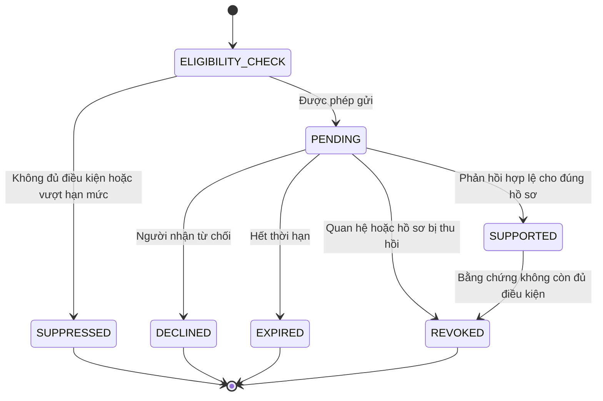

# Contact abuse prevention — Ngăn lạm dụng người liên hệ trong khôi phục tài khoản

Một dịch vụ có thể dùng người liên hệ đã đăng ký để hỗ trợ khôi phục khi chủ tài khoản mất mật khẩu, MFA, passkey hoặc thiết bị xác thực. Cơ chế này tạo thêm một bề mặt cần bảo vệ: người hỗ trợ có thể bị spam, lừa chuyển mã, gây áp lực phải đồng ý hoặc bị lộ quan hệ với chủ tài khoản.

**Contact abuse prevention** là việc giới hạn khả năng tác động lên người liên hệ và bảo vệ ý nghĩa của phản hồi của họ. Mục tiêu không chỉ là giảm số email hay SMS. Hệ thống phải ngăn một yêu cầu recovery trở thành công cụ quấy rối, dò mạng lưới quan hệ hoặc cấp quyền ngoài ý muốn.

## 1. Xác định vai trò và các kiểu lạm dụng

Trong một hồ sơ recovery có ít nhất ba vai trò:

- **Chủ tài khoản:** người có quyền đối với tài khoản cần khôi phục.
- **Người yêu cầu:** người đang thực hiện luồng recovery; ở đầu luồng chưa thể mặc nhiên coi họ là chủ tài khoản.
- **Người liên hệ hỗ trợ:** người đã tham gia cơ chế recovery theo chính sách của dịch vụ.

Một người yêu cầu biết tên hoặc email của chủ tài khoản chưa được phép gửi thông báo tùy ý đến mọi người trong danh bạ của họ. Người liên hệ cũng không mặc nhiên trở thành người được quyền đổi mật khẩu hoặc quản lý tài khoản.

| Kiểu lạm dụng | Tình huống | Hậu quả cần ngăn |
| --- | --- | --- |
| Gửi dồn thông báo | Tạo nhiều hồ sơ và bấm gửi lại liên tục | Quấy rối, tốn chi phí, làm người nhận mất cảnh giác |
| Gây mệt mỏi để ép đồng ý | Thông báo liên tục kèm lời thúc giục | Người liên hệ xác nhận chỉ để ngừng bị làm phiền |
| Dò người liên hệ | Thử định danh tài khoản và đọc phản hồi API | Lộ email, số điện thoại hoặc quan hệ xã hội |
| Lừa chuyển mã | Giả làm chủ tài khoản hoặc nhân viên hỗ trợ | Mã được dùng cho một hồ sơ do kẻ tấn công kiểm soát |
| Thêm người hỗ trợ giả | Chèn địa chỉ mới trong lúc recovery | Chuyển quy trình sang người do kẻ tấn công điều khiển |
| Tái sử dụng xác nhận | Dùng phản hồi của hồ sơ cũ cho yêu cầu mới | Cấp quyền cho thao tác người liên hệ chưa đồng ý |
| Thông đồng | Một người kiểm soát nhiều địa chỉ hoặc nhiều người cùng gian lận | Tạo đủ số xác nhận mà không có bằng chứng độc lập |

NIST SP 800-63B-4 mô tả recovery contact là các địa chỉ của người quen đáng tin cậy được thiết lập để nhận mã recovery, đồng thời yêu cầu có cách xem và quản lý contact. Một người được tìm thấy qua đồ thị bạn bè không tự trở thành recovery contact. [NIST SP 800-63B-4, Recovery Contacts](https://pages.nist.gov/800-63-4/sp800-63b.html#recovery-contacts)

Bài này đề xuất các biện pháp thiết kế cho cả luồng gửi mã qua contact và luồng contact xác nhận hỗ trợ trên dịch vụ. Hai luồng có giao thức khác nhau; không được coi một lần bấm xác nhận bất kỳ là tương đương với phương pháp mã recovery được tiêu chuẩn mô tả.

## 2. Bảo vệ việc thiết lập và thay đổi người liên hệ

### 2.1. Chọn contact trước khi xảy ra sự cố

Quan hệ hỗ trợ cần được thiết lập khi chủ tài khoản có thể hoàn thành yêu cầu xác thực phù hợp. Người yêu cầu chưa chứng minh được quyền đối với tài khoản không được tự nhập một email mới rồi dùng ngay email đó làm bằng chứng recovery.

Quy trình minh họa gồm:

1. Chủ tài khoản xác thực phù hợp trước khi đề nghị thêm contact.
2. Dịch vụ gửi một lời mời có giới hạn, không gửi dồn lời mời khi chưa có phản hồi.
3. Xác minh điểm nhận liên hệ theo giao thức được thiết kế và ghi nhận sự đồng ý tham gia.
4. Chỉ đánh dấu đủ điều kiện sau khi các yêu cầu thiết lập đã hoàn tất.
5. Cho phép chủ tài khoản quản lý danh sách và người liên hệ rút khỏi vai trò hỗ trợ.

Sự đồng ý tham gia là một biện pháp bảo vệ người nhận trong thiết kế này. Nó không có nghĩa người đó tự động đồng ý với mọi lần recovery về sau.

### 2.2. Thay đổi contact là thao tác nhạy cảm

Kẻ tấn công có thể chiếm một session rồi thay toàn bộ danh sách người hỗ trợ. Vì vậy, việc thêm, thay hoặc xóa contact cần yêu cầu xác thực phù hợp, thông báo qua kênh đã thiết lập và đánh giá rủi ro theo chính sách.

Một contact vừa được thêm không nên lập tức được dùng để hợp thức hóa hồ sơ recovery đã mở trước đó. Có thể áp dụng khoảng chờ hoặc các điều kiện đủ tư cách khác, nhưng thời gian chờ không thay thế bằng chứng thiết lập hợp lệ.

Mỗi quan hệ nên có phiên bản hoặc định danh ổn định để phân biệt trước và sau thay đổi. Khi contact bị gỡ hoặc rút lui, không tiếp tục sử dụng snapshot cũ để gửi thông báo hay chấp nhận xác nhận.

## 3. Giới hạn thông báo theo nhiều chiều

Chỉ giới hạn theo IP không ngăn được người gửi phân tán yêu cầu. Chỉ giới hạn theo một hồ sơ cũng không ngăn được việc tạo hồ sơ mới để làm lại từ đầu.

| Chiều giới hạn | Mục đích | Lỗ hổng nếu dùng riêng lẻ |
| --- | --- | --- |
| Recovery session hoặc hồ sơ | Giảm bấm gửi lại trong cùng luồng | Tạo hồ sơ mới để né hạn mức |
| Tài khoản cần khôi phục | Giảm tác động tập trung vào một chủ tài khoản | Một contact có thể bị nhắm qua nhiều tài khoản |
| Người nhận | Bảo vệ một địa chỉ trước spam từ nhiều nguồn | Có thể bị kẻ xấu cố ý làm cạn hạn mức |
| Cặp tài khoản–contact | Gộp các yêu cầu trùng quan hệ | Không thấy tổng lượng thông báo đến người đó |
| Nguồn yêu cầu và thiết bị | Giảm tự động hóa từ cùng nguồn | Không đủ trước nhiều nguồn phân tán |
| Toàn dịch vụ và nhà cung cấp | Kiểm soát chi phí, tải và sự cố gửi hàng loạt | Không thay thế bảo vệ từng người nhận |

OWASP khuyến nghị chống yêu cầu quên mật khẩu tự động quá mức và tránh phản hồi làm lộ tài khoản tồn tại. Có thể áp dụng nguyên tắc đó cho lời nhờ hỗ trợ recovery; hạn mức cụ thể phải được thiết kế cho mức rủi ro và kênh của dịch vụ. [OWASP Forgot Password Cheat Sheet](https://cheatsheetseries.owasp.org/cheatsheets/Forgot_Password_Cheat_Sheet.html#forgot-password-request)

### 3.1. Gộp yêu cầu thay vì tạo thông báo mới

Trong thiết kế minh họa, một cặp tài khoản–contact chỉ có một lời nhờ hỗ trợ đang chờ cho cùng mục đích recovery. Yêu cầu trùng trả về trạng thái xử lý phù hợp nhưng không tạo thêm thông báo.

Nút “gửi lại” không được tự gia hạn hồ sơ vô hạn, xóa bộ đếm hoặc tạo một mã hồ sơ mới để vượt hạn mức. Đổi từ email sang SMS cũng không nên làm mất ngân sách chung của người nhận nếu cả hai kênh thuộc cùng quan hệ đã thiết lập.

Việc tự động gửi nhắc cần có số lần tối đa và điều kiện dừng. Không gửi nhắc sau khi người liên hệ đã từ chối, rút khỏi vai trò, chặn lời nhờ hoặc khi hồ sơ đã hết hạn.

### 3.2. Tránh biến hạn mức thành công cụ từ chối dịch vụ

Kẻ xấu có thể cố dùng hết hạn mức người nhận để người dùng thật không nhờ hỗ trợ được. Hệ thống cần kết hợp hạn mức theo nguồn, gộp yêu cầu, hàng đợi có kiểm soát và đường recovery khác đủ điều kiện.

Không khóa tài khoản chủ sở hữu chỉ vì có nhiều yêu cầu chưa xác minh từ bên ngoài. Hạn chế một nguồn spam và thay đổi quyền truy cập của nạn nhân là hai hành động khác nhau.

CAPTCHA hoặc trì hoãn có thể tăng chi phí tự động hóa, nhưng không chứng minh quyền sở hữu tài khoản và không thay thế các ràng buộc gửi thông báo.

## 4. Nội dung thông báo phải chống lừa đảo và gây áp lực

Thông báo nên được tạo từ mẫu do dịch vụ kiểm soát. Không cho người yêu cầu chèn đoạn văn tùy ý, số điện thoại hỗ trợ, URL hoặc lời thúc giục vào email mang thương hiệu của dịch vụ.

Một thông báo ban đầu chỉ cần cho biết có lời nhờ hỗ trợ, cách mở ứng dụng hoặc tên miền chính thức và quyền từ chối. Chi tiết cần nhận diện hồ sơ chỉ hiển thị trong giao diện phù hợp với quyền của người nhận.

Ví dụ nội dung minh họa:

> Có một lời nhờ hỗ trợ khôi phục trong dịch vụ. Hãy tự mở ứng dụng hoặc trang chính thức để xem. Nếu không nhận ra yêu cầu, bạn có thể từ chối hoặc báo lạm dụng. Bạn không cần xác nhận chỉ để ngừng nhận lời nhắc.

Đây là lời nhắn mẫu, không phải thông báo đã gửi cho người liên hệ thực tế.

### 4.1. Hiển thị rõ người nhận đang hỗ trợ điều gì

Giao diện xác nhận cần cho biết tài khoản hoặc quan hệ đã thiết lập mà contact đang hỗ trợ, mã tham chiếu hồ sơ và phạm vi của phản hồi. Không dùng một nút “Đồng ý” chung chung nếu phản hồi có thể góp phần cấp lại quyền truy cập.

Nguyên tắc cho phép người phê duyệt nhận biết dữ liệu quan trọng của thao tác xuất hiện trong hướng dẫn transaction authorization của OWASP. Áp dụng vào recovery là một lựa chọn thiết kế: contact cần hiểu họ đang hỗ trợ hồ sơ nào và phản hồi có tác động gì. [OWASP Transaction Authorization Cheat Sheet](https://cheatsheetseries.owasp.org/cheatsheets/Transaction_Authorization_Cheat_Sheet.html)

Thông tin như tên thiết bị hoặc vị trí suy ra chỉ có tính hỗ trợ, có thể không chính xác và không tự chứng minh người yêu cầu là chủ tài khoản. Không để phần mô tả do người yêu cầu tự khai bị hiển thị như một sự thật đã xác minh.

### 4.2. Phân biệt các loại mã

Một số giao thức recovery contact có chủ đích cho người hỗ trợ nhận rồi chuyển một **mã recovery chuyên dụng** cho chủ tài khoản. Khi hỗ trợ mô hình đó, cần hướng dẫn rõ mã thuộc dịch vụ nào, mục đích nào và cách nhận diện yêu cầu hợp lệ qua kênh độc lập đã biết.

Không được đánh đồng mã này với OTP đăng nhập của chính contact, mã đổi mật khẩu của contact hoặc mã xác minh một địa chỉ mới. Những mã đó không được chuyển cho người yêu cầu hay nhân viên hỗ trợ.

Mã chuyên dụng cũng có thể bị lừa lấy. Giao thức vẫn phải giới hạn hiệu lực, số lần thử, liên kết tài khoản và đáp ứng chính sách recovery tổng thể. Một contact sẵn lòng giúp không làm mọi mã hoặc mọi yêu cầu trở nên an toàn.

## 5. Ràng buộc phản hồi với đúng hồ sơ và quan hệ

Phản hồi hỗ trợ không được là một cờ `contactApproved=true` do client gửi lên. Server phải biết phản hồi thuộc quan hệ nào, hồ sơ nào và phạm vi thao tác nào.

Các ràng buộc thường cần có:

- Đúng tài khoản cần khôi phục và đúng tenant nếu hệ thống có nhiều tenant.
- Đúng `attemptId`, `contactRelationshipId` và phiên bản quan hệ.
- Đúng mục đích, chẳng hạn hỗ trợ recovery, không phải chấp nhận lời mời tham gia.
- Thời hạn hiệu lực và trạng thái hồ sơ còn mở.
- Bằng chứng người phản hồi kiểm soát kênh hoặc đã xác thực theo giao thức của phương pháp.
- Cơ chế chống sử dụng lại, chuyển phản hồi sang hồ sơ khác và ghi nhận hai lần.

Token hoặc mã được sinh bằng cơ chế ngẫu nhiên mật mã, có phạm vi hẹp và được lưu bộ kiểm tra an toàn. Token trong một đường dẫn không nên tự mang quyền thay email, gỡ MFA hoặc mở session đăng nhập cho người cầm link.

### 5.1. Không thay đổi trạng thái bằng một lần mở link

Trình đọc thư, bộ quét link và dịch vụ xem trước có thể tự truy cập URL. Một request `GET` mở trang không được đồng nghĩa với đồng ý hỗ trợ, từ chối hay chặn liên hệ.

Trang xem cần có hành động rõ ràng tiếp theo. Với luồng dùng session đã xác thực, bảo vệ hành động thay đổi trạng thái khỏi CSRF và kiểm tra quyền trên server. Với luồng dựa vào capability token, token phải gắn đúng hành động, được kiểm tra và tiêu thụ theo giao thức đã thiết kế.

Không ghi token hoặc mã vào log truy cập, công cụ phân tích hay nội dung lỗi. Không dùng một token dài hạn cho mọi lời nhờ và mọi thao tác của contact.

### 5.2. Vòng đời lời nhờ hỗ trợ



`SUPPORTED` chỉ là trạng thái bằng chứng của contact trong ví dụ. Nó không đồng nghĩa tài khoản đã được khôi phục. Bộ quyết định recovery còn phải áp dụng yêu cầu của tài khoản và các bằng chứng khác nếu chính sách đòi hỏi.

Việc nhà cung cấp báo email đã gửi, SMS đã phát hoặc link đã được mở không phải phản hồi hỗ trợ hợp lệ.

## 6. Chống gửi trùng và xử lý thay đổi trong lúc chờ

Một lỗi phổ biến là kiểm tra hạn mức trước, rồi nhiều request đồng thời cùng vượt qua và gửi nhiều thông báo. Việc giữ ngân sách và tạo công việc gửi cần có kiểm soát đồng thời phù hợp.

Pseudocode sau mô tả nguyên tắc, không phải mã triển khai hoàn chỉnh:

```text
requestContactHelp(attemptId, contactReference):
    tải hồ sơ và quan hệ từ dữ liệu server
    xác định người yêu cầu được phép đi đến bước nhờ contact

    trong một giao dịch có kiểm soát đồng thời:
        kiểm tra hồ sơ còn mở và quan hệ còn đủ điều kiện
        tìm lời nhờ đang chờ theo phạm vi gộp đã định
        nếu đã có: trả về kết quả không tạo thêm thông báo
        kiểm tra và giữ ngân sách gửi theo các chiều áp dụng
        tạo lời nhờ với phiên bản quan hệ và thời hạn
        tạo một mục outbox có khóa chống trùng

    worker gửi:
        đọc lại trạng thái hồ sơ, lời nhờ và quan hệ
        nếu đã hết hạn, bị chặn hoặc bị thu hồi: không gửi
        gửi qua nhà cung cấp với khóa idempotency nếu được hỗ trợ
        ghi kết quả gửi, không tự ghi nhận contact đã đồng ý
```

Một khóa idempotency do client tự đổi tùy ý không đủ để chống spam. Server cần phạm vi gộp gắn với quan hệ, tài khoản và mục đích; tạo thêm UUID không được tạo thêm ngân sách gửi.

Outbox giúp kiểm soát công việc nội bộ nhưng không tự bảo đảm người nhận chỉ thấy đúng một thông báo. Nếu nhà cung cấp đã nhận yêu cầu mà response bị mất, retry có thể tạo bản gửi trùng. Cần dùng khả năng chống trùng của nhà cung cấp, giới hạn retry và xử lý trạng thái gửi chưa rõ thay vì lặp vô hạn.

Nếu contact rút lui sau khi job được tạo, worker phải tôn trọng trạng thái mới trước lần gửi. Nếu quan hệ bị thu hồi sau khi đã phản hồi, bộ cấp quyền cần kiểm tra hiệu lực của bằng chứng tại thời điểm sử dụng, theo chính sách của dịch vụ.

## 7. Ngăn thông đồng và đếm trùng tín hiệu xã hội

Nhiều địa chỉ không nhất thiết là nhiều người độc lập. Một người có thể kiểm soát nhiều email; nhiều contact có thể dùng chung hộp thư, thiết bị hoặc một tài khoản đã bị chiếm.

Không nên coi các yếu tố sau là bằng chứng độc lập chỉ vì số đếm tăng:

- Hai địa chỉ có cùng một người kiểm soát.
- Hai phản hồi cùng xuất phát từ một quan hệ được nhân bản.
- Một contact phản hồi nhiều lần cho cùng hồ sơ.
- Nhiều người lặp lại cùng thông tin công khai về chủ tài khoản.
- Số lượng bạn bè, lượt theo dõi hoặc tương tác trên mạng xã hội.

Server có thể loại phản hồi lặp theo định danh quan hệ và điểm nhận đã được xác minh. Tuy nhiên, kiểm tra kỹ thuật như hai email khác nhau không chứng minh được hai con người độc lập. Cần ghi nhận giới hạn đó trong đánh giá rủi ro.

Nếu dùng một ngưỡng nhiều contact hỗ trợ, chính sách phải nêu cách xác định contact đủ điều kiện, cách xử lý bằng chứng bị thu hồi và giới hạn của ngưỡng. Không tự quy đổi “hai người bạn đồng ý” thành MFA hoặc thành quyền bỏ qua các yêu cầu khác.

Nhân viên hỗ trợ cũng không được thêm contact do người yêu cầu giới thiệu trong cuộc gọi để đạt đủ số lượng. Nhánh ngoại lệ cần căn cứ riêng và lưu vết, không sửa số đếm để hồ sơ qua cổng quyết định.

## 8. Quyền từ chối, chặn và báo lạm dụng

Người liên hệ phải có cách từ chối một hồ sơ mà không cần đồng ý trước. Nếu đã rút lui, họ không nên tiếp tục nhận chuỗi nhắc chỉ vì chủ tài khoản chưa cập nhật danh sách.

Cần phân biệt các lựa chọn:

| Lựa chọn | Tác động trong thiết kế minh họa |
| --- | --- |
| Từ chối hồ sơ hiện tại | Dừng nhắc cho hồ sơ đó, không tự kết luận chủ tài khoản gian lận |
| Rút khỏi một quan hệ hỗ trợ | Quan hệ không còn đủ điều kiện cho các yêu cầu tiếp theo |
| Chặn lời mời hoặc lời nhờ từ dịch vụ | Dừng loại thông báo tùy chọn tương ứng đến điểm nhận đã được xác nhận |
| Báo lạm dụng | Tạo tín hiệu để xử lý nguồn và hành vi lạm dụng theo chính sách |

Quyền chặn phải gắn với người nhận hoặc capability có phạm vi đúng. Một người chỉ biết email của contact không được gọi API để rút người đó khỏi mọi quan hệ hỗ trợ.

Có thể cung cấp cách rút lui có phạm vi hẹp qua link an toàn để người nhận không bị buộc tạo tài khoản mới chỉ để ngừng bị làm phiền. Link đó không được đồng thời cấp quyền duyệt recovery hay ảnh hưởng các tài khoản khác.

Không gộp việc chặn lời nhờ hỗ trợ với việc tắt mọi thông báo bảo mật cho tài khoản riêng của contact. Hai loại thông báo có mục đích và chính sách khác nhau.

Một báo cáo lạm dụng chưa được kiểm chứng không nên tự động khóa tài khoản nạn nhân hoặc gỡ các phương tiện của họ. Hệ thống cần xử lý báo cáo giả, giới hạn nguồn báo cáo và cho người dùng thật đường xử lý phù hợp.

## 9. Bảo vệ dữ liệu liên hệ và đồ thị quan hệ

Trước khi người yêu cầu có đủ quyền, không trả về danh sách đầy đủ tên, email, số điện thoại hoặc trạng thái online của contact. Ngay cả việc che một phần địa chỉ cũng có thể làm lộ quan hệ; cần đánh giá có thật sự cần hiển thị ở bước đó không.

Không trả kết quả công khai kiểu “người bạn A đã từ chối nhưng B chưa đọc”. Một trạng thái xử lý tổng quát thường đủ cho giai đoạn chưa xác minh và giảm khả năng gây áp lực lên từng người.

Trong kho dữ liệu, dùng định danh nội bộ cho quan hệ và kiểm soát quyền đọc địa chỉ thực. Hash thông thường của email hoặc số điện thoại không tạo ra sự ẩn danh chắc chắn, vì kẻ tấn công có thể dò miền giá trị. Nếu cần khóa so khớp phục vụ hạn mức, có thể thiết kế HMAC với khóa được bảo vệ; khóa này vẫn là dữ liệu nhạy cảm có khả năng liên kết.

Việc chuẩn hóa điểm nhận cần theo loại kênh và quy tắc được hỗ trợ. Không mặc định mọi nhà cung cấp email đều coi dấu chấm hoặc hậu tố trong địa chỉ là tương đương, vì gộp sai có thể làm ảnh hưởng người khác.

Chỉ thu thập quan hệ cần cho recovery. Không cần tải toàn bộ danh bạ hoặc quét bạn bè công khai chỉ để chọn một người hỗ trợ. Quy định thời hạn lưu lời mời, phản hồi và báo cáo lạm dụng; không giữ nội dung trao đổi cá nhân vô thời hạn.

## 10. Các tình huống thiết kế điển hình

### 10.1. Nhiều hồ sơ nhắm vào cùng một contact

Kẻ tấn công dùng nhiều nguồn truy cập và tạo nhiều hồ sơ cho một tài khoản. Mỗi hồ sơ chỉ gửi một lần nên hạn mức theo hồ sơ không phát hiện được tổng tác động.

Giới hạn theo tài khoản, cặp quan hệ và người nhận giúp thấy mẫu này. Các lời nhờ trùng được gộp; contact có thể chặn và báo lạm dụng. Không đáp trả bằng cách tự khóa tài khoản chủ sở hữu.

### 10.2. Người nhận bấm đồng ý để dừng thông báo

Một contact liên tục nhận lời nhắc và nghĩ rằng xác nhận sẽ làm chúng biến mất. Đây là thất bại về chống gây áp lực, kể cả khi token và chữ ký đều hợp lệ.

Giao diện cần có lựa chọn từ chối và dừng nhắc rõ ràng. Hệ thống không được thiết kế sao cho đồng ý là cách dễ nhất hoặc duy nhất để ngừng bị quấy rối.

### 10.3. Chuyển mã sang hồ sơ khác

Contact được nhờ hỗ trợ một hồ sơ của người quen nhưng mã hoặc phản hồi bị chuyển sang hồ sơ khác. Nếu server chỉ kiểm tra contact đã từng xác nhận mà không gắn với `attemptId`, kẻ tấn công có thể tái sử dụng bằng chứng.

Ràng buộc mục đích, tài khoản, hồ sơ, quan hệ và thời hạn ngăn việc dùng lại ngoài phạm vi. Mỗi lần sử dụng hợp lệ phải được xử lý nhất quán để hai request đồng thời không tiêu thụ một bằng chứng hai lần.

### 10.4. Contact không còn muốn tham gia

Một người rút khỏi quan hệ sau khi lời nhờ đã vào hàng đợi. Worker bỏ qua trạng thái mới và tiếp tục gửi, còn bộ quyết định vẫn tính xác nhận cũ.

Thiết kế cần kiểm tra hiệu lực ở cả lúc gửi lẫn lúc dùng bằng chứng. Chủ tài khoản được hướng dẫn quản lý phương án recovery, nhưng không được dùng sự bất tiện đó để ép contact tiếp tục tham gia.

### 10.5. Hai địa chỉ do cùng một người kiểm soát

Một hồ sơ đạt đủ ngưỡng địa chỉ phản hồi nhưng các địa chỉ thực tế cùng do kẻ tấn công điều khiển. Việc đạt ngưỡng kỹ thuật không chứng minh sự độc lập của các chủ thể.

Hệ thống cần giữ các giới hạn của social signal trong chính sách và kết hợp phương pháp recovery đủ điều kiện. Không tự thêm quyền gỡ MFA chỉ vì đã nhận đủ số phản hồi.

## 11. Tín hiệu vận hành và ranh giới cấp quyền

Các tín hiệu hữu ích gồm số lời nhờ thực sự được gửi, tỷ lệ gộp trùng, số lần bị chặn do ngân sách, số người nhận báo lạm dụng, callback muộn và bằng chứng bị từ chối vì sai phạm vi. Tách số nhà cung cấp báo đã giao khỏi số phản hồi hợp lệ.

Quan sát theo nhiều chiều để phát hiện cả một nguồn nhắm vào nhiều contact và nhiều nguồn nhắm vào một contact. Tránh đưa địa chỉ thực, token hoặc toàn bộ quan hệ xã hội vào nhãn metric và log có phạm vi đọc rộng.

Một luồng bảo vệ contact tốt cần đồng thời giữ các ràng buộc sau:

1. Chỉ người liên hệ đủ điều kiện mới nhận lời nhờ có giới hạn.
2. Một yêu cầu lặp không tự tạo thêm thông báo hoặc làm mới ngân sách.
3. Người nhận có thể từ chối, rút lui và báo lạm dụng mà không phê duyệt recovery.
4. Phản hồi được xác minh và gắn với đúng tài khoản, hồ sơ, quan hệ và mục đích.
5. Gửi thành công, mở link hoặc có nhiều tín hiệu xã hội không tự trở thành quyền khôi phục.
6. Bộ quyết định cuối cùng vẫn áp dụng chính sách recovery, phạm vi thao tác và kiểm soát session cần thiết.

Người liên hệ là một bên cần được bảo vệ trong giao thức. Sự sẵn lòng hỗ trợ của họ chỉ có giá trị khi phản hồi được đưa ra có chủ ý, không bị ép bởi spam và không bị sử dụng ngoài phạm vi đã hiểu.
