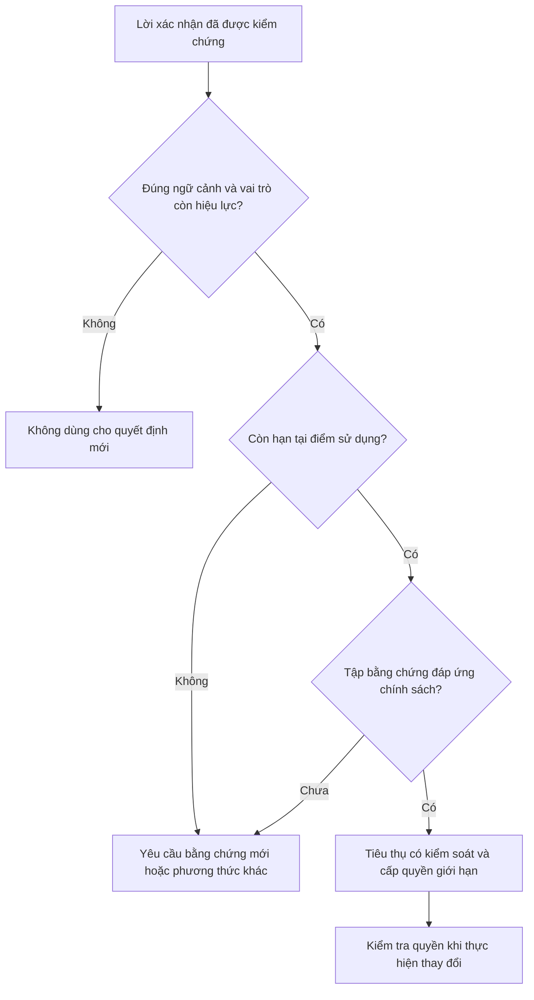

# Social proof expiration

## 1. Một lời xác nhận đúng không có giá trị vô thời hạn

Trong khôi phục tài khoản, **social proof** có thể là lời xác nhận của người liên hệ khôi phục hoặc một bên có vai trò phù hợp đối với người yêu cầu. **Social proof expiration** là việc giới hạn thời gian mà lời xác nhận đó được dùng làm căn cứ cho một hành động cụ thể.

Ví dụ, một contact xác nhận lúc 09:10 rằng họ đang hỗ trợ chủ tài khoản mất điện thoại chứa MFA. Đến chiều, yêu cầu đã bị hủy, contact phát hiện tài khoản của mình bị chiếm hoặc người yêu cầu chuyển sang xin thay email. Không thể dùng lời xác nhận buổi sáng như một chấp thuận còn nguyên giá trị cho mọi tình huống sau đó.

Thời hạn giúp hạn chế khoảng thời gian bằng chứng có thể bị đánh cắp, phát lại hoặc sử dụng sau khi ngữ cảnh thay đổi. Tuy nhiên, chưa hết hạn không đồng nghĩa vẫn đáng tin cậy: quyền của contact có thể bị thu hồi sớm hơn.

OWASP khuyến nghị thông tin ủy quyền chỉ có hiệu lực trong một khoảng thời gian giới hạn và phải được kiểm tra tại điểm thực hiện hành động. Nguyên tắc này hữu ích khi thiết kế bước chuyển từ lời xác nhận sang quyền recovery. [OWASP — Transaction Authorization](https://cheatsheetseries.owasp.org/cheatsheets/Transaction_Authorization_Cheat_Sheet.html#29-authorization-credentials-should-only-be-valid-during-a-limited-time-period)

Bài học này tập trung vào thời hạn, độ mới và việc sử dụng lại bằng chứng xã hội khi người dùng mất mật khẩu, MFA, passkey hoặc thiết bị xác thực. Những mốc thời gian minh họa không phải cấu hình mặc định cho hệ thống thực.

## 2. Tách các vòng đời liên quan

Trong một luồng recovery có thể có nhiều đối tượng cùng mang trường `expiresAt` nhưng không cùng ý nghĩa.

| Đối tượng | Câu hỏi mà thời hạn trả lời | Điều không được suy ra |
| --- | --- | --- |
| Quan hệ recovery contact | Vai trò hỗ trợ còn tồn tại và có hiệu lực không? | Quan hệ lâu dài không phải chấp thuận mọi yêu cầu |
| Lời mời xác nhận một yêu cầu | Contact còn được phản hồi thử thách này không? | Lời mời còn hạn không chứng minh đã có lời xác nhận |
| Lời xác nhận | Nhận định đã được kiểm chứng còn được phép dùng đến khi nào? | Đã xác nhận một lần không có nghĩa được dùng mãi |
| Kế hoạch social proof | Tập contact và điều kiện của lần thu thập này còn hiệu lực không? | Không trộn phản hồi từ mọi kế hoạch để đủ số |
| Hồ sơ recovery | Yêu cầu tổng thể còn mở để xử lý không? | Hồ sơ còn mở không giữ mọi bằng chứng ở trạng thái hợp lệ |
| Quyền tiếp tục recovery | Người yêu cầu còn được thực hiện hành động được cấp không? | Quyền recovery không tự là session đăng nhập đầy đủ |
| Bản ghi lịch sử | Dữ liệu được lưu trong bao lâu để giải thích quyết định? | Còn lưu không có nghĩa còn được dùng để cấp quyền |

Một contact có thể hỗ trợ tài khoản trong nhiều năm, nhưng mỗi yêu cầu vẫn cần bằng chứng có phạm vi và thời hạn phù hợp. Ngược lại, hết thời hạn một lời xác nhận không tự xóa quan hệ contact đã thiết lập.

NIST SP 800-63B-4 quy định thời hạn cho issued recovery codes và có điều chỉnh riêng cho mã gửi qua recovery contacts. Những quy định đó áp dụng cho cơ chế mã trong tài liệu; không phải một TTL chung cho mọi mô hình lời xác nhận xã hội. [NIST — Recovery Contacts](https://pages.nist.gov/800-63-4/sp800-63b/events/#recovery-contacts)

Khi thiết kế một phương thức khác, cần mô tả rõ đối tượng nào hết hạn, sự kiện nào bắt đầu tính hạn và thao tác nào phải hoàn tất trước hạn.

## 3. Xác định độ mới và nguồn thời gian

### 3.1. Một bằng chứng cần nhiều mốc thời gian có ý nghĩa

Một mô hình dữ liệu minh họa:

```text
caseCreatedAt          thời điểm mở hồ sơ recovery
challengeIssuedAt      thời điểm máy chủ phát thử thách cho contact
challengeExpiresAt     hạn cuối chấp nhận phản hồi thử thách
contactAuthenticatedAt thời điểm xác thực contact được hệ thống kiểm chứng
endorsedAt             thời điểm lời xác nhận được ghi nhận đáng tin cậy
proofExpiresAt         hạn sử dụng lời xác nhận
receivedAt             thời điểm hệ thống nhận phản hồi
consumedAt             thời điểm bằng chứng được dùng để cấp quyền
```

Không nhất thiết mọi hệ thống phải lưu đúng các tên trường này. Điều cần giữ là sự khác biệt giữa phát thử thách, xác thực người xác nhận, nhận phản hồi và sử dụng kết quả.

Đăng nhập contact từ nhiều giờ trước và xác nhận một yêu cầu lúc này là hai sự kiện khác nhau. Chính sách phải quyết định việc xác thực đó có đủ mới cho hành động xác nhận hay cần xác thực lại.

### 3.2. Không tin giờ do trình duyệt tự khai

Người gửi có thể thay đổi đồng hồ thiết bị hoặc gửi một `endorsedAt` tùy ý. Các giá trị này không được phép tự quyết định hiệu lực bằng chứng.

Máy chủ cần dùng nguồn thời gian có thẩm quyền cho quyết định. Nếu nhận chứng thực từ một dịch vụ khác, chỉ sử dụng thời gian do bên đó cung cấp sau khi đã kiểm chứng nguồn, tính toàn vẹn và quy tắc độ lệch đồng hồ.

Các máy tham gia cần có quy ước nhất quán về múi giờ và độ chính xác. Có thể lưu một thời điểm tuyệt đối và đổi sang múi giờ địa phương khi hiển thị; không so sánh hai chuỗi giờ địa phương thiếu thông tin múi giờ.

### 3.3. Quy ước rõ tại đúng thời điểm hết hạn

Một quy tắc dễ hiểu là khoảng hiệu lực nửa mở:

```text
validFrom <= decisionTime < expiresAt
```

Theo quy tắc này, tại đúng `expiresAt`, bằng chứng đã hết hiệu lực. Không dùng `<= expiresAt` ở một dịch vụ và `< expiresAt` ở dịch vụ khác.

Nếu cần dung sai đồng hồ giữa các bên phát hành, dung sai phải có giới hạn và ý nghĩa rõ ràng. Không biến nó thành thời gian gia hạn tùy ý hoặc cộng lại nhiều lần qua các tầng xử lý.

Nếu không thể xác định thời gian đủ tin cậy cho quyết định nhạy cảm, hệ thống cần giữ yêu cầu hoặc chuyển quy trình phù hợp. Không coi việc chưa kiểm tra được thời gian là bằng chứng vẫn còn hạn.

## 4. Hiệu lực là giao của thời gian và ngữ cảnh

Một lời xác nhận được dùng cho recovery cần đồng thời đáp ứng nhiều điều kiện:

```text
Đúng nguồn và đã được kiểm chứng
+ đúng contact và vai trò còn hiệu lực
+ đúng tài khoản
+ đúng hồ sơ và kế hoạch thu thập
+ đúng hành động
+ còn trong khoảng thời gian được phép
+ chưa bị thu hồi, thay thế hoặc tiêu thụ
+ các điều kiện rủi ro hiện hành vẫn đạt
→ có thể được xem xét cho quyết định
```

Chữ ký hợp lệ, nếu có, chỉ giải quyết một phần nguồn gốc và tính toàn vẹn. Nó không tự chứng minh vai trò chưa bị thu hồi hoặc lời xác nhận chưa được dùng.

Với một thiết kế yêu cầu mọi bằng chứng liên quan còn hạn tại điểm cấp quyền, hạn thời gian hiệu dụng có thể được tính:

```text
effectiveExpiresAt = min(
    proofExpiresAt,
    challengeContextDeadline,
    selectionPlanExpiresAt,
    recoveryCaseExpiresAt,
    thời hạn vai trò nếu vai trò có hạn định trước
)
```

Ở đây, `challengeContextDeadline` chỉ tham gia nếu chính sách yêu cầu ngữ cảnh của thử thách tiếp tục có hiệu lực tới điểm sử dụng. Có hệ thống chỉ dùng `challengeExpiresAt` làm hạn nhận phản hồi; hệ thống đó phải định nghĩa riêng thời hạn sử dụng lời xác nhận sau khi đã nhận hợp lệ.

Điều quan trọng là không lấy TTL của đối tượng này để âm thầm suy ra TTL của đối tượng khác.

Thu hồi vai trò hoặc phát hiện nguy cơ chiếm tài khoản là điều kiện động, không chỉ là một ngày hết hạn có sẵn để đưa vào hàm `min`. Hệ thống phải kiểm tra các trạng thái đó tại điểm quyết định.

## 5. Nhiều lời xác nhận phải cùng hợp lệ tại điểm sử dụng

Giả sử một chính sách minh họa yêu cầu hai xác nhận từ các contact đủ điều kiện và đáp ứng ràng buộc độc lập. Các mốc sau đều ở cùng một ngày, múi giờ UTC+07:00:

| Đối tượng hoặc sự kiện | Bắt đầu | Kết thúc hoặc thời điểm |
| --- | --- | --- |
| Hồ sơ recovery | 09:00 | Hết hạn 10:00 |
| Kế hoạch thu thập | 09:05 | Hết hạn 09:45 |
| A xác nhận | Ghi nhận lúc 09:10 | Bằng chứng hết hạn 09:30 |
| B xác nhận | Ghi nhận lúc 09:20 | Bằng chứng hết hạn 09:40 |

Nếu các điều kiện còn lại đều đạt, khoảng mà cả hai lời xác nhận có thể cùng được dùng là:

```text
09:20 <= decisionTime < 09:30
```

Các hệ quả:

- Lúc 09:15, chưa có xác nhận của B.
- Lúc 09:25, A và B có thể cùng còn hiệu lực.
- Lúc 09:30, A đã hết hạn theo quy tắc nửa mở.
- Lúc 09:35, việc hồ sơ và lời xác nhận B còn hạn không làm A hợp lệ trở lại.
- Lúc 09:46, kế hoạch đã hết hạn dù hồ sơ tổng thể chưa hết hạn.

Không chỉ kiểm tra rằng “đã từng thu được hai xác nhận”. Cần chọn một tập bằng chứng đang đáp ứng điều kiện tại thời điểm có thẩm quyền sử dụng nó.

Nếu A phải xác nhận lại, kết quả mới là một bằng chứng mới với nguồn gốc và thời hạn riêng. Không thay `proofExpiresAt` của bản ghi cũ rồi coi đó là sự đồng ý mới.

Các ngưỡng và thời lượng ở ví dụ chỉ phục vụ giải thích. Đủ hai lời xác nhận cũng chỉ đạt một phần điều kiện của phương thức recovery được thiết kế, không tự tạo quyền thay MFA hay đăng nhập.

## 6. Phân biệt hết hạn, thu hồi, thay thế và đã dùng

| Tình trạng | Nguyên nhân | Cách xử lý về quyền sử dụng |
| --- | --- | --- |
| `EXPIRED` | Đã đến hạn thời gian | Không tiếp tục dùng để cấp quyền mới |
| `REVOKED` | Vai trò hoặc lời xác nhận bị thu hồi | Ngừng dùng theo hiệu lực thu hồi, dù chưa đến hạn |
| `SUPERSEDED` | Bản ghi hoặc ngữ cảnh đã được thay thế | Không âm thầm dùng cùng bản mới |
| `CONSUMED` | Đã được dùng cho quyết định cấp quyền được cho phép | Không phát lại để tạo thêm quyền |
| `CANCELLED` | Hồ sơ hoặc sự kiện bị hủy | Không nhận thêm xác nhận để hồi sinh sự kiện đó |
| `PENDING` | Chưa có phản hồi đạt yêu cầu | Không coi sự im lặng là chấp thuận |

Trong lưu trữ, một lời xác nhận có thể vẫn mang kết quả lịch sử `APPROVED` nhưng đã quá hạn. Khi đó, khả năng sử dụng phải được tính từ cả kết quả lẫn thời gian và trạng thái liên quan.

Không nên dựa duy nhất vào một job nền chuyển mọi bản ghi từ `APPROVED` sang `EXPIRED`. Job chậm không được tạo thêm một khoảng mà bằng chứng quá hạn vẫn sử dụng được.

Hai tình huống cần phân biệt:

1. **Contact bị thu hồi trước khi cấp quyền:** lời xác nhận chưa dùng phải được đánh giá theo vai trò hiện hành; không giữ giá trị chỉ vì nó được tạo lúc vai trò còn hiệu lực.
2. **Bằng chứng hết hạn sau một recovery đã hoàn tất hợp lệ:** không tự khôi phục mật khẩu cũ hay hoàn tác yếu tố mới. Đây là kết quả đã thực hiện; nếu phát hiện gian lận, xử lý bằng quy trình sự cố riêng.

Thời hạn của bằng chứng là giới hạn dùng bằng chứng cho quyết định, không phải lệnh đảo ngược mọi thay đổi đã xảy ra.

## 7. Gửi lại và xác nhận lại không được hồi sinh bằng chứng cũ

### 7.1. Gửi lại thông báo

Gửi lại cùng một lời mời để cải thiện khả năng nhận thông báo không nên tự tăng thời hạn hoặc xóa lịch sử thử sai.

Nếu hệ thống quyết định phát một thử thách mới, cần quy định rõ:

- Thử thách cũ còn hay mất hiệu lực.
- Lần phát mới thuộc hồ sơ và phiên bản kế hoạch nào.
- Thời hạn mới bị giới hạn bởi những mốc tổng thể nào.
- Có yêu cầu lời xác nhận mới và xác thực contact theo chính sách hiện hành không.
- Ngân sách gửi và chống lạm dụng được tính ra sao.

Không dùng thao tác “gửi lại” để kéo dài hồ sơ vô hạn.

### 7.2. Xác nhận lại

Gia hạn hiệu lực bằng chứng nên là một sự kiện có căn cứ mới, chẳng hạn contact chủ động xác nhận lại đúng yêu cầu qua luồng được kiểm chứng.

Không đủ căn cứ nếu chỉ:

- Người yêu cầu mở lại trang hoặc tải lại ứng dụng.
- Worker trong hàng đợi nhận lại cùng một thông điệp.
- Nhân viên hỗ trợ sửa thời gian trong bản ghi.
- Một callback cũ được gửi lại sau khi mạng hoạt động trở lại.
- Hệ thống mở hồ sơ mới rồi sao chép cờ `APPROVED` từ hồ sơ cũ.

Contact có thể không còn đồng ý, không còn đủ thẩm quyền hoặc không thể tham gia an toàn. Quy trình xác nhận lại phải cho phép từ chối và báo không chắc, không mặc định giữ quyết định trước đó.

### 7.3. Đổi hành động hoặc contact

Lời xác nhận cho một yêu cầu đặt lại mật khẩu không tự áp dụng cho việc đổi email hoặc đăng ký passkey mới. Đổi hành động có thể cần kế hoạch và bằng chứng mới ngay cả khi thời hạn cũ chưa kết thúc.

Khi thay contact, cần quản lý phiên bản kế hoạch và những phản hồi còn được phép dùng. Không ghép một lời xác nhận từ kế hoạch cũ với một lời xác nhận từ kế hoạch mới chỉ để đạt ngưỡng.

## 8. Xử lý phản hồi đến muộn và hàng đợi

### 8.1. Thời điểm người dùng bấm không tự là thời điểm chấp nhận

Giả sử lời mời hết hạn lúc 09:20:

```text
09:18  Trình duyệt hiển thị người dùng đã bấm xác nhận
09:22  Máy chủ nhận và kiểm tra phản hồi
```

Nếu chính sách yêu cầu máy chủ nhận và kiểm chứng trước 09:20, phản hồi này không đạt hạn. Giá trị `clickedAt=09:18` do trình duyệt gửi không thay đổi kết luận.

Với tích hợp có chứng thực thời gian từ một bên đáng tin, chính sách có thể mô tả cách xét thời điểm phát hành và hạn tiếp nhận riêng. Không chấp nhận một cơ chế như vậy chỉ bằng cách tin mọi timestamp trong callback.

### 8.2. Phản hồi đã nhận trước hạn nhưng xử lý sau hạn

Một hàng đợi có thể nhận thông điệp lúc 09:19 rồi xử lý lúc 09:25. Cần phân biệt:

- Hạn để tiếp nhận phản hồi.
- Hạn để xác minh và ghi nhận lời xác nhận.
- Hạn để sử dụng bằng chứng trong một quyết định.

Nếu lời xác nhận đã hết hiệu lực tại điểm cấp quyền, việc nó từng nằm trong hàng đợi trước hạn không làm nó hợp lệ trở lại.

Retry và xử lý lặp lại cần giữ nguyên định danh sự kiện và thời điểm gốc đáng tin cậy. Không tạo `endorsedAt` mới mỗi lần thông điệp được đọc lại.

### 8.3. Khóa chống xử lý trùng không thay kiểm tra hết hạn

Một khóa idempotency giúp cùng một thao tác lặp lại không sinh thêm kết quả. Nó không có nghĩa mọi lần gửi với cùng khóa đều được phép thực hiện hành động.

Nếu lần trước đã phát một quyền recovery rồi quyền đó hết hạn, gửi lại cùng thao tác không nên nhận một quyền mới với thời hạn bắt đầu lại. Hệ thống có thể trả trạng thái hiện hành của kết quả cũ hoặc yêu cầu quy trình mới theo chính sách.

## 9. Kiểm tra tại điểm cấp quyền và chống tranh chấp đồng thời

### 9.1. Bộ đếm xác nhận đã tính sẵn có thể bị cũ

Một trường `approvedCount = 2` được lưu lúc 09:25 có thể sai cho quyết định lúc 09:35 nếu một bằng chứng hết hạn lúc 09:30.

Cache và dữ liệu tổng hợp có thể hỗ trợ giao diện, nhưng bước quyết định phải kiểm tra tập bằng chứng hiện hành. Nếu hệ thống dùng dữ liệu dẫn xuất, nó cần bảo đảm các hạn thời gian và sự kiện thu hồi được áp dụng đủ chặt cho hành động đó.

Làm sạch cache sau một khoảng thời gian không thay thế kiểm tra thu hồi tại điểm nhạy cảm.

### 9.2. Ví dụ mã giả cho chính sách giới hạn chặt thời gian

Trong ví dụ này, quyền recovery chưa dùng không được sống lâu hơn các bằng chứng đã dùng để cấp nó. Đây là một lựa chọn thiết kế cụ thể.

```text
function createScopedGrant(caseId, requestedAction):
    beginShortTransaction()

    case = lockCase(caseId)
    plan = lockCurrentPlan(case)
    proofs = lockCandidateProofs(plan)
    roles = loadAuthoritativeRolesForUpdate(proofs)
    policy = loadApplicablePolicy(case, requestedAction)

    if not case.isActive or not plan.matches(case, requestedAction):
        rollbackAndReturn("CONTEXT_NOT_ACTIVE")

    candidates = proofs.filter(proof =>
        proof.result == APPROVED
        and proof.sourceWasVerified
        and proof.matches(case, plan, requestedAction)
        and proof.isUnused
        and proof.isNotRevoked
        and roles.currentRoleAccepts(proof)
    )

    # Nguồn giờ có thẩm quyền tại bước quyết định,
    # không phải timestamp lấy lúc request mới bắt đầu.
    decisionTime = authoritativeDecisionTime()

    usable = candidates.filter(proof =>
        proof.validFrom <= decisionTime
        and decisionTime < effectiveDeadline(proof, case, plan)
    )

    selected = chooseSetMeetingPolicy(usable, policy)

    if selected.isEmpty:
        rollbackAndReturn("FRESH_PROOF_REQUIRED")

    deadline = minimumEffectiveDeadline(selected, case, plan)
    grantDeadline = min(deadline, decisionTime + policy.grantLifetime)

    guardedInsertGrantAndConsumeProofs(
        selected,
        expectedCaseAndPlanVersions,
        expectedRoleAndProofVersions,
        requestedAction,
        grantDeadline,
        requireAuthoritativeTimeBefore = deadline
    )

    commitOrReturnConflict()
```

Các thao tác khóa, kiểm tra phiên bản và ghi có điều kiện là hợp đồng cần được hiện thực phù hợp với kho dữ liệu. Tên hàm mã giả không tự cung cấp tính nguyên tử.

Cần kiểm tra xung đột, thời gian và phiên bản trong bước cập nhật quyết định; không chỉ dựa vào kết quả đọc đầu tiên. Transaction nên ngắn, tránh giữ khóa trong lúc chờ người dùng hoặc gọi dịch vụ bên ngoài.

Một số cơ sở dữ liệu có hàm thời gian trả về thời điểm bắt đầu transaction. Nếu transaction kéo dài, giá trị đó có thể không phù hợp cho kiểm tra tại bước cấp quyền. Phải biết rõ ngữ nghĩa nguồn giờ được dùng.

Nếu bản ghi quyền chỉ xuất hiện sau khi hạn đã qua do chậm xử lý, nó phải không sử dụng được ở bước tiêu thụ. Giao diện báo thành công hoặc kết quả commit không được bỏ qua thời hạn của quyền.

## 10. Chuyển từ bằng chứng sang quyền recovery phải có quy tắc riêng

Có hai điểm cần xác định rõ:

1. Bằng chứng được tiêu thụ lúc quyết định cho phép cấp quyền.
2. Quyền đã cấp được dùng lúc thực hiện thay đổi bảo mật.

Trong chính sách chặt ở phần trước:

```text
grantExpiresAt <= thời hạn hiệu dụng sớm nhất
                 của tập bằng chứng được dùng
```

Nhờ đó, phát token ngay trước khi bằng chứng hết hạn không tạo thêm một cửa sổ dài để thực hiện thay đổi.

Một hệ thống khác có thể thiết kế điểm chuyển giao một lần: bằng chứng được xác minh và tiêu thụ trước hạn, sau đó một quyền có vòng đời riêng được phát theo chính sách. Nếu chọn cách này, cần đánh giá và mô tả rõ thời hạn mới, điều kiện thu hồi và giới hạn hành động. Không được tạo nó như một hệ quả ngẫu nhiên của việc luôn phát token có TTL cố định.

OWASP yêu cầu token reset chỉ dùng một lần và hết hạn sau một khoảng phù hợp. Các điều kiện đó cần được áp dụng cho token thực sự được phát, không chỉ cho lời xác nhận đứng trước nó. [OWASP — Forgot Password Cheat Sheet](https://cheatsheetseries.owasp.org/cheatsheets/Forgot_Password_Cheat_Sheet.html)

Trong cả hai mô hình:

- Quyền phải gắn với đúng tài khoản, yêu cầu và hành động.
- Mỗi lần dùng phải kiểm tra thời hạn và trạng thái hiện hành.
- Hai yêu cầu đồng thời không được cùng tiêu thụ một quyền dùng một lần.
- Hủy hồ sơ, thu hồi contact hoặc phát hiện sự cố phải có quy tắc tác động tới quyền chưa dùng.
- Không tự đăng nhập đầy đủ chỉ vì đã thu đủ xác nhận.

Quyền đặt lại mật khẩu không tự bao gồm quyền thay email hoặc gỡ mọi MFA. Khi thực hiện thay đổi, xử lý session, refresh token và yếu tố bị mất theo chính sách của hành động đó.

## 11. Trải nghiệm hết hạn không được trở thành cửa hậu

### 11.1. Thông báo rõ nhưng không lộ quan hệ

Một thông báo cho người yêu cầu có thể là:

> Một số xác nhận của yêu cầu này không còn hiệu lực. Bạn có thể bắt đầu bước xác nhận mới hoặc chọn phương thức khôi phục được cung cấp.

Không nhất thiết tiết lộ ai đã thu hồi, ai báo nghi giả mạo hoặc toàn bộ danh sách contact cho một người chưa được xác minh.

Phía contact có thể được thông báo:

> Yêu cầu này đã kết thúc. Phản hồi cũ sẽ không được dùng để cho phép một yêu cầu mới.

Đồng hồ đếm ngược ở giao diện chỉ giúp người dùng hiểu thời gian còn lại. Máy chủ vẫn là nơi quyết định hiệu lực.

### 11.2. Chọn thời hạn theo rủi ro và khả năng sử dụng

Thời hạn quá ngắn có thể khiến contact ở múi giờ khác hoặc người dùng cần hỗ trợ tiếp cận khó hoàn tất. Thời hạn quá dài kéo dài khoảng sử dụng lại một bằng chứng không còn phản ánh đúng tình huống.

Các yếu tố cần xét gồm:

- Mức nhạy cảm của việc đặt lại mật khẩu, thay MFA hoặc đăng ký passkey.
- Khả năng liên lạc với contact và thời gian phản hồi thực tế.
- Độ tin cậy của tài khoản contact và khả năng thu hồi.
- Độ trễ vận chuyển thông điệp và thời gian xử lý.
- Khả năng mở lại quy trình một cách có kiểm soát khi hết hạn.

Không giải quyết việc hết hạn thường xuyên bằng cách ngầm vô hiệu hóa kiểm tra thời gian. Nếu có cơ chế hỗ trợ đặc biệt, nó cần bằng chứng và thẩm quyền riêng, không phải một nút sửa `expiresAt` tùy ý.

### 11.3. Hạn chế gửi dồn và gây từ chối dịch vụ

Gửi lại phải có ngân sách và giới hạn tần suất. Mở hồ sơ mới không nên tự xóa dấu vết của hàng loạt yêu cầu liên quan.

Mặt khác, một yêu cầu hết hạn hoặc contact không trả lời không nên tự thu hồi session hợp lệ của chủ tài khoản. Người ngoài có thể cố tình tạo và để hết hạn nhiều yêu cầu nhằm quấy rối hoặc gây mất truy cập.

Việc không có bằng chứng còn mới chỉ có nghĩa yêu cầu chưa đạt điều kiện. Nó không tự chứng minh người dùng gian lận.

## 12. Lưu dấu vết mà không giữ quyền còn sống

Một bản ghi lịch sử có thể cần:

```text
proofRef
caseRef
contactRef
action
planVersion
roleVersion
policyVersion
endorsedAt
expiresAt
receivedAt
consumedAt
revokedAt
decisionReason
```

Các trường được lưu tùy theo mô hình thực; không phải mọi giá trị đều luôn có. Bản ghi cần giúp giải thích bằng chứng đã được nhận và dùng trong điều kiện nào.

Không đưa token, OTP hay nội dung riêng tư không cần thiết vào log. Tham chiếu contact và quan hệ xã hội vẫn là dữ liệu cần kiểm soát truy cập và thời hạn lưu giữ.

Có thể giữ một bản ghi đã hết hạn để phục vụ giải thích quyết định, nhưng không đưa nó trở lại tập bằng chứng đang được dùng. Việc xóa dữ liệu cũ theo chính sách cũng không phải cơ chế chính để ngăn sử dụng quá hạn.

Luồng hiệu lực có thể hình dung như sau:



Một lời xác nhận có giá trị khi còn mới, đúng phạm vi, đúng người và chưa mất hiệu lực vì sự kiện khác. Hết hạn phải được kiểm tra trong đường quyết định thực tế; retry, gửi lại, dữ liệu cache và lịch sử chấp thuận không được tự kéo dài quyền sử dụng.
