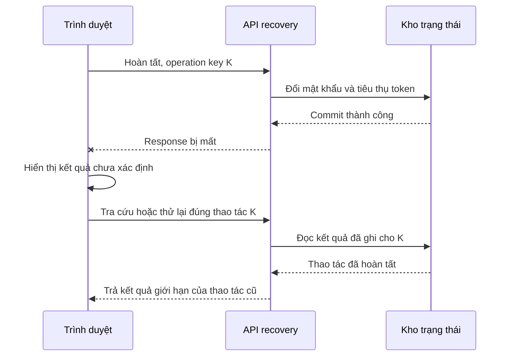

# Recovery token error handling — Xử lý lỗi token khôi phục

Một liên kết recovery có thể hết hạn, bị dùng trước đó, thuộc sai mục đích hoặc không thể được kiểm tra vì cơ sở dữ liệu đang gặp sự cố. Người dùng cũng có thể mất kết nối sau khi máy chủ đã đổi mật khẩu thành công.

Những tình huống này đều có vẻ là “lỗi” trên giao diện, nhưng cần cách xử lý khác nhau. Nếu gộp tất cả thành “mã sai”, người dùng thật dễ bị mắc kẹt. Nếu trả mọi chi tiết nội bộ, dịch vụ có thể tiết lộ tài khoản, trạng thái token hoặc cấu trúc hệ thống. Nếu coi mọi timeout là chưa thực hiện, thao tác thử lại có thể gây thay đổi lặp.

Mục tiêu của xử lý lỗi là giữ đúng quyền của recovery token, bảo toàn trạng thái, giảm rò rỉ thông tin và cho người dùng một bước tiếp theo phù hợp.

## 1. Bốn câu hỏi cần trả lời khi có lỗi

Khi nhận một kết quả bất thường, hệ thống cần xác định:

1. **Có đủ cơ sở kiểm tra token không?** Nếu thiếu khóa xác minh hoặc không truy cập được trạng thái thu hồi, chưa thể kết luận token sai.
2. **Thao tác đã thay đổi trạng thái chưa?** Chưa bắt đầu, đã rollback, đã commit và chưa biết kết quả là những trạng thái khác nhau.
3. **Người đang nhận phản hồi được biết đến mức nào?** Một người chưa xác thực không nên thấy cùng lượng thông tin như phiên recovery đã được kiểm tra đúng phạm vi.
4. **Có thể thử lại theo cách nào?** Sửa dữ liệu, chờ giới hạn, dùng lại cùng mã thao tác hay bắt đầu lại qua kênh hợp lệ?

Nguyên tắc chung: **không cấp quyền khi chưa xác minh được, và không khẳng định chưa có thay đổi nếu chưa biết kết quả giao dịch**.

Các mã lỗi, HTTP status và trạng thái dưới đây là một thiết kế minh họa cho dịch vụ account recovery, không phải bộ mã chuẩn bắt buộc dùng chung.

## 2. Phân loại nội bộ trước khi thiết kế thông báo

| Nhóm lỗi nội bộ | Ví dụ | Ý nghĩa đối với trạng thái |
| --- | --- | --- |
| Đầu vào không hợp lệ | Token quá dài, sai encoding, thiếu trường bắt buộc | Không thực hiện hành động recovery |
| Secret không khớp | Không tìm thấy token tương ứng hoặc kiểm tra bí mật thất bại | Không cho dùng quyền |
| Token không còn dùng được | Hết hạn, đã dùng, đã thu hồi | Không thực hiện hành động mới từ token đó |
| Sai ngữ cảnh | Sai purpose, audience, tenant hoặc hồ sơ | Không cho chuyển quyền sang ngữ cảnh khác |
| Thiếu điều kiện nghiệp vụ | Hồ sơ chưa đủ bằng chứng, đang chờ hoặc bị hủy | Token đúng chưa đủ để hoàn tất |
| Dữ liệu hành động cần sửa | Mật khẩu mới không đạt policy | Có thể sửa khi phiên và quyền vẫn còn hợp lệ |
| Bị giới hạn | Quá ngân sách thử mã hoặc tần suất yêu cầu | Chờ hoặc đi theo đường hỗ trợ phù hợp |
| Phụ thuộc không sẵn sàng | Không truy cập được kho token, khóa xác minh hoặc trạng thái thu hồi | Chưa xác định được tính hợp lệ |
| Lỗi thực thi | Lỗi ghi dữ liệu, vi phạm ràng buộc trạng thái | Cần xác định rollback hay commit |
| Kết quả chưa rõ | Mất kết nối ở thời điểm commit hoặc mất response | Không được suy đoán hành động đã thất bại |
| Lỗi tác vụ sau commit | Gửi thông báo thất bại sau khi thay đổi đã lưu | Thao tác chính có thể đã hoàn tất |

Việc phân loại chính xác giúp vận hành và phục hồi. Không có yêu cầu phải trả nguyên mã nội bộ cho client.

Ví dụ, `TOKEN_EXPIRED`, `TOKEN_REVOKED` và `TOKEN_NOT_FOUND` có thể cùng ánh xạ tới một nhóm phản hồi công khai. Ngược lại, `TOKEN_STORE_UNAVAILABLE` không nên bị biến thành “hãy nhập lại mã đúng”.

## 3. Tách lý do nội bộ khỏi thông báo công khai

Một phản hồi có ba lớp khác nhau:

| Lớp | Phục vụ ai? | Nội dung phù hợp |
| --- | --- | --- |
| Thông báo người dùng | Người đang thực hiện recovery | Điều có thể làm tiếp theo, không lộ dữ liệu ngoài quyền |
| Mã ứng dụng công khai | Client và giao diện | Nhóm hành động ổn định như thử lại sau hoặc yêu cầu liên kết mới |
| Lý do vận hành | Nhân sự và hệ thống được phân quyền | Loại lỗi, công đoạn, tham chiếu và trạng thái đã xác định |

OWASP khuyến nghị trả phản hồi chung phù hợp cho người dùng, đồng thời xử lý chi tiết lỗi trong hệ thống thay vì hiển thị exception và thông tin kỹ thuật ra ngoài. [OWASP Error Handling Cheat Sheet](https://cheatsheetseries.owasp.org/cheatsheets/Error_Handling_Cheat_Sheet.html)

### Phản hồi cho token không sử dụng được

Ở endpoint công khai, có thể dùng một thông báo chung cho token không tồn tại, secret sai, hết hạn, đã dùng, bị thu hồi hoặc sai purpose:

> Liên kết hoặc mã khôi phục này không sử dụng được. Bạn có thể quay lại trang khôi phục để yêu cầu hướng dẫn mới.

Không kèm email đầy đủ, tên tài khoản, thời điểm phát mã hoặc thông tin “token thuộc tài khoản khác”. Không trả gợi ý phần nào của mã đã đúng.

Trong một phiên recovery đã được xác minh và ràng buộc đúng hồ sơ, dịch vụ có thể cung cấp hướng dẫn cụ thể hơn nếu policy cho phép, chẳng hạn hồ sơ đã hết thời gian tiếp tục. Việc có một ID hồ sơ hoặc request ID đơn thuần không tạo ra quyền xem chi tiết đó.

### Phản hồi cho sự cố hạ tầng

> Hiện chưa thể xác nhận yêu cầu khôi phục. Vui lòng thử lại sau theo hướng dẫn.

Thông báo này không kết luận token sai. Nó cũng không hứa thao tác chưa xảy ra nếu lỗi xuất hiện sau khi đã gửi yêu cầu hoàn tất. Trạng thái kết quả chưa rõ cần cách diễn đạt riêng ở phần sau.

## 4. Không biến phản hồi lỗi thành công cụ dò thông tin

Một phản hồi có thể tiết lộ qua nhiều kênh ngoài dòng chữ hiển thị:

- HTTP status khác nhau giữa các tài khoản.
- Tên trường, kích thước hoặc cấu trúc JSON.
- Redirect sang URL chứa định danh tài khoản.
- Thời gian xử lý khác biệt rõ rệt.
- Chi tiết còn lại như số lần thử, thời gian hết hạn hoặc kênh đã gửi.
- Exception, cookie, header hoặc thông báo từ gateway.

Ở bước yêu cầu hướng dẫn recovery bằng email hoặc tên tài khoản, phản hồi cần nhất quán giữa tài khoản có và không có. OWASP cũng lưu ý tính nhất quán của thông báo và thời gian phản hồi ở chức năng quên mật khẩu. [OWASP Forgot Password Cheat Sheet](https://cheatsheetseries.owasp.org/cheatsheets/Forgot_Password_Cheat_Sheet.html)

Với bước nộp token, thiết kế minh họa không công khai phân biệt “ID token đúng nhưng secret sai” với “ID không tồn tại”. Thông tin đó có thể giúp người thử xác nhận một phần giá trị.

So sánh secret bằng cơ chế phù hợp giúp giảm rò rỉ ở thao tác so sánh, nhưng không làm toàn bộ request có thời gian cố định. Truy cập cache, cơ sở dữ liệu và các nhánh xử lý vẫn khác nhau. Cần giảm khác biệt có ý nghĩa và quản lý tài nguyên; không chỉ thêm một khoảng sleep rồi tuyên bố hết rủi ro timing.

Cũng không nên thực hiện công việc mật mã tốn kém không giới hạn cho mọi chuỗi rác nhằm “cân bằng thời gian”. Giới hạn đầu vào và ngân sách chống lạm dụng vẫn cần được thực thi.

## 5. Thiết kế hợp đồng lỗi cho API

Có thể dùng Problem Details để trả nhóm lỗi có cấu trúc. RFC 9457 định nghĩa định dạng này cho HTTP API; nội dung lỗi vẫn cần được thiết kế để tránh lộ thông tin nhạy cảm hoặc chi tiết debug. [RFC 9457, Problem Details for HTTP APIs](https://www.rfc-editor.org/rfc/rfc9457.html)

Ví dụ cho token không được chấp nhận:

```http
HTTP/1.1 400 Bad Request
Content-Type: application/problem+json
Cache-Control: no-store

{
  "type": "https://accounts.example.com/problems/recovery-not-accepted",
  "title": "Không thể sử dụng yêu cầu khôi phục",
  "status": 400,
  "detail": "Liên kết hoặc mã khôi phục không sử dụng được.",
  "code": "RECOVERY_NOT_ACCEPTED",
  "requestRef": "req_example_opaque"
}
```

Tên miền và mã là ví dụ minh họa. `requestRef` là tham chiếu hỗ trợ, không phải secret hoặc quyền đọc hồ sơ. Không dùng nó làm bằng chứng đủ để lấy trạng thái tài khoản.

Một bảng ánh xạ minh họa:

| Tình huống | HTTP có thể chọn | Cách xử lý client |
| --- | --- | --- |
| Token không sử dụng được | `400` | Hướng dẫn quay lại luồng recovery hợp lệ |
| Request vượt giới hạn kích thước | `413` | Không tự gửi lại cùng payload quá lớn |
| Dữ liệu hành động không đạt policy trong ngữ cảnh hợp lệ | `422` | Cho sửa trường được phép, không in lại secret |
| Xung đột thao tác đã được xác định trong ngữ cảnh hợp lệ | `409` | Dùng hướng dẫn cho đúng hồ sơ hoặc thao tác |
| Quá ngân sách yêu cầu | `429` | Tôn trọng thời gian chờ máy chủ cung cấp |
| Phụ thuộc tạm thời không sẵn sàng trước khi thực hiện | `503` | Thử lại có giới hạn theo hợp đồng |
| Lỗi không dự kiến | `500` | Hiển thị thông báo an toàn và tham chiếu hỗ trợ |

HTTP status không nên được chọn tùy tiện ở mỗi nhánh exception. Hợp đồng cần nhất quán và phải xem cả semantics lẫn nguy cơ dò thông tin.

Nếu trả `Retry-After`, giá trị không được vô tình tiết lộ chi tiết trạng thái của một tài khoản chỉ vì người gửi khai email của tài khoản ấy. Client không nên tự lặp liên tục khi máy chủ chưa cho phép.

`202 Accepted` chỉ phù hợp với một hợp đồng thực sự tiếp nhận xử lý bất đồng bộ. Không trả “đang xử lý” để che một yêu cầu đã chắc chắn bị từ chối hoặc một thao tác mà dịch vụ chưa có khả năng theo dõi.

## 6. Lỗi nào nên để người dùng sửa?

### 6.1. Đầu vào token

Người dùng có thể sao chép kèm khoảng trắng hoặc dùng liên kết cũ. UI có thể hỗ trợ thao tác rõ ràng, nhưng máy chủ cần giữ quy tắc biểu diễn đã thiết kế.

Không tự cắt bớt, sửa ký tự gần giống hoặc chấp nhận một phần secret nhằm làm mã “dễ đúng hơn”. Việc chuẩn hóa, nếu có, phải được xác định cùng định dạng mã ngay từ đầu.

Thông báo có thể nhắc sao chép đầy đủ hoặc mở hướng dẫn mới, nhưng không tiết lộ token nào trong lịch sử của tài khoản vẫn còn hiệu lực.

### 6.2. Dữ liệu hành động

Sau khi đã kiểm tra được quyền recovery phù hợp, lỗi mật khẩu mới có thể được giải thích đủ cụ thể để sửa, chẳng hạn chưa đáp ứng policy.

Lỗi này không cần tiêu thụ quyền đặt mật khẩu nếu chưa có thay đổi được commit, theo thiết kế dùng một lần tại thời điểm hoàn tất. Tuy nhiên:

- Token vẫn có thể hết hạn trong lúc người dùng sửa.
- Mỗi lần sửa không được tự kéo dài hạn dùng.
- Các request vẫn chịu giới hạn tần suất.
- Không trả lại mật khẩu đã nhập trong response, log hoặc thông báo lỗi.

Nếu thiết kế tiêu thụ token gốc để đổi lấy phiên hẹp trước đó, người dùng sửa dữ liệu trong quyền của phiên hẹp ấy. Không khôi phục token gốc về trạng thái chưa dùng chỉ vì gặp lỗi ở một bước sau.

### 6.3. Thiếu bằng chứng recovery

Một token đúng cho một challenge không nhất thiết đủ để gỡ MFA hoặc đăng ký passkey mới. Khi thiếu bằng chứng bắt buộc, hệ thống tiếp tục theo policy hoặc chuyển sang phương án hỗ trợ đã được phê duyệt.

Không giải quyết “thiếu bằng chứng” bằng cách bỏ bớt yêu cầu chỉ vì người dùng thử nhiều lần hoặc nói tình huống khẩn cấp.

## 7. Giữ trạng thái token đúng khi thao tác thất bại

Đối với phương án token được tiêu thụ cùng thay đổi chính:

| Kết quả thực thi | Trạng thái cần hiểu |
| --- | --- |
| Chưa bắt đầu thay đổi | Chưa sử dụng quyền; vẫn kiểm hạn và điều kiện ở lần tiếp theo |
| Transaction rollback chắc chắn | Chưa có thay đổi chính được commit |
| Transaction commit thành công | Thay đổi và tiêu thụ token đã có hiệu lực |
| Không biết commit hay rollback | Phải xác minh kết quả; không suy đoán |
| Tác vụ thông báo lỗi sau commit | Không đồng nghĩa thay đổi chính đã thất bại |

Không đánh dấu token đã dùng ngay khi nhận một request sai secret. Một người ngoài có thể dùng giá trị đoán để phá quyền recovery của người thật.

Ngược lại, không để cập nhật mật khẩu thành công rồi đánh dấu dùng token bằng một job rời không có bảo đảm nhất quán. Khoảng trống đó có thể cho request khác dùng lại token.

Một transaction hoặc cơ chế cập nhật nguyên tử tương đương cần gắn thay đổi chính với tiêu thụ quyền. Nếu hệ thống có nhiều thành phần, trạng thái trung gian và cách hoàn tất phải được thiết kế rõ; không giả định các bước riêng lẻ luôn cùng thành công.

### Thời điểm hết hạn và đồng hồ

Hạn dùng được kiểm tra bằng thời gian máy chủ đáng tin tại điểm quyết định đã định. Không dùng thời gian từ trình duyệt để cho phép token quá hạn.

Nếu dịch vụ không thể tin cậy thời gian hoặc không đọc được trạng thái cần thiết để quyết định, đó là lỗi khả năng xác minh. Không tự bỏ kiểm tra hạn dùng để giữ luồng chạy.

### Thu hồi trong lúc người dùng đang mở trang

Một lần kiểm tra token khi tải form không đủ cho request hoàn tất vài phút sau. Máy chủ cần kiểm lại trạng thái hiện tại, hồ sơ, purpose và điều kiện thu hồi tại điểm thực thi.

Trang đang mở không giữ quyền vĩnh viễn. Khi token hoặc phiên hẹp không còn hợp lệ, UI cần hướng dẫn tiếp tục qua luồng chính thức.

## 8. Timeout không chứng minh thao tác chưa xảy ra

Xét một tình huống:



Phản hồi phù hợp ở client có thể là:

> Chưa xác nhận được kết quả. Hãy kiểm tra trạng thái hoặc thử lại theo hướng dẫn của cùng yêu cầu.

Không nên nói chắc “đổi mật khẩu thất bại” chỉ vì trình duyệt không nhận response. Cũng không tự tạo yêu cầu mới với một mật khẩu khác rồi coi đó là retry của thao tác trước.

### Idempotency cần gắn với đúng thao tác

Một operation key do client gửi chưa đủ để cấp quyền. Máy chủ phải ràng buộc bản ghi thao tác với:

- Tài khoản và hồ sơ recovery đã kiểm tra.
- Purpose và token hoặc grant tương ứng.
- Chủ thể hoặc phiên tiếp tục có quyền.
- Nội dung hành động cần phân biệt.
- Thời gian lưu kết quả và phạm vi được đọc lại.

Cùng key nhưng nội dung hành động khác phải được coi là xung đột, không ghi đè kết quả cũ.

Nếu cần fingerprint request có chứa mật khẩu mới, không lưu plaintext hoặc một hash nhanh có thể bị dùng để thử mật khẩu ngoại tuyến. Cần cơ chế bảo vệ phù hợp, chẳng hạn fingerprint có khóa được quản lý riêng, với thời hạn lưu tối thiểu. Không đưa fingerprint bí mật vào log.

Đọc lại một kết quả hoàn tất không phải thực hiện quyền lần thứ hai. Dịch vụ có thể trả xác nhận giới hạn cho đúng thao tác và đúng bằng chứng truy cập trong cửa sổ trạng thái đã định. Việc đó không làm token đã tiêu thụ có quyền thay đổi mới.

### Không được tự “hoàn tác” kết quả chưa rõ

Nếu mất kết nối lúc commit, không viết một transaction mới để đặt token về chưa dùng nhằm “cho người dùng thử lại”. Transaction ban đầu có thể đã hoàn tất.

Cần đọc trạng thái có thẩm quyền hoặc để hệ thống phục hồi xác định kết quả. Nếu chưa làm được, giữ trạng thái kết quả chưa rõ và không cấp thêm quyền. Một response `500` hoặc `504` không tự là bằng chứng rằng dữ liệu chưa thay đổi.

## 9. Tách lỗi tác vụ phụ khỏi kết quả chính

Sau khi thay đổi thành công, dịch vụ có thể cần gửi thông báo hoặc đồng bộ trạng thái với thành phần khác.

Nếu gửi email thông báo thất bại:

- Không đổi response thành “mật khẩu chưa được đặt” khi thực tế đã commit.
- Ghi nhận công việc cần gửi lại bằng cơ chế bền vững, ví dụ outbox.
- Retry tác vụ gửi với khả năng chống trùng phù hợp.
- Không khôi phục token đã tiêu thụ.

Nhưng không phải bước nào cũng là tác vụ phụ. Nếu chính sách đòi hỏi chặn các phiên bị chiếm trước khi cho truy cập tiếp, dịch vụ phải có cách cưỡng chế điều kiện đó. Chỉ ghi một event “hãy thu hồi session” chưa chứng minh mọi nơi đã chặn session.

Có thể cần trạng thái hoàn tất có điều kiện hoặc chưa cấp session mới đến khi đạt điều kiện bảo mật bắt buộc. Giao diện và API phải phản ánh đúng điều đã biết, thay vì dùng cùng chữ “thành công” cho mọi giai đoạn.

Điểm phân biệt là **bước nào có thể retry sau mà không làm sai bảo đảm bảo mật**, không chỉ bước nào chạy ở background.

## 10. Giới hạn thử và yêu cầu token mới

Cần tách ít nhất ba ngân sách:

| Ngân sách | Mục tiêu |
| --- | --- |
| Yêu cầu phát hoặc gửi lại token | Giảm spam và chi phí phân phối |
| Thử secret | Giảm khả năng đoán mã |
| Hoàn tất hoặc kiểm tra trạng thái | Bảo vệ tài nguyên và tránh retry dồn dập |

Lỗi đọc cơ sở dữ liệu không phải một lần người dùng đoán sai mã. Không nên tăng bộ đếm sai secret chỉ vì một phụ thuộc timeout.

Ngược lại, không được cho một lần resend hoặc hồ sơ mới xóa sạch ngân sách thử cũ. Giới hạn cần phối hợp theo các tín hiệu thích hợp, đồng thời tránh cho người ngoài khóa toàn bộ đăng nhập hợp lệ chỉ bằng việc khai tên tài khoản.

Một lỗi token không nên tự động:

- Gửi secret sang địa chỉ mới được nhập trong request.
- Chuyển từ kênh mạnh hơn sang kênh yếu hơn.
- Tắt MFA vì “hệ thống đang lỗi”.
- Phát token mới vô hạn.
- Thu hồi mọi phương thức đăng nhập chỉ vì một request chưa xác thực.

Nếu cho yêu cầu hướng dẫn mới, hệ thống dùng kênh được policy cho phép và quy tắc phát lại đã xác định. Việc mã mới có thu hồi mã cũ hay không phải là chính sách nhất quán, có xét nguy cơ làm gián đoạn người thật; không để mỗi nhánh exception tự chọn.

## 11. Ghi nhận lỗi mà không tạo thêm nơi lộ token

Một sự kiện vận hành minh họa:

```json
{
  "event": "recovery.token_rejected",
  "requestRef": "req_example_opaque",
  "caseRef": "rc_example_opaque",
  "tokenRecordRef": "tr_example_opaque",
  "stage": "VALIDATE_CONTEXT",
  "reason": "PURPOSE_MISMATCH",
  "publicCode": "RECOVERY_NOT_ACCEPTED",
  "stateMutation": "NONE"
}
```

Các tham chiếu chỉ được ghi khi đã có căn cứ ánh xạ. Không tự khẳng định một request rác thuộc tài khoản nào.

Không ghi:

- Token nguyên văn hoặc một phần đủ hữu ích để khai thác.
- URL đầy đủ có chứa secret.
- Mật khẩu mới, OTP hoặc recovery code khác.
- Authorization header, cookie hoặc recovery grant.
- Request body đầy đủ bằng bộ ghi debug tự động.

Ngay cả digest hoặc tham chiếu cũng có thể phục vụ liên kết hoạt động, nên cần kiểm soát quyền và thời hạn lưu.

Những chỉ số hữu ích có thể gồm tỷ lệ từ chối theo công đoạn, lỗi phụ thuộc, độ trễ kiểm tra, số kết quả chưa xác định, retry và công việc thông báo chưa gửi. Không cần đưa định danh cá nhân làm nhãn metric có số lượng lớn.

Khi exception không dự kiến xảy ra, client nhận thông báo an toàn cùng tham chiếu. Chi tiết kỹ thuật chỉ dành cho kênh vận hành được kiểm soát và cũng phải được lọc secret.

## 12. Giao diện và hỗ trợ cần có bước tiếp theo rõ

| Điều người dùng thấy | Bước tiếp theo phù hợp |
| --- | --- |
| Liên kết hoặc mã không sử dụng được | Quay lại trang recovery chính thức để nhận hướng dẫn mới |
| Dữ liệu hành động cần sửa | Sửa trường được phép trong lúc quyền còn hiệu lực |
| Đang bị giới hạn | Chờ theo chỉ dẫn, không tự lặp request |
| Tạm thời chưa xác minh được | Thử lại có giới hạn khi dịch vụ sẵn sàng |
| Kết quả chưa rõ | Tra cứu đúng thao tác hoặc retry cùng operation key theo hợp đồng |
| Cần hỗ trợ | Cung cấp request reference, không gửi token hoặc mật khẩu |

Khi hiển thị lỗi, UI không nên làm mất mọi ngữ cảnh an toàn của thao tác đang chờ rồi buộc người dùng tạo nhiều hồ sơ. Tuy nhiên, không giữ mật khẩu mới lâu trong trình duyệt chỉ để hỗ trợ retry.

Với ngôn ngữ khác nhau, client nên dựa vào mã ứng dụng ổn định để chọn hành động, không phân tích câu văn lỗi. Nội dung dịch cần giữ cùng ý nghĩa về trạng thái và quyền.

Nhân viên hỗ trợ có thể dùng request reference để tra cứu theo quyền của mình. Người cung cấp reference không mặc nhiên có quyền đọc dữ liệu của hồ sơ được tìm thấy.

Không yêu cầu người dùng dán cả liên kết recovery vào cuộc trò chuyện hỗ trợ. Một request reference an toàn không nên chứa secret được nhúng bên trong.

## 13. Ví dụ tổng hợp: đổi mật khẩu rồi mất response

Linh mở một liên kết reset mật khẩu hợp lệ. Hệ thống dùng token chỉ cho phép đặt mật khẩu mới, không cho tắt MFA.

1. Linh nhập mật khẩu chưa đạt policy. Dịch vụ trả hướng dẫn sửa trong ngữ cảnh recovery hợp lệ; chưa commit thay đổi và chưa tiêu thụ quyền hoàn tất.
2. Linh sửa mật khẩu và gửi thao tác K.
3. Máy chủ kiểm lại token, trạng thái hồ sơ và policy; commit mật khẩu mới cùng việc tiêu thụ token.
4. Mạng của Linh ngắt trước khi nhận kết quả.
5. UI hiển thị kết quả chưa xác định, không khẳng định thao tác thất bại.
6. Khi kết nối lại, luồng được bảo vệ đọc kết quả K hoặc retry đúng K theo hợp đồng.
7. Máy chủ trả xác nhận của thao tác cũ; không đổi mật khẩu lần nữa và không cấp quyền đăng nhập đầy đủ chỉ từ việc đọc kết quả.
8. Thông báo chưa gửi, nếu có, được xử lý lại qua cơ chế bền vững.

Nếu Linh dùng lại token với operation key mới để chọn một mật khẩu khác, đó là hành động mới từ quyền đã tiêu thụ và phải bị từ chối.

Nếu kho token đã không truy cập được ngay từ trước bước kiểm tra, tình huống khác: dịch vụ chưa thể xác minh và không được đổi mật khẩu. Hai lỗi có thể cùng xuất hiện dưới dạng mất kết nối ở client, nên việc theo dõi trạng thái máy chủ là cần thiết.

## 14. Các nguyên tắc cần giữ

- Phân loại lỗi nội bộ đủ chi tiết, nhưng chỉ công khai thông tin đúng quyền và đúng nhu cầu.
- Token sai, hết hạn hoặc sai ngữ cảnh không được biến thành công cụ dò tài khoản.
- Hạ tầng không sẵn sàng không đồng nghĩa secret sai.
- Không có bằng chứng xác minh thì không cấp quyền; không rõ kết quả thì không suy đoán đã thất bại.
- Thay đổi chính và tiêu thụ quyền dùng một lần phải có bảo đảm nhất quán.
- Retry cần gắn với đúng thao tác, không tự tạo quyền mới hoặc thay nội dung cũ.
- Lỗi gửi thông báo sau commit khác với lỗi trước khi thay đổi trạng thái.
- Hướng dẫn hỗ trợ dùng tham chiếu an toàn, không yêu cầu chia sẻ token.

Xử lý lỗi recovery token là một phần của quyết định cấp quyền. Thông báo, trạng thái và cơ chế phục hồi cần cùng mô tả đúng điều hệ thống đã xác minh và đã thực hiện.