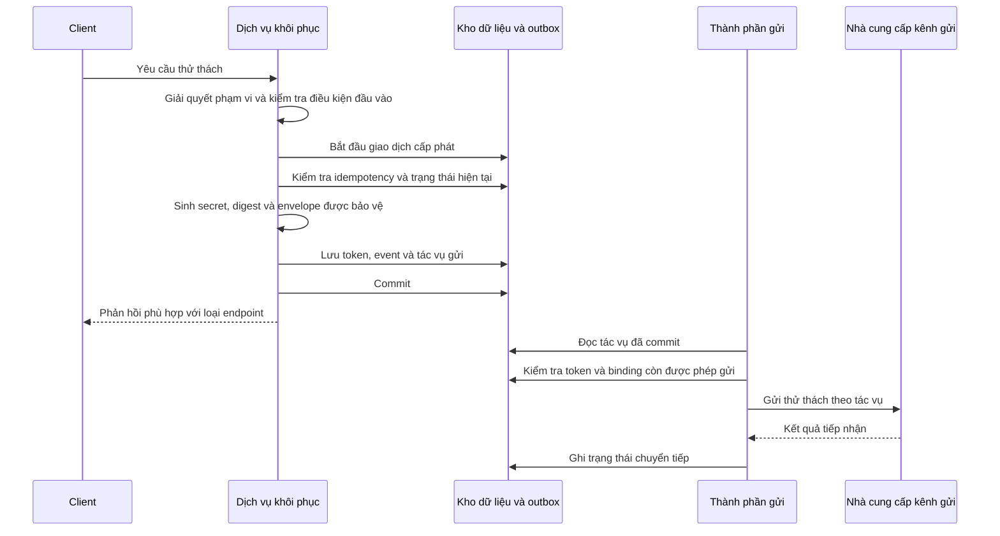

# Token creation event

## 1. Sự kiện tạo token đánh dấu điều gì?

Trong vòng đời token khôi phục, **token creation event** là sự kiện ghi nhận máy chủ đã tạo và lưu thành công một token cùng các ràng buộc sử dụng của nó. Với mô hình có giao dịch, sự kiện chỉ được đưa ra ngoài khi giao dịch tạo token đã commit.

Việc một người nhấn “Quên mật khẩu” mới tạo ra **yêu cầu**. Việc bộ sinh ngẫu nhiên tạo được một chuỗi mới chỉ tạo ra **vật liệu bí mật**. Cả hai chưa đủ để kết luận đã có một token khôi phục được máy chủ quản lý.

Một token cần có mục đích, tài khoản hoặc chủ thể đích, thời hạn và trạng thái vòng đời. Khi phát sự kiện quá sớm, hệ thống gửi thư hoặc xử lý rủi ro có thể hành động dựa trên một token chưa tồn tại hoặc một giao dịch sau đó bị rollback.

Ví dụ, người dùng mất mật khẩu và yêu cầu nhận liên kết khôi phục qua kênh đã thiết lập. Nếu dịch vụ gửi email trước rồi mới lưu token, lỗi cơ sở dữ liệu có thể khiến người dùng nhận một liên kết không bao giờ dùng được. Nếu dịch vụ lưu token trước rồi mất kết nối trước khi gửi thư, token tồn tại nhưng người dùng chưa nhận được.

OWASP yêu cầu token đặt lại mật khẩu được sinh ngẫu nhiên an toàn, lưu bảo vệ, dùng một lần và có thời hạn phù hợp. Sự kiện tạo token cần gắn với những thuộc tính đó ngay khi token được phát hành. [Nguồn: OWASP, General Security Practices](https://cheatsheetseries.owasp.org/cheatsheets/Forgot_Password_Cheat_Sheet.html#general-security-practices).

Bài học sử dụng mô hình token opaque có bản ghi máy chủ và giao dịch cơ sở dữ liệu. Tên sự kiện, schema và trạng thái là thiết kế minh họa, không phải giao thức bắt buộc của một tiêu chuẩn.

## 2. Phân biệt yêu cầu, sự kiện và kết quả khôi phục

| Tên minh họa | Loại | Điều nó thực sự biểu đạt |
| --- | --- | --- |
| `RequestRecoveryChallenge` | Command | Có yêu cầu xin một thử thách khôi phục |
| `RecoveryTokenCreated` | Event | Token và dữ liệu vòng đời đã được lưu thành công |
| `SendRecoveryChallenge` | Tác vụ gửi có phạm vi riêng | Thành phần gửi được giao chuyển thử thách tới đúng kênh |
| `RecoveryChallengeSubmittedToProvider` | Event vận chuyển | Nhà cung cấp đã tiếp nhận yêu cầu gửi theo giao thức tích hợp |
| `RecoveryTokenConsumed` | Event | Token đã được tiêu thụ cho một thao tác được cho phép |
| `AccountRecoveryCompleted` | Event | Toàn bộ điều kiện hoàn tất khôi phục đã được đáp ứng |

Không suy luận từ `RecoveryTokenCreated` rằng:

- Người yêu cầu là chủ tài khoản.
- Email hoặc tin nhắn đã đến tay người nhận.
- Người nhận đã kiểm soát được token.
- Token chắc chắn còn hiệu lực tại thời điểm sự kiện được xử lý.
- Người yêu cầu được phép bỏ MFA, thay passkey hoặc đăng nhập đầy đủ.

Token đặt lại mật khẩu có thể được tạo trước khi chủ tài khoản chứng minh quyền qua kênh nhận token. Điều đó phù hợp với vai trò của thử thách: bằng chứng sẽ được thu nhận ở bước sau.

Ngược lại, một token cho thao tác thay MFA sau xử lý hỗ trợ có thể đòi hỏi các điều kiện xác minh trước khi được tạo. Không áp dụng một cổng cấp phát giống nhau cho mọi loại recovery token.

Tên sự kiện nên mô tả sự thật đã xảy ra. Một nhãn chung như `RecoverySucceeded` ngay lúc tạo token sẽ làm các dịch vụ phía sau hiểu nhầm và có thể cấp quyền quá sớm.

## 3. Cổng cấp phát trước khi tạo token

### 3.1. Xác định đúng chủ thể và mục đích

Máy chủ cần giải quyết yêu cầu thành một phạm vi nội bộ đáng tin, chẳng hạn:

```text
tenant_id
    + subject_id
    + recovery_case_id
    + purpose
    + delivery_channel_binding
```

Đối với endpoint công khai, người dùng có thể cung cấp email để bắt đầu luồng. Tuy nhiên, quan hệ giữa email, tài khoản, tenant và kênh nhận phải được máy chủ xác định theo chính sách, không lấy nguyên một nhóm ID tùy ý từ body rồi phát token.

`purpose` phải thể hiện thao tác mà token sẽ hỗ trợ. `PASSWORD_RESET` và `MFA_REBIND_AUTHORIZATION` có tác động khác nhau; không coi chúng là hai tên hiển thị cho cùng một quyền.

Token cũng cần ràng buộc với phiên bản kênh phù hợp. Không để người đang khôi phục tự nhập một địa chỉ mới rồi lập tức nhận thử thách vốn phải gửi tới kênh đã thiết lập trước.

### 3.2. Áp dụng điều kiện theo loại luồng

Một yêu cầu cấp token có thể cần kiểm tra:

- Luồng khôi phục và purpose có được hỗ trợ cho tài khoản hay không.
- Case còn ở trạng thái được phép cấp thử thách.
- Bằng chứng hoặc bước xác thực trước đó có đáp ứng điều kiện của purpose.
- Kênh nhận có hợp lệ theo chính sách hiện tại.
- Hạn mức tạo và gửi có cho phép thao tác mới.
- Có token hoặc tác vụ tương ứng đang được xử lý không.

Không yêu cầu người đã mất mọi yếu tố xác thực phải đăng nhập thông thường chỉ để bắt đầu mọi hình thức khôi phục. Đồng thời, không cho endpoint khởi tạo công khai tự có quyền phát một authorization token nhạy cảm mà chưa đủ bằng chứng.

Đủ điều kiện **tạo thử thách** và đủ điều kiện **hoàn tất khôi phục** là hai trạng thái khác nhau.

### 3.3. Giữ phản hồi công khai không làm lộ tài khoản

Đối với yêu cầu công khai, phản hồi nên tránh cho biết email có tài khoản hoặc token thật sự đã được tạo hay chưa. OWASP khuyến nghị thông điệp nhất quán và hạn chế khác biệt thời gian có thể dùng để dò tài khoản. [Nguồn: OWASP, Forgot Password Request](https://cheatsheetseries.owasp.org/cheatsheets/Forgot_Password_Cheat_Sheet.html#forgot-password-request).

Sự kiện nội bộ có thể chứa tham chiếu chủ thể để phục vụ vận hành, nhưng không vì vậy mà được phát tới client hoặc một kênh theo dõi công khai.

## 4. Những dữ liệu cần cố định tại thời điểm tạo

Một bản ghi token minh họa có thể gồm:

| Trường | Vai trò |
| --- | --- |
| `token_id` | Định danh bản ghi; không phải bí mật dùng để khôi phục |
| `token_digest` | Giá trị đối chiếu hoặc tra cứu của token entropy cao |
| `subject_id`, `tenant_id` | Chủ thể và phạm vi tài khoản |
| `case_id`, `purpose` | Quy trình và thao tác được token hỗ trợ |
| `issued_at`, `expires_at` | Mốc cấp phát và thời hạn do máy chủ quản lý |
| `status` | Trạng thái vòng đời, ví dụ `ISSUED` |
| `generation` | Thế hệ trong phạm vi cấp phát đã định |
| `security_epoch` | Phiên bản bảo mật dùng để nhận biết điều kiện đã thay đổi |
| `channel_binding_ref` | Kênh nhận và phiên bản ràng buộc tương ứng |
| `policy_version` | Chính sách đã dùng để quyết định cấp phát |

Chuỗi bí mật phải được sinh bằng cơ chế mật mã phù hợp. Bản ghi chỉ có `token_id` hoặc một chuỗi sinh từ email và timestamp không tạo ra bí mật chống đoán.

Trong thiết kế token entropy cao, lưu digest có thể giúp không phải giữ token thô trong bảng token. Nhưng nếu còn một hệ thống gửi thư cần token thô, các bản sao phục vụ gửi vẫn phải được bảo vệ riêng.

Các trường quyết định quyền nên được ghi nhận tại thời điểm tạo. Không để worker gửi thư tự chọn purpose hoặc kéo một địa chỉ mới nhất rồi thay thế kênh đã được cấp phép.

Nếu thông tin kênh thay đổi sau đó, hệ thống cần kiểm tra điều kiện hiện tại và xử lý theo chính sách. Không âm thầm gửi cùng token sang một đích khác để “sửa lỗi gửi”.

## 5. Giao dịch tạo token và bản ghi sự kiện

Hai thao tác riêng lẻ “ghi database” và “phát sự kiện” có thể bị ngắt ở giữa:

| Thứ tự | Điểm lỗi | Hậu quả |
| --- | --- | --- |
| Phát sự kiện rồi lưu token | Ghi token thất bại | Thành phần khác thấy một token không tồn tại |
| Lưu token rồi phát sự kiện trực tiếp | Tiến trình chết trước khi phát | Token tồn tại nhưng sự kiện có thể bị mất |
| Gửi thử thách rồi commit | Giao dịch rollback | Bí mật được gửi ra nhưng không có trạng thái máy chủ phù hợp |

Một cách xử lý là **transactional outbox**: ghi thay đổi nghiệp vụ và bản ghi cần chuyển tiếp trong cùng giao dịch; một thành phần khác đọc các bản ghi đã commit để chuyển đi. AWS mô tả pattern này để xử lý bài toán dual write và lưu ý bên nhận phải chịu được thông điệp lặp. [Nguồn: AWS, Transactional Outbox Pattern](https://docs.aws.amazon.com/prescriptive-guidance/latest/cloud-design-patterns/transactional-outbox.html).

Áp dụng vào mô hình của bài, một giao dịch có thể thực hiện:

1. Kiểm tra lại trạng thái case, chính sách và quyền cấp phát.
2. Xác định phiên bản và thế hệ token.
3. Lưu token mới cùng các ràng buộc.
4. Áp dụng chính sách đối với token trước đó trong cùng phạm vi.
5. Ghi sự kiện `RecoveryTokenCreated` vào outbox.
6. Ghi tác vụ gửi riêng được bảo vệ.
7. Ghi kết quả idempotency của thao tác.
8. Commit.

`RecoveryTokenCreated` có ý nghĩa là sự kiện của dữ liệu đã commit. Trong lúc giao dịch còn mở, đối tượng event có thể đã được tạo trong bộ nhớ hoặc bản ghi outbox đã được insert, nhưng không được bên ngoài xử lý như một sự thật bền vững.

Nếu bất kỳ phần bắt buộc nào của giao dịch thất bại, token, sự kiện và tác vụ gửi phải cùng không được công nhận là đã phát hành. Không bắt lỗi ghi outbox rồi vẫn báo token đã được cấp đủ.

Outbox không làm dịch vụ gửi email tham gia vào giao dịch database. Nó tạo một công việc có thể được chuyển tiếp và khôi phục sau lỗi; không bảo đảm người dùng cuối sẽ nhận thư.

## 6. Payload sự kiện không phải nơi chứa bearer secret

Một sự kiện tạo token thường cần đủ metadata để đối chiếu, nhưng không cần chứa token thô:

```json
{
  "eventId": "evt_example",
  "eventType": "RecoveryTokenCreated",
  "schemaVersion": 1,
  "occurredAt": "2026-11-23T09:00:00Z",
  "tokenId": "tok_example",
  "caseId": "case_example",
  "subjectRef": "subject_example",
  "purpose": "PASSWORD_RESET",
  "generation": 3,
  "issuedAt": "2026-11-23T09:00:00Z",
  "expiresAt": "2026-11-23T09:20:00Z",
  "policyVersion": "recovery-issuance-v2",
  "correlationId": "flow_example",
  "causationId": "command_example"
}
```

Thời hạn 20 phút chỉ là dữ liệu minh họa, không phải khuyến nghị áp dụng cho mọi kênh hoặc purpose.

Những định danh trên vẫn là dữ liệu nội bộ, có thể liên kết tới người dùng. “Không chứa bí mật” không đồng nghĩa được công khai hoặc gửi cho mọi consumer.

Không thêm những trường sau vào sự kiện dùng chung chỉ để thuận tiện:

- `rawToken` hoặc `recoveryUrl` có chứa secret.
- Mã OTP đầy đủ.
- Mật khẩu hoặc thông tin MFA.
- Dữ liệu định danh không cần thiết cho consumer.
- Payload yêu cầu gốc chứa dữ liệu người dùng.

### Tách sự kiện nghiệp vụ và tác vụ gửi

Thành phần gửi thử thách có nhu cầu khác với hệ thống audit hoặc thống kê. Nó có thể cần quyền truy cập một envelope chứa token và đích nhận. Envelope đó nên nằm trong luồng riêng có quyền hẹp, được bảo vệ và có thời hạn lưu rõ ràng.

Một cách thiết kế là lưu envelope mã hóa phục vụ gửi trong cùng giao dịch, rồi chỉ cho thành phần gửi được phép giải mã. Metadata công khai nội bộ vẫn chỉ tham chiếu `token_id` và `delivery_task_id`.

Bảo vệ envelope phải gồm cả ràng buộc: ciphertext hoặc cơ chế bao gói cần được gắn với đúng token, case, purpose và kênh nhận theo thiết kế. Không để thành phần trung gian đổi đích gửi bằng một trường ngoài không được kiểm tra.

Mã hóa không xóa nhu cầu kiểm soát quyền giải mã, vòng đời khóa, bản sao hàng đợi và log. Nếu consumer nào cũng giải mã được, việc mã hóa không tạo ra ranh giới truy cập mong muốn.

## 7. Idempotency: retry không có nghĩa tạo token mới

Người dùng nhấn nút hai lần, client timeout hoặc hệ thống chuyển tiếp yêu cầu đều có thể làm cùng thao tác được xử lý nhiều lần.

Nếu mỗi lần nhận request đều sinh token mới, một lỗi mạng có thể:

- Tạo nhiều secret còn hiệu lực.
- Làm token vừa gửi bị thay thế ngay lập tức.
- Gây nhiều email hoặc tin nhắn không cần thiết.
- Làm sai số liệu cấp phát và tăng khả năng lạm dụng.

Cần phân biệt các định danh:

| Định danh | Mục đích |
| --- | --- |
| `request_id` | Nhận biết một yêu cầu ở lớp giao tiếp |
| `idempotency_key` | Nhận biết cùng một thao tác cấp phát được gửi lại |
| `token_id` | Nhận biết token thật sự được tạo |
| `event_id` | Nhận biết một sự kiện đã ghi nhận |
| `delivery_task_id` | Nhận biết một công việc chuyển thử thách |

Không dùng riêng một khóa do client cung cấp làm namespace chung cho mọi tài khoản. Khóa phải được ràng buộc với phạm vi chủ thể, purpose và ngữ cảnh thao tác do máy chủ xác định.

Cùng khóa và cùng nội dung hợp lệ có thể trả kết quả đã ghi nhận. Cùng khóa nhưng đổi purpose hoặc kênh nhận phải được phát hiện là xung đột, thay vì sửa bản ghi cũ hoặc tạo thêm token.

Retry không nên trả lại token thô qua API công khai. Kết quả giao tiếp có thể là một receipt hoặc thông báo chung theo loại endpoint.

Nếu thao tác cũ đã tạo token nhưng token đã hết hạn, không tự kéo dài hạn rồi gọi đó là retry. Muốn cấp một token mới phải đi qua một quyết định cấp phát mới, với hạn mức và điều kiện hiện tại.

### Chống tranh chấp khi cấp phát

Idempotency cần được thi hành bằng ràng buộc duy nhất, giao dịch hoặc cơ chế đồng bộ phù hợp. Chỉ “đọc chưa thấy khóa” rồi “ghi mới” ở hai bước rời rạc vẫn có thể tạo hai token khi request chạy đồng thời.

Trong mô hình mỗi case và purpose chỉ có một token hiện hành, việc tăng generation và thay thế token trước cũng phải cùng nằm trong ranh giới đồng bộ. Không cho hai giao dịch đều coi mình là thế hệ tiếp theo duy nhất.

Đây là lựa chọn chính sách của mô hình, không phải yêu cầu rằng mọi hệ thống phải vô hiệu hóa mọi token của tài khoản sau mỗi yêu cầu công khai. Nếu người lạ chỉ cần gửi “quên mật khẩu” liên tục để làm link của chủ tài khoản hết hiệu lực, thiết kế đã tạo ra một cách gây gián đoạn.

## 8. Thời gian tạo và thời gian gửi không được đánh tráo

Có ít nhất bốn mốc thời gian khác nhau:

```text
request_received_at
    -> issued_at
    -> submitted_to_delivery_provider_at
    -> consumed_at
```

`issued_at` và `expires_at` phải do một nguồn thời gian phía máy chủ được kiểm soát xác định. Không nhận expiry tùy ý từ client.

Trong mô hình này, thời hạn bắt đầu từ mốc cấp phát đã lưu. Worker gửi chậm không tự đổi `issued_at` hoặc kéo `expires_at` ra sau. Nếu token hết hạn trước khi được gửi, worker không nên gửi một link vốn đã không sử dụng được; việc cấp lại cần theo chính sách.

Ví dụ:

| Thời điểm | Sự kiện |
| --- | --- |
| 09:00 | Token được tạo, hạn đến 09:20 |
| 09:02 | Tác vụ gửi bắt đầu retry vì nhà cung cấp lỗi |
| 09:18 | Nhà cung cấp tiếp nhận thử thách |
| 09:21 | Người dùng trình token |

Ở 09:21, token đã hết hạn theo dữ liệu được cấp. Không coi nó còn 19 phút vì hệ thống mới gửi lúc 09:18.

`occurredAt` trong event mô tả thời điểm nghiệp vụ theo định nghĩa của schema; nó không nhất thiết là thời điểm broker nhận event. Nếu chọn bằng `issuedAt`, cần giữ ý nghĩa đó nhất quán, còn event chỉ được chuyển ra sau commit.

Không dùng timestamp để thay thế cơ chế thứ tự nghiệp vụ. Hai token có thể có thời gian gần nhau hoặc được xử lý ở các máy có sai lệch đồng hồ. Generation hoặc phiên bản trạng thái là dữ liệu riêng để xác định quan hệ thay thế trong phạm vi đã chọn.

## 9. Luồng tạo và chuyển tiếp tham khảo



Thành phần gửi cần kiểm tra token chưa bị thu hồi, chưa bị thay thế, chưa hết hạn và vẫn gắn với đúng kênh được phép. Không chỉ tin một event đến trễ nói “đã tạo”.

Tuy nhiên, kiểm tra trước khi gửi không thể bảo đảm thu hồi được một email đang trên đường tới người nhận. Tính an toàn phải tiếp tục dựa vào kiểm tra token khi sử dụng. Link đã bị thu hồi vẫn phải bị từ chối dù thư đến sau.

Nếu nhà cung cấp đã nhận yêu cầu nhưng phản hồi bị mất, hệ thống có thể không biết thư đã được gửi hay chưa. Một khóa idempotency của nhà cung cấp, khi được hỗ trợ đúng cách, có thể giảm gửi lặp. Không tự khẳng định end-to-end “gửi đúng một lần” chỉ vì có outbox.

Việc gửi lại cùng thông điệp không được khiến consumer tự tạo token mới. Consumer của sự kiện tạo token chỉ thực hiện vai trò được giao, không diễn giải lại event thành command cấp thêm credential.

## 10. Ví dụ tổ chức hàm cấp phát

Đoạn sau là **mã giả theo cú pháp Java**. Nó minh họa ranh giới giao dịch và dữ liệu, không phải API thư viện hoặc một triển khai hoàn chỉnh.

`ValidatedIssueCommand` là kết quả xử lý đầu vào có phạm vi nội bộ rõ ràng. Máy chủ vẫn phải kiểm tra lại trạng thái có thể thay đổi trong giao dịch, thay vì tin rằng một lần kiểm tra trước đó còn đúng mãi.

```java
IssueReceipt createRecoveryToken(ValidatedIssueCommand command) {
    admissionControl.requireAllowed(command.requestContext());

    return repository.inIssuanceTransaction(command.scope(), tx -> {
        var previous = tx.findIdempotencyResult(command.operationKey());

        if (previous != null) {
            previous.requireSameRequestFingerprint(command.fingerprint());
            return previous.receipt(); // No new token or creation event.
        }

        var caseState = tx.currentCaseState();
        var policy = tx.currentIssuancePolicy();
        var channel = tx.authorizedChannelBinding();

        policy.requireIssuanceAllowed(command, caseState, channel);
        tx.requireNewIssuanceBudgetAvailable();

        Instant issuedAt = tx.trustedNow();
        Instant expiresAt = issuedAt.plus(policy.tokenLifetime());
        long generation = tx.allocateAllowedGeneration();

        var secret = tokenGenerator.create();
        var digest = tokenProtection.digest(secret);
        var tokenId = identifiers.newTokenId();

        var envelope = deliveryProtection.protectAndBind(
            secret,
            tokenId,
            command.scope(),
            channel,
            expiresAt
        );

        tx.applyPreviousTokenPolicy(generation);

        tx.insertIssuedToken(
            tokenId, digest, command.scope(), channel.reference(),
            issuedAt, expiresAt, generation, caseState.securityEpoch()
        );

        tx.appendCreationEventWithoutSecret(
            identifiers.newEventId(), tokenId, command.scope(),
            issuedAt, expiresAt, generation, policy.version()
        );

        tx.enqueuePrivateDelivery(tokenId, envelope, expiresAt);

        var receipt = IssueReceipt.forOperation(command.operationId());
        tx.saveIdempotencyResult(
            command.operationKey(), command.fingerprint(), receipt
        );
        tx.consumeIssuanceBudget();

        return receipt;
    });
}
```

Những điều kiện của ví dụ:

- Repository phải bảo vệ đúng phạm vi idempotency, generation, budget và trạng thái liên quan khỏi request đồng thời.
- Nếu tạo secret, bảo vệ envelope hoặc ghi bản ghi bắt buộc thất bại, giao dịch không được commit một phần.
- Hàm bảo vệ envelope phải dùng cơ chế và khóa được quản lý phù hợp; không tự coi Base64 là mã hóa.
- Kết quả chỉ được trả như thành công nội bộ sau khi cơ chế giao dịch xác nhận commit.
- Lớp HTTP vẫn chịu trách nhiệm ánh xạ sang phản hồi công khai không làm lộ tài khoản.
- Không log `secret`, envelope đã giải mã hoặc URL có chứa token.

Nếu bước mã hóa hoặc ký phải gọi một dịch vụ bên ngoài, cần thiết kế thời hạn chờ và ranh giới giao dịch thực tế. Đoạn mã không giả định một giao dịch database có thể rollback các tác dụng bên ngoài như gửi email.

## 11. Xử lý lỗi theo trạng thái thật

| Tình huống | Cách diễn giải | Hướng xử lý |
| --- | --- | --- |
| Bộ sinh bí mật lỗi | Chưa có token được cấp | Dừng cấp phát, không dùng giá trị dự phòng dự đoán được |
| Lưu token thành công trong giao dịch nhưng outbox lỗi | Giao dịch chưa đủ điều kiện commit | Rollback các thay đổi liên quan |
| Commit thành công, tiến trình chết trước khi phản hồi | Token có thể đã tồn tại | Retry dựa trên idempotency và dữ liệu đã commit |
| Worker chưa chuyển được tác vụ | Token đã tạo nhưng chưa được chuyển tiếp | Retry tác vụ trong giới hạn, không tự gia hạn token |
| Sự kiện đến trễ sau thu hồi | Lịch sử tạo là thật nhưng quyền hiện tại đã đổi | Không gửi hoặc kích hoạt lại dựa trên sự kiện cũ |
| Thông báo nhận từ nhà cung cấp bị lặp | Kết quả vận chuyển lặp | Xử lý idempotent, không cộng thêm một lần tạo token |
| Event bị phát lại để dựng projection | Đang dựng dữ liệu quan sát | Không tái gửi thử thách hoặc tái tạo secret từ lịch sử |

Bản ghi sự kiện là lịch sử, còn quyền sử dụng token phụ thuộc trạng thái hiện tại. Một consumer không được ghi lại `ISSUED` đè lên `CONSUMED` hoặc `REVOKED` chỉ vì nó vừa nhận được một event tạo đến muộn.

Nếu event schema thay đổi, cần có `schemaVersion` và quy tắc tương thích rõ ràng. Trường không nhận biết hoặc purpose không được hỗ trợ không phải lý do để rơi về một loại token có quyền rộng hơn.

Không tái tạo secret từ metadata sự kiện để phục hồi gửi thư. Nếu hệ thống không còn bản sao được bảo vệ phục vụ gửi, cần áp dụng quy trình cấp lại; không sinh ra một secret mới dưới cùng token ID rồi giữ nguyên sự kiện tạo cũ.

## 12. Truy vết việc tạo mà không mở rộng quyền truy cập

Sự kiện tạo token giúp trả lời những câu hỏi vận hành cụ thể:

- Token nào được tạo cho case và purpose nào?
- Chính sách, kênh và phiên bản bảo mật nào đã được dùng?
- Thao tác nào gây ra sự kiện và có phải retry không?
- Công việc chuyển thử thách tương ứng đang ở trạng thái nào?
- Token bị tiêu thụ, hết hạn hay thu hồi về sau?

Có thể dùng `correlationId` để nối các bước của cùng luồng và `causationId` để chỉ thao tác trực tiếp gây ra sự kiện. Không dùng token thô làm correlation ID.

Hệ thống thống kê có thể đếm token thực sự được tạo theo `event_id` hoặc `token_id` phù hợp. Không đếm mọi lần client nhấn nút thành một lần cấp phát thành công, cũng không đếm mỗi lần broker chuyển lại thông điệp thành token mới.

Quyền đọc audit, quyền đọc metadata token và quyền giải mã tác vụ gửi nên được phân biệt. Một người hỗ trợ xem được lịch sử “token đã tạo” không nhất thiết cần xem secret hoặc đích nhận đầy đủ.

Việc tạo token cũng không nên khóa toàn bộ tài khoản hoặc vô hiệu hóa MFA chỉ vì có yêu cầu khôi phục từ bên ngoài. Các thay đổi nhạy cảm đó cần một quyết định được phép ở bước tương ứng, tránh biến endpoint tạo thử thách thành công cụ gây gián đoạn.

Sự kiện tạo token có giá trị khi nó ghi đúng một sự thật đã được commit, không mang bí mật vượt phạm vi và có thể được xử lý lặp an toàn. Hoàn tất khôi phục vẫn là một quyết định về sau, dựa trên token còn hợp lệ cùng toàn bộ bằng chứng và chính sách cần thiết.
