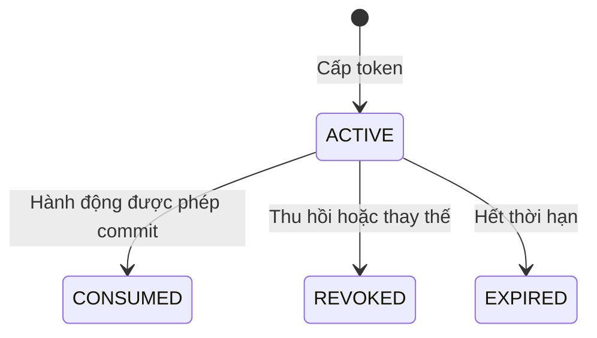
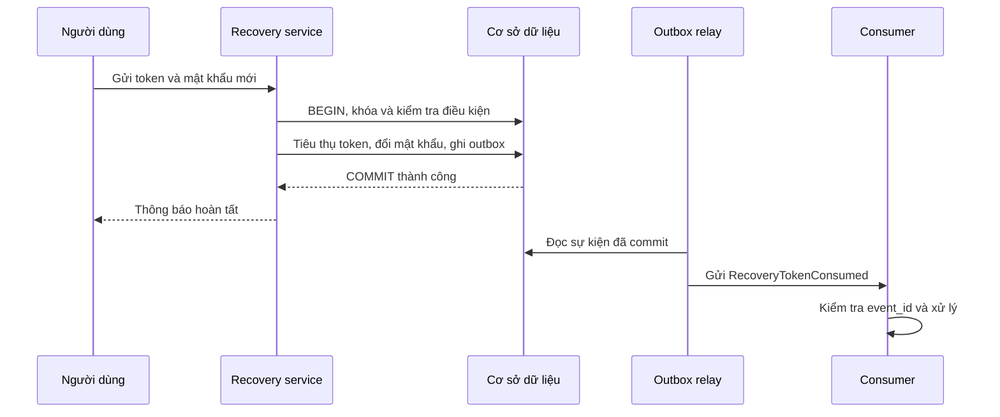

# Token consumption event

## 1. Sự kiện tiêu thụ token ghi nhận điều gì?

Trong khôi phục tài khoản, **token consumption event** là sự kiện miền ghi nhận một token đã được sử dụng thành công cho đúng hành động mà nó được cấp phép, và quyền sử dụng token đó đã kết thúc. Sự kiện này giúp nối ba phần của hệ thống: quyết định bảo mật, thay đổi trạng thái tài khoản và bằng chứng phục vụ vận hành.

Ví dụ, người dùng mất mật khẩu, nhận liên kết khôi phục rồi gửi mật khẩu mới. Khi giao dịch đổi mật khẩu được commit cùng việc đánh dấu token đã dùng, hệ thống có thể ghi sự kiện `RecoveryTokenConsumed`. Nhấp vào liên kết hoặc nhập token đúng chưa đủ để kết luận hành động ấy đã xảy ra.

Token khôi phục cần có thời hạn và bị vô hiệu hóa sau khi sử dụng. Đây là yêu cầu được nêu trong [OWASP Forgot Password Cheat Sheet](https://cheatsheetseries.owasp.org/cheatsheets/Forgot_Password_Cheat_Sheet.html). Trong bài này, ta xây dựng một thiết kế minh họa để thực hiện yêu cầu đó đồng thời ghi lại sự kiện đáng tin cậy; tên sự kiện và schema dưới đây là lựa chọn của thiết kế, không phải một chuẩn giao thức.

Cần phân biệt các khái niệm sau:

| Khái niệm | Ý nghĩa | Có chứng minh token đã được tiêu thụ thành công? |
| --- | --- | --- |
| Token presented | Máy chủ nhận token từ một request | Chưa |
| Token validated | Token vượt qua các kiểm tra áp dụng tại thời điểm kiểm tra | Chưa; trạng thái có thể thay đổi trước lúc cập nhật |
| Consumption attempted | Hệ thống bắt đầu thao tác sử dụng token | Chưa; giao dịch có thể thất bại |
| Token consumed | Quyền dùng token đã chuyển sang trạng thái kết thúc và giao dịch tương ứng đã commit | Có, trong phạm vi hợp đồng của sự kiện |
| Recovery completed | Toàn bộ luồng khôi phục đã đạt điều kiện hoàn tất | Chỉ khi bước tiêu thụ này chính là bước cuối của luồng |

Một sự kiện tiêu thụ token cũng không tự chứng minh người gửi là chủ tài khoản hợp pháp. Nếu kẻ tấn công lấy được token, thao tác tiêu thụ vẫn có thể thành công về mặt kỹ thuật. Mức bảo đảm danh tính đến từ toàn bộ chính sách khôi phục: bằng chứng đã xác minh, kiểm tra rủi ro, quyền hạn của token và các điều kiện bổ sung.

## 2. Xác định ranh giới tiêu thụ theo mục đích

Trước khi viết mã, hãy trả lời: **token cho phép hoàn thành hành động nào?** Thời điểm tiêu thụ phải gắn với hành động ấy.

| Mục đích token | Ranh giới tiêu thụ trong một thiết kế minh họa | Điều không được suy diễn |
| --- | --- | --- |
| Đặt lại mật khẩu | Mật khẩu mới được lưu và token bị vô hiệu hóa trong cùng giao dịch | Người dùng đã đăng nhập hoặc các session cũ đã bị thu hồi ở mọi nơi |
| Đổi token lấy recovery grant | Token bị vô hiệu hóa đồng thời grant giới hạn được tạo bền vững | Mật khẩu đã đổi hoặc luồng khôi phục đã xong |
| Xác nhận một bằng chứng trong quy trình mất MFA | Bằng chứng được ghi vào đúng recovery flow và token không thể dùng lại | Đã đủ quyền gỡ MFA hoặc bỏ qua thời gian chờ |
| Xác nhận bước khôi phục passkey hoặc thiết bị | Bước được token cho phép đã hoàn tất theo chính sách | Khóa mới đã được đăng ký hợp lệ, trừ khi đó là chính hành động được commit |

**Recovery grant** trong ví dụ là quyền tạm thời do máy chủ quản lý, chỉ được dùng cho một số thao tác khôi phục cụ thể. Nếu chọn mô hình đổi token sang grant, cần kiểm soát vòng đời của grant riêng: thời hạn, phạm vi, ràng buộc luồng và khả năng sử dụng lại. Chỉ chuyển quyền từ token sang grant mà bỏ các kiểm soát này sẽ tạo ra một bearer credential khác dễ bị lạm dụng.

Không tiêu thụ token chỉ vì một request `GET` mở trang đặt lại mật khẩu. Trình quét email, phần mềm xem trước liên kết hoặc trình duyệt có thể truy cập URL trước khi người dùng thực hiện hành động. Trang mở liên kết nên dẫn đến bước xác nhận; thao tác đổi trạng thái dùng request có chủ đích, với bảo vệ CSRF phù hợp cơ chế xác thực hoặc cookie đang sử dụng.

Việc chọn `POST` không tự chứng minh ý định của người dùng. Máy chủ vẫn phải kiểm tra dữ liệu, quyền của token, trạng thái recovery flow và các điều kiện bảo mật.

## 3. Mô hình trạng thái và các bất biến

Một mô hình đơn giản có thể lưu trạng thái tường minh:



Trong một triển khai khác, `EXPIRED` là trạng thái được suy ra từ `expires_at`, không cần một tác vụ cập nhật từng hàng khi đồng hồ đi qua thời hạn. Dù lưu theo cách nào, điều kiện chấp nhận vẫn phải kiểm tra thời gian phía máy chủ.

Các bất biến cốt lõi của thiết kế:

1. Một token chỉ tạo ra tối đa một lần chuyển trạng thái tiêu thụ thành công.
2. Token được ràng buộc với đúng tài khoản, tenant nếu có, recovery flow và mục đích.
3. Hành động được token cho phép và trạng thái tiêu thụ được commit cùng nhau khi nằm trong cùng cơ sở dữ liệu giao dịch.
4. Giao dịch rollback không được để lại một sự kiện thành công có hiệu lực ở bên ngoài.
5. Gửi lại sự kiện không được làm consumer lặp lại tác dụng phụ.
6. Token đã tiêu thụ không được phục hồi về `ACTIVE` để xử lý lỗi gửi email, lỗi broker hoặc người dùng retry.

Có thể biểu diễn điều kiện nhận token như sau:

```text
token tồn tại và khớp bí mật được trình bày
AND đúng tenant, tài khoản, recovery flow và purpose
AND chưa tiêu thụ
AND chưa thu hồi
AND chưa hết hạn tại thời điểm quyết định được chọn
AND recovery flow vẫn cho phép hành động
AND các điều kiện xác minh/rủi ro bắt buộc đã đạt
```

Không lấy `account_id`, `purpose` hoặc trạng thái phê duyệt do client gửi làm sự thật. Máy chủ phải suy ra hoặc đối chiếu chúng với bản ghi token và ngữ cảnh đã xác minh. Một token `PASSWORD_RESET` không được dùng cho endpoint gỡ MFA chỉ vì cùng thuộc một tài khoản.

Đối với mã ngắn như OTP, cần thêm giới hạn số lần thử và chống dò đoán. Một trường `consumed_at` không thay thế các kiểm soát đó.

## 4. Chống hai request cùng tiêu thụ token

Cách làm dễ có lỗi là kiểm tra rồi cập nhật bằng hai thao tác không được bảo vệ:

```text
Request A đọc token: chưa dùng
Request B đọc token: chưa dùng
Request A đổi mật khẩu
Request B đổi mật khẩu
Cả hai cùng ghi token đã dùng
```

Một request đã đọc trạng thái hợp lệ không có nghĩa nó đã giành được quyền sử dụng. Quyết định thắng phải nằm ở thao tác cập nhật nguyên tử hoặc ở giao dịch khóa bản ghi.

Với PostgreSQL ở mức `READ COMMITTED`, một `UPDATE` gặp bản ghi đang được giao dịch khác cập nhật có thể phải đợi; sau khi giao dịch kia commit, điều kiện `WHERE` được đánh giá lại trên phiên bản mới của hàng. Cơ chế này hỗ trợ cập nhật có điều kiện như `consumed_at IS NULL`; nó không tự bảo vệ tất cả điều kiện nghiệp vụ nằm ở những bảng khác. Xem [tài liệu Transaction Isolation của PostgreSQL](https://www.postgresql.org/docs/18/transaction-iso.html).

### 4.1. Giao dịch minh họa cho đặt lại mật khẩu

Giả sử token, tài khoản, recovery flow và outbox nằm trong cùng một cơ sở dữ liệu. Máy chủ đã kiểm tra định dạng mật khẩu và tính password hash trước khi mở giao dịch để tránh giữ khóa trong lúc thực hiện công việc tốn CPU. Các kiểm tra có thể thay đổi theo trạng thái tài khoản vẫn phải được xác nhận lại trong giao dịch.

Một thứ tự xử lý có thể là:

```text
BEGIN
  Khóa tài khoản theo account_id đã được máy chủ đối chiếu.
  Khóa recovery flow tương ứng.
  Khóa bản ghi token tương ứng.

  Xác nhận tài khoản và recovery flow vẫn cho phép đặt lại mật khẩu.
  Đánh giá lại các điều kiện rủi ro bắt buộc có liên quan.

  Cập nhật có điều kiện để tiêu thụ đúng token.
  Nếu không cập nhật đúng một hàng: ROLLBACK, từ chối.

  Lưu password hash mới và tăng credential_version của tài khoản.
  Ghi recovery flow hoàn tất theo đúng trạng thái/version dự kiến.
  Nếu một cập nhật bắt buộc không thành công: ROLLBACK.

  Ghi audit thành công và bản ghi outbox.
COMMIT

Chỉ sau COMMIT mới trả kết quả thành công.
```

Thứ tự khóa cần thống nhất giữa các đường tiêu thụ, thu hồi token và hoàn tất recovery có liên quan. Khóa riêng token không ngăn một luồng khác đổi chính sách, khóa tài khoản hoặc hủy recovery flow ở nơi khác. Nếu dùng optimistic locking thay cho khóa hàng, phải đưa version của những đối tượng liên quan vào điều kiện cập nhật và rollback toàn bộ khi version không khớp.

Ví dụ câu lệnh tiêu thụ sau khi đã lấy các khóa cần thiết:

```sql
UPDATE recovery_token
SET consumed_at = clock_timestamp(),
    consumption_id = :consumption_id
WHERE id = :token_id
  AND tenant_id = :tenant_id
  AND account_id = :account_id
  AND recovery_flow_id = :recovery_flow_id
  AND purpose = 'PASSWORD_RESET'
  AND token_digest = :token_digest
  AND consumed_at IS NULL
  AND revoked_at IS NULL
  AND expires_at > clock_timestamp()
RETURNING id, account_id, recovery_flow_id,
          consumed_at, consumption_id;
```

Đây là một phần của giao dịch, không phải toàn bộ endpoint:

- Các tham số định danh đã được máy chủ đối chiếu với token và flow; `token_digest` được tính từ token nhận được, không lấy trực tiếp từ client.
- `consumption_id` là định danh cho lần chuyển trạng thái thành công; không phải bí mật cho phép khôi phục.
- Tất cả thao tác dùng cùng connection/giao dịch. Không cập nhật mật khẩu bằng một giao dịch độc lập.
- Kết quả không có hàng nghĩa là request chưa giành được quyền tiêu thụ. Không tiếp tục đổi mật khẩu và không phát `RecoveryTokenConsumed`.
- Thời hạn được kiểm tra tại quyết định tiêu thụ sau khi đã lấy khóa. Không dùng một thời gian đã cache từ lúc request vừa đến nếu việc chờ khóa có thể kéo dài.
- `consumed_at` trả về được dùng làm thời gian xảy ra sự kiện; không thay bằng thời gian broker nhận message.

Trong mô hình này, sau khi giao dịch commit thì token không còn dùng được, password hash đã đổi và sự kiện đã được ghi bền vững. Nếu thao tác lưu mật khẩu, hoàn tất flow hoặc ghi outbox thất bại, toàn bộ thay đổi phải rollback. Token có thể còn hiệu lực sau rollback nếu vẫn thỏa thời hạn và chính sách; request thất bại không được mô tả là tiêu thụ thành công.

Có thể đặt ràng buộc duy nhất trên `consumption_id` không rỗng và trên cặp `(event_type, token_id)` trong outbox nếu hợp đồng quy định mỗi token chỉ có một sự kiện tiêu thụ. Các ràng buộc này giúp phát hiện lỗi lập trình nhưng không thay thế điều kiện cập nhật và giao dịch.

### 4.2. Hai request hợp lệ đến gần nhau

Giả sử A và B cùng gửi một token:

1. A lấy khóa trước, thực hiện thay đổi và commit.
2. B lấy được khóa sau đó, thấy token đã tiêu thụ hoặc cập nhật có điều kiện trả về không có hàng.
3. B không thay đổi mật khẩu và không tạo một sự kiện tiêu thụ mới.

Nếu A rollback, B có thể tiếp tục và thành công sau khi kiểm tra lại. Tính một lần áp dụng cho **lần tiêu thụ đã commit**, không phải mọi lần request bắt đầu xử lý.

Nếu cơ sở dữ liệu báo deadlock hoặc serialization failure, cần rollback giao dịch và chỉ retry có giới hạn khi loại lỗi cho phép. Không bỏ qua điều kiện token để ép lần retry thành công.

## 5. Ghi sự kiện cùng giao dịch bằng outbox

Một lỗi khác xuất hiện khi ghi cơ sở dữ liệu và gửi message là hai thao tác độc lập:

| Thứ tự thực hiện | Tình huống lỗi | Hậu quả |
| --- | --- | --- |
| Commit token trước, gửi message sau | Tiến trình dừng sau commit nhưng trước khi gửi | Token đã dùng nhưng downstream thiếu sự kiện |
| Gửi message trước, commit token sau | Commit thất bại | Consumer nhận thông tin thành công về một hành động chưa xảy ra |

**Transactional outbox** giải quyết khoảng trống này bằng cách lưu thay đổi nghiệp vụ và bản ghi sự kiện trong cùng giao dịch. Relay đọc các bản ghi đã commit để gửi đi. Message vẫn có thể được gửi lặp nên consumer cần xử lý idempotent. Đây là cơ chế được mô tả trong [AWS Prescriptive Guidance về transactional outbox](https://docs.aws.amazon.com/prescriptive-guidance/latest/cloud-design-patterns/transactional-outbox.html).



Relay có thể gửi message thành công rồi dừng trước khi ghi nhận đã gửi. Lần chạy tiếp theo sẽ gửi lại cùng sự kiện. Vì vậy:

- Giữ nguyên `event_id` khi gửi lại, không tạo một sự kiện nghiệp vụ mới cho mỗi lần chuyển phát.
- Consumer lưu dấu đã xử lý, chẳng hạn khóa duy nhất `(consumer_name, event_id)`.
- Nếu tác dụng phụ là cập nhật cùng cơ sở dữ liệu của consumer, cập nhật và ghi dấu đã xử lý cần ở cùng giao dịch.
- Nếu tác dụng phụ là gọi nhà cung cấp email hoặc dịch vụ ngoài, cần thêm cơ chế idempotency của bên nhận hoặc một hàng đợi gửi có quản lý trạng thái. Chỉ ghi dấu trước hay sau cuộc gọi đều còn một khoảng lỗi nếu không có phối hợp phù hợp.

Không đồng nhất “một lần chuyển trạng thái token” với “một lần broker giao message”. Đích thiết kế là một kết quả nghiệp vụ duy nhất dù việc chuyển phát có thể lặp.

## 6. Hợp đồng dữ liệu của sự kiện

Một payload minh họa:

```json
{
  "event_id": "c7d92a44-e987-4c3d-97c0-b17c92a98b51",
  "event_type": "RecoveryTokenConsumed",
  "schema_version": 1,
  "occurred_at": "2026-11-23T08:15:30Z",
  "tenant_id": "tenant_042",
  "account_id": "account_981",
  "recovery_flow_id": "recovery_752",
  "token_record_id": "tokenrec_416",
  "consumption_id": "consume_635",
  "purpose": "PASSWORD_RESET",
  "authorized_action": "PASSWORD_REPLACED",
  "credential_version": 18,
  "correlation_id": "request_209"
}
```

Các giá trị là dữ liệu giả. `token_record_id` chỉ định danh bản ghi nội bộ, **không phải token hoặc một phần của token**. Biết định danh này không được cho phép thực hiện thao tác khôi phục.

Một số trường cần có ý nghĩa rõ ràng:

| Trường | Vai trò |
| --- | --- |
| `event_id` | Định danh bất biến để nhận biết một sự kiện khi bị gửi lặp |
| `schema_version` | Cho consumer biết phiên bản cấu trúc payload |
| `occurred_at` | Thời điểm quyết định tiêu thụ được lưu trong giao dịch đã commit |
| `recovery_flow_id` | Liên kết với luồng xác minh và phê duyệt tương ứng |
| `purpose` | Quyền mà token đã được cấp |
| `authorized_action` | Hành động thực sự được commit tại ranh giới tiêu thụ |
| `credential_version` | Phiên bản thông tin xác thực sau thay đổi, nếu thiết kế dùng cơ chế này |
| `correlation_id` | Nối dấu vết request với audit và outbox; không thay thế `event_id` |

Không đưa những dữ liệu sau vào payload, log ứng dụng, tracing span hoặc metric label:

- Token gốc, mã OTP, backup code và liên kết khôi phục đầy đủ.
- Mật khẩu mới, password hash, recovery grant hoặc cookie phiên.
- Token digest nếu các consumer không có nhu cầu bảo mật đã được xác định.
- Giấy tờ, ảnh xác minh hoặc dữ liệu cá nhân không cần cho tác dụng phụ của consumer.

Ngay cả định danh tài khoản và flow cũng cần kiểm soát truy cập, thời gian lưu và phạm vi tenant. Đừng gửi toàn bộ sự kiện audit nhạy cảm tới mọi consumer chỉ vì chúng cùng dùng một message broker.

Consumer phải xác thực nguồn phát và chỉ nhận các loại sự kiện mà nó được phép xử lý. Payload do client tự gửi lên một endpoint không được coi là bằng chứng tiêu thụ token. Phân quyền topic hoặc hàng đợi, kênh truyền được xác thực và quyền của service phát là một phần của ranh giới tin cậy.

## 7. Retry, replay và kết quả commit chưa rõ

Ba tình huống dễ bị gộp nhầm:

### 7.1. Request thứ hai cố dùng lại token

Nếu token đã tiêu thụ, request mới không được nhận lại quyền đổi mật khẩu hoặc thay đổi yếu tố xác thực. Endpoint trả kết quả an toàn và hướng dẫn người dùng bắt đầu lại nếu cần.

Không cần tiết lộ ra ngoài rằng một tài khoản cụ thể tồn tại hay token cụ thể đã dùng vào thời điểm nào. Bên trong hệ thống có thể ghi nhận nguyên nhân từ chối theo mức chi tiết phù hợp để phục vụ điều tra.

### 7.2. Client mất response sau commit

Ví dụ giao dịch đã thành công nhưng kết nối HTTP bị ngắt. Người dùng gửi lại cùng request và gặp token đã dùng.

Có thể xử lý theo một trong hai chính sách:

- Trả thông báo token không còn sử dụng được, hướng dẫn đăng nhập hoặc khởi động lại luồng theo tình huống.
- Dùng hợp đồng idempotency: lưu định danh thao tác và dấu vết của dữ liệu yêu cầu đã được bảo vệ, ràng buộc chúng với token/flow/ngữ cảnh tương ứng trong cùng giao dịch. Lần gửi lại hợp lệ chỉ nhận xác nhận kết quả đã lưu.

Với chính sách thứ hai, cùng idempotency key nhưng nội dung khác phải bị từ chối. Không lưu mật khẩu rõ để so sánh; nếu cần ràng buộc payload, dùng cơ chế dấu vết được thiết kế để không tạo thêm kho kiểm tra mật khẩu ngoại tuyến dễ bị lạm dụng. Response được phát lại không được chứa bí mật mới, session đăng nhập hay một quyền khôi phục có thể dùng lại.

Một idempotency key do client cung cấp không phải bằng chứng nhận dạng. Hệ thống vẫn phải kiểm tra ràng buộc với thao tác và ngữ cảnh đã xác minh.

### 7.3. Máy chủ không biết commit đã thành công hay chưa

Khi mất kết nối với cơ sở dữ liệu đúng lúc commit, không được tự suy rằng giao dịch đã rollback. Sau khi kết nối phục hồi, tra cứu kết quả bền vững qua định danh thao tác, `consumption_id`, trạng thái token và dữ liệu nghiệp vụ liên quan theo hợp đồng đã thiết kế.

Không thực hiện một lần đổi mật khẩu khác chỉ để “chắc chắn thành công”, không tạo `event_id` mới cho kết quả cũ và không đưa token về trạng thái chưa dùng. Nếu chưa xác định được kết quả, trả trạng thái phù hợp để client không vô tình gây một thao tác mới ngoài ý định.

## 8. Quan hệ với session và các yếu tố xác thực

Một sự kiện tiêu thụ token có thể kích hoạt thông báo an toàn, đánh giá rủi ro hoặc đồng bộ trạng thái. Nhưng các kiểm soát bắt buộc để ngăn truy cập trái phép cần có hiệu lực theo ranh giới đã cam kết, không chỉ chờ một consumer chạy trong tương lai.

Ví dụ khi thay mật khẩu, giao dịch có thể tăng `credential_version`. Session mang phiên bản cũ bị từ chối nếu bộ phận xác thực đối chiếu với phiên bản có hiệu lực hiện tại. Nếu bộ phận này dùng cache, cần tính cả độ trễ và chính sách làm mới: tăng version trong database chưa chứng minh mọi session trên mọi máy đã bị chặn ngay.

Tương tự, nếu thu hồi refresh token ở một hệ thống khác bằng message bất đồng bộ, sẽ tồn tại khoảng thời gian chờ đồng bộ. Cần xác định rõ khoảng đó có chấp nhận được không và có lớp kiểm tra trung tâm hoặc biện pháp hạn chế truy cập nào bù lại. Một sự kiện đã ghi trong outbox không phải bằng chứng việc thu hồi từ xa đã hoàn tất.

Với mất MFA hoặc passkey, token xác nhận email thường chỉ là một bằng chứng trong quy trình. Tiêu thụ token ấy không tự cấp quyền:

- Gỡ mọi yếu tố xác thực đang tồn tại.
- Đăng ký một yếu tố mới không qua kiểm tra của quy trình.
- Bỏ qua thời gian chờ hoặc phê duyệt bắt buộc.
- Tạo session có mức bảo đảm tương đương đăng nhập mạnh trước đó.

Nếu luồng gồm nhiều bước, nên phát các sự kiện phản ánh từng kết quả cụ thể, chẳng hạn `RecoveryEvidenceConfirmed`, `RecoveryTokenConsumed` và `AccountRecoveryCompleted`. Không đặt tên sự kiện hoàn tất tài khoản cho một bước chỉ mới ghi nhận bằng chứng.

## 9. Sử dụng sự kiện cho vận hành và chống lạm dụng

Có thể theo dõi số lần tiêu thụ thành công, số lần bị từ chối, độ trễ outbox và số lần giao message lặp. Khi đọc các số liệu, cần giữ đúng đơn vị:

- Đếm sự kiện nghiệp vụ theo `event_id` duy nhất để tránh relay retry làm tăng giả số lần khôi phục.
- Phân biệt request bị từ chối do token đã dùng với consumer nhận lại một message cũ.
- Không dùng token, account ID hay flow ID làm nhãn metric có số lượng giá trị không giới hạn.
- Một lần retry sau mất mạng có thể là hành vi bình thường; nhiều lần dùng lại token trên các ngữ cảnh khác nhau mới là tín hiệu cần xem xét thêm.
- Giám sát backlog của outbox vì token có thể đã tiêu thụ nhưng thông báo an toàn chưa tới người dùng.

Lần thử thất bại có thể được ghi thành audit `RecoveryTokenConsumptionRejected` với lý do nội bộ được kiểm soát. Đây là dữ liệu về hành vi thử, không được trộn với sự kiện tiêu thụ thành công. Chống lạm dụng cần kết hợp giới hạn tốc độ, giới hạn lần thử và chính sách rủi ro; không chỉ dựa vào việc xử lý message sau thành công.

Đối với thay đổi nhạy cảm, thông báo cho người dùng qua kênh phù hợp giúp phát hiện việc khôi phục ngoài ý muốn. Thông báo không chứa lại token khôi phục hoặc bí mật mới, và lỗi gửi thông báo không được làm token đã dùng trở lại hiệu lực.

## 10. Ví dụ xuyên suốt: đổi mật khẩu với hai request và một lần gửi lặp

Giả sử recovery flow đã đạt các điều kiện xác minh cần thiết. Token `T` cho phép đặt lại mật khẩu một lần và chưa hết hạn.

| Thời điểm | Diễn biến | Trạng thái có ý nghĩa |
| --- | --- | --- |
| 08:15:29 | A và B gửi token T gần như đồng thời | Hai lần thử, chưa có hai quyền sử dụng |
| 08:15:30 | A lấy khóa, kiểm tra điều kiện và cập nhật token | Thay đổi còn nằm trong giao dịch |
| 08:15:30 | A lưu mật khẩu mới, tăng version, ghi outbox rồi commit | Một lần tiêu thụ thành công; có sự kiện E1 |
| 08:15:31 | B tiếp tục và không thỏa điều kiện token chưa dùng | B bị từ chối; không có sự kiện tiêu thụ E2 |
| 08:15:32 | Relay gửi E1, consumer xử lý và lưu dấu | Tác dụng phụ đã được ghi nhận theo hợp đồng consumer |
| 08:15:33 | Relay gửi lại E1 sau lỗi ghi nhận chuyển phát | Consumer nhận ra E1 đã xử lý và không lặp tác dụng phụ |

Nếu thay hàng commit bằng một lần rollback, các thay đổi token, mật khẩu và outbox của A đều không tồn tại như kết quả thành công. B có thể thành công sau khi kiểm tra lại điều kiện. Nếu E1 chỉ xác nhận việc đổi token lấy grant, không dòng nào trong timeline được phép tự suy rằng mật khẩu đã thay đổi.

Ranh giới sự kiện phải đủ chính xác để một người vận hành đọc `RecoveryTokenConsumed` và biết quyền nào đã được sử dụng, hành động nào đã commit, điều gì còn chờ xử lý và vì sao token ấy không thể tiếp tục cấp quyền.
