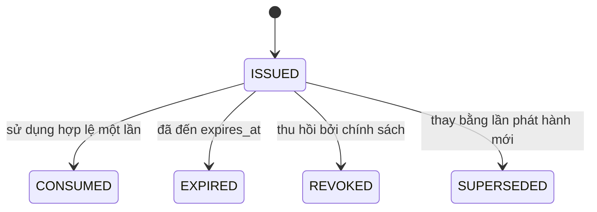

# Token expiration event

## 1. Sự kiện hết hạn trong luồng khôi phục tài khoản

Token expiration event là sự kiện ghi nhận rằng một token khôi phục chưa được sử dụng đã đi qua thời hạn cho phép. Sự kiện giúp cập nhật tiến trình, dọn quyền tạm và cung cấp dấu vết vận hành cho các luồng mất mật khẩu, MFA, passkey hoặc thiết bị xác thực.

Một yêu cầu khôi phục có thể tồn tại lâu hơn một token. Email đến chậm, người dùng chuyển thiết bị hoặc yêu cầu gửi lại đều có thể khiến token cũ hết hạn trong khi tài khoản vẫn hoạt động bình thường. Vì vậy, cần gắn sự kiện với đúng token và đúng lần phát hành, tránh diễn giải thành việc toàn bộ tài khoản bị vô hiệu.

OWASP yêu cầu token đặt lại mật khẩu dùng một lần và hết hạn sau khoảng thời gian phù hợp. Bài này triển khai ý tưởng hết hạn thành một thiết kế sự kiện; tên trạng thái, hợp đồng event và ví dụ thời gian bên dưới là lựa chọn minh họa của hệ thống. [Nguồn: OWASP Forgot Password Cheat Sheet](https://cheatsheetseries.owasp.org/cheatsheets/Forgot_Password_Cheat_Sheet.html).

## 2. Thời hạn có hiệu lực độc lập với việc phát sự kiện

Giả sử token được cấp lúc `09:00:00Z`, có `expires_at = 09:10:00Z`. Quy ước khoảng hiệu lực là:

```text
issued_at <= server_now < expires_at
```

Tại đúng `09:10:00Z`, token hết hiệu lực. Nếu tác vụ nền chỉ phát hiện lúc `09:10:12Z`, endpoint sử dụng token vẫn phải từ chối trong 12 giây đó. Không chờ event, tác vụ dọn dẹp hoặc việc xóa bản ghi để quyết định token có hợp lệ.

Cần phân biệt ba mốc:

| Mốc | Ý nghĩa |
| --- | --- |
| `expires_at` | Thời điểm quyền dùng token kết thúc theo chính sách đã cấp |
| `recorded_at` | Thời điểm hệ thống ghi nhận chuyển trạng thái hết hạn |
| `published_at` | Thời điểm event được chuyển ra kênh phân phối |

`published_at` chậm thể hiện độ trễ vận hành; nó không kéo dài hiệu lực token. Bản ghi còn `ISSUED` trong cơ sở dữ liệu cũng không đủ chứng minh token còn dùng được: phải kiểm tra cả thời hạn và các ràng buộc khác.

## 3. Mô hình trạng thái và phạm vi của event

Một mô hình đơn giản cho mỗi token:



Trong mô hình này, các trạng thái cuối không chuyển trở lại `ISSUED`. Token đã `CONSUMED` trước hạn không phát sinh thêm chuyển trạng thái `EXPIRED` khi đồng hồ đi qua `expires_at`. Thời hạn cũ vẫn được giữ để truy vết, nhưng kết quả vòng đời đã là sử dụng thành công.

Nếu token hết hạn còn nằm ở `ISSUED`, tác vụ nền có thể chuẩn hóa thành `EXPIRED`. Trong khoảng chờ chuẩn hóa, endpoint vẫn từ chối dựa trên thời gian. Đây là khác biệt giữa hiệu lực quyền và trạng thái được lưu phục vụ xử lý.

Event hết hạn chỉ mô tả đối tượng được nêu trong event. Một token đặt lại mật khẩu hết hạn không tự chứng minh rằng mật khẩu đã đổi, MFA đã được gỡ hoặc tài khoản bị chiếm đoạt. Những thay đổi đó cần quyết định và dấu vết riêng.

## 4. Dữ liệu tối thiểu cần giữ

Bản ghi token có thể gồm:

| Trường | Vai trò |
| --- | --- |
| `token_id` | Định danh nội bộ, khác chuỗi bí mật người dùng nhận |
| `token_digest` | Giá trị kiểm chứng token, không lưu token thô |
| `recovery_request_id` | Gắn token với một tiến trình khôi phục |
| `tenant_id`, `account_id` | Ràng buộc đúng miền và tài khoản |
| `purpose` | Ví dụ `PASSWORD_RESET` hoặc `MFA_RECOVERY` |
| `generation` | Phân biệt các lần cấp lại trong cùng tiến trình |
| `issued_at`, `expires_at` | Mốc thời gian do máy chủ quyết định |
| `status`, `version` | Trạng thái và phiên bản cho kiểm soát đồng thời |
| `expired_recorded_at` | Mốc hệ thống thực sự ghi nhận hết hạn |

`token_digest` cũng là dữ liệu nhạy cảm, không đưa vào event hoặc log. Digest đơn giản không đủ bảo vệ mã có ít entropy khỏi dò ngoại tuyến; cách kiểm chứng phải phù hợp với loại token. Phần xử lý hết hạn không thay thế kiểm tra bí mật, mục đích, số lần thử và ràng buộc tiến trình.

Để dễ xử lý event cũ, thiết kế này giữ nguyên `expires_at` của một token sau khi cấp. Gửi lại sẽ tạo token với `token_id` hoặc `generation` mới. Nếu hệ thống cho sửa hạn, phải bổ sung phiên bản thời hạn để một lịch cũ không hết hạn nhầm phiên bản mới.

## 5. Kiểm tra tại endpoint sử dụng token

Endpoint nhận token cần đọc trạng thái có thẩm quyền và kiểm tra thời hạn sát điểm quyết định sử dụng. Không dùng thời gian từ trình duyệt, đồng hồ đếm ngược trên giao diện hoặc timestamp do người gọi gửi làm nguồn quyết định.

Mã giả sau thể hiện thứ tự xử lý, không phải một API có thể chép chạy trực tiếp:

```text
begin transaction
    token = lock_token_matching_digest_and_scope(input)
    if token does not exist:
        finish_without_account_change(INVALID)

    decision_time = authoritative_clock_after_lock()

    if token.status != ISSUED:
        finish_without_account_change(UNUSABLE)

    if decision_time >= token.expires_at:
        transition_to_expired(token, decision_time)
        insert_expiration_outbox_event(token)
        commit
        return UNUSABLE

    validate_purpose_request_generation_and_recovery_policy(token)
    consume_token_and_apply_authorized_change_atomically(token)
    commit
    return SUCCESS
```

Nhánh hết hạn phải commit chuyển trạng thái cùng outbox trước khi trả kết quả thất bại đã kiểm soát. Nếu triển khai bằng exception khiến framework rollback toàn giao dịch, cả dấu vết hết hạn và outbox có thể mất. Điều đó không được làm endpoint chấp nhận token, nhưng sẽ ảnh hưởng việc ghi nhận và phát sự kiện.

Điểm quyết định cần được quy định rõ: ví dụ thời điểm kiểm tra cuối sau khi đã lấy khóa, ngay trước chuyển trạng thái có điều kiện. Yêu cầu đến trước hạn nhưng chờ khóa đến sau hạn phải bị từ chối. Một giao dịch đã tiêu thụ token hợp lệ tại điểm quyết định có thể hoàn tất commit ngay sau hạn theo hợp đồng này; cần giao dịch ngắn, không giữ khóa để chờ người dùng hay gọi dịch vụ ngoài.

Nếu dùng PostgreSQL, `CURRENT_TIMESTAMP` và `now()` phản ánh lúc bắt đầu giao dịch; `statement_timestamp()` phản ánh lúc bắt đầu câu lệnh. `clock_timestamp()` phản ánh thời gian thực tại lần gọi. Vì vậy, thiết kế cần lấy mẫu thời gian phù hợp sau khi chờ khóa, tránh vô tình dùng mốc cũ. UTC giúp biểu diễn thống nhất, nhưng vẫn cần đồng bộ và theo dõi đồng hồ máy chủ. [Nguồn: PostgreSQL Date/Time Functions](https://www.postgresql.org/docs/current/functions-datetime.html#FUNCTIONS-DATETIME-CURRENT).

Nếu không đọc được nguồn trạng thái có thẩm quyền, endpoint không thực hiện thay đổi tài khoản. Phản hồi lỗi tạm thời nên tách biệt nội bộ với kết quả token hết hạn để vận hành không hiểu nhầm sự cố hạ tầng thành hành vi người dùng.

## 6. Phát hiện hết hạn bằng tác vụ nền

Có ba cách thường kết hợp:

| Cách | Đặc điểm | Điều cần bổ sung |
| --- | --- | --- |
| Phát hiện khi token được trình lên | Từ chối ngay tại endpoint | Tác vụ nền cho token không bao giờ được dùng |
| Quét bản ghi đến hạn | Tìm `ISSUED` có `expires_at <= now` theo lô | Chỉ mục, giới hạn lô, theo dõi tồn đọng |
| Lịch chạy hoặc thông điệp trì hoãn | Đánh thức gần thời điểm cần xử lý | Đọc lại trạng thái và quét đối soát khi lịch bị mất |

Một lịch đến sớm chỉ là tín hiệu kiểm tra. Worker phải đọc lại `expires_at`, không chuyển sang `EXPIRED` chỉ vì nhận được thông điệp mang tên hết hạn. Nếu chưa đến hạn, đặt lại lịch hoặc để lần quét sau xử lý.

Một lịch đến muộn vẫn có thể ghi nhận hết hạn nếu token chưa đi vào trạng thái cuối khác. Nếu token đã dùng, bị thu hồi hoặc bị thay thế, worker bỏ qua chuyển trạng thái hết hạn. Không hồi sinh token khi thấy sự kiện cũ.

Ví dụ chỉ mục phục vụ quét trên PostgreSQL:

```sql
CREATE INDEX recovery_token_expiry_pending_idx
    ON recovery_token (expires_at, token_id)
    WHERE status = 'ISSUED';
```

Worker nên khóa một lô giới hạn, kiểm tra lại trạng thái, ghi chuyển trạng thái và outbox trong giao dịch ngắn. Nhiều worker có thể chia lô bằng khóa hàng hoặc cơ chế nhận việc có điều kiện; không để từng worker đọc cùng danh sách rồi cập nhật vô điều kiện. PostgreSQL cung cấp khóa hàng để ngăn các giao dịch khác đồng thời sửa hoặc xóa hàng đang bị khóa. [Nguồn: PostgreSQL Row-Level Locks](https://www.postgresql.org/docs/current/explicit-locking.html#LOCKING-ROWS).

## 7. Ghi trạng thái và event bằng transactional outbox

Hai thao tác tách rời dễ tạo khoảng mất dữ liệu:

```text
Cập nhật EXPIRED thành công
→ tiến trình dừng trước khi publish
→ không có event cho consumer
```

Đổi thứ tự cũng có vấn đề: publish trước rồi giao dịch cập nhật rollback sẽ tạo thông báo hết hạn không tương ứng với trạng thái đã commit.

Transactional outbox đưa hai bản ghi vào cùng một giao dịch:

```text
begin transaction
    lock token
    check status == ISSUED and now >= expires_at
    update token to EXPIRED; increase version
    insert RecoveryTokenExpired into outbox
commit

relay reads committed outbox
→ publish
→ mark delivery progress
```

Nếu giao dịch rollback, cả chuyển trạng thái và outbox đều không được ghi nhận. Sau commit, relay có thể thử lại đến khi phân phối được. Relay có thể publish thành công rồi dừng trước khi lưu tiến độ, vì vậy consumer phải chịu được giao lại. Outbox không tự tạo bảo đảm xử lý đúng một lần trên toàn hệ thống.

Khóa duy nhất như `(event_type, token_id, generation)` có thể chặn sinh hai event hết hạn cho cùng một vòng đời. Nó phải đi cùng chuyển trạng thái có điều kiện; chỉ chống trùng bản ghi event không đủ ngăn ghi đè `CONSUMED` thành `EXPIRED`.

## 8. Hợp đồng event không mang bí mật

Ví dụ payload minh họa:

```json
{
  "event_id": "evt_exp_781",
  "event_type": "RecoveryTokenExpired",
  "schema_version": 1,
  "token_id": "rt_42",
  "recovery_request_id": "rr_18",
  "tenant_id": "tenant_a",
  "purpose": "PASSWORD_RESET",
  "generation": 2,
  "aggregate_version": 4,
  "expires_at": "2026-11-23T09:10:00Z",
  "recorded_at": "2026-11-23T09:10:12Z"
}
```

Event không chứa token thô, digest, liên kết khôi phục đầy đủ, mật khẩu, mã MFA hay tài liệu xác minh danh tính. Các định danh nội bộ vẫn cần phân quyền đọc và thời hạn lưu phù hợp. Consumer chỉ nhận những trường cần cho nhiệm vụ của nó.

`expires_at` biểu thị thời điểm hết hiệu lực; `recorded_at` biểu thị lúc quan sát và lưu chuyển trạng thái. `aggregate_version` là phiên bản của token trong ví dụ này, không được đem so trực tiếp với phiên bản của cả tiến trình khôi phục hoặc một token khác.

Consumer chỉ tiếp nhận event từ nguồn được xác thực và được phép phát loại sự kiện này. Một JSON có tên `RecoveryTokenExpired` từ người dùng không có giá trị như event nội bộ đã commit.

## 9. Consumer phải xử lý trùng, chậm và sai thứ tự

Mỗi consumer giữ dấu đã xử lý theo `(consumer_name, event_id)`. Nếu cập nhật dữ liệu cục bộ, việc ghi dấu và thay đổi dữ liệu nên nằm trong cùng giao dịch. Nếu gọi dịch vụ ngoài, dùng khóa idempotency hoặc hàng đợi đầu ra phù hợp để tránh tạo tác dụng phụ lặp.

Khi cập nhật tiến trình khôi phục, consumer còn phải kiểm tra đúng token và generation hiện hành. Dedupe theo `event_id` không giải quyết việc event hợp lệ của token cũ đến sau khi token mới đã được cấp.

Ví dụ:

```text
09:00  cấp T1, generation 1
09:05  cấp T2, generation 2; T1 thành SUPERSEDED
09:10  lịch hết hạn của T1 được chạy
09:12  người dùng trình T2 còn hạn
```

Worker nhìn thấy T1 đã `SUPERSEDED` nên không chuyển T1 sang `EXPIRED` trong mô hình trên. Nếu một event về T1 đã tồn tại từ trước khi T2 được cấp và đến consumer muộn, consumer chỉ cập nhật phạm vi T1, không đóng tiến trình đang dùng T2.

Tương tự, consumer không suy rằng mọi phương thức khôi phục đều thất bại chỉ vì một token email hết hạn. Các bằng chứng độc lập hoặc yêu cầu hỗ trợ khác phải được xét theo chính sách riêng.

## 10. Tranh chấp giữa sử dụng và hết hạn

Giả sử endpoint và worker nền cùng xử lý một token sát hạn. Cả hai cần tuân theo cùng giao thức khóa hoặc cập nhật có điều kiện trên nguồn chuẩn.

| Trường hợp | Kết quả mong muốn |
| --- | --- |
| Endpoint lấy khóa, kiểm tra còn hạn và tiêu thụ trước | Worker thấy `CONSUMED`, không ghi event hết hạn |
| Worker lấy khóa sau hạn, chuyển `EXPIRED` trước | Endpoint thấy trạng thái cuối, không đổi tài khoản |
| Endpoint đến trước hạn nhưng lấy khóa sau hạn | Kiểm tra lại thời gian và từ chối |
| Worker được đánh thức trước hạn | Giữ token chưa hết hạn, lên lịch xử lý sau |
| Hai worker cùng nhận một công việc | Chỉ một chuyển trạng thái thành công |

Không giữ kết quả kiểm tra còn hạn ở một bước rồi thực hiện thay đổi bảo mật ở bước khác mà thiếu ràng buộc nguyên tử. Khi nhiều đối tượng phải khóa, cần thứ tự khóa thống nhất và xử lý retry có giới hạn cho xung đột giao dịch.

Đối với khôi phục MFA hoặc đăng ký lại passkey, token còn hạn chỉ là một điều kiện đầu vào. Quyết định gỡ yếu tố cũ hay cho phép đăng ký yếu tố mới vẫn phải đáp ứng yêu cầu xác minh và đánh giá rủi ro của luồng đó.

## 11. Cache TTL và thông báo hết hạn

Nếu token được cache, bản cache cần mang thời hạn và không được tạo đường đi cho phép bỏ qua trạng thái nguồn chuẩn. Cache thiếu dữ liệu không chứng minh rằng token đã hết hạn: bản ghi có thể bị loại bỏ, cache gặp lỗi hoặc chưa được nạp.

Redis keyspace notifications dùng Pub/Sub; thông báo trong thời gian subscriber mất kết nối sẽ bị mất. Vì vậy, không dùng riêng kênh này làm nhật ký hết hạn bền vững hoặc làm điều kiện duy nhất để thu hồi quyền. Có thể dùng thông báo như tín hiệu đánh thức, sau đó đối soát với bản ghi có thẩm quyền. [Nguồn: Redis Keyspace Notifications](https://redis.io/docs/latest/develop/pubsub/keyspace-notifications/).

Tác vụ xóa vật lý cần tách khỏi thời hạn quyền và quá trình phát event. Xóa token ngay khi đến hạn có thể làm mất dữ liệu để xác định generation, đối soát outbox hoặc giải thích lỗi cho vận hành. Thời gian giữ metadata được quyết định bởi nhu cầu truy vết và chính sách dữ liệu; giữ metadata không làm token có hiệu lực trở lại.

## 12. Tác dụng phụ phù hợp trong account recovery

Một event hết hạn có thể đóng biểu mẫu của đúng token, hủy quyền tạm chỉ dành cho token đó, cập nhật tiến trình hoặc ghi chỉ số vận hành. Mọi thay đổi vẫn cần ràng buộc phạm vi và tính idempotent.

Cần tách token khỏi recovery session. Nếu trình token hợp lệ tạo một grant tạm cho bước tiếp theo, grant đó phải có mục đích, quyền và hạn riêng. Hệ thống phải chọn rõ grant bị giới hạn bởi hạn token gốc hay có thời hạn riêng được cấp hợp lệ. Kiểm tra quyền grant tại endpoint tương ứng; không chờ event bất đồng bộ để chặn một grant đã hết hạn.

Token đặt lại mật khẩu hết hạn không phải lý do tự động đăng xuất mọi phiên đăng nhập bình thường, khóa tài khoản hoặc gỡ MFA. Nếu bất kỳ ai cũng có thể yêu cầu gửi link rồi chờ link hết hạn, gắn các tác dụng phụ này vào event sẽ tạo cách gây gián đoạn cho chủ tài khoản.

Không tự gửi lại token mỗi lần nhận event. Người dùng có thể nhận chuỗi email không mong muốn và kẻ tấn công có thể tạo tải lặp. Cấp lại cần hành động hoặc chính sách rõ ràng, giới hạn tần suất và một vòng đời mới.

## 13. Phản hồi người dùng và quan sát vận hành

Trang mở link có thể hiển thị: “Liên kết không còn sử dụng được. Vui lòng bắt đầu lại yêu cầu khôi phục.” Không đưa email, tên tài khoản hay thông tin token ra phản hồi để giải thích chi tiết. Chỉ có thể dùng thông báo cụ thể hơn khi ngữ cảnh đã đủ bảo đảm người xem được phép biết.

Đồng hồ đếm ngược trên giao diện giúp người dùng thao tác, nhưng máy chủ vẫn quyết định. Nếu biểu mẫu mở lúc còn hạn và gửi sau hạn, backend từ chối. Không gia hạn ngầm vì người dùng đã mở trang.

Các chỉ số hữu ích gồm:

- Số chuyển trạng thái hết hạn thực sự, tách khỏi số lần trình token đã hết hạn.
- Độ trễ ghi nhận: `recorded_at - expires_at`.
- Tuổi bản ghi outbox chưa phân phối và số lần retry.
- Độ trễ consumer, số event trùng và số event cũ bị bỏ qua theo generation.
- Lỗi đọc nguồn chuẩn, sai lệch đồng hồ và lượng token đến hạn còn chờ xử lý.

Một token có thể bị trình lại hàng nghìn lần nhưng chỉ có một chuyển trạng thái hết hạn. Nếu trộn hai loại số liệu, vận hành sẽ khó phân biệt nhiều yêu cầu khôi phục bị bỏ dở với việc một token bị tự động thử lại.

Log nên ghi mã kết quả và correlation ID có kiểm soát, không ghi token, digest hoặc URL chứa token. Tránh dùng định danh tài khoản làm nhãn metric có số lượng giá trị lớn. Chính sách lưu và phân quyền log phải tính đến việc dữ liệu khôi phục có thể tiết lộ hành vi nhạy cảm của người dùng.
