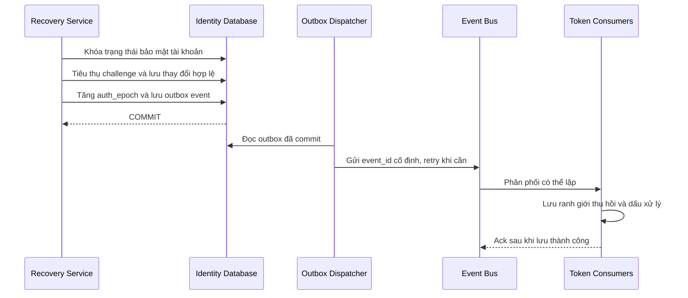

# Token revocation event

## 1. Vì sao khôi phục tài khoản cần sự kiện thu hồi token?

Một người dùng mất thiết bị xác thực, hoàn tất quy trình xác minh danh tính rồi đặt lại mật khẩu và đăng ký phương thức MFA mới. Giao diện thông báo thành công, nhưng thiết bị cũ vẫn giữ refresh token, API vẫn chấp nhận access token, còn một liên kết khôi phục trước đó vẫn chưa hết hạn. Tài khoản có thông tin đăng nhập mới nhưng quyền truy cập cũ chưa chắc đã bị cắt.

**Token revocation event** là sự kiện thông báo một quyết định thu hồi token đã được ghi nhận tại thành phần có thẩm quyền. Các dịch vụ nhận sự kiện để cập nhật trạng thái từ chối, vô hiệu hóa cache hoặc đóng phiên liên quan. Giá trị của sự kiện nằm ở việc truyền đạt đúng quyết định và phạm vi thu hồi; riêng việc gửi một thông điệp lên hàng đợi chưa chứng minh mọi nơi đã ngừng chấp nhận token.

Trong luồng khôi phục tài khoản, cần phân biệt ba thời điểm:

1. **Quyết định được cam kết:** nguồn dữ liệu có thẩm quyền đã lưu việc thu hồi.
2. **Sự kiện được phát:** thông điệp đã được chuyển tới hạ tầng phân phối.
3. **Quyết định được thực thi:** từng điểm kiểm tra quyền đã từ chối token thuộc phạm vi đó.

Bài học sử dụng một thiết kế nội bộ minh họa cho hệ thống khôi phục tài khoản. Các tên trường, trạng thái và chính sách bên dưới là lựa chọn của ví dụ, không phải một schema bắt buộc cho mọi hệ thống.

## 2. Phân biệt sự kiện, lệnh và trạng thái token

| Khái niệm | Ý nghĩa | Ví dụ |
| --- | --- | --- |
| Lệnh thu hồi | Yêu cầu hệ thống xem xét và thực hiện một thao tác | Thu hồi các phiên của tài khoản sau khi xác minh khôi phục thành công |
| Trạng thái thu hồi | Dữ liệu có thẩm quyền mà bộ kiểm tra token sử dụng | Bản ghi token có `state = REVOKED` |
| Sự kiện thu hồi | Thông báo về thay đổi đã được cam kết | `account.tokens_revoked.v1` |
| Xác nhận xử lý | Bằng chứng một consumer đã áp dụng sự kiện | Session Service đã lưu phiên bản thu hồi mới |

Consumer không được coi một lệnh chưa được kiểm tra quyền là bằng chứng tài khoản đã bị thu hồi. Producer cũng không nên phát sự kiện mang nghĩa “đã thu hồi” trước khi giao dịch thay đổi trạng thái hoàn tất.

Với token khôi phục một lần, có thể mô hình hóa các trạng thái kết thúc riêng biệt:

```text
ACTIVE ── hoàn tất thao tác hợp lệ ──> CONSUMED
ACTIVE ── quyết định thu hồi ───────> REVOKED
ACTIVE ── vượt expires_at ─────────> EXPIRED
```

`CONSUMED` thể hiện token đã thực hiện đúng mục đích một lần. `REVOKED` thể hiện quyền sử dụng bị rút lại trước khi token được dùng. `EXPIRED` thể hiện hết thời hạn. Một hệ thống có thể tính hết hạn trực tiếp từ `expires_at` thay vì chạy tác vụ đổi trạng thái; trong cả hai trường hợp, bộ kiểm tra phải từ chối token đã hết hạn.

Không chuyển một token đã thu hồi trở lại `ACTIVE` khi nhận lại sự kiện cũ hoặc khi người dùng đăng nhập thành công. Nếu người dùng cần quyền mới, hệ thống cấp token mới theo trạng thái bảo mật hiện tại.

## 3. Khi nào phát sự kiện và ai có quyền quyết định?

Quyền phát sự kiện phải xuất phát từ một thay đổi hợp lệ tại Recovery Service, Authorization Server hoặc thành phần quản lý phiên được chỉ định. Không cho phép client tự chọn tài khoản và phát sự kiện thu hồi vào bus nội bộ.

| Tình huống | Quyết định minh họa | Điều kiện cần làm rõ |
| --- | --- | --- |
| Người lạ chỉ gửi yêu cầu quên mật khẩu | Chưa thu hồi phiên đăng nhập | Yêu cầu chưa chứng minh quyền kiểm soát tài khoản |
| Khôi phục do nghi chiếm đoạt đã được xác minh và hoàn tất | Thu hồi các token thuộc phạm vi chính sách khôi phục | Bằng chứng xác minh, chính sách và giao dịch hoàn tất |
| Người dùng báo mất một thiết bị qua phiên đủ tin cậy | Thu hồi phiên hoặc nhóm token của thiết bị đó | Thiết bị nào, phiên nào, có dấu hiệu lan rộng hay không |
| Phát hiện sử dụng lại refresh token trong một family | Áp dụng chính sách xử lý family bị nghi lộ | Phải có logic phát hiện và quyết định tại nơi quản lý family |
| Quản trị viên xử lý sự cố | Thu hồi phạm vi được phê duyệt | Quyền thao tác, lý do, dấu vết kiểm toán |
| Hủy một yêu cầu khôi phục còn hiệu lực | Thu hồi token và grant của yêu cầu đó | Không tự mở rộng thành đăng xuất mọi thiết bị |

Việc gõ một email ở màn hình quên mật khẩu không được trở thành cách đăng xuất nạn nhân. OWASP khuyến nghị không thay đổi tài khoản trước khi có token hợp lệ; hướng dẫn cũng nhấn mạnh token khôi phục cần dùng một lần và có thời hạn. Sau khi đặt lại mật khẩu, hệ thống cần xử lý các phiên hiện hữu theo chính sách phù hợp. [OWASP Forgot Password Cheat Sheet](https://cheatsheetseries.owasp.org/cheatsheets/Forgot_Password_Cheat_Sheet.html)

Với mất MFA, passkey hoặc thiết bị, điều kiện xác minh danh tính phải tương ứng với mức rủi ro của thao tác. Sự kiện thu hồi không thay thế quy trình xác minh đó. Trong ví dụ này, chính sách thu hồi toàn tài khoản chỉ chạy sau khi luồng khôi phục được chấp thuận hoặc sau một quyết định ứng phó sự cố có thẩm quyền.

## 4. Xác định chính xác phạm vi thu hồi

Một sự kiện hữu ích phải trả lời: thu hồi cái gì, của ai, trong tenant nào và từ ranh giới trạng thái nào?

| Phạm vi | Định danh mục tiêu | Tác động dự kiến |
| --- | --- | --- |
| Một token | ID bản ghi token nội bộ | Chỉ token đó bị từ chối |
| Một yêu cầu khôi phục | `recovery_request_id` | Những token hoặc grant được gắn với yêu cầu đó |
| Một phiên | `session_id` | Phiên tương ứng và các token được hợp đồng quy định là liên quan |
| Một refresh-token family | `family_id` | Các thành viên thuộc family bị thu hồi, gồm cả việc chặn cấp tiếp từ family |
| Một tài khoản | `tenant_id`, `subject_id` và phiên bản bảo mật mới | Các loại token được liệt kê, có phiên bản cũ hơn ranh giới mới |

Thu hồi recovery token không mặc nhiên thu hồi refresh token. Thu hồi refresh token không tự làm JWT access token biến mất khỏi thiết bị. Xóa cookie tại một trình duyệt cũng không cắt bản sao token trên thiết bị khác. Mỗi điểm kiểm tra phải có cách nhận biết rằng quyền tương ứng đã kết thúc.

RFC 7009 định nghĩa endpoint thu hồi token OAuth và bàn về việc thu hồi các token liên quan theo chính sách. Tài liệu cũng thừa nhận có thể tồn tại độ trễ lan truyền giữa các máy chủ. Endpoint này và sự kiện nội bộ là hai cơ chế khác nhau; gọi endpoint thành công không phải bằng chứng tất cả consumer đã cập nhật cache. [RFC 7009, mục 2.1](https://www.rfc-editor.org/rfc/rfc7009.html#section-2.1)

### Ranh giới theo phiên bản bảo mật

Ví dụ sử dụng `auth_epoch`, một số nguyên tăng đơn điệu của tài khoản. Token thuộc các loại được quản lý mang epoch tại thời điểm cấp:

```text
Trước khôi phục: account.auth_epoch = 17
Token cũ:        token.auth_epoch   = 17
Sau thu hồi:     account.auth_epoch = 18
Điều kiện epoch: token.auth_epoch phải bằng epoch hiện hành có thẩm quyền
```

Điều kiện epoch là một phần của kiểm tra token, bên cạnh chữ ký hoặc đối chiếu bí mật, thời hạn, issuer, audience, mục đích và trạng thái bản ghi. Không chấp nhận token chỉ vì nó tự khai một epoch lớn hơn giá trị đang biết.

Trong thiết kế minh họa, một miền `auth_epoch` chung áp dụng cho recovery token, recovery grant, refresh token, access token và phiên web. Vì vậy, tăng epoch có chủ ý vô hiệu hóa quyền cũ ở cả năm loại. Một sản phẩm muốn thu hồi riêng từng loại cần dùng các miền phiên bản hoặc các phạm vi khác và mô tả rõ quan hệ giữa chúng.

Sau khi epoch tăng lên 18, một lần đăng nhập mới hợp lệ có thể cấp token epoch 18. Nếu consumer nhận chậm sự kiện tăng lên 18, nó chỉ loại quyền trước ranh giới đó; không thực hiện thao tác “xóa mọi phiên đang tồn tại lúc nhận” khiến phiên mới cũng bị xóa nhầm.

`occurred_at` hữu ích cho quan sát, nhưng ví dụ không dùng đồng hồ máy chủ để xác định thứ tự bảo mật. Hai node có thể lệch giờ hoặc ghi sự kiện trong cùng một đơn vị thời gian. Epoch phải được tăng tại nguồn dữ liệu có thẩm quyền bằng cơ chế tuần tự hóa cập nhật của cùng tài khoản.

## 5. Hợp đồng sự kiện minh họa

Ví dụ một sự kiện sau khi khôi phục tài khoản do nghi bị chiếm đoạt đã hoàn tất:

```json
{
  "event_id": "evt_01_recovery_complete",
  "event_type": "account.tokens_revoked.v1",
  "schema_version": 1,
  "issuer": "account-recovery-service",
  "audience": "identity-enforcement-services",
  "tenant_id": "tenant_demo",
  "subject_id": "account_demo",
  "scope": {
    "kind": "ACCOUNT_EPOCH",
    "auth_epoch": 18,
    "token_classes": [
      "recovery_token",
      "recovery_grant",
      "refresh_token",
      "access_token",
      "web_session"
    ]
  },
  "aggregate_version": 57,
  "reason": "COMPROMISE_RECOVERY_COMPLETED",
  "occurred_at": "2026-11-23T03:00:00Z",
  "correlation_id": "recovery_request_demo",
  "policy_version": "recovery-policy-4"
}
```

Những ID trên là dữ liệu giả để minh họa, không phải bí mật hay giá trị token.

- `event_id` định danh duy nhất một sự kiện. Retry gửi lại cùng sự kiện phải giữ nguyên ID.
- `event_type` và `schema_version` cho biết cách diễn giải hợp đồng. Consumer không đoán ý nghĩa của một phiên bản chưa hỗ trợ.
- `issuer` và `audience` thể hiện nguồn và bên nhận dự kiến; giá trị trong JSON cần được gắn với danh tính đã xác thực của producer, không được tự coi là bằng chứng đáng tin.
- `tenant_id` và `subject_id` là khóa định danh nội bộ. Mọi tra cứu và cập nhật phải giữ đúng ranh giới tenant.
- `scope.kind` quyết định cấu trúc mục tiêu. Với phạm vi một token, hợp đồng cần một ID bản ghi token; không dùng thiếu `subject_id` để ngầm hiểu “mọi tài khoản”.
- `auth_epoch` là ranh giới quyền mới. `aggregate_version` là phiên bản thay đổi của bản ghi nguồn, phục vụ đối soát; hai giá trị không được tùy tiện thay thế nhau.
- `reason`, `correlation_id` và `policy_version` phục vụ giải thích quyết định và liên hệ với hồ sơ khôi phục đã được bảo vệ.

Không đưa mật khẩu, OTP, recovery code, token nguyên bản, URL khôi phục hoặc tài liệu xác minh danh tính vào payload. Consumer cần nhận diện mục tiêu thu hồi, không cần có khả năng sử dụng thông tin xác thực của người dùng. Ngay cả ID nội bộ cũng có thể liên kết hoạt động của một người, nên quyền đọc bus và thời hạn lưu dữ liệu phải được giới hạn theo nhu cầu vận hành.

Nếu tích hợp liên hệ thống bằng Security Event Token, cần theo profile đã thống nhất. RFC 8417 định nghĩa cấu trúc SET và phân biệt nó với access token; tài liệu không tự cung cấp thứ tự cho nhiều sự kiện. JSON nội bộ trong ví dụ trên không phải một SET tuân thủ RFC chỉ vì có trường sự kiện hoặc được bọc thành JWT. [RFC 8417](https://www.rfc-editor.org/rfc/rfc8417.html)

## 6. Ghi trạng thái và sự kiện trong cùng giao dịch

Một lỗi thường gặp là cập nhật thông tin đăng nhập xong mới gọi broker:

```text
Đổi thông tin đăng nhập -> COMMIT -> gọi broker -> tiến trình bị dừng
```

Tài khoản đã thay đổi nhưng sự kiện thu hồi bị mất. Đảo thứ tự cũng không giải quyết được: nếu phát sự kiện trước rồi giao dịch rollback, consumer có thể thu hồi quyền cho một thay đổi chưa từng hoàn tất.

Ví dụ chọn **transactional outbox**: lưu bản ghi sự kiện trong cùng giao dịch cơ sở dữ liệu với quyết định thu hồi. Một dispatcher đọc outbox sau commit và gửi lại khi cần.



Một giao dịch hoàn tất khôi phục của ví dụ gồm:

1. Khóa bản ghi bảo mật của đúng tài khoản hoặc dùng cơ chế so sánh phiên bản tương đương.
2. Kiểm tra challenge thuộc đúng tài khoản, đúng mục đích, chưa hết hạn, chưa bị dùng hoặc thu hồi, và có epoch phù hợp. Đối chiếu bí mật bằng cách lưu trữ và kiểm tra an toàn đã được thiết kế cho loại token đó.
3. Chuyển challenge đang dùng sang `CONSUMED` bằng cập nhật có điều kiện; yêu cầu đúng một bản ghi được đổi.
4. Lưu thay đổi thông tin đăng nhập đã được chấp thuận; thu hồi các bản ghi token cũ thuộc phạm vi chính sách.
5. Tăng `auth_epoch` và ghi sự kiện chứa giá trị mới vào outbox.
6. Commit toàn bộ; nếu một điều kiện thất bại, rollback.

Mã giả dưới đây chỉ thể hiện điều kiện tiêu thụ, không phải toàn bộ triển khai xác minh token:

```sql
UPDATE recovery_token
SET state = 'CONSUMED', consumed_at = :database_now
WHERE tenant_id = :tenant_id
  AND subject_id = :subject_id
  AND id = :verified_token_record_id
  AND purpose = :expected_purpose
  AND auth_epoch = :locked_current_epoch
  AND state = 'ACTIVE'
  AND expires_at > :database_now;

-- Chỉ tiếp tục trong cùng giao dịch nếu affected_rows = 1.
-- Tăng epoch và INSERT outbox cũng thuộc giao dịch này.
```

Giá trị `verified_token_record_id` chỉ được có sau khi đối chiếu token thành công; biết ID bản ghi không phải bằng chứng được phép khôi phục.

Các đường cấp mới và đổi refresh token cũng phải phối hợp với cùng trạng thái bảo mật. Chẳng hạn, nếu quá trình refresh đã đọc epoch 17 rồi chờ, nó không được cấp token có hiệu lực như một phiên epoch 18 sau khi khôi phục vừa commit. Cách đơn giản trong ví dụ là khóa cùng bản ghi tài khoản trong giao dịch cấp/đổi token và kiểm tra lại epoch cùng trạng thái family trước khi cấp. Việc chỉ thêm outbox mà bỏ qua cuộc đua này vẫn để lại đường tái tạo quyền cũ.

Nếu thay đổi thông tin đăng nhập nằm ở một nhà cung cấp bên ngoài, không thể giả định một giao dịch SQL bao trùm cả hai hệ thống. Cần một workflow bền vững, trạng thái trung gian và cách đối soát riêng; không thông báo mọi miền đã thu hồi chỉ vì bước nội bộ đã commit.

## 7. Consumer xử lý lặp, sai thứ tự và lỗi giữa chừng

### Nhận trùng không được tạo tác dụng phụ lặp

Dispatcher có thể gửi thành công rồi mất kết nối trước khi lưu xác nhận. Broker cũng có thể giao lại thông điệp chưa được ack. Vì vậy consumer phải chấp nhận khả năng cùng một `event_id` xuất hiện nhiều lần.

Một cách xử lý là dùng inbox của từng consumer, có khóa duy nhất `(consumer_name, event_id)`. Dấu xử lý và cập nhật ranh giới thu hồi cần được lưu trong cùng giao dịch tại consumer:

```text
Xác thực nguồn gửi và kiểm tra hợp đồng sự kiện
BEGIN giao dịch consumer
    Thử chèn event_id vào inbox bằng ràng buộc duy nhất
    Nếu event_id đã được xử lý: kết thúc mà không áp dụng lại
    Nếu là sự kiện mới:
        Lưu epoch tối thiểu = max(epoch tối thiểu đang biết, epoch trong sự kiện)
        Lưu thay đổi phiên hoặc token tương ứng với phạm vi
COMMIT
Ack thông điệp
```

Nếu consumer lưu inbox trước rồi mới cập nhật trạng thái ở một giao dịch khác, lỗi ở giữa có thể khiến retry bị bỏ qua dù quyền chưa bị thu hồi. Nếu consumer cần tác dụng phụ ngoài cơ sở dữ liệu, ví dụ gửi thông báo hoặc đóng kết nối ở node khác, nó cần một tác vụ bền vững có khóa idempotency riêng. Không đánh dấu tác dụng phụ đã xong chỉ vì đã ghi inbox.

### Sai thứ tự không được khôi phục quyền cũ

Giả sử hai lần thay đổi hợp lệ tạo epoch 18 rồi 19. Consumer nhận sự kiện 19 trước, sau đó mới nhận 18. Phép cập nhật đơn điệu giữ ranh giới ở 19:

```text
max(17, 19) = 19
max(19, 18) = 19
```

Không dùng phép gán trực tiếp từ mọi sự kiện nhận được. Đồng thời, không bỏ toàn bộ một sự kiện chỉ vì `aggregate_version` nhỏ hơn phiên bản đã thấy nếu hợp đồng còn chứa tác dụng độc lập chưa áp dụng. Quy tắc “giữ max” trong ví dụ phù hợp với ranh giới epoch; một sự kiện thu hồi riêng family khác vẫn cần được xử lý theo mục tiêu của nó.

Consumer không được cấp lại token hay đăng nhập người dùng chỉ vì nhận sự kiện. Quyền mới phải đi qua đường xác thực và cấp token bình thường.

### Khởi động lại và dữ liệu thu hồi

Ranh giới epoch và bản ghi từ chối phải tồn tại bền vững hoặc có thể nạp lại từ nguồn có thẩm quyền trước khi nhận lưu lượng cần bảo vệ. Một cache trống sau restart không đồng nghĩa mọi token đều hợp lệ.

Với thu hồi một token cụ thể, giữ bản ghi từ chối đủ lâu để mọi điểm kiểm tra không còn chấp nhận token đó, kể cả khoảng cho phép lệch giờ đã cấu hình. Với refresh token có vòng đời dài hoặc cơ chế gia hạn, không xóa dấu thu hồi chỉ dựa vào một TTL ngắn cố định. Với epoch tài khoản, không giảm giá trị và không tái sử dụng định danh tài khoản theo cách khiến quyền cũ có thể hợp lệ trở lại.

## 8. JWT và cửa sổ lan truyền thu hồi

Một API chỉ kiểm tra chữ ký, audience và thời hạn của JWT sẽ không tự biết `auth_epoch` trong cơ sở dữ liệu vừa tăng. Sự kiện chỉ giúp khi đường xác thực hoặc kiểm tra quyền thực sự sử dụng trạng thái thu hồi mà consumer đã cập nhật.

| Cơ chế thực thi | Cách nhận biết thu hồi | Giới hạn cần mô tả |
| --- | --- | --- |
| Token tham chiếu, tra cứu nguồn trạng thái | Kiểm tra bản ghi token hoặc introspection phù hợp | Cache kết quả tra cứu có thể làm chậm việc từ chối |
| JWT kèm kiểm tra epoch có thẩm quyền | Đối chiếu epoch token với tài khoản | Tăng số lần truy cập trạng thái hoặc cần cache có giới hạn độ cũ |
| JWT kèm denylist theo ID token | Tra cứu ID token đã thu hồi | Phải phân phối và giữ bản ghi từ chối đủ lâu |
| JWT chỉ kiểm tra ngoại tuyến | Token cũ tiếp tục được chấp nhận tới khi hết hạn theo quy tắc validator | Không cung cấp thu hồi sớm cho API đó |

Ví dụ thu hồi commit lúc 10:00:00. API A áp dụng sự kiện lúc 10:00:02. API B chỉ kiểm tra JWT có thời hạn tới 10:05:00. Không thể tuyên bố mọi API đã cắt quyền sau hai giây; API B chưa có cơ chế nhận biết việc thu hồi trước hạn.

Một consumer đang biết epoch 17 gặp JWT epoch 18 cũng không nên chỉ dựa vào cache để quyết định nó là giả hoặc hợp lệ. Nó cần làm mới từ nguồn đáng tin hoặc xử lý theo chính sách không thể xác minh trạng thái. Ngược lại, sau khi đã biết epoch 19, nó phải từ chối token epoch 18 dù sự kiện 18 đến muộn.

Trong thiết kế yêu cầu chặn nhanh thao tác nhạy cảm, điểm thực hiện thay đổi như thêm passkey, đổi địa chỉ khôi phục hoặc xuất recovery code phải kiểm tra trạng thái mới tại ranh giới thực hiện thao tác. Kiểm tra một lần khi request vừa vào gateway không đủ nếu request chờ lâu rồi mới ghi dữ liệu. Cần phối hợp giao dịch, khóa hoặc điều kiện phiên bản để quyền cũ không hoàn tất thao tác sau ranh giới thu hồi đã chọn.

Các tham số vận hành nên bao gồm độ cũ tối đa được phép của trạng thái thu hồi và cách xử lý khi vượt giới hạn đó. Độ trễ broker quan sát được ở phân vị cao giúp theo dõi hệ thống, nhưng không phải một bảo đảm tuyệt đối về thời gian cắt quyền. Không thể cam kết giới hạn hữu hạn khi một điểm thực thi có thể dùng cache cũ vô thời hạn.

## 9. Session, MFA và passkey sau khôi phục

Việc thu hồi token truy cập cần đi cùng chính sách cho các phiên và thông tin xác thực liên quan. OWASP xem khôi phục tài khoản và thay đổi thông tin quan trọng là những sự kiện rủi ro cần xem xét xác thực lại. [OWASP Session Management Cheat Sheet](https://cheatsheetseries.owasp.org/cheatsheets/Session_Management_Cheat_Sheet.html#reauthentication-after-risk-events)

Trong ví dụ, token và phiên cũ có epoch 17 không được dùng để cấp tiếp quyền epoch 18. Recovery grant chỉ cho phép hoàn tất những thao tác khôi phục được chỉ định, không tự biến thành phiên đăng nhập đầy đủ. Sau khi luồng kết thúc, người dùng thực hiện đường đăng nhập phù hợp với thông tin xác thực còn hợp lệ.

Passkey là thông tin xác thực có khóa công khai được đăng ký, không phải access token. Thu hồi session token không tự xóa đăng ký passkey hay khóa TOTP. Nếu thiết bị hoặc phương thức xác thực bị xác định là đã lộ, cần một quyết định riêng đối với bản ghi authenticator tương ứng. Đồng thời phải kiểm soát khả năng phiên cũ dùng để thêm authenticator mới trước khi quyền bị cắt.

Với WebSocket hoặc kết nối dài, việc token không thể dùng cho request mới không nhất thiết đóng kết nối đã tồn tại. Dịch vụ sở hữu kết nối cần ánh xạ đúng phiên, áp dụng ranh giới thu hồi và kiểm tra lại quyền khi thực hiện thao tác nhạy cảm. Việc gửi lệnh đóng kết nối nên có khả năng lặp an toàn; nó không thay thế kiểm tra quyền phía máy chủ.

Một tài khoản đăng nhập qua nhiều nhà cung cấp hoặc nhiều ứng dụng có thể có nhiều miền phiên độc lập. Sự kiện nội bộ của ứng dụng chỉ bảo đảm trong những miền đã có consumer và cơ chế thực thi tương ứng.

## 10. Bảo vệ đường truyền sự kiện và quan sát kết quả

Đường sự kiện là một phần của cơ chế bảo mật. Nếu bên không có quyền có thể giả mạo sự kiện account-wide, họ có thể liên tục cắt phiên của nạn nhân. Nếu một consumer chấp nhận sai tenant hoặc sai mục tiêu, tác động có thể vượt khỏi tài khoản đang được khôi phục.

Thiết kế minh họa yêu cầu:

- Producer có danh tính dịch vụ được xác thực và quyền gửi đúng loại sự kiện; client công khai không được ghi trực tiếp vào topic này.
- Consumer kiểm tra nguồn, phiên bản schema, tenant, scope và các trường bắt buộc trước khi cập nhật dữ liệu. Payload không hợp lệ đi vào quy trình xử lý lỗi có quan sát được.
- Kênh truyền bảo vệ tính toàn vẹn và bí mật theo mô hình triển khai. Nếu cần bằng chứng từ đầu đến cuối qua nhiều bên trung gian, dùng cơ chế xác thực thông điệp phù hợp với hợp đồng đã thống nhất.
- Quyền đọc outbox, inbox, bus và log được giới hạn. Không ghi token hoặc hồ sơ định danh nhạy cảm vào log lỗi.
- Retry có giới hạn tốc độ và backoff; bản ghi lỗi không bị xóa im lặng. Sự kiện không xử lý được phải có đường sửa nguyên nhân và phát lại an toàn.

Các trạng thái vận hành nên diễn đạt đúng mức bằng chứng:

| Trạng thái | Có thể kết luận | Chưa thể kết luận |
| --- | --- | --- |
| Giao dịch thu hồi đã commit | Nguồn có thẩm quyền đã đổi trạng thái | Mọi consumer đã áp dụng |
| Outbox còn chờ gửi | Có sự kiện bền vững cần phân phối | Sự kiện đã đến nơi |
| Broker xác nhận nhận thông điệp | Broker đã nhận theo bảo đảm của nó | Bộ kiểm tra token đã đổi quyết định |
| Consumer đã lưu epoch mới | Consumer đó đã cập nhật trạng thái bền vững | Mọi node thực thi phía sau đều đã làm mới cache |
| Điểm thực thi từ chối token cũ | Quyền cũ bị chặn tại điểm được quan sát | Mọi hệ thống ngoài phạm vi cũng đã thu hồi |

Những số liệu hữu ích gồm tuổi bản ghi outbox chưa gửi, độ trễ từ commit đến consumer áp dụng, số lần giao lại, lỗi schema, tuổi cache thu hồi và lượng request bị từ chối vì epoch cũ. Khóa liên hệ nên là `event_id`, `correlation_id` và định danh nội bộ được kiểm soát, thay vì email hoặc token nguyên bản.

Nếu broker ngừng hoạt động, quyết định đã commit tại nguồn không được rollback chỉ để làm các phiên cũ hoạt động lại. Dispatcher tiếp tục retry; các thao tác cần trạng thái mới dùng đường kiểm tra có thẩm quyền hoặc chính sách từ chối khi không xác minh được. Phản hồi cho người dùng và nhân viên vận hành phải phản ánh được phạm vi nào đã hoàn tất, phạm vi nào còn đang lan truyền.

## 11. Diễn tiến một lần khôi phục

Giả sử tài khoản đang ở epoch 17, có phiên web S1, refresh-token family F1 và hai yêu cầu khôi phục R1, R2.

1. Người dùng hoàn tất xác minh cho R2 theo chính sách khôi phục do nghi chiếm đoạt. Chỉ việc tạo R1 hoặc R2 trước đó chưa làm S1 bị thu hồi.
2. Giao dịch hoàn tất R2 tiêu thụ token được dùng, lưu thông tin xác thực mới, thu hồi quyền cũ thuộc phạm vi chính sách và nâng epoch lên 18. Cùng giao dịch lưu sự kiện E1 vào outbox.
3. Mọi đường xác minh recovery token có thẩm quyền từ chối token R1 cũ theo trạng thái hoặc epoch, dù email chứa liên kết R1 vẫn còn trong hộp thư.
4. Authorization Server từ chối đổi token từ F1; Session Service loại S1. Các API áp dụng quy tắc epoch hoặc denylist theo hợp đồng để chặn access token cũ.
5. Consumer nhận E1 hai lần vẫn giữ ranh giới 18. Nếu người dùng đã đăng nhập hợp lệ lại và nhận phiên S2 epoch 18, việc nhận E1 muộn không thu hồi nhầm S2.
6. Nếu một API chỉ xác minh JWT ngoại tuyến, token cũ có thể còn được chấp nhận đến hết hạn. Đây là giới hạn của cơ chế thực thi tại API đó và phải được giải quyết khi yêu cầu sản phẩm đòi cắt quyền sớm hơn.

Điểm cốt lõi của thiết kế là sự nhất quán giữa **quyết định có thẩm quyền, phạm vi thu hồi, bản ghi sự kiện bền vững và kiểm tra quyền thực tế**. Khi bốn phần này có hợp đồng rõ ràng, luồng khôi phục mới có thể giảm nguy cơ người đang giữ token cũ tiếp tục chiếm quyền sau khi chủ tài khoản đã hoàn tất khôi phục.
