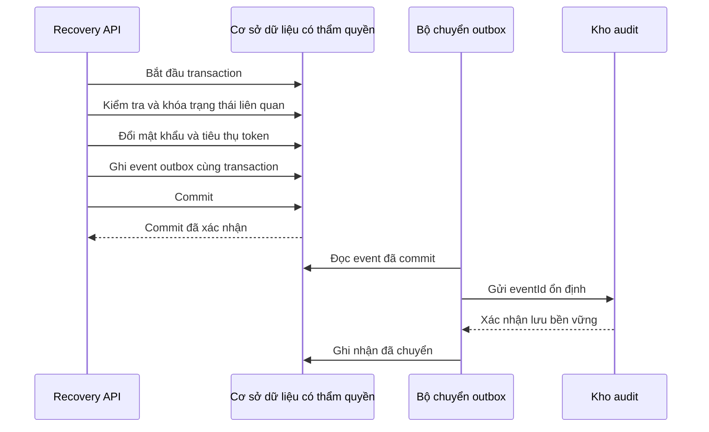

# Token lifecycle audit — Dấu vết kiểm toán vòng đời token

Một recovery token có thể được phát hành đúng cách nhưng vẫn trở thành điểm yếu nếu hệ thống không trả lời được: token đó phục vụ hồ sơ nào, ai cho phép phát hành, khi nào quyền bị tiêu thụ, vì sao bị thu hồi và điều gì xảy ra sau đó. Khi người dùng báo “tôi không yêu cầu khôi phục tài khoản”, một dòng log HTTP thành công không đủ để dựng lại diễn biến.

**Token lifecycle audit** là việc tạo, bảo vệ và đối chiếu bằng chứng về vòng đời token. Trong khôi phục tài khoản, bằng chứng cần liên kết được quyết định cấp quyền với thay đổi mật khẩu, MFA, passkey hoặc thiết bị xác thực, đồng thời không tạo thêm nơi lưu bí mật.

Bài này trình bày một thiết kế minh họa. Tên event, schema, trạng thái, truy vấn và chính sách vận hành bên dưới là đề xuất để giải thích cách thiết kế; chúng không phải một bộ mã sự kiện hay yêu cầu tuân thủ dùng chung cho mọi hệ thống.

## 1. Audit cần trả lời những câu hỏi nào?

Một cuộc điều tra vòng đời token thường bắt đầu từ một hồ sơ recovery hoặc một thay đổi trên tài khoản, chứ không bắt đầu từ secret của token.

| Câu hỏi | Bằng chứng cần có trong thiết kế |
| --- | --- |
| Vì sao phát hành token? | Hồ sơ recovery, purpose, quyết định và phiên bản policy |
| Quyền gắn với đối tượng nào? | Tenant, tham chiếu tài khoản và bản ghi token |
| Ai hoặc dịch vụ nào thực hiện? | Danh tính tác nhân đã xác minh, dịch vụ thực thi, nguồn yêu cầu |
| Token được gửi như thế nào? | Tham chiếu kênh đã được phép, các lần gửi và kết quả tương ứng |
| Token có bị thay thế không? | Quan hệ giữa bản ghi cũ, bản ghi mới và lý do thay thế |
| Quyền đã được sử dụng chưa? | Chuyển trạng thái đã commit và thao tác nghiệp vụ liên quan |
| Có ai thử sử dụng sau thu hồi hoặc hết hạn không? | Sự kiện từ chối, ngữ cảnh kiểm tra và thời điểm quan sát |
| Sau recovery còn quyền truy cập nào? | Kết quả cưỡng chế session và thay đổi authenticator có liên quan |
| Bằng chứng có bị thiếu hoặc sửa không? | Tình trạng thu thập, độ trễ, khoảng trống và kiểm soát toàn vẹn |

Audit không thay thế kiểm tra quyền. API hoàn tất recovery vẫn phải đọc trạng thái có thẩm quyền, kiểm tra secret, purpose, hạn dùng và policy tại điểm quyết định.

**Không tìm thấy event trong hệ thống tìm kiếm log không chứng minh token chưa từng được sử dụng.** Event có thể chưa được chuyển tới, bị lỗi lập chỉ mục hoặc nằm ngoài khoảng thời gian đang truy vấn.

## 2. Phân biệt trạng thái, bằng chứng và chỉ số

Trong thiết kế minh họa, ba lớp có trách nhiệm khác nhau:

| Lớp | Nội dung | Dùng để làm gì? |
| --- | --- | --- |
| Kho trạng thái token | Secret verifier, thời hạn, trạng thái, version | Quyết định token có được thực hiện hành động hiện tại không |
| Audit trail | Sự kiện có cấu trúc về quyết định và kết quả | Dựng lại lịch sử và giải thích thay đổi |
| Metrics | Số lượng, tỷ lệ, độ trễ tổng hợp | Phát hiện xu hướng và vận hành |

Không đưa secret verifier sang audit trail chỉ để “đủ dữ liệu”. Người phân tích cần biết bản ghi nào được kiểm tra và kết quả ra sao; họ không cần có khả năng kiểm thử hoặc sử dụng secret.

Tương tự, một metric `recovery_token_consumed_total` tăng lên không đủ chứng minh hồ sơ cụ thể đã hoàn tất. Metric cũng không nên dùng email, token hoặc ID hồ sơ làm nhãn có số lượng giá trị không giới hạn.

Nếu kiến trúc dùng event sourcing, event store có thể là nguồn trạng thái chính. Khi đó cần định nghĩa rõ luồng event có thẩm quyền và cách dựng trạng thái; không mặc nhiên trao vai trò ấy cho bản sao log tại SIEM.

## 3. Xác định các mốc vòng đời cần ghi nhận

OWASP khuyến nghị token đặt lại mật khẩu được tạo bằng bộ sinh ngẫu nhiên an toàn, lưu trữ an toàn, chỉ dùng một lần và có hạn dùng phù hợp. Đây là các thuộc tính mà dấu vết kiểm toán cần giúp giải thích, nhưng một event “đã phát hành” riêng lẻ chưa chứng minh các thuộc tính ấy được cưỡng chế. [OWASP Forgot Password Cheat Sheet](https://cheatsheetseries.owasp.org/cheatsheets/Forgot_Password_Cheat_Sheet.html)

Một danh mục event minh họa:

| Event | Khi nào được tạo? | Không nên suy diễn thành |
| --- | --- | --- |
| `recovery.request_observed` | Dịch vụ nhận một yêu cầu recovery | Tài khoản tồn tại hoặc người yêu cầu đã được xác minh |
| `recovery.token_issued` | Bản ghi token và quyết định phát hành đã được lưu bền vững | Người dùng đã nhận hoặc đã đọc token |
| `recovery.token_delivery_attempted` | Thành phần phân phối thực hiện một lần gửi | Nhà cung cấp đã tiếp nhận thành công |
| `recovery.token_delivery_accepted` | Nhà cung cấp xác nhận tiếp nhận lần gửi | Token đã tới đúng người hoặc được người đó mở |
| `recovery.token_check_rejected` | Một lần kiểm tra không được chấp nhận | Token chắc chắn tồn tại, hoặc đã bị tiêu thụ |
| `recovery.token_consumed` | Quyền token đã được tiêu thụ bằng thay đổi trạng thái có thẩm quyền | Mọi bước recovery về sau đều hoàn tất |
| `recovery.token_revoked` | Quyết định thu hồi đã có hiệu lực | Tất cả session hoặc token loại khác đã bị chặn |
| `recovery.token_expiry_observed` | Dịch vụ quan sát token đã qua hạn | Token chỉ vừa hết hạn tại thời điểm ghi event |
| `recovery.token_record_purged` | Dữ liệu bản ghi đã được xóa theo chính sách | Toàn bộ dấu vết ở mọi hệ thống đã bị xóa |

Các kết quả giao nhận như bounce hoặc delivery receipt, nếu có, là event riêng theo ngữ nghĩa của nhà cung cấp. Email được phần mềm quét liên kết mở không phải bằng chứng người dùng đã đọc hoặc chấp thuận recovery.

### Trạng thái terminal và điều kiện sử dụng

Một mô hình đơn giản có thể dùng `ACTIVE`, `CONSUMED` và `REVOKED`, đồng thời tính hết hạn từ `expiresAt`:

```text
Có thể xem xét sử dụng =
    state == ACTIVE
    và trustedNow < expiresAt
    và đúng tenant, hồ sơ, purpose
    và secret hợp lệ
    và đủ điều kiện policy
```

Một hàng còn `state=ACTIVE` sau `expiresAt` vẫn không có quyền sử dụng. Không cần đợi job đổi hàng sang `EXPIRED` mới chặn token.

Nếu hệ thống lưu `EXPIRED` như trạng thái riêng, audit phải phân biệt thời điểm quyền hết hiệu lực với thời điểm job cập nhật bản ghi. Hai cách biểu diễn đều cần semantics nhất quán.

## 4. Thiết kế định danh tương quan mà không dùng secret

Một request chỉ là một lần tương tác. Một hồ sơ có thể kéo dài qua nhiều request, nhiều lần gửi và nhiều token.

Trong ví dụ này:

- `requestRef`: nối các hoạt động thuộc cùng một request.
- `caseRef`: nối các hoạt động thuộc cùng hồ sơ recovery.
- `tokenRecordRef`: định danh nội bộ của một bản ghi token, được tạo độc lập với secret.
- `deliveryAttemptRef`: phân biệt các lần gửi.
- `operationRef`: nối một thao tác nghiệp vụ và kết quả bền vững của nó.
- `eventId`: định danh của một sự kiện, được giữ nguyên khi phát lại.
- `causationRef`: chỉ ra thao tác hoặc sự kiện trực tiếp dẫn tới sự kiện hiện tại.

Không dùng token thô, một phần token, hoặc hash của mã ngắn làm khóa tương quan. Hash không có khóa của OTP ngắn vẫn có thể bị thử toàn bộ không gian giá trị.

Một tham chiếu ngẫu nhiên không phải quyền truy cập. API đọc lịch sử vẫn phải kiểm tra quyền theo tenant, tài khoản, hồ sơ và vai trò; biết `caseRef` không cho phép xem bằng chứng xác minh danh tính.

### Phát lại và phát hành mới

Nếu gửi lại cùng token được policy cho phép, giữ `tokenRecordRef` và tạo `deliveryAttemptRef` mới. Nếu tạo secret mới, tạo bản ghi token mới và ghi quan hệ thay thế khi thực sự có.

Ví dụ:

```text
case rc_A
  token tr_1: ISSUED -> delivery d_1 -> delivery d_2 -> REVOKED
  token tr_2: ISSUED, replaces=tr_1 -> delivery d_3 -> CONSUMED
```

Chỉ ghi `replaces=tr_1` khi thiết kế thực sự thay thế token ấy. Nếu policy cho phép hai token đồng thời, cần ghi đúng hai quyền còn hiệu lực, thay vì gắn quan hệ thay thế cho tiện hiển thị.

## 5. Một bản ghi audit có cấu trúc

OWASP khuyến nghị log thể hiện được thời điểm, vị trí, tác nhân và sự việc; đồng thời tránh ghi trực tiếp access token, mật khẩu, session identifier và bí mật mật mã. [OWASP Logging Cheat Sheet](https://cheatsheetseries.owasp.org/cheatsheets/Logging_Cheat_Sheet.html)

Một event tiêu thụ token trong thiết kế minh họa:

```json
{
  "schemaVersion": 1,
  "eventId": "evt_example_019",
  "eventType": "recovery.token_consumed",
  "eventClass": "STATE_TRANSITION",
  "occurredAt": "2026-11-23T04:10:30.120Z",
  "recordedAt": "2026-11-23T04:10:31.400Z",
  "producer": "account-recovery-service",
  "producerVersion": "release_example",
  "tenantRef": "tenant_example",
  "accountRef": "acct_example",
  "caseRef": "rc_example",
  "tokenRecordRef": "tr_example",
  "requestRef": "req_example",
  "operationRef": "op_example",
  "actor": {
    "kind": "RECOVERY_CLAIMANT",
    "verifiedContextRef": "ctx_example",
    "assuranceBasis": "POLICY_EVIDENCE_ACCEPTED"
  },
  "executor": "service_account_recovery",
  "purpose": "PASSWORD_RESET",
  "policyVersion": "recovery_policy_example",
  "transition": {
    "from": "ACTIVE",
    "to": "CONSUMED",
    "version": 4
  },
  "outcome": "COMMITTED",
  "reasonCode": "PASSWORD_CHANGE_COMMITTED"
}
```

Các giá trị trên đều là dữ liệu giả. `verifiedContextRef` trỏ tới ngữ cảnh được kiểm soát quyền; nó không chứa ảnh giấy tờ, câu trả lời xác minh hoặc secret.

Cần phân biệt **người khai báo danh tính**, **người có bằng chứng phù hợp** và **dịch vụ thực thi**. Một request nhập email của Mai không được ghi `actor=Mai` như thể Mai đã được xác thực.

`PASSWORD_RESET` cũng không đồng nghĩa người đó đã đủ điều kiện gỡ MFA hoặc đăng ký passkey mới. Audit cần giữ đúng phạm vi bằng chứng và quyền thực tế được cấp.

### Trường nào chỉ ghi khi thực sự biết?

Với một token không ánh xạ được tới bản ghi hợp lệ, có thể không có `accountRef`, `caseRef` hoặc `tokenRecordRef`. Không suy ra tài khoản từ chuỗi do client tự khai rồi ghi như một kết luận đã xác minh.

`reasonCode` nên là mã hữu hạn do server chọn. Không chép nguyên exception, giá trị header hoặc request body vào trường này.

## 6. Gắn event với kết quả commit

Đây là điểm dễ gây sai lịch sử nhất:

```text
Ghi log "token_consumed"
    -> cập nhật mật khẩu
    -> transaction rollback
```

Dấu vết khi ấy tuyên bố một thay đổi không hề có hiệu lực.

Chiều ngược lại cũng có vấn đề:

```text
Commit mật khẩu và trạng thái token
    -> gọi hệ thống log
    -> mất kết nối trước khi event được lưu
```

Thay đổi có thật nhưng bằng chứng bị mất.

### Một phương án: transactional outbox

Trong ví dụ, thay đổi nghiệp vụ, tiêu thụ token và bản ghi outbox nằm trong cùng một transaction cục bộ:



Các event quan sát request bị từ chối có thể đi qua đường ghi khác. Chúng không được mang nhãn `STATE_TRANSITION/COMMITTED` khi không có chuyển trạng thái.

Outbox trong ví dụ chỉ chứa dữ liệu audit an toàn. Nếu tác vụ gửi token cần chuyển secret tới nhà cung cấp, payload phân phối phải được bảo vệ riêng và có thời hạn giữ riêng; không nhét secret vào audit outbox.

### Chống hai lần tiêu thụ cùng một quyền

Pseudo-SQL sau chỉ minh họa ràng buộc cập nhật trạng thái, không phải toàn bộ logic xác minh:

```sql
UPDATE recovery_token
SET state = 'CONSUMED',
    consumed_at = :trusted_now,
    version = version + 1
WHERE token_record_ref = :token_record_ref
  AND tenant_ref = :tenant_ref
  AND case_ref = :case_ref
  AND purpose = :expected_purpose
  AND state = 'ACTIVE'
  AND expires_at > :trusted_now
  AND version = :expected_version;
```

Secret phải được xác minh trước bằng cơ chế phù hợp. Các điều kiện nghiệp vụ có thể thay đổi đồng thời cũng phải được bảo vệ trong transaction hoặc bằng cơ chế tương đương.

Chỉ khi cập nhật đúng một hàng và toàn bộ transaction commit, event tiêu thụ mới có ý nghĩa `COMMITTED`. Nếu đổi mật khẩu thất bại thì cập nhật token và outbox phải rollback cùng nó trong mô hình này.

Nếu token được tiêu thụ để đổi lấy một recovery grant hẹp, event cần mô tả đúng hành động `TOKEN_EXCHANGED_FOR_GRANT`. Việc đổi mật khẩu xảy ra sau là một thao tác và bằng chứng riêng.

## 7. Chấp nhận giao nhận lặp, phân biệt thứ tự và thời gian

Bộ chuyển outbox có thể gửi event thành công rồi chết trước khi ghi nhận xác nhận. Khi chạy lại, cùng event được gửi thêm lần nữa.

Trong thiết kế này:

1. `eventId` được tạo và lưu cùng outbox, không tạo mới mỗi lần retry.
2. Kho audit có ràng buộc duy nhất cho `eventId`.
3. Nếu cùng ID nhưng nội dung khác nhau, hệ thống ghi nhận bất thường; không âm thầm ghi đè.
4. Tác vụ downstream cũng cần chống xử lý lặp theo hợp đồng của mình.

Giao nhận lặp không đồng nghĩa token được dùng hai lần. Ngược lại, hai event có ID khác nhau cùng khẳng định một lần tiêu thụ cần được đối chiếu với operation và version.

### Không sắp xếp toàn bộ lịch sử chỉ bằng timestamp

Trong schema minh họa:

| Trường | Ý nghĩa |
| --- | --- |
| `occurredAt` | Thời điểm producer ghi nhận sự việc theo đồng hồ server |
| `recordedAt` | Thời điểm kho audit nhận và lưu event |
| `expiresAt` | Mốc hết quyền được lưu khi phát hành token |
| `effectiveAt` nếu có | Mốc hiệu lực theo semantics của quyết định cụ thể |
| `transition.version` | Thứ tự chuyển trạng thái của cùng một bản ghi |

Đồng hồ server cần được quản lý; timestamp không phải bằng chứng tuyệt đối về thứ tự commit giữa nhiều máy. Thời gian do trình duyệt gửi chỉ là dữ liệu khai báo nếu chưa có cơ sở tin cậy.

Version dùng để đối chiếu **chuyển trạng thái của cùng token**, không phải bộ đếm liên tục của mọi request. Giữa hai version có thể có nhiều lần gửi, kiểm tra sai hoặc truy vấn không thay đổi trạng thái.

Token đã hết hạn lúc 04:20 nhưng job quan sát lúc 04:27 phải được giải thích bằng hai mốc ấy. Không ghi lịch sử giả rằng quyền vẫn còn hiệu lực trong bảy phút chờ job.

## 8. Audit trạng thái không đồng nghĩa audit toàn bộ recovery đã xong

Một chuỗi event có thể là:

```text
token_consumed: COMMITTED
password_changed: COMMITTED
session_invalidation_requested: QUEUED
notification_requested: QUEUED
```

Chuỗi này chưa chứng minh session cũ đã bị chặn hoặc người dùng đã được thông báo.

NIST SP 800-63B-4 yêu cầu thông báo cho người đăng ký hoặc người được chỉ định khi xảy ra account recovery, trong phạm vi áp dụng của hướng dẫn. Thiết kế hệ thống vì vậy cần phân biệt yêu cầu gửi thông báo với kết quả gửi được ghi nhận, không dùng một event chung để đại diện mọi giai đoạn. [NIST SP 800-63B-4, Account Recovery Notification](https://pages.nist.gov/800-63-4/sp800-63b.html#account-recovery)

Với session, một event `session_invalidation_effective` chỉ nên mang ý nghĩa đã đạt điều kiện cưỡng chế được định nghĩa. Nếu dùng session epoch, cần biết các điểm kiểm tra truy cập có thực sự áp dụng epoch mới; audit không biến một message đã enqueue thành bảo đảm chặn truy cập.

Tương tự, việc thu hồi token do nghi ngờ lộ secret không tự thu hồi passkey, refresh token hay recovery code khác. Bằng chứng phải chỉ rõ phạm vi và đối tượng.

### Thao tác từ hỗ trợ hoặc quản trị

Nếu nhân viên hỗ trợ thu hồi token hay cho phép bắt đầu một bước recovery, cần liên kết:

- Danh tính nhân viên và dịch vụ thực thi.
- Ticket hoặc quyết định phê duyệt có quyền truy cập riêng.
- Phạm vi quyền, lý do dạng mã và phiên bản policy.
- Kết quả thay đổi thực tế.

Một ticket tồn tại không có nghĩa yêu cầu đã được phê duyệt. Không cho tác nhân tự khai `approved=true` trong request rồi xem đó là bằng chứng.

## 9. Kiểm soát dữ liệu đi vào audit

Trong mô hình này, producer xây event theo danh sách trường cho phép. Dữ liệu nhạy cảm bị loại trước khi event rời thành phần xử lý, thay vì chờ bộ lọc tại kho tìm kiếm.

Không đưa vào audit:

- Token, OTP, recovery code hoặc liên kết chứa secret.
- Cookie, Authorization header, recovery grant hoặc mật khẩu.
- Secret verifier lấy từ kho token.
- Nội dung giấy tờ, ảnh khuôn mặt hoặc câu trả lời xác minh.
- Toàn bộ request/response body để “phòng khi cần”.

Mã hóa cả kho log không biến việc sao chép secret vào log thành thiết kế tối thiểu dữ liệu. Người có quyền đọc log có thể vẫn xem được nội dung sau giải mã.

### Dữ liệu gián tiếp cũng cần được xem xét

Email, số điện thoại, địa chỉ IP và User-Agent có thể hỗ trợ điều tra nhưng cũng tăng khả năng liên kết cá nhân. Với ví dụ này, ưu tiên tham chiếu nội bộ tới dữ liệu được quản lý riêng; chỉ giữ tín hiệu bổ sung khi có mục đích và quyền truy cập phù hợp.

Không coi pseudonymization là ẩn danh tuyệt đối. `accountRef` vẫn có thể nối tới một cá nhân qua hệ thống khác.

Trường do client kiểm soát cần giới hạn độ dài và serialize đúng định dạng. Một chuỗi chứa xuống dòng không được tạo thành event giả hoặc làm hỏng cấu trúc. Giao diện xem audit cũng phải encode nội dung khi hiển thị.

Lọc secret phải bao phủ cả reverse proxy, tracing, APM, exception reporter và payload lỗi của nhà cung cấp. Dịch vụ chính không log token vẫn chưa đủ nếu URL chứa token bị sao chép sang access log.

## 10. Bảo vệ đường đi và thời gian lưu bằng chứng

Có thể tổ chức ba vai trò trong thiết kế minh họa:

| Vai trò | Quyền phù hợp |
| --- | --- |
| Producer | Gửi event thuộc loại và tenant được phép; không đọc lịch sử tùy ý |
| Điều tra viên được phân quyền | Đọc phạm vi vụ việc; không sửa hoặc phát hành token |
| Người quản lý lưu trữ | Thực hiện retention theo cơ chế kiểm soát; không tự phê duyệt thay đổi nghiệp vụ |

OWASP lưu ý cần bảo vệ log khỏi truy cập, sửa đổi và xóa trái phép, đồng thời có khả năng phát hiện can thiệp. [OWASP Logging Cheat Sheet, Protection](https://cheatsheetseries.owasp.org/cheatsheets/Logging_Cheat_Sheet.html#protection)

Trong ví dụ, ứng dụng không có quyền sửa hoặc xóa các audit record đã nhận. Các điều chỉnh lịch sử được thể hiện bằng event bổ sung có tham chiếu, thay vì sửa âm thầm dòng cũ.

Nếu dùng chữ ký, chuỗi hash hoặc lưu trữ bất biến, cần nói rõ chúng bảo vệ điều gì. Chữ ký cho thấy dữ liệu được ký bằng một khóa; nó không chứng minh producer chưa bị chiếm quyền hay toàn bộ event đã được thu thập. Chuỗi hash cũng có giới hạn nếu kẻ tấn công thay được cả dữ liệu và điểm neo.

### Retention tách biệt với TTL của token

Token hết quyền không có nghĩa dấu vết điều tra phải bị xóa ngay. Ngược lại, nhu cầu điều tra không tự cho phép giữ mọi dữ liệu mãi mãi.

NIST SP 800-63B-4 có hướng dẫn về chính sách lưu hồ sơ và đánh giá rủi ro riêng tư, bảo mật khi giữ dữ liệu ngoài các yêu cầu bắt buộc. Không có một số ngày lưu chung có thể lấy từ TTL của token. [NIST SP 800-63B-4, Records Retention Policy](https://pages.nist.gov/800-63-4/sp800-63b.html#records-retention-policy)

Trong thiết kế, cần xác định riêng thời gian giữ bản ghi token, outbox đã chuyển, audit chi tiết, dữ liệu liên kết định danh và bản sao lưu. Cơ chế giữ phục vụ điều tra phải có phạm vi và người chịu trách nhiệm.

## 11. Khi đường audit gặp sự cố

Một hệ thống không nên chỉ đếm lỗi recovery mà bỏ qua việc chính audit trail đang mất dữ liệu.

Các tín hiệu vận hành đề xuất:

| Tín hiệu | Vấn đề cần xem xét |
| --- | --- |
| Tuổi của event outbox chưa chuyển lâu nhất | Kho audit hoặc bộ chuyển có thể bị gián đoạn |
| Tỷ lệ event không được schema chấp nhận | Producer và consumer có thể lệch hợp đồng |
| Event ID trùng nhưng payload khác | Lỗi producer hoặc dấu hiệu can thiệp |
| Thiếu version chuyển trạng thái trong cửa sổ đã đủ độ trễ | Khả năng mất hoặc sai thứ tự bằng chứng |
| Số thao tác đã commit nhưng chưa có event được đối soát | Khoảng trống giữa dữ liệu chính và audit |
| Thay đổi policy không có quyết định liên quan | Khả năng bỏ qua đường kiểm soát |
| Quá nhiều lần thử một token đã terminal | Replay, client lỗi hoặc hoạt động thăm dò |

Các tín hiệu là đầu mối điều tra, không phải kết luận chắc chắn về tấn công. Ví dụ event đến chậm có thể giải thích một khoảng trống tạm thời.

### Chính sách suy giảm cần được xác định trước

Trong phương án outbox, kho audit trung tâm tạm ngừng chưa nhất thiết chặn mọi request nếu bằng chứng vẫn được lưu bền vững cục bộ và còn ngân sách lưu trữ.

Nếu không thể lưu bằng chứng bắt buộc cho một thay đổi nhạy cảm, thiết kế có thể từ chối thay đổi đó trước commit. Đây phải là quyết định rủi ro đã xác định, không phải việc logger tùy tiện ném exception.

Không đổi một thao tác đã commit thành “chưa thực hiện” vì event chưa xuất hiện ở kho tìm kiếm. Nếu kết quả commit chưa rõ, cần xác minh nguồn có thẩm quyền trước khi mô tả kết quả.

Với lưu lượng request rác, cần giới hạn chi phí ghi nhận và mô tả rõ phần nào được tổng hợp hoặc lấy mẫu. Không âm thầm lấy mẫu các event chuyển trạng thái có thẩm quyền rồi vẫn tuyên bố audit đầy đủ.

## 12. Dựng lại một hồ sơ từ dấu vết an toàn

Giả sử Lan báo rằng mật khẩu đã đổi dù cô không yêu cầu. Nhân viên điều tra có quyền bắt đầu từ tài khoản, giới hạn tenant và khoảng thời gian, rồi đi tới hồ sơ recovery liên quan.

Một lịch sử minh họa:

| Mốc | Bằng chứng |
| --- | --- |
| 04:00 | Policy P cho phép phát hành token `tr_A` cho hồ sơ `rc_L` |
| 04:01 | Nhà cung cấp tiếp nhận lần gửi `d_1` |
| 04:03 | Một lần kiểm tra bị từ chối, không thay đổi trạng thái |
| 04:05 | `tr_A` bị thu hồi do quyết định thay thế |
| 04:05 | `tr_B` được phát hành, liên kết với `tr_A` |
| 04:07 | Operation `op_L` commit đổi mật khẩu và tiêu thụ `tr_B` |
| 04:07 | Bộ chuyển gửi lại event của `op_L`; kho audit nhận biết trùng ID |
| 04:08 | Ghi nhận kết quả cưỡng chế session theo cơ chế của hệ thống |
| 04:09 | Một request mới dùng `tr_A` bị từ chối vì đã thu hồi |

Từ bảng này có thể xác định token nào đã tạo ra thay đổi, request nào chỉ là thử sai, và event nào là giao nhận lặp. Chưa thể kết luận người thực hiện là Lan chỉ vì token tới một địa chỉ liên hệ của cô.

Điều tra tiếp cần xem căn cứ recovery, nguồn quyết định thay thế, thay đổi kênh liên hệ và quyền truy cập liên quan. Các bằng chứng đó được đọc qua quyền riêng, không yêu cầu Lan gửi token đang giữ.

Một truy vấn minh họa trên bản chiếu audit:

```sql
SELECT event_id, event_type, occurred_at, recorded_at,
       token_record_ref, operation_ref,
       transition_version, outcome
FROM recovery_audit_projection
WHERE tenant_ref = :authorized_tenant
  AND case_ref = :authorized_case
  AND occurred_at >= :from_time
  AND occurred_at < :to_time
ORDER BY occurred_at, recorded_at, event_id;
```

Thứ tự trên hỗ trợ đọc lịch sử, không chứng minh thứ tự nhân quả tuyệt đối. Khi có xung đột, đối chiếu version của cùng token, quan hệ causation, kết quả operation và độ trễ thu thập.

Không có event tiêu thụ trong truy vấn này chỉ có nghĩa chưa thấy event trong bản chiếu và cửa sổ đang đọc. Kết luận về trạng thái phải đối chiếu nguồn có thẩm quyền.

## 13. Các bất biến cần giữ trong thiết kế audit

Các bất biến sau giúp đánh giá một thiết kế cụ thể về mặt lập luận:

1. Mọi event khẳng định chuyển trạng thái đã commit phải xuất phát từ thay đổi có thẩm quyền tương ứng.
2. Một token dùng một lần không tạo ra hai hành động mới thành công từ cùng quyền đã tiêu thụ.
3. Event gửi token không được mang ý nghĩa người dùng đã chứng minh danh tính.
4. Dữ liệu audit không chứa bí mật đủ để tái sử dụng hoặc kiểm thử quyền recovery.
5. Event được giao lại giữ nguyên định danh; thao tác mới có định danh và quyền riêng.
6. Hết hạn theo thời gian không phụ thuộc việc job đã ghi event hay chưa.
7. Thu hồi token và cưỡng chế session là những đối tượng cần bằng chứng đúng phạm vi.
8. Khoảng trống, độ trễ và giới hạn của dữ liệu được nêu rõ khi kết luận.

Dấu vết kiểm toán có ích khi giúp giải thích một quyết định bảo mật bằng bằng chứng có nguồn gốc, ngữ nghĩa và phạm vi rõ ràng. Ghi nhiều dòng hơn không tự tạo ra lịch sử đáng tin; điều quyết định là các dòng ấy mô tả đúng quyền đã được cấp, thay đổi đã có hiệu lực và những điều hệ thống chưa biết.
