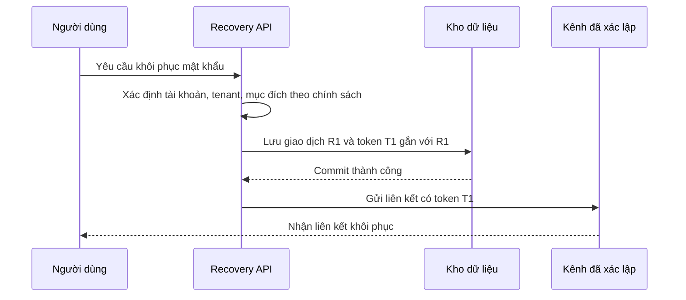

# Binding token to transaction

## 1. Ràng buộc token với một giao dịch khôi phục

Trong khôi phục tài khoản, một token không nên mang ý nghĩa chung chung là “đã xác minh người dùng”. Nó cần chỉ rõ bằng chứng này được cấp cho lần khôi phục nào, tài khoản nào và hành động nào. Binding token to transaction là việc lưu và kiểm tra mối liên hệ đó tại máy chủ trước khi cho phép chuyển bước hoặc thay đổi thông tin bảo mật.

Ví dụ, cùng một tài khoản có thể đang có yêu cầu đặt lại mật khẩu `R1` và yêu cầu khôi phục MFA `R2`. Người dùng nhận token `T1` cho `R1`. Kể cả `T1` đúng và còn hạn, hệ thống không được dùng nó để hoàn tất `R2`, đổi địa chỉ khôi phục hoặc đăng ký passkey mới ngoài phạm vi đã được cho phép.

OWASP nhấn mạnh việc thực thi ủy quyền giao dịch tại máy chủ, bảo vệ dữ liệu giao dịch khỏi bị thay đổi và kiểm tra ủy quyền trước khi thực thi. Bài này áp dụng các nguyên tắc đó vào account recovery; các trường dữ liệu và trạng thái bên dưới là một mô hình minh họa. [Nguồn: OWASP Transaction Authorization Cheat Sheet](https://cheatsheetseries.owasp.org/cheatsheets/Transaction_Authorization_Cheat_Sheet.html).

## 2. Phân biệt giao dịch nghiệp vụ và giao dịch cơ sở dữ liệu

Từ “transaction” có hai nghĩa cần tách biệt:

| Khái niệm | Ví dụ | Thời gian tồn tại |
| --- | --- | --- |
| Giao dịch khôi phục nghiệp vụ | Yêu cầu `R1` cho phép đặt lại mật khẩu của tài khoản A | Có thể kéo dài nhiều phút, qua nhiều HTTP request |
| Giao dịch cơ sở dữ liệu | Khối cập nhật mật khẩu và đánh dấu token đã dùng | Ngắn, giới hạn trong một lần xử lý |

Token được ràng buộc với giao dịch nghiệp vụ bằng định danh và ngữ cảnh do máy chủ quản lý. Giao dịch cơ sở dữ liệu giúp bảo đảm việc kiểm tra và tiêu thụ quyền diễn ra nguyên tử. Chỉ thêm `@Transactional` vào một method không tự tạo ra ràng buộc nghiệp vụ giữa token và yêu cầu khôi phục.

Không giữ giao dịch cơ sở dữ liệu mở trong lúc chờ người dùng đọc email, nhập mật khẩu hoặc cung cấp tài liệu xác minh. Lưu tiến trình thành dữ liệu bền vững, rồi kiểm tra lại ở mỗi thao tác nhạy cảm.

## 3. Rủi ro khi token chỉ được kiểm tra “đúng hay sai”

Một cách xử lý thiếu ràng buộc thường có dạng:

```text
if verifyToken(input.token):
    resetPassword(input.accountId, input.newPassword)
```

Ở đây, token có thể hợp lệ cho A nhưng `accountId` trong request lại là B. Endpoint đang dùng kết quả xác minh của một đối tượng để cho phép thay đổi đối tượng khác.

Một lỗi khác vẫn xảy ra khi hai yêu cầu thuộc cùng tài khoản: backend lưu `verified = true` ở session chung sau khi xác minh token của `R1`, rồi cho mọi endpoint recovery đi tiếp. Người gọi có thể chuyển từ đặt lại mật khẩu sang khôi phục MFA, hoặc áp dụng bằng chứng cũ vào một yêu cầu có mục đích mới.

Ràng buộc đúng cần trả lời đồng thời:

- Token thuộc đúng giao dịch khôi phục đang được xử lý hay không?
- Giao dịch đó thuộc đúng tài khoản và tenant hay không?
- Bằng chứng này cho phép đúng mục đích và đúng bước hiện tại hay không?
- Phiên bản ý định, lần phát hành, thời hạn và trạng thái còn phù hợp hay không?
- Quyết định bảo mật cuối cùng có dùng chính ngữ cảnh đã được kiểm tra hay không?

Định danh khó đoán giúp giảm khả năng dò tìm, nhưng không thay thế kiểm tra quyền trên đối tượng. [Nguồn: OWASP IDOR Prevention Cheat Sheet](https://cheatsheetseries.owasp.org/cheatsheets/Insecure_Direct_Object_Reference_Prevention_Cheat_Sheet.html).

## 4. Mô hình dữ liệu cho ràng buộc phía máy chủ

Có thể dùng hai bản ghi riêng: giao dịch khôi phục và token của giao dịch.

| Đối tượng | Các trường minh họa |
| --- | --- |
| `RecoveryTransaction` | `id`, `tenant_id`, `account_id`, `purpose`, `intent_version`, `state`, `expires_at`, `version` |
| `RecoveryToken` | `id`, `token_digest`, `transaction_id`, `intent_version`, `generation`, `allowed_step`, `expires_at`, `status` |

`transaction_id` là định danh tiến trình, không phải bí mật đủ để cấp quyền. `token_digest` là giá trị kiểm chứng chuỗi bí mật mà người dùng nhận. Không dùng `transaction_id`, email hoặc số thứ tự tăng dần thay cho token bí mật.

Ví dụ dữ liệu phía máy chủ:

```yaml
transaction:
  id: recovery_R1
  tenant_id: tenant_alpha
  account_id: account_A
  purpose: PASSWORD_RESET
  intent_version: 1
  state: AWAITING_EMAIL_PROOF
  expires_at: '2026-11-23T10:20:00Z'

token:
  id: token_T1
  transaction_id: recovery_R1
  intent_version: 1
  generation: 2
  allowed_step: SUBMIT_NEW_PASSWORD
  status: ISSUED
  expires_at: '2026-11-23T10:15:00Z'
```

Ví dụ cố ý không hiển thị token thô hoặc digest. Mốc thời gian chỉ để diễn giải, không phải khuyến nghị TTL áp dụng cho mọi hệ thống.

Với hệ thống nhiều tenant, khóa ngoại và truy vấn cần giữ đúng phạm vi tenant. Nếu có lặp lại `account_id` hoặc `purpose` trên bảng token để truy vấn nhanh, phải có cách duy trì sự nhất quán với giao dịch nguồn. Dữ liệu lặp lại mâu thuẫn không được giải quyết bằng cách chọn giá trị từ request.

## 5. Tạo ràng buộc trước khi gửi token

Một luồng phát hành minh họa:



Máy chủ tạo giao dịch và gắn token với nó trước khi token có thể được sử dụng. Mục đích và quyền của token được quyết định từ endpoint cùng chính sách máy chủ. Người gọi không thể thêm `purpose=MFA_RECOVERY` hoặc `skipVerification=true` để thay đổi yêu cầu xác minh.

Kênh nhận token phải được lựa chọn theo chính sách khôi phục đã được xác lập. Địa chỉ email mới do người chưa được xác minh nhập vào không tự trở thành nơi đáng tin để nhận token cấp quyền cho tài khoản.

Nếu cần gửi bất đồng bộ, cơ chế giao nhận phải chịu được retry và bảo vệ bí mật trong dữ liệu chờ gửi. Không đưa token thô vào log vận hành hoặc event thông thường chỉ để tiện theo dõi việc phát hành.

OWASP yêu cầu token khôi phục gắn với một người dùng, được lưu an toàn, dùng một lần và có thời hạn phù hợp. Ràng buộc thêm với giao dịch giúp thu hẹp phạm vi sử dụng trong thiết kế này. [Nguồn: OWASP Forgot Password Cheat Sheet](https://cheatsheetseries.owasp.org/cheatsheets/Forgot_Password_Cheat_Sheet.html#general-security-practices).

## 6. Endpoint phải lấy đối tượng thay đổi từ ngữ cảnh đã kiểm chứng

Một request có thể có dạng:

```http
POST /recovery/recovery_R1/password
Content-Type: application/json

{
  "token": "<recovery-token>",
  "newPassword": "<new-password>"
}
```

Đường dẫn `recovery_R1` do client gửi vẫn là dữ liệu không đáng tin. Máy chủ dùng nó để tìm giao dịch, sau đó phải chứng minh token thuộc chính giao dịch này. Biết được ID hoặc mở đúng URL chưa đủ tạo quyền.

Không cần nhận `accountId` từ body để chọn tài khoản cần đổi mật khẩu. Tài khoản đích được lấy từ giao dịch đã kiểm chứng. Nếu giao thức có gửi lại account hoặc tenant ID, chỉ coi chúng là giá trị cần đối chiếu; không dùng chúng ghi đè ngữ cảnh nguồn.

Một điều kiện chấp nhận minh họa:

```text
token.transaction_id == transaction.id
AND token.intent_version == transaction.intent_version
AND token.generation is accepted by the transaction's issuance policy
AND transaction.tenant_id == trusted_tenant_context
AND transaction.purpose == PASSWORD_RESET
AND token.allowed_step == SUBMIT_NEW_PASSWORD
AND transaction.state == AWAITING_EMAIL_PROOF
AND token.status == ISSUED
AND now < token.expires_at
AND now < transaction.expires_at
AND required_recovery_evidence_is_satisfied
```

Điều kiện về generation phụ thuộc chính sách: hệ thống có thể chỉ cho token mới nhất dùng được hoặc giữ nhiều token còn hiệu lực trong một khoảng có kiểm soát. Phải chọn và thực thi rõ ràng, không để endpoint tự áp dụng mỗi nơi một cách.

Ngữ cảnh tenant phải được xác định qua cấu hình định tuyến hoặc cơ chế đã được máy chủ kiểm chứng. Header hay trường body do client tự khai không tự trở thành nguồn tin cậy chỉ vì được đặt tên `tenantId`.

## 7. Kiểm tra và thực thi trong cùng quyết định nguyên tử

Mã giả dưới đây minh họa phương án dùng token để hoàn tất đặt lại mật khẩu trực tiếp. Các helper là hợp đồng nghiệp vụ, không phải một thư viện cụ thể:

```text
validate_request_shape_and_password_policy(input)
prepared_password_hash = hash_password(input.newPassword)

begin database transaction
    recovery = lock_recovery(input.transactionId, trustedTenant)
    token = lock_token_for(recovery.id, digest(input.token))

    if either record is missing:
        rollback; return GENERIC_FAILURE

    decision_time = authoritative_time_after_locks()

    require_matching_binding(token, recovery)
    require_purpose_and_step(recovery, token, PASSWORD_RESET)
    require_active_states_and_deadlines(recovery, token, decision_time)
    require_current_recovery_policy_and_evidence(recovery)

    update_password(recovery.account_id, prepared_password_hash)
    mark_token_consumed(token.id)
    mark_recovery_completed(recovery.id)
    invalidate_other_credentials_as_required_by_policy(recovery)
    insert_audit_and_notification_outbox(recovery.id)
commit

return PASSWORD_RESET_COMPLETED
```

Mã giả giả định các bản ghi quyết định cấp quyền và mật khẩu có thể cập nhật trong cùng kho giao dịch. Nếu một điều kiện `require` thất bại, rollback và trả kết quả không tiết lộ chi tiết. Không tiếp tục thực thi sau khi ghi nhận lỗi ràng buộc.

Việc băm mật khẩu có thể thực hiện trước khi giữ khóa để rút ngắn giao dịch, nhưng đây chưa phải ủy quyền thay đổi tài khoản. Sau khi lấy khóa vẫn phải kiểm tra lại chính sách liên quan, trạng thái tài khoản và toàn bộ ràng buộc còn hiệu lực. Giới hạn tần suất và tài nguyên cần được đặt trước tác vụ tốn CPU này.

Nếu phải khóa thêm tài khoản hoặc đối tượng bảo mật khác, mọi luồng liên quan cần thứ tự khóa thống nhất. Việc hủy yêu cầu, gửi lại token, thay đổi ý định và hoàn tất recovery phải cùng tuân thủ giao thức khóa hoặc phiên bản có điều kiện.

Trong kiến trúc có dịch vụ mật khẩu nằm ở hệ thống khác, một giao dịch cơ sở dữ liệu cục bộ không bao phủ được lời gọi mạng. Cần thiết kế quyền thực thi bền vững gắn với giao dịch, trạng thái trung gian và thao tác từ xa có idempotency; không giả định một annotation cục bộ tạo ra atomicity xuyên dịch vụ.

## 8. Ràng buộc ý định và xử lý thay đổi dữ liệu

Chỉ kiểm tra `transaction_id` vẫn chưa đủ nếu nội dung giao dịch có thể bị sửa sau khi token được cấp. Ví dụ, giao dịch ban đầu chỉ đặt lại mật khẩu nhưng sau đó bị đổi `purpose` thành gỡ MFA trong khi vẫn giữ nguyên ID.

Một cách xử lý là giữ bất biến các trường quyết định quyền sau khi bắt đầu xác minh:

| Dữ liệu | Cách xử lý khi thay đổi |
| --- | --- |
| Tài khoản hoặc tenant | Tạo giao dịch khác; không chuyển token sang chủ thể mới |
| Mục đích khôi phục | Tạo ý định mới và yêu cầu bằng chứng phù hợp |
| Phạm vi yếu tố được phép thay thế | Tăng phiên bản ý định, vô hiệu bằng chứng không còn phù hợp |
| Đích nhận thông báo hoặc bằng chứng nhạy cảm | Xét lại chính sách, không tin giá trị client tự thay |
| Gửi lại cho cùng ý định | Áp dụng chính sách generation đã công bố |

`intent_version` mô tả phiên bản ý định bảo mật. Nó khác `version` dùng chống cập nhật đồng thời, vì những thay đổi như số lần thử hoặc thời điểm đọc cuối không nhất thiết đổi ý định. Token phải gắn với phiên bản ý định phù hợp, không chỉ với một con số phiên bản bất kỳ.

Hệ thống cũng có thể lưu fingerprint của tập dữ liệu ý định đã chuẩn hóa để phát hiện thay đổi. Tập trường, cách mã hóa và nguồn dữ liệu phải rõ ràng; không băm tùy tiện JSON từ client rồi coi đó là bằng chứng đã ủy quyền.

Không đưa mật khẩu mới, mã khôi phục hoặc tài liệu danh tính vào fingerprint công khai, token hoặc log. Với đặt lại mật khẩu thông thường, token có thể cấp quyền chọn mật khẩu mới cho đúng tài khoản; nó không cần chứa giá trị mật khẩu tương lai. Chính sách mật khẩu vẫn được thực thi lúc người dùng gửi giá trị mới.

## 9. Nhiều bước và quyền khôi phục tạm

Một số luồng đổi token một lần lấy recovery grant tạm để người dùng thực hiện bước kế tiếp. Khi đó, ràng buộc phải được truyền sang grant:

```text
Email token T1
  → kiểm chứng đúng R1, đúng ý định, đúng bước
  → tiêu thụ T1 và cấp grant G1 nguyên tử
  → G1 chỉ cho phép bước tiếp theo của R1
```

Grant cần mang hoặc tham chiếu `transaction_id`, tài khoản, tenant, mục đích, bước được phép, phiên bản ý định và thời hạn. Lưu `recoveryVerified=true` vào một session có nhiều chức năng sẽ làm mất phần lớn giới hạn này.

Endpoint sử dụng grant vẫn đọc trạng thái hiện tại của giao dịch, kiểm tra hủy yêu cầu và giới hạn thời gian. Cần quy định grant chịu hạn riêng hay bị chặn bởi hạn của giao dịch gốc; không gia hạn quyền vô tình bằng việc liên tục chuyển token qua các bước.

Recovery session có quyền hạn chế không tự trở thành phiên đăng nhập đầy đủ. Đối với luồng đặt lại mật khẩu, OWASP khuyến nghị người dùng đăng nhập theo cơ chế thông thường sau khi hoàn tất, tránh tự động đăng nhập vì các rắc rối về session. [Nguồn: OWASP Forgot Password Cheat Sheet](https://cheatsheetseries.owasp.org/cheatsheets/Forgot_Password_Cheat_Sheet.html#user-resets-password).

Nếu dùng cookie cho recovery grant, cơ chế bảo vệ request thay đổi trạng thái phải phù hợp với cookie đó, bao gồm chống CSRF. Ràng buộc token với giao dịch không tự loại bỏ mọi tấn công qua trình duyệt.

## 10. Hai tab, gửi lại và request đồng thời

| Tình huống | Hành vi cần thiết |
| --- | --- |
| Tab A mở `R1`, tab B mở `R2` | Token hoặc grant của R1 không áp dụng cho R2 |
| Client đổi transaction ID trong URL | Kiểm tra quan hệ token–transaction và từ chối nếu không khớp |
| Token đúng giao dịch nhưng sai endpoint | Kiểm tra `purpose` và `allowed_step` |
| Gửi lại token cùng giao dịch | Generation cũ theo chính sách rõ ràng, không dựa vào email đến trước hay sau |
| Hủy giao dịch khi token còn hạn | Trạng thái giao dịch chặn token và grant liên quan |
| Hai request dùng cùng token | Chỉ một lần chuyển trạng thái và một tác dụng nghiệp vụ được commit |
| Client retry sau khi mất phản hồi thành công | Không lặp lại thay đổi bảo mật bằng cùng token |

Binding hạn chế token sang đúng giao dịch; dùng một lần ngăn thực thi lại trong chính giao dịch đó. Hai cơ chế bổ sung cho nhau. Một token gắn rất chặt với `R1` nhưng được dùng lại nhiều lần vẫn có thể gây thay đổi mật khẩu ngoài ý muốn.

Nếu hỗ trợ idempotency key, khóa này cần gắn với giao dịch, hành động và ngữ cảnh quyền phù hợp. Nó không thay thế token và không được cho phép người chỉ biết key đọc lại dữ liệu nhạy cảm của một lần xử lý trước. Kết quả retry có thể chỉ xác nhận trạng thái đã hoàn tất theo phạm vi được phép.

## 11. Phạm vi bảo vệ và giới hạn còn lại

Ràng buộc giao dịch giúp chống việc lấy token hợp lệ của yêu cầu này để dùng cho yêu cầu khác. Nó không làm một bearer token bị đánh cắp mất khả năng sử dụng trong chính giao dịch đã cấp cho token đó. Vẫn cần bảo vệ kênh gửi, HTTPS, tránh lộ token qua log hoặc nội dung bên thứ ba và kiểm soát các dấu hiệu lạm dụng.

Ràng buộc với trình duyệt hoặc thiết bị là quyết định riêng. Bắt buộc trình duyệt khởi tạo và trình duyệt mở email phải giống nhau có thể làm người dùng mất thiết bị không khôi phục được. Cho phép chuyển thiết bị cần giao thức tiếp tục tiến trình được thiết kế rõ, giữ nguyên chủ thể và mục đích. IP hoặc User-Agent không nên được coi là bằng chứng mật mã về quyền sở hữu token.

Đối với MFA và passkey, một token email gắn đúng giao dịch không tự nâng mức bảo đảm xác minh. Cho phép gỡ yếu tố cũ hoặc cấp quyền đăng ký yếu tố mới phải căn cứ vào chính sách khôi phục, bằng chứng bổ sung và rủi ro của tài khoản. Ràng buộc kỹ thuật không hợp thức hóa một chính sách xác minh quá yếu.

Nếu token có cấu trúc được ký thay cho token opaque, các trường transaction, chủ thể, mục đích và hạn phải nằm trong phần được bảo vệ và được kiểm tra. Chữ ký hợp lệ vẫn không chứng minh giao dịch chưa bị hủy hoặc token chưa dùng; các yêu cầu đó thường cần trạng thái máy chủ hoặc cơ chế tương đương.

## 12. Phản hồi và dấu vết xử lý

Phản hồi công khai nên tránh tiết lộ token đúng cho tài khoản nào hoặc giao dịch nào khi ràng buộc thất bại. Có thể dùng thông báo “Yêu cầu khôi phục không còn sử dụng được. Vui lòng bắt đầu lại.” Trong luồng đã đủ xác minh, giao diện có thể đưa chỉ dẫn tiếp tục phù hợp mà không hiển thị bí mật.

Bên trong hệ thống, cần phân biệt các nguyên nhân để điều tra:

- Không tìm thấy token hoặc giao dịch trong đúng phạm vi.
- Token không khớp giao dịch hoặc phiên bản ý định.
- Sai mục đích, sai bước hoặc bằng chứng bổ sung chưa đủ.
- Giao dịch đã hủy, hoàn tất, hết hạn hoặc token đã dùng.
- Xung đột đồng thời, lỗi đọc trạng thái hoặc lỗi commit.

Không đánh dấu token của giao dịch khác là đã dùng chỉ vì một request ghép sai token với ID. Các bộ đếm và giới hạn thử cần được thiết kế theo phạm vi thích hợp để chống dò tìm mà không tạo cách khóa tài khoản tùy ý cho người ngoài.

Audit có thể ghi transaction ID nội bộ, token ID nội bộ, bước xử lý, kết quả, phiên bản ý định và correlation ID được kiểm soát. Không ghi token thô, digest, mật khẩu mới hoặc URL chứa bí mật. Quyền xem audit cần tính đến việc các định danh và lịch sử khôi phục cũng là dữ liệu nhạy cảm.

Trong ví dụ R1/R2, kết quả đúng là T1 chỉ có thể cấp quyền theo hợp đồng của R1; việc xác minh thành công không tạo quyền chung cho R2 hoặc toàn bộ tài khoản. Endpoint cuối phải dùng chính tài khoản, mục đích và trạng thái đã được kiểm chứng khi thực hiện thay đổi.
