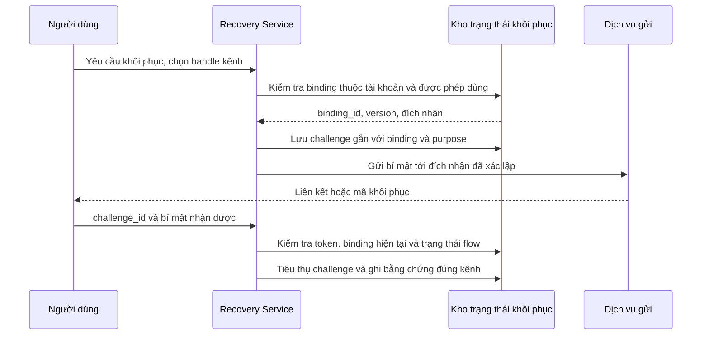

# Binding token to channel

## 1. Ràng buộc token với kênh khôi phục là gì?

Một tài khoản có email khôi phục đã xác minh và số điện thoại dự phòng. Hệ thống gửi liên kết đặt lại mật khẩu qua email. Khi nhận token, API lại đọc trường `channel` do client gửi để quyết định bước tiếp theo. Nếu chỉ đổi `channel` từ `EMAIL` sang `SMS` mà token vẫn được chấp nhận như bằng chứng đã kiểm soát số điện thoại, hệ thống đã để bằng chứng của một kênh được sử dụng dưới danh nghĩa kênh khác.

**Ràng buộc token với kênh khôi phục** là việc máy chủ gắn token với một kênh và đích nhận cụ thể, rồi kiểm tra ràng buộc đó khi sử dụng token. Trong ví dụ của bài, token còn gắn với tài khoản, yêu cầu khôi phục, mục đích và phiên bản cấu hình kênh. Client không được tự thay đổi ý nghĩa của những giá trị này.

Có thể diễn đạt điều kiện chấp nhận như sau:

```text
Token đúng bí mật
AND đúng yêu cầu khôi phục và tài khoản
AND đúng mục đích của bước đang thực hiện
AND đúng kênh và phiên bản đích nhận đã gắn khi cấp
AND kênh đó vẫn được chính sách hiện hành cho phép sử dụng
AND token còn hạn, chưa bị dùng, chưa bị thu hồi
AND chưa vượt giới hạn thử
```

Ràng buộc này ngăn việc sử dụng sai ngữ cảnh và hỗ trợ vô hiệu hóa token khi thông tin khôi phục thay đổi. Nó không tự ngăn người đã đánh cắp token sử dụng token trong đúng ngữ cảnh đó. Muốn chống tình huống này cần thêm cơ chế chứng minh quyền sở hữu hoặc bằng chứng độc lập phù hợp với mức rủi ro.

Các cấu trúc dữ liệu và quy tắc dưới đây là một thiết kế minh họa cho hệ thống khôi phục tài khoản, không phải một chuẩn giao thức áp dụng nguyên xi cho mọi sản phẩm.

## 2. Phân biệt những nghĩa khác nhau của “channel”

| Khái niệm | Ví dụ | Điều được ràng buộc |
| --- | --- | --- |
| Kênh phân phối và đích nhận | Email khôi phục A, số điện thoại B, ứng dụng đã đăng ký C | Token thuộc bằng chứng của đúng kênh và đích nhận đó |
| Ngữ cảnh nghiệp vụ | Đặt lại mật khẩu, xác minh kênh mới, khôi phục MFA | Token chỉ được dùng cho mục đích đã cấp |
| Ngữ cảnh trình duyệt hoặc thiết bị | Một recovery session có bí mật riêng | Quyền tiếp tục luồng có thể yêu cầu thêm bí mật hoặc khóa của ngữ cảnh đó |
| Channel binding mật mã ở tầng giao thức | Một giao thức xác thực dùng dữ liệu gắn với kết nối TLS | Bằng chứng xác thực được liên hệ với kênh bảo mật theo giao thức cụ thể |

Gửi token qua email là lựa chọn kênh phân phối. Lưu `channel_kind = EMAIL` là metadata và một phần điều kiện kiểm tra phía máy chủ. Hai việc này không tạo ra channel binding mật mã.

Tương tự, token đi qua HTTPS được bảo vệ khi truyền giữa các đầu cuối TLS tương ứng, nhưng không mặc nhiên bị ràng buộc với cùng một thiết bị hay cùng một kết nối khi sử dụng lại. Người dùng có thể mở email trên điện thoại rồi bấm liên kết trên máy tính; đó là hành vi hợp lệ nếu chính sách khôi phục cho phép.

Trong phần lớn ví dụ của bài, “kênh” có nghĩa là **kênh khôi phục cùng đích nhận đã được máy chủ xác lập**. Phần về TLS ở cuối bài giải thích giới hạn của việc đồng nhất hai khái niệm này.

## 3. Bảo vệ điều gì và còn giới hạn nào?

| Tình huống | Cách ràng buộc giúp xử lý | Giới hạn còn lại |
| --- | --- | --- |
| Client đổi nhãn `EMAIL` thành `SMS` | Máy chủ lấy kênh từ bản ghi challenge, không từ nhãn do client tự khai | Token bị lộ vẫn có thể bị dùng như token email nếu không có bằng chứng bổ sung |
| Đích email được thay đổi sau khi gửi token | Phiên bản kênh trong token không còn khớp cấu hình hiện tại | Phải kiểm tra phiên bản tại thời điểm thực hiện thao tác |
| Cùng một mã ngắn xuất hiện ở hai challenge | Tra cứu đúng challenge và so sánh trong ngữ cảnh riêng | Mã ngắn vẫn cần giới hạn thử và chống đoán |
| Token đặt lại mật khẩu bị gửi sang API đổi MFA | Kiểm tra `purpose` và trạng thái flow dự kiến | Bản thân việc sở hữu email chưa chắc đủ để khôi phục MFA |
| Hộp thư khôi phục bị chiếm quyền | Ràng buộc vẫn xác định đây là bằng chứng email | Không chứng minh người đang thao tác là chủ tài khoản hợp pháp |
| Nhà cung cấp SMS báo đã gửi thành công | Trạng thái gửi được lưu tách khỏi trạng thái xác minh | “Đã gửi” hoặc “đã giao” không đồng nghĩa người dùng đã chứng minh quyền kiểm soát |

OWASP khuyến nghị trao đổi thông tin đặt lại mật khẩu qua kênh phụ, dùng token ngẫu nhiên an toàn, có thời hạn và dùng một lần. Với khôi phục sau nghi ngờ chiếm đoạt, không nên chỉ dựa vào thông tin khôi phục vừa được thêm hoặc thay đổi. Các nguyên tắc này là nền tảng; chính sách ràng buộc cụ thể vẫn cần được thiết kế cho từng luồng. [OWASP Forgot Password Cheat Sheet](https://cheatsheetseries.owasp.org/cheatsheets/Forgot_Password_Cheat_Sheet.html)

## 4. Mô hình dữ liệu: ràng buộc với một đích nhận cụ thể

Chỉ lưu loại kênh `EMAIL` là chưa đủ. Một tài khoản có thể có nhiều email, và cùng một email có thể được thay thế, vô hiệu hóa hoặc đăng ký lại trong vòng đời tài khoản.

Ví dụ tách hai loại bản ghi:

```text
RecoveryChannelBinding
    tenant_id
    subject_id
    binding_id
    channel_kind
    destination_reference
    version
    state
    established_at
    policy_attributes

RecoveryChallenge
    challenge_id
    tenant_id
    subject_id
    recovery_flow_id
    purpose
    binding_id
    binding_version
    channel_kind
    generation
    token_verifier
    verifier_key_id
    issued_at
    expires_at
    failed_attempts
    state
```

`destination_reference` trỏ tới đích nhận trong kho dữ liệu được bảo vệ, thay vì đưa email hoặc số điện thoại đầy đủ vào mọi payload. `binding_id` là định danh nội bộ ổn định của bản ràng buộc; biết định danh này không phải bằng chứng sở hữu kênh.

`version` thay đổi khi có thay đổi ảnh hưởng đến quyền sử dụng kênh: đổi đích nhận, thu hồi hoặc thay đổi trạng thái bảo mật liên quan. `generation` phục vụ phân biệt các lần cấp challenge trong cùng luồng theo chính sách gửi lại. Hai giá trị giải quyết hai loại thay đổi khác nhau.

Các điểm quan trọng của mô hình:

- `tenant_id`, `subject_id` và `binding_id` phải thuộc cùng một quan hệ đã được máy chủ kiểm tra. Không chỉ kiểm tra rằng `binding_id` tồn tại.
- `channel_kind` được lấy từ binding. Client không được ghi loại kênh vào challenge như một thuộc tính có thẩm quyền.
- `binding_version` là ảnh chụp của phiên bản kênh khi cấp token. Khi kiểm tra, phải đối chiếu với trạng thái hiện tại.
- `purpose` phân biệt đặt lại mật khẩu, xác minh email mới, khôi phục MFA hoặc hủy một yêu cầu. Không dùng một token cho mọi hành động.
- `policy_attributes` có thể chứa mức tin cậy hoặc điều kiện sử dụng kênh. Một cờ `verified = true` đơn lẻ chưa mô tả đủ việc kênh có được phép dùng cho thao tác rủi ro cao hay không.

Nếu đích nhận thay đổi từ A sang B, lựa chọn của ví dụ là tăng phiên bản và vô hiệu hóa những challenge gắn với phiên bản A. Không sửa bản ghi token cũ để nó đột nhiên có nghĩa là đã được gửi và xác minh tại B.

Đối với email hoặc số điện thoại, việc chuẩn hóa đích nhận phải theo quy tắc đã xác định của hệ thống. Không tự bỏ dấu chấm, bỏ phần mở rộng hay thay đổi địa chỉ theo giả định áp dụng cho mọi nhà cung cấp. Ràng buộc nên tham chiếu binding nội bộ đã xác lập, thay vì so sánh những chuỗi do client liên tục gửi lại.

## 5. Cấp token: máy chủ quyết định ngữ cảnh

Một lần cấp challenge có thể đi theo các bước sau:

1. Nhận yêu cầu bắt đầu khôi phục và áp dụng giới hạn lạm dụng phù hợp.
2. Xác định tài khoản và những kênh hiện được chính sách cho phép dùng trong luồng này.
3. Nếu cho chọn kênh, client chỉ chọn một handle được giới hạn trong tập lựa chọn của flow. Máy chủ kiểm tra lại quyền sử dụng, không nhận một địa chỉ mới tùy ý làm đích khôi phục.
4. Chụp `binding_id`, `binding_version`, loại kênh, mục đích và thế hệ challenge.
5. Sinh bí mật ngẫu nhiên, lưu verifier và hạn dùng; liên kết challenge với flow.
6. Gửi bí mật tới đích nhận đã lấy từ binding. Ghi nhận trạng thái gửi tách khỏi trạng thái xác minh.



Phản hồi công khai không nên cung cấp toàn bộ danh sách email hoặc số điện thoại của một tài khoản chưa được xác thực. Nếu sản phẩm hiển thị đích nhận đã che một phần, cần đánh giá mức thông tin được phép lộ trong ngữ cảnh đó. API không được trở thành công cụ liệt kê kênh khôi phục của người khác.

### Token dài và mã ngắn

Một token ngẫu nhiên dài có thể lưu verifier bằng hàm băm mật mã phù hợp. Với mã ngắn như OTP, băm không khóa vẫn cho phép người có dữ liệu verifier thử hết không gian mã nhỏ. Thiết kế minh họa dùng HMAC với khóa phía máy chủ được quản lý riêng cho loại mã này.

Ngữ cảnh có thể được đưa vào dữ liệu tính verifier:

```text
context = encodeLengthPrefixed(
    tenant_id,
    subject_id,
    recovery_flow_id,
    challenge_id,
    purpose,
    binding_id,
    binding_version,
    generation
)

verifier = HMAC(server_key, context || secret_code)
```

Đây là mã giả thể hiện việc phân tách ngữ cảnh, không phải một định dạng giao thức chuẩn. Hàm mã hóa phải không gây nhập nhằng giữa các trường. Khóa HMAC không được lưu cùng dữ liệu challenge; cần định danh khóa để xử lý vòng đời khóa và thời hạn tồn tại của các challenge liên quan.

Đưa ngữ cảnh vào HMAC không làm tăng số giá trị mà OTP có thể nhận và không ngăn đoán trực tuyến. Ví dụ một mã gồm sáu chữ số chỉ có một triệu khả năng nếu phân phối đều. Số lần thử, thời hạn, tốc độ gửi lại và giới hạn theo tài khoản, flow, kênh cùng nguồn truy cập vẫn cần được kiểm soát. So sánh verifier phải dùng phép so sánh phù hợp để tránh rò rỉ qua thời gian thực hiện.

## 6. Sử dụng token: ràng buộc phải được kiểm tra tại máy chủ

Một request xác minh đơn giản có thể chỉ chứa:

```json
{
  "challenge_id": "challenge_demo_1",
  "proof": "<bi-mat-nguoi-dung-nhan-duoc>"
}
```

Các giá trị trên là minh họa. `challenge_id` là bộ chọn bản ghi, không phải bí mật xác thực. Máy chủ nạp tài khoản, flow, kênh và mục đích từ trạng thái đã lưu. Nếu một endpoint nhận thêm `channel` hoặc `destination` để phục vụ giao diện, các trường đó không được thay thế ràng buộc hiện có.

Quy trình kiểm tra có thể biểu diễn bằng mã giả:

```text
verifyRecoveryChallenge(challengeId, proof, expectedPurpose):
    áp dụng giới hạn tốc độ cho request
    tìm challenge và flow theo bộ chọn, không tìm trên mọi OTP
    mở giao dịch với thứ tự khóa thống nhất:
        khóa trạng thái bảo mật, binding, flow và challenge liên quan
        kiểm tra cùng tenant, cùng tài khoản và đúng quan hệ binding
        kiểm tra flow đang ở bước cho phép nhận loại bằng chứng này
        kiểm tra purpose = expectedPurpose lấy từ logic endpoint
        kiểm tra binding còn được phép sử dụng theo chính sách
        kiểm tra binding.version = challenge.binding_version
        kiểm tra generation và trạng thái challenge hiện hành
        kiểm tra hạn dùng và ngân sách số lần thử
        đối chiếu proof với verifier của đúng challenge
        nếu hợp lệ:
            chuyển challenge ACTIVE -> CONSUMED có điều kiện
            ghi bằng chứng của đúng kênh vào flow
            chỉ tạo quyền tiếp tục phù hợp với bước vừa hoàn tất
    commit trạng thái tương ứng
```

Các nhánh sai mã phải ghi tăng số lần thử theo cách không bị rollback cùng nhánh thất bại nghiệp vụ. Nếu hệ thống ném lỗi và hoàn nguyên cả bộ đếm mỗi lần sai, giới hạn thử trên giao diện không còn giá trị thực tế.

Việc tiêu thụ challenge và ghi nhận bằng chứng cần nhất quán. Không ghi `email_verified_for_recovery` trước rồi thất bại khi tiêu thụ token, hoặc tiêu thụ token xong nhưng không có trạng thái để phục hồi phần còn lại của flow.

Ví dụ bằng chứng được máy chủ ghi lại:

```json
{
  "evidence_type": "RECOVERY_EMAIL_PROOF",
  "binding_id": "binding_demo_email",
  "binding_version": 4,
  "challenge_id": "challenge_demo_1",
  "recovery_flow_id": "flow_demo_1",
  "purpose": "PASSWORD_RESET",
  "verified_at": "2026-11-23T04:00:00Z"
}
```

Bằng chứng này chỉ nói rằng challenge của email tương ứng đã được hoàn tất theo quy tắc của flow. Nó không phải bằng chứng đã kiểm soát một số điện thoại, đã xuất trình MFA cũ hoặc đã đủ điều kiện để đăng ký passkey mới. Thành phần đánh giá chính sách phải quyết định tổng bằng chứng hiện có cho phép bước tiếp theo nào.

Nếu cấp recovery grant sau bước này, grant cần phạm vi hẹp, thời hạn ngắn theo chính sách và liên kết với flow cùng bằng chứng đã chấp nhận. Không đổi recovery token thành một phiên đăng nhập đầy đủ chỉ vì token đã được nhập đúng.

## 7. Gửi lại, đổi kênh và thay đích nhận

### Gửi lại cùng kênh

Trong ví dụ, mỗi lần gửi lại challenge của cùng flow và binding sẽ tăng `generation` và làm challenge trước đó không còn được chấp nhận. Cấp mới và kiểm tra thế hệ phải được phối hợp để hai request đồng thời không cùng tạo các thế hệ được coi là hiện hành.

Nếu người dùng nhận email chậm và bấm liên kết cũ, hệ thống có thể giải thích cách dùng thông báo mới nhất mà không công khai trạng thái chi tiết cho người không có quyền. Có thể thiết kế cho nhiều token cùng tồn tại, nhưng khi đó phải quy định rõ việc một token được dùng sẽ ảnh hưởng thế nào tới các token còn lại; không để hành vi phụ thuộc ngẫu nhiên vào thứ tự gửi.

Chính sách gửi lại cũng phải chống lạm dụng. Một người chưa chứng minh quyền với tài khoản không nên có thể liên tục làm mất hiệu lực mọi luồng hợp lệ của nạn nhân chỉ bằng nút “gửi lại”. Giới hạn thay thế trong đúng flow, kiểm soát tần suất và điều kiện tạo flow là những lựa chọn cần được thiết kế cùng nhau.

### Chuyển từ email sang SMS

Chuyển kênh là một quyết định mới của máy chủ:

```text
Challenge E1: EMAIL, binding B-email, version 4
Người dùng yêu cầu chuyển kênh
Máy chủ đánh giá SMS có được phép dùng cho flow này hay không
Nếu được phép: cấp challenge S1 cho B-sms, version 2
Token E1 không trở thành bằng chứng SMS
```

Tùy chính sách, E1 có thể bị thu hồi hoặc vẫn tồn tại như một challenge email độc lập. Điều bắt buộc là máy chủ không đổi nhãn của E1 rồi coi nó như đã được gửi tới số điện thoại. Nếu bước khôi phục MFA đòi hỏi bằng chứng mạnh hơn SMS, việc người dùng không nhận được email không phải lý do tự động hạ yêu cầu bằng chứng.

### Thay địa chỉ hoặc số điện thoại

Một địa chỉ mới do người đang khôi phục nhập chưa phải kênh khôi phục đáng tin của tài khoản. Gửi mã đến địa chỉ đó chỉ có thể chứng minh khả năng nhận tại đích mới theo quy trình xác minh tương ứng; nó không tự chứng minh quyền với tài khoản cũ.

Luồng đổi kênh cần phân biệt quyền đề nghị thay đổi, bằng chứng kiểm soát đích mới và quyết định đưa đích mới vào sử dụng. Token để xác minh kênh mới phải có mục đích riêng. Những token đã gắn với phiên bản kênh cũ cần được xử lý theo chính sách thu hồi đã chọn, không tự động tái gắn sang đích mới.

Nếu đã cấp recovery grant dựa trên một kênh sau đó bị thu hồi, không chỉ kiểm tra phiên bản ở bước nhập OTP. Grant phải được kiểm tra lại khi thực hiện thao tác cuối, hoặc được vô hiệu hóa theo sự thay đổi đó. Nếu không, token cũ có thể đã đổi thành quyền trung gian còn sống lâu hơn ràng buộc mà hệ thống muốn loại bỏ.

## 8. Cuộc đua giữa xác minh và thay đổi kênh

Giả sử challenge C được cấp cho binding phiên bản 4. Hai thao tác chạy gần nhau:

```text
Request A: xác minh challenge C
Request B: vô hiệu hóa binding hoặc đổi sang phiên bản 5
```

Nếu A đọc phiên bản 4, B commit phiên bản 5 rồi A tiếp tục cấp quyền dựa trên dữ liệu cũ, việc kiểm tra phiên bản chỉ có tính hình thức.

Một cách xử lý trong thiết kế minh họa là yêu cầu cả hai đường thay đổi dùng cùng cơ chế khóa bản ghi bảo mật hoặc cùng điều kiện phiên bản tại ranh giới commit. Khi B đã hoàn tất trước, A phải thấy thay đổi và từ chối bằng chứng cũ. Khi A hoàn tất trước, quyền trung gian mà A vừa tạo vẫn phải chịu quy tắc thu hồi liên quan khi B hoàn tất sau.

Thứ tự khóa phải thống nhất giữa cấp token, gửi lại, xác minh và cập nhật kênh để tránh các đường xử lý có cách nhìn khác nhau về trạng thái hiện hành. Nếu các dữ liệu thuộc nhiều dịch vụ, cần hợp đồng phối hợp và mức nhất quán rõ ràng; một sự kiện thay đổi kênh phân phối chậm không đủ để bảo đảm mọi thao tác nhạy cảm lập tức ngừng dùng phiên bản cũ.

### Người dùng đổi trình duyệt hoặc mạng

Binding tới kênh nhận không đồng nghĩa binding tới IP hay User-Agent. Người dùng mất thiết bị thường phải chuyển sang thiết bị khác; mạng di động cũng có thể đổi địa chỉ trong cùng một flow.

IP và dấu hiệu thiết bị có thể phục vụ đánh giá rủi ro. Chúng không phải bằng chứng mật mã về quyền kiểm soát email hoặc số điện thoại. Nếu sản phẩm yêu cầu một bí mật recovery session hay khóa thiết bị bổ sung, cần xác định đây là điều kiện riêng, xử lý rõ trải nghiệm mở liên kết trên thiết bị khác và có đường khôi phục khi thiết bị ban đầu đã mất.

Không âm thầm bỏ điều kiện binding khi thiếu cookie, nhưng cũng không thêm điều kiện “phải cùng IP” rồi coi đó là một kênh khôi phục an toàn hơn.

## 9. Ràng buộc mật mã với kênh TLS khác ở đâu?

RFC 9266 định nghĩa kiểu channel binding `tls-exporter`, tương thích với TLS 1.3. Dữ liệu này được lấy từ kết nối TLS để giao thức xác thực sử dụng theo quy tắc channel binding; nó không phải bí mật có thể tùy tiện dùng như khóa mã hóa hoặc khóa HMAC cho recovery token. [RFC 9266, mục 2 và 4](https://www.rfc-editor.org/rfc/rfc9266.html#section-2)

Với luồng email phổ thông, lần yêu cầu gửi email và lần bấm liên kết thường diễn ra trên hai kết nối TLS khác nhau. Gắn token cứng vào kết nối đầu tiên sẽ không tự phù hợp với nhu cầu người dùng mở liên kết sau đó. JavaScript trên trang web thông thường cũng không có một API chuẩn phổ dụng để ứng dụng tự lấy TLS exporter của kết nối HTTPS rồi hoàn thành một giao thức channel binding tùy ý.

Vì vậy, không thể triển khai channel binding thật bằng những cách sau:

- Thêm `channel = HTTPS` vào JWT rồi chỉ kiểm tra chữ ký.
- Băm địa chỉ IP hoặc User-Agent và gọi kết quả là TLS binding.
- Tin một header `X-TLS-Channel` từ request công khai mà không xác thực nguồn và ý nghĩa của nó.
- Coi kết nối TLS từ reverse proxy tới backend là kết nối bảo mật trực tiếp của người dùng cuối.

Nếu TLS kết thúc tại gateway, backend nhìn thấy một ranh giới khác. Một thiết kế dựa vào bằng chứng từ tầng TLS cần xác định nơi xác minh bằng chứng, cách truyền kết quả đáng tin tới backend và cách ngăn client giả mạo metadata. Chỉ chuyển tiếp một chuỗi header không tạo ra sự liên hệ mật mã từ đầu đến cuối.

### Certificate binding và proof of possession

Có những cơ chế ràng buộc token với bên trình token nhưng không phải với một kết nối email khôi phục:

| Cơ chế | Ràng buộc chính | Điều không nên suy ra |
| --- | --- | --- |
| OAuth mutual-TLS certificate-bound token | Chứng thư và quyền sở hữu khóa riêng tương ứng | Token bắt buộc chỉ dùng được trên đúng một kết nối TLS ban đầu |
| OAuth DPoP | Khóa proof of possession và bằng chứng ở tầng ứng dụng | Người dùng đã kiểm soát một email, số điện thoại hoặc đã qua quy trình định danh |
| Token khôi phục gắn với email | Binding và đích nhận mà hệ thống đã chọn để gửi challenge | Người trình token bắt buộc đang dùng thiết bị đã nhận email |

RFC 8705 mô tả OAuth token gắn với chứng thư, trong đó bên sử dụng phải chứng minh quyền sở hữu khóa riêng tương ứng qua mutual TLS. RFC 9449 mô tả DPoP ở tầng ứng dụng. Đây là những hợp đồng giao thức cần triển khai đầy đủ, không phải đặc tính xuất hiện khi thêm một trường `binding` vào recovery token. [RFC 8705](https://www.rfc-editor.org/rfc/rfc8705.html#section-3), [RFC 9449](https://www.rfc-editor.org/rfc/rfc9449.html#section-3)

Khi người dùng đang khôi phục vì mất thiết bị hoặc khóa, bắt buộc xuất trình chính khóa đã mất có thể làm đường khôi phục không sử dụng được. Sản phẩm cần tách quy trình chứng minh bằng chứng thay thế khỏi quy trình thu hồi khóa cũ và đăng ký khóa mới; không bỏ qua yêu cầu xác minh danh tính chỉ để vượt lỗi binding.

## 10. Phối hợp nhiều kênh và mục đích khôi phục

Giả sử chính sách yêu cầu hai bằng chứng cho việc đặt lại MFA: một bằng chứng từ kênh khôi phục đã xác lập và một bằng chứng độc lập khác. Hệ thống phải ghi rõ loại bằng chứng nào đã được hoàn tất, thay vì chỉ cộng số lượng challenge thành công.

Hai token khác nhau gửi đến cùng một hộp thư không tạo thành hai kênh độc lập. Email và SMS cùng phụ thuộc vào một thiết bị đang bị chiếm quyền cũng có thể có rủi ro chung. Sự độc lập cần được đánh giá theo nguồn kiểm soát và mô hình đe dọa, không chỉ theo tên nhãn `EMAIL` hoặc `SMS`.

Tương tự, xác minh đích email mới không cho phép tự động đặt lại mật khẩu của một tài khoản chỉ vì người dùng khai rằng tài khoản đó thuộc về mình. Một bằng chứng chỉ có giá trị khi được liên kết với đúng flow và vai trò nghiệp vụ mà nó được cấp.

Có thể hình dung ba mục đích khác nhau:

```text
VERIFY_NEW_RECOVERY_EMAIL -> chứng minh nhận tại email mới
PASSWORD_RESET           -> hoàn tất một bước đặt lại mật khẩu
MFA_RECOVERY             -> cung cấp bằng chứng cho quy trình khôi phục MFA
```

Việc chuyển từ bằng chứng này sang quyền thực hiện hành động khác phải qua đánh giá chính sách phía máy chủ. Nếu có bước trao đổi token, token mới cần phản ánh đúng phạm vi được phép, mục đích, thời hạn và những ràng buộc vẫn phải giữ.

Với passkey, một token được gửi qua email không tự chứng minh quyền sở hữu khóa riêng của passkey cũ. Nó có thể là một thành phần trong luồng khôi phục đã được thiết kế, nhưng quyết định thu hồi authenticator cũ hoặc đăng ký authenticator mới vẫn cần được kiểm soát riêng.

## 11. Một diễn tiến cụ thể

Tài khoản A có binding email B với phiên bản 4. Hệ thống cấp challenge C1 cho flow F1, mục đích `PASSWORD_RESET`, gắn với B phiên bản 4.

| Hành động sau đó | Quyết định của thiết kế minh họa |
| --- | --- |
| Người dùng nhập đúng bí mật của C1 tại bước đặt lại mật khẩu của F1, binding B vẫn hợp lệ | Tiêu thụ C1 và ghi bằng chứng email cho F1; chỉ tiếp tục trong quyền chính sách cho phép |
| Client gửi C1 cùng `channel = SMS` | Không coi là bằng chứng SMS; dùng binding lưu tại máy chủ và xử lý sai ngữ cảnh theo hợp đồng endpoint |
| Client gửi C1 cho flow F2 | Từ chối do không khớp flow; không tự chuyển challenge sang F2 |
| C1 được gửi tới endpoint khôi phục MFA | Từ chối do mục đích không phù hợp |
| Binding B đã bị thu hồi hoặc chuyển sang phiên bản 5 | Từ chối C1 dù bí mật và hạn dùng vẫn đúng |
| C1 đã được dùng thành công một lần | Từ chối lần dùng tiếp theo; không tạo thêm grant |
| Người dùng mở C1 trên trình duyệt khác, chính sách không yêu cầu browser binding | Không từ chối chỉ vì đổi trình duyệt; vẫn kiểm tra đủ điều kiện còn lại |
| Kẻ tấn công lấy được C1 trước khi dùng và trình đúng ngữ cảnh | Ràng buộc với email đơn thuần chưa phân biệt được với người dùng hợp lệ |

Tình huống cuối cho thấy cần mô tả đúng mức bảo đảm: token được gửi tới kênh nào và gắn với kênh đó là một điều kiện quan trọng, nhưng việc sở hữu token vẫn có thể là bằng chứng dạng bearer nếu không có cơ chế bổ sung.

## 12. Vận hành mà không làm rò rỉ token hoặc đích nhận

Log nội bộ có thể ghi `challenge_id`, `recovery_flow_id`, loại kênh, ID binding, phiên bản và mã nguyên nhân như `BINDING_VERSION_MISMATCH`. Không ghi bí mật token, OTP, liên kết khôi phục nguyên vẹn hoặc địa chỉ nhận đầy đủ khi không cần thiết.

Các ID nội bộ vẫn có khả năng liên kết hoạt động của người dùng, nên quyền truy cập log và thời hạn giữ dữ liệu cần được kiểm soát. Thông báo lỗi công khai không nên giúp người lạ phân biệt chính xác tài khoản có tồn tại, đang có kênh nào hoặc vừa thay số điện thoại lúc nào.

Đối với liên kết email, máy chủ tạo URL từ cấu hình origin đáng tin cậy; không lấy tùy ý `Host` hoặc một `redirect_uri` của client làm nơi gửi token. Trang xử lý token cần hạn chế rò rỉ URL qua log, tài nguyên bên thứ ba và thông tin referrer. Một lần tải trang bằng GET, kể cả từ công cụ xem trước email, không nên tự thực hiện thao tác nhạy cảm như đặt lại mật khẩu hoặc đăng ký authenticator.

Những số liệu hữu ích cho việc quan sát gồm số lần sai phiên bản binding, token bị dùng sai mục đích, tần suất chuyển kênh, gửi lại quá mức và số challenge bị thu hồi khi cập nhật kênh. Không diễn giải mọi sai lệch là tấn công: email chậm, người dùng bấm thông báo cũ và thay đổi thiết bị cũng có thể tạo ra các dấu hiệu này.

Một ràng buộc kênh có giá trị khi nó được máy chủ thiết lập từ nguồn đáng tin, được giữ nguyên ý nghĩa trong suốt flow và được kiểm tra tại thời điểm cấp quyền thực tế. Mọi bước đổi kênh, đổi đích nhận hoặc trao đổi token đều phải duy trì mối liên hệ giữa **tài khoản, yêu cầu khôi phục, mục đích và bằng chứng của đúng kênh**.
