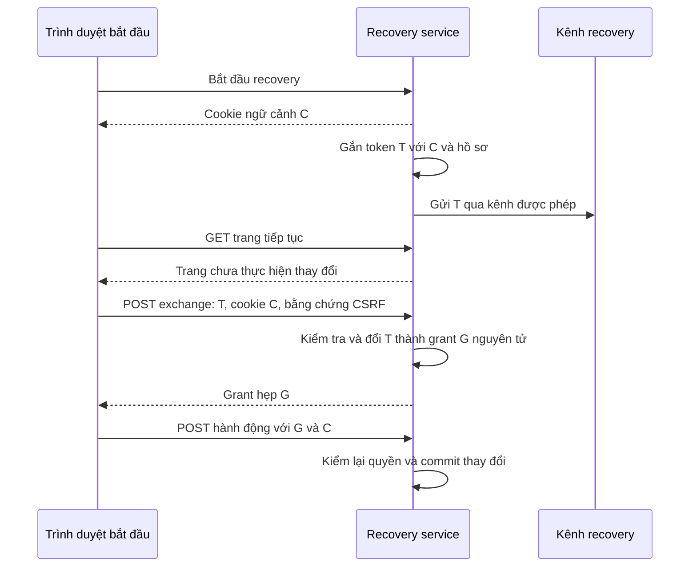

# Binding token to client context — Ràng buộc token với ngữ cảnh client

Một liên kết khôi phục có thể bị sao chép từ email, lịch sử trình duyệt, ứng dụng nhắn tin hoặc một nơi ghi log ngoài ý muốn. Nếu chỉ cần sở hữu liên kết là đủ thực hiện hành động, người lấy được token có thể thử sử dụng nó trên client của mình.

**Ràng buộc token với ngữ cảnh client** là việc máy chủ yêu cầu thêm bằng chứng về ngữ cảnh sử dụng đã được thiết lập cho token hoặc quyền recovery. Ví dụ, yêu cầu có bí mật của phiên bắt đầu recovery, hoặc chứng minh giữ một khóa riêng đã được gắn với quyền đó.

Mục tiêu là thu hẹp nơi một token bị lộ có thể được sử dụng. Ràng buộc này vẫn cần đi cùng xác minh danh tính, giới hạn quyền, thời hạn, dùng một lần và kiểm soát session.

Các đường dẫn API, tên cookie, schema và luồng dưới đây là thiết kế minh họa cho dịch vụ khôi phục tài khoản. Chúng không phải một giao thức chuẩn để sao chép nguyên trạng vào mọi ứng dụng.

## 1. “Client context” gồm những gì?

Trong một luồng recovery, từ “client” có thể chỉ ứng dụng, phiên trình duyệt hoặc một cặp khóa. Các khái niệm ấy có mức bảo đảm khác nhau.

| Thành phần ngữ cảnh | Máy chủ biết được gì? | Giới hạn |
| --- | --- | --- |
| Tenant, tài khoản, hồ sơ và purpose | Token được cấp cho đối tượng và hành động nào | Chưa chứng minh ai đang cầm token |
| ID phiên hoặc hồ sơ công khai | Request đang nhắc tới phiên hoặc hồ sơ nào | Một ID không bí mật không chứng minh sở hữu |
| Bí mật ngẫu nhiên trong cookie recovery | Request có bí mật của ngữ cảnh được máy chủ cấp | Cookie có thể bị đánh cắp; không phải định danh phần cứng |
| Public key đã ràng buộc và proof hợp lệ | Client có thể thực hiện phép ký bằng khóa tương ứng | Chưa tự chứng minh danh tính người sử dụng |
| IP, User-Agent, ngôn ngữ, múi giờ | Một số đặc điểm của request | Có thể thay đổi, trùng giữa nhiều người hoặc bị giả mạo |
| Authenticator đã đăng ký trước | Có thể cung cấp bằng chứng theo phương thức xác thực tương ứng | Chỉ có giá trị sau khi thực hiện đầy đủ kiểm tra của phương thức |

Không thể thay việc chứng minh sở hữu bằng cách thêm trường `deviceId` vào JSON. Nếu client tự chọn chuỗi và server chỉ so sánh lại chuỗi đó, người biết giá trị cũng có thể gửi nó.

Cần xác định rõ: **binding đang yêu cầu chứng minh điều gì, bằng chứng do ai cấp và kẻ tấn công có thể sao chép bằng cách nào?**

## 2. Phân biệt ràng buộc bắt buộc với tín hiệu rủi ro

Một thiết kế có thể dùng hai nhóm điều kiện:

| Nhóm | Ví dụ trong bài | Cách quyết định |
| --- | --- | --- |
| Điều kiện bắt buộc | Đúng hồ sơ, purpose, bí mật cookie hoặc proof từ khóa đã ràng buộc | Thiếu hoặc sai thì không thực hiện hành động được bảo vệ |
| Tín hiệu rủi ro | Thay đổi mạng, trình duyệt, vùng địa lý suy đoán | Điều chỉnh đánh giá rủi ro hoặc yêu cầu bằng chứng bổ sung theo policy |

Không nên âm thầm biến một điều kiện bắt buộc thành tùy chọn khi nó gây bất tiện. Cũng không nên coi mọi thay đổi tín hiệu rủi ro là bằng chứng người dùng đã bị chiếm tài khoản.

OWASP lưu ý IP và User-Agent có thể giúp phát hiện bất thường, nhưng kẻ tấn công có thể dùng chung mạng hoặc giả User-Agent. Các thuộc tính này không cung cấp một ràng buộc đáng tin cậy để tự chống mọi cuộc tấn công session. [OWASP Session Management Cheat Sheet, Binding the Session ID to Other User Properties](https://cheatsheetseries.owasp.org/cheatsheets/Session_Management_Cheat_Sheet.html#binding-the-session-id-to-other-user-properties)

Ví dụ, Huy bắt đầu recovery qua Wi-Fi rồi chuyển sang mạng di động. IP mới là thay đổi bình thường có thể xảy ra. Nếu hệ thống khóa cứng token theo IP ban đầu, người dùng thật có thể bị chặn dù vẫn giữ đúng bí mật ngữ cảnh.

Ngược lại, người ở cùng mạng công ty có thể có IP công khai giống nhau. IP không phải một yếu tố sở hữu độc lập.

### Tín hiệu phải có nguồn gốc rõ

Nếu dùng địa chỉ mạng trong đánh giá, máy chủ cần biết proxy nào được phép cung cấp thông tin client. Header `X-Forwarded-For` do một người gửi trực tiếp không tự trở thành địa chỉ đã được xác minh.

Thiếu User-Agent hoặc không lấy được một thuộc tính fingerprint nên được biểu diễn là “chưa biết”. Không tự gán một giá trị mặc định rồi coi các request có cùng mặc định là cùng thiết bị.

## 3. Phải chọn thời điểm thiết lập binding

Một câu hỏi quyết định sức mạnh của cơ chế là: **token đã gắn với ngữ cảnh trước khi bị lộ, hay ai cầm token trước sẽ được tự chọn ngữ cảnh?**

Xét hai phương án:

| Phương án | Diễn biến | Điều được bảo vệ |
| --- | --- | --- |
| Ràng buộc từ lúc phát hành | Phiên A được tạo trước; token T được lưu cùng binding của A | Người chỉ lấy được T khó dùng T ở phiên B |
| Ràng buộc sau lần đổi quyền đầu tiên | Bất kỳ người giữ T hợp lệ nào cũng có thể đổi lấy grant gắn với phiên của họ | Thu hẹp việc dùng lại grant sau exchange; chưa chặn người đánh cắp T đổi quyền trước |

Phương án thứ hai có thể hữu ích, nhưng không được mô tả như đã bảo vệ token gốc khỏi sử dụng trên client khác.

Một thuộc tính như `client_id` công khai hoặc tên ứng dụng cũng không chứng minh request đến từ bản cài đặt hợp lệ của ứng dụng đó.

### Binding không tự tạo thêm một yếu tố xác thực

Một token gửi qua email và một cookie mới tạo trên trình duyệt cho thấy hai bí mật trong một luồng. Điều đó chưa tự trở thành MFA.

Kẻ tấn công có thể bắt đầu hồ sơ recovery trên chính trình duyệt của mình. Nếu hắn kiểm soát được kênh nhận token của nạn nhân, hắn có cả ngữ cảnh do mình khởi tạo lẫn token. Binding vẫn khớp nhưng người đó chưa chắc là chủ tài khoản.

Vì vậy, khôi phục MFA hoặc passkey cần bằng chứng theo mức rủi ro của hành động. Việc binding khớp chỉ là một điều kiện trong quyết định.

## 4. Luồng minh họa: binding với phiên bắt đầu recovery

Thiết kế này dùng một bí mật ngữ cảnh do server tạo, lưu trong cookie của trình duyệt bắt đầu recovery.

### Bước 1 — Tạo ngữ cảnh trước khi phát hành token

1. Người dùng bắt đầu trên trang recovery chính thức.
2. Server tạo ngữ cảnh C với bí mật ngẫu nhiên khó đoán và thời hạn hữu hạn.
3. Trình duyệt nhận cookie chứa bí mật của C.
4. Khi policy cho phép phát hành token T, bản ghi T được liên kết với C, hồ sơ recovery và purpose.
5. Chỉ T được chuyển qua kênh recovery; bí mật của C không được gửi kèm trong email.

Một header minh họa:

```http
Set-Cookie: __Host-recovery_ctx=<opaque-random-value>; Secure; HttpOnly; SameSite=Lax; Path=/
Cache-Control: no-store
```

Với tiền tố `__Host-`, cookie cần `Secure`, `Path=/` và không có `Domain`. `HttpOnly` hạn chế JavaScript đọc giá trị cookie, nhưng script độc hại vẫn có thể gây request mang cookie. [OWASP Session Management Cheat Sheet, Cookies](https://cheatsheetseries.owasp.org/cheatsheets/Session_Management_Cheat_Sheet.html#cookies)

`Path=/` không cấp quyền toàn hệ thống. Quyền recovery vẫn được server giới hạn ở các endpoint và thao tác phù hợp. Lựa chọn `SameSite` phải phù hợp luồng mở liên kết; thuộc tính cookie không thay thế thiết kế chống CSRF.

### Bước 2 — Mở liên kết để xem trang tiếp tục

Một GET từ liên kết email chỉ phục vụ việc mở trang. Nó không đổi mật khẩu, gỡ MFA, đăng ký passkey hoặc tiêu thụ quyền dùng một lần.

Cần tính đến phần mềm quét liên kết, preview của ứng dụng email và thao tác prefetch. Những request ấy không thể được coi là hành động xác nhận của chủ tài khoản.

Không đưa bí mật cookie C vào URL để “giúp mở ở mọi trình duyệt”. Nếu cả T và C cùng nằm trong một liên kết bị sao chép, lợi ích của việc yêu cầu hai thành phần giảm đáng kể.

### Bước 3 — Đổi token bằng request được bảo vệ

Khi người dùng chủ động tiếp tục, client gửi POST tới endpoint exchange, gồm token T theo hợp đồng của API. Trình duyệt gửi cookie C theo cơ chế cookie.

Server kiểm tra:

- Token có định dạng hợp lệ, đúng secret và còn được phép sử dụng.
- T gắn với đúng tenant, tài khoản, hồ sơ và purpose.
- Bí mật cookie xác minh được ngữ cảnh C đã lưu.
- Binding của T đúng với C; hồ sơ không bị hủy hoặc thay thế.
- Request đáp ứng cơ chế chống CSRF và các điều kiện policy.
- Hành động không vượt ngân sách thử và giới hạn tài nguyên.

Không lấy một `contextRef` từ body rồi coi nó thay thế bằng chứng cookie. Client có thể khai định danh mong muốn; server mới là nơi xác minh quan hệ và bí mật.

### Bước 4 — Cấp recovery grant hẹp

Nếu kiểm tra thành công, server có thể tiêu thụ T để tạo một grant G chỉ cho phép tiếp tục đúng hồ sơ và hành động đã xác định.

OWASP mô tả khả năng đổi mã hoặc URL token thành một phiên giới hạn, chẳng hạn chỉ cho phép đặt lại mật khẩu. Token recovery không nên mặc nhiên mở một phiên đăng nhập đầy đủ. [OWASP Forgot Password Cheat Sheet](https://cheatsheetseries.owasp.org/cheatsheets/Forgot_Password_Cheat_Sheet.html)

Trong ví dụ này, G có bí mật mới do server tạo và gắn với C. Việc tiêu thụ T và tạo G cần có bảo đảm nhất quán; không để một khoảng trống cho hai request cùng đổi T thành hai grant hợp lệ.

Grant được cấp sau khi kiểm tra quyền không dùng lại một session identifier do client tự đặt. Ngữ cảnh trước recovery cũng không được tự nâng thành session đăng nhập.

### Bước 5 — Kiểm tra lại ở thao tác cuối

Khi thực sự đổi mật khẩu hoặc thực hiện bước recovery khác, server kiểm tra lại G, C, hạn dùng, purpose và trạng thái hồ sơ hiện tại.

Một lần binding khớp lúc mở form không giữ quyền vĩnh viễn. Hồ sơ có thể bị thu hồi trong lúc người dùng đang nhập dữ liệu.



## 5. Mô hình dữ liệu cần giữ điều gì?

Một bản ghi token minh họa có thể mô tả như sau. Các trường `Ref` là tham chiếu nội bộ giả, không phải secret.

```json
{
  "tokenRecordRef": "tr_example",
  "tenantRef": "tenant_example",
  "accountRef": "acct_example",
  "recoveryCaseRef": "rc_example",
  "purpose": "PASSWORD_RESET",
  "bindingMode": "RECOVERY_CONTEXT_COOKIE",
  "bindingRef": "ctx_example",
  "tokenVerifierRef": "verifier_example",
  "issuedAt": "2026-11-23T05:00:00Z",
  "expiresAt": "2026-11-23T05:12:00Z",
  "state": "ACTIVE",
  "version": 1
}
```

Mốc thời gian trên chỉ để minh họa dữ liệu, không phải khuyến nghị TTL cố định.

Server lưu dữ liệu xác minh bí mật theo thiết kế phù hợp; không trả verifier cho client. Ngữ cảnh có thời hạn, trạng thái và dữ liệu xác minh riêng. Việc bảo vệ mã ngắn cũng cần xét nguy cơ thử ngoại tuyến nếu dữ liệu xác minh bị lộ.

Nếu dùng token tự chứa đã ký, chữ ký bảo vệ tính toàn vẹn claim, không bảo đảm người trình token giữ đúng cookie hoặc khóa riêng. Server vẫn phải kiểm bằng chứng client tương ứng và trạng thái thu hồi cần thiết.

### Không cho thay binding bằng request thường

Các trường như `bindingMode`, `bindingRef`, tài khoản và purpose do server xác định sau các bước được phép. Client không có quyền sửa chúng chỉ bằng một request hoàn tất.

Các tình huống phải bị chặn trong mô hình này gồm:

- Token của C1 nhưng client gửi cookie của C2.
- Token của hồ sơ A nhưng body chỉ định tài khoản B.
- Token đặt mật khẩu được đưa tới endpoint gỡ MFA.
- Binding yêu cầu khóa nhưng request xin dùng cookie thay thế.
- Request đưa public key mới để thay public key đã gắn với token.

Nếu policy cho phép chuyển binding, đó là một thủ tục riêng có căn cứ cấp quyền, không phải thao tác sửa thuộc tính tùy ý.

## 6. CSRF và binding bảo vệ những khía cạnh khác nhau

Một cookie được trình duyệt gửi tự động có thể giúp xác minh ngữ cảnh, nhưng cũng tạo ra yêu cầu kiểm soát request do website khác kích hoạt.

OWASP khuyến nghị bảo vệ request thay đổi trạng thái bằng cơ chế chống CSRF phù hợp và tránh dùng GET cho các thay đổi đó. [OWASP CSRF Prevention Cheat Sheet](https://cheatsheetseries.owasp.org/cheatsheets/Cross-Site_Request_Forgery_Prevention_Cheat_Sheet.html)

Trong luồng minh họa:

| Thành phần | Câu hỏi cần trả lời |
| --- | --- |
| Token recovery | Client có bằng chứng recovery được cấp cho hồ sơ này không? |
| Cookie ngữ cảnh | Request có ngữ cảnh đã gắn với token không? |
| Cơ chế chống CSRF | Request dùng cookie có đáp ứng hợp đồng về nguồn và sự tương tác không? |
| Policy recovery | Các bằng chứng hiện có đủ cho hành động này không? |
| Kiểm tra trạng thái cuối | Quyền còn hiệu lực tại thời điểm thực hiện không? |

Không dùng token recovery làm một giá trị chống CSRF dùng chung cho toàn bộ ứng dụng. Hai loại token cần mục đích và vòng đời riêng.

Origin và Fetch Metadata có thể tham gia kiểm soát request trình duyệt theo policy. Chúng không tự chứng minh một người hoặc một bản cài đặt ứng dụng native; client ngoài trình duyệt có thể tự tạo nhiều header.

Nếu kiểm tra Origin, cần so khớp nguồn được phép theo cấu trúc chính xác, bao gồm scheme, host và port. Một chuỗi chứa tên miền tin cậy không đủ để được coi là đúng nguồn.

## 7. Khi cần ràng buộc với khóa của client

Một ứng dụng có thể giữ cặp khóa riêng và dùng khóa riêng tạo proof. Token hoặc grant được server liên kết với public key tương ứng.

Ý tưởng là người lấy được token nhưng không dùng được khóa sẽ thiếu bằng chứng cần thiết. Tuy nhiên, binding chỉ có giá trị khi server biết đúng public key nào đã được chấp nhận trong đúng bước cấp quyền.

Một thiết kế cho recovery phải giải quyết ít nhất:

1. Cách thiết lập khóa và chứng minh quyền gắn khóa với hồ sơ.
2. Cách kiểm tra proof gắn với đúng request và quyền đang trình.
3. Độ mới của proof, challenge hoặc nonce và kiểm soát phát lại.
4. Thuật toán được chấp nhận và cách quản lý vòng đời khóa.
5. Cách xử lý mất khóa và chuyển thiết bị mà không hạ điều kiện cấp quyền.

Public key mới tạo chứng minh khả năng dùng một khóa mới. Nó chưa chứng minh người tạo khóa là chủ tài khoản. Đăng ký passkey mới trong recovery cũng cần quyền đăng ký đã được thiết lập trước.

### DPoP là một tham chiếu có phạm vi cụ thể

RFC 9449 định nghĩa DPoP để ràng buộc OAuth access/refresh token với khóa của client. Proof cần được kiểm tra theo giao thức, gồm quan hệ với khóa đã gắn token, request và chống phát lại. Một proof hợp lệ tự nó không phải cơ chế xác thực hay quyết định quyền truy cập. [RFC 9449, Concept and Checking DPoP Proofs](https://www.rfc-editor.org/rfc/rfc9449.html#section-4.3)

Nếu hệ thống dùng OAuth cùng DPoP, nên triển khai đầy đủ hợp đồng của giao thức bằng thành phần phù hợp. Thêm một JWT tự ký vào endpoint recovery không tự biến endpoint đó thành triển khai DPoP.

DPoP cũng không mặc nhiên bảo vệ toàn bộ request body; bảo vệ đường truyền và xử lý đúng dữ liệu hành động vẫn cần thiết. [RFC 9449, Request Integrity](https://www.rfc-editor.org/rfc/rfc9449.html#section-11.7)

Không suy ra khóa “không xuất được” có nghĩa client không thể bị lạm dụng. Script độc hại trong cùng ngữ cảnh có thể gọi chức năng ký hoặc kích hoạt request khi client còn hoạt động. Cần xét khả năng sử dụng khóa trái phép bên cạnh khả năng lấy ra private key.

## 8. Người dùng mở email ở thiết bị khác thì sao?

Đây là tình huống cần thiết kế ngay từ đầu, đặc biệt khi module phục vụ người mất thiết bị xác thực.

Ví dụ, Minh bắt đầu recovery trên laptop A nhưng mở email bằng điện thoại B. B có T nhưng không có C của A.

Một chính sách khóa theo phiên bắt đầu phải xử lý đúng sự thiếu hụt ấy; không được tự tạo C mới rồi sửa token sang C mới chỉ vì T đúng.

Các lựa chọn minh họa:

| Lựa chọn | Cách duy trì ý nghĩa bảo mật |
| --- | --- |
| Tiếp tục ở trình duyệt ban đầu | Người dùng nhập mã hoặc tiếp tục trên A; A vẫn giữ C |
| Bắt đầu hồ sơ mới trên B | B có ngữ cảnh mới và phải hoàn thành bằng chứng recovery của hồ sơ mới |
| Chuyển ngữ cảnh có phê duyệt | Một thủ tục được bảo vệ xác nhận chuyển từ ngữ cảnh đang có quyền |
| Luồng thay thế khi mất A | Policy yêu cầu bằng chứng phù hợp khác; không giả định cookie cũ còn tồn tại |

Nếu cho nhập mã đọc từ email vào A, mã vẫn cần thời hạn, giới hạn thử và dùng một lần theo thiết kế. Không yêu cầu người dùng gửi cả mã và cookie cho nhân viên hỗ trợ.

Một QR chứa cả token lẫn bí mật ngữ cảnh chỉ chuyển toàn bộ quyền tới người quét. QR không tự tạo ra sự phê duyệt hoặc bảo đảm đúng người nhận.

### Trường hợp mất hẳn thiết bị ban đầu

Recovery không thể luôn phụ thuộc vào một thiết bị mà người dùng đã mất. Nhưng việc có đường thay thế không đồng nghĩa bỏ qua mọi binding khi gặp lỗi.

Hệ thống cần một phương án có mức bằng chứng phù hợp với rủi ro: phương thức recovery đã đăng ký, authenticator còn dùng được, hoặc quy trình xác minh danh tính đã được phê duyệt.

Nếu phương án ấy không đạt yêu cầu cho việc gỡ MFA hoặc thêm passkey, chỉ một token đúng và một trình duyệt mới vẫn chưa đủ.

## 9. Xử lý mismatch mà không mở đường tắt

Trong ví dụ, một request có binding sai bị từ chối thực hiện hành động. Phản hồi công khai có thể hướng dẫn tiếp tục trên trình duyệt ban đầu hoặc bắt đầu lại theo luồng chính thức.

Không nên trả:

```text
Token đúng, nhưng cookie của bạn thuộc phiên khác.
Hãy đặt contextRef thành ctx_123 để tiếp tục.
```

Thông báo ấy tiết lộ kết quả kiểm tra từng phần và khuyến khích client điều chỉnh một định danh đáng lẽ do server quản lý.

Một cách diễn đạt an toàn hơn:

> Chưa thể tiếp tục khôi phục trong ngữ cảnh hiện tại. Hãy làm theo hướng dẫn trên trang khôi phục chính thức.

Chi tiết nội bộ có thể phân biệt `CONTEXT_MISSING`, `CONTEXT_EXPIRED`, `BINDING_MISMATCH` và lỗi phụ thuộc, với quyền xem phù hợp.

### Không tiêu thụ token chỉ vì có người gửi binding sai

Nếu một người ngoài biết token reference nhưng thiếu secret hoặc cookie, việc tự thu hồi token ngay sau một lần thử có thể tạo khả năng làm gián đoạn người thật.

Policy chống lạm dụng cần phân biệt từ chối request, giới hạn thử và quyết định thu hồi quyền. Không để một endpoint chưa xác thực khóa toàn bộ đăng nhập hay xóa phương thức xác thực của người dùng chỉ bằng cách khai tài khoản.

Ngược lại, không được cho bỏ kiểm tra binding vì kho ngữ cảnh timeout. Không xác minh được điều kiện bắt buộc thì chưa đủ cơ sở cấp quyền.

## 10. Giữ binding đúng qua race, retry và thay đổi trạng thái

Binding cần được cưỡng chế ở điểm đổi quyền và điểm thực hiện hành động, không chỉ trong middleware trước khi đọc dữ liệu.

Pseudo-code minh họa:

```text
exchange(tokenSecret, contextSecret, request):
    enforceRequestBudget(request)
    verifyRequestProtection(request)

    beginTransaction()
    token = loadAndLockToken(tokenSecret)
    context = loadAuthoritativeContext(contextSecret)

    require token is active and not expired
    require token secret is valid
    require context secret is valid and context is active
    require token.bindingMode == RECOVERY_CONTEXT_COOKIE
    require token.bindingRef == context.ref
    require token.caseRef belongs to the same allowed recovery flow
    require currentPolicyAllowsExchange(token, context)

    grant = createFreshRestrictedGrant(
        caseRef = token.caseRef,
        purpose = token.purpose,
        bindingRef = context.ref
    )
    consumeToken(token)
    recordSafeTransition(token, grant)
    commitTransaction()

    return grant through the protected delivery mechanism
```

Đây là mô hình logic, không phải code hoàn chỉnh để triển khai. Tra cứu, xác minh secret, xử lý không tìm thấy, rollback và kiểm soát lỗi cần có thiết kế tương ứng.

Nếu trạng thái context hoặc policy có thể thay đổi đồng thời, mức cô lập và cơ chế version phải ngăn quyết định dựa trên dữ liệu đã hết hiệu lực.

Một proof hoặc một cookie còn đúng không làm token đã tiêu thụ có quyền mới. Retry cùng thao tác cần hợp đồng chống lặp riêng; không dùng retry để cấp lại grant vô hạn hoặc đổi binding.

Các replica có thể có độ trễ. Điều kiện dùng một lần và thu hồi cần dựa trên cơ chế có thẩm quyền đáp ứng bảo đảm của hệ thống, thay vì tùy request đọc được bản sao cũ nào.

## 11. Giới hạn bảo vệ cần nói rõ

Một bảng tình huống giúp diễn đạt đúng giá trị của thiết kế:

| Tình huống | Binding với cookie C từ lúc phát hành giúp gì? | Giới hạn còn lại |
| --- | --- | --- |
| Chỉ T bị sao chép sang B | B thiếu C nên không thực hiện được exchange đã bảo vệ | Luồng khác có thể có điều kiện riêng |
| T và C cùng bị lấy | Không còn phân biệt bằng hai bí mật ấy | Cần giới hạn quyền và kiểm soát bổ sung |
| Kẻ tấn công cùng IP với nạn nhân | Không tự có C chỉ nhờ cùng mạng | IP chỉ là tín hiệu |
| Người dùng đổi mạng nhưng giữ C | Có thể tiếp tục nếu policy khác cho phép | Vẫn đánh giá rủi ro hiện tại |
| XSS trong trang recovery | Không thể dựa vào HttpOnly để ngăn mọi hành động | Script có thể thao tác trong ngữ cảnh trình duyệt |
| Kẻ tấn công bắt đầu recovery và kiểm soát email | Có thể giữ đúng C của chính hắn và nhận T | Binding không thay xác minh chủ tài khoản |
| Người dùng mất trình duyệt ban đầu | C có thể không còn | Cần luồng recovery thay thế có bằng chứng phù hợp |

Không mô tả mọi cookie là “device binding”. Một hồ sơ trình duyệt có thể được di chuyển, sao chép hoặc chạy trên nhiều môi trường; tính chất phụ thuộc vào nền tảng và cách bảo vệ dữ liệu.

Tương tự, proof từ khóa mới tạo không bảo đảm một thiết bị cụ thể chưa bị chiếm. Cần mô tả đúng điều đã xác minh, không suy rộng thành mức tin cậy của toàn thiết bị.

## 12. Ghi nhận binding mà không làm lộ quyền recovery

Một audit event đề xuất:

```json
{
  "event": "recovery.binding_check_rejected",
  "requestRef": "req_example",
  "caseRef": "rc_example",
  "tokenRecordRef": "tr_example",
  "bindingMode": "RECOVERY_CONTEXT_COOKIE",
  "reasonCode": "BINDING_MISMATCH",
  "stateMutation": "NONE",
  "policyVersion": "policy_example"
}
```

Chỉ ghi các tham chiếu khi máy chủ đã có căn cứ ánh xạ chúng. Request rác có thể chưa thuộc một tài khoản hay hồ sơ được xác định.

Không ghi token, cookie context, grant, private key, proof chứa dữ liệu nhạy cảm hoặc URL recovery đầy đủ. Nếu cần điều tra public-key binding, ưu tiên tham chiếu khóa được quản lý theo mục đích và thời hạn lưu, không thu thập fingerprint thiết bị vô hạn.

Các chỉ số hữu ích có thể là tỷ lệ thiếu context, mismatch theo phiên bản client, số lần phải bắt đầu lại và tỷ lệ người dùng không tiếp tục được khi mở email trên thiết bị khác.

Không dùng một tỷ lệ mismatch cao để kết luận ngay là tấn công. Nó cũng có thể phản ánh cookie bị chặn, ứng dụng mở webview khác hoặc một luồng cross-device chưa được thiết kế đầy đủ.

## 13. Cách lựa chọn cho một luồng recovery cụ thể

Để lựa chọn binding, cần trả lời các câu hỏi theo đúng hành động đang bảo vệ:

1. Token bị lấy riêng lẻ ở đâu, và kẻ tấn công có thể lấy thêm cookie hoặc dùng khóa không?
2. Ngữ cảnh được thiết lập trước khi phát hành hay sau khi ai đó trình token?
3. Luồng bình thường có chuyển giữa email app, webview, trình duyệt và thiết bị không?
4. Người dùng có thể mất chính client giữ binding không?
5. Bằng chứng recovery hiện có đủ cho đặt mật khẩu, gỡ MFA hay đăng ký passkey đến mức nào?
6. Khi binding thiếu, hệ thống có phương án tiếp tục được phê duyệt hay chỉ vô tình hạ điều kiện?
7. Quyền mới sau exchange có giữ nguyên giới hạn và kiểm tra lại tại thao tác cuối không?

Ràng buộc token với client context có giá trị khi điều kiện được server thiết lập từ đúng thời điểm, được kiểm tra bằng bằng chứng phù hợp và có đường xử lý mất ngữ cảnh rõ ràng. Cần giữ mục tiêu cụ thể: giảm khả năng sử dụng một quyền recovery bị lấy sang ngữ cảnh khác, trong khi vẫn xác minh đúng chủ tài khoản và đúng phạm vi hành động.
