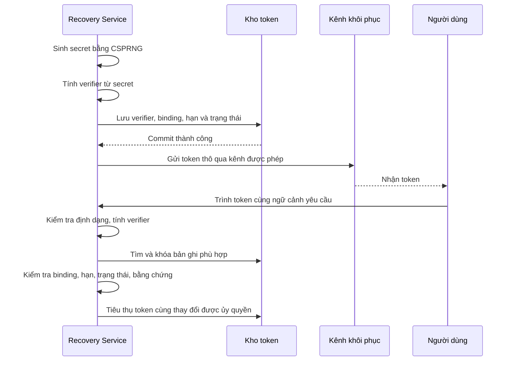

# Hashed token storage

## 1. Vì sao cơ sở dữ liệu không nên giữ token thô

Token khôi phục là bí mật có thể cấp quyền thay đổi mật khẩu hoặc tiếp tục một quy trình khôi phục MFA, passkey hay thiết bị xác thực. Nếu lưu nguyên token trong cơ sở dữ liệu, người đọc được bảng, bản sao lưu hoặc bản xuất chẩn đoán có thể lấy token còn hạn để thử sử dụng trực tiếp.

Hashed token storage là cách lưu giá trị kiểm chứng một chiều của token thay cho chính bí mật. Khi người dùng trình token, máy chủ tính lại giá trị kiểm chứng rồi đối chiếu với dữ liệu đã lưu. Máy chủ không cần khôi phục token gốc để thực hiện bước này.

OWASP yêu cầu token khôi phục được sinh bằng nguồn ngẫu nhiên mật mã, đủ khó đoán, gắn với người dùng, lưu an toàn và vô hiệu sau khi sử dụng. Bài này cụ thể hóa việc lưu trữ cho token opaque ngẫu nhiên có entropy cao; cách chọn hàm băm bên dưới phụ thuộc giả định đó. [Nguồn: OWASP Forgot Password Cheat Sheet](https://cheatsheetseries.owasp.org/cheatsheets/Forgot_Password_Cheat_Sheet.html#general-security-practices).

## 2. Phân biệt token, giá trị băm và định danh bản ghi

| Giá trị | Mục đích | Có cho phép sử dụng như token không? |
| --- | --- | --- |
| Token thô | Bí mật gửi qua kênh khôi phục được chấp nhận | Có, trong phạm vi và thời hạn đã cấp |
| Token hash hoặc verifier | Kiểm chứng token người dùng trình lên | Không được chấp nhận trực tiếp |
| Token ID | Định danh bản ghi phục vụ xử lý và truy vết | Không |
| Recovery transaction ID | Xác định yêu cầu khôi phục | Không |

Một lỗi làm mất lợi ích của băm là cho endpoint nhận cả token thô lẫn token hash. Nếu chỉ cần gửi giá trị đọc từ cột `token_hash` để tiếp tục recovery, cột đó đã trở thành bearer credential mới.

Base64, Base64URL và hex là các cách biểu diễn byte, không phải bảo vệ một chiều. Lưu `Base64(token)` vẫn cho phép khôi phục token. Mã hóa có khóa bảo vệ theo một mô hình khác: ai có quyền giải mã có thể lấy lại bí mật, trong khi verifier băm được thiết kế chỉ để đối chiếu.

Đối với token chỉ cần kiểm chứng, không nên thêm khả năng “xem lại token” cho nhân viên hỗ trợ. Khi cần gửi lại, tạo token mới theo chính sách thay thế hoặc song song đã xác định.

## 3. Chọn hàm băm dựa trên entropy đầu vào

Độ dài đầu ra của SHA-256 không chứng minh đầu vào khó đoán. Mã gồm sáu chữ số chỉ có một triệu khả năng, bất kể sau khi băm có tạo ra 256 bit đầu ra hay không.

| Loại bí mật | Đặc điểm | Hướng thiết kế lưu trữ |
| --- | --- | --- |
| Token opaque gồm 32 byte ngẫu nhiên mật mã | Không gian bí mật rất lớn nếu nguồn sinh đúng | Có thể dùng SHA-256 làm verifier theo mô hình của bài |
| Mã OTP/PIN ngắn | Ít khả năng, dễ thử hết khi có verifier thông thường | Cần thiết kế riêng cho dò ngoại tuyến, khóa bí mật nếu phù hợp và giới hạn thử trực tuyến |
| Mật khẩu người dùng chọn | Phân bố không đều, thường có thể đoán | Dùng cơ chế lưu mật khẩu thích hợp với salt và hàm băm mật khẩu có chi phí |

Một token được sinh từ 32 byte ngẫu nhiên có tối đa 256 bit entropy, với điều kiện nguồn ngẫu nhiên và toàn bộ quy trình sinh giữ được chất lượng đó. Biểu diễn Base64URL không padding dài 43 ký tự giữ nguyên các byte bí mật; việc mã hóa không tự tạo thêm entropy.

Trong thiết kế này, SHA-256 nhanh là chấp nhận được vì kẻ có verifier vẫn phải tìm trong không gian token ngẫu nhiên rất lớn. Đây không phải lý do để dùng SHA-256 trực tiếp cho mật khẩu. OWASP nêu rõ mật khẩu cần hàm băm chậm phù hợp và SHA-256 nhanh không phù hợp cho lưu mật khẩu. [Nguồn: OWASP Password Storage Cheat Sheet](https://cheatsheetseries.owasp.org/cheatsheets/Password_Storage_Cheat_Sheet.html#introduction).

Nếu token được tạo từ timestamp, email, bộ đếm hoặc một nguồn có thể dự đoán, băm đầu ra không sửa được thiết kế sinh bí mật. Tương tự, TTL ngắn và giới hạn thử ở API không ngăn người đã lấy được verifier thông thường thử đoán ngoại tuyến.

## 4. Salt, domain separation và HMAC có vai trò khác nhau

Với token ngẫu nhiên đủ mạnh và độc lập, salt riêng không phải điều kiện bắt buộc để chống dò từ điển như trường hợp mật khẩu. Không gian token đã làm bảng dò chuẩn bị trước trở nên không thực tế trong giả định của bài. Nếu dùng thư viện băm mật khẩu hoặc chính sách yêu cầu salt, vẫn phải tuân thủ cách dùng salt của cơ chế đó.

Domain separation là thêm ngữ cảnh cố định vào dữ liệu cần băm để phân biệt cách dùng. Ví dụ:

```text
verifier = SHA-256(
    ASCII("account-recovery:token:v1:") || secret_bytes
)
```

Tiền tố trên là dữ liệu công khai, không phải pepper hay khóa bí mật. Nó giúp định nghĩa miền và phiên bản thuật toán; nó không làm mã sáu chữ số khó dò hơn. Việc ràng buộc tài khoản, tenant, mục đích và giao dịch vẫn cần được kiểm tra từ dữ liệu nguồn.

Một lựa chọn khác là verifier có khóa:

```text
verifier = HMAC-SHA-256(K, domain || secret_bytes)
```

Khóa `K` cần được giữ tách khỏi cơ sở dữ liệu token và được quản lý như bí mật. Trong mô hình chỉ lộ dữ liệu DB mà không lộ khóa, kẻ tấn công không thể tự tính verifier HMAC của các giá trị đoán. Nếu khóa cũng bị lộ hoặc có đường gọi dịch vụ tính HMAC không bị kiểm soát, lợi ích này thay đổi.

HMAC không tăng entropy của token và không thay thế giới hạn thử, TTL hoặc xác minh danh tính. Không tự ghép một khóa với dữ liệu rồi coi đó là HMAC. Nếu có nhiều trường ngữ cảnh biến độ dài, dùng định dạng mã hóa không nhập nhằng thay vì nối chuỗi tùy tiện.

OWASP phân biệt salt công khai với pepper bí mật, yêu cầu pepper được lưu riêng và bảo vệ trong kho bí mật hoặc HSM. Nguyên tắc tách bí mật đó cũng cần thiết khi chọn verifier HMAC cho thiết kế token. [Nguồn: OWASP Password Storage — Peppering](https://cheatsheetseries.owasp.org/cheatsheets/Password_Storage_Cheat_Sheet.html#peppering).

## 5. Luồng phát hành và kiểm chứng



Token thô vẫn phải tồn tại tạm thời ở nơi sinh, kênh gửi và phía người dùng. Mục tiêu là giảm số bản sao bền vững và quyền truy cập bí mật, không khẳng định bí mật không bao giờ xuất hiện trong bộ nhớ.

Helper sinh token trả bí mật cho thành phần gửi tin nội bộ. API công khai nhận yêu cầu “quên mật khẩu” không được trả token về cho người vừa nhập tên tài khoản; nếu làm vậy, kênh chứng minh quyền kiểm soát email hoặc phương thức khôi phục sẽ bị bỏ qua.

## 6. Ví dụ Java cho token ngẫu nhiên 32 byte

Lớp dưới đây minh họa phần sinh và kiểm chứng token. Nó không bao gồm truy vấn cơ sở dữ liệu, kiểm tra quyền khôi phục hoặc xử lý dùng một lần.

```java
import java.nio.charset.StandardCharsets;
import java.security.MessageDigest;
import java.security.NoSuchAlgorithmException;
import java.security.SecureRandom;
import java.util.Arrays;
import java.util.Base64;

public final class RecoveryTokenCodec {
    private static final int SECRET_BYTES = 32;
    private static final int DIGEST_BYTES = 32;
    private static final SecureRandom RANDOM = new SecureRandom();
    private static final Base64.Encoder ENCODER =
            Base64.getUrlEncoder().withoutPadding();
    private static final Base64.Decoder DECODER = Base64.getUrlDecoder();
    private static final byte[] DOMAIN =
            "account-recovery:token:v1:"
                    .getBytes(StandardCharsets.US_ASCII);

    private RecoveryTokenCodec() {
    }

    public static String generateRawToken() {
        byte[] secret = new byte[SECRET_BYTES];
        RANDOM.nextBytes(secret);
        try {
            return ENCODER.encodeToString(secret);
        } finally {
            Arrays.fill(secret, (byte) 0);
        }
    }

    public static byte[] verifierOf(String rawToken) {
        byte[] secret = decodeCanonical(rawToken);
        try {
            MessageDigest digest = MessageDigest.getInstance("SHA-256");
            digest.update(DOMAIN);
            return digest.digest(secret);
        } catch (NoSuchAlgorithmException exception) {
            throw new IllegalStateException("SHA-256 unavailable", exception);
        } finally {
            Arrays.fill(secret, (byte) 0);
        }
    }

    public static boolean matches(String candidate, byte[] storedVerifier) {
        if (storedVerifier == null || storedVerifier.length != DIGEST_BYTES) {
            return false;
        }
        try {
            byte[] calculated = verifierOf(candidate);
            return MessageDigest.isEqual(storedVerifier, calculated);
        } catch (IllegalArgumentException invalidFormat) {
            return false;
        }
    }

    private static byte[] decodeCanonical(String token) {
        if (token == null || token.length() != 43
                || !token.matches("[A-Za-z0-9_-]{43}")) {
            throw new IllegalArgumentException("Invalid token format");
        }
        byte[] secret = DECODER.decode(token);
        if (secret.length != SECRET_BYTES
                || !ENCODER.encodeToString(secret).equals(token)) {
            Arrays.fill(secret, (byte) 0);
            throw new IllegalArgumentException("Invalid token format");
        }
        return secret;
    }
}
```

`SecureRandom` cung cấp nguồn ngẫu nhiên phù hợp cho mục đích mật mã; không thay bằng `Random` hoặc tự seed bằng thời gian hiện tại. Mỗi lần tính verifier tạo một `MessageDigest` riêng để tránh chia sẻ trạng thái băm đang cập nhật giữa các request. [Nguồn: Java SecureRandom](https://docs.oracle.com/en/java/javase/25/docs/api/java.base/java/security/SecureRandom.html), [Java MessageDigest](https://docs.oracle.com/en/java/javase/25/docs/api/java.base/java/security/MessageDigest.html).

Hai phía đều băm chính 32 byte secret sau khi giải mã, không phải URL đầy đủ hoặc một chuỗi đã bị trim hay đổi chữ hoa thành chữ thường. Kiểm tra biểu diễn canonical loại bỏ các cách biểu diễn khác nhau của cùng byte đầu vào. Base64URL có phân biệt chữ hoa và chữ thường.

`MessageDigest.isEqual` được dùng để so sánh hai digest có độ dài cố định; không viết vòng lặp tự dừng ngay ở byte khác đầu tiên. Điều đó không làm toàn bộ HTTP endpoint có thời gian cố định: truy vấn DB, bản ghi thiếu và các nhánh xử lý vẫn có thể khác nhau. [Nguồn: Java MessageDigest.isEqual](https://docs.oracle.com/en/java/javase/25/docs/api/java.base/java/security/MessageDigest.html#isEqual(byte%5B%5D,byte%5B%5D)).

`Arrays.fill` chỉ xóa các mảng byte mà đoạn mã trực tiếp giữ. Token dạng `String`, bản sao do runtime hoặc kênh gửi có thể vẫn tồn tại; ví dụ không hứa xóa sạch mọi dấu vết bí mật trong bộ nhớ Java. Tránh đưa token vào đối tượng có `toString()` tự động hoặc ghi log tham số của helper.

## 7. Thiết kế bản ghi lưu trữ

Một bản ghi có thể gồm:

| Trường | Vai trò |
| --- | --- |
| `id` | Định danh nội bộ, dùng cho audit và cập nhật |
| `tenant_id`, `account_id` | Chủ thể và phạm vi quản lý |
| `recovery_transaction_id` | Ràng buộc với đúng tiến trình khôi phục |
| `purpose`, `allowed_step` | Giới hạn hành động được phép |
| `verifier` | Digest nhị phân 32 byte trong ví dụ SHA-256 |
| `verifier_scheme` | Ví dụ `SHA256_RECOVERY_V1` |
| `key_version` | Chỉ cần khi cơ chế verifier dùng khóa có phiên bản |
| `created_at`, `expires_at` | Mốc cấp và hết hiệu lực |
| `status`, `consumed_at` | Kiểm soát và ghi nhận dùng một lần |

Có thể lưu digest ở dạng nhị phân hoặc hex với hợp đồng định dạng rõ ràng. SHA-256 tạo 32 byte; biểu diễn hex đầy đủ cần 64 ký tự. Không cắt còn vài ký tự để tiết kiệm cột hoặc chỉ so sánh một phần đầu của digest.

Không thêm cột `raw_token` dự phòng cho “dễ debug”. Giá trị verifier cũng không nên bị công khai: nó có thể hỗ trợ dò ngoại tuyến nếu loại bí mật yếu và cho phép liên kết dữ liệu giữa các bản sao.

Thuật toán và phiên bản được máy chủ quản lý. Người gọi không thể gửi `scheme=none`, chọn phiên bản cũ hoặc buộc backend thử mọi thuật toán tùy ý.

## 8. Tìm bản ghi bằng digest hoặc bằng selector

Có hai mô hình phổ biến cần chọn rõ:

| Mô hình | Cách tìm | Điểm cần chú ý |
| --- | --- | --- |
| Tra cứu theo digest | Tính verifier rồi truy vấn chỉ mục phù hợp | Thuận tiện với verifier xác định của token entropy cao |
| Selector và secret | Dùng selector tìm hàng, băm secret rồi đối chiếu | Selector không có quyền; giúp tìm bản ghi có salt hoặc phiên bản khóa cụ thể |

Với tra cứu digest, phải thêm ràng buộc tenant, mục đích và giao dịch thích hợp. Tìm thấy hàng chỉ chứng minh có bản ghi khớp verifier, chưa chứng minh còn quyền sử dụng.

Với mô hình `selector.secret`, selector có thể là định danh ngẫu nhiên không mang quyền. Chỉ lưu verifier của phần secret và metadata cần thiết. Biết selector, token ID hoặc recovery transaction ID không cho phép bỏ qua bước kiểm chứng secret.

Nếu dùng hàm băm có salt riêng cho mỗi hàng, không thể tính một digest duy nhất trước rồi tra cứu theo cách của SHA-256 không salt. Cần tìm đúng bản ghi bằng selector hoặc ngữ cảnh khác trước khi gọi hàm kiểm chứng của thư viện. Không quét toàn bộ bảng và thử một mật mã tốn CPU trên từng hàng.

## 9. Verifier khớp vẫn phải kiểm tra quyền và dùng một lần

Luồng chấp nhận token cần kết hợp các điều kiện:

```text
verifier khớp
AND đúng tenant, tài khoản và giao dịch
AND đúng mục đích, đúng bước
AND token chưa dùng, chưa thu hồi hoặc bị thay thế
AND thời gian máy chủ chưa đến expires_at
AND giao dịch khôi phục còn hiệu lực
AND các bằng chứng và chính sách bổ sung đã được đáp ứng
```

Việc tiêu thụ token và thay đổi bảo mật cần một quyết định nguyên tử trên nguồn trạng thái dùng chung. Hai request cùng có token đúng không được cùng đổi mật khẩu chỉ vì mỗi request đều đọc thấy `status = ISSUED` trước khi ghi.

Một cách xử lý là khóa bản ghi token và giao dịch liên quan, kiểm tra lại thời gian cùng trạng thái sau khi lấy khóa, thực hiện thay đổi được phép và đánh dấu đã dùng trong cùng giao dịch. Nếu thao tác ở nhiều dịch vụ, cần giao thức thực thi bền vững và idempotency phù hợp; một phép so sánh digest không cung cấp atomicity đó.

Token hợp lệ cho đặt lại mật khẩu không tự cấp quyền gỡ MFA hoặc đăng ký passkey mới. Lưu trữ tốt giảm rủi ro lộ bí mật nhưng không nâng mức bảo đảm của phương thức xác minh danh tính.

## 10. Không tạo bản sao token thô ở hệ thống phụ

Bảng chính chỉ có hash nhưng các nơi khác giữ bí mật nguyên văn thì phạm vi rủi ro vẫn lớn. Cần xem toàn bộ đường đi của token:

- Request log của reverse proxy, máy chủ ứng dụng và APM.
- Nội dung email hoặc SMS còn trong hàng đợi, outbox và dead-letter queue.
- Lịch sử trình duyệt, URL referrer và công cụ phân tích trên trang recovery.
- Cache, trace, crash dump, bản sao lưu và tệp xuất hỗ trợ.

Khi cần giữ token để gửi bất đồng bộ, dữ liệu giao nhận đó là một kho bí mật riêng: chỉ thành phần gửi được đọc, hạn lưu ngắn, bảo vệ nội dung và quản lý khóa phù hợp nếu mã hóa. Sau khi kết thúc nhu cầu gửi hoặc retry, dọn theo chính sách thay vì giữ vô hạn.

Không log toàn URL hoặc body có token. Việc che giá trị ở tầng ứng dụng chưa đủ nếu proxy hoặc công cụ quan sát đã ghi trước đó. Audit nên dùng token ID nội bộ và correlation ID đã được kiểm soát thay cho token hay digest.

Lưu hash không bảo vệ được token đã lộ trong hộp thư hoặc trình duyệt. Kênh gửi an toàn, tránh rò rỉ URL và kiểm soát session vẫn là các phần riêng của luồng khôi phục.

## 11. Xoay khóa, thay thuật toán và khôi phục dữ liệu

Nếu chỉ lưu verifier, không thể tính lại verifier theo thuật toán hay khóa mới từ token gốc mà hệ thống không còn giữ. Không được coi việc băm digest cũ bằng khóa mới là tương đương với tính verifier mới trên secret gốc.

Với token sống ngắn, một chiến lược là cấp mới theo scheme hiện hành, chỉ chấp nhận scheme cũ trong khoảng chuyển tiếp có giới hạn, rồi thu hồi hoặc để hết hạn. Với HMAC, giữ `key_version` để chọn đúng khóa được phép; không thử một danh sách khóa tăng mãi trên mọi request.

Nếu khóa xác minh bị lộ, việc cho toàn bộ token cũ tiếp tục hoạt động có thể không phù hợp. Quy trình ứng phó cần xác định token nào bị ảnh hưởng, thu hồi quyền tương ứng và phát hành lại khi người dùng có đủ điều kiện.

Bản sao lưu có verifier vẫn có thể chứa trạng thái `ISSUED` của token đã dùng sau thời điểm sao lưu. Khôi phục snapshot vì vậy có nguy cơ phục hồi quyền đã tiêu thụ. Kế hoạch phục hồi phải giữ được dấu tiêu thụ/thu hồi từ nguồn bền vững phù hợp, hoặc vô hiệu các token bị ảnh hưởng bằng cơ chế được endpoint thực sự kiểm tra.

Thời hạn token phải được giữ theo mốc tuyệt đối đã cấp. Không tính lại thành “bây giờ cộng TTL” khi nạp bản sao lưu, vì điều đó sẽ gia hạn bí mật cũ.

## 12. Giới hạn của mô hình bảo vệ

Hashed storage chủ yếu giảm khả năng lấy token còn dùng được từ việc đọc dữ liệu lưu trữ. Nó không bảo vệ hoàn toàn khi kẻ tấn công có quyền sửa tùy ý bảng token: người đó có thể cố thay verifier, chủ thể, mục đích hoặc trạng thái theo một token do họ biết. Cần phân quyền ghi, kiểm soát truy cập DB và phát hiện thay đổi bất thường.

Nếu ứng dụng bị kiểm soát, token thô có thể bị lấy ngay lúc sinh hoặc lúc người dùng trình lên. Nếu bí mật có entropy thấp, hash thông thường vẫn có thể bị dò. Nếu endpoint chấp nhận digest như token, cơ chế bảo vệ bị vô hiệu ngay trong thiết kế giao thức.

Trong ví dụ 32 byte ngẫu nhiên, dữ liệu bền vững dùng để kiểm chứng là verifier cùng binding, hạn và trạng thái. Bí mật được gửi qua đúng kênh, đối chiếu tại máy chủ và tiêu thụ theo quyền đã cấp; mỗi phần đều cần giữ đúng vai trò của nó.
