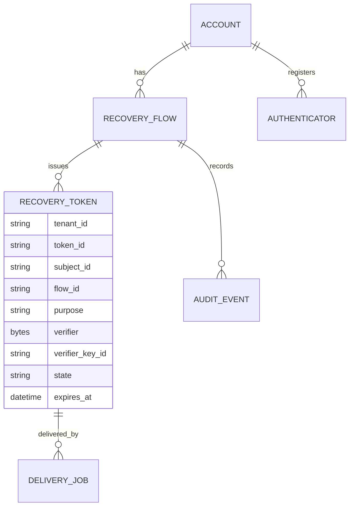

# Token record separation

## 1. Vì sao cần tách bản ghi token?

Một ứng dụng bắt đầu với bảng `users` có các cột `password_hash`, `reset_token` và `reset_expires_at`. Khi thêm khôi phục MFA, xác minh email mới và gửi lại liên kết, lập trình viên tiếp tục tái sử dụng cột `reset_token`. Kết quả là cùng một vị trí lưu trữ phải biểu diễn nhiều mục đích, nhiều yêu cầu và nhiều trạng thái khác nhau.

Thiết kế này dễ dẫn đến những vấn đề cụ thể:

- Lần gửi lại ghi đè token của một luồng khác mà không có quyết định thu hồi rõ ràng.
- API đọc hồ sơ người dùng vô tình trả cả token hoặc verifier qua cơ chế serialize entity.
- Token xác minh email bị dùng như token đặt lại mật khẩu vì không lưu mục đích riêng.
- Không phân biệt được token đã dùng, đã hết hạn hay đã bị thu hồi.
- Nhân viên hỗ trợ cần xem trạng thái khôi phục nhưng lại được quyền đọc dữ liệu có thể dùng để chiếm quyền.

**Token record separation** là việc dành bản ghi và hợp đồng truy cập riêng cho token, tách nó khỏi các dữ liệu có trách nhiệm, mức nhạy cảm hoặc vòng đời khác. Một lần cấp token có danh tính và trạng thái riêng, liên kết rõ với tài khoản và luồng khôi phục tương ứng.

Tách bản ghi không đồng nghĩa bắt buộc xây thêm một microservice hay một cơ sở dữ liệu. Cũng không có nghĩa chỉ cần chuyển token nguyên bản sang một bảng khác là đã bảo vệ được token. Mục tiêu là quản lý đúng ngữ cảnh, giảm nơi có thể truy cập bí mật và duy trì các chuyển trạng thái an toàn.

Bài học sử dụng một mô hình nội bộ minh họa cho khôi phục tài khoản. Các tên bảng, trường và chính sách là lựa chọn của ví dụ.

## 2. Những loại dữ liệu cần được phân biệt

| Loại dữ liệu | Trách nhiệm chính | Vì sao cần phân biệt với bản ghi token khôi phục? |
| --- | --- | --- |
| Hồ sơ tài khoản | Định danh tài khoản và dữ liệu hồ sơ được phép sử dụng | Được nhiều chức năng đọc, không nên kéo theo bí mật khôi phục |
| Thông tin xác thực | Mật khẩu đã băm, đăng ký passkey, cấu hình authenticator | Có vòng đời và cách bảo vệ khác token dùng một lần |
| Recovery flow | Mục đích, chính sách, tiến trình và bằng chứng của một lần khôi phục | Một flow có thể có nhiều challenge, không phải bản thân một token |
| Recovery token | Verifier, ràng buộc, thời hạn và trạng thái sử dụng | Cần kiểm tra và tiêu thụ riêng từng lần cấp |
| Dữ liệu gửi | Nội dung cần chuyển tới email, SMS hoặc ứng dụng | Có thể tạm cần bí mật nguyên bản để giao cho người dùng |
| Audit event | Ai thực hiện, quyết định nào, lúc nào và đối tượng liên quan | Cần lưu dấu vết nhưng không cần chứa token dùng được |
| Session hoặc refresh token | Duy trì quyền truy cập sau xác thực | Không được dùng chung trạng thái hoặc phạm vi với token khôi phục |

Một tài khoản có thể đồng thời có hai yêu cầu khôi phục hợp lệ theo chính sách, một phiên đăng nhập và một yêu cầu xác minh kênh mới. Nếu chỉ có một cột `token`, rất khó diễn đạt chính xác những quan hệ này.

OWASP yêu cầu token đặt lại mật khẩu được lưu an toàn, gắn với người dùng, có thời hạn và dùng một lần. Tách bản ghi là một cách tổ chức dữ liệu để hỗ trợ các yêu cầu đó, không phải một yêu cầu OWASP rằng mọi sản phẩm phải có cùng số bảng. [OWASP Forgot Password Cheat Sheet](https://cheatsheetseries.owasp.org/cheatsheets/Forgot_Password_Cheat_Sheet.html)

## 3. Tách ở những lớp nào?

Có nhiều mức tách biệt, mỗi mức giải quyết một phần vấn đề.

| Mức tách biệt | Ví dụ | Điều nó giúp đạt được | Điều chưa được bảo đảm |
| --- | --- | --- | --- |
| Bản ghi nghiệp vụ | Một token có một `token_id` và trạng thái riêng | Truy vết, tiêu thụ, hết hạn, gửi lại có ngữ nghĩa rõ | Quyền đọc bí mật đã bị giới hạn |
| Bảng hoặc schema | `recovery_token` tách khỏi `account_profile` | Tổ chức dữ liệu và phân quyền chi tiết hơn | Các role dùng chung quyền toàn cơ sở dữ liệu sẽ bị chặn |
| Repository và DTO | Chỉ luồng xác minh đọc verifier; API hỗ trợ nhận DTO không có verifier | Tránh lộ qua truy vấn và serialize ngoài ý muốn | Một lỗi phân quyền ở tầng khác đã được loại bỏ |
| Danh tính truy cập | Role hỗ trợ chỉ đọc view trạng thái; dịch vụ gửi có quyền riêng | Giới hạn quyền theo tác vụ thực tế | Người có quyền quản trị toàn hệ thống không thể đọc |
| Kho khóa và dữ liệu | Khóa HMAC hoặc khóa giải mã nằm ngoài dữ liệu token | Giảm tác động khi chỉ một kho dữ liệu bị lộ | Runtime có cả dữ liệu và quyền dùng khóa đã an toàn tuyệt đối |
| Hệ thống hoặc cơ sở dữ liệu riêng | Dịch vụ token có API và dữ liệu riêng | Có thể tăng mức cô lập theo mô hình đe dọa | Giao dịch liên hệ thống vẫn đơn giản như một giao dịch SQL |

Ví dụ chọn các bản ghi và hợp đồng truy cập riêng trong một cơ sở dữ liệu giao dịch. Cách này cho phép tiêu thụ token và cập nhật thông tin xác thực trong cùng giao dịch khi cần. Chỉ tách sang hệ thống khác khi lợi ích cô lập và quyền vận hành bù được chi phí phối hợp, đối soát và xử lý lỗi.

Nếu role của ứng dụng vẫn được đọc và sửa mọi bảng, việc đổi tên bảng chỉ tạo ranh giới tổ chức. Muốn có ranh giới quyền, phải cấu hình quyền truy cập và bảo vệ các đường đi vòng như truy vấn quản trị, export, backup, log và công cụ hỗ trợ.

## 4. Một mô hình bản ghi riêng cho token

Mô hình khái niệm có thể như sau:



Sơ đồ thể hiện quan hệ nghiệp vụ, không phải một schema hoàn chỉnh. Trong hệ thống nhiều tenant, các quan hệ tham chiếu cần bảo đảm tài khoản, flow và token thuộc đúng cùng tenant.

Một bản ghi token chi tiết hơn có thể chứa:

```text
RecoveryTokenRecord
    tenant_id
    token_id
    subject_id
    flow_id
    purpose
    token_kind
    verifier_algorithm
    verifier_key_id
    verifier
    channel_binding_id
    channel_binding_version
    generation
    security_epoch
    issued_at
    expires_at
    state
    failed_attempts
    consumed_at
    revoked_at
```

Các trường được chia theo trách nhiệm:

- **Định danh và quan hệ:** `tenant_id`, `token_id`, `subject_id`, `flow_id`.
- **Ngữ cảnh sử dụng:** `purpose`, `token_kind`, binding kênh, thế hệ và phiên bản bảo mật.
- **Kiểm tra bí mật:** thuật toán verifier, định danh khóa nếu cần, và giá trị verifier.
- **Vòng đời:** thời điểm cấp, hạn dùng, trạng thái, số lần thử và thời điểm kết thúc.

`token_id` là ID bản ghi hoặc bộ chọn để tra cứu. Nó không thay thế bí mật token và không đủ để được khôi phục tài khoản. Nếu token công khai có định dạng `selector.secret`, máy chủ dùng selector để tìm bản ghi rồi kiểm tra secret bằng verifier. Cần quy định việc mã hóa và phân tích định dạng; không dùng một định dạng cho phép phần nhập nhằng bị diễn giải khác nhau ở các thành phần.

Các ràng buộc tham chiếu cần ngăn token của tài khoản A trỏ vào flow của tài khoản B. Có thể thực hiện bằng khóa tham chiếu tổng hợp phù hợp hoặc kiểm tra có thẩm quyền trong giao dịch. Không chỉ kiểm tra rằng cả hai ID đều tồn tại ở đâu đó.

Không biến `metadata` JSON thành nơi chứa tùy ý mật khẩu mới, OTP nguyên bản, tài liệu định danh hoặc URL khôi phục. Tách bảng nhưng dồn mọi thứ vào một cột không có hợp đồng sẽ làm mất lợi ích của việc tách trách nhiệm.

## 5. Phân biệt bí mật, verifier và ID bản ghi

| Giá trị | Dùng để làm gì? | Có cần giữ nguyên bản lâu dài? |
| --- | --- | --- |
| Bí mật token | Người dùng trình để chứng minh sở hữu token | Thường không cần sau khi giao, ngoài nhu cầu gửi đang chờ được kiểm soát |
| Verifier | Máy chủ đối chiếu token được trình | Cần trong khoảng token có thể được xác minh |
| ID bản ghi | Tra cứu và liên kết nội bộ | Có thể cần lâu hơn cho trạng thái hoặc audit, nhưng vẫn là dữ liệu cần bảo vệ |
| Khóa HMAC hoặc khóa giải mã | Tạo, kiểm tra hoặc giải mã dữ liệu theo thiết kế | Quản lý riêng theo quyền sử dụng và vòng đời khóa |

### Token ngẫu nhiên có entropy cao

Với token sinh ngẫu nhiên bằng nguồn an toàn và có đủ entropy, có thể lưu một giá trị băm mật mã thay cho token nguyên bản. Khi nhận token, máy chủ tính lại và đối chiếu theo định dạng đã chọn.

Cơ chế này khác với lưu mật khẩu do con người chọn. Không suy từ việc dùng hàm băm nhanh cho bí mật ngẫu nhiên dài sang việc dùng cùng cơ chế cho mật khẩu có khả năng đoán cao. Kho mật khẩu vẫn có thuật toán và chính sách riêng.

### OTP hoặc mã có không gian nhỏ

Một OTP ngắn có thể bị thử hết khi kẻ tấn công lấy được verifier băm không khóa. Trong ví dụ, loại này dùng HMAC với khóa được quản lý riêng, gắn ngữ cảnh như tenant, token ID, flow, mục đích và thế hệ vào dữ liệu xác minh bằng cách mã hóa không nhập nhằng.

Khóa không nằm trong bản ghi token hay cùng bản export dữ liệu. `verifier_key_id` chỉ định khóa cần dùng, không chứa bản thân khóa. Xoay khóa cần tính đến những token chưa hết hạn; nếu khóa cũ bị thu hồi vì sự cố, hệ thống phải xử lý những token phụ thuộc vào nó thay vì giữ một đường kiểm tra không còn được tin cậy.

HMAC không tăng số khả năng của mã và không thay thế giới hạn thử trực tuyến. Nếu runtime đã bị chiếm và có thể yêu cầu dùng khóa để xác minh tùy ý, lợi ích của việc tách kho khóa cũng bị giới hạn bởi quyền và cơ chế kiểm soát runtime đó.

### Mã hóa không đồng nghĩa chỉ lưu verifier

Nếu lưu token nguyên bản dưới dạng mã hóa có thể giải ngược, thành phần có quyền giải mã vẫn lấy lại được token để sử dụng. Điều đó có thể cần cho một tác vụ gửi đang chờ, nhưng thường không cần cho phần kiểm tra token.

OWASP khuyến nghị tách khóa khỏi dữ liệu mã hóa khi có thể. Tuy nhiên, hiệu quả phụ thuộc vào việc người tấn công có thể lấy được cả hai phía hay không; đổi vị trí lưu mà không đổi quyền truy cập không tạo ra sự cô lập thực tế. [OWASP Cryptographic Storage Cheat Sheet](https://cheatsheetseries.owasp.org/cheatsheets/Cryptographic_Storage_Cheat_Sheet.html#separation-of-keys-and-data)

Mã hóa ổ đĩa hoặc cơ sở dữ liệu cũng không thay thế việc lưu verifier: một truy vấn SQL được cấp quyền vẫn thường đọc dữ liệu ở dạng mà ứng dụng sử dụng. Cần xác định đang bảo vệ trước việc mất bản sao ổ đĩa, lộ bản dump hay truy cập qua tài khoản ứng dụng.

## 6. Tách dữ liệu gửi khỏi trạng thái kiểm tra token

Hệ thống cần gửi liên kết hoặc OTP tới người dùng, trong khi kho xác minh được thiết kế chỉ giữ verifier. Đây là hai nhu cầu khác nhau cần được giải quyết rõ ràng.

Một lựa chọn của ví dụ là:

```text
Kho token:
    token_id, verifier, ngữ cảnh, thời hạn, trạng thái

Tác vụ gửi có kiểm soát:
    delivery_job_id, token_id, đích nhận tham chiếu,
    payload mã hóa, thời hạn gửi, trạng thái gửi

Sự kiện kiểm toán:
    event_id, flow_id, token_id, loại quyết định, thời điểm
```

Tác vụ gửi có thể tạm chứa bản mã của bí mật hoặc liên kết hoàn chỉnh. Khóa giải mã và quyền đọc payload được giới hạn cho thành phần gửi phù hợp; không dùng cùng quyền với trang hỗ trợ hoặc hệ thống phân tích. Payload này vẫn là dữ liệu nhạy cảm, kể cả khi nằm trong outbox, hàng đợi retry hoặc bản sao dự phòng.

Nếu dùng outbox để giao việc bền vững, không trộn payload gửi chứa bí mật vào cùng hợp đồng audit hoặc event bus mà nhiều consumer được quyền đọc. Một sự kiện “token đã được cấp” chỉ cần tham chiếu và metadata tối thiểu, không cần có token để các dịch vụ khác dùng thử.

Trước khi gửi một tác vụ bị trì hoãn, dispatcher cần biết tác vụ còn được phép gửi theo trạng thái token và thế hệ hiện hành hay không. Retry giao cùng thông báo không nên tự tạo thêm token mới hoặc sửa lại verifier của bản ghi cũ.

Ngay cả khi đã kiểm tra trước lúc gửi, vẫn có thể xảy ra cuộc đua khiến thông báo cũ đến sau khi token bị thu hồi. Tính an toàn phải dựa vào kiểm tra tại lúc sử dụng token; kiểm tra trước gửi chủ yếu giảm thông báo không còn hữu ích.

Sau khi giao thành công hoặc hết thời hạn gửi, bản mã nhạy cảm cần được dọn theo chính sách. Có thể giữ trạng thái gửi, mã lỗi nhà cung cấp và ID tham chiếu để đối soát mà không giữ toàn bộ nội dung khôi phục.

Thiết kế cần thừa nhận nhà cung cấp email hoặc SMS có thể xử lý nội dung được gửi. Việc kho ứng dụng chỉ giữ verifier không làm token biến mất khỏi tất cả hệ thống tham gia phân phối.

## 7. Tách quyền truy cập theo tác vụ

Không phải thành phần nào biết có một token cũng cần đọc verifier hoặc bí mật của token đó.

| Thành phần | Dữ liệu cần thiết trong ví dụ | Quyền không nên cấp chỉ vì tiện lợi |
| --- | --- | --- |
| API hồ sơ | Thông tin hồ sơ được phép công khai | Đọc bản ghi token hoặc dữ liệu gửi |
| Luồng xác minh token | Bản ghi token và trạng thái bảo mật liên quan | Export mọi token cho chức năng hỗ trợ |
| Thành phần gửi | Payload cần giao và metadata gửi tối thiểu | Sửa verifier, đổi chủ tài khoản hoặc đánh dấu token đã dùng |
| Giao diện hỗ trợ | Mục đích, trạng thái, thời gian, mã lỗi đã lọc | Xem OTP, token nguyên bản, verifier hoặc khóa |
| Audit và phân tích | Sự kiện đã lọc, tham chiếu cần thiết | Truy vấn toàn bộ kho bí mật hoặc giải mã tác vụ gửi |
| Migration và bảo trì | Quyền đặc biệt theo thao tác được quản lý | Dùng quyền đó làm danh tính thường trực của API công khai |

OWASP nhấn mạnh phân quyền tối thiểu cho việc truy cập bí mật và khả năng cấu hình quyền chi tiết. Trong ví dụ, bảng riêng chỉ phát huy tác dụng khi các danh tính thực thi được cấp đúng phần quyền cần dùng. [OWASP Secrets Management Cheat Sheet](https://cheatsheetseries.owasp.org/cheatsheets/Secrets_Management_Cheat_Sheet.html#23-access-control)

Ở cơ sở dữ liệu quan hệ, có thể sử dụng quyền trên bảng, cột, view hoặc API lưu trữ phù hợp. PostgreSQL, chẳng hạn, phân biệt các quyền như `SELECT`, `INSERT`, `UPDATE` và cho phép cấp một số quyền ở mức cột. Việc chọn bảng riêng không thay thế cấu hình những quyền đó. [PostgreSQL: Privileges](https://www.postgresql.org/docs/current/ddl-priv.html)

Một view chỉ bỏ cột verifier chưa tự giới hạn dòng theo tenant. Quyền xem tài khoản nào vẫn phải được thực thi bằng cơ chế phân quyền dữ liệu phù hợp hoặc một API có kiểm soát. Không dùng tham số `tenant_id` do client tự khai làm bằng chứng được phép xem tenant đó.

### Tách entity lưu trữ và DTO trả ra ngoài

Ví dụ DTO hỗ trợ chỉ chứa:

```json
{
  "token_record_id": "record_demo_1",
  "purpose": "PASSWORD_RESET",
  "state": "CONSUMED",
  "issued_at": "2026-11-23T05:00:00Z",
  "expires_at": "2026-11-23T05:15:00Z"
}
```

Đây là dữ liệu giả minh họa. DTO này không chứa bí mật, verifier, khóa hoặc đích nhận đầy đủ. Nó vẫn cần kiểm tra quyền đối tượng và tenant trước khi trả về.

Repository phục vụ giao diện nên chỉ lấy những cột cần dùng. Đánh dấu một thuộc tính là không serialize có thể giúp giảm rủi ro ở một đường trả JSON, nhưng không bảo vệ các đường log entity, debug dump, export hoặc truy vấn trực tiếp. Tránh để một entity tài khoản tự động nạp quan hệ tới mọi bản ghi token rồi đi qua các lớp không cần biết chúng.

## 8. Tách bản ghi nhưng giữ tính nguyên tử khi dùng token

Tách dữ liệu không được làm một token dùng một lần trở thành token có thể dùng hai lần do cập nhật rời rạc.

Một lần hoàn tất đặt lại mật khẩu có thể cần phối hợp:

1. Kiểm tra và tiêu thụ token.
2. Lưu mật khẩu mới theo cơ chế bảo vệ mật khẩu đã thiết kế.
3. Kết thúc flow hoặc ghi nhận bước đã hoàn tất.
4. Thu hồi các quyền liên quan theo chính sách.
5. Ghi sự kiện bền vững phục vụ audit và lan truyền thay đổi.

Nếu các dữ liệu này ở cùng cơ sở dữ liệu, có thể đặt các thay đổi bắt buộc trong cùng giao dịch. Việc token nằm ở bảng riêng không ngăn dùng giao dịch chung.

Mã giả SQL dưới đây chỉ minh họa bước tiêu thụ sau khi đã kiểm tra bí mật và khóa hoặc xác minh phiên bản trạng thái cần thiết:

```sql
UPDATE recovery_token
SET state = 'CONSUMED',
    consumed_at = :database_now
WHERE tenant_id = :tenant_id
  AND token_id = :verified_token_record_id
  AND subject_id = :subject_id
  AND flow_id = :flow_id
  AND purpose = :expected_purpose
  AND state = 'ACTIVE'
  AND generation = :current_generation
  AND security_epoch = :locked_security_epoch
  AND expires_at > :database_now;

-- Chỉ tiếp tục khi affected_rows = 1.
-- Cập nhật credential, flow và sự kiện bắt buộc trong cùng giao dịch.
```

`verified_token_record_id` không được lấy trực tiếp từ client rồi coi là đã xác minh. Bí mật được trình phải khớp verifier của đúng bản ghi; binding kênh, trạng thái flow, hạn dùng và ngân sách thử cũng phải hợp lệ theo chính sách.

Nếu hai request cạnh tranh, chỉ một request được chuyển token từ `ACTIVE` sang `CONSUMED`. Request còn lại không được thực hiện tiếp thay đổi mật khẩu chỉ vì trước đó từng đọc thấy token đang hoạt động.

Nếu giao dịch thay đổi mật khẩu thất bại và rollback toàn bộ, trạng thái token và flow trở lại nhất quán theo quyết định của thiết kế. Với các nhánh sai bí mật, bộ đếm thử cần được ghi theo cách không bị rollback mất cùng lỗi nghiệp vụ; không đặt mọi cập nhật vào một nhánh rồi hoàn nguyên cả giới hạn thử.

### Khi dữ liệu thuộc nhiều hệ thống

Nếu kho token và nhà cung cấp thông tin xác thực nằm ở hai hệ thống độc lập, một giao dịch SQL không bao trùm cả hai. Cần workflow bền vững với bước đặt chỗ hoặc chuyển trạng thái, khóa idempotency cho thao tác bên ngoài, xử lý retry và đối soát kết quả chưa rõ.

Không thể đơn giản đánh dấu token đã dùng rồi quên thay đổi mật khẩu khi mạng lỗi. Cũng không nên gọi thay đổi mật khẩu trước và cho phép mọi retry dùng lại token tùy ý. Bản ghi token riêng giúp lưu trạng thái phối hợp, nhưng không tự tạo ra tính nguyên tử liên hệ thống.

## 9. Phân biệt các loại token và thông tin xác thực

Tên gọi đều liên quan bảo mật không có nghĩa mọi dữ liệu nên vào cùng một bảng `tokens` với vài cột tùy chọn.

| Loại | Đặc điểm vòng đời | Hướng tách trong thiết kế minh họa |
| --- | --- | --- |
| Liên kết đặt lại mật khẩu | Bí mật ngẫu nhiên, hạn ngắn, dùng một lần | Bản ghi recovery token gắn đúng purpose và flow |
| OTP khôi phục | Không gian mã nhỏ, có giới hạn thử | Kiểu challenge có verifier và quy tắc riêng |
| Recovery code lưu ngoại tuyến | Một tập mã, mỗi mã có trạng thái dùng riêng | Tập phát hành và bản ghi verifier từng mã; không gộp cả tập thành một cờ |
| Recovery grant | Quyền hạn chế để tiếp tục một flow | Bản ghi hoặc token có phạm vi, thời hạn và điều kiện thu hồi riêng |
| Refresh token | Liên hệ session, client, family và quy tắc đổi token | Kho phiên hoặc authorization token với hợp đồng riêng |
| Passkey | Đăng ký credential và khóa công khai, có metadata authenticator | Kho authenticator; không coi khóa công khai là bearer recovery token |
| Seed TOTP | Bí mật dùng để xác minh nhiều mã theo thời gian | Kho bí mật authenticator được bảo vệ phù hợp; không chỉ băm như token ngẫu nhiên một lần |

Có thể dùng một số cấu trúc hạ tầng chung nếu chúng biểu diễn đầy đủ các khác biệt. Khi dùng bảng chung, cần loại token rõ ràng, ràng buộc dữ liệu, quyền truy cập và logic xử lý riêng từng loại. Không để bất kỳ token nào còn hạn cũng được chấp nhận tại bất kỳ endpoint nào.

Sự phân biệt này quan trọng khi người dùng mất MFA hoặc passkey: hoàn tất một challenge khôi phục không tự động cho phép xóa mọi authenticator hoặc tạo phiên đầy đủ. Chính sách quyết định quyền đó, còn các bản ghi lưu trữ phải giữ được quan hệ giữa bằng chứng, mục đích và hành động được phép.

## 10. Gửi lại, hết hạn và dọn dữ liệu

Mỗi lần cấp token nên có bản ghi thể hiện được danh tính lần cấp. Nếu chính sách yêu cầu gửi lại làm token trước mất hiệu lực, hãy ghi sự thu hồi hoặc thế hệ mới rõ ràng; không âm thầm thay verifier trong một bản ghi rồi để audit vẫn chỉ vào cùng một “token” không phân biệt trước sau.

Một thiết kế khác có thể gửi lại cùng token khi tác vụ gửi ban đầu chưa hoàn tất. Khi đó cần giải thích nguồn lấy lại bí mật, thời hạn giữ payload và giới hạn retry. Không thể vừa khẳng định hệ thống đã xóa mọi bản sao bí mật sau lần gửi đầu, vừa yêu cầu đọc lại bí mật từ verifier để gửi lần nữa.

Phân biệt hai thời điểm:

```text
Hết hạn chấp nhận token: do expires_at và chính sách xác minh quyết định
Xóa bản ghi vật lý:     do chính sách dọn dữ liệu quyết định
```

Tác vụ cleanup chậm không được làm token quá hạn tiếp tục hợp lệ. Ngược lại, không xóa dấu thu hồi quá sớm nếu vẫn có điểm kiểm tra có thể chấp nhận một token được trình mà không còn thấy bản ghi từ chối. Với kho token yêu cầu bản ghi đang hoạt động mới chấp nhận, bản ghi không tồn tại phải được xử lý là không hợp lệ, không phải mặc định hợp lệ.

Có thể giữ metadata kết thúc tối thiểu để phục vụ audit và đối soát sau khi đã loại bỏ verifier hoặc payload gửi theo chính sách. Cần tính cả cache, hàng đợi lỗi, log truy vấn, bản sao đọc và bản backup; xóa ở bảng chính không đồng nghĩa mọi bản sao đã biến mất.

Với tài khoản đã xóa hoặc kênh đã bị thu hồi, quan hệ tham chiếu và chính sách vòng đời phải ngăn bản ghi token mồ côi trở thành quyền khôi phục không còn gắn với đối tượng hợp lệ.

## 11. Backup, sự cố và giới hạn của việc tách bản ghi

Tách kho token giúp xác định nơi chứa dữ liệu nhạy cảm, nhưng cần xem xét điều gì xảy ra khi một thành phần bị lộ.

| Phần bị lộ | Tác động có thể có | Điều giúp giảm tác động trong mô hình |
| --- | --- | --- |
| DTO hỗ trợ đã lọc | Lộ trạng thái hoặc lịch sử khôi phục | Không chứa verifier, bí mật và đích nhận đầy đủ; vẫn cần phân quyền |
| Bản dump verifier token ngẫu nhiên mạnh | Lộ metadata và khả năng thử đoán ngoại tuyến | Không giữ token nguyên bản; bí mật đủ entropy |
| Bản dump OTP băm không khóa | Có thể thử hết không gian mã nhỏ | Cơ chế verifier có khóa được tách và giới hạn vòng đời |
| Payload gửi cùng quyền giải mã | Có thể lấy token hoặc mã còn hiệu lực | Quyền giải mã hẹp, thời hạn ngắn, thu hồi khi sự cố |
| Runtime xác minh bị chiếm | Có thể đọc bí mật đang được trình hoặc dùng quyền của dịch vụ | Giảm quyền và phạm vi, phát hiện, cô lập, thu hồi; tách bảng không tự giải quyết |
| Quyền sửa dữ liệu bảo mật bị chiếm | Có thể sửa trạng thái, quan hệ hoặc credential để vượt kiểm soát | Bảo vệ quyền ghi và đường quản trị; không chỉ bảo vệ quyền đọc |

Không khẳng định verifier làm cơ sở dữ liệu bị chiếm quyền hoàn toàn trở nên vô hại. Kẻ có quyền sửa credential hoặc quyết định chính sách có nhiều đường khác ngoài việc đoán token.

### Khôi phục từ snapshot

Một snapshot cũ có thể chứa token `ACTIVE` mà hệ thống vận hành sau đó đã tiêu thụ hoặc thu hồi. Nếu phục hồi snapshot rồi mở lưu lượng ngay, những token đó có nguy cơ sống lại nếu vẫn còn hạn theo đồng hồ hiện tại.

Quy trình phục hồi cần xử lý trạng thái bảo mật trước khi nhận request. Một lựa chọn đơn giản cho token khôi phục là vô hiệu hóa các token đang hoạt động được phục hồi từ snapshot, chặn các tác vụ gửi cũ tương ứng và yêu cầu cấp challenge mới. Nếu hệ thống chọn giữ một phần token, phải có nguồn quyết định đủ tin cậy để đối soát những lần dùng và thu hồi đã xảy ra sau snapshot.

Đồng thời phải xét phiên, refresh token và các quyền trung gian đã được cấp từ flow. Việc chỉ dọn bảng recovery token không tự thu hồi grant hoặc session đã tồn tại ở kho khác.

## 12. Ví dụ tổng hợp một lần đặt lại mật khẩu

Tài khoản A đang có mật khẩu cũ và một email khôi phục hợp lệ. Người dùng tạo flow F1; hệ thống cấp token T1.

1. `account_profile` vẫn chỉ chứa dữ liệu tài khoản cần cho các chức năng thông thường. Bí mật T1 không được thêm vào entity hồ sơ.
2. `recovery_flow` lưu F1 với mục đích đặt lại mật khẩu và chính sách cần áp dụng.
3. `recovery_token` lưu bản ghi T1, verifier, quan hệ với F1, binding email, thời hạn và trạng thái `ACTIVE`.
4. Tác vụ gửi tạm giữ payload được bảo vệ để giao liên kết. Audit chỉ nhận sự kiện có ID tham chiếu, không nhận liên kết nguyên vẹn.
5. Người dùng trình T1. Dịch vụ xác minh lấy đúng bản ghi, đối chiếu bí mật và kiểm tra toàn bộ ngữ cảnh.
6. Giao dịch hợp lệ tiêu thụ T1, lưu mật khẩu mới, kết thúc bước của F1 và ghi các quyết định thu hồi hoặc sự kiện cần thiết theo chính sách.
7. Giao diện hỗ trợ chỉ nhìn thấy mục đích, trạng thái và thời gian đã được phép xem. Nó không có token để đăng nhập hoặc khôi phục thay người dùng.
8. Dữ liệu nhạy cảm được dọn theo vòng đời, trong khi dấu vết tối thiểu được giữ theo chính sách đối soát và quyền truy cập.

Giá trị của token record separation nằm ở việc mỗi loại dữ liệu có trách nhiệm rõ ràng: hồ sơ không mang bí mật khôi phục, kho xác minh không giữ bí mật chỉ để tiện gửi lại, audit không trở thành nơi sao chép token, và các thay đổi bắt buộc vẫn nhất quán khi token được sử dụng một lần.
