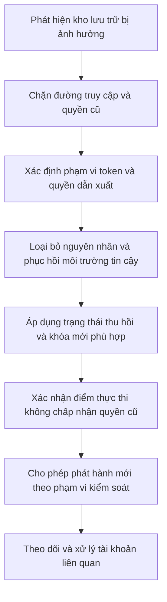

# Token storage incident response — Ứng phó sự cố kho lưu trữ token

Một bản sao cơ sở dữ liệu chứa recovery token bị truy cập trái phép. Một dịch vụ ghi cả URL đặt lại mật khẩu vào log. Một tài khoản vận hành có quyền đọc khóa giải mã bị chiếm. Các tình huống này đều liên quan đến lưu trữ token, nhưng khả năng bị lạm dụng và cách xử lý không giống nhau.

Ứng phó hiệu quả cần xác định **dữ liệu hoặc năng lực nào đã bị lộ, quyền recovery nào còn có thể thực hiện, và hệ thống nào vẫn đủ tin cậy để cưỡng chế thu hồi**. Đổi một khóa hoặc xóa một file chưa trả lời đủ ba câu hỏi ấy.

Bài này tập trung vào token dùng trong khôi phục mật khẩu, MFA, passkey và thiết bị xác thực. Các trạng thái, tên trường, câu lệnh và kịch bản dưới đây là thiết kế minh họa, không phải playbook áp dụng nguyên trạng cho mọi tổ chức.

## 1. Nhìn sự cố qua quyền mà kẻ tấn công có thể sử dụng

Kho token thường chứa nhiều loại dữ liệu hơn một cột secret. Nó có thể chứa tài khoản, hồ sơ recovery, purpose, thời hạn, binding và trạng thái dùng một lần.

Vì vậy, cần phân biệt ít nhất ba nhóm ảnh hưởng:

| Nhóm ảnh hưởng | Ví dụ | Câu hỏi ưu tiên |
| --- | --- | --- |
| Lộ bí mật | Token thô, recovery grant, mã trong hàng đợi gửi | Người lấy dữ liệu có thể trình quyền nào ngay bây giờ? |
| Lộ dữ liệu xác minh hoặc khóa | Digest, HMAC verifier, khóa giải mã hoặc ký | Có thể thử đoán, khôi phục secret hoặc tạo bằng chứng giả đến mức nào? |
| Mất tính toàn vẹn hoặc quyền kiểm soát | Sửa trạng thái, tài khoản, purpose, thời hạn; dùng quyền của dịch vụ phát hành | Dữ liệu và quyết định nào không còn đáng tin? |

Ngoài nguy cơ chiếm tài khoản còn có rò rỉ thông tin: danh sách người yêu cầu recovery, địa chỉ liên hệ, lịch sử thay đổi và quan hệ giữa tài khoản với thiết bị.

NIST SP 800-61 Rev. 3 đặt ứng phó sự cố trong quản lý rủi ro an ninh mạng, bao gồm chuẩn bị, phát hiện, ứng phó và khôi phục. Bài học cho thiết kế kho token là phải chuẩn bị khả năng thu hồi và phục hồi trước khi sự cố xảy ra. [NIST SP 800-61 Rev. 3](https://csrc.nist.gov/pubs/sp/800/61/r3/final)

## 2. Phân loại đúng thứ đã bị lộ

Một bảng đánh giá ban đầu có thể như sau:

| Thứ bị lộ | Khả năng đáng lo | Điều chưa thể kết luận ngay |
| --- | --- | --- |
| Token thô còn hiệu lực | Dùng quyền bearer hoặc thử tiếp tục hồ sơ | Binding và điều kiện bổ sung có thể vẫn chặn |
| Digest của token ngẫu nhiên đủ mạnh | Có dữ liệu để kiểm tra các giá trị đoán | Không đồng nghĩa đã khôi phục được secret |
| Hash của mã ngắn | Có thể thử không gian mã ngoại tuyến tùy cơ chế bảo vệ | Giới hạn thử online không bảo vệ bản sao đã bị lấy |
| HMAC verifier cùng khóa liên quan | Có thể kiểm tra các giá trị đoán nếu có đủ dữ liệu | Chưa tự có quyền tạo một bản ghi hợp lệ trong kho có trạng thái |
| Ciphertext cùng quyền giải mã | Có thể khôi phục secret được mã hóa | Cần xét quyền sử dụng khóa, không chỉ file khóa |
| Khóa ký token tự chứa | Có thể tạo token được các bên tin khóa chấp nhận, tùy kiểm tra khác | Chưa biết mọi endpoint có cùng điều kiện chấp nhận |
| Credential kho dữ liệu có quyền ghi | Có thể sửa quyền, trạng thái hoặc quan hệ recovery | Không thể chỉ dựa vào hiện trạng hàng dữ liệu để chứng minh an toàn |
| Tài khoản dịch vụ đang chạy | Có thể sử dụng quyền phát hành, xác minh hoặc giải mã | Khóa không xuất được vẫn có thể bị gọi sử dụng trái phép |

### Hash không có một mức bảo vệ chung cho mọi token

Một secret dài, ngẫu nhiên từ bộ sinh phù hợp khác với OTP vài chữ số. Nếu token bị sinh yếu hoặc có cấu trúc dễ đoán, cột mang tên `token_hash` không tự bảo đảm an toàn.

Với mã ngắn, salt riêng giúp chống dùng chung kết quả tính toán giữa nhiều bản ghi nhưng không biến không gian mã thành lớn hơn. Khi đánh giá sự cố, phải xem cơ chế xác minh thực tế, độ mạnh của mã và khóa bảo vệ còn nằm ngoài phạm vi bị lộ hay không.

Không dùng việc “chưa thấy ai đăng nhập” để bỏ qua rò rỉ dữ liệu xác minh.

## 3. Tạo hồ sơ sự cố và giới hạn điều đã biết

Ở giai đoạn đầu, nên ghi tách ba loại thông tin:

| Loại | Ví dụ |
| --- | --- |
| Đã xác nhận | Một bucket chứa bản export được truy cập bởi principal không được phép |
| Có khả năng | Bản export có thể chứa các token còn hiệu lực tại thời điểm truy cập |
| Chưa biết | Có bản sao khác không; token nào đã được sử dụng; khóa liên quan có bị gọi hay không |

Một hồ sơ minh họa:

```json
{
  "incidentRef": "inc_example",
  "affectedStoreRef": "recovery_export_example",
  "knownExposure": "READ_ACCESS_TO_EXPORT",
  "exposureStart": "2026-11-23T02:00:00Z",
  "exposureEnd": "2026-11-23T03:00:00Z",
  "timeConfidence": "ESTIMATED",
  "affectedTokenFormat": "OPAQUE_RECOVERY_TOKEN",
  "affectedTenantScope": "UNDER_INVESTIGATION",
  "rawSecretsInTicket": false
}
```

Không đưa secret hoặc URL recovery thật vào ticket để minh họa. Dùng tham chiếu tới chứng cứ được kiểm soát quyền.

Phạm vi cần xét không chỉ các token còn active lúc phát hiện. Một token đã bị tiêu thụ trong khoảng bị lộ có thể đã tạo ra mật khẩu mới, recovery grant, session hoặc passkey do người ngoài kiểm soát.

### Xác định trách nhiệm vận hành

Một sự cố cần người điều phối, người phụ trách dữ liệu và thu hồi, người bảo quản chứng cứ, cùng đầu mối liên hệ người dùng. Trong hệ thống nhỏ, một người có thể đảm nhiệm nhiều vai trò nhưng quyết định và người chịu trách nhiệm vẫn cần rõ.

Không tự đặt một mốc “phải hoàn tất trong 15 phút” cho mọi tình huống. Mức khẩn cấp phụ thuộc quyền còn hiệu lực, khả năng phát hành giả, phạm vi tài khoản và khả năng tiếp tục bị truy cập.

## 4. Khoanh vùng mà không làm mất bằng chứng cần thiết

Mục tiêu trước mắt là ngăn tiếp tục đọc, sửa hoặc sử dụng các quyền bị ảnh hưởng.

Các hành động có thể gồm, theo phạm vi và thẩm quyền của playbook:

- Đóng quyền truy cập công khai hoặc truy cập sai của kho bị lộ.
- Thu hồi credential của principal bị chiếm và chặn đường sử dụng còn tồn tại.
- Cô lập workload bị nghi xâm nhập khỏi quyền phát hành hoặc giải mã.
- Tạm ngừng các bước recovery nhạy cảm nếu chưa thể tin cậy điều kiện xác minh.
- Vô hiệu hóa token hoặc grant thuộc phạm vi ảnh hưởng tại nguồn có thẩm quyền.
- Bảo quản bằng chứng cần thiết trong vùng điều tra được hạn chế quyền.

Không nên tiếp tục phát hành token mới vào cùng đường rò rỉ. Cũng không nên chờ thu thập xong mọi chứng cứ mới chặn một token đang có thể bị dùng.

Bảo quản chứng cứ và khoanh vùng cần được phối hợp. Xóa toàn bộ log ngay có thể phá khả năng xác định tài khoản đã bị tác động; giữ log có secret ở nơi công khai cũng tiếp tục gây hại.

OWASP nêu thu hồi, thay thế secret và xử lý các bản lộ trong quy trình khắc phục; việc xử lý secret trong log cần giữ tính toàn vẹn cần thiết của bằng chứng. [OWASP Secrets Management Cheat Sheet, Remediation](https://cheatsheetseries.owasp.org/cheatsheets/Secrets_Management_Cheat_Sheet.html#92-remediation)

### “Dừng gửi email” chưa đủ

Một nút tạm dừng gửi token chỉ chặn một công đoạn. Token đã gửi có thể còn dùng được; grant đã được tạo có thể vẫn tiếp tục; request đang chạy có thể sắp commit.

Cần xác định riêng cơ chế chặn phát hành mới, chặn đổi token thành grant và chặn hành động cuối. Phạm vi khoanh vùng phải đi tới điểm thực thi quyền.

## 5. Thu hồi token theo nguồn trạng thái có thẩm quyền

Với token opaque có trạng thái, có thể thu hồi từng bản ghi hoặc theo một phạm vi đã xác định.

Một pseudo-SQL minh họa:

```sql
UPDATE recovery_token
SET state = 'REVOKED',
    revoked_at = :trusted_now,
    revocation_reason = 'STORAGE_INCIDENT',
    incident_ref = :incident_ref,
    version = version + 1
WHERE tenant_ref = :tenant_ref
  AND issuance_batch_ref = :affected_batch
  AND state = 'ACTIVE';
```

Câu lệnh trên không phải kế hoạch xử lý hoàn chỉnh. Trước khi áp dụng trong sự cố thực, phạm vi batch, transaction, quyền thực thi và các quyền dẫn xuất cần được xác định.

Một kết quả “đã cập nhật 120 hàng” chưa chứng minh mọi nơi chấp nhận token đã đọc trạng thái mới.

### Một phương án thu hồi theo generation

Nếu hệ thống đã thiết kế cơ chế generation, token hoặc grant có thể được gắn với thế hệ phát hành. Máy chủ duy trì generation hiện được chấp nhận tại một nguồn tin cậy.

```text
Chấp nhận token chỉ khi:
    secret và ngữ cảnh hợp lệ
    và token.state == ACTIVE
    và token.expiresAt > trustedNow
    và token.issuanceGeneration == acceptedGeneration
    và policy cho phép hành động hiện tại
```

Tăng generation có thể chặn một phạm vi rộng mà không chờ sửa từng hàng, nhưng chỉ khi mọi điểm sử dụng đều cưỡng chế điều kiện đó.

Generation trong token tự chứa phải nằm trong dữ liệu được bảo vệ toàn vẹn. Giá trị server hiện chấp nhận không được do client tự khai.

Cơ chế này cũng cần phạm vi rõ: theo tenant, nhóm purpose hay toàn dịch vụ. Không dùng một thay đổi toàn hệ thống khi có thể xác định phạm vi nhỏ hơn đủ an toàn, nhưng cũng không giả định phạm vi nhỏ nếu bằng chứng chưa cho phép.

### Bảo vệ điểm cắt với request đang chạy

Request có thể đã đọc token hợp lệ trước khi lệnh thu hồi được commit. Nếu nó tiếp tục đổi mật khẩu sau đó mà không kiểm tra điều kiện ở điểm thực thi, thu hồi chưa đạt ý nghĩa mong muốn.

Thiết kế cần một cách điều phối như khóa trạng thái, kiểm version hoặc kiểm tra generation được tuần tự hóa với hành động cuối. Trong một số tình huống có thể cần chặn nhận tác vụ mới và xử lý request đang chạy trước khi xác nhận điểm cắt.

Không chỉ phát event “hãy thu hồi” rồi báo quyền đã bị chặn ở mọi nơi.

## 6. Xử lý khóa và credential đúng theo chức năng

Một sự cố kho token có thể cần xử lý nhiều bí mật khác nhau:

| Bí mật hoặc quyền | Việc cần làm rõ |
| --- | --- |
| Credential đọc kho | Chặn truy cập và các phiên truy cập còn tồn tại; phát lại quyền tối thiểu từ môi trường tin cậy |
| Credential có quyền ghi | Xác minh tính toàn vẹn dữ liệu và quyết định phát hành, không chỉ thay password kết nối |
| Khóa mã hóa | Dữ liệu nào có thể đã bị giải mã; quyền gọi giải mã còn tồn tại ở đâu |
| Khóa HMAC dùng làm verifier | Những phiên bản verifier và tập token nào bị ảnh hưởng |
| Khóa ký token tự chứa | Bên xác minh nào còn tin khóa cũ và có thể nhận token giả |
| Secret của dịch vụ phân phối | Nhà cung cấp nào có thể bị dùng để gửi hoặc đọc nội dung recovery |

### Đổi khóa không làm người ngoài quên secret đã lấy

Nếu token thô đã bị đọc, mã hóa lại dữ liệu trong kho không làm bản sao ấy biến mất. Token cần bị vô hiệu hóa tại nơi sử dụng.

Nếu ciphertext và khóa giải mã đều bị lộ, việc re-encrypt dưới khóa mới giúp bảo vệ dữ liệu về sau, nhưng không thu hồi plaintext đã được lấy trước đó.

Với HMAC verifier, thay khóa có thể làm verifier cũ không còn dùng được hoặc cần một quy trình chuyển đổi được thiết kế trước. Không thể “rehash mọi token bằng khóa mới” nếu không có token gốc và hệ thống chỉ lưu verifier.

Không khôi phục token đã bị thu hồi chỉ để làm việc chuyển khóa thuận tiện.

### Khóa cũ không được tiếp tục cấp quyền qua nhánh tương thích

Khi khóa ký bị nghi lộ, cấu hình “ký bằng khóa mới nhưng vẫn chấp nhận chữ ký khóa cũ” có thể giữ nguyên khả năng sử dụng token giả ở các bên xác minh.

Cần xác định nơi đang cache khóa, thời gian cache, bên thứ ba có liên quan và cơ chế ngừng tin khóa cũ. Nếu không kiểm soát được tất cả điểm xác minh, phải mô tả giới hạn khoanh vùng ấy.

Nếu giữ vật liệu cũ cho mục đích điều tra hoặc giải mã chứng cứ, quyền ấy phải tách khỏi đường cấp quyền production.

## 7. Theo dõi quyền dẫn xuất từ token đã lộ

Một đồ thị đơn giản có thể là:

```text
Token T
   -> Recovery grant G
      -> Đổi mật khẩu
      -> Gỡ hoặc thay MFA
      -> Đăng ký passkey
      -> Tạo session mới
```

Thu hồi T chỉ chặn việc dùng T trong tương lai. Nó không tự hoàn tác những bước đã commit.

Cần tìm các operation đã thực hiện trong khoảng ảnh hưởng và xác định:

- Grant nào được tạo từ token hoặc hồ sơ liên quan.
- Mật khẩu hoặc phương thức xác thực nào đã thay đổi.
- Kênh recovery hay địa chỉ thông báo nào đã bị sửa.
- Session nào còn có thể tiếp tục truy cập.
- Authenticator nào có căn cứ bị người ngoài thêm hoặc chiếm quyền.

OWASP lưu ý đặt lại mật khẩu riêng lẻ có thể chưa phục hồi quyền kiểm soát tài khoản đã bị chiếm; cần xét session, phương thức recovery và MFA, đồng thời dùng bằng chứng recovery phù hợp. [OWASP Forgot Password Cheat Sheet, Account Recovery After Suspected Compromise](https://cheatsheetseries.owasp.org/cheatsheets/Forgot_Password_Cheat_Sheet.html#account-recovery-after-suspected-compromise)

Không tự xóa mọi passkey của mọi tài khoản chỉ vì một bản export có token đã hết hạn. Quyết định tác động rộng phải dựa trên phạm vi, mức tin cậy của dữ liệu và rủi ro còn lại.

Ngược lại, không giữ một passkey có bằng chứng do kẻ tấn công đăng ký chỉ vì token gốc đã bị thu hồi.

### Recovery generation và session generation có thể khác nhau

Một bộ đếm thu hồi token recovery không mặc nhiên được tầng xác thực session sử dụng. Hai hệ thống có thể có nguồn trạng thái, cache và cơ chế cưỡng chế riêng.

Trong báo cáo, cần tách “token recovery bị chặn” khỏi “session bị chặn”. Chỉ gộp khi kiến trúc thực sự có một điều kiện chung được cưỡng chế trên mọi đường truy cập liên quan.

## 8. Xét toàn bộ nơi lưu và nơi sao chép

Kho chính có thể đã an toàn trở lại nhưng bản sao khác vẫn giữ dữ liệu:

| Nơi lưu | Nguy cơ cần xem xét |
| --- | --- |
| Cache, replica, khu vực khác | Trạng thái thu hồi cũ hoặc quyền đọc chưa bị chặn |
| Hàng đợi và dead-letter queue | Payload gửi token thô có thể được phát lại |
| Log, tracing, APM | URL hoặc request body chứa secret |
| Export, dashboard, công cụ hỗ trợ | Bản tải xuống tiếp tục tồn tại ngoài kho chính |
| Snapshot và backup | Khôi phục dữ liệu cũ có thể làm sống lại quyền |
| Bộ nhớ, crash dump, file tạm | Runtime có thể đã giữ secret sau khi cột dữ liệu bị sửa |
| Hệ thống của nhà cung cấp | Nội dung giao nhận hoặc credential nằm ngoài hạ tầng trực tiếp |

Với hàng đợi, tác vụ gửi chậm phải kiểm tra token hoặc hồ sơ còn được phép phân phối theo hợp đồng. Nếu nó gửi một token đã bị thu hồi, người dùng có thể nhận liên kết vô dụng; nếu còn nhánh chấp nhận cũ thì rủi ro lớn hơn.

Không để resend sau sự cố tự tạo quyền mới từ hồ sơ bị ảnh hưởng mà chưa đánh giá lại điều kiện phát hành.

Một lần xóa object ở kho chính không chứng minh đã xóa mọi phiên bản, bản sao hoặc bản tải xuống trước đó. Các giới hạn ấy cần được ghi vào hồ sơ sự cố.

## 9. Bảo quản và đối chiếu bằng chứng an toàn

Cần dựng lại ít nhất các mốc:

1. Bắt đầu khả năng bị truy cập trái phép.
2. Những lần đọc, export, giải mã hoặc sửa dữ liệu có căn cứ.
3. Token hoặc grant được sử dụng trong khoảng liên quan.
4. Thay đổi trên tài khoản và session.
5. Thời điểm quyền cũ thực sự bị chặn.
6. Thời điểm có thể phát hành và sử dụng quyền mới an toàn.

Thời điểm phát hiện không đồng nghĩa thời điểm bắt đầu xâm nhập. Thời điểm lệnh thu hồi được gửi cũng không đồng nghĩa mọi điểm sử dụng đã áp dụng xong.

OWASP khuyến nghị tránh ghi trực tiếp access token, mật khẩu, session identifier và các bí mật khác vào log; log cũng cần được bảo vệ khỏi truy cập và sửa đổi trái phép. [OWASP Logging Cheat Sheet](https://cheatsheetseries.owasp.org/cheatsheets/Logging_Cheat_Sheet.html)

Trong điều tra, ưu tiên token record reference, case reference, operation reference, key version và principal reference. Chỉ lấy dữ liệu nhạy cảm khi cần cho mục đích xác định, rồi giữ trong vùng chứng cứ có kiểm soát.

### Chứng cứ có giới hạn

Không thấy event sử dụng token có thể do token chưa bị dùng, nhưng cũng có thể do thiếu log, độ trễ, sai cửa sổ thời gian hoặc khả năng log đã bị sửa.

Hash của bản sao chứng cứ giúp đối chiếu tính toàn vẹn của bản sao ấy về sau. Nó không tự chứng minh dữ liệu nguồn đầy đủ hay chưa bị thay trước khi thu thập.

Khi một principal có quyền ghi đã bị chiếm, cần đối chiếu dữ liệu chính với các nguồn độc lập đủ tin cậy. Không chỉ đọc cột `state=REVOKED` ở chính kho bị sửa rồi kết luận sự cố đã được kiểm soát.

## 10. Phục hồi từ môi trường và trạng thái đáng tin

Trước khi đưa luồng recovery trở lại, cần biết nguyên nhân và đường xâm nhập đã được xử lý tới mức nào.

Một hướng phục hồi minh họa:



Nếu workload bị chiếm, đổi secret rồi cấp ngay secret mới cho workload ấy có thể làm lộ tiếp. Phải xem lại danh tính dịch vụ, quyền truy cập, thành phần triển khai và khả năng người ngoài còn duy trì truy cập.

### Không làm sống lại token qua backup

Giả sử backup được tạo lúc 01:00, token T bị thu hồi lúc 03:00 và hệ thống khôi phục backup lúc 04:00. Nếu trạng thái thu hồi chỉ nằm trong phần dữ liệu đã bị rollback, T có thể xuất hiện lại như chưa bị dùng hoặc chưa bị thu hồi.

Thiết kế phục hồi cần bảo đảm trạng thái an ninh mới hơn được áp dụng trước khi mở đường sử dụng. Có thể cần nguồn thu hồi độc lập hoặc generation mới không bị rollback cùng snapshot cũ.

Đây là thuộc tính phải được thiết kế, không phải việc tự thêm một cột sau khi restore rồi cho rằng an toàn.

Không phục hồi secret verifier, grant hoặc credential cũ chỉ vì chúng có trong backup. Bản sao phục hồi phải đi cùng quyết định về những quyền nào còn được chấp nhận.

## 11. Mở lại dịch vụ theo các điều kiện cụ thể

“Đã đổi khóa” không phải điều kiện duy nhất để phục hồi. Với mô hình trong bài, các điều kiện đề xuất gồm:

| Điều kiện | Bằng chứng vận hành cần có |
| --- | --- |
| Đường đọc hoặc ghi trái phép đã bị chặn | Quyền, principal và đường truy cập liên quan đã được xử lý |
| Quyền recovery cũ bị chặn | Trạng thái có thẩm quyền và các điểm sử dụng cùng cưỡng chế |
| Quyền dẫn xuất được xử lý theo phạm vi | Grant, session, authenticator và thay đổi tài khoản đã được phân loại |
| Phát hành mới không đi qua nơi lộ | Đường lưu, gửi, log và identity của dịch vụ đã được kiểm soát |
| Vật liệu bảo vệ mới ở môi trường tin cậy | Quyền dùng khóa và credential được giới hạn phù hợp |
| Khôi phục không đảo ngược thu hồi | Trạng thái an ninh sau sự cố được giữ khi restore |
| Khả năng theo dõi hoạt động đã hoạt động | Có nguồn bằng chứng và người chịu trách nhiệm xử lý bất thường |

Các điều kiện trên cần được áp dụng theo kiến trúc thực tế. Không dùng một request trên một node để suy ra tất cả replica, khu vực và bên xác minh đã được xử lý.

Nếu một phần phạm vi chưa được kiểm soát, có thể mở lại phần độc lập đã có căn cứ an toàn theo quyết định rủi ro được phép. Báo cáo phải chỉ rõ phần còn hạn chế.

Không bỏ rate limit, kiểm tra trạng thái hoặc yêu cầu bằng chứng chỉ để giảm số người bị kẹt sau sự cố.

## 12. Hỗ trợ người dùng và truyền thông đúng điều đã biết

Thông báo cần dựa trên sự thật có căn cứ: loại dữ liệu bị ảnh hưởng, quyền nào đã bị chặn, điều người dùng cần làm và đường hỗ trợ chính thức.

Một thông báo minh họa:

> Chúng tôi đã vô hiệu hóa các yêu cầu khôi phục thuộc phạm vi ảnh hưởng. Nếu bạn vẫn cần khôi phục tài khoản, hãy truy cập ứng dụng hoặc trang chính thức để bắt đầu lại. Nhân viên hỗ trợ sẽ không yêu cầu bạn gửi mật khẩu, mã hoặc liên kết khôi phục.

Không tự tuyên bố “không có tài khoản nào bị truy cập” nếu nguồn bằng chứng chưa đủ. Cũng không nói mọi người dùng bị chiếm tài khoản khi mới chỉ xác nhận một tập dữ liệu bị đọc.

Với trường hợp nghi tài khoản đã bị chiếm, kênh liên hệ mới được thêm trong khoảng sự cố có thể không đáng tin. Cần dùng bằng chứng và kênh đã được đánh giá phù hợp, đồng thời tránh khôi phục máy móc một địa chỉ cũ từng bị người dùng bỏ vì mất quyền kiểm soát.

### Không tạo thêm đường phishing

Không yêu cầu người dùng dán recovery token vào ticket, đọc OTP cho hỗ trợ hoặc cài phần mềm lạ để “làm sạch token”.

Nếu gửi hướng dẫn, giữ nội dung nhất quán với đường truy cập chính thức và tránh nhúng một quyền recovery mới vào mọi thông báo đại trà. Quy trình cấp quyền mới vẫn phải thực hiện các điều kiện recovery bình thường.

Yêu cầu thông báo pháp lý hoặc hợp đồng phải được xử lý theo bối cảnh áp dụng và đầu mối có thẩm quyền; không tự lấy một thời hạn chung làm quy tắc cho mọi quốc gia.

## 13. Kịch bản tổng hợp: token thô bị ghi vào hệ thống log

Một dịch vụ phát hành token đặt lại mật khẩu và vô tình ghi URL đầy đủ vào APM trong một phiên bản triển khai. Một tài khoản có quyền đọc APM bị truy cập trái phép.

### Điều đã xác nhận

- APM có URL chứa token của một khoảng triển khai.
- Một principal không được phép đã đọc dữ liệu thuộc khoảng ấy.
- Chưa có căn cứ rằng khóa ký, khóa mã hóa hoặc kho chính bị sửa.

### Cách lập luận về phạm vi

Cần xác định token nào đã được log, tài khoản nào liên quan, thời hạn và trạng thái hiện tại. Đồng thời phải xem token nào đã được dùng trong khoảng lộ, vì chúng có thể đã tạo grant hoặc thay đổi tài khoản trước lúc phát hiện.

Binding có thể giảm khả năng dùng riêng token, nhưng không đủ để kết luận mọi token trong log đều vô hại. Cần biết điều kiện binding được thiết lập và cưỡng chế thực tế.

### Khoanh vùng và khôi phục

Trong một phương án xử lý:

1. Chặn quyền đọc trái phép và đường runtime đang tiếp tục ghi secret.
2. Bảo quản chứng cứ cần thiết ở vùng hạn chế quyền.
3. Thu hồi token thuộc phạm vi có căn cứ và xử lý grant liên quan.
4. Điều tra các thao tác đã commit để xác định tài khoản cần phục hồi.
5. Xử lý các bản sao log và APM theo chính sách giữ chứng cứ và dữ liệu.
6. Mở phát hành mới sau khi đường ghi log đã được sửa và cơ chế quyền cũ bị chặn đã có căn cứ.
7. Thông báo và theo dõi các trường hợp liên quan.

Trong tình huống này, thay khóa ký không phải phản ứng tự động chỉ vì token bị lộ, nếu hệ thống không có bằng chứng khóa ấy bị ảnh hưởng. Biện pháp phải tương ứng với loại quyền và năng lực thực sự bị xâm phạm.

Nếu điều tra phát hiện principal còn có quyền sửa kho chính, phạm vi phải mở rộng. Không giữ nguyên kết luận ban đầu khi xuất hiện bằng chứng mới.

## 14. Những nhầm lẫn cần tránh khi đóng sự cố

| Nhầm lẫn | Cách hiểu đúng |
| --- | --- |
| Token hết hạn là sự cố tự kết thúc | Cần xét quyền dẫn xuất, dữ liệu cá nhân và đường xâm nhập còn tồn tại |
| Chỉ lưu hash nên không có rủi ro | Phải xét entropy, cách xác minh, khóa, quyền ghi và dữ liệu liên quan |
| Rotate khóa là mọi token cũ vô hiệu | Chỉ đúng khi các điểm sử dụng thật sự ngừng chấp nhận quyền cũ |
| Xóa hàng token là thu hồi đầy đủ | Cache, token tự chứa và grant có thể vẫn còn đường dùng |
| Đổi mật khẩu là lấy lại hoàn toàn tài khoản | Session hoặc authenticator do người ngoài kiểm soát có thể còn |
| Restore backup là quay lại trạng thái an toàn | Backup có thể khôi phục quyền đã bị thu hồi hoặc dữ liệu bị sửa |
| Không thấy log bất thường là chưa bị lạm dụng | Kết luận phụ thuộc độ đầy đủ và độ tin cậy của nguồn bằng chứng |

Báo cáo kết thúc cần nêu nguyên nhân, phạm vi đã xác nhận, phần chưa thể xác định, quyền đã thu hồi, điều kiện mở lại và các cải tiến có người chịu trách nhiệm.

Với kho token recovery, kết quả cần đạt là đường xâm nhập đã được xử lý, quyền cũ không còn được thực hiện theo phạm vi quyết định, quyền dẫn xuất đã được xem xét và quyền mới chỉ được cấp từ một môi trường cùng quy trình đủ tin cậy.
