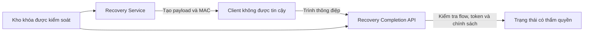

# Message authentication design

## 1. Xác thực thông điệp giải quyết vấn đề gì?

Trong một luồng khôi phục tài khoản, client có thể trình một thông điệp chứa tài khoản cần khôi phục, mục đích, thời hạn và định danh yêu cầu. Nếu máy chủ chỉ đọc những giá trị này rồi thực hiện thao tác, người tấn công có thể sửa `subject_id`, đổi `purpose` hoặc kéo dài hạn dùng.

**Message authentication** là cơ chế kiểm tra tính toàn vẹn và nguồn gốc thông điệp trong một mô hình tin cậy đã xác định. Với Message Authentication Code, viết tắt là MAC, bên tạo và bên kiểm tra sử dụng khóa bí mật để phát hiện việc sửa thông điệp hoặc tạo thông điệp không có khóa phù hợp.

Đối với khôi phục tài khoản, cần phân biệt hai câu hỏi:

1. Thông điệp này có được tạo bởi một bên nắm khóa hợp lệ, và các byte được bảo vệ có còn nguyên vẹn không?
2. Thông điệp đó có được phép dùng để thực hiện hành động khôi phục này, tại thời điểm này, cho tài khoản này không?

MAC hỗ trợ câu hỏi thứ nhất. Câu hỏi thứ hai còn cần kiểm tra mục đích, bên nhận, thời hạn, trạng thái token, bằng chứng xác minh danh tính và chính sách hiện hành. **MAC hợp lệ không tự đồng nghĩa với quyền đặt lại mật khẩu, xóa MFA hoặc đăng ký passkey mới.**

Bài học sử dụng một giao thức nội bộ minh họa để làm rõ các quyết định thiết kế. Những giới hạn kích thước, tên trường và thời hạn trong ví dụ không phải quy định bắt buộc cho mọi sản phẩm.

## 2. Phân biệt hash, MAC, chữ ký và mã hóa

| Cơ chế | Điều có thể cung cấp | Điều không tự cung cấp |
| --- | --- | --- |
| Hash không khóa | Dấu vân tay của dữ liệu theo hàm băm | Xác thực nguồn khi người tấn công có thể sửa cả dữ liệu lẫn hash |
| HMAC | Kiểm tra toàn vẹn và xác thực giữa các bên có khóa chung | Giữ kín payload, chống replay hoặc phân biệt riêng từng bên cùng biết khóa |
| Chữ ký số | Bên có khóa riêng tạo chữ ký, bên có khóa công khai kiểm tra | Chính sách khôi phục hợp lệ, tính bí mật hoặc tự động dùng một lần |
| Mã hóa có xác thực, như một cơ chế AEAD phù hợp | Tính bí mật và toàn vẹn trong hợp đồng mật mã đã chọn | Đủ điều kiện nghiệp vụ hoặc chống dùng lại chỉ nhờ giải mã thành công |
| TLS | Bảo vệ kênh giữa các đầu cuối TLS tương ứng | Bảo vệ mọi bản sao thông điệp sau khi kết thúc kênh hoặc thay thế trạng thái dùng một lần |

Không dùng `SHA-256(payload)` để chứng minh máy chủ đã tạo payload: người sửa payload cũng có thể tính lại hash. Cũng không tự ghép `SHA-256(secret || payload)` rồi coi đó là HMAC. HMAC là một cấu trúc đã được định nghĩa, cần sử dụng qua thư viện mật mã phù hợp.

RFC 2104 mô tả HMAC và việc sử dụng khóa bí mật chung để tính, kiểm tra mã xác thực. Tài liệu lịch sử có những ví dụ thuật toán cũ; ví dụ trong bài này chọn HMAC-SHA-256, không lấy mọi thuật toán xuất hiện trong RFC làm lựa chọn triển khai. [RFC 2104](https://www.rfc-editor.org/rfc/rfc2104.html)

Một payload được Base64url hóa vẫn có thể đọc lại sau khi giải mã biểu diễn. Gắn HMAC vào JSON không làm email, số điện thoại hoặc dữ liệu định danh trong JSON trở thành bí mật. Nếu không cần để client mang những dữ liệu đó, có thể dùng token tham chiếu ngẫu nhiên và lưu ngữ cảnh ở máy chủ.

## 3. Xác định mô hình tin cậy trước khi chọn MAC

Giả sử Recovery Service phát hành thông điệp cho Recovery Completion API. Người dùng và trình duyệt có thể lưu, chuyển tiếp hoặc sửa thông điệp, nhưng không được nắm khóa HMAC. Completion API kiểm tra thông điệp rồi đối chiếu trạng thái khôi phục trước khi thực hiện hành động.



Với MAC dùng khóa chung, bên có khả năng kiểm tra bằng khóa thô cũng có khả năng tạo MAC. Nếu mười dịch vụ cùng được cấp một khóa, một MAC đúng chỉ chứng minh nó đến từ một thành viên nắm khóa trong nhóm đó; không thể dựa riêng vào MAC để kết luận chính xác dịch vụ nào đã tạo.

Nếu nhiều bên chỉ cần kiểm tra mà không được phép phát hành, chữ ký bất đối xứng hoặc một dịch vụ kiểm tra có hợp đồng quyền phù hợp có thể tạo ranh giới tốt hơn. Việc chọn giữa HMAC và chữ ký phụ thuộc vào quyền của bên phát hành, bên kiểm tra, chi phí vận hành khóa và phạm vi bị ảnh hưởng khi một thành phần bị chiếm.

Nếu toàn bộ ngữ cảnh đã nằm trong bản ghi phía máy chủ và client chỉ trình một bí mật ngẫu nhiên mạnh, hệ thống không nhất thiết phải bọc thêm một payload tự chứa với MAC. Khi đó, tính đúng đắn dựa vào verifier, quan hệ bản ghi và việc kiểm tra trạng thái. Không bổ sung một giao thức chỉ để có thêm một lớp định dạng mà không xác định nó bảo vệ điều gì.

## 4. Phải xác thực những dữ liệu nào?

Một lỗi nguy hiểm là chỉ tính MAC trên `subject_id` và `expires_at`, trong khi API còn dùng `purpose`, `tenant_id` và `flow_id` từ cùng request để ra quyết định. Những trường không được bảo vệ có thể bị thay đổi mà MAC vẫn đúng.

Trong thiết kế minh họa, toàn bộ envelope quyết định ngữ nghĩa bảo mật được đưa vào đầu vào MAC. Payload có thể như sau:

```json
{
  "type": "RECOVERY_PASSWORD_RESET",
  "issuer": "account-recovery-service",
  "audience": "recovery-completion-api",
  "tenant_id": "tenant_demo",
  "subject_id": "account_demo",
  "flow_id": "flow_demo",
  "nonce": "<gia-tri-ngau-nhien-rieng-cho-lan-cap>",
  "purpose": "PASSWORD_RESET",
  "issued_at": "2026-11-23T06:00:00Z",
  "expires_at": "2026-11-23T06:10:00Z",
  "security_epoch": 8,
  "policy_version": "recovery-policy-4"
}
```

Đây là dữ liệu giả minh họa. Chuỗi placeholder của `nonce` không phải một giá trị đủ entropy để dùng thực tế.

| Nhóm trường | Mục đích kiểm tra |
| --- | --- |
| `type`, `purpose` | Ngăn thông điệp cho một loại thao tác bị dùng sang loại khác |
| `issuer`, `audience` | Xác định bên phát hành được phép và nơi tiếp nhận dự kiến |
| `tenant_id`, `subject_id`, `flow_id` | Ràng buộc đúng miền dữ liệu, tài khoản và yêu cầu khôi phục |
| `nonce` | Liên kết một lần cấp với trạng thái chống dùng lại |
| `issued_at`, `expires_at` | Kiểm tra thời điểm phát hành, hạn dùng và thời lượng tối đa được phép |
| `security_epoch` | Phát hiện thông điệp thuộc trạng thái bảo mật cũ |
| `policy_version` | Liên hệ quyết định phát hành với chính sách; không cho client tự chọn chính sách yếu hơn |

Đưa một trường vào MAC chỉ bảo vệ việc trường đó không bị thay đổi sau khi phát hành. Máy chủ vẫn phải xác định nó đúng khi phát hành và còn được chấp nhận khi sử dụng. Một issuer có lỗi nghiệp vụ hoàn toàn có thể tạo MAC đúng cho payload sai.

Đối với JWT, RFC 8725 nhấn mạnh giới hạn thuật toán được phép, xác minh issuer và audience, phân biệt loại token cùng những bộ quy tắc kiểm tra riêng. Những nguyên tắc đó đặc biệt quan trọng khi cùng hệ thống có access token, recovery token và token xác minh kênh. [RFC 8725](https://www.rfc-editor.org/rfc/rfc8725.html)

Giao thức envelope minh họa trong bài không phải JWT hoặc JWS. Nếu sản phẩm chọn JWT/JWS, cần dùng thư viện và hợp đồng của chuẩn đó, không thay định dạng chuẩn bằng cách ghép chuỗi rồi vẫn gọi nó là JWT.

## 5. Thiết kế đầu vào MAC không nhập nhằng

MAC xác thực một chuỗi byte, không xác thực khái niệm mơ hồ “JSON này nhìn tương đương”. Hai cách serialize cùng một đối tượng có thể khác thứ tự thuộc tính, khoảng trắng hoặc biểu diễn ký tự.

Một lựa chọn là phát hành payload một lần thành UTF-8 và bảo vệ chính biểu diễn được truyền. Bên nhận xác thực đúng những byte của envelope đã nhận, sau đó parse payload theo schema nghiêm ngặt. Không parse JSON rồi serialize lại theo serializer khác trước khi tính MAC.

### Envelope minh họa

Ví dụ dùng bốn thành phần ASCII, ngăn bởi dấu chấm:

```text
token = r1.<key_id>.<base64url(payload_utf8)>.<base64url(tag)>

unsigned_envelope = r1.<key_id>.<base64url(payload_utf8)>

mac_input = ASCII("account-recovery/message-auth/v1\n")
            || ASCII(unsigned_envelope)

tag = HMAC-SHA-256(key[key_id], mac_input)
```

Trong biểu diễn trên, `\n` của tiền tố tương ứng với một byte xuống dòng LF. Các dấu `<...>` chỉ mô tả vị trí dữ liệu, không xuất hiện như vậy trong token thực tế.

Hợp đồng định dạng của ví dụ quy định:

- `r1` là phiên bản cố định cho hợp đồng này, không phải một giá trị được tùy ý dùng để bật chế độ kiểm tra cũ.
- `key_id` chỉ gồm chữ ASCII, chữ số, dấu gạch dưới hoặc gạch ngang, có độ dài giới hạn; không chứa dấu chấm, đường dẫn hoặc URL.
- Payload dùng Base64url không padding, không khoảng trắng và không chấp nhận các cách biểu diễn thay thế ngoài hợp đồng.
- Tag là đầy đủ 32 byte của HMAC-SHA-256. Sau giải mã phải đúng 32 byte; ví dụ không cho client yêu cầu cắt tag.
- Envelope phải có đúng bốn thành phần và giới hạn tổng kích thước trước khi giải mã.
- Giới hạn payload giải mã, chẳng hạn 2 KiB trong thiết kế minh họa, được kiểm tra trước khi parse JSON.

Vì bảng ký tự của từng thành phần không chứa dấu phân tách, các phần được phân định rõ. Tiền tố cố định tạo phân tách miền sử dụng cho hợp đồng này. Trong ví dụ, `r1`, `key_id` và payload đều được MAC bảo vệ.

Tách miền không phải lý do dùng một khóa cho mọi việc. Khóa xác thực envelope khôi phục nên có mục đích riêng, khác khóa xác thực webhook, khóa verifier OTP hoặc khóa mã hóa tác vụ gửi. Nếu có cơ chế dẫn xuất khóa, cần dùng một thiết kế dẫn xuất đã được xác định, không tự lấy một hash rồi chia byte theo ý muốn.

### Parse nghiêm ngặt sau khi MAC đúng

Payload chỉ được chuyển sang logic cấp quyền sau khi xác thực mật mã thành công. Trước đó, máy chủ chỉ xử lý cấu trúc tối thiểu và `key_id` không đáng tin để chọn trong tập khóa đã cấu hình.

Khi parse JSON, cần từ chối trường trùng tên, kiểu dữ liệu sai, thời gian không theo định dạng được quy định và giá trị vượt giới hạn. Với schema phiên bản này, ví dụ chọn từ chối trường không được khai báo. Không để một parser lấy giá trị đầu còn thành phần khác lấy giá trị cuối của cùng thuộc tính `purpose`.

Không trim, đổi hoa thường hoặc chuẩn hóa payload sau khi xác thực rồi diễn giải nó khác với schema đã thống nhất. Với Base64url, có thể kiểm tra biểu diễn chuẩn bằng cách mã hóa lại dữ liệu vừa giải mã và đối chiếu với chuỗi nhận được.

## 6. Chọn khóa và thuật toán tại máy chủ

Trong ví dụ, thuật toán là `HmacSHA256`, được chọn bởi cấu hình tin cậy. Client không có trường `alg` để yêu cầu `none`, đổi sang thuật toán khác hoặc dùng loại khóa khác.

Nếu sử dụng một chuẩn có trường thuật toán, bên nhận vẫn phải cấu hình tập thuật toán và loại khóa được phép. Không chỉ đọc `alg` từ thông điệp rồi truyền thẳng vào API mật mã mà không kiểm tra.

`key_id` cũng là dữ liệu không đáng tin cho tới khi MAC được kiểm tra. Nó chỉ được dùng như một khóa tra cứu trong keyring có giới hạn:

```text
recovery-mac-k3 -> khóa, HmacSHA256, miền sử dụng, trạng thái, thời hạn kiểm tra
recovery-mac-k4 -> khóa, HmacSHA256, miền sử dụng, trạng thái, thời hạn kiểm tra
```

Không dùng `key_id` làm đường dẫn file, truy vấn ghép chuỗi hoặc URL để tải khóa do người gửi chọn. Không quét vô hạn mọi khóa khi không tìm thấy ID. Nếu việc nạp khóa từ hạ tầng được thực hiện động, nguồn cấu hình, cache, giới hạn tốc độ và quyền nạp phải được quản lý từ phía máy chủ.

Một khóa HMAC-SHA-256 của ví dụ được sinh ngẫu nhiên với 32 byte vật liệu khóa. Đây là lựa chọn cụ thể của mô hình, không phải chuỗi mật khẩu dài 32 ký tự do người vận hành tự nghĩ ra. Khóa được cấp qua hạ tầng quản lý bí mật hoặc khóa phù hợp, không hard-code trong mã nguồn hay đưa vào token.

Định danh khóa, trạng thái khóa và quyền dùng khóa là những dữ liệu khác nhau. Biết `key_id` không phải biết khóa; nhưng có quyền yêu cầu một dịch vụ tạo MAC cho payload tùy ý vẫn có thể tương đương quyền phát hành thông điệp. API ký hoặc tạo MAC cần giới hạn danh tính gọi và loại thông điệp được phép tạo.

## 7. Ví dụ Java: tính và đối chiếu HMAC

Đoạn mã dưới đây chỉ minh họa lớp tính và so sánh tag. `unsignedEnvelope` là mảng byte ASCII của đúng envelope đã được xử lý cấu trúc theo hợp đồng ở trên; parser, keyring và kiểm tra nghiệp vụ thuộc các lớp khác.

```java
import java.nio.charset.StandardCharsets;
import java.security.GeneralSecurityException;
import java.security.MessageDigest;
import javax.crypto.Mac;
import javax.crypto.SecretKey;

public final class RecoveryMessageMac {
    private static final int TAG_BYTES = 32;
    private static final byte[] DOMAIN =
            "account-recovery/message-auth/v1\n"
                    .getBytes(StandardCharsets.US_ASCII);

    private RecoveryMessageMac() {
    }

    public static byte[] compute(
            SecretKey key,
            byte[] unsignedEnvelope) throws GeneralSecurityException {
        Mac mac = Mac.getInstance("HmacSHA256");
        mac.init(key);
        mac.update(DOMAIN);
        return mac.doFinal(unsignedEnvelope);
    }

    public static boolean verify(
            SecretKey key,
            byte[] unsignedEnvelope,
            byte[] suppliedTag) throws GeneralSecurityException {
        if (suppliedTag == null || suppliedTag.length != TAG_BYTES) {
            return false;
        }

        byte[] expectedTag = compute(key, unsignedEnvelope);
        return MessageDigest.isEqual(expectedTag, suppliedTag);
    }
}
```

Lớp sử dụng `Mac` của Java với thuật toán cố định và tạo một instance cho mỗi lần tính, tránh chia sẻ trạng thái tính MAC đang thay đổi giữa các request. Khóa được truyền từ bên ngoài để lớp không tự cất một chuỗi bí mật trong mã nguồn. [Java `Mac`](https://docs.oracle.com/en/java/javase/25/docs/api/java.base/javax/crypto/Mac.html)

Tag được giải mã về byte rồi so sánh, không so từng ký tự của chuỗi Base64 bằng một vòng lặp dừng ở ký tự sai đầu tiên. `MessageDigest.isEqual` là API đối chiếu được dùng trong ví dụ; tài liệu JDK mô tả việc thời gian so sánh không phụ thuộc nội dung hai mảng trong điều kiện đã nêu. Điều này không biến toàn bộ endpoint thành một thao tác có thời gian hằng số. [Java `MessageDigest.isEqual`](https://docs.oracle.com/en/java/javase/25/docs/api/java.base/java/security/MessageDigest.html#isEqual(byte[],byte[]))

Việc từ chối tag sai độ dài dựa trên thông tin định dạng công khai. Không cho phép caller cung cấp tag chỉ dài một byte rồi so sánh thành công theo phần đầu của tag thật.

Lỗi provider hoặc lỗi truy cập khóa không được làm hệ thống bỏ qua MAC và tiếp tục khôi phục. Caller cần xử lý lỗi hạ tầng theo chính sách không cấp quyền khi chưa xác thực được thông điệp, đồng thời có cách quan sát và phục hồi phù hợp.

## 8. Trình tự kiểm tra một thông điệp khôi phục

Một trình tự xử lý của ví dụ gồm các bước sau:

1. Giới hạn kích thước request, số lần thử và tốc độ xử lý trước các thao tác tốn tài nguyên.
2. Kiểm tra số thành phần, phiên bản envelope, bảng ký tự, độ dài và Base64url theo hợp đồng.
3. Dùng `key_id` để tra đúng keyring cho loại thông điệp này; kiểm tra khóa còn được phép xác minh.
4. Tính HMAC trên chính unsigned envelope nhận được, đối chiếu tag đầy đủ.
5. Parse payload UTF-8 nghiêm ngặt một lần, kiểm tra schema và kiểu dữ liệu.
6. Kiểm tra `type`, `issuer`, `audience` và `purpose` đúng với endpoint cùng cấu hình máy chủ.
7. Kiểm tra thời hạn bằng đồng hồ đáng tin của máy chủ; áp dụng độ lệch giờ được phép có giới hạn và thời lượng tối đa từ phát hành đến hết hạn.
8. Nạp trạng thái có thẩm quyền cho đúng tenant, tài khoản, flow và nonce; kiểm tra epoch, binding, bằng chứng và chính sách hiện tại.
9. Tiêu thụ quyền một lần bằng cập nhật có điều kiện hoặc cơ chế đồng bộ tương đương, phối hợp với thao tác khôi phục.
10. Ghi sự kiện tối thiểu và trả kết quả phù hợp; không ghi token đầy đủ hoặc khóa vào log.

Một MAC đúng không cho phép bỏ bước 6 đến bước 9. Ví dụ `audience` có thể được bảo vệ hoàn hảo nhưng vẫn sai nơi nhận; `expires_at` có thể nguyên vẹn nhưng đã ở quá khứ; `nonce` có thể đúng nhưng đã dùng.

Tương tự, không tin mọi `policy_version` đã được MAC bảo vệ là được tiếp tục dùng vô thời hạn. Máy chủ phải xác định chính sách cũ còn được chấp nhận hay phải khởi động lại luồng khi yêu cầu bảo mật thay đổi.

Với các endpoint có nhiều loại token, không thử lần lượt “kiểm tra access token thất bại thì coi là recovery token” bằng các nhánh nới lỏng. Mỗi loại có bộ điều kiện rõ ràng; việc nhận diện loại không thay thế xác thực loại đó.

## 9. Chống replay và xử lý đồng thời

MAC không thay đổi khi người tấn công gửi lại đúng thông điệp. Nếu chỉ kiểm tra MAC và hạn dùng, cùng một thông điệp có thể được dùng nhiều lần trong khoảng còn hạn.

Ví dụ gắn một `nonce` ngẫu nhiên riêng cho mỗi lần phát hành với bản ghi có trạng thái:

```text
ACTIVE -> CONSUMED
ACTIVE -> REVOKED
ACTIVE -> không hợp lệ sau expires_at
```

Thông điệp phải trỏ tới đúng bản ghi đã được phát hành. Không tự tạo bản ghi `ACTIVE` chỉ vì lần đầu gặp một nonce có MAC hợp lệ; hành vi đó làm thay đổi mô hình quyền phát hành và cần một hợp đồng khác nếu muốn sử dụng.

Một giao dịch hoàn tất đặt lại mật khẩu của ví dụ kiểm tra trạng thái bảo mật hiện hành, tiêu thụ nonce, lưu thay đổi credential và ghi sự kiện bắt buộc cùng nhau khi chúng nằm trong một cơ sở dữ liệu. Hai request đồng thời không được cùng đi tiếp chỉ vì đều đã tính được MAC đúng trước đó.

```text
Request A: MAC đúng -> giành quyền ACTIVE -> CONSUMED -> hoàn tất
Request B: MAC đúng -> không còn ACTIVE -> không cấp lại quyền
```

Nếu người dùng retry sau khi mất phản hồi, hệ thống có thể có cơ chế truy vấn hoặc trả lại kết quả đã hoàn tất một cách an toàn theo khóa idempotency được thiết kế riêng. Điều đó không có nghĩa cho phép token đã dùng thực hiện một hành động mới.

Định danh dùng để chống replay nên là nonce hoặc định danh phát hành có thẩm quyền. Không chỉ dùng chuỗi tag làm ID: cùng một payload có thể có tag khác khi được phát hành lại dưới khóa khác, trong khi quyền nghiệp vụ cũ vẫn phải được coi là đã tiêu thụ.

MAC đúng cũng không giải quyết cuộc đua với thu hồi. Nếu token được xác thực trước khi epoch tài khoản tăng nhưng thao tác ghi diễn ra sau đó, cần kiểm tra phiên bản hoặc phối hợp giao dịch tại ranh giới thực hiện hành động. Không để một kết quả xác thực từ cache trở thành quyền ghi vĩnh viễn.

## 10. Quản lý vòng đời và sự cố khóa

Một keyring có thể phân biệt:

| Trạng thái khóa | Tạo thông điệp mới | Kiểm tra thông điệp cũ |
| --- | --- | --- |
| Khóa đang phát hành | Có, trong đúng miền sử dụng | Có, theo chính sách |
| Khóa chỉ xác minh trong chuyển tiếp | Không | Có trong giới hạn chuyển tiếp đã xác định |
| Khóa bị thu hồi vì sự cố | Không | Không tiếp tục tin chỉ vì token còn hạn |
| Khóa đã kết thúc vòng đời | Không | Không |

Khoảng chấp nhận khóa cũ phải xét thời hạn thông điệp, độ lệch giờ cho phép và những workflow thật sự cần tiếp tục. Nó không phải một lý do để giữ mọi khóa cũ mãi mãi. Nếu tác vụ gửi bị chậm quá lâu, thông điệp vẫn phải hết hạn theo chính sách, không tự kéo dài vì hàng đợi còn bản sao.

Khi khóa bị nghi lộ, người tấn công có thể tạo MAC đúng cho dữ liệu do họ chọn trong miền bị ảnh hưởng. Cần dừng phát hành bằng khóa đó, cập nhật tập khóa được chấp nhận, thu hồi những quyền liên quan theo phạm vi sự cố và yêu cầu xác minh lại khi cần. Đổi khóa phát hành nhưng vẫn cho mọi validator chấp nhận khóa đã lộ sẽ chưa cắt được khả năng giả mạo.

Đối với nhiều node, phân phối trạng thái khóa và ranh giới thu hồi có độ trễ riêng. Không tuyên bố thông điệp đã bị từ chối trên toàn hệ thống chỉ vì một instance đã tải keyring mới.

Khóa không xuất hiện trong payload, URL, thông báo lỗi hoặc log debug. Việc lưu một khóa ở biến riêng trong cùng bảng dữ liệu mà mọi role đều đọc được cũng không tạo ra ranh giới bảo vệ có ý nghĩa.

## 11. Các lỗi thiết kế dễ gặp

| Lỗi | Vì sao nguy hiểm? | Hướng xử lý trong ví dụ |
| --- | --- | --- |
| Chỉ hash payload | Người sửa payload có thể tính lại hash | Dùng cơ chế xác thực có khóa hoặc chữ ký phù hợp |
| MAC không bao phủ purpose hoặc tenant | Thông điệp có thể bị đổi ngữ cảnh | Bảo vệ toàn bộ dữ liệu quyết định quyền và kiểm tra giá trị mong đợi |
| Lấy thuật toán trực tiếp từ client | Có thể mở nhánh không được phép hoặc sai loại khóa | Cố định thuật toán và cấu hình tập được chấp nhận |
| Cho `key_id` trỏ tới URL hoặc file tùy ý | Đưa dữ liệu không tin cậy vào quá trình chọn khóa | Tra cứu trong keyring được kiểm soát |
| Serialize lại JSON trước khi đối chiếu | Hai bên có thể xác thực biểu diễn khác nhau | Bảo vệ byte được truyền và parse theo một hợp đồng nghiêm ngặt |
| So sánh chỉ phần đầu tag | Làm giảm mạnh không gian giả mạo | Bắt buộc tag đầy đủ đúng độ dài |
| Chỉ kiểm tra MAC và `expires_at` | Thông điệp còn hạn có thể bị replay | Kiểm tra và tiêu thụ trạng thái một lần |
| Coi HMAC là mã hóa | Lộ dữ liệu vẫn đọc được trong payload | Giảm dữ liệu, dùng tham chiếu hoặc cơ chế bí mật phù hợp khi cần |
| Chia sẻ một khóa cho mọi dịch vụ và mục đích | Mở rộng quyền giả mạo và phạm vi sự cố | Tách miền, khóa và quyền sử dụng theo nhu cầu |
| Khóa lỗi thì cho phép tiếp tục | Biến lỗi hạ tầng thành đường vượt xác thực | Không cấp quyền khi chưa xác minh được |

Mỗi hướng xử lý phải được gắn với phần thực thi thực tế. Chẳng hạn, ghi `purpose` vào payload nhưng không đối chiếu với endpoint không ngăn dùng token đặt lại mật khẩu để yêu cầu đặt lại MFA.

## 12. Diễn tiến một lần khôi phục

Giả sử Recovery Service đã hoàn tất bước xác minh cần thiết cho một lần đặt lại mật khẩu của tài khoản A.

1. Máy chủ tạo nonce N, lưu bản ghi phát hành gắn với flow F và trạng thái bảo mật hiện tại.
2. Payload chỉ chứa dữ liệu cần thiết, có mục đích `PASSWORD_RESET`, audience đúng Completion API và thời hạn theo chính sách.
3. Máy chủ chọn khóa đang phát hành, tạo envelope và tính HMAC trên các byte đã quy định. Client nhận thông điệp nhưng không nhận khóa.
4. Client trình thông điệp. Nếu sửa tài khoản, mục đích hoặc thời hạn, tag không còn khớp; nếu giữ nguyên, thông điệp vẫn phải đi qua kiểm tra nghiệp vụ.
5. Completion API xác thực MAC, parse nghiêm ngặt, kiểm tra đúng nơi nhận và đúng mục đích, sau đó nạp trạng thái của A, F và N.
6. Nếu N còn hoạt động và chính sách cho phép, giao dịch tiêu thụ quyền và thực hiện thay đổi. Nếu N đã dùng, bị thu hồi hoặc thuộc epoch cũ, MAC đúng vẫn không làm request được chấp nhận.
7. Sau khi hoàn tất, log chỉ lưu tham chiếu và kết quả cần thiết. Việc tạo phiên đăng nhập mới, thu hồi phiên cũ hoặc đăng ký authenticator đi theo chính sách riêng của luồng.

Thiết kế xác thực thông điệp hiệu quả cần một hợp đồng thống nhất giữa **dữ liệu được bảo vệ, cách biểu diễn byte, khóa được phép sử dụng và điều kiện cấp quyền**. HMAC là một công cụ mật mã trong hợp đồng đó; tính an toàn của khôi phục tài khoản còn phụ thuộc vào việc mọi điểm thực hiện hành động áp dụng đúng trạng thái và chính sách sau khi MAC đã được kiểm tra.
