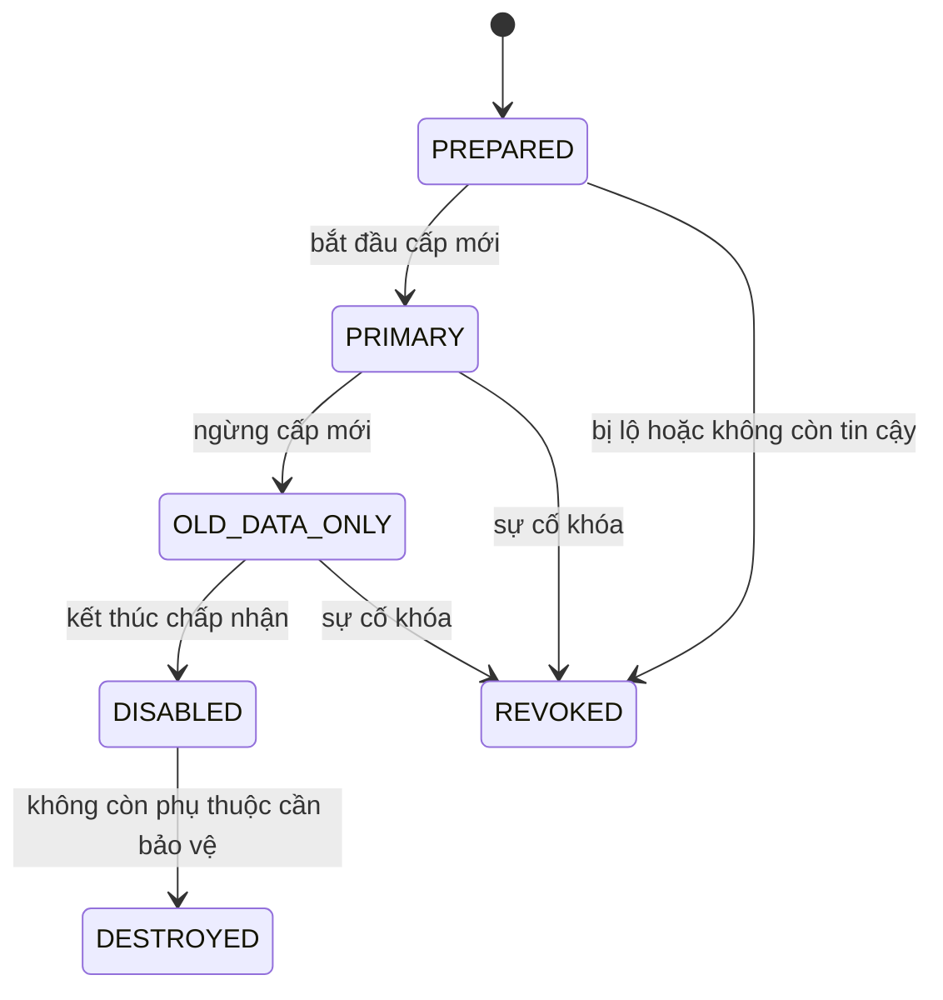

# Cryptographic key rotation

## 1. Xoay khóa trong hệ thống khôi phục tài khoản

Cryptographic key rotation là việc chuyển sang vật liệu khóa mới theo một chính sách rõ ràng, đồng thời quản lý khả năng xử lý dữ liệu đã được bảo vệ bằng khóa cũ. Trong account recovery, thay khóa thiếu kế hoạch có thể khiến liên kết khôi phục hợp lệ bị từ chối, grant tạm không kiểm chứng được hoặc payload chờ gửi không giải mã được.

Ngược lại, giữ khóa cũ được chấp nhận vô hạn làm giảm giá trị của việc xoay khóa. Nếu khóa đã bị lộ, chỉ bắt đầu cấp token bằng khóa mới không ngăn kẻ tấn công tiếp tục tạo token giả bằng khóa cũ còn được verifier tin cậy.

Vì vậy, cần tách ba quyết định: dùng khóa nào để tạo dữ liệu mới, khóa nào còn được phép kiểm chứng hoặc giải mã dữ liệu cũ, và lúc nào một phiên bản phải bị thu hồi hoặc hủy. Các trạng thái và cấu hình trong bài là mô hình minh họa cho một dịch vụ recovery, không phải tên trạng thái bắt buộc của mọi KMS.

## 2. Xác định đúng loại khóa cần xoay

Không phải mọi bí mật trong luồng recovery đều là cùng một loại khóa:

| Loại | Ví dụ sử dụng | Ảnh hưởng khi đổi khóa |
| --- | --- | --- |
| Khóa HMAC | Tạo verifier có khóa cho token opaque hoặc mã khôi phục | Token cũ cần đúng phiên bản khóa để kiểm chứng |
| Cặp khóa ký | Ký recovery grant có cấu trúc | Verifier cần public key đúng; private key mới dùng cho cấp mới |
| Khóa mã hóa dữ liệu, DEK | Bảo vệ payload gửi token hoặc tài liệu nhạy cảm | Ciphertext cũ còn cần DEK tương ứng |
| Khóa bọc khóa, KEK | Bọc DEK trong envelope encryption | Có thể cần bọc lại DEK trước khi bỏ KEK cũ |
| Khóa mã hóa cookie recovery | Bảo vệ trạng thái phiên hạn chế | Các instance phải xử lý được cookie trong cửa sổ chuyển tiếp |

Token ngẫu nhiên của từng yêu cầu là một credential riêng. Gửi lại token không tự xoay khóa HMAC dùng chung. Tương tự, SHA-256 không khóa dùng làm verifier của token entropy cao không có một secret key để xoay; đổi hàm băm là thay scheme lưu trữ.

Nên tách khóa theo mục đích và môi trường. Khóa ký grant recovery không nên đồng thời dùng ký access token đăng nhập, tính HMAC token hoặc mã hóa nội dung email. Nếu một khóa phục vụ quá nhiều nhiệm vụ, thu hồi nó sẽ ảnh hưởng rộng và khó xác định phạm vi dữ liệu liên quan.

## 3. Metadata và vòng đời của một phiên bản khóa

Một bản ghi quản lý phiên bản có thể gồm:

```text
key_id                  : định danh phiên bản cụ thể
purpose                 : nhiệm vụ được phép
algorithm               : thuật toán theo chính sách máy chủ
material_reference      : tham chiếu tới khóa trong kho quản lý
issue_state             : có được tạo dữ liệu mới không
accept_state            : có được xử lý dữ liệu cũ không
issue_started_at        : thời điểm bắt đầu dùng để cấp mới
issue_stopped_at        : thời điểm đã thực sự dừng cấp mới
accept_not_after        : mốc kết thúc chấp nhận theo chính sách
policy_revision         : phiên bản cấu hình quản trị
```

Metadata không chứa private key, khóa HMAC hay khóa giải mã thô. `key_id` là định danh có thể xuất hiện trong token hoặc bản ghi; biết nó không cấp quyền đọc vật liệu khóa.

Một vòng đời minh họa:



`OLD_DATA_ONLY` có nghĩa khác theo loại khóa: kiểm chữ ký cũ, tính lại HMAC cho verifier cũ hoặc giải mã ciphertext cũ. Với HMAC, bên có khóa để kiểm chứng cũng có khả năng tính MAC mới; hạn chế “chỉ kiểm” là chính sách của ứng dụng hoặc dịch vụ mật mã, không phải thuộc tính bất đối xứng tự có.

Với chữ ký bất đối xứng, public key phục vụ kiểm chứng không cần có bí mật như private key. Dữ liệu ký cũ có thể cần public key để xác minh phục vụ audit lâu hơn thời gian một token được phép cấp quyền recovery. Phải phân biệt hai mục đích sử dụng đó.

## 4. Chọn thời hạn sử dụng khóa và cửa sổ chuyển tiếp

Cryptoperiod là khoảng thời gian khóa được cho phép sử dụng cho nhiệm vụ nhất định. OWASP khuyến nghị xác định nó theo thuật toán, độ mạnh khóa, môi trường, mô hình đe dọa và độ nhạy dữ liệu; không có một số ngày duy nhất phù hợp mọi khóa. Khối lượng sử dụng cũng cần được xét cùng lịch thời gian. [Nguồn: OWASP Key Management — Cryptoperiods and Rotation](https://cheatsheetseries.owasp.org/cheatsheets/Key_Management_Cheat_Sheet.html#cryptoperiods-and-rotation).

Với khóa bảo vệ token sống ngắn và chưa có dấu hiệu bị lộ, có thể tính mốc chuyển tiếp từ lần cấp cũ cuối cùng thực sự được phép:

```text
old_key_accept_not_after = last_old_issue_time
                          + maximum_token_lifetime
                          + permitted_clock_skew
```

Đây là mốc quản lý khóa, không thay thế kiểm tra `exp` hay `expires_at` của từng token. Không kéo dài token chỉ vì khóa vẫn còn trong cửa sổ chấp nhận. Khoảng sai lệch đồng hồ phải được định nghĩa nhất quán, không cộng lặp lại ở nhiều tầng.

Ví dụ, nếu lần cấp bằng K1 cuối cùng là `09:00:00Z`, hạn token tối đa là 10 phút và hệ thống cho sai lệch 30 giây, mốc chấp nhận K1 có thể là `09:10:30Z`. Các giá trị chỉ minh họa. Nếu một instance cũ còn cấp K1 lúc `09:04`, giả định “đã dừng từ 09:00” không còn đúng và phải được xử lý như sai lệch triển khai.

Đối với khóa giải mã payload hoặc bọc DEK, TTL token không đủ quyết định thời điểm bỏ khóa: bản ghi, hàng đợi và backup có thể còn cần khả năng đọc dữ liệu. Cửa sổ này phải được tính theo phụ thuộc dữ liệu thực tế.

## 5. Quy trình xoay định kỳ: chuẩn bị đọc trước, chuyển ghi sau

Một đợt xoay có kế hoạch từ K1 sang K2 có thể gồm:

1. Tạo K2 bằng cơ chế mật mã phù hợp trong KMS/HSM hoặc kho khóa được quản lý; cấp quyền đúng cho từng workload.
2. Phân phối metadata và khả năng kiểm chứng hoặc giải mã K2 đến các thành phần cần dùng, trong khi K1 vẫn cấp dữ liệu mới.
3. Xác nhận các instance sẵn sàng xử lý K2 và nạp cấu hình cùng revision phù hợp.
4. Chuyển khóa cấp mới sang K2; mọi token hoặc ciphertext mới ghi đúng phiên bản thực sự đã dùng.
5. Ngăn instance cũ tiếp tục cấp K1, rồi theo dõi lượng dữ liệu K1 còn hoạt động.
6. Kết thúc chấp nhận K1 khi đủ điều kiện theo loại khóa; sau đó mới xét hủy vật liệu không còn cần.

Đảo thứ tự, cho issuer dùng K2 trước khi verifier biết K2, có thể khiến người dùng nhận token mới mà không tiếp tục recovery được. Chuyển ghi thành công cũng chưa chứng minh toàn bộ dữ liệu cũ đã được di chuyển.

```text
Giai đoạn A: cấp K1; đọc K1 và K2 đã chuẩn bị
Giai đoạn B: cấp K2; đọc K2 và K1 trong cửa sổ được phép
Giai đoạn C: cấp K2; dừng dùng K1 cho quyền recovery
```

“Đọc K1 và K2” ở đây chỉ áp dụng cho đúng purpose và thuật toán cho phép. Nó không có nghĩa thử mọi khóa của toàn hệ thống hoặc chấp nhận mọi token có một chữ ký kiểm tra được.

## 6. Gắn phiên bản khóa đúng với thao tác mật mã

Cấu hình minh họa cho verifier token HMAC:

```yaml
policyRevision: 42
purpose: RECOVERY_TOKEN_VERIFIER
primaryKeyId: recovery-hmac-v2
acceptedKeys:
  recovery-hmac-v2:
    algorithm: HMAC_SHA256
    acceptNotAfter: null
  recovery-hmac-v1:
    algorithm: HMAC_SHA256
    acceptNotAfter: '2026-11-23T09:10:30Z'
```

`null` trong ví dụ nghĩa là chưa lên lịch ngừng chấp nhận theo cấu hình này, không phải được dùng vô hạn hoặc bỏ qua trạng thái thu hồi. Khóa vẫn phải ở trạng thái được phép trong chính sách hiện hành.

Một lỗi tinh tế xảy ra khi ứng dụng đọc alias “current” thành K1, rồi alias đổi sang K2 trước thao tác ký. Nếu token ghi `kid=K1` nhưng thao tác mật mã thực sự dùng K2, token mới sẽ không kiểm chứng được như dự kiến.

Ứng dụng cần giữ một snapshot nhất quán của key ID, thuật toán và tham chiếu phiên bản cụ thể cho thao tác. Nếu API mật mã trả lại phiên bản thực tế đã dùng, metadata lưu cùng kết quả phải khớp với phiên bản đó. Không ghi lại alias có thể đổi như thể nó là định danh phiên bản bất biến.

Với token opaque, lưu `key_version` cùng verifier trong bản ghi máy chủ. Với dữ liệu mã hóa, lưu định danh phiên bản khóa hoặc envelope metadata theo định dạng được hỗ trợ. Nếu không có thông tin này, lần xoay tiếp theo dễ dẫn tới thử nhiều khóa hoặc mất khả năng đọc dữ liệu cũ.

## 7. Xoay khóa HMAC của verifier token

Giả sử bản ghi lưu:

```text
transaction_id = R1
key_version = recovery-hmac-v1
verifier = HMAC(K1, canonical_context || secret)
expires_at = thời hạn đã cấp
status = ISSUED
```

Sau khi chuyển cấp mới sang K2, bản ghi này vẫn cần K1 nếu còn được chấp nhận. Không thể tính `HMAC(K2, secret)` chỉ từ verifier cũ, vì hệ thống không giữ `secret`. Tính HMAC của verifier cũ bằng K2 là một scheme khác, không phải thay thế tương đương.

Với token sống ngắn, có thể cho token K1 đi hết cửa sổ hợp lệ rồi dọn bản ghi. Khi token được trình hợp lệ trong thời gian chuyển tiếp, hệ thống có thể tiêu thụ nó và cấp grant mới bằng K2 theo đúng quy trình; không tự gia hạn quyền gốc.

Mô hình selector và secret giúp máy chủ tìm đúng hàng trước, đọc phiên bản khóa đã lưu rồi kiểm chứng secret. Nếu lookup trực tiếp bằng HMAC mà không có selector hoặc ngữ cảnh chọn hàng, cần thiết kế cách tìm trong một tập phiên bản hữu hạn đã được phép; không thử mọi khóa lịch sử trên mọi request.

Nếu token dùng verifier SHA-256 không khóa, việc thay khóa HMAC của nhóm khác không buộc token đó phải được băm lại. Cần inventory đúng để không làm vô hiệu toàn bộ recovery chỉ vì tên cấu hình chung chung là `TOKEN_KEY`.

## 8. Chọn khóa và kiểm tra recovery grant được ký

`kid` trong header token giúp chọn khóa, nhưng trước khi kiểm chữ ký nó vẫn là dữ liệu không đáng tin. Verifier chỉ dùng nó tra cứu trong tập khóa đã được cấu hình cho đúng issuer và loại grant. Không biến `kid` thành đường dẫn tệp, câu SQL nối chuỗi hoặc URL để tải khóa tùy ý.

Một luồng kiểm chứng minh họa:

```text
parse bounded token structure
select current trusted policy for recovery grants
validate key-id format and look up an allowed key entry
reject unknown, revoked, disabled or out-of-window keys
require algorithm and token type allowed by server policy
verify signature with the selected key
validate issuer, audience, subject, time bounds and maximum lifetime
check purpose, recovery transaction, grant state and one-time-use rules
perform only the authorized recovery step atomically
```

Không dùng giá trị `alg` người gửi khai để tự chọn một thuật toán yếu hơn, hoặc lấy public key của một cặp bất đối xứng làm khóa HMAC. Chữ ký đúng bằng K1 không làm một access token đăng nhập trở thành recovery grant.

RFC 8725 yêu cầu kiểm soát thuật toán, kiểm tra issuer/audience theo profile và tránh nhầm giữa các loại JWT; tài liệu cũng cảnh báo dữ liệu header phục vụ tìm khóa có thể dẫn đến injection hoặc SSRF nếu dùng thiếu kiểm soát. [Nguồn: RFC 8725, mục 3.1 và 3.8–3.12](https://www.rfc-editor.org/rfc/rfc8725.html#section-3).

Sau xoay khóa, token đã hết hạn, bị dùng hoặc bị thu hồi vẫn phải bị từ chối. Thêm K2 vào trust set không được xóa các kiểm tra trạng thái máy chủ hoặc đặt lại dấu dùng một lần.

## 9. Xoay khóa mã hóa không tự chuyển đổi ciphertext

Với payload email có token thô hoặc dữ liệu xác minh cần lưu mã hóa, bản ghi cũ vẫn có thể phụ thuộc K1 sau khi dữ liệu mới chuyển sang K2. Có hai hướng xử lý theo nhu cầu:

| Hướng | Cách thực hiện | Điều kiện giữ khóa cũ |
| --- | --- | --- |
| Chờ dữ liệu hết nhu cầu lưu | Dữ liệu mới dùng K2; dữ liệu K1 được đọc trong thời gian cho phép rồi dọn | K1 còn cần cho đến khi các phụ thuộc kết thúc |
| Chuyển đổi dữ liệu còn cần | Đọc bằng phiên bản cũ, mã hóa hoặc bọc lại bằng phiên bản mới | K1 còn cần đến khi chuyển đổi và khả năng phục hồi được giải quyết |

Trong envelope encryption, bọc lại DEK bằng KEK mới không thay DEK đang mã hóa dữ liệu. Vì vậy, thao tác đó không đặt lại giới hạn sử dụng hay xử lý một DEK đã bị lộ. Muốn thay DEK bảo vệ ciphertext hiện có cần mã hóa lại dữ liệu theo thiết kế thích hợp. [Nguồn: OWASP Key Management — Envelope Encryption](https://cheatsheetseries.owasp.org/cheatsheets/Key_Management_Cheat_Sheet.html#cryptoperiods-and-rotation).

Dùng API và định dạng mã hóa đã được thiết kế đúng; khi mã hóa lại phải tuân thủ yêu cầu nonce/IV của thuật toán và bảo vệ metadata liên quan bằng cơ chế xác thực phù hợp. Không tự bỏ xác thực ciphertext để cứu các bản ghi đang lỗi trong quá trình xoay.

Cần kiểm tra chính xác hành vi nhà cung cấp. Ví dụ, Cloud KMS nêu rõ xoay khóa không tự mã hóa lại dữ liệu, không tự vô hiệu hoặc xóa các phiên bản cũ; hủy phiên bản còn dùng có thể gây mất dữ liệu. [Nguồn: Google Cloud KMS — Key rotation](https://docs.cloud.google.com/kms/docs/key-rotation#after_you_rotate_keys).

Chuyển đổi nên theo lô, có trạng thái và điều kiện phiên bản để retry không ghi đè dữ liệu vừa được thay đổi. Chỉ dọn bản cũ khi bản mới được lưu thành công theo hợp đồng phục hồi, không xóa trước rồi thử mã hóa sau.

## 10. Khóa nghi bị lộ cần thu hồi khẩn cấp

Xoay định kỳ thường có thời gian chuyển tiếp để duy trì token cũ hợp lệ. Khi khóa ký hoặc HMAC đã bị lộ, giữ thời gian chuyển tiếp như bình thường có thể tiếp tục chấp nhận dữ liệu do kẻ tấn công tạo.

Một quy trình ứng phó cần bao quát:

1. Xác định phiên bản khóa, mục đích và dữ liệu chịu ảnh hưởng; chặn nguồn tiếp tục lộ hoặc sử dụng khóa trái phép.
2. Ngừng cấp bằng khóa đó và đưa trạng thái thu hồi tới mọi thành phần đang ra quyết định tin cậy.
3. Tạo khóa thay thế qua môi trường và quyền truy cập đã được xử lý nguyên nhân sự cố.
4. Vô hiệu token, grant hoặc quyền bị ảnh hưởng theo khả năng của giao thức; yêu cầu người dùng bắt đầu lại bước xác minh khi cần.
5. Xem xét các thay đổi tài khoản đã thực hiện trong khoảng bị ảnh hưởng và xử lý theo quy trình khôi phục sự cố.

OWASP yêu cầu thu hồi bí mật có khả năng đã bị xâm phạm và bảo đảm hệ thống có thể nhận biết trạng thái thu hồi; đây là việc khác với chỉ tạo một secret mới. [Nguồn: OWASP Secrets Management — Revocation và Remediation](https://cheatsheetseries.owasp.org/cheatsheets/Secrets_Management_Cheat_Sheet.html#92-remediation).

Vô hiệu khóa trong KMS không tự làm mọi verifier quên khóa đã cache. Với chữ ký bất đối xứng, verifier có public key thường không gọi KMS khi kiểm chữ ký; token cũ vẫn có thể được chấp nhận nếu chính sách của verifier chưa loại khóa bị thu hồi. Với HMAC đã được xuất vào bộ nhớ, việc chặn đọc khóa mới cũng không xóa bản sao đang có.

Do đó, phải có đường cập nhật trạng thái tin cậy và giới hạn độ cũ của cấu hình ở verifier. Xóa khóa khỏi một trang cấu hình hoặc đổi alias là chưa đủ bằng chứng đã ngăn chấp nhận.

Xoay khóa mã hóa sau khi bị lộ không lấy lại tính bí mật của ciphertext mà kẻ tấn công đã sao chép cùng khóa. Nó bảo vệ các thao tác tương lai theo phạm vi mới; dữ liệu cũ đã lộ cần được đánh giá riêng.

## 11. Cache, mất KMS và rollback triển khai

| Tình huống | Hành vi phù hợp |
| --- | --- |
| Token có key ID chưa được phép | Từ chối; không tự tải khóa từ địa chỉ người gửi cung cấp |
| Một instance chưa biết K2 | Xử lý lệch cấu hình, không bỏ kiểm chứng hoặc quay sang khóa tùy ý |
| KMS lỗi tạm thời khi cấp mới | Báo lỗi tạm thời hoặc retry có giới hạn, không sinh khóa mặc định |
| Có snapshot khóa được cache hợp lệ | Chỉ dùng trong phạm vi tuổi cache và chính sách thu hồi đã thiết kế |
| Cache quá cũ hoặc không biết trạng thái tin cậy cần thiết | Không tiếp tục thao tác bảo mật dựa trên suy đoán |
| Cần rollback mã ứng dụng | Giữ metadata và trạng thái thu hồi hiện hành; không phục hồi khóa bị lộ |

Dùng khóa cache để tăng khả dụng là quyết định cần đi kèm thời gian sống, cơ chế thu hồi và phạm vi quyền. Không gọi nó là fail-safe nếu cache cho phép một khóa bị thu hồi tiếp tục hoạt động không giới hạn.

Rollback từ bản triển khai K2 về mã cũ không được âm thầm cho K1 cấp token mới trở lại. Phần mềm cần hiểu cấu hình hiện tại, hoặc triển khai phải chặn instance không đáp ứng revision tối thiểu. Rollback code và rollback quyết định tin cậy là hai thao tác khác nhau.

Mỗi tiến trình có thể giữ các thao tác đang chạy khi cấu hình đổi. Cần xác định mốc ngừng cấp và cách chặn các thao tác cũ sau mốc đó. Không chỉ quan sát một alias đã đổi rồi suy rằng không còn instance hoặc công việc nền dùng K1.

## 12. Khi nào được bỏ khóa cũ?

Trước khi bỏ vật liệu khóa, cần phân biệt không còn cấp mới, không còn chấp nhận cho recovery và không còn dữ liệu cần giải mã. Ba trạng thái này không nhất thiết xảy ra cùng lúc.

Các phụ thuộc có thể gồm token còn hạn, grant đang ở bước tiếp theo, payload trong outbox, dead-letter queue, bản sao dữ liệu và backup cần phục hồi. Một bản ghi đã chuyển sang K2 trên DB chính không chứng minh mọi bản sao K1 đã biến mất.

Với khóa ký, có thể bỏ private key sau khi không còn nhu cầu ký theo chính sách, trong khi public key được lưu cho việc kiểm chứng audit. Điều đó không buộc verifier tiếp tục cấp quyền từ token K1 ngoài thời hạn đã cho phép.

Với khóa giải mã, hủy khóa khi vẫn cần đọc backup có thể làm mất khả năng phục hồi. Ngược lại, giữ một khóa đã bị lộ chỉ để tránh lỗi phục hồi không loại bỏ sự cố. Phải lựa chọn phương án phục hồi dữ liệu và cô lập quyền truy cập theo kế hoạch cụ thể.

Khôi phục snapshot cấu hình cũ không được làm khóa bị thu hồi trở lại trạng thái tin cậy. Khi phục hồi dịch vụ, đối chiếu revision, danh sách thu hồi và thời hạn với nguồn quản trị còn đáng tin trước khi mở lại luồng recovery.

## 13. Dấu vết và chỉ số cần quan sát

Audit của đợt xoay có thể ghi key ID và purpose, revision chính sách, chủ thể thực hiện, thời điểm tạo/chuyển cấp mới/thu hồi, cùng kết quả triển khai ở từng thành phần. Không ghi vật liệu khóa, token thô, verifier hoặc nội dung đã giải mã.

Các chỉ số hữu ích gồm:

- Số thao tác cấp mới theo key ID; đặc biệt là thao tác dùng K1 sau mốc ngừng cấp.
- Số lần kiểm chứng dữ liệu cũ thành công, key ID không biết và khóa đã bị thu hồi bị trình lại.
- Độ trễ phân phối chính sách, tuổi cache và số instance chưa đạt revision cần thiết.
- Lỗi KMS/HSM, lỗi quyền, lỗi kiểm chứng hoặc giải mã trong lúc chuyển phiên bản.
- Lượng dữ liệu còn phụ thuộc khóa cũ và tiến độ chuyển đổi theo lô.

Dùng key ID trong metric theo tập phiên bản được quản lý, tránh tạo nhãn không giới hạn từ `kid` người gọi tự gửi. Một lượng lớn key ID lạ cần được kiểm soát ở parser, lookup và rate limit thay vì kéo theo nhiều lần gọi kho khóa.

Một đợt xoay thành công cần thể hiện đúng hành vi: dữ liệu mới dùng khóa mới, dữ liệu cũ chỉ hoạt động trong phạm vi còn được phép, khóa bị thu hồi không tiếp tục cấp quyền và dữ liệu cần giữ vẫn đọc được theo chính sách. Việc nhìn thấy K2 tồn tại trong kho khóa mới chỉ là một phần của kết quả đó.
