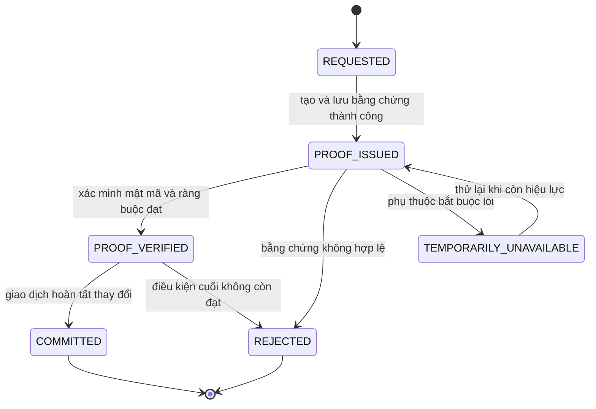

# Cryptographic failure handling: xử lý lỗi mật mã trong khôi phục tài khoản

## 1. Lỗi mật mã là một nhánh quyết định quyền truy cập

Trong luồng khôi phục tài khoản, mật mã bảo vệ các bằng chứng có thể dẫn tới việc đặt lại mật khẩu, thay MFA hoặc đăng ký passkey mới. Một chữ ký hợp lệ chưa đủ để cấp quyền; nhưng khi chữ ký không thể được kiểm tra, hệ thống càng không được coi đó là bằng chứng hợp lệ.

**Cryptographic failure handling** là thiết kế hành vi của hệ thống khi không thể tạo, xác minh hoặc sử dụng vật liệu mật mã một cách đáng tin cậy. Hành vi này bao gồm quyết định dừng bước nào, giữ trạng thái gì, trả thông báo nào, có được thử lại hay không và vận hành phải điều tra điều gì.

Ví dụ, dịch vụ quản lý khóa KMS bị timeout đúng lúc xác minh token khôi phục. Hai cách xử lý sau tạo ra hai mức an toàn hoàn toàn khác nhau:

- Cho tiếp tục đặt lại mật khẩu vì cho rằng đây chỉ là lỗi hạ tầng: một sự cố khả dụng trở thành đường vượt xác thực.
- Tạm dừng việc đổi thông tin xác thực, giữ trạng thái tài khoản và hướng dẫn thử lại: quyền truy cập vẫn cần bằng chứng đã được xác minh.

Bài này tập trung vào nhánh lỗi trong module khôi phục tài khoản. Các sơ đồ, tên trạng thái, mã lỗi và chính sách minh họa dưới đây là một thiết kế tham khảo; chúng cần được điều chỉnh theo mô hình rủi ro và kiến trúc triển khai thực tế.

## 2. Những bất biến phải còn đúng khi có lỗi

Trước khi đặt tên exception hoặc chọn HTTP status, cần xác định các bất biến nghiệp vụ:

1. Không đổi mật khẩu, MFA, passkey hay địa chỉ khôi phục nếu bằng chứng bắt buộc chưa được xác minh thành công.
2. Lỗi hạ tầng không làm tăng mức tin cậy của yêu cầu.
3. Một token dùng một lần không được hoàn tất hai thao tác độc lập, kể cả khi hai yêu cầu chạy đồng thời.
4. Một thao tác đã commit không được thực hiện lại chỉ vì client chưa nhận được phản hồi.
5. Lỗi không làm lộ token, khóa, mật khẩu, mã dự phòng hoặc thông tin giúp phân biệt tài khoản tồn tại.
6. Khi việc khôi phục làm mất hiệu lực session cũ, trạng thái xác thực mới và cơ chế vô hiệu hóa session phải nhất quán trước khi cấp quyền truy cập tiếp theo.

Đây là ý nghĩa của **fail closed** tại ranh giới cấp quyền: thiếu kết quả xác minh đáng tin cậy thì không thực hiện hành động cần kết quả đó. Nó không đồng nghĩa với khóa vĩnh viễn tài khoản, xóa mọi bằng chứng hoặc làm dừng toàn bộ hệ thống mỗi khi một dịch vụ phụ gặp lỗi.

Một lỗi gửi email thông báo sau khi khôi phục đã commit có thể được xử lý bằng hàng đợi thử lại. Một lỗi xác minh MAC trước khi thay MFA phải chặn thay đổi đó. Hai bước có vai trò bảo mật khác nhau nên không thể dùng chung chính sách “có lỗi thì tiếp tục”.

## 3. Phân loại lỗi trước khi chọn cách xử lý

Không nên gom mọi tình huống vào `INVALID_TOKEN`. Phía ngoài có thể dùng thông báo chung, nhưng bên trong cần đủ thông tin để xử lý chính xác.

| Nhóm | Ví dụ | Quyết định với quyền khôi phục | Hành động nội bộ |
| --- | --- | --- | --- |
| Đầu vào không hợp lệ | Token quá dài, Base64 sai, envelope thiếu trường | Không cấp quyền | Chặn sớm bằng giới hạn kích thước và parser chặt chẽ |
| Bằng chứng không hợp lệ | MAC sai, chữ ký sai, AEAD tag sai | Không cấp quyền | Ghi kết quả xác minh thất bại đã làm sạch |
| Ràng buộc nghiệp vụ không đạt | Token hết hạn, đã dùng, sai mục đích hoặc sai tài khoản | Không cấp quyền | Giữ lý do chi tiết trong luồng xử lý nội bộ |
| Phụ thuộc tạm thời không sẵn sàng | KMS timeout, HSM bận, không đọc được trạng thái token | Không cấp quyền ở bước đang phụ thuộc | Thử lại có giới hạn hoặc yêu cầu người dùng quay lại |
| Cấu hình hoặc triển khai sai | Không tải được key bắt buộc, thuật toán không hỗ trợ | Không cấp quyền | Cảnh báo, ngăn instance phục vụ nhánh bị ảnh hưởng |
| Nghi ngờ sự cố an ninh | Khóa bị lộ, nonce bị tái sử dụng, vật liệu khóa sai provenance | Không tiếp tục dùng đường tin cậy bị ảnh hưởng | Cô lập, thu hồi và điều tra theo phạm vi |
| Kết quả ghi chưa biết | Mất kết nối sau lệnh commit đổi mật khẩu | Chưa kết luận thao tác thất bại | Đọc trạng thái thao tác đã lưu trước khi quyết định thử lại |

MAC là mã xác thực thông điệp. AEAD là mã hóa có xác thực và có thể ràng buộc dữ liệu bổ sung. Trong cả hai trường hợp, lỗi kiểm tra tính xác thực nghĩa là dữ liệu chưa đáng tin cậy; không được lấy phần dữ liệu đã giải mã tạm thời để tiếp tục xử lý.

Một token hết hạn là kết quả nghiệp vụ, không phải bằng chứng KMS đang hỏng. Ngược lại, KMS không trả lời không chứng minh token sai. Phân biệt hai điều này giúp tránh vừa chặn nhầm người dùng vừa bỏ sót sự cố hạ tầng.

## 4. Xử lý lỗi ở từng giai đoạn mật mã

### 4.1. Khi sinh token hoặc mã dự phòng

OWASP yêu cầu token khôi phục được sinh bằng nguồn ngẫu nhiên an toàn mật mã, đủ khó đoán, được lưu an toàn, có hạn sử dụng và chỉ dùng một lần. Đây là các thuộc tính nền tảng của bằng chứng khôi phục. [Nguồn: OWASP Forgot Password Cheat Sheet](https://cheatsheetseries.owasp.org/cheatsheets/Forgot_Password_Cheat_Sheet.html).

Nếu nguồn ngẫu nhiên an toàn hoặc bước tạo token báo lỗi:

- Không thay bằng thời gian hiện tại, số thứ tự, hàm random thông thường hoặc token cố định.
- Không rút ngắn token để tránh lỗi lưu trữ hay giới hạn truyền tải.
- Không trả “đã tạo thành công” nếu token chưa được lưu bền vững theo thiết kế.
- Không đưa token chưa được ghi nhận vào email hoặc SMS rồi hy vọng bước lưu sẽ thành công sau đó.

Với token ngẫu nhiên có entropy cao, một thiết kế có thể chỉ lưu digest để tra cứu và đối chiếu. Điều này khác với mã OTP ngắn: không gian giá trị nhỏ khiến digest đơn thuần vẫn có thể bị dò ngoại tuyến khi dữ liệu bị lộ. Việc chọn cách bảo vệ mã ngắn cần xem xét thêm khóa bí mật, giới hạn thử và mô hình rủi ro; không sao chép máy móc cách lưu token dài.

Khi cần chuyển token cho bộ gửi email, thiết kế phải tính cả bản sao bí mật trong hàng đợi. Có thể giữ bí mật bằng payload mã hóa với thời gian lưu ngắn và quyền đọc hạn chế. Không ghi token rõ vào một outbox phổ thông rồi coi việc chỉ lưu digest trong bảng token là đã bảo vệ toàn bộ hệ thống.

### 4.2. Khi xác minh MAC, chữ ký hoặc token có cấu trúc

Luồng xử lý nên tách rõ ba tầng:

1. Kiểm tra kích thước và cấu trúc đầu vào.
2. Kiểm tra mật mã bằng thuật toán và nguồn khóa được cấu hình tin cậy.
3. Kiểm tra ràng buộc như mục đích, tài khoản, tenant, thời hạn, phiên bản thông tin xác thực và trạng thái dùng một lần.

Trường `kid` hoặc tên thuật toán nằm trong token là dữ liệu do bên gửi cung cấp cho tới khi được kiểm chứng theo chính sách. Không dùng nó làm đường dẫn file, URL tải khóa tùy ý hoặc lý do để bật thuật toán yếu hơn.

Nếu chữ ký hợp lệ nhưng token dành cho “xác nhận email”, token đó không được dùng để “thay MFA”. Nếu token đúng mục đích nhưng thuộc tenant khác, vẫn phải từ chối. Mật mã xác nhận tính toàn vẹn của một thông điệp; chính sách ứng dụng quyết định thông điệp đó có đủ thẩm quyền cho thao tác cụ thể hay không.

Đặc biệt tránh mẫu xử lý sau:

```text
thử xác minh token
nếu có exception:
    đọc payload chưa xác minh
    lấy accountId từ payload
    tiếp tục reset để tránh làm gián đoạn người dùng
```

Một exception có thể do đầu vào bị sửa, khóa không đúng hoặc dịch vụ không sẵn sàng. Không nguyên nhân nào trong số đó làm payload trở nên đáng tin cậy.

### 4.3. Khi giải mã dữ liệu khôi phục

Nếu hồ sơ bằng chứng hoặc thông tin bàn giao được bảo vệ bằng AEAD, ứng dụng chỉ được sử dụng plaintext sau khi thư viện báo xác thực thành công. Tag sai, dữ liệu bị cắt hoặc dữ liệu bổ sung không khớp đều phải dừng xử lý bản ghi đó.

Dữ liệu bổ sung có thể ràng buộc tenant, loại bản ghi hoặc phiên bản định dạng. Nếu thay đổi cách dựng dữ liệu bổ sung mà không quản lý phiên bản, hệ thống có thể tự làm mất khả năng đọc dữ liệu hợp lệ. Khi đó cần khôi phục cấu hình hoặc thực hiện migration có kiểm soát, không bỏ kiểm tra tag.

Với cơ chế cần nonce duy nhất theo khóa, nghi ngờ nonce bị tái sử dụng là tín hiệu phải xem xét an toàn của toàn bộ tập dữ liệu liên quan. Không chỉ bắt exception của một yêu cầu rồi tiếp tục mã hóa với bộ đếm có thể đã quay lùi.

### 4.4. Khi băm mật khẩu mới

Nếu thư viện băm mật khẩu hoặc nguồn tham số đáng tin cậy không hoạt động, không lưu mật khẩu rõ, không chuyển tạm sang hash nhanh và không đánh dấu khôi phục hoàn tất.

Khi chuẩn bị credential mới, nên hoàn tất các bước có thể thất bại trước giao dịch thay đổi trạng thái, rồi kiểm tra lại điều kiện quan trọng trong giao dịch. Điều này giảm thời gian giữ khóa cơ sở dữ liệu mà vẫn ngăn một bằng chứng hết hạn hoặc bị thu hồi trong khoảng chờ được sử dụng để commit.

OWASP nhấn mạnh việc lựa chọn kiến trúc bảo vệ dữ liệu và quản lý vòng đời khóa, bao gồm tạo, phân phối, thay và loại bỏ khóa. Phần ứng dụng vào luồng khôi phục trong bài là quyết định thiết kế từ các nguyên tắc đó. [Nguồn: OWASP Cryptographic Storage Cheat Sheet](https://cheatsheetseries.owasp.org/cheatsheets/Cryptographic_Storage_Cheat_Sheet.html).

## 5. Thiết kế trạng thái để lỗi không tạo đường đi tắt

Có thể mô hình hóa tiến trình khôi phục như sau:



Sơ đồ thể hiện trạng thái logic; không bắt buộc lưu từng trạng thái thành một cột. `PROOF_VERIFIED` cũng không tự động là một quyền có thể tái sử dụng ở mọi request. Nếu ứng dụng lưu kết quả xác minh để đi qua nhiều màn hình, cần ràng buộc nó vào đúng phiên khôi phục, đúng thao tác, đúng tài khoản và thời hạn ngắn.

Trạng thái tạm thời không sẵn sàng không được tự làm mới TTL. Một token hết hạn trong lúc KMS ngừng hoạt động vẫn phải được xử lý theo chính sách hết hạn khi hệ thống trở lại. Tăng thời hạn cho toàn bộ token là thay đổi chính sách bảo mật, không phải hành động retry kỹ thuật.

Không tiêu thụ token ngay khi người dùng mở URL. Trình quét liên kết trong email hoặc thao tác mở lại tab có thể tạo request ngoài ý định. Bước tiêu thụ gắn với hành động xác nhận thay đổi được bảo vệ phù hợp, không gắn với một lần tải trang thụ động.

## 6. Dùng một lần, tính nguyên tử và kết quả chưa biết

### 6.1. Hai yêu cầu đồng thời

Nếu quy trình là “đọc token còn hiệu lực, đổi mật khẩu, đánh dấu đã dùng” bằng ba thao tác không có ràng buộc nguyên tử, hai request có thể cùng vượt qua bước đọc.

Một mô hình tham khảo dùng giao dịch cơ sở dữ liệu để gộp:

- Kiểm tra và chuyển token từ chưa dùng sang đã dùng bằng điều kiện cạnh tranh.
- Cập nhật credential của tài khoản theo phiên bản dự kiến.
- Tăng phiên bản thu hồi session hoặc ghi trạng thái bắt buộc vô hiệu hóa session.
- Ghi kết quả thao tác và sự kiện thông báo vào outbox.

Nếu một bước bắt buộc thất bại, giao dịch phải rollback. Với thành phần nằm ngoài cùng cơ sở dữ liệu, không giả định có tính nguyên tử xuyên dịch vụ; cần điều phối riêng và một ranh giới cấp quyền rõ ràng.

Ví dụ SQL khái niệm cho bước chiếm quyền sử dụng token:

```sql
UPDATE recovery_token
SET used_at = :now,
    operation_id = :operation_id
WHERE token_id = :token_id
  AND account_id = :account_id
  AND purpose = :purpose
  AND used_at IS NULL
  AND revoked_at IS NULL
  AND expires_at > :now
  AND credential_version = :expected_version;
```

Thao tác phải ảnh hưởng đúng một dòng trong giao dịch chứa cả thay đổi tài khoản. Các điều kiện trên không thay thế bước xác minh bí mật token. `token_id` có thể chỉ là định danh tra cứu công khai; biết nó không đồng nghĩa với sở hữu bằng chứng.

Nếu cập nhật credential thất bại sau lệnh này, rollback phải hoàn nguyên cả việc đánh dấu token đã dùng. Nếu các bước chạy ở hai kho dữ liệu khác nhau, đoạn SQL đơn lẻ không còn đủ để bảo đảm bất biến.

### 6.2. Commit thành công nhưng phản hồi bị mất

Giả sử cơ sở dữ liệu đã commit mật khẩu mới và token đã dùng, nhưng kết nối tới ứng dụng bị đứt trước khi nhận kết quả. Trả thông báo chắc chắn “không có thay đổi nào” là sai; tạo thao tác reset mới ngay có thể gây tác động kép.

Cần phân biệt:

| Kết quả nội bộ | Điều đã biết | Cách xử lý |
| --- | --- | --- |
| `NOT_COMMITTED` | Có bằng chứng giao dịch không commit | Có thể thử lại theo chính sách |
| `COMMITTED` | Kết quả bền vững đã được đọc lại | Trả kết quả đã lưu, không làm lại |
| `OUTCOME_UNKNOWN` | Chưa xác định được giao dịch có commit không | Tra cứu/reconcile bằng định danh thao tác |

Một định danh idempotency chỉ hữu ích nếu kết quả được lưu bền vững và gắn với cùng tài khoản, phiên khôi phục và ý nghĩa yêu cầu. Không cho phép một key được dùng lại để đổi sang mật khẩu hay yếu tố xác thực khác. Không lưu plaintext mật khẩu trong bản ghi idempotency; cơ chế phát hiện request khác nhau cũng phải tránh tạo thêm kho dữ liệu có thể dò mật khẩu dễ dàng.

Endpoint tra cứu kết quả không được trở thành endpoint tra cứu tài khoản công khai. Nó vẫn cần quyền phù hợp của phiên khôi phục và chỉ trả thông tin tối thiểu.

## 7. Minh họa ranh giới xử lý lỗi

Đoạn mã giả sau nhấn mạnh thứ tự quyết định; các hàm là thành phần trừu tượng, không phải API Java có sẵn:

```text
completeRecovery(request):
    boundedInput = parseWithLimits(request)
    context = requireRecoveryContext(boundedInput)

    previous = findAuthorizedOperationResult(context, request.operationId)
    if previous exists:
        requireSameOperationIntent(previous, request)
        return previous.publicResult

    try:
        proof = verifyCryptographyAndBindings(
            boundedInput.token,
            context.account,
            context.purpose
        )
        preparedCredential = prepareCredential(request.newCredential)
    catch RejectedProof:
        recordSanitizedRejection()
        return genericProofRejected()
    catch RequiredDependencyUnavailable:
        recordDependencyFailure()
        return temporarilyUnavailable()
    catch UnexpectedFailure:
        recordSanitizedUnexpectedFailure()
        return genericFailure()

    try:
        result = transaction:
            requireCurrentRecoveryPolicy(context)
            requireProofStillCurrent(proof)
            claimUnusedProofConditionally(proof)
            changeCredentialWithExpectedVersion(preparedCredential)
            persistSessionInvalidationBoundary(context.account)
            saveOperationResult(context, request.operationId)
            appendNotificationOutboxWithoutPlaintextSecrets()
        return result.publicResult
    catch CommitOutcomeUnknown:
        return reconcileOrReturnPending(context, request.operationId)
    catch ConditionalConflict:
        return resolveAlreadyCompletedOrReject(context, request.operationId)
    catch KnownRolledBackFailure:
        return temporarilyUnavailable()
```

Điểm quan trọng là mọi nhánh lỗi xác minh đều kết thúc trước thay đổi quyền. Ngoài ra, `requireProofStillCurrent` không chỉ kiểm tra chữ ký lần nữa: nó phải kiểm tra điều kiện có thể đã đổi như token bị thu hồi, phiên khôi phục bị hủy hoặc credential version đã tăng.

Việc tìm kết quả cũ phải kiểm tra quyền trước khi trả kết quả. Bản ghi thao tác đã hoàn tất có thể giúp xử lý retry của token đã dùng, nhưng không biến token đã dùng thành một quyền thay đổi credential lần thứ hai.

Nếu session của hệ thống dùng cache hoặc nhiều vùng, chỉ ghi một sự kiện thu hồi rồi lập tức cấp session đầy đủ có thể để lại cửa sổ cho session cũ. Thiết kế cần làm rõ dịch vụ xác thực sẽ kiểm tra phiên bản thu hồi ở đâu và có được cấp quyền khi không đọc được trạng thái đó hay không.

## 8. Phản hồi bên ngoài và thông tin nội bộ

OWASP khuyến nghị bộ xử lý lỗi trả phản hồi chung cho lỗi bất ngờ và giữ chi tiết cần thiết ở phía máy chủ. Trong luồng khôi phục, nguyên tắc này giúp tránh lộ stack trace, cấu trúc khóa hoặc khác biệt nhạy cảm qua thông báo. [Nguồn: OWASP Error Handling Cheat Sheet](https://cheatsheetseries.owasp.org/cheatsheets/Error_Handling_Cheat_Sheet.html).

Một cách ánh xạ tham khảo:

| Tình huống | Thông báo người dùng | Chi tiết nội bộ |
| --- | --- | --- |
| Yêu cầu gửi hướng dẫn khôi phục | “Nếu thông tin phù hợp, bạn sẽ nhận được hướng dẫn.” | Kết quả xử lý được kiểm soát truy cập |
| Token sai, hết hạn, đã dùng hoặc sai ràng buộc | “Liên kết không còn khả dụng. Hãy yêu cầu hướng dẫn mới.” | Mã nguyên nhân riêng cho điều tra |
| Phụ thuộc khôi phục đang lỗi trên phạm vi chung | “Tạm thời chưa thể hoàn tất. Vui lòng thử lại sau.” | Dependency, loại lỗi, khoảng thời gian |
| Chưa xác định kết quả commit | “Yêu cầu đang được xác nhận. Vui lòng kiểm tra trạng thái.” | Operation ID và tình trạng reconcile |

Không bắt buộc mọi trường hợp dùng cùng HTTP status. Điều cần bảo vệ là thông tin nhạy cảm có thể suy ra từ toàn bộ hành vi: nội dung, status, header, thời gian đáp ứng và khác biệt giữa các nhánh.

Ví dụ, nếu hệ thống chỉ gọi KMS sau khi tìm thấy tài khoản rồi trả `503` riêng cho nhánh đó, lỗi KMS có thể giúp dò tài khoản. Có thể đưa việc phát hành token sang xử lý bất đồng bộ hoặc áp dụng chính sách không sẵn sàng ở phạm vi endpoint trước khi phân nhánh theo tài khoản. Thêm độ trễ ngẫu nhiên đơn thuần không chứng minh đã loại bỏ kênh rò rỉ thời gian.

Log cũng cần có cấu trúc. Một sự kiện hữu ích có thể gồm:

```json
{
  "event": "recovery_crypto_dependency_unavailable",
  "stage": "verify_proof",
  "dependency": "approved_key_service",
  "failure_class": "timeout",
  "request_correlation_id": "server-generated-id",
  "decision": "no_credential_change"
}
```

Không log token gốc, query string chứa token, plaintext hồ sơ, mật khẩu mới, khóa bí mật hoặc toàn bộ request. Thông điệp exception từ thư viện hay KMS cũng phải được làm sạch trước khi đưa vào log hoặc hệ thống theo dõi lỗi. Correlation ID nên do hệ thống tạo hoặc được kiểm tra định dạng, không sao chép đầu vào tùy ý.

## 9. KMS lỗi, thay khóa và phục hồi dịch vụ

### 9.1. Khả dụng cao cần giữ nguyên chính sách tin cậy

Khi KMS hoặc HSM lỗi, có thể có phương án dự phòng nếu đã được thiết kế và cho phép từ trước, chẳng hạn chuyển sang điểm phục vụ khác của cùng dịch vụ khóa với chính sách tương đương.

Không gọi những hành vi sau là failover an toàn:

- Dùng một khóa hard-code khi không lấy được khóa chính.
- Bỏ xác minh MAC hoặc chữ ký để duy trì tỷ lệ thành công.
- Chấp nhận token chưa ký hoặc thuật toán ngoài allowlist.
- Tải khóa từ URL do token cung cấp.
- Dùng khóa đã bị thu hồi vì nghi lộ để “cứu” các yêu cầu đang chờ.

Nếu có cache khóa, phải xác định rõ loại khóa được cache, quyền sử dụng, tuổi cache và khả năng tiếp nhận thu hồi. Cache public key để xác minh chữ ký khác với xuất khóa bí mật khỏi HSM. Không giả định một cơ chế cache hợp lý cho loại khóa này sẽ phù hợp cho mọi loại khóa khác.

### 9.2. `kid` lạ không có cùng ý nghĩa với kho khóa hỏng

Một `kid` không thuộc tập khóa đã chấp nhận có thể là đầu vào không hợp lệ. Không cần gọi lại kho khóa vô hạn cho mỗi giá trị lạ. Ngược lại, khi instance không tải được tập khóa bắt buộc theo cấu hình đáng tin cậy, đó là lỗi vận hành.

Nếu cho phép refresh khóa do rotation, cần giới hạn tần suất, gộp các lần refresh trùng nhau và chỉ truy vấn nguồn đã cấu hình. Những giới hạn này vừa bảo vệ hạ tầng vừa ngăn kẻ tấn công dùng token giả làm bộ khuếch đại request tới KMS.

### 9.3. Khôi phục sau sự cố cần có thứ tự

Một trình tự tham khảo:

1. Xác định sự cố là gián đoạn dịch vụ, cấu hình sai hay nghi ngờ lộ khóa.
2. Khoanh vùng loại token, phiên bản khóa và khoảng thời gian bị ảnh hưởng.
3. Chặn phát hành hoặc sử dụng bằng chứng thuộc đường tin cậy không còn bảo đảm.
4. Khôi phục nguồn khóa và chính sách được phê duyệt; nếu nghi lộ thì thay khóa và quyết định thu hồi phù hợp.
5. Reconcile thao tác có kết quả chưa biết trước khi cho retry gây thay đổi trạng thái.
6. Mở lại luồng khôi phục sau khi ranh giới cấp quyền và thu hồi session hoạt động đúng.

Không kéo dài hiệu lực tất cả token, reset toàn bộ tài khoản hoặc ép thay mọi MFA chỉ vì một timeout đơn lẻ. Phạm vi ứng phó cần dựa vào bằng chứng sự cố và đặc tính loại khóa liên quan.

## 10. Áp dụng khi mất MFA, passkey hoặc thiết bị

Khi mất MFA hoặc passkey, thao tác cuối thường là thay một yếu tố có mức đảm bảo cao. Vì vậy lỗi ở một đường xác minh không được tự động làm giảm tiêu chuẩn của bước thay thế.

Ví dụ: người dùng mất điện thoại, còn mã dự phòng. Dịch vụ kiểm tra mã dự phòng đang lỗi. Hệ thống không được tự coi việc sở hữu email là đủ để xóa MFA nếu chính sách yêu cầu thêm bằng chứng. Có thể chuyển sang một quy trình xác minh danh tính độc lập đã được thiết kế, với giới hạn quyền và thời gian chờ tương ứng.

Quy trình hỗ trợ thủ công cũng phải có tiêu chuẩn riêng: ai được duyệt, cần bằng chứng gì, cần bao nhiêu người phê duyệt và hành động nào được phép. Nút “bỏ qua lỗi crypto” cho nhân viên hỗ trợ sẽ làm ranh giới an toàn phụ thuộc vào một exception kỹ thuật.

Đối với passkey, khôi phục tài khoản thường dẫn tới quyền đăng ký credential mới, không phải giải mã để tìm lại private key bị mất. Một bước thất bại khi xác minh bằng chứng không được tạo ra quyền đăng ký đó. Nếu hệ thống cấp phiên khôi phục hạn chế để đăng ký passkey, phiên ấy phải có scope và thời hạn phù hợp, thay vì trở thành session truy cập đầy đủ ngay lập tức.

## 11. Tình huống xuyên suốt

Người dùng A mở một liên kết khôi phục hợp lệ để thay MFA. Token còn hiệu lực, nhưng lần gọi dịch vụ xác minh khóa bị timeout.

**Lần thứ nhất:** ứng dụng phân loại đây là phụ thuộc bắt buộc chưa sẵn sàng, không phải token sai. MFA cũ và session hiện tại không thay đổi. Người dùng nhận thông báo tạm thời; hệ thống ghi sự kiện đã làm sạch. Token không được gia hạn tự động.

**Lần thứ hai:** dịch vụ khóa đã hoạt động. Token vượt qua xác minh mật mã, đúng mục đích thay MFA và đúng phiên khôi phục. Giao dịch chiếm quyền sử dụng token, thay credential MFA, ghi phiên bản thu hồi session và lưu kết quả thao tác. Sau đó phản hồi bị mất trên đường về client.

**Lần thứ ba:** client gửi lại cùng định danh thao tác. Hệ thống kiểm tra quyền tra cứu của phiên khôi phục, đọc kết quả đã commit và trả lại trạng thái hoàn tất. Nó không tạo MFA mới lần nữa và không khôi phục token về chưa dùng.

Nếu đồng thời có request khác dùng cùng token cho một thao tác khác, điều kiện dùng một lần chỉ cho một giao dịch thành công. Request còn lại không được nhận quyền chỉ vì token từng vượt qua xác minh chữ ký ở thời điểm trước đó.

Ba lần gọi cho thấy ba điều khác nhau: lỗi phụ thuộc không tạo quyền, commit không phụ thuộc vào việc client đã thấy thông báo, và xác minh mật mã không thay thế kiểm soát cạnh tranh trong trạng thái nghiệp vụ.

## 12. Các câu hỏi cần trả lời trong bản thiết kế

Trước khi triển khai nhánh lỗi, nhóm phát triển cần ghi rõ:

- Mỗi thao tác thay credential dựa vào bằng chứng và trạng thái nào?
- Khi không xác minh được một thành phần bắt buộc, hệ thống dừng ở ranh giới nào?
- Nhánh retry có thể làm lại thay đổi đã commit hay kéo dài tuổi token không?
- Ai có thể đọc kết quả thao tác khi token đã dùng?
- Cách vô hiệu hóa session cũ có còn hiệu lực khi cache hoặc một vùng triển khai bị lỗi không?
- Log, trace, email queue và outbox có giữ bản sao bí mật ngoài dự kiến không?
- Phương án dự phòng có giữ nguyên mức đảm bảo và nguồn khóa được tin cậy không?
- Khi khóa nghi bị lộ, điều gì cần thu hồi và điều gì vẫn được phép hoạt động?

Một thiết kế xử lý lỗi mật mã tốt khiến đường đi khi có sự cố trở nên xác định: quyền không tăng vì thiếu bằng chứng, thao tác không bị lặp vì mất phản hồi, và vận hành có thông tin để khôi phục dịch vụ mà không đưa bí mật ra ngoài.

