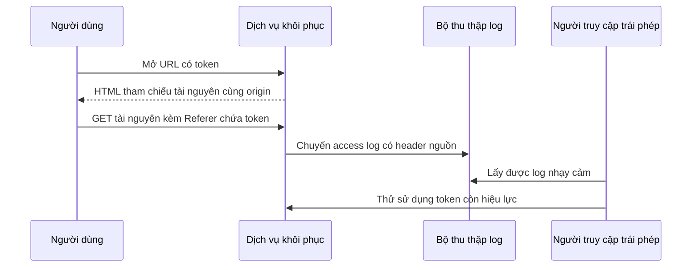

# Link leakage in referrer

## 1. Vì sao liên kết khôi phục là dữ liệu nhạy cảm?

Liên kết khôi phục thường mang một token cho phép bắt đầu thao tác đặc biệt:

```text
https://accounts.example/recovery/start?token=DEMO_TOKEN_NOT_VALID
```

Nếu hệ thống chỉ yêu cầu token này để đặt lại mật khẩu, người lấy được liên kết có thể thực hiện thao tác đó thay chủ tài khoản. Khi khôi phục MFA, passkey hoặc thiết bị xác thực, hậu quả còn phụ thuộc quyền mà token được cấp. Một token mở bước xác minh danh tính không được mặc nhiên trở thành quyền xóa mọi yếu tố xác thực.

**Link leakage in referrer** là tình huống URL nhạy cảm xuất hiện trong thông tin nguồn của một request tiếp theo, rồi đi vào hệ thống không cần biết token. Mục tiêu của thiết kế là giữ quyền khôi phục trong luồng được kiểm soát, đồng thời giảm số nơi có thể nhìn thấy bí mật.

Các tên miền và token trong bài đều là dữ liệu minh họa.

## 2. Hiểu đúng header Referer

`Referer` là tên header HTTP được chuẩn hóa với cách viết lịch sử này. Nó mô tả nguồn của một request; tên chính sách điều khiển lại viết là `Referrer-Policy`. Đừng nhầm URL đích trong request với URL nguồn có thể nằm ở header.

Ví dụ giả định trình duyệt đang áp dụng chính sách cho phép gửi URL nguồn đầy đủ:

```http
GET /recovery/form?token=DEMO_TOKEN_NOT_VALID HTTP/1.1
Host: accounts.example
```

Trang biểu mẫu tham chiếu ảnh cùng origin. Request ảnh có thể là:

```http
GET /assets/recovery-logo.svg HTTP/1.1
Host: accounts.example
Referer: https://accounts.example/recovery/form?token=DEMO_TOKEN_NOT_VALID
```

Token không nằm trong đường dẫn ảnh nhưng vẫn có thể xuất hiện trong log của request ảnh.

Theo [RFC 9110, mục Referer](https://www.rfc-editor.org/rfc/rfc9110.html#name-referer), thông tin nguồn có thể bị lược bỏ; fragment và userinfo không được đưa vào giá trị header. Vì vậy:

- Đưa token từ query sang path vẫn để lại bí mật trong URL nguồn.
- Fragment sau dấu `#` không rò trực tiếp qua header này, nhưng mã JavaScript trên trang vẫn có thể đọc nó.
- Không có `Referer` không chứng minh request đáng tin hay độc hại.

## 3. Token đi từ trang khôi phục đến đâu?

Một sự cố có thể bắt đầu từ một tài nguyên rất bình thường:



Sơ đồ giả định request thật sự gửi URL nguồn đầy đủ. Nó không khẳng định mọi trình duyệt đều gửi token trong mọi request.

Có ba ranh giới cần quan tâm:

| Ranh giới | Ví dụ | Ý nghĩa trong thiết kế |
| --- | --- | --- |
| Trình duyệt → dịch vụ cùng origin | Ảnh, CSS, API nội bộ | Token có thể lan sang log của các endpoint khác |
| Trình duyệt → origin khác | CDN, trang hỗ trợ, tài nguyên ngoài | Mức thông tin nguồn phụ thuộc chính sách có hiệu lực |
| Hệ thống phục vụ → hệ thống vận hành | Proxy, WAF, APM, kho log | Phạm vi đọc log có thể rộng hơn phạm vi vận hành recovery |

Cùng origin thường có nghĩa cùng scheme, host và port. `https://accounts.example` và `https://help.example` khác origin dù cùng tổ chức. Ngược lại, hai đường dẫn trên `https://accounts.example` có thể do hai nhóm vận hành khác nhau nhưng vẫn cùng origin đối với trình duyệt.

Do đó, “tài nguyên nội bộ” là mô tả tổ chức; nó chưa chứng minh dữ liệu khôi phục không bị phân phối thêm.

## 4. Chọn chính sách cho vùng recovery

Xét URL nguồn `https://accounts.example/recovery?token=DEMO`, với đích đều dùng HTTPS:

| Chính sách | Đích cùng origin | Đích khác origin |
| --- | --- | --- |
| `no-referrer` | Không gửi | Không gửi |
| `same-origin` | URL đầy đủ | Không gửi |
| `origin` | Chỉ origin | Chỉ origin |
| `strict-origin-when-cross-origin` | URL đầy đủ | Chỉ origin |
| `unsafe-url` | URL đầy đủ | URL đầy đủ |

“Đầy đủ” ở đây vẫn loại fragment và userinfo. Hành vi được mô tả trong [đặc tả Referrer Policy, bản dự thảo hiện hành](https://w3c.github.io/webappsec-referrer-policy/#referrer-policy-states).

Với trang mang token, thiết kế của bài chọn `no-referrer`: cả request cùng origin cũng không cần nhận URL khôi phục.

```http
HTTP/1.1 200 OK
Content-Type: text/html; charset=UTF-8
Referrer-Policy: no-referrer
Cache-Control: no-store
```

`Cache-Control` kiểm soát lưu trữ qua cache; đây là lớp riêng với việc gửi thông tin nguồn. Không dùng một header để suy ra lớp còn lại đã được bảo vệ.

[OWASP Forgot Password Cheat Sheet](https://cheatsheetseries.owasp.org/cheatsheets/Forgot_Password_Cheat_Sheet.html#url-tokens) cũng hướng dẫn đặt `no-referrer` cho trang đặt lại mật khẩu. Cần gửi cấu hình từ response đầu tiên của vùng nhạy cảm, gồm trang lỗi và trang token hết hạn; trang lỗi có giao diện chung vẫn có thể tải tài nguyên phụ.

## 5. Header trang và liên kết ra ngoài

Khi chưa điều khiển được response header, có thể khai báo chính sách trong phần đầu HTML, trước tài nguyên khác:

```html
<head>
  <meta charset="utf-8">
  <meta name="referrer" content="no-referrer">
  <title>Khôi phục tài khoản</title>
</head>
```

Header từ server là lựa chọn chính trong thiết kế này vì không phụ thuộc việc parser đã đọc đến thẻ meta. Không đưa thẻ meta xuống cuối trang sau khi tài nguyên đã bắt đầu tải.

Nếu buộc phải có liên kết hỗ trợ ngoài vùng khôi phục, đánh dấu rõ trên liên kết:

```html
<a href="https://help.example/account-recovery"
   target="_blank"
   rel="noopener noreferrer"
   referrerpolicy="no-referrer">
  Hướng dẫn khôi phục tài khoản
</a>
```

Theo [HTML Standard về noreferrer](https://html.spec.whatwg.org/multipage/links.html#link-type-noreferrer), `noreferrer` ngăn gửi thông tin nguồn cho điều hướng tương ứng. `noopener` xử lý quan hệ với cửa sổ mở trang; chỉ thêm `noopener` không thay cho chính sách referrer.

Các biện pháp cần phối hợp theo từng request. Một thuộc tính `referrerpolicy` yếu hơn trên phần tử, một cấu hình fetch riêng hoặc response chuyển hướng có thể thay đổi chính sách có hiệu lực. Không coi header của trang là cấu hình bất biến mà mọi mã chạy trong trang đều không thể làm yếu đi.

## 6. Giới hạn tài nguyên và mã được chạy

Header nguồn chỉ là một đường truyền. Nếu đưa SDK phân tích vào trang token, SDK có thể chủ động lấy URL rồi gửi bằng body:

```javascript
// Ví dụ điều cần tránh trên trang khôi phục.
sendAnalytics({
  pageUrl: window.location.href
});
```

Trong ví dụ này, bỏ `Referer` không xóa trường `pageUrl` khỏi payload. Đây là gửi dữ liệu trực tiếp bằng mã trang, khác với cơ chế referrer của trình duyệt.

Thiết kế nên để trang tiếp nhận token thật nhỏ:

- Chỉ tải mã và tài nguyên thực sự cần cho recovery.
- Dùng tài nguyên được kiểm soát trực tiếp, hạn chế chuỗi phụ thuộc.
- Không gắn chat widget, quảng cáo, session replay hoặc tag manager vào trang mang token.
- Không tạo liên kết ra ngoài có tham số chứa token.
- Nếu cần số liệu, dùng sự kiện nghiệp vụ tổng hợp không kèm URL thô.

Tài nguyên cùng origin vẫn cần chính sách bảo vệ. Một endpoint `/assets/logo.svg` có thể được proxy chuyển đến hạ tầng khác; tên đường dẫn không phản ánh hết nơi log được lưu.

CSP có thể giới hạn tài nguyên và đích kết nối, nhưng cần thiết kế riêng cho ứng dụng. Cho phép một script chạy vẫn trao cho script khả năng truy cập dữ liệu mà trang nhìn thấy; một cấu hình `script-src` không tự biến script được cho phép thành an toàn.

## 7. Rút ngắn thời gian token xuất hiện trong URL

Mẫu thiết kế dưới đây giảm thời gian tồn tại của URL chứa token. Đây là một lựa chọn kiến trúc minh họa, không phải cơ chế tự động có sẵn của trình duyệt.

1. Người dùng mở endpoint tiếp nhận token qua HTTPS.
2. Server trả trang tối giản với `no-referrer` và `no-store`; chưa thực hiện thay đổi tài khoản.
3. Người dùng chủ động xác nhận tiếp tục bằng POST có biện pháp chống CSRF phù hợp.
4. Backend xác thực token, chuyển quyền sang phiên recovery giới hạn và làm mất khả năng dùng lại token bằng thao tác nguyên tử.
5. Backend chuyển hướng đến URL sạch trên origin tin cậy đã cấu hình.
6. Các bước tiếp theo chỉ sử dụng phiên recovery; token không được đưa lại vào HTML hoặc URL.

Ví dụ response sau POST thành công:

```http
HTTP/1.1 303 See Other
Location: /recovery/continue
Referrer-Policy: no-referrer
Cache-Control: no-store
Set-Cookie: __Host-recovery=DEMO_SESSION_NOT_VALID; Path=/; Secure; HttpOnly; SameSite=Lax
```

Tiền tố cookie trong ví dụ yêu cầu thuộc tính phù hợp, gồm `Secure`, `Path=/` và không có `Domain`; xem [bản dự thảo về tiền tố cookie __Host-](https://www.ietf.org/archive/id/draft-ietf-httpbis-rfc6265bis-22.html#section-4.1.3.2). Tên cookie và giá trị chỉ minh họa. Ứng dụng còn phải có phòng vệ CSRF; `SameSite` là một lớp hỗ trợ.

Cookie không tạo quyền đăng nhập đầy đủ. Trạng thái phía server cần nêu rõ tài khoản, mục đích, thời hạn, bước xác minh đã đạt và thao tác được phép. Không chấp nhận session ID do client tự chọn để tránh cố định phiên.

Không tiêu thụ quyền đổi mật khẩu ngay bằng GET: trình quét email hoặc cơ chế xem trước có thể tự mở liên kết. Với luồng trao token lấy phiên, phải xử lý rõ trải nghiệm khi quá trình bị ngắt; không khôi phục lại token đã tiêu thụ chỉ vì client mất response.

Việc xác thực và chuyển quyền cần nguyên tử để hai request song song không cùng đổi một token lấy hai phiên hợp lệ. Pseudocode:

```text
begin transaction
    tokenRecord = lock token record selected by digest
    require token exists, correct purpose, not expired, not consumed
    require continuation request passes required CSRF protections

    recoverySession = create fresh random session
    bind session to account, purpose and permitted next step
    mark token as consumed
commit transaction

return clean redirect and recovery-session cookie
```

Backend quyết định tài khoản từ bản ghi token, không từ tham số account ID có thể bị sửa. Với recovery MFA hoặc passkey, phiên này chỉ mở các bước đã được chính sách cho phép, bao gồm xác minh bổ sung nếu cần.

## 8. URL sạch không xóa dấu vết đã có

Một response redirect không phải bằng chứng rằng URL nguồn chưa từng rò. Request đầu tiên đã đi qua server, proxy hoặc WAF trước khi client nhận response.

Tương tự, `history.replaceState` có thể thay URL hiển thị mà không tải lại trang, nhưng nó không thu hồi request đã gửi hoặc bản ghi đã thu thập. Nếu mã phân tích chạy trước thao tác này, thời điểm bảo vệ đã quá muộn.

Các đường thoát cần xử lý riêng:

| Đường thoát | Ví dụ | Hướng xử lý |
| --- | --- | --- |
| URL đích | `/recovery?token=...` trong access log | Bỏ query nhạy cảm hoặc thay bằng giá trị che |
| Header nguồn | Token trong `Referer` của request ảnh | Chính sách referrer và lọc header ở tầng thu thập |
| Payload ứng dụng | SDK gửi `location.href` | Loại SDK hoặc loại trường dữ liệu tại nguồn |
| Lịch sử và nội dung chia sẻ | Sao chép URL, ảnh chụp màn hình | URL sạch, quyền hẹp và thời gian hiệu lực hạn chế |
| Hệ thống lỗi | APM ghi URL hoặc body | Quy tắc che dữ liệu trước khi gửi đến kho tập trung |

Đặt token trong fragment chỉ thay một phần mô hình. Client vẫn phải đọc và chuyển token đến backend theo cách nào đó; extension, XSS hoặc SDK có thể nhìn thấy dữ liệu phía client. Không chọn fragment như một phép thay thế toàn bộ thiết kế recovery.

## 9. Quan sát luồng mà không ghi bí mật

Có thể cần theo dõi vì sao một người dùng không tiếp tục được. Dữ liệu hữu ích nên là sự kiện nghiệp vụ và mã tương quan ngẫu nhiên, tách khỏi bí mật cho phép khôi phục:

```json
{
  "event": "recovery_continuation_created",
  "requestId": "demo-request-482",
  "recoveryAttemptId": "demo-attempt-91",
  "purpose": "password_reset",
  "result": "allowed"
}
```

Không dùng token hoặc phiên recovery làm `requestId`. Tránh ghi URL đầy đủ, cookie, Authorization, body chứa bí mật hoặc header nguồn chưa được lọc. Mã tương quan cũng không được cho phép đổi mật khẩu hay cấp session.

Lọc dữ liệu nên bắt đầu trước lúc gửi đến kho log, APM và hệ thống phân tích. Nếu chỉ che trên màn hình quản trị, bản thô vẫn có thể tồn tại ở pipeline hoặc bản xuất.

Không dùng `Referer` để quyết định ai được khôi phục tài khoản. Tín hiệu này có thể thiếu ở người dùng hợp lệ và có thể bị client ngoài trình duyệt tự đặt. Quyền tiếp tục phải đến từ bằng chứng recovery hợp lệ và trạng thái server.

## 10. Khi phát hiện token đã xuất hiện trong log

Ví dụ nhóm vận hành phát hiện kho log tài nguyên đã lưu URL khôi phục trong trường header nguồn. Có thể suy luận rằng phạm vi tiếp xúc bí mật đã rộng hơn dự kiến; chưa thể kết luận mọi token trong kho đã bị khai thác.

Ứng phó cần dựa trên khoảng thời gian ảnh hưởng và quyền của token:

1. Chặn đường ghi thêm bí mật, sửa chính sách tại nơi phục vụ trang và tầng thu thập liên quan.
2. Xác định token nào có thể còn hiệu lực; thu hồi chúng theo phạm vi sự cố.
3. Nếu token có thể đổi lấy phiên, tìm và xử lý cả phiên recovery được tạo từ token liên quan.
4. Xem lại các thay đổi mật khẩu, MFA, passkey hoặc thiết bị xảy ra trong khoảng ảnh hưởng.
5. Giới hạn truy cập kho chứa dữ liệu nhạy cảm và xử lý bản sao theo quy trình sự cố.
6. Cấp đường khôi phục mới và thông báo qua kênh tin cậy khi chính sách yêu cầu.

Việc token hết hạn giúp giảm nguy cơ sử dụng về sau nhưng không tự xóa hậu quả nếu token đã được đổi lấy quyền khác. Xóa một dòng log cũng không thu hồi phiên đã cấp.

Phạm vi thu hồi phiên đăng nhập thông thường cần gắn với bằng chứng chiếm đoạt và chính sách tài khoản. Tránh biến một sự cố có phạm vi hẹp thành thao tác khóa toàn bộ người dùng thiếu căn cứ.

## 11. Những ngộ nhận làm thiết kế yếu đi

| Ngộ nhận | Điều cần hiểu |
| --- | --- |
| Có HTTPS là token không thể lộ | HTTPS bảo vệ đường truyền; bên nhận request và kho log vẫn có thể thấy dữ liệu |
| Chỉ cần tránh request ra ngoài | Request cùng origin vẫn có thể lan URL sang hệ thống vận hành |
| CORS sẽ chặn rò referrer | CORS không phải chính sách che URL nguồn |
| `noopener` đã đủ | Nó không thay `noreferrer` hoặc `Referrer-Policy` |
| Redirect sẽ xóa toàn bộ token | Request trước redirect và dữ liệu đã thu thập vẫn tồn tại |
| `no-referrer` chặn mọi kiểu gửi URL | Mã trang vẫn có thể đưa URL vào payload riêng |
| Token một lần thì không cần phòng rò | Người có token bị lộ có thể là người dùng nó trước |
| Kiểm tra `Referer` là xác minh danh tính | Header nguồn không phải bằng chứng sở hữu tài khoản |

Thiết kế an toàn kết hợp việc giảm thông tin nguồn, hạn chế mã và tài nguyên trên trang, chuyển sớm sang URL sạch, giữ quyền recovery hẹp và tránh lưu bí mật trong các pipeline vận hành. Từng lớp giải quyết một phần cụ thể của đường đi token.
