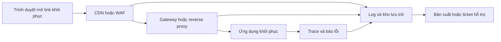

# Link leakage in logs — Rò rỉ liên kết khôi phục qua log

## 1. Vì sao một dòng log có thể trao quyền khôi phục tài khoản?

Trong luồng khôi phục tài khoản, liên kết gửi qua email có thể chứa token cho phép đặt lại mật khẩu hoặc tiếp tục một bước xác minh. Với thiết kế dựa trên bearer token, người nắm token hợp lệ có thể thực hiện quyền mà token đại diện. Vì vậy, URL chứa token là dữ liệu bí mật, kể cả khi nó có hình thức giống một địa chỉ web thông thường.

Ví dụ sau chỉ dùng giá trị giả, không phải token hoạt động:

```text
https://accounts.example.invalid/recovery/start?token=DEMO_SECRET_NOT_VALID
```

Nếu URL này xuất hiện nguyên vẹn trong access log, quyền đọc log có thể trở thành một đường lấy credential khôi phục. Người xem log không cần quyền truy cập cơ sở dữ liệu token hay hộp thư của người dùng. Họ chỉ cần đọc được bí mật trước khi nó hết hạn hoặc bị sử dụng.

Trong module khôi phục tài khoản, hậu quả phụ thuộc vào phạm vi của token: đặt lại mật khẩu, tiếp tục khôi phục MFA, hoặc cho phép đăng ký lại phương thức xác thực. Token xác minh email không nên tự động có quyền xóa MFA hay đăng ký passkey mới. Thiết kế log phải đi cùng việc giới hạn đúng quyền khôi phục.

## 2. Đường đi của URL và các bản sao ngoài dự kiến

Một request thường đi qua nhiều thành phần trước khi tới controller. Từng thành phần có thể tạo bản sao dữ liệu phục vụ vận hành.



Sơ đồ là một mô hình minh họa. Không phải hệ thống nào cũng lưu URL ở tất cả các điểm trên; rủi ro phát sinh tại nơi cấu hình thực sự thu thập dữ liệu đó.

| Điểm thu thập | Dữ liệu dễ mang token | Hướng xử lý trong thiết kế |
| --- | --- | --- |
| CDN, WAF, gateway | Request target, query string, bản ghi request bị chặn | Loại bí mật trước khi ghi hoặc xuất log |
| Reverse proxy | Request line, URI gốc, header | Chọn trường an toàn cho tuyến recovery |
| HTTP request logger | Query, body, cookie | Dùng danh sách trường được phép ghi |
| Controller và service | Tham số, DTO, đối tượng token | Chỉ ghi kết quả nghiệp vụ và ID nội bộ |
| APM và distributed tracing | URL đầy đủ, span attribute, baggage | Chuẩn hóa route, không đưa token vào telemetry |
| Error tracker | Exception, breadcrumb, request context | Loại dữ liệu nhạy cảm trước khi SDK gửi đi |
| Dịch vụ gửi email | Nội dung thư, payload, response chẩn đoán | Không ghi toàn bộ thư hoặc reset URL |
| Pipeline và kho log | Event thô, dead-letter message, bản sao lưu | Giới hạn thu thập và quyền truy cập từng bản sao |

Sửa logger trong Java không sửa được access log mà gateway đã tạo trước đó. Tương tự, một bộ lọc ở kho log trung tâm không bảo vệ bản log thô còn nằm trên máy chủ hoặc trong hàng đợi thu thập.

## 3. Những hình thức rò rỉ dễ bị bỏ sót

### Query string, path và nội dung request

Tên tham số không phải lúc nào cũng là `token`. Bí mật có thể nằm trong `code`, `recoveryKey`, một URL được lồng trong trường `redirect`, hoặc một đoạn path như `/recovery/DEMO_SECRET_NOT_VALID`.

Đổi token từ query sang path vẫn để bí mật trong request target. Đổi sang POST giảm sự xuất hiện trong URL nhưng body vẫn có thể bị ghi bởi middleware, WAF hoặc chế độ debug. Mỗi thay đổi phải xét dữ liệu thực tế mà từng thành phần thu thập.

Trong NGINX, `$request_uri` chứa URI gốc cùng arguments. Vì vậy, định dạng access log sử dụng biến này có thể lưu token trong query. Một path đã bỏ query cũng chỉ phù hợp khi chính path không chứa bí mật. [Tài liệu biến HTTP của NGINX](https://nginx.org/en/docs/http/ngx_http_core_module.html#variables).

### Exception và đối tượng được serialize

Các câu lệnh có vẻ phục vụ chẩn đoán vẫn có thể làm lộ token:

```text
Không an toàn:
  log("Recovery request: " + request)
  log("Invalid recovery URL: " + fullUrl)
  log("Email provider payload: " + messageBody)
  throw Error("Token expired: " + rawToken)
```

Một DTO có trường token có thể bị đưa vào log qua `toString()`, JSON serializer hoặc interceptor ghi tham số method. Log ở mức DEBUG vẫn là nơi lưu credential nếu nó chứa token thật; mức độ log không thay đổi tính nhạy cảm của dữ liệu.

### Header và URL được ghi ở request tiếp theo

Trang chứa token có thể tạo request tải ảnh, gọi API hoặc điều hướng. Tùy referrer policy và quan hệ origin, header `Referer` có thể mang URL nguồn rồi được máy nhận ghi log. Chính sách `no-referrer` yêu cầu bỏ header này; chính sách chỉ rút gọn URL khi khác origin vẫn có thể gửi URL đầy đủ cho request cùng origin. [Đặc tả Referrer Policy](https://www.w3.org/TR/referrer-policy/).

SDK phía trình duyệt cũng có thể đọc URL trực tiếp để tạo page-view hoặc breadcrumb. Chặn `Referer` không chặn việc SDK chủ động gửi `location.href`.

## 4. Thiết kế sự kiện phục vụ điều tra mà không chứa credential

Câu hỏi cần trả lời là: yêu cầu nào đã diễn ra, ở bước nào, có kết quả gì? Để trả lời, hệ thống thường không cần lưu chính bí mật đã được trình bày.

OWASP liệt kê access token, mật khẩu và session identifier trong nhóm dữ liệu cần tránh ghi trực tiếp vào log. Với liên kết recovery mang quyền truy cập, nguyên tắc này dẫn tới việc loại token và URL có token khỏi sự kiện vận hành. [OWASP Logging Cheat Sheet](https://cheatsheetseries.owasp.org/cheatsheets/Logging_Cheat_Sheet.html).

Ví dụ schema dưới đây là một lựa chọn thiết kế cho dịch vụ khôi phục tài khoản:

```json
{
  "event": "recovery_link_checked",
  "recovery_request_id": "f7ba3410-33c6-4a3c-8626-0378dac1790f",
  "route": "/recovery/start",
  "outcome": "EXPIRED",
  "trace_id": "server-generated-correlation-id"
}
```

`recovery_request_id` được sinh độc lập phía server và chỉ dùng đối chiếu nghiệp vụ. Nó không được API chấp nhận như token thay thế. `route` là tuyến đã biết, không phải URL người dùng gửi. `outcome` thuộc tập giá trị cố định như `ACCEPTED`, `INVALID`, `EXPIRED`, `REPLAYED`, không chứa mô tả lỗi do client tự cung cấp.

Việc ghi kết quả chi tiết vào log nội bộ không có nghĩa endpoint công khai phải trả cùng chi tiết. Phản hồi cho người dùng cần xét nguy cơ tiết lộ trạng thái tài khoản hoặc token.

### Ví dụ Java: giới hạn dữ liệu ngay tại giao diện audit

```java
import java.util.UUID;

public final class RecoveryAudit {
    private static final System.Logger LOGGER =
            System.getLogger(RecoveryAudit.class.getName());

    public enum Outcome {
        ACCEPTED, INVALID, EXPIRED, REPLAYED
    }

    private RecoveryAudit() {
    }

    public static void recordLinkCheck(
            UUID recoveryRequestId, Outcome outcome) {
        LOGGER.log(
                System.Logger.Level.INFO,
                "event=recovery_link_checked request_id={0} outcome={1}",
                recoveryRequestId,
                outcome);
    }
}
```

Giao diện này không nhận request, URL hay raw token nên người gọi không thể vô tình đưa các đối tượng đó vào chính sự kiện này. Đây chỉ là phần audit minh họa; việc xác minh token, rate limiting và quản lý session thuộc các thành phần riêng.

UUID truyền vào phải là ID nội bộ được tạo cho việc đối chiếu. Không parse token thành UUID rồi đặt tên lại là `recoveryRequestId`. Bất kỳ ID nào dùng được để tiếp tục khôi phục đều phải được xem xét như credential.

Khi token không hợp lệ và chưa ánh xạ được tới yêu cầu recovery, hệ thống có thể dùng một event ID độc lập thay vì ghi lại đầu vào để tìm kiếm sau. Với mã ngắn hoặc OTP, tránh ghi một hash đơn giản rồi coi là đã an toàn: không gian giá trị nhỏ có thể bị thử hết. ID đối chiếu độc lập thường đáp ứng nhu cầu điều tra mà không lưu dấu vết dẫn xuất từ bí mật.

## 5. Loại dữ liệu trước điểm lưu đầu tiên

Thiết kế theo danh sách trường được phép ghi giúp giới hạn sự lan truyền khi request có thêm tham số mới. Ví dụ, một sự kiện recovery chỉ cho phép thời gian, loại sự kiện, ID đối chiếu nội bộ, route cố định và outcome. Các trường còn lại không được tự động serialize vào event.

Với tuyến recovery chuyên dụng, có thể chọn bỏ toàn bộ query khỏi access log thay vì cố che một vài tên khóa. Nếu route có token trong path, cần ánh xạ sang tên tuyến cố định. Request không khớp route cũng cần một nhãn như `UNMATCHED_RECOVERY_ROUTE` thay vì mặc định ghi toàn bộ path đầu vào.

Một phương án cho gateway là ghi các trường đã chuẩn hóa như:

```text
method=GET
route=/recovery/start
status=200
duration_ms=18
request_id=server-generated-id
```

Đây là schema minh họa, không phải cấu hình hoàn chỉnh của một proxy. Không sao chép URI gốc vào một trường khác như `original_url` hoặc `debug_request` sau khi đã bỏ query khỏi trường chính.

Bộ lọc theo mẫu vẫn hữu ích như một lớp bổ sung, nhưng có giới hạn:

- Chỉ che `token=` sẽ bỏ sót tên khóa khác, path và JSON lồng nhau.
- Che một giá trị có thể bỏ sót query chứa khóa lặp lại.
- URL encoding hoặc một URL lồng trong payload có thể làm biểu diễn thay đổi.
- Cắt vài ký tự đầu hoặc cuối vẫn tiết lộ một phần bí mật và có thể không cần thiết.
- Che trên dashboard chỉ thay đổi cách hiển thị nếu bản thô bên dưới còn nguyên.

Nếu một đường xử lý dữ liệu recovery không phân tích được đầu vào, lựa chọn an toàn cho log là bỏ trường nhạy cảm đó và giữ mã lỗi phân loại. Không dùng toàn bộ dữ liệu thô làm phương án ghi log dự phòng.

## 6. Giảm thời gian URL mang quyền xuất hiện trong trình duyệt

Trang recovery nên hạn chế script theo dõi, widget hỗ trợ và tài nguyên bên thứ ba. Các response liên quan có thể dùng:

```http
Referrer-Policy: no-referrer
Cache-Control: no-store
```

`no-store` điều khiển việc lưu trong HTTP cache; nó không yêu cầu access logger ngừng ghi request. `no-referrer` kiểm soát thông tin nguồn trong request tiếp theo; nó không xóa URL khỏi request ban đầu đã tới gateway.

Một thiết kế có thể đổi token lấy một phiên recovery có quyền hạn hẹp, rồi chuyển người dùng tới URL sạch. Tuy nhiên, credential của phiên thay thế cũng phải bị loại khỏi log, bao gồm cookie và header. Quyền của phiên chỉ bao phủ bước recovery đã được xác minh, không tự trở thành phiên đăng nhập đầy đủ.

Không đặt lại mật khẩu, xóa MFA hay đăng ký passkey chỉ vì một GET tới link. Bộ quét email có thể mở liên kết trước người dùng; quá trình mở trang phải được phân biệt với hành động xác nhận có chủ đích. Thiết kế đổi token và tiêu thụ token cần xét riêng trường hợp này.

Redirect hoặc xóa query bằng JavaScript giúp giảm sự xuất hiện về sau nhưng không thu hồi bản log đã tạo. Chúng bổ sung cho chính sách thu thập dữ liệu ở hạ tầng.

## 7. Token hết hạn và dùng một lần giới hạn thiệt hại đến đâu?

OWASP khuyến nghị token reset có tính ngẫu nhiên phù hợp, thời hạn giới hạn và bị vô hiệu sau sử dụng. Các thuộc tính này giảm cửa sổ lợi dụng khi token lộ. [OWASP Forgot Password Cheat Sheet](https://cheatsheetseries.owasp.org/cheatsheets/Forgot_Password_Cheat_Sheet.html).

Chúng không ngăn người đọc log tranh sử dụng token trước chủ tài khoản. Điều kiện “chỉ dùng một lần” cần được thực thi nguyên tử: hai request đồng thời không được cùng vượt qua bước kiểm tra rồi cùng tạo quyền recovery.

Token hết hạn cũng không đồng nghĩa sự cố log đã kết thúc. Nếu token đã được đổi sang một phiên recovery còn hiệu lực, chỉ thu hồi token có thể không thu hồi phiên đó. Nếu việc khôi phục đã hoàn thành, cần xem xét mật khẩu, phương thức xác thực và session đã được tạo hoặc thay đổi trong khoảng thời gian liên quan.

## 8. Tình huống: ứng dụng đã che token nhưng hệ thống vẫn bị lộ

Giả sử nhóm phát triển chỉ ghi `recovery_request_id` trong service Java. Tuy nhiên, gateway vẫn ghi URI đầy đủ và agent quan sát vẫn gửi URL gốc lên trace. Một ticket hỗ trợ sau đó đính kèm bản xuất log chứa liên kết recovery.

Trong tình huống giả định này, sửa service không xử lý nguồn rò rỉ. Thiết kế cần có một hợp đồng dữ liệu thống nhất cho gateway, APM và công cụ hỗ trợ: mỗi bên nhận trường nào, loại trường nào trước khi lưu, dữ liệu nằm ở đâu và ai được đọc.

Khi phát hiện token đã vào log, trình tự xử lý có thể gồm:

1. Chặn việc thu thập mới tại các điểm tạo bản ghi, kể cả chế độ debug và trace.
2. Xác định khoảng thời gian, nguồn log, bản sao và phạm vi yêu cầu recovery bị ảnh hưởng bằng ID nội bộ.
3. Vô hiệu token còn hiệu lực và các phiên recovery có liên quan theo khả năng ánh xạ của hệ thống.
4. Xem xét hành động recovery và session phát sinh để quyết định biện pháp khôi phục tài khoản phù hợp.
5. Hạn chế quyền đọc, xuất và chia sẻ các bản ghi đã chứa bí mật; xử lý bản sao theo quy trình ứng phó và lưu giữ chứng cứ.

Không dán token thật vào ticket để chứng minh sự cố. Bằng chứng dùng ID sự kiện, thời gian và mẫu đã che. Việc xóa mọi log ngay lập tức có thể làm mất chứng cứ, còn chỉ che dashboard có thể để nguyên credential trong kho lưu trữ.

## 9. Các quyết định cần hiểu đúng

| Nhận định | Giới hạn thực tế |
| --- | --- |
| HTTPS đã bảo vệ link | Thành phần kết thúc TLS vẫn thấy request và có thể ghi log |
| Log chỉ có nhân viên nội bộ đọc | Quyền đọc phục vụ vận hành vẫn có thể tiếp cận credential |
| Chỉ giữ log một ngày | Token còn hiệu lực trong một phần ngày đó vẫn có thể bị lợi dụng |
| Đã bỏ query | Token có thể nằm ở path, body, header hoặc URL lồng |
| Chỉ lấy mẫu một phần request | Sampling giảm số lượng bản ghi, không làm từng bản ghi an toàn |
| Đã mã hóa kho log | Người được quyền giải mã hoặc truy vấn vẫn có thể đọc token |
| Đã thu hồi token gốc | Phiên recovery hoặc session phát sinh có thể cần xử lý riêng |

Mục tiêu của thiết kế là giữ đủ sự kiện để giải thích một lần khôi phục tài khoản, đồng thời ngăn credential đi vào hệ thống quan sát. ID đối chiếu độc lập, route đã chuẩn hóa và kết quả phân loại giúp đạt mục tiêu đó mà không lưu liên kết có thể dùng lại.
