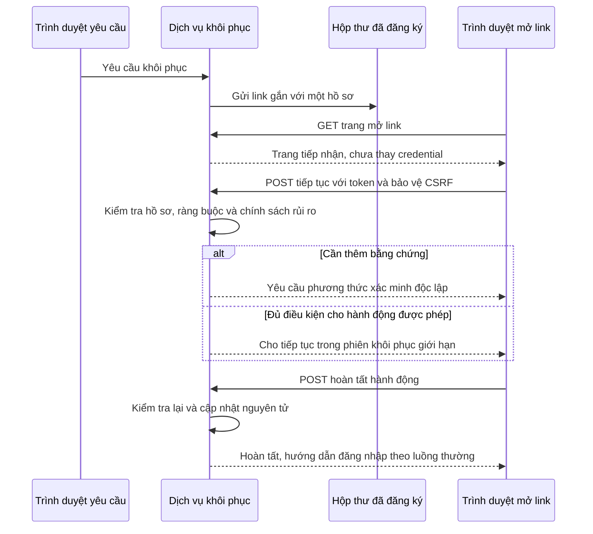

# Link forwarding behavior — Hành vi khi chuyển tiếp liên kết khôi phục

## 1. Chuyển tiếp link có thể chuyển tiếp cả quyền khôi phục

Trong luồng khôi phục tài khoản, **link forwarding behavior** là cách hệ thống xử lý khi liên kết gửi cho một người được mở bởi người khác hoặc trong một ngữ cảnh khác. Điều này xảy ra khi người dùng chuyển tiếp email cho đồng nghiệp, dán URL vào cuộc trò chuyện, gửi ảnh chụp có mã QR, hoặc nhờ bộ phận hỗ trợ mở link.

Giả sử hệ thống gửi cho Lan:

```text
https://accounts.example.com/recovery/open?token=<secret>
```

Lan chuyển nguyên email cho Minh. Nếu máy chủ chỉ kiểm tra token, Minh có thể được cấp đúng quyền khôi phục mà Lan được cấp. Máy chủ nhìn thấy một bí mật hợp lệ; nó không tự biết ai đã nhận email đầu tiên hay vì sao URL xuất hiện trên trình duyệt hiện tại.

Khái niệm bearer token mô tả loại token mà người giữ token có thể sử dụng mà không phải chứng minh sở hữu một khóa mật mã riêng. Đây là định nghĩa trong [RFC 6750, mục 1.2](https://www.rfc-editor.org/rfc/rfc6750.html#section-1.2). RFC này nói về OAuth; bài học áp dụng **phép suy luận tương tự** cho link khôi phục nếu việc giữ bí mật trong URL là bằng chứng duy nhất được yêu cầu.

Có ba tình huống cần phân biệt:

| Tình huống | Điều gì thực sự thay đổi? | Câu hỏi thiết kế |
| --- | --- | --- |
| Chuyển tiếp email hoặc sao chép URL cho người khác | Bí mật khôi phục có thêm người biết | Người nhận bản sao có đủ quyền để hoàn tất hay còn thiếu bằng chứng độc lập? |
| Chính chủ mở link trên điện thoại thay vì máy tính | Ngữ cảnh trình duyệt thay đổi | Luồng có hỗ trợ chuyển thiết bị một cách rõ ràng không? |
| Gateway email hoặc trình xem trước truy cập URL | Có lượt truy cập trước người dùng | Lượt đọc có làm mất token hoặc thay đổi tài khoản không? |

HTTP redirect là một cơ chế khác: máy chủ trả về một địa chỉ để trình duyệt điều hướng. Redirect có thể nằm trên đường đi của link, nhưng không giải quyết được việc một người đã sao chép bí mật.

## 2. Những bảo vệ thường bị hiểu quá mức

Token ngẫu nhiên, thời hạn ngắn và dùng một lần giúp giới hạn việc đoán hoặc tái sử dụng. Chúng không xác định người đang cầm token.

Ví dụ, một token chỉ được dùng một lần vẫn có thể bị Minh dùng trước Lan. Tính chất dùng một lần khi đó ngăn Lan dùng lại; nó không bảo đảm người đầu tiên là chính chủ.

Tương tự:

- HTTPS bảo vệ đường truyền đến endpoint, nhưng người nhận vẫn có thể chủ động chia sẻ URL.
- Chữ ký của token giúp kiểm tra tính toàn vẹn, nhưng một bản sao nguyên vẹn vẫn có chữ ký hợp lệ.
- Trường `accountId` ràng buộc token với tài khoản cần phục hồi, nhưng không chứng minh danh tính người mở link.
- Địa chỉ email ghi trong token xác định đích phát hành; việc đối chiếu lại cùng địa chỉ đó không bổ sung bí mật mới.
- Nút “Tiếp tục” thể hiện một thao tác, nhưng người được chuyển tiếp link cũng có thể bấm nút.

Vì vậy cần mô tả bảo đảm thật chính xác: **link hợp lệ chứng minh người gửi yêu cầu hiện tại đang có link**, trừ khi hệ thống còn yêu cầu một bằng chứng khác.

## 3. Xác định quyền mà link thực sự cấp

Trước khi chọn giải pháp chống chuyển tiếp, hãy quyết định link được phép làm gì. Một liên kết mở hồ sơ khôi phục có rủi ro khác với liên kết được phép xóa MFA hoặc đăng ký passkey mới.

Bảng dưới là chính sách minh họa cho một sản phẩm giả định; không phải yêu cầu chung cho mọi hệ thống.

| Thao tác | Vai trò của link email | Điều kiện bổ sung trong ví dụ |
| --- | --- | --- |
| Xem hướng dẫn tiếp tục khôi phục | Mở trang tiếp nhận | Không thay đổi credential |
| Đặt lại mật khẩu của tài khoản thông thường | Một bằng chứng trong hồ sơ khôi phục | Áp dụng chính sách rủi ro đã công bố; giữ yêu cầu MFA khi đăng nhập |
| Thay email khôi phục hoặc vô hiệu hóa MFA | Mở yêu cầu cần xác minh thêm | Mã khôi phục đã cấp trước hoặc phương thức xác minh độc lập phù hợp |
| Đăng ký passkey thay thế khi đã mất mọi thiết bị | Liên kết với hồ sơ đang xử lý | Hoàn tất quy trình phục hồi danh tính, không suy quyền từ email đơn lẻ |
| Khôi phục tài khoản quản trị | Khởi tạo hồ sơ giới hạn | Bằng chứng mạnh hơn và quy trình phê duyệt riêng của tổ chức |

Việc cho phép email đơn lẻ đặt lại mật khẩu là một quyết định về mức bảo đảm. Nếu lựa chọn này được chấp nhận, tài liệu vận hành phải thừa nhận rằng người có bản sao link có thể sử dụng quyền đó khi chưa có kiểm soát bổ sung.

Với MFA, lựa chọn cơ chế phục hồi phụ thuộc mô hình đe dọa và cách người dùng mất yếu tố xác thực. [OWASP Multifactor Authentication Cheat Sheet](https://cheatsheetseries.owasp.org/cheatsheets/Multifactor_Authentication_Cheat_Sheet.html#resetting-mfa) thảo luận các phương án phục hồi và sự đánh đổi giữa chúng. Từ đó, bài học đề xuất tách quyền đặt lại mật khẩu khỏi quyền thay thế yếu tố xác thực.

## 4. Một luồng tham khảo chịu được việc mở link ngoài dự kiến

Thiết kế dưới đây là **ví dụ do bài học đề xuất**, gồm hai pha: tiếp nhận link và hoàn tất hành động. Mục tiêu là không để một lượt mở URL tự động biến thành thay đổi credential.



Ở ví dụ này:

1. Hồ sơ khôi phục có định danh nội bộ, tài khoản đích và loại hành động cố định.
2. `GET` và `HEAD` không đặt lại mật khẩu, không xóa MFA, không đánh dấu token đã dùng.
3. Khi người dùng chủ động tiếp tục, máy chủ tạo ngữ cảnh khôi phục ngắn hạn nếu các điều kiện cho phép.
4. Phiên khôi phục chỉ được gọi các endpoint của hành động đã cấp. Nó không phải phiên đăng nhập thông thường.
5. Ở bước hoàn tất, máy chủ kiểm tra lại token, thời hạn và mọi bằng chứng yêu cầu, rồi xử lý dùng một lần cùng thay đổi credential.

Việc giữ thao tác đọc không gây ra hành động nghiệp vụ nhạy cảm phù hợp ngữ nghĩa safe methods của [RFC 9110, mục 9.2.1](https://www.rfc-editor.org/rfc/rfc9110.html#section-9.2.1). Áp dụng ở đây giúp lượt truy cập tự động không làm mất quyền khôi phục. Tuy nhiên, POST hay nút xác nhận cũng không chứng minh người thao tác là chính chủ; không dựa riêng vào chúng để chống người nhận link chuyển tiếp.

## 5. Ràng buộc link với ngữ cảnh: chọn điều gì có giá trị

### Ràng buộc với trình duyệt đã yêu cầu

Một cách triển khai là lưu bí mật ngẫu nhiên trong cookie của trình duyệt khởi tạo, đồng thời lưu giá trị đối chiếu trong hồ sơ. Khi tiếp tục, máy chủ yêu cầu cả token email lẫn bằng chứng ngữ cảnh này.

Cookie phải được máy chủ kiểm tra. Thêm một `requestId` công khai vào URL mà không có bí mật ngữ cảnh không tạo ra ràng buộc chống sao chép.

Cách này có thể ngăn Minh sử dụng **chỉ bản sao URL** trên trình duyệt của Minh. Tuy nhiên nó có giới hạn quan trọng:

- Nếu Minh tự khởi tạo yêu cầu cho tài khoản của Lan, Minh có thể đã giữ cookie khởi tạo. Nếu Lan tiếp tục chuyển link cho Minh, hai điều kiện lại cùng hội tụ.
- Kẻ lấy được cả token lẫn bí mật trình duyệt có thể vượt qua ràng buộc này.
- Người dùng thật mở mail bằng một trình duyệt khác cũng có thể thiếu cookie cần thiết.

Vì vậy ràng buộc trình duyệt là kiểm soát tính liên tục của yêu cầu, không phải kết luận chắc chắn về danh tính.

### Ràng buộc với thiết bị hoặc authenticator đã đăng ký

Một thiết bị tin cậy còn hoạt động có thể cung cấp bằng chứng độc lập, chẳng hạn xác nhận bằng credential đã gắn với tài khoản. Nhưng khi người dùng mất chính thiết bị đó, không thể yêu cầu nó như điều kiện duy nhất cho mọi luồng phục hồi.

Phải có nhánh phục hồi được thiết kế trước. Không tự bỏ toàn bộ điều kiện chỉ vì yêu cầu đến từ trình duyệt mới.

### Dùng IP và User-Agent làm tín hiệu phụ

IP và User-Agent hữu ích để phát hiện thay đổi ngữ cảnh, nhưng không phải bí mật sở hữu tài khoản. Người dùng có thể chuyển mạng; nhiều người có thể dùng chung IP; chuỗi User-Agent cũng không xác thực được người gửi.

Nếu chính sách dùng các tín hiệu này, nên thể hiện kết quả thành “cần thêm xác minh” hoặc nhánh phù hợp khác. Tránh tuyên bố “cùng IP thì không thể là link được chuyển tiếp”.

## 6. Hỗ trợ chính chủ chuyển thiết bị

Giả sử Lan bắt đầu trên máy tính nhưng đọc email trên điện thoại. Chính sách bắt buộc cookie máy tính ở mọi bước sẽ khiến Lan bị chặn dù không chia sẻ link cho ai.

Một nhánh chuyển thiết bị có thể được thiết kế như sau:

1. Điện thoại chỉ mở trang giải thích rằng yêu cầu đã bắt đầu trong ngữ cảnh khác.
2. Hệ thống cho biết cần quay lại trình duyệt khởi tạo, hoặc chọn một phương thức phục hồi khác đã được chấp nhận.
3. Nếu hỗ trợ chuyển giao sang điện thoại, việc chuyển giao phải gắn với đúng hồ sơ và mức bằng chứng yêu cầu.
4. Ngữ cảnh cũ chỉ bị thay thế khi chuyển giao thành công theo chính sách; một lượt mở link đơn thuần không chiếm quyền ngữ cảnh đang có.
5. Hồ sơ hết hạn không được sống lại chỉ vì thiết bị mới mở URL.

Mã ghép nối hiển thị trên màn hình có thể hỗ trợ trải nghiệm chuyển thiết bị, nhưng bản thân mã đó cũng có thể bị chuyển tiếp. Một màn hình hiển thị mã khớp nhau chưa đủ để chứng minh chủ tài khoản đã chấp thuận.

Điểm cần diễn đạt cho người dùng là bước tiếp theo có thể thực hiện được. Ví dụ:

> Yêu cầu này được bắt đầu trên một trình duyệt khác. Hãy quay lại trình duyệt đó để tiếp tục, hoặc chọn một phương thức khôi phục khác.

Không cung cấp nút “Bỏ qua bảo vệ thiết bị” nếu phía sau nút đó chỉ còn cùng link đã bị chuyển tiếp.

## 7. Chống tranh chấp sử dụng: token một lần phải được xử lý nguyên tử

Nếu Lan và Minh đều có link, hai yêu cầu hoàn tất có thể đến gần như cùng lúc. Mẫu “đọc chưa dùng, đổi credential, sau đó đánh dấu đã dùng” có thể cho phép cả hai vượt qua bước đọc.

Một bản ghi tham khảo:

```text
RecoveryChallenge
  id
  account_id
  purpose
  token_hash
  expires_at
  used_at
  revoked_at
  required_evidence_policy
```

Các giá trị `account_id` và `purpose` được xác định ở máy chủ. Không lấy tài khoản đích từ form rồi tin rằng một token bất kỳ được quyền tác động đến tài khoản đó.

Ví dụ mã giả cho thiết kế giữ token chưa dùng đến bước hoàn tất:

```text
completeRecovery(rawToken, recoveryContext, submittedChange):
    requireValidCsrfAndRequestContext()
    requireRateLimitWithinPolicy()

    begin transaction
        challenge = findByTokenHashForUpdate(hash(rawToken))
        require challenge exists
        require challenge.used_at is null
        require challenge.revoked_at is null
        require serverNow() < challenge.expires_at
        require recoveryContext.challenge_id == challenge.id
        require recoveryContext.account_id == challenge.account_id
        require recoveryContext.purpose == challenge.purpose
        require allowedChange(challenge.purpose, submittedChange)
        require evidenceSatisfies(challenge.required_evidence_policy)

        applyCredentialChange(challenge.account_id, submittedChange)
        markUsed(challenge.id)
        revokeOtherAffectedRecoveryGrants(challenge.account_id)
        applySessionRevocationPolicy(challenge.account_id)
        enqueueSecurityNotification(challenge.account_id)
    commit transaction
```

Đây là mã giả, không phải chương trình hoàn chỉnh. Ví dụ giả định các thay đổi cốt lõi có thể thực hiện trong cùng ranh giới giao dịch. Nếu credential hoặc session nằm ở dịch vụ khác, cần cơ chế phối hợp và chặn quyền sử dụng trong khoảng chuyển tiếp; không coi một lời gọi bất đồng bộ là thu hồi đã hoàn tất.

Thông báo được đưa vào hàng đợi bền vững trong giao dịch, rồi gửi sau commit. Không gửi email thành công trước khi thay đổi tài khoản thực sự được xác nhận.

Một thiết kế khác có thể tiêu thụ token khi đổi sang recovery grant. Khi đó grant thay thế phải tiếp tục có phạm vi, thời hạn và cơ chế chống dùng lại riêng. Không được tiêu thụ link rồi tạo ra một grant có thể sao chép và sử dụng vô hạn.

## 8. Giảm khả năng URL đi qua nơi không cần biết bí mật

Chuyển tiếp có thể do con người chủ động, nhưng cũng có thể xảy ra qua cách tích hợp sản phẩm. Ví dụ, người dùng dán link vào ticket và hệ thống hỗ trợ ghi nguyên URL vào lịch sử lâu dài.

Trong thiết kế tham khảo:

- Email bảo mật không bọc link qua dịch vụ theo dõi lượt bấm quảng cáo.
- Trang khôi phục không gửi URL chứa token vào analytics, error tracking hoặc công cụ chat hỗ trợ.
- Bộ lọc log ở ingress và ứng dụng che tham số bí mật trước khi ghi.
- Token không xuất hiện trong thông báo lỗi, tên sự kiện hoặc nội dung thông báo cho hỗ trợ.
- Endpoint tiếp tục điều hướng đến đích cố định trong ứng dụng, không chuyển token sang URL bên ngoài từ tham số người dùng.
- Trang nhạy cảm trả `Cache-Control: no-store`; không coi header này là khả năng xóa mọi bản sao đã được tạo.

Với referrer, chính sách `Referrer-Policy: no-referrer` yêu cầu trình duyệt không gửi thông tin referrer từ tài liệu đó. Cơ chế này được mô tả trong [W3C Referrer Policy](https://www.w3.org/TR/referrer-policy/#referrer-policy-no-referrer). Nó không ngăn người dùng sao chép thanh địa chỉ và không che URL khỏi máy chủ đã nhận request ban đầu.

Sau khi thiết lập ngữ cảnh khôi phục, có thể chuyển đến URL sạch và chỉ giữ bí mật cần thiết trong ngữ cảnh phía máy chủ. Việc làm sạch URL giảm các lần lộ tiếp theo; nó không thu hồi bản URL người khác đã có.

## 9. Liên hệ với mất MFA, passkey và session

Trong module khôi phục tài khoản, link có thể là điểm vào cho nhiều tình huống mất quyền truy cập. Phải giữ riêng các quyền sau:

```text
Được mở hồ sơ khôi phục
    không tự suy ra
Được thay mật khẩu
    không tự suy ra
Được vô hiệu hóa MFA hoặc đăng ký passkey thay thế
    không tự suy ra
Được truy cập dữ liệu tài khoản
```

Ví dụ, link thuộc hồ sơ `RESET_PASSWORD` không được dùng tại endpoint `REPLACE_AUTHENTICATOR`. Đổi tên endpoint hoặc truyền một `action` khác từ phía trình duyệt không được thay đổi mục đích đã cấp.

Khi người dùng phục hồi thành công, cần xử lý cả phiên khôi phục và các phiên đăng nhập chịu ảnh hưởng. Nếu hệ thống kết luận tài khoản có thể đã bị chiếm đoạt, việc chỉ thay mật khẩu có thể để lại những đường truy cập khác.

OWASP khuyến nghị token khôi phục có thời hạn, dùng một lần, và sau khi đặt lại mật khẩu nên đăng nhập theo cơ chế thông thường thay vì tự động đăng nhập. Tài liệu cũng nêu lựa chọn vô hiệu hóa các phiên hiện có. Xem [Forgot Password Cheat Sheet](https://cheatsheetseries.owasp.org/cheatsheets/Forgot_Password_Cheat_Sheet.html#user-resets-password).

Trong ví dụ này, thông báo hoàn tất được gửi đến kênh đã được xác lập theo chính sách. Thông báo chỉ nêu loại thay đổi và cách phản hồi nếu không phải người dùng thực hiện; không đính kèm token hoặc link có quyền phục hồi tương đương.

## 10. Xử lý khi người dùng báo đã chuyển tiếp link

Giả sử Lan cho biết đã gửi URL vào một nhóm chat. Xóa tin nhắn khỏi nhóm không chứng minh tất cả người nhận đã xóa bản sao.

Cách xử lý tham khảo là:

1. Thu hồi challenge bị lộ và các recovery grant được tạo từ challenge đó.
2. Nếu hành động chưa hoàn tất, bắt đầu lại theo chính sách, với bí mật mới và bằng chứng cần thiết.
3. Nếu credential đã thay đổi, coi đây là một tình huống nghi ngờ chiếm đoạt cần phục hồi quyền kiểm soát rộng hơn.
4. Xem xét các session, authenticator và thông tin khôi phục đã bị thay đổi trong khoảng liên quan.
5. Lưu dấu vết bằng định danh hồ sơ nội bộ; không thu thập token thô làm “bằng chứng”.

Thu hồi một challenge không đồng nghĩa khóa toàn bộ tài khoản. Tránh biến khả năng gửi yêu cầu khôi phục hoặc mở một link bất thường thành công cụ gây từ chối dịch vụ cho chính chủ.

Bộ phận hỗ trợ có thể yêu cầu mã hồ sơ không bí mật để tra cứu. Nếu quy trình hỗ trợ yêu cầu người dùng gửi nguyên link khôi phục, chính quy trình đó đang tạo thêm người giữ quyền.

## 11. Ba tình huống để áp dụng cách suy luận

### Lan chuyển email cho đồng nghiệp để nhờ đọc hướng dẫn

Nếu link đủ để đặt lại mật khẩu, đồng nghiệp có thể sử dụng quyền đó. Việc email ban đầu gửi đúng địa chỉ Lan không làm bản sao mất hiệu lực.

Thiết kế phù hợp phải giới hạn quyền của link theo mức bảo đảm đã chọn, đồng thời cung cấp trang hướng dẫn không chứa bí mật để người dùng có thể chia sẻ khi cần trợ giúp.

### Lan mở link trên điện thoại và bị thiếu cookie khởi tạo

Đây có thể là thao tác hợp lệ. Sự khác biệt thiết bị chỉ cho biết ngữ cảnh không liên tục, chưa kết luận được hành vi gian lận.

Cần đưa Lan vào nhánh chuyển thiết bị hoặc phương thức phục hồi khác. Không âm thầm bỏ điều kiện ràng buộc, cũng không tiêu thụ token chỉ để trả về lỗi thiếu cookie.

### Người lạ dùng link trước chính chủ

Nếu không còn bằng chứng khác và chính sách cho phép link tự hoàn tất, tính chất dùng một lần không cứu được chính chủ. Nó chỉ xác định rằng quyền đã được sử dụng.

Kết luận thiết kế cần rút ra là: muốn người chỉ nhận bản sao không hoàn tất được, phải có điều kiện mà bản sao đó không mang theo. Điều kiện ấy có thể là bằng chứng độc lập phù hợp, hoặc ràng buộc với ngữ cảnh đã được xác minh; sức mạnh và giới hạn của từng điều kiện phải được mô tả rõ.
