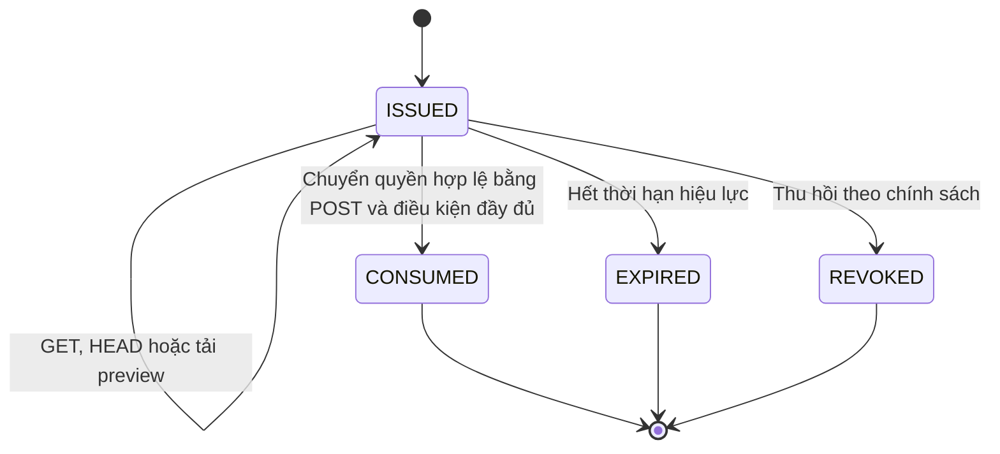
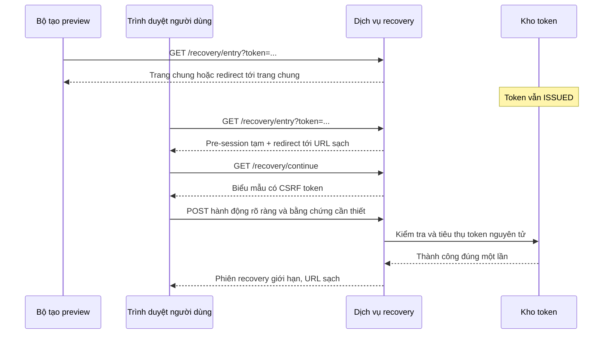

# Bảo vệ liên kết khôi phục trước tính năng xem trước (Link preview protection)

## 1. Một liên kết có thể được mở trước người nhận

Người dùng yêu cầu đặt lại mật khẩu và nhận được email chứa liên kết:

```text
https://accounts.example.test/recovery/entry?token=DEMO_TOKEN_NOT_VALID
```

Trước khi người dùng bấm vào liên kết, hệ thống bảo vệ email có thể phân tích URL. Nếu người dùng dán liên kết vào ứng dụng nhắn tin để hỏi bộ phận hỗ trợ, ứng dụng có thể truy cập trang để dựng thẻ xem trước. Trình duyệt hoặc ứng dụng đọc thư cũng có thể thực hiện tải trước theo cách triển khai riêng.

Đây là hoạt động bình thường trong môi trường phân phối liên kết. Slack mô tả cơ chế unfurl mặc định là truy cập liên kết được phát hiện trong tin nhắn để tạo preview. Microsoft mô tả Safe Links có khả năng quét, viết lại URL trong luồng email và kiểm tra URL tại thời điểm nhấp. Không nên suy ra mọi hệ thống thực hiện cùng một chuỗi request. [Nguồn: Slack — Unfurling links](https://docs.slack.dev/messaging/unfurling-links-in-messages/), [Microsoft — Safe Links](https://learn.microsoft.com/en-us/defender-office-365/safe-links-about).

Nếu backend coi lần truy cập đầu tiên là “người dùng đã xác nhận”, một bộ quét hợp lệ có thể:

- Tiêu thụ token một lần, khiến người nhận thấy liên kết đã được dùng.
- Chiếm phiên recovery đầu tiên nếu hệ thống gắn token với trình duyệt mở sớm nhất.
- Kích hoạt thay đổi nhạy cảm khi endpoint GET trực tiếp thực hiện hành động.
- Làm lộ email, trạng thái MFA hoặc thông tin tài khoản trong preview.

**Link preview protection** cần bảo vệ cả tính sẵn sàng của liên kết, bí mật của dữ liệu và ranh giới cấp quyền khôi phục. Mục tiêu không phải đoán chính xác mọi bot; hệ thống cần chịu được các lần mở tự động mà chưa coi đó là sự chấp thuận của chủ tài khoản.

## 2. Phân biệt xem tài liệu với thực hiện quyền khôi phục

Một recovery token có thể là bearer credential: bên sở hữu giá trị đó có thể thực hiện quyền mà token cấp, trừ khi còn yêu cầu bằng chứng khác. Khi một URL mang token được chuyển cho dịch vụ preview, dịch vụ đó đã nhìn thấy URL. Trả một trang “không có preview” không làm dịch vụ quên token.

Cần phân biệt hai mức đe dọa:

| Mức đe dọa | Ví dụ | Biện pháp trọng tâm |
| --- | --- | --- |
| Mở tự động thụ động | GET, HEAD, theo redirect, đọc metadata | Không tiêu thụ token hoặc thay đổi tài khoản bằng các request xem trang |
| Thực thi tự động sâu hoặc chủ động | Chạy JavaScript, giữ cookie, gửi form; bên giữ token cố ý thực hiện recovery | Không tự gửi hành động khi load; giới hạn quyền; yêu cầu bằng chứng phù hợp với mức rủi ro |

Một nút “Tiếp tục” giúp tách hoạt động tải trang khỏi thao tác gửi form. Nó không chứng minh người bấm là con người hoặc chủ tài khoản. CSRF token chứng minh mối liên hệ giữa request và phiên biểu mẫu theo thiết kế, không chứng minh danh tính.

Nếu cần chống bên đã biết token và có thể chủ động dùng token, phải bổ sung ràng buộc hoặc bằng chứng ngoài việc sở hữu liên kết. Ví dụ là xác nhận từ một yếu tố còn tin cậy, recovery code đã cấp trước hoặc quy trình xác minh danh tính theo chính sách. Mã khác gửi tới cùng hộp thư bị chiếm quyền không tạo ra một yếu tố độc lập.

## 3. Bất biến quan trọng: tải trang không được sử dụng quyền

Theo HTTP Semantics, các safe method có ngữ nghĩa chủ yếu là đọc; một client không yêu cầu thay đổi nghiệp vụ khi dùng chúng. Điều này cho phép các thành phần tự động truy xuất tài nguyên mà không kỳ vọng gây hành động có hại. [Nguồn: RFC 9110, mục 9.2.1](https://www.rfc-editor.org/rfc/rfc9110.html#section-9.2.1).

Đối với recovery, thiết kế cụ thể nên giữ các bất biến sau:

| Request hoặc hoạt động | Hành vi phù hợp | Hành vi cần tránh |
| --- | --- | --- |
| GET liên kết đầu vào | Trả trang chung hoặc chuẩn bị trạng thái tạm có giới hạn | Đánh dấu token đã dùng, đăng nhập, thay mật khẩu |
| HEAD liên kết | Trả header tương ứng, không có body | Chạy nhánh GET làm thay đổi quyền rồi chỉ bỏ body |
| Theo redirect | Tiếp tục tới trang an toàn cùng origin | Đi qua endpoint có hành động ngầm |
| Tải ảnh preview, favicon, stylesheet | Chỉ tải tài nguyên công khai tĩnh | Truyền token tới endpoint ảnh hoặc endpoint xác nhận |
| Gửi POST có chủ đích | Kiểm tra phiên, CSRF, token, mục đích, bằng chứng; thực hiện chuyển trạng thái hợp lệ | Coi riêng phương thức POST là đủ điều kiện cấp quyền |
| Mở lại liên kết chưa dùng | Vẫn có thể bắt đầu quy trình trong thời hạn hiệu lực | Từ chối chỉ vì một bộ quét đã đọc URL |

“Không thay đổi nghiệp vụ” không có nghĩa máy chủ không được ghi bất kỳ số đếm nào. Có thể ghi nhận một lượt truy cập đã giảm thiểu dữ liệu hoặc tạo pre-session ngắn hạn. Tuy nhiên, những hoạt động này không được làm mất quyền sử dụng token, khóa tài khoản, tiêu hao số lần nhập bằng chứng hoặc gửi thông báo thành công giả.

Các request tài nguyên phụ và handler lỗi cũng thuộc phạm vi này. Một trang GET an toàn ở controller vẫn có thể không an toàn nếu middleware, redirect handler hoặc service dùng chung tiêu thụ token.

## 4. Trạng thái token không phụ thuộc vào việc đã có người xem trang

Một mô hình đơn giản:



Không cần thêm trạng thái độc quyền `CLAIMED_BY_FIRST_VISITOR` chỉ để biểu diễn một lượt mở. Nếu dùng thông tin “đã xem” phục vụ vận hành, giữ nó tách khỏi trạng thái quyết định quyền và không coi nó là bằng chứng người dùng đã đọc email.

Một token có thể được **tiêu thụ khi đổi sang phiên recovery giới hạn**, sau một POST đủ điều kiện; việc đổi mật khẩu hoặc đăng ký lại yếu tố xác thực diễn ra ở bước sau. Khi đó:

- Token cũ không còn dùng được sau lần đổi quyền thành công.
- Phiên mới chỉ có quyền của giao dịch recovery tương ứng.
- Phiên mới có hạn dùng riêng và kiểm tra bằng chứng còn thiếu.
- Không tự tạo một session đăng nhập đầy đủ chỉ từ việc xem liên kết.

OWASP mô tả token khôi phục cần được sinh an toàn, gắn với người dùng, lưu an toàn và mất hiệu lực sau khi sử dụng; đồng thời nêu khả năng dùng restricted session cho luồng reset. Thời điểm nào được coi là sử dụng phải được thiết kế rõ trong giao dịch của ứng dụng. [Nguồn: OWASP Forgot Password Cheat Sheet](https://cheatsheetseries.owasp.org/cheatsheets/Forgot_Password_Cheat_Sheet.html#url-tokens).

## 5. Một luồng tiếp nhận chịu được preview thụ động

### 5.1. Tiếp nhận nhưng chưa cấp quyền

Một phương án là tách endpoint nhận URL khỏi endpoint xác nhận:



Đường đi của bộ preview và trình duyệt có thể giống nhau hoàn toàn ở tầng GET. Hệ thống không cần mở một nhánh cấp quyền đặc biệt cho User-Agent được cho là “người thật”.

Pre-session có thể chứa handle ngẫu nhiên trỏ tới dữ liệu tạm trên máy chủ, chẳng hạn digest dùng để tra token và bí mật CSRF. Nó chỉ hỗ trợ biểu mẫu, chưa chứng minh token hợp lệ và chưa cấp quyền đổi thông tin tài khoản.

Nếu một bộ quét cũng nhận được pre-session, điều đó không được làm token bị gắn độc quyền với bộ quét. Trình duyệt của người dùng vẫn tạo được trạng thái tạm riêng khi mở liên kết sau đó.

### 5.2. Làm sạch URL mà không làm mất quyền sử dụng

Endpoint đầu vào có thể chuyển bằng 303 tới một đường dẫn cùng origin, ví dụ `/recovery/continue`, sau khi lưu tham chiếu tạm cần thiết trên máy chủ. Không đưa token vào `Location`, tên cookie hoặc giá trị metadata.

Cookie handle cần các thuộc tính phù hợp như `Secure`, `HttpOnly` và `SameSite`, với hạn dùng ngắn. Chọn SameSite cần tính đến việc người dùng bắt đầu điều hướng từ email và chính sách CSRF của hệ thống; không đồng nhất “cookie tồn tại” với “đã xác minh chủ tài khoản”.

URL sạch giảm việc token tiếp tục xuất hiện trong điều hướng và tài nguyên phụ. Nó không xóa token đã nằm trong URL của email, hệ thống quét hoặc log của request đầu tiên. Các tầng CDN, proxy, tracing và access log vẫn cần loại dữ liệu bí mật trước khi lưu.

### 5.3. Không tự gửi hành động khi trang được tải

Những cách triển khai sau làm mất ý nghĩa của bước xác nhận:

```javascript
// Không dùng trên trang nhận liên kết recovery.
window.addEventListener("load", () => {
  document.querySelector("#continue-form").submit();
});
```

Tương tự, tránh `fetch` đổi token ngay khi component mount, prefetch API có tác dụng đổi quyền hoặc redirect qua URL “confirm” thực hiện hành động bằng GET.

Biểu mẫu cần mô tả rõ hành động tiếp theo, dùng nút gửi do người dùng chủ động chọn và không tự động thực hiện. Nếu chính sách đòi hỏi thêm bằng chứng, backend phải kiểm tra bằng chứng ấy trước khi cho phép chuyển quyền. JavaScript ở frontend không phải nơi quyết định cuối cùng.

## 6. Mã giả cho điểm chuyển quyền

Ví dụ dưới đây diễn tả trách nhiệm chính, không phải triển khai hoàn chỉnh cho một framework:

```text
GET /recovery/entry:
    giới hạn kích thước và kiểm tra định dạng token đầu vào
    tạo trạng thái biểu mẫu tạm có TTL và giới hạn tài nguyên
    lưu digest tra cứu, không ghi token vào log
    không sửa trạng thái token hoặc tài khoản
    trả cookie handle và redirect cùng origin tới /recovery/continue

HEAD /recovery/entry:
    trả header chung không chứa thông tin tài khoản
    không tạo quyền hoặc tiêu thụ token
    không cần tạo trạng thái biểu mẫu

POST /recovery/continue:
    nạp trạng thái tạm từ cookie handle
    kiểm tra CSRF và nguồn request theo chính sách
    kiểm tra hành động được gửi và bằng chứng bổ sung nếu bắt buộc

    bắt đầu transaction:
        tìm token bằng digest
        kiểm tra token tồn tại, đúng mục đích và đúng giao dịch
        kiểm tra token chưa hết hạn, chưa dùng, chưa bị thu hồi
        kiểm tra lại mọi điều kiện phụ thuộc trạng thái hiện tại

        cập nhật có điều kiện ISSUED -> CONSUMED
        yêu cầu đúng một bản ghi được cập nhật

        tạo phiên recovery giới hạn gắn với cùng giao dịch
        ghi kết quả đổi quyền để hỗ trợ retry đúng phiên

    commit
    trả cookie phiên recovery và redirect tới URL sạch
```

Tiêu thụ token và tạo phiên tiếp theo cần thuộc cùng ranh giới nhất quán. Nếu đánh dấu đã dùng trước rồi tạo session thất bại, người dùng có thể bị mắc kẹt. Nếu tạo session trước rồi tiêu thụ token ngoài transaction, hai request có thể nhận hai quyền tiếp tục.

Nếu phản hồi thành công bị mất, retry từ đúng pre-session có thể được thiết kế để khôi phục kết quả đã cấp. Không biến cơ chế retry thành quyền cho bất kỳ bên nào chỉ cần gửi lại token đã dùng. Việc xác định cùng phiên và bảo vệ dữ liệu retry là trách nhiệm của backend.

Với luồng đặt lại mật khẩu, có thể thiết kế tiêu thụ token trực tiếp trong POST đặt mật khẩu mới thay vì có POST đổi sang session riêng. Nguyên tắc vẫn giữ nguyên: GET không tiêu thụ, điều kiện được kiểm tra tại thời điểm hành động và chuyển trạng thái được thực hiện nguyên tử.

## 7. Preview chỉ được chứa thông tin chung

Đừng để template hoặc metadata biến một lượt GET thành kênh tiết lộ dữ liệu. Ví dụ trang chung:

```html
<!doctype html>
<html lang="vi">
<head>
  <meta charset="utf-8">
  <title>Khôi phục tài khoản</title>
  <meta name="description"
        content="Tiếp tục quy trình khôi phục trên trang chính thức.">
  <meta property="og:title" content="Khôi phục tài khoản">
  <meta property="og:description"
        content="Mở trang để tiếp tục quy trình khôi phục.">
</head>
<body>
  <p>Tiếp tục quy trình khôi phục tài khoản trên trang chính thức.</p>
</body>
</html>
```

Đây là ví dụ nội dung có thể công khai, không phải toàn bộ form. Những dữ liệu cần tránh trong title, description, Open Graph, Twitter Card, JSON-LD và nội dung preview gồm:

- Token hoặc URL đầy đủ chứa token.
- Email, tên người dùng và định danh tài khoản.
- Thông tin “tài khoản này chưa bật MFA” hoặc yếu tố nào đã bị mất.
- Thông báo xác nhận token hợp lệ kèm thông tin nhận diện.
- URL ảnh có query chứa bí mật hoặc định danh recovery.

Nếu dùng ảnh preview, chọn ảnh công khai tĩnh không mang tham số giao dịch. Không để `og:url`, canonical URL hoặc liên kết hỗ trợ tự sao chép URL đang có token.

Trả nội dung chung không ngăn được việc người dùng đã chia sẻ URL bí mật cho nền tảng nhắn tin. Nếu liên kết bị đưa vào nơi nhiều người truy cập, cần coi phạm vi giữ bí mật đã thay đổi và thu hồi theo đánh giá rủi ro, thay vì chỉ ẩn thẻ preview.

## 8. Header và chỉ dẫn crawler: vai trò và giới hạn

Các header minh họa cho một trang recovery tối giản:

```http
Cache-Control: no-store
Referrer-Policy: no-referrer
X-Robots-Tag: noindex, nofollow
Content-Security-Policy: default-src 'none'; script-src 'none'; style-src 'self'; img-src 'self'; form-action 'self'; base-uri 'none'; frame-ancestors 'none'
```

Chính sách cần phù hợp với tài nguyên thực tế và được áp dụng cho trang đầu vào, trang đích, redirect và các nhánh lỗi liên quan.

- `no-store` yêu cầu cache không lưu phản hồi; nó không thu hồi bản sao ở một hệ thống đã nhận URL.
- `no-referrer` giảm rò rỉ qua header nguồn giới thiệu; nó không lọc payload mà script tự gửi.
- `noindex, nofollow` thể hiện chỉ dẫn tới crawler có hỗ trợ; chúng không xác thực người nhận và không ngăn request đầu tiên.
- CSP giới hạn tài nguyên và khả năng thực thi theo cấu hình; nó không ngăn một client ngoài trình duyệt gọi trực tiếp endpoint.

`robots.txt` cũng không phải cơ chế kiểm soát truy cập. Google nêu rõ các trình thu thập khác nhau có thể xử lý khác nhau và không nên dùng robots.txt để giữ bí mật thông tin. Việc chặn crawl còn có thể ngăn crawler nhìn thấy chỉ dẫn noindex trên trang. [Nguồn: Google Search Central — Giới hạn của robots.txt](https://developers.google.com/search/docs/crawling-indexing/robots/intro).

Không yêu cầu tổ chức nhận email tắt bộ quét bảo mật chỉ để liên kết hoạt động. Luồng recovery nên tương thích với hoạt động quét thụ động bình thường.

## 9. Vì sao nhận diện bot không thể là ranh giới cấp quyền

Một số hệ thống cố tránh tiêu thụ token bằng cách kiểm tra:

```text
if User-Agent chứa "bot":
    chỉ hiển thị trang
else:
    sử dụng token ngay
```

Thiết kế này vẫn có lỗi ở nhánh còn lại. Bộ quét có thể dùng User-Agent giống trình duyệt; người dùng cũng có thể truy cập qua proxy hoặc trình duyệt nhúng. Kẻ có token tự chọn header của request.

Các dấu hiệu như User-Agent, IP, thời gian mở quá sớm, Fetch Metadata hoặc header gợi ý prefetch có thể hỗ trợ quan sát và đánh giá rủi ro. Chúng không thay thế bằng chứng cần thiết cho recovery, và không đảm bảo phát hiện mọi công cụ tự động.

Cũng không nên gắn token cứng với IP của request đầu tiên. Bộ quét có thể mở trước; người dùng có thể chuyển mạng hoặc thiết bị. Nếu ràng buộc giao dịch với một thiết bị đã được xác minh, dùng bằng chứng đã có từ thiết kế khởi tạo, không lấy “bên GET trước” làm thiết bị tin cậy.

## 10. Tính sẵn sàng, chống lạm dụng và trải nghiệm người nhận

Một liên kết có thể nhận nhiều GET hoặc HEAD trước lần gửi form thật. Vì vậy, cần tách giới hạn tài nguyên khỏi chính sách xác minh:

- Giới hạn kích thước request, tốc độ truy cập và số pre-session tạm để tránh làm đầy kho trạng thái.
- Không tính mỗi lượt GET vào số lần nhập sai recovery code hoặc bằng chứng danh tính.
- Không thu hồi token chỉ vì nhiều bộ quét cùng mở nó.
- Không gửi email “khôi phục thành công” hoặc thay đổi session đăng nhập từ một sự kiện xem trang.
- Dùng thời hạn token dựa trên rủi ro và thời gian nhận thư thực tế; không gia hạn vô hạn sau mỗi lượt preview.
- Cung cấp cách yêu cầu liên kết mới khi token thực sự hết hạn hoặc bị thu hồi, với phản hồi không làm lộ tài khoản.

Nếu chính sách cấp liên kết mới làm vô hiệu liên kết cũ, thông báo cho người dùng dùng thư mới nhất. Không diễn giải việc liên kết cũ hết hiệu lực thành bằng chứng preview đã tiêu thụ token khi nguyên nhân là chính sách thay thế.

Các thông báo sau khi xác thực thất bại nên đủ rõ để người nhận tiếp tục an toàn mà không tiết lộ dữ liệu tài khoản. Không in lại token trong trang lỗi, thông báo hỗ trợ hoặc URL chuyển hướng.

## 11. Ba tình huống để hiểu ranh giới thiết kế

### Bộ quét theo mọi redirect

Bộ quét mở URL, nhận cookie tạm rồi theo 303 tới trang chung. Nó có thể đọc HTML, ảnh và metadata. Token vẫn ở trạng thái ISSUED; không có session đăng nhập hoặc quyền thay yếu tố xác thực nào được cấp. Người dùng mở sau vẫn tiếp tục được.

### Hai người gửi form gần như đồng thời

Một người dùng và một bên khác cùng biết token gửi POST. Cơ chế cập nhật có điều kiện chỉ cho một lần đổi quyền thành công; bên còn lại nhận lỗi phù hợp. Điều này ngăn dùng lại, nhưng không bảo đảm người thắng là chủ tài khoản. Với recovery nhạy cảm, chính sách cần thêm bằng chứng trước khi cho phép hành động cuối cùng.

### Mất thiết bị MFA hoặc passkey

Preview của một liên kết bắt đầu recovery không được xóa yếu tố cũ, đăng ký passkey mới hoặc thu hồi session hiện tại. Ngay cả sau khi token email được chấp nhận, hệ thống vẫn giữ các bước xác minh, thời gian chờ hoặc phê duyệt mà mức rủi ro yêu cầu. Quyền nhận một email không tự mở rộng thành mọi quyền quản trị tài khoản.

Thiết kế tốt giữ việc đọc liên kết ở phía đọc tài liệu, giữ quyền thay đổi ở giao dịch có điều kiện rõ ràng và giữ thông tin tài khoản khỏi nội dung preview. Các đặc tính này tiếp tục cần được bảo toàn khi thay nhà cung cấp email, thêm ứng dụng nhắn tin hoặc đổi cách dựng frontend.
