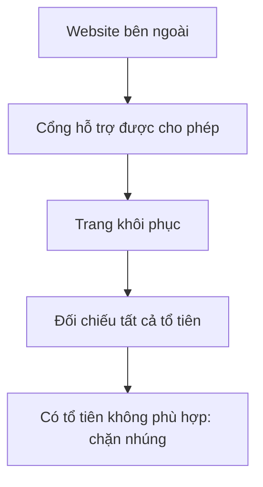

# Recovery page framing — Bảo vệ trang khôi phục khi bị nhúng

## 1. Framing làm thay đổi ngữ cảnh người dùng nhìn thấy

**Recovery page framing** là việc một trang khôi phục tài khoản được tải bên trong trang khác, thường qua `iframe`. Trang ngoài có thể thuộc cổng hỗ trợ hợp lệ, nhưng cũng có thể do kẻ tấn công kiểm soát.

Nguy cơ điển hình là **clickjacking**: giao diện bên ngoài khiến người dùng tưởng mình đang bấm một nút vô hại, trong khi thao tác thực tế tác động đến trang khôi phục nằm trong khung. Kẻ tấn công có thể che, dịch chuyển hoặc làm mờ khung để thay đổi cách người dùng hiểu hành động. Cơ chế đánh lừa thao tác qua các lớp giao diện được mô tả trong [RFC 7034, phần giới thiệu](https://www.rfc-editor.org/rfc/rfc7034.html#section-1).

Ví dụ giả định:

1. Lan đang có một phiên khôi phục giới hạn sau khi xác minh bằng phương thức hợp lệ.
2. Lan mở một website hứa “kiểm tra thiết bị đã sẵn sàng”.
3. Website đó nhúng trang xác nhận thay thế yếu tố xác thực của dịch vụ tài khoản.
4. Một nút trên website được bố trí trùng với nút xác nhận trong khung.
5. Nếu các điều kiện phía máy chủ vẫn được thỏa mãn, cú bấm của Lan có thể tiếp tục một hành động mà Lan không hiểu đúng.

Tình huống này **không giả định mọi trang khôi phục đều có thể bị tấn công như nhau**. Trang nhúng vẫn cần tải được, và hành động vẫn cần các bằng chứng mà máy chủ yêu cầu. Nếu endpoint đòi token bí mật chưa bị lộ, kẻ tấn công không tự có token chỉ nhờ tạo `iframe`.

Điểm cần bảo vệ là tính rõ ràng của thao tác: người dùng phải nhìn thấy và hiểu trang đang yêu cầu thay đổi quyền truy cập tài khoản.

## 2. Vì sao luồng khôi phục cần bảo vệ cả trước và sau xác minh

Khôi phục có thể bắt đầu khi người dùng chưa đăng nhập. Vì vậy, không thể chỉ áp dụng chính sách chống framing cho các trang nằm sau bộ lọc đăng nhập.

Trong một sản phẩm giả định, các màn hình sau cùng thuộc ranh giới cần bảo vệ:

| Màn hình | Nguy cơ khi xuất hiện trong ngữ cảnh gây hiểu nhầm |
| --- | --- |
| Nhập định danh để yêu cầu khôi phục | Bị dẫn dắt gửi yêu cầu lặp lại hoặc chọn nhầm tài khoản |
| Tiếp nhận link hoặc nhập mã phục hồi | Hiểu sai bên đang yêu cầu bằng chứng |
| Chọn phương thức xác minh còn dùng được | Chọn phương thức không đúng với ý định |
| Đặt lại mật khẩu | Thực hiện thay đổi credential trong giao diện bị điều khiển |
| Xác nhận thay thế MFA hoặc passkey | Chấp thuận thay đổi đường truy cập quan trọng |
| Hoàn tất, hết hạn hoặc thông báo lỗi | Bị dẫn dắt sang một bước tiếp theo không đáng tin |

Các tác động trong bảng là những điều cần xét khi thiết kế, không phải khẳng định rằng chỉ một cú bấm là đủ để vượt qua toàn bộ quy trình.

Đặc biệt, đặt lại mật khẩu, vô hiệu hóa MFA và đăng ký passkey mới phải là các quyền riêng theo chính sách khôi phục. Chặn framing hỗ trợ bảo vệ giao diện; nó không cấp hay thu hồi các quyền nghiệp vụ đó.

## 3. Chính sách mặc định cho trang không có nhu cầu nhúng

Với một luồng khôi phục có thể mở trực tiếp trong tab riêng, lựa chọn đơn giản là không cho bất kỳ trang nào nhúng tài liệu khôi phục.

Ví dụ phản hồi HTTP:

```http
HTTP/1.1 200 OK
Content-Type: text/html; charset=utf-8
Content-Security-Policy: frame-ancestors 'none'
X-Frame-Options: DENY

<!doctype html>
<html lang="vi">
  <head><title>Khôi phục tài khoản</title></head>
  <body>...</body>
</html>
```

`frame-ancestors 'none'` không cho tài liệu có trang tổ tiên chứa nó trong khung. `'self'` là lựa chọn khác khi cần cho phép nhúng từ cùng origin. Tham khảo ý nghĩa các giá trị trong [MDN: frame-ancestors](https://developer.mozilla.org/en-US/docs/Web/HTTP/Reference/Headers/Content-Security-Policy/frame-ancestors).

Đây là ví dụ về **phần cấu hình chống framing**, không phải toàn bộ chính sách CSP của ứng dụng. Nếu sản phẩm đang có các chỉ thị kiểm soát script, style hoặc kết nối, cần giữ chúng khi bổ sung chính sách này.

Header phải nằm trên **phản hồi của trang khôi phục**. Đặt một chính sách trên website bên ngoài rồi kỳ vọng website độc hại cũng làm theo không tạo ra bảo vệ cho tài liệu bên trong.

Chính sách này vẫn cho người dùng mở trang khôi phục trực tiếp ở cấp cao nhất của tab. Vì vậy, người dùng theo link email vào một tab riêng không bị chặn chỉ vì cấu hình không cho nhúng.

## 4. Phân biệt frame-ancestors với frame-src và default-src

Tên các chỉ thị gần giống nhau nhưng kiểm soát hai chiều khác nhau:

| Chỉ thị | Câu hỏi mà chỉ thị trả lời | Có trực tiếp xác định ai được nhúng trang khôi phục không? |
| --- | --- | --- |
| `frame-ancestors` | Trang nào được làm tổ tiên chứa tài liệu hiện tại? | Có |
| `frame-src` | Tài liệu hiện tại được tải khung con từ đâu? | Không |
| `default-src` | Nguồn mặc định cho các chỉ thị tải tài nguyên có fallback là gì? | Không thay thế `frame-ancestors` |

Ví dụ:

```http
Content-Security-Policy: frame-src 'none'
```

Cấu hình trên ngăn trang đang được bảo vệ tải khung con. Nó không tự cấm website khác đưa trang đó vào một khung. Chiều kiểm soát này được giải thích trong [MDN: frame-src](https://developer.mozilla.org/en-US/docs/Web/HTTP/Reference/Headers/Content-Security-Policy/frame-src).

Hai chi tiết triển khai dễ bỏ sót:

- `frame-ancestors` không nhận giá trị thay thế từ `default-src`.
- `frame-ancestors` đặt trong thẻ `meta` không có hiệu lực theo cơ chế CSP.

Do đó, `default-src 'none'` hoặc một thẻ `meta` có chữ “CSP” chưa chứng minh trang đã có chính sách chống framing. Hai quy tắc này được nêu tại [MDN: frame-ancestors](https://developer.mozilla.org/en-US/docs/Web/HTTP/Reference/Headers/Content-Security-Policy/frame-ancestors).

## 5. Vai trò của X-Frame-Options

`X-Frame-Options` là header chống framing được dùng cùng các chính sách tương thích phù hợp.

| Giá trị | Ý nghĩa thiết kế |
| --- | --- |
| `DENY` | Không cho tài liệu được nhúng |
| `SAMEORIGIN` | Giới hạn nhúng trong cùng origin |
| `ALLOW-FROM ...` | Cú pháp đã lỗi thời, không dùng làm cơ sở cho cấu hình mới |

Không đặt `X-Frame-Options` bằng thẻ `meta`, cũng không tạo danh sách origin bằng cách ghép các giá trị tùy ý vào header. Xem [MDN: X-Frame-Options](https://developer.mozilla.org/en-US/docs/Web/HTTP/Reference/Headers/X-Frame-Options).

Với ví dụ cấm nhúng, cặp cấu hình có cùng ý định:

```http
Content-Security-Policy: frame-ancestors 'none'
X-Frame-Options: DENY
```

Theo mô hình xử lý CSP hiện hành, một chính sách `frame-ancestors` ở chế độ thực thi có thể thay thế việc xử lý `X-Frame-Options`. Quan hệ này được quy định trong [CSP Level 3](https://www.w3.org/TR/CSP3/#frame-ancestors-and-frame-options).

Vì vậy, không nên thiết kế hai header cố tình trái nhau rồi dựa vào một giá trị được kỳ vọng sẽ “thắng” trên mọi trình duyệt. Ví dụ, cho đối tác bên ngoài nhúng bằng CSP nhưng đồng thời dùng `SAMEORIGIN` có thể tạo trải nghiệm khác nhau trên các môi trường chỉ hiểu một phần chính sách.

Nếu cần tương thích với một tập trình duyệt cụ thể, chính sách sản phẩm phải xác định rõ khả năng hỗ trợ cần có. Không suy khả năng tương thích hiện tại từ một bảng trình duyệt lịch sử.

## 6. Ngoại lệ nhúng phải tương ứng với ranh giới tin cậy

Một tổ chức có thể muốn đặt giao diện khôi phục trong cổng hỗ trợ nội bộ. Trước khi cho phép, cần làm rõ lợi ích đó có đủ để chấp nhận việc cổng hỗ trợ trở thành bên kiểm soát ngữ cảnh hiển thị hay không.

Ví dụ chỉ cho cùng origin:

```http
Content-Security-Policy: frame-ancestors 'self'
X-Frame-Options: SAMEORIGIN
```

Nếu trang ở `https://accounts.example.com`, origin này khác với `https://support.example.com`. Cùng một tên miền tổ chức không tự đồng nghĩa cùng origin.

Ví dụ CSP có ngoại lệ được chỉ rõ:

```http
Content-Security-Policy: frame-ancestors https://support.example.com
```

Đây là minh họa cú pháp, không phải đề xuất mở ngoại lệ cho mọi hệ thống. Trong thiết kế này, chủ sở hữu cổng hỗ trợ phải chịu trách nhiệm về nội dung có thể xuất hiện quanh khung, script bên thứ ba và khả năng một phần cổng bị chiếm quyền.

Với khung lồng nhau, mỗi tổ tiên phải phù hợp với chính sách. Một trang trung gian được cho phép không làm một tổ tiên không được phép trở thành hợp lệ. Cơ chế đối chiếu toàn bộ chuỗi tổ tiên được mô tả trong [MDN: frame-ancestors](https://developer.mozilla.org/en-US/docs/Web/HTTP/Reference/Headers/Content-Security-Policy/frame-ancestors).



Nếu không có nhu cầu nghiệp vụ rõ ràng, mở trang khôi phục trong tab riêng giúp giảm số bên tham gia ranh giới tin cậy. Tránh dùng wildcard rộng chỉ để giải quyết nhanh một lỗi tích hợp.

## 7. Chính sách phải đi cùng tài liệu thực sự được hiển thị

Một luồng thường có nhiều tuyến và nhiều thành phần trả HTML. Ví dụ:

```text
/recovery/start
/recovery/open
/recovery/verify
/recovery/new-password
/recovery/replace-authenticator
/recovery/complete
/recovery/error
```

Trong thiết kế tham khảo, mọi tài liệu nhạy cảm trong nhóm này nhận chính sách chống framing phù hợp, kể cả tài liệu trả về khi thiếu token hoặc hết phiên.

Cần phân biệt ba nơi:

1. Ứng dụng phát sinh HTML.
2. Reverse proxy hoặc CDN chuyển tiếp phản hồi.
3. Trình duyệt nhận phản hồi cuối cùng.

Khai báo đúng trong ứng dụng chưa đủ nếu một lớp phía sau loại bỏ header hoặc phục vụ một phiên bản HTML khác. Với trang lỗi do gateway tạo, middleware của ứng dụng có thể chưa từng chạy.

Redirect cũng không làm chính sách của một phản hồi trở thành cấu hình toàn cục cho mọi trang đích. Trang thực sự được hiển thị cần tự nhận chính sách của nó; không chỉ gắn header ở endpoint mở link rồi bỏ qua form cuối.

Nếu CSP đang được phát hành từ nhiều lớp, cần quản lý chúng như một cấu hình có chủ sở hữu. Việc có nhiều chính sách thực thi không phải cách để một lớp tùy ý nới quyền đã bị lớp khác cấm. CSP mô tả tác động phối hợp của nhiều chính sách trong [mục Effect of multiple policies](https://www.w3.org/TR/CSP3/#multiple-policies).

Phần này mô tả cách tổ chức triển khai của một sản phẩm; không yêu cầu thay đổi hạ tầng ngoài phạm vi bài học.

## 8. Chế độ báo cáo và JavaScript không thay thế chính sách thực thi

Hai header có mục đích khác nhau:

```http
Content-Security-Policy: frame-ancestors 'none'
```

```http
Content-Security-Policy-Report-Only: frame-ancestors 'none'
```

Header thứ hai không phải hàng rào chặn. Chế độ report-only dùng cho việc quan sát thay vì thực thi chính sách, theo [CSP Level 3, Policy Delivery](https://www.w3.org/TR/CSP3/#csp-report-only-header).

Nếu một luồng khôi phục cần bị cấm nhúng, không được coi việc chỉ phát hành cấu hình report-only là đã đạt yêu cầu đó. Việc tiếp nhận báo cáo còn phụ thuộc cách cấu hình cơ chế báo cáo và môi trường trình duyệt.

Một đoạn JavaScript kiểu “nếu đang trong iframe thì đổi `window.top.location`” cũng không nên là lớp bảo vệ chính. Nó phụ thuộc vào việc script chạy và điều kiện điều hướng tại thời điểm đó. OWASP phân tích các giới hạn của frame-breaking script trong [Clickjacking Defense Cheat Sheet](https://cheatsheetseries.owasp.org/cheatsheets/Clickjacking_Defense_Cheat_Sheet.html#best-for-now-legacy-browser-frame-breaking-script).

Có thể dùng thông báo ở giao diện để giải thích yêu cầu mở tab riêng khi phù hợp. Tuy nhiên, trải nghiệm giải thích không thay cho header do máy chủ cung cấp.

## 9. SameSite, CSRF và phân quyền bảo vệ các phần khác

Chống framing nên đứng cạnh những kiểm soát khác, với nhiệm vụ riêng.

| Kiểm soát | Nhiệm vụ trong luồng khôi phục |
| --- | --- |
| `frame-ancestors` | Giới hạn các ngữ cảnh được nhúng trang |
| Cookie `SameSite` | Điều khiển việc gửi cookie theo ngữ cảnh site |
| Bảo vệ CSRF | Kiểm tra tính hợp lệ của yêu cầu thay đổi trạng thái |
| Token khôi phục | Chứng minh việc giữ bí mật theo mục đích đã cấp |
| Phân quyền phía máy chủ | Giới hạn hành động mà hồ sơ hoặc phiên khôi phục được phép làm |
| Xác minh bổ sung | Đáp ứng mức bằng chứng cần thiết cho hành động nhạy cảm |

Cookie `SameSite` không phải chính sách cấm nhúng. Trang cùng site nhưng khác origin có thể vẫn là ngữ cảnh không được tin cậy. Ngoài ra, một bước dùng token URL có thể không phụ thuộc cookie đăng nhập thông thường. Xem giới hạn của SameSite trong [OWASP: Defending with SameSite Cookies](https://cheatsheetseries.owasp.org/cheatsheets/Clickjacking_Defense_Cheat_Sheet.html#defending-with-samesite-cookies).

Một CSRF token có mặt hợp lệ trong chính trang bị nhúng không tự bảo đảm người dùng hiểu mình đang bấm gì. Vì vậy, trong ví dụ của bài học, server vẫn cần CSRF và phân quyền, còn trình duyệt nhận chính sách chống framing để giảm khả năng giao diện thật bị đặt trong lớp trình bày gây nhầm lẫn.

Tương tự, không thể thay `frame-ancestors` bằng việc tắt CORS. Cấu hình cho phép đọc phản hồi từ script của origin khác và quyết định tài liệu có được hiển thị trong khung là hai vấn đề khác nhau.

## 10. Thiết kế trải nghiệm khi không cho nhúng

Giả sử cổng hỗ trợ trước đây hiển thị toàn bộ form khôi phục trong iframe. Khi chuyển sang chính sách không cho nhúng, thiết kế có thể đổi thành:

1. Cổng hỗ trợ chỉ hiển thị hướng dẫn và đường dẫn đến miền tài khoản chính thức.
2. Người dùng chủ động mở trang khôi phục trong tab riêng.
3. Mật khẩu mới, mã phục hồi và bằng chứng xác minh chỉ được nhập tại trang tài khoản.
4. Cổng hỗ trợ không yêu cầu người dùng gửi lại nguyên URL có token.
5. Khi hoàn tất, người dùng nhận thông báo phù hợp trong luồng khôi phục; cổng hỗ trợ không cần nhận bí mật để vẽ trạng thái.

Đây là phương án sản phẩm do bài học đề xuất. Nó giúp trang tài khoản trực tiếp trình bày tác động của hành động, chẳng hạn:

> Bạn đang thay thế phương thức xác thực của tài khoản này. Hãy tiếp tục nếu đây là yêu cầu của bạn.

Thông báo cần gắn với đúng hành động và mức bằng chứng của hồ sơ. Không dùng một nút xác nhận chung để ngầm cho phép cả đổi mật khẩu, gỡ MFA và đăng ký passkey mới.

Không tự tắt bảo vệ framing chỉ vì người dùng đang dùng trình duyệt trong ứng dụng email hoặc một webview. Trước hết cần phân biệt môi trường mở trang độc lập với trường hợp tài liệu thật sự đang bị nhúng.

## 11. Giới hạn cần hiểu đúng

Chính sách chống framing ngăn một kiểu sắp đặt tài liệu trong trình duyệt hỗ trợ chính sách. Nó không chứng minh website đang ở tab riêng là đáng tin và không sửa lỗi xác minh danh tính.

Các tình huống vẫn cần kiểm soát riêng gồm:

- Website giả mạo tự vẽ giao diện giống trang khôi phục.
- Token bị lộ rồi được dùng trực tiếp trong tab riêng.
- Script độc hại chạy được trong chính origin tài khoản.
- Endpoint phía máy chủ chấp nhận hành động vượt quá quyền của phiên khôi phục.
- Thủ thuật gây nhầm lẫn thao tác ở cửa sổ cấp cao nhất thay vì iframe.

Với luồng mất mật khẩu, MFA, passkey hoặc thiết bị xác thực, cách áp dụng nhất quán là để trang nhạy cảm có chính sách nhúng rõ ràng, đồng thời giữ nguyên các yêu cầu về bằng chứng, token, giới hạn quyền và session. Giao diện giúp người dùng hiểu hành động; máy chủ quyết định hành động đó có được phép thực hiện hay không.
