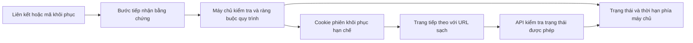

# Recovery page storage: quản lý dữ liệu lưu trên trang khôi phục tài khoản

## 1. Vì sao storage của trang khôi phục là một ranh giới bảo mật?

Trang khôi phục tài khoản xử lý những dữ liệu có thể dẫn tới việc đặt mật khẩu mới, thay MFA hoặc đăng ký passkey mới. Một token khôi phục bị lưu ngoài dự kiến có thể tiếp tục tồn tại sau khi người dùng đóng màn hình. Một trạng thái giao diện bị khôi phục từ cache có thể khiến trình duyệt hiển thị bằng chứng cũ dù máy chủ đã thu hồi quyền.

**Recovery page storage** là cách phân loại, lưu, sử dụng và loại bỏ dữ liệu của trang khôi phục trong trình duyệt. Phạm vi này rộng hơn lời gọi `localStorage.setItem()`: nó bao gồm cookie, Web Storage, IndexedDB, Cache API, service worker, lịch sử URL, trạng thái JavaScript, dữ liệu biểu mẫu và ảnh chụp trang trong back/forward cache.

Mục tiêu thiết kế là giảm số bản sao bí mật ở trình duyệt và giữ quyết định cấp quyền ở máy chủ. Người dùng có thể cần tiếp tục quy trình sau khi refresh; điều đó không đòi hỏi phải lưu token hoặc mật khẩu vào storage bền vững.

Các đường dẫn, tên cookie và thời hạn trong bài là ví dụ kiến trúc cho module khôi phục tài khoản. Chúng không phải giá trị bắt buộc cho mọi hệ thống.

## 2. Phân loại dữ liệu trước khi chọn nơi lưu

Không thể quyết định “dùng cookie hay localStorage” nếu chưa biết dữ liệu chứa quyền gì. Một chuỗi ngẫu nhiên trông vô nghĩa vẫn là bí mật nếu người sở hữu nó có thể thay MFA.

| Dữ liệu | Vai trò và rủi ro | Cách xử lý tham khảo |
| --- | --- | --- |
| Token trong liên kết khôi phục | Có thể chứng minh quyền bắt đầu hoặc tiếp tục khôi phục | Chỉ tiếp xúc trong bước tiếp nhận cần thiết; không sao chép vào Web Storage |
| Mã OTP hoặc mã dự phòng | Bằng chứng xác minh, có thể bị phát lại | Chỉ giữ trong ô nhập và bộ nhớ ngắn hạn trong lúc gửi |
| Mật khẩu mới và nhập lại | Bí mật thông tin xác thực | Không tự lưu nháp; chỉ gửi tới endpoint cần thiết qua HTTPS |
| Định danh phiên khôi phục | Quyền hạn chế do máy chủ cấp | Cookie được bảo vệ phù hợp; trạng thái và TTL do máy chủ quản lý |
| Cờ `identityVerified=true` | Trạng thái giao diện có thể bị sửa | Không dùng làm bằng chứng cấp quyền |
| Email, số điện thoại, hồ sơ định danh | Dữ liệu cá nhân, có thể giúp dò tài khoản | Chỉ trả và giữ tối thiểu; tránh bản sao bền vững không cần thiết |
| Bước đang hiển thị, ngôn ngữ | Chủ yếu phục vụ giao diện | Có thể lưu nếu không chứa bí mật; phải coi là đầu vào không tin cậy |
| Kết quả “đã hoàn tất” | Có thể cũ khi quay lại tab | Đọc trạng thái máy chủ khi cần quyết định thao tác tiếp |
| Mã dự phòng mới vừa tạo | Bí mật để dùng khi mất yếu tố xác thực | Hiển thị có kiểm soát; không tự lưu vào storage của ứng dụng |

Định danh hiển thị công khai và định danh có tính chất bearer là hai loại khác nhau. Nếu chỉ cần biết một `recoveryId` là đủ để thay mật khẩu, nó phải được bảo vệ như token, dù tên trường không có chữ `secret`.

Một nguyên tắc quan trọng khác: dữ liệu do trình duyệt gửi lên đều cần được máy chủ kiểm tra lại. Xóa một mục storage hoặc sửa một cờ trong DevTools không được làm thay đổi mức đảm bảo danh tính.

## 3. Hiểu đúng từng nơi lưu trong trình duyệt

### 3.1. `localStorage`: tiện cho tùy chọn, rủi ro cho bằng chứng

`localStorage` thuộc phạm vi origin và được JavaScript trong origin truy cập. Nó thường tồn tại qua việc đóng và mở lại trình duyệt. Đường dẫn `/recover` không có một kho riêng biệt với `/dashboard` nếu chúng dùng cùng origin.

OWASP cảnh báo không lưu định danh session trong local storage vì JavaScript có thể đọc chúng; XSS cũng có thể đọc hoặc sửa dữ liệu được lưu ở đó. Với trang khôi phục, các quyền tương đương token hoặc session cần được nhìn theo cùng rủi ro. [Nguồn: OWASP HTML5 Security Cheat Sheet](https://cheatsheetseries.owasp.org/cheatsheets/HTML5_Security_Cheat_Sheet.html).

Ví dụ cần tránh:

```javascript
localStorage.setItem("recoveryToken", tokenFromEmail);
localStorage.setItem("newPasswordDraft", passwordInput.value);
localStorage.setItem("identityVerified", "true");
```

Hai dòng đầu tạo bản sao bí mật bền vững. Dòng cuối trở thành lỗi cấp quyền nếu máy chủ hoặc frontend dựa vào nó để cho phép bỏ qua bước xác minh.

Những dữ liệu ít nhạy cảm hơn như ngôn ngữ có thể phù hợp, nhưng không nên gộp toàn bộ đối tượng `recoveryState` vào một mục lưu tự động. Một thay đổi sau này thêm token vào đối tượng có thể âm thầm đưa token xuống đĩa.

### 3.2. `sessionStorage`: thời gian sống ngắn hơn không tạo khả năng giữ bí mật

`sessionStorage` vẫn được JavaScript đọc. Nó gắn với phiên trang theo tab và origin, có thể sống qua reload và phục hồi trang. Khi có `opener`, storage ban đầu của trang mới có thể là bản sao từ trang mở nó; sau đó hai bản tách biệt. [Nguồn: MDN sessionStorage](https://developer.mozilla.org/en-US/docs/Web/API/Window/sessionStorage).

Vì vậy chuyển token từ localStorage sang sessionStorage chỉ thay đổi một số đặc điểm tồn tại, không loại bỏ rủi ro XSS. Không coi “đóng tab sẽ hết” là cơ chế thu hồi quyền phía máy chủ.

Một trường hợp có thể chấp nhận là lưu tên bước giao diện như `enter-code`, nếu nó không tiết lộ dữ liệu cần bảo vệ. Khi đọc lại, frontend chỉ dùng nó để đề xuất màn hình; máy chủ vẫn trả về bước thực sự được phép.

### 3.3. IndexedDB và cache của thư viện trạng thái

IndexedDB phù hợp cho dữ liệu có cấu trúc, nhưng không phải kho bí mật độc lập với JavaScript cùng origin. Đổi tên token thành một bản ghi trong IndexedDB không cải thiện ranh giới tin cậy.

Nguồn lưu gián tiếp thường dễ bị bỏ sót hơn lời gọi storage trực tiếp:

- Middleware tự động persist Redux hoặc store tương tự.
- Plugin đồng bộ query cache xuống IndexedDB.
- Cơ chế lưu form nháp hoặc phục hồi phiên làm việc.
- Hàng đợi đồng bộ nền khi mất mạng.
- Công cụ ghi lại thao tác người dùng và lỗi ứng dụng.

Store của tính năng khôi phục nên được loại khỏi cơ chế persist mặc định. Chọn allowlist các trường giao diện vô hại thường dễ kiểm soát hơn việc cố xóa một danh sách tên trường nhạy cảm có thể tăng theo thời gian.

### 3.4. Bộ nhớ JavaScript và DOM

Giữ dữ liệu trong bộ nhớ thường giảm thời gian tồn tại so với lưu bền vững, nhưng không chống được script độc hại đang chạy trong trang. Giá trị ô nhập, biến JavaScript và thuộc tính DOM vẫn nằm trong phạm vi ứng dụng đang thực thi.

Không đưa token vào `data-*`, HTML comment, thuộc tính ẩn hoặc biến toàn cục chỉ để tiện cho các component. `type="password"` che ký tự trên màn hình, không làm giá trị không thể được JavaScript đọc.

Khi không còn cần dùng, bỏ tham chiếu và xóa giá trị ô nhập là biện pháp giảm lưu giữ. JavaScript không cung cấp một bảo đảm tổng quát rằng chuỗi đã được ghi đè khỏi mọi bản sao bộ nhớ, crash dump hoặc dữ liệu do trình duyệt quản lý.

## 4. Mô hình ưu tiên: trạng thái máy chủ, quyền hạn chế ở cookie

Một mô hình tham khảo tách dữ liệu thành ba lớp:



Ở máy chủ có thể lưu tài khoản đích, mục đích, bằng chứng đã đạt, thời hạn, số lần thử, trạng thái thu hồi và bước tiếp theo. Cookie chỉ mang một định danh khó đoán, không chứa toàn bộ hồ sơ khôi phục.

Cookie minh họa:

```http
Set-Cookie: __Host-recovery=<opaque-random-id>; Path=/; Secure; HttpOnly; SameSite=Lax; Max-Age=600
Cache-Control: no-store
```

`HttpOnly` ngăn JavaScript đọc cookie qua API thông thường; cookie vẫn được trình duyệt gửi trong các request phù hợp, kể cả request do script tạo. `Secure` hạn chế gửi qua kết nối an toàn. Tiền tố `__Host-` yêu cầu `Secure`, `Path=/` và không có `Domain` trên trình duyệt hỗ trợ quy tắc tiền tố. [Nguồn: MDN Set-Cookie](https://developer.mozilla.org/en-US/docs/Web/HTTP/Reference/Headers/Set-Cookie).

Ví dụ chọn `Lax` để minh họa một luồng có điều hướng từ email; `Strict` có thể phù hợp khi hành vi điều hướng cho phép. Cần chỉ định rõ thay vì dựa vào mặc định của trình duyệt. Giá trị 600 giây là ví dụ, không thay thế TTL hoặc thu hồi ở máy chủ.

Các giới hạn vẫn phải được hiểu đúng:

- Cookie phiên khôi phục không phải session đăng nhập đầy đủ.
- `Path` điều khiển việc gửi cookie, không phải ranh giới phân quyền giữa các ứng dụng.
- `HttpOnly` không ngăn XSS dùng trình duyệt nạn nhân gửi hành động có cookie.
- `SameSite` không thay thế toàn bộ cơ chế chống CSRF.
- Thời điểm cookie hết hạn trên client không phải nguồn chuẩn về quyền còn hiệu lực.

Endpoint thay credential cần kiểm tra phiên khôi phục, bước xác minh, tài khoản đích và biện pháp chống request giả mạo phù hợp, chẳng hạn CSRF token cùng kiểm tra origin. Không cho một cookie có scope “đặt mật khẩu mới” được dùng để đổi email hoặc tắt MFA ngoài chính sách.

## 5. Tiếp nhận token mà không tạo thêm bản sao

Một luồng tiếp nhận có thể được tổ chức như sau:

1. Người dùng mở liên kết qua HTTPS tới endpoint khôi phục.
2. Endpoint xử lý bằng chứng theo thiết kế, tạo hoặc gắn quy trình hạn chế và trả phản hồi không lưu HTTP cache.
3. Trình duyệt được đưa tới URL sạch, không còn token trong query string.
4. Các bước tiếp theo đọc trạng thái được phép từ máy chủ thông qua cookie hạn chế.
5. Hành động thay credential chỉ diễn ra sau bước xác nhận rõ ràng và kiểm tra lại bằng chứng, trạng thái dùng một lần.

Không coi một lần GET là đủ để thay mật khẩu, thay MFA hoặc tiêu thụ không thể phục hồi bằng chứng duy nhất. Trình quét liên kết email có thể truy cập URL trước người dùng. Cách trao đổi token và thời điểm tiêu thụ phải được thiết kế để tránh biến hành vi mở liên kết thụ động thành hành động thay đổi tài khoản.

Nếu token xuất hiện trong URL ban đầu, việc redirect hoặc `history.replaceState()` giúp giảm thời gian token còn trong URL của các bước sau, nhưng không xóa ngược request đã đi qua proxy, log hay thành phần đã đọc nó.

Ví dụ frontend có thể thay URL hiện tại sau bước tiếp nhận thành công:

```javascript
history.replaceState(null, "", "/recover/continue");
```

Không truyền token vào đối số `state` để “giấu khỏi thanh địa chỉ”. History state vẫn là một nơi giữ dữ liệu mà script có thể đọc. Cũng không coi URL fragment là kho bí mật: fragment không được gửi như query tới máy chủ, nhưng script trong trang có thể đọc nó.

Trang tiếp nhận cần tránh analytics, chat widget hoặc script bên thứ ba không cần thiết. Chính sách `Referrer-Policy: no-referrer` giúp giảm việc gửi địa chỉ trang qua header Referer, nhưng không ngăn script chủ động thu thập URL.

## 6. HTTP cache, Cache API và service worker là ba vấn đề khác nhau

### 6.1. Chính sách HTTP cache

HTML chứa dữ liệu khôi phục, phản hồi kiểm tra trạng thái và phản hồi có thông tin nhạy cảm cần chính sách lưu cache rõ ràng. Ví dụ:

```http
Cache-Control: no-store
Referrer-Policy: no-referrer
X-Content-Type-Options: nosniff
```

Đối với HTTP cache, `no-store` yêu cầu không lưu phản hồi. `no-cache` cho phép lưu nhưng cần xác thực lại trước khi tái sử dụng; `private` ngăn shared cache lưu, vẫn có thể cho phép private cache. Các ý nghĩa này không thể dùng thay thế nhau. [Nguồn: MDN Cache-Control](https://developer.mozilla.org/en-US/docs/Web/HTTP/Reference/Headers/Cache-Control).

Áp dụng chính sách trên các nhánh lỗi và phản hồi cá nhân hóa, không chỉ trang thành công. Cấu hình CDN hoặc reverse proxy cũng cần tôn trọng phạm vi endpoint khôi phục; không có quy tắc cache chung vô tình ghi đè chính sách đó.

Tài nguyên công khai như CSS hoặc ảnh không chứa trạng thái cá nhân có thể có chính sách cache riêng. Không cần đưa token vào URL file JavaScript hoặc trả một bundle riêng chứa token để khởi tạo ứng dụng.

### 6.2. Cache API không tự tuân theo mọi header HTTP cache

Cache API do ứng dụng quản lý không tự tuân theo các header cache HTTP. Do đó một service worker gọi `cache.put()` có thể tạo bản sao mà chỉ thêm `Cache-Control: no-store` ở máy chủ không giải quyết được. [Nguồn: MDN Cache](https://developer.mozilla.org/en-US/docs/Web/API/Cache).

Với ứng dụng có chế độ offline, cần loại rõ các trang, API và phản hồi khôi phục khỏi:

- Precache khi cài service worker.
- Runtime cache kiểu cache-first hoặc stale-while-revalidate.
- Offline fallback chứa trạng thái cá nhân.
- Hàng đợi phát lại request thay credential.

Mẫu chính sách khái niệm:

```text
nếu request thuộc luồng recovery:
    chỉ gửi mạng theo chính sách không lưu
    không đọc phản hồi recovery từ Cache API
    không ghi phản hồi hoặc request body vào kho offline
    khi mạng lỗi: hiển thị trạng thái chưa thể tiếp tục
ngược lại:
    dùng chiến lược cache của tài nguyên công khai tương ứng
```

Đây là quy tắc cần tích hợp với router và service worker thực tế, không phải đoạn mã có thể dán vào mọi dự án. `fetch(..., { cache: "no-store" })` không tự loại bỏ một nhánh service worker đang trả bản sao trong Cache API.

Khi sửa cấu hình đã từng cache dữ liệu nhạy cảm, phải xem cả dữ liệu cũ. Một bản service worker mới không tự chứng minh rằng mọi client đang mở đã ngừng dùng phiên bản cũ hoặc rằng mọi bản sao đã bị xóa.

## 7. Back/Forward và phục hồi trang không phải một lần xác thực mới

Back/forward cache, gọi tắt bfcache, có thể giữ ảnh chụp của trang cùng trạng thái JavaScript để phục hồi nhanh khi người dùng nhấn Back hoặc Forward. Nó khác HTTP cache. Chrome đã triển khai khả năng đưa một số trang có `Cache-Control: no-store` vào bfcache trong các điều kiện được cho phép; không nên xem header này là lời bảo đảm rằng mọi lần Back đều tải lại trang. [Nguồn: Chrome for Developers về bfcache và no-store](https://developer.chrome.com/docs/web-platform/bfcache-ccns).

Điều này dẫn tới hai yêu cầu riêng:

1. Không để một màn hình cũ tự cấp lại quyền thực hiện hành động.
2. Giảm việc hiển thị lại dữ liệu nhạy cảm không cần thiết khi trang được phục hồi.

Ở tầng giao diện, có thể vô hiệu hóa thao tác và yêu cầu trạng thái hiện tại khi nhận `pageshow`. Đoạn mã giả sau chỉ mô tả thứ tự:

```text
khi trang được hiển thị hoặc phục hồi:
    khóa các nút thay credential
    xóa OTP và mật khẩu còn trong ô nhập
    yêu cầu trạng thái recovery hiện tại từ máy chủ, không lưu cache
    nếu phiên còn hiệu lực và đúng bước:
        hiển thị bước được phép, không điền lại bí mật cũ
    nếu phiên hết hạn, đã hoàn tất hoặc đã bị thu hồi:
        hiển thị trạng thái tương ứng
    nếu không lấy được trạng thái:
        giữ thao tác bị khóa và cho phép thử lại có kiểm soát
```

Đây là biện pháp quản lý giao diện, không thay thế kiểm tra ở API. Một request tới endpoint thay credential luôn phải được xác minh lại, dù giao diện có đang mở khóa nút hay không.

Không chờ `unload` để xóa token hoặc thu hồi phiên. Sự kiện có thể không chạy khi ứng dụng bị đóng, tiến trình bị dừng hoặc thiết bị chuyển trạng thái. Có thể dùng các tín hiệu vòng đời trang để giảm lưu giữ dữ liệu, nhưng việc thu hồi và thời hạn vẫn phải hoạt động khi không nhận được tín hiệu nào từ trình duyệt.

Cũng không nên hứa rằng một handler `pageshow` sẽ ngăn mọi khung hình cũ xuất hiện trước khi JavaScript xử lý. Nếu yêu cầu bảo mật đòi hỏi hạn chế tái hiển thị nghiêm ngặt, cần giảm ngay từ đầu dữ liệu nhạy cảm được render và thiết kế theo hành vi của các trình duyệt được hỗ trợ.

## 8. Biểu mẫu, password manager và dữ liệu người dùng chủ động lưu

Không tự lưu mật khẩu xuống storage của ứng dụng khác với việc cho phép người dùng sử dụng password manager. Cơ chế quản lý mật khẩu của trình duyệt hoặc công cụ do người dùng lựa chọn có mô hình lưu giữ và tương tác riêng.

Biểu mẫu đặt mật khẩu mới nên mô tả đúng mục đích ô nhập:

```html
<label for="new-password">Mật khẩu mới</label>
<input
  id="new-password"
  name="newPassword"
  type="password"
  autocomplete="new-password"
  required
/>

<label for="confirm-password">Nhập lại mật khẩu mới</label>
<input
  id="confirm-password"
  name="confirmPassword"
  type="password"
  autocomplete="new-password"
  required
/>
```

Ô nhập mã một lần có thể dùng `autocomplete="one-time-code"` khi phù hợp. Đây là gợi ý cho trình duyệt về ý nghĩa trường; không phải cam kết rằng dữ liệu sẽ không được giữ trong bất kỳ cơ chế nào. Nhiều trình duyệt cũng không dùng `autocomplete="off"` để vô hiệu hóa password manager trên trường đăng nhập. [Nguồn: MDN autocomplete](https://developer.mozilla.org/en-US/docs/Web/HTML/Reference/Attributes/autocomplete).

Không triển khai autosave mật khẩu “để tránh mất khi refresh”. Nếu refresh làm mất mật khẩu chưa gửi, hãy giải thích việc cần nhập lại hoặc để người dùng dùng password manager. Hạn chế lưu bí mật là một lựa chọn thiết kế có chủ đích, không phải lỗi cần vá bằng persist toàn bộ form.

Đối với mã dự phòng mới, nếu sản phẩm cho tải xuống hoặc sao chép, người dùng đang chủ động tạo một bản sao ngoài trang. Cần giải thích đó là thông tin nhạy cảm và không tự động nhét bản sao thứ hai vào localStorage, clipboard hoặc thư viện theo dõi sự kiện. Tính năng sao chép chỉ chạy khi người dùng yêu cầu; không giả định ứng dụng có thể xóa mọi clipboard đã đồng bộ sang thiết bị khác.

Khi đăng ký passkey sau khôi phục, ứng dụng không cần lưu private key passkey vào IndexedDB của trang. Việc quản lý private key thuộc cơ chế authenticator và nền tảng tương ứng. Frontend chỉ cần giữ dữ liệu giao thức tối thiểu trong thời gian thao tác, còn quyền đăng ký credential mới vẫn do máy chủ quyết định.

## 9. Dọn dữ liệu theo vòng đời và đúng phạm vi

### 9.1. Những thời điểm cần kết thúc dữ liệu của một lượt khôi phục

Dữ liệu tạm của lượt khôi phục cần được xử lý khi:

- Hoàn tất thay credential.
- Người dùng hủy quy trình hoặc bắt đầu quy trình khác.
- Phiên hoặc bằng chứng hết hạn.
- Máy chủ thu hồi quyền vì chính sách hoặc rủi ro.
- Giao diện chuyển sang bước không còn cần OTP, mật khẩu hoặc tài liệu trước đó.

Phía máy chủ phải kết thúc hoặc hạn chế lại phiên trước khi giao diện coi việc dọn dữ liệu là đã hoàn tất về bảo mật. Xóa cookie ở trình duyệt không chứng minh định danh phiên đã bị thu hồi ở máy chủ; bản sao định danh bị đánh cắp vẫn có thể được gửi từ nơi khác.

Cookie minh họa để kết thúc phiên trên client:

```http
Set-Cookie: __Host-recovery=; Path=/; Secure; HttpOnly; SameSite=Lax; Max-Age=0
Cache-Control: no-store
```

Các thuộc tính phạm vi khi xóa phải khớp cookie cần xóa. JavaScript không được dùng `document.cookie` như cách xóa một cookie `HttpOnly`; máy chủ cần gửi header phù hợp. Nếu hệ thống cấp session đăng nhập mới, phải phân biệt rõ nó với cookie khôi phục đang bị xóa.

### 9.2. Không dọn bằng lệnh xóa toàn bộ storage một cách mặc định

Lệnh `localStorage.clear()` có thể làm mất dữ liệu của ứng dụng khác cùng origin. Xóa toàn bộ IndexedDB hoặc mọi cache có thể làm hỏng chức năng offline và dữ liệu nháp không liên quan.

Nếu cần xử lý dữ liệu tồn tại từ phiên bản cũ, xác định chính xác tên mục, database, cache và thời điểm migration. Một ví dụ giới hạn phạm vi:

```javascript
function removeLegacyRecoveryDraft() {
  const keys = ["legacyRecoveryDraft", "legacyRecoveryToken"];

  for (const key of keys) {
    for (const storageName of ["localStorage", "sessionStorage"]) {
      try {
        window[storageName].removeItem(key);
      } catch {
        // Không đọc hoặc ghi thêm bí mật để khắc phục lỗi storage.
        // Trạng thái quyền vẫn được kết thúc phía máy chủ.
      }
    }
  }
}
```

Hàm này minh họa việc xóa những mục đã biết của ứng dụng, không tạo quyền truy cập và không tuyên bố đã xóa mọi bản sao. Trong triển khai thực tế, lỗi dọn dữ liệu nên được phản ánh bằng sự kiện tối thiểu không chứa nội dung bí mật; cần tránh một hệ thống telemetry tự thu thập giá trị mục storage gây lỗi.

`Clear-Site-Data` là công cụ mạnh hơn nhưng có phạm vi rộng. Chỉ thị `"storage"` có thể xóa các loại storage của origin và đăng ký service worker; chỉ thị `"cookies"` có thể ảnh hưởng cookie trên registered domain, gồm subdomain. Không gắn một header xóa rộng vào mọi response recovery mà chưa đánh giá ảnh hưởng. [Nguồn: MDN Clear-Site-Data](https://developer.mozilla.org/en-US/docs/Web/HTTP/Reference/Headers/Clear-Site-Data).

### 9.3. Mã hóa trước khi lưu không tự giải quyết vấn đề

Mẫu “mã hóa token rồi lưu localStorage” chỉ có ý nghĩa khi có mô hình quản lý khóa phù hợp. Nếu script độc hại đọc được khóa hoặc gọi được chức năng giải mã, việc lưu ciphertext không loại bỏ rủi ro đang quan tâm.

Một khóa Web Crypto không cho export cũng không ngăn mọi script cùng ngữ cảnh sử dụng khóa khi chúng có quyền truy cập phù hợp. Không coi một tùy chọn thư viện mã hóa là đủ để biến storage của trang thành kho an toàn cho bearer token.

Nếu không có nhu cầu nghiệp vụ rõ ràng phải giữ dữ liệu nhạy cảm ngoại tuyến, cách giảm rủi ro trực tiếp hơn là không lưu dữ liệu đó xuống storage bền vững của ứng dụng.

## 10. Refresh, mất mạng, nhiều tab và thiết bị dùng chung

### 10.1. Refresh hoặc storage bị chặn

Trang có thể hoạt động khi localStorage không sẵn sàng nếu trạng thái chính nằm ở máy chủ. Khi người dùng refresh, frontend gọi endpoint trạng thái bằng phiên khôi phục hạn chế và dựng lại bước hợp lệ. Mật khẩu hoặc OTP chưa gửi có thể cần nhập lại.

Nếu cookie cần thiết bị chặn và không thể tạo phiên, hiển thị hướng dẫn rõ ràng hoặc cung cấp một thiết kế thay thế đã được đánh giá. Không tự chuyển định danh phiên vào query string hay localStorage chỉ để né một lỗi cookie.

Các tùy chọn giao diện không quan trọng có thể dùng giá trị mặc định nếu storage ném exception. Lỗi lưu ngôn ngữ không được làm thay đổi cách kiểm tra bằng chứng.

### 10.2. Mất mạng khi gửi thao tác

Không ghi request đặt lại mật khẩu vào hàng đợi offline để tự phát lại khi có mạng. Token có thể đã hết hạn, request có thể đã commit hoặc người dùng đã đổi ý.

Khi kết quả chưa rõ, giữ thông báo phù hợp và tra cứu trạng thái bằng quyền hạn chế đã được cấp. Cơ chế idempotency cần được thiết kế phía máy chủ; không đạt được chỉ bằng cách giữ mật khẩu và token trong IndexedDB rồi gửi lại.

### 10.3. Nhiều tab không tạo nhiều quyền độc lập

Cookie thường được chia sẻ giữa các tab phù hợp phạm vi. Tab B bắt đầu một lượt khôi phục khác có thể thay cookie mà tab A đang dùng. Vì vậy mỗi hành động cần được ràng buộc đúng quy trình, tài khoản và mục đích; không chỉ dựa vào một cookie có tên giống nhau và màn hình đang hiển thị.

Có thể dùng một định danh không có quyền độc lập để giúp phát hiện tab đang hiển thị sai quy trình. Máy chủ vẫn phải kiểm tra định danh ấy thuộc phiên và thao tác hiện tại. Không biến “flow ID để đồng bộ giao diện” thành bearer token thứ hai.

`BroadcastChannel` hoặc sự kiện đồng bộ có thể báo “hãy tải lại trạng thái” khi một tab hoàn tất, nhưng không truyền token, OTP hay mật khẩu qua kênh đó. Tín hiệu từ tab khác chỉ là yêu cầu cập nhật giao diện; API vẫn giữ bất biến dùng một lần.

### 10.4. Thiết bị dùng chung

Kết thúc luồng cần đưa trang về trạng thái không còn ô nhập và dữ liệu tài khoản không cần thiết. Có thể nhắc người dùng đóng trang khi sử dụng thiết bị công cộng, nhưng không xem thao tác đó là cơ chế thu hồi chính.

Ứng dụng không thể bảo đảm chống mọi extension có quyền rộng, malware trên máy hoặc ảnh chụp màn hình của người dùng khác. Thiết kế storage giảm bản sao và tuổi tồn tại của bí mật, kết hợp với token dùng một lần và kiểm soát session, thay vì hứa rằng dọn DOM sẽ xóa mọi dấu vết trên thiết bị.

## 11. Tình huống xuyên suốt: khôi phục MFA sau khi mất điện thoại

Người dùng mở email khôi phục trên máy tính dùng chung. Mục tiêu là xác minh đủ bằng chứng để đăng ký MFA mới.

**Bước tiếp nhận:** liên kết được xử lý qua HTTPS; endpoint áp dụng chính sách không lưu HTTP cache và không đưa trang tiếp nhận vào cơ chế offline. Sau xử lý phù hợp, trình duyệt đi tới URL sạch và giữ cookie phiên khôi phục hạn chế. Việc mở URL chưa tự tắt MFA cũ.

**Bước nhập mã:** mã bổ sung chỉ nằm trong ô nhập trong thời gian cần thiết. Store giao diện không được persist; công cụ theo dõi lỗi không thu thập nội dung form. Refresh khiến người dùng nhập lại mã nếu chưa gửi, nhưng máy chủ vẫn biết quy trình đang ở bước nào.

**Bước hoàn tất:** máy chủ kiểm tra quyền hiện tại, thay credential theo chính sách và kết thúc quyền khôi phục đã dùng. Frontend xóa giá trị form, bỏ trạng thái tạm và hiển thị kết quả tối thiểu. Nếu cần đăng nhập, thực hiện theo quy trình được thiết kế thay vì tái sử dụng cookie recovery làm session đầy đủ.

**Khi nhấn Back:** giao diện có thể được trình duyệt phục hồi. Trang khóa thao tác, làm sạch ô nhập và đọc trạng thái mới; máy chủ báo quy trình đã kết thúc. Một request cũ được gửi lại cũng không thể đăng ký thêm MFA chỉ nhờ cờ `verified` còn trong bộ nhớ.

Bảo vệ ở đây đến từ sự kết hợp: giảm lưu giữ dữ liệu phía client, kiểm soát các lớp cache, quyền hạn chế và quyết định cuối ở máy chủ. Không một thao tác `removeItem()` riêng lẻ nào thay thế được các phần còn lại.

## 12. Các quyết định cần ghi rõ trong thiết kế

| Câu hỏi | Quyết định cần có |
| --- | --- |
| Trình duyệt cần nhớ gì qua refresh? | Dữ liệu tối thiểu, nguồn trạng thái chính và cách dựng lại bước |
| Dữ liệu nào mang quyền? | Token, session handle và mọi định danh bearer phải được nhận diện |
| Phạm vi script nào đọc được dữ liệu? | Origin, script bên thứ ba, widget và thư viện persist |
| Những lớp cache nào tham gia? | HTTP cache, CDN, service worker, Cache API và bfcache |
| Khi phiên hết hạn hoặc hoàn tất thì sao? | Thu hồi phía máy chủ, xóa cookie đúng phạm vi, dọn giao diện |
| Nếu storage hoặc mạng lỗi thì sao? | Không chuyển sang nơi lưu yếu hơn; không phát lại bí mật ngoại tuyến |
| Người dùng mở hai tab thì sao? | Ràng buộc từng thao tác với đúng quy trình và xử lý màn hình cũ |
| Dữ liệu được tải xuống hoặc sao chép thì sao? | Hành động rõ ràng của người dùng và giới hạn khả năng thu hồi bản sao |

Đối với trang khôi phục tài khoản, dữ liệu phía trình duyệt nên đủ để phục vụ tương tác hiện tại, còn quyền thay đổi thông tin xác thực phải tiếp tục được xác nhận ở máy chủ. Cách phân chia này giúp refresh, lỗi storage hoặc màn hình cũ không trở thành lý do kéo dài hay tái tạo quyền khôi phục.

