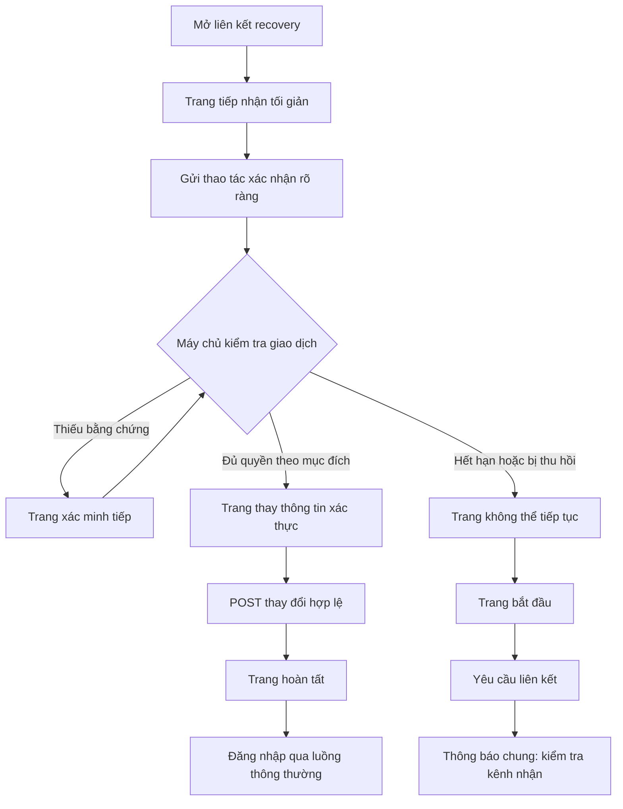

# Điều hướng an toàn trên trang khôi phục tài khoản (Recovery page navigation)

## 1. Điều hướng quyết định người dùng đang được phép làm gì

Một luồng khôi phục thường đi qua nhiều trang: yêu cầu trợ giúp, nhận liên kết, xác minh bằng chứng, đặt mật khẩu mới, đăng ký lại yếu tố xác thực và thông báo hoàn tất. Người dùng có thể mở liên kết trong trình duyệt khác, bấm Back, tải lại, nhân đôi tab hoặc quay lại sau khi giao dịch đã hết hạn.

Vì vậy, điều hướng recovery không chỉ là chọn URL tiếp theo. Nó phải thể hiện đúng quyền hiện có của giao dịch và không đưa bí mật tới một nơi không được phép.

Xét tình huống:

1. Người dùng xác minh email ở tab A.
2. Tab A chuyển sang trang đặt mật khẩu.
3. Người dùng mở lại trang xác minh bằng nút Back.
4. Giao diện cũ vẫn hiện nút “Tiếp tục”, dù token đã được đổi sang quyền khác.

Nếu backend tin vào trang đang hiển thị hoặc tham số `step=verified`, người dùng có thể bỏ qua bước cần thiết hoặc thực hiện lại một hành động đã hoàn tất. Nếu backend kiểm tra đúng trạng thái, trang cũ chỉ là một bản trình bày lỗi thời; nó không khôi phục quyền đã mất.

Bất biến cốt lõi là: **URL và giao diện biểu diễn trạng thái; máy chủ quyết định quyền và chuyển trạng thái**.

## 2. Tách ba loại trạng thái

| Loại trạng thái | Ví dụ | Giá trị đối với bảo mật |
| --- | --- | --- |
| Trạng thái trình bày | Tab đang mở, thanh tiến độ, màn hình đang chọn | Giúp người dùng hiểu vị trí, không cấp quyền |
| Trạng thái giao dịch recovery | Bằng chứng đã được chấp nhận, mục đích, hạn dùng, bước được phép | Do máy chủ quản lý và kiểm tra trước thao tác |
| Trạng thái đăng nhập | Session người dùng, mức xác thực, phiên đã bị thu hồi hay chưa | Tách khỏi quyền recovery giới hạn |

Một recovery session được phép đặt lại mật khẩu chưa phải session đăng nhập đầy đủ. Tương tự, đã chứng minh khả năng nhận email không mặc nhiên đủ để xóa MFA hoặc đăng ký một passkey thay thế.

Không dùng các giá trị sau làm bằng chứng đã hoàn thành một bước:

```text
/recovery/change?verified=true
/recovery/complete?success=1
history.state = { identityVerified: true }
localStorage["recoveryStep"] = "MFA_VERIFIED"
```

Người dùng hoặc mã chạy trong trình duyệt có thể thay đổi chúng. Backend cần tải giao dịch tương ứng từ một handle phù hợp, xác minh quyền của phiên và quyết định trang hoặc thao tác nào được chấp nhận.

## 3. Xây bản đồ điều hướng từ trạng thái phía máy chủ

Ví dụ một luồng minh họa:



Các mũi tên có thay đổi trạng thái nghiệp vụ cần được thực hiện bằng request có chủ đích, thường là POST, với CSRF và kiểm tra quyền phù hợp. GET chỉ tải trang hoặc đọc trạng thái; không đặt lại mật khẩu, tiêu thụ token hay xóa yếu tố xác thực vì một trang vừa được mở.

Một bảng định tuyến phía máy chủ có thể như sau:

| Trạng thái giao dịch | Trang GET có thể trình bày | Hành động được xem xét |
| --- | --- | --- |
| Chưa có giao dịch có thể tiếp tục | Trang bắt đầu hoặc thông báo chung | Gửi yêu cầu recovery có kiểm soát |
| Chờ xác nhận hoặc bằng chứng | Trang xác nhận, trang nhập bằng chứng | POST xác minh theo mục đích |
| Đã có quyền thay đổi giới hạn | Trang đặt mật khẩu hoặc bước đăng ký yếu tố được phép | POST đúng loại thay đổi |
| Đã hoàn tất | Trang kết quả phù hợp hoặc đăng nhập | Không thực hiện lại thay đổi |
| Hết hạn, bị thu hồi hoặc không hợp lệ | Trang giải thích chung và bắt đầu lại | Không khôi phục quyền bằng điều hướng |

Đây là mô hình minh họa; trạng thái cụ thể phụ thuộc chính sách recovery. Điều quan trọng là mọi endpoint thay đổi phải tự kiểm tra điều kiện hiện tại. Việc một request GET từng trả về biểu mẫu hợp lệ không bảo đảm biểu mẫu ấy còn quyền gửi sau vài phút.

## 4. Giữ token khỏi các bước điều hướng tiếp theo

Liên kết đầu vào có thể phải mang một token:

```text
https://accounts.example.test/recovery/entry?token=DEMO_TOKEN_NOT_VALID
```

Sau khi tiếp nhận, có thể giữ tham chiếu tạm ở phía máy chủ và chuyển người dùng sang URL sạch như `/recovery/continue`. Cookie chỉ chứa handle ngẫu nhiên có thời hạn ngắn, với `Secure`, `HttpOnly` và chính sách `SameSite` phù hợp.

Trạng thái tạm được tạo khi tải trang chưa phải quyền khôi phục đã được xác minh. Không tiêu thụ token hoặc gắn độc quyền nó với trình duyệt đầu tiên chỉ vì có GET; trình quét email cũng có thể mở URL.

Không mang token đi tiếp qua:

- Tham số `next`, `returnTo` hoặc URL trang trợ giúp.
- Thuộc tính `href` của nút Back hoặc liên kết “Đăng nhập”.
- `history.state`, localStorage hoặc dữ liệu router.
- URL ảnh, tài nguyên, thông báo lỗi hoặc payload analytics.
- Thông điệp gửi sang cửa sổ khác.

Redirect sang URL sạch giảm số lần bí mật được sao chép. Nó không xóa URL gốc khỏi email, log ingress hoặc mọi bản ghi lịch sử trình duyệt.

`history.replaceState` có thể thay URL của entry lịch sử hiện tại mà không tải tài liệu mới. Nó không phải thao tác xóa toàn bộ lịch sử hoặc thu hồi dữ liệu đã gửi. Không dùng nó để thay thế việc bảo vệ request đầu vào và vòng đời token. [Nguồn: MDN — History.replaceState](https://developer.mozilla.org/en-US/docs/Web/API/History/replaceState).

## 5. Dùng Post/Redirect/Get cho các chuyển bước phù hợp

Sau một POST thành công, trả redirect tới một trang GET giúp việc Refresh ở trang kết quả không tự gửi lại biểu mẫu.

Ví dụ:

```http
POST /recovery/change-password
Content-Type: application/x-www-form-urlencoded

csrf=DEMO_CSRF&newPassword=DEMO_PASSWORD_NOT_REAL
```

Sau khi backend kiểm tra quyền và hoàn tất giao dịch:

```http
HTTP/1.1 303 See Other
Location: /recovery/complete
Cache-Control: no-store
Referrer-Policy: no-referrer
```

Trình duyệt thông thường tiếp tục tải trang kết quả bằng GET. Theo RFC 9110, 303 trỏ tới tài nguyên có thể được truy xuất để biểu diễn kết quả gián tiếp; 307 giữ nguyên phương thức khi client tự động theo redirect. Vì thế, không dùng 307 hoặc 308 như sự thay thế tùy ý cho bước POST sang trang GET. [Nguồn: RFC 9110, mục 15.4.4, 15.4.8 và 15.4.9](https://www.rfc-editor.org/rfc/rfc9110.html#section-15.4.4).

Nếu POST chứa mật khẩu mới hoặc bằng chứng xác minh, một redirect giữ phương thức tới đích không được kiểm soát có thể đưa body tới sai endpoint. Đích redirect cần cố định hoặc được lựa chọn từ chính sách đáng tin cậy.

Post/Redirect/Get không bảo đảm một POST chỉ chạy đúng một lần. Hai lần nhấp, retry mạng hoặc hai tab vẫn có thể tạo request trùng. Backend cần tiêu thụ token nguyên tử, kiểm tra phiên bản trạng thái hoặc cơ chế chống thực hiện trùng phù hợp.

## 6. Không để return URL điều khiển ranh giới tin cậy

Một endpoint như sau có nguy cơ open redirect:

```text
/recovery/complete?next=https://untrusted.example.test/sign-in
```

Ngay sau thao tác khôi phục nhạy cảm, người dùng dễ tin rằng trang tiếp theo vẫn thuộc dịch vụ. Redirect do đầu vào không tin cậy điều khiển có thể đưa họ tới trang giả mạo. OWASP mô tả rủi ro phishing này và khuyến nghị tránh đích do người dùng tùy ý cung cấp, hoặc ánh xạ lựa chọn vào đích đã kiểm soát. [Nguồn: OWASP — Unvalidated Redirects and Forwards](https://cheatsheetseries.owasp.org/cheatsheets/Unvalidated_Redirects_and_Forwards_Cheat_Sheet.html).

Với recovery, một lựa chọn dễ kiểm soát là dùng tên đích có ý nghĩa nghiệp vụ:

```text
destination = "SIGN_IN"

resolveDestination(destination):
    nếu destination == "SIGN_IN":
        trả "/sign-in"
    nếu destination == "RECOVERY_HELP":
        trả "/help/account-recovery"
    ngược lại:
        trả "/sign-in"
```

Request không được cung cấp URL thay thế cho các giá trị trên. Ngoài tính hợp lệ của đích, backend vẫn phải kiểm tra người dùng có đủ quyền tới trang đó hay không.

Nếu sản phẩm bắt buộc nhận URL, cần phân tích và chuẩn hóa theo quy tắc nhất quán, kiểm tra chính xác scheme, origin và route được phép. Chỉ kiểm tra chuỗi bắt đầu bằng `/` là chưa đủ vì `//host/path` có thể là URL tham chiếu tới host khác; kiểm tra chứa tên miền tin cậy cũng dễ nhầm với tên miền hoặc thành phần URL khác.

Giới hạn cùng origin vẫn chưa giải quyết mọi vấn đề: một route cùng origin có thể tự redirect tiếp hoặc thực hiện hành động ngoài recovery. Ưu tiên tập đích nhỏ, cố định và phù hợp với trạng thái giao dịch.

## 7. Back, Forward và Refresh phải không phục hồi quyền cũ

| Thao tác người dùng | Điều có thể xảy ra trong trình duyệt | Hành vi recovery cần giữ |
| --- | --- | --- |
| Back sau khi token đã dùng | Biểu mẫu cũ xuất hiện | Gửi lại vẫn phải bị kiểm tra theo trạng thái mới |
| Forward tới màn hình hoàn tất | Trang cũ được hiển thị lại | Không coi việc thấy trang là bằng chứng giao dịch vừa thành công |
| Refresh sau POST | Trình duyệt có thể hỏi gửi lại nếu chưa redirect | Dùng PRG và chống thực hiện trùng ở backend |
| Mở bookmark của trang giữa luồng | Không có phiên recovery tương ứng | Trả bước có thể tiếp tục hoặc hướng dẫn bắt đầu lại |
| Quay lại sau khi hết hạn | UI vẫn có dữ liệu cũ | Không gia hạn hoặc cấp quyền chỉ vì người dùng quay lại |
| Đóng tab hoặc mất mạng | Không biết request cuối đã commit hay chưa | Cho phép hỏi trạng thái hoặc retry có kiểm soát |

Không cố bảo vệ luồng bằng cách vô hiệu nút Back, liên tục `pushState` hoặc bẫy `popstate` để giữ người dùng trong trang. Những cách này gây khó sử dụng, không ngăn request trực tiếp và không thay thế kiểm tra quyền.

Nút “Quay lại” trong giao diện nên diễn đạt rõ ý nghĩa. “Sửa thông tin yêu cầu” khác với “Hủy giao dịch” và khác với “Bắt đầu lại”. Nếu hủy làm thay đổi trạng thái, dùng thao tác có chủ đích được bảo vệ, không gắn hành động thu hồi vào một liên kết GET.

## 8. Bfcache và trang được khôi phục từ bộ nhớ

Trình duyệt có thể lưu trạng thái tài liệu để khôi phục nhanh khi Back hoặc Forward, gọi là back/forward cache, viết tắt bfcache. Khi đó DOM, dữ liệu trong bộ nhớ và trạng thái form có thể trở lại mà không đi qua lần tải trang thông thường.

Không được giả định `Cache-Control: no-store` luôn loại bỏ khả năng này trên mọi trình duyệt. Chrome đã triển khai hỗ trợ bfcache cho một số trang dùng no-store theo các điều kiện an toàn của trình duyệt. HTTP cache và bfcache là hai cơ chế cần phân biệt. [Nguồn: Chrome for Developers — bfcache và no-store](https://developer.chrome.com/docs/web-platform/bfcache-ccns).

Hướng xử lý:

- Giữ `Cache-Control: no-store` cho phản hồi nhạy cảm và endpoint trạng thái.
- Giảm tối đa dữ liệu bí mật tồn tại trong DOM hoặc trạng thái frontend.
- Khi trang được khôi phục, xác minh lại bước có thể tiếp tục trước khi cho thao tác nhạy cảm.
- Mọi POST vẫn kiểm tra độc lập ở backend, kể cả khi mã đồng bộ giao diện không chạy.

`pageshow` bao gồm trường hợp quay lại qua Back hoặc Forward; thuộc tính `persisted` cho biết trang đang được khôi phục từ bộ nhớ. [Nguồn: MDN — pageshow](https://developer.mozilla.org/en-US/docs/Web/API/Window/pageshow_event).

Ví dụ tối giản cho ứng dụng chọn đồng bộ lại bằng điều hướng:

```javascript
window.addEventListener("pageshow", (event) => {
  if (event.persisted) {
    window.location.replace("/recovery/resume");
  }
});
```

`/recovery/resume` phải là endpoint GET an toàn: tải trạng thái từ session, chọn một route cố định được phép, không tiêu thụ token hoặc thay đổi thông tin xác thực. Nó cũng cần tránh redirect vòng lặp.

Đây là hỗ trợ tính nhất quán giao diện, không phải lớp kiểm soát quyền. Handler JavaScript có thể chạy sau lúc một phần nội dung được khôi phục đã xuất hiện; không đặt bí mật vào trang rồi kỳ vọng sự kiện này bảo đảm chúng chưa từng được nhìn thấy.

Không dùng `unload`, `beforeunload` hoặc sự kiện đóng tab làm điều kiện duy nhất để hủy giao dịch. Thiết bị có thể tắt, tiến trình có thể bị dừng và sự kiện không được thực thi. Hạn dùng và trạng thái phía máy chủ phải tự bảo đảm vòng đời.

## 9. Nhiều tab, thay đổi tài khoản và request đang chờ

### 9.1. Hai tab cùng thực hiện

Cookie recovery thường được chia sẻ giữa các tab cùng phạm vi. Nếu tab A hoàn tất giao dịch, tab B có thể vẫn hiển thị biểu mẫu cũ. Nếu một cookie bị thay bởi luồng khác, tab B thậm chí có thể đang giữ giao diện của giao dịch trước.

Backend cần gắn hành động với đúng mục đích, đúng giao dịch và bằng chứng đã được chấp nhận. Một định danh hoặc phiên bản giao dịch không bí mật trong biểu mẫu có thể giúp phát hiện nhầm ngữ cảnh, nhưng không tự cấp quyền; server phải đối chiếu với session và quyền hiện tại.

Không suy ra tài khoản mục tiêu từ email đang hiện trên trang hoặc một query mà người dùng sửa được. Khi có mismatch, dừng thao tác và hướng tới bước đồng bộ lại thay vì âm thầm đổi mật khẩu cho một tài khoản khác.

### 9.2. Nhấn nút nhiều lần

Có thể vô hiệu nút gửi trong lúc request đang chạy để giảm nhấp nhầm và công bố trạng thái “Đang xử lý” cho công nghệ hỗ trợ. Backend vẫn phải chịu được request trùng và tranh chấp từ nhiều tab.

Nếu request đã commit nhưng phản hồi bị mất, retry được thiết kế tốt có thể trả lại kết quả của cùng thao tác trong đúng ngữ cảnh được cấp quyền. Không đưa raw password, token hoặc bằng chứng vào khóa idempotency hoặc URL truy vấn trạng thái.

### 9.3. Phản hồi về sai thứ tự

Trong SPA, một request đọc trạng thái cũ có thể về sau request mới và đưa UI lùi về bước trước. Frontend có thể bỏ qua phản hồi lỗi thời bằng số thứ tự request hoặc cơ chế hủy request. Backend vẫn quyết định trạng thái thật.

Đóng modal, đổi route hoặc hủy fetch không chứng minh server đã hủy hành động. Nếu cần biết thao tác có hoàn tất hay không, đọc lại trạng thái qua một endpoint an toàn gắn với đúng phiên.

## 10. Mở từ email, trình duyệt nhúng và thiết bị khác

Liên kết có thể mở trong webview của ứng dụng email, trong khi người dùng muốn tiếp tục bằng trình duyệt chính. Cookie giữa các môi trường có thể không được chia sẻ.

Thiết kế nên:

- Giải thích khi không tìm thấy giao dịch có thể tiếp tục trong môi trường hiện tại.
- Cung cấp cách mở lại liên kết hoặc bắt đầu lại theo chính sách, không hạ yêu cầu bằng chứng.
- Không đưa recovery session vào URL chỉ để chuyển giữa trình duyệt.
- Không coi IP hoặc User-Agent giống nhau là đủ để chuyển quyền từ thiết bị này sang thiết bị khác.
- Không cấp quyền dựa trên việc trình duyệt đầu tiên mở liên kết.

Nếu sản phẩm có bàn giao đa thiết bị, cần một giao thức riêng với giao dịch liên kết, hạn dùng, xác nhận và chống dùng lại. Một tham số `continueOnOtherDevice=true` không tạo ra các thuộc tính đó.

Đối với việc đăng ký lại passkey, còn phải giữ đúng origin và phạm vi WebAuthn của dịch vụ. Điều hướng tới một tên miền khác hoặc webview có hành vi khác không được trở thành lý do bỏ qua xác minh hay nới quyền recovery.

## 11. Liên kết trợ giúp, tab mới và cửa sổ khác

Một trang recovery nên có lối trợ giúp rõ ràng nhưng không gửi kèm token cho trang đích. Nếu mở tài liệu bên ngoài bằng tab mới, có thể dùng:

```html
<a href="https://support.example.test/account-recovery"
   target="_blank"
   rel="noopener noreferrer">
  Mở hướng dẫn khôi phục trong tab mới
</a>
```

URL trong ví dụ không có token hoặc dữ liệu giao dịch. Không dùng `document.referrer` làm nguồn tin cậy để quyết định đường “quay lại”.

Ưu tiên hoàn tất recovery trong một tài liệu cấp cao nhất trên origin chính thức; tránh thiết kế mặc định cần popup điều khiển cửa sổ cha. Nếu bắt buộc dùng `postMessage`, bên nhận cần kiểm tra origin, nguồn cửa sổ và cấu trúc dữ liệu; bên gửi dùng target origin chính xác. Không gửi token, password hoặc recovery session qua thông điệp để “đồng bộ điều hướng”. [Nguồn: MDN — postMessage và yêu cầu bảo mật](https://developer.mozilla.org/en-US/docs/Web/API/Window/postMessage#security_concerns).

Ngay cả thông báo “hoàn tất” từ một cửa sổ cũng chỉ nên khiến cửa sổ nhận hỏi lại backend trong ngữ cảnh hợp lệ, không tự cấp quyền đăng nhập.

## 12. Kết thúc và bắt đầu lại mà không gây nhầm trạng thái

Trang hoàn tất cần phản ánh kết quả đã được server xác nhận. Nó không nên hiện thông tin tài khoản chi tiết chỉ vì người dùng mở một URL công khai có tên `complete`.

Với đặt lại mật khẩu, một hướng an toàn và dễ hiểu là đưa người dùng về cơ chế đăng nhập thông thường sau khi hoàn tất, đồng thời áp dụng chính sách thu hồi session và thông báo bảo mật của dịch vụ. OWASP khuyến nghị không tự đăng nhập ngay sau reset vì làm tăng độ phức tạp của xử lý xác thực và session. [Nguồn: OWASP — Forgot Password, User Resets Password](https://cheatsheetseries.owasp.org/cheatsheets/Forgot_Password_Cheat_Sheet.html#user-resets-password).

Quyền recovery giới hạn cần kết thúc hoặc bị thu hồi khi không còn cần. Nếu muốn tiếp tục hiển thị kết quả, có thể dùng trạng thái kết quả tối thiểu, ngắn hạn, không còn quyền thay đổi thông tin xác thực.

Với “Bắt đầu lại”, cần nói rõ liệu thao tác chỉ quay về màn hình đầu hay hủy giao dịch hiện tại. Nếu hủy thật, thực hiện POST có CSRF và kiểm tra quyền; không dùng một redirect GET để âm thầm xóa trạng thái.

Một luồng điều hướng dễ dùng có thể chịu được việc người dùng quay lại, mất mạng hoặc đổi tab mà không làm sống lại quyền cũ. Đạt được điều đó bằng trạng thái phía máy chủ, đích điều hướng được kiểm soát và hành vi trình duyệt được xem là có thể lỗi thời.
