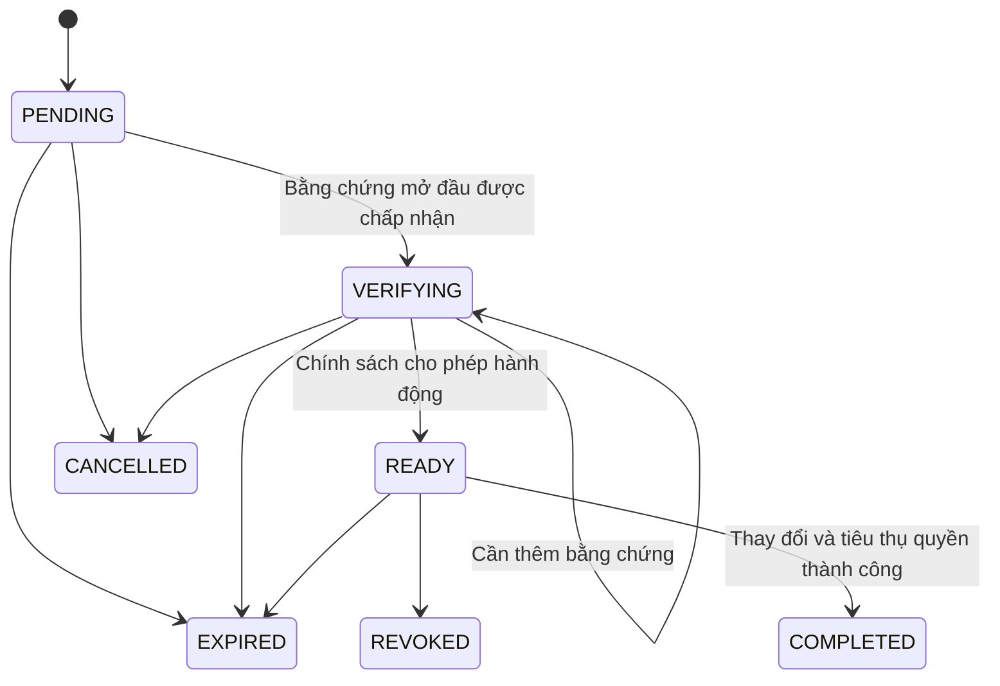

# Recovery API resource model — Mô hình tài nguyên cho API khôi phục tài khoản

## 1. Mô hình tài nguyên quyết định API đang bảo vệ điều gì

Một API khôi phục tài khoản không chỉ nhận email rồi đổi mật khẩu. Nó quản lý một quá trình có mục đích, bằng chứng, thời hạn và quyền hạn thay đổi theo từng bước. Nếu tất cả được gom vào một đối tượng có các field như `userId`, `verified` và `newPassword`, ranh giới giữa đầu vào của client và quyết định của server rất dễ bị xóa nhòa.

Mô hình tài nguyên cần trả lời được các câu hỏi:

- Đây là yêu cầu khôi phục nào, cho tài khoản và tenant nào?
- Người gọi mới khai báo mong muốn, hay đã chứng minh được một điều gì đó?
- Bằng chứng đã đủ cho đúng hành động đang yêu cầu chưa?
- Quyền khôi phục còn hiệu lực, đã bị thu hồi hay đã được dùng?
- Thay đổi tài khoản thực sự đã hoàn tất hay chỉ mới được tiếp nhận?

Tên tài nguyên và đường dẫn API giúp diễn đạt các câu trả lời này, nhưng quyền truy cập phải được thực thi phía server. Việc đưa một challenge dưới đường dẫn của recovery request không tự chứng minh challenge đó thuộc request.

Trong bài, các tài nguyên, trạng thái và endpoint là một thiết kế minh họa cho module khôi phục tài khoản. Chúng không phải tên gọi bắt buộc của một tiêu chuẩn.

## 2. Tách ý định, bằng chứng và quyền thực hiện

Một mô hình có thể bắt đầu với các thành phần sau:

| Thành phần | Vai trò | Điều không được suy diễn |
| --- | --- | --- |
| `RecoveryRequest` | Ghi nhận mục đích và vòng đời một yêu cầu | Có request không đồng nghĩa được đổi tài khoản |
| `Challenge` | Mô tả một bước chứng minh, như token email hoặc mã dự phòng | Gửi challenge thành công không đồng nghĩa người dùng đã vượt qua |
| `VerificationAttempt` | Ghi nhận một lần trình bày và kiểm tra bằng chứng | Client không được tự khai báo kết quả xác minh |
| `RecoveryContext` | Ngữ cảnh phiên có quyền hạn hẹp để tiếp tục luồng | Đây không mặc nhiên là phiên đăng nhập đầy đủ |
| `RecoveryAuthorization` | Quyền do server cấp cho một hành động recovery cụ thể | Quyền đặt lại mật khẩu không bao gồm xóa MFA |
| `RecoveryCompletion` | Kết quả thực hiện thay đổi được cho phép | Đã nhận request chưa chắc đã hoàn thành thay đổi |

Các thành phần có thể là bảng riêng, bản ghi trong cùng aggregate hoặc trạng thái nội bộ của service. Không phải thành phần nào cũng cần một endpoint công khai. Đặc biệt, không cần mở API cho client tự tạo `RecoveryAuthorization` chỉ vì mô hình có tài nguyên đó.

Một `RecoveryRequest` có thể chứa thông tin nội bộ như sau:

```text
id
resolvedAccountId
tenantId
purpose
state
createdAt
expiresAt
policyVersion
version
```

`resolvedAccountId` là kết quả server tìm và ràng buộc tài khoản theo luồng hợp lệ. Nó không phải một field được phép sửa tùy ý từ request body. Khi chưa xác định hoặc không có tài khoản phù hợp, hệ thống không được bịa một tài khoản đích rồi xử lý như một recovery thật.

`purpose` có thể biểu diễn `PASSWORD_RESET`, `MFA_RECOVERY` hoặc `AUTHENTICATOR_REENROLLMENT`. Tách mục đích giúp chính sách xác minh và hành động cuối không bị dùng lẫn. Mô hình có thể chia chúng thành các loại yêu cầu riêng nếu mỗi loại có vòng đời khác biệt đáng kể.

## 3. ID tài nguyên và credential là hai khái niệm riêng

Một ID như `rr_demo_001` dùng để định vị request. Token email hoặc credential của phiên recovery dùng để chứng minh quyền theo chính sách. API phải xác định rõ mỗi giá trị thuộc loại nào.

OWASP mô tả Broken Object Level Authorization khi API nhận ID đối tượng nhưng không kiểm tra quyền đối với chính đối tượng đó. Dùng UUID thay cho số tăng dần không thay thế kiểm tra quyền. [OWASP API1:2023](https://api-security.owasp.org/editions/2023/en/0xa1-broken-object-level-authorization/).

Ví dụ, người gọi đang có context của `rr_demo_001` không được đổi path thành `rr_demo_002` để đọc tiến độ hoặc tạo challenge cho request khác. Khi truy cập challenge, server cũng cần kiểm tra toàn bộ quan hệ:

```text
caller context -> recovery request -> challenge
                     |
                     +-> resolved account + tenant + purpose
```

Các kiểm tra tối thiểu của mô hình minh họa gồm:

1. Context hoặc credential hợp lệ và còn hiệu lực.
2. Context được phép truy cập đúng recovery request.
3. Challenge được định vị thực sự thuộc request đó.
4. Request và challenge chưa rơi vào trạng thái kết thúc không cho phép thao tác.
5. Hành động được gọi nằm trong quyền được cấp tại bước hiện tại.

Nếu một thiết kế cho phép chỉ cần biết `requestId` là tiếp tục khôi phục, thì ID đó đang có vai trò credential. Khi ấy nó phải được bảo vệ như bí mật, thay vì vừa coi là bearer token vừa ghi rộng rãi vào log hoặc ticket như ID vô hại.

## 4. Một tập endpoint thể hiện đúng vòng đời

Bảng dưới đây minh họa một luồng trình duyệt. Ngữ cảnh recovery được server quản lý; các thao tác dùng cookie cần có cơ chế chống CSRF phù hợp.

| Endpoint minh họa | Công việc | Ranh giới quyền |
| --- | --- | --- |
| `POST /recovery-requests` | Tiếp nhận ý định khôi phục | Có thể công khai; áp dụng chống lạm dụng và chống dò tài khoản |
| `POST /recovery-sessions` | Đổi bằng chứng mở đầu hợp lệ lấy context hạn chế | Server kiểm tra bằng chứng và tự xác định request tương ứng |
| `GET /recovery-requests/{requestId}` | Trả một góc nhìn tiến độ tối thiểu | Cần context được phép đọc request này |
| `POST /recovery-requests/{requestId}/challenges` | Khởi tạo hoặc gửi một bước xác minh được chính sách cho phép | Không cho client chọn tùy ý nơi nhận bí mật |
| `POST /recovery-requests/{requestId}/challenges/{challengeId}/attempts` | Trình bày bằng chứng cho challenge | Kết quả và ngân sách thử do server quản lý |
| `POST /recovery-requests/{requestId}/password-resets` | Thực hiện đặt lại mật khẩu | Cần quyền còn hiệu lực cho đúng mục đích |
| `POST /recovery-requests/{requestId}/cancellations` | Hủy yêu cầu theo chính sách | Cần quyền hủy phù hợp, không chỉ biết ID |

Trong phương án này, challenge email ban đầu được server tạo khi tiếp nhận yêu cầu. `POST /recovery-sessions` kiểm tra token email, ghi nhận bằng chứng tương ứng và mở ngữ cảnh tiếp tục luồng. Challenge bổ sung chỉ xuất hiện nếu chính sách recovery yêu cầu.

Endpoint cuối cho MFA hoặc đăng ký lại phương thức xác thực cần quyền và schema tương ứng. Không dùng endpoint đặt lại mật khẩu như một cổng tổng quát nhận thêm `disableMfa: true`.

### Tiếp nhận công khai không tiết lộ tài khoản

Request ban đầu có thể có dạng:

```http
POST /recovery-requests
Content-Type: application/json

{
  "accountIdentifier": "learner@example.invalid",
  "purpose": "PASSWORD_RESET"
}
```

Phản hồi công khai minh họa:

```http
HTTP/1.1 202 Accepted
Content-Type: application/json
Cache-Control: no-store

{
  "message": "Nếu thông tin phù hợp, hướng dẫn khôi phục sẽ được gửi."
}
```

Ở bước này, thiết kế không trả danh sách tài khoản, ID nội bộ, phương thức MFA hay địa chỉ liên hệ đã lưu. Không dùng `404` riêng cho email không tồn tại trong khi email tồn tại nhận `202`. OWASP khuyến nghị phản hồi và thời gian xử lý nhất quán cho các trường hợp tài khoản tồn tại và không tồn tại. [OWASP Forgot Password Cheat Sheet](https://cheatsheetseries.owasp.org/cheatsheets/Forgot_Password_Cheat_Sheet.html).

Phản hồi chung vẫn cần đi cùng hành vi phía sau phù hợp. Nếu client có một API polling trả `ACCOUNT_NOT_FOUND`, sự khác biệt chỉ bị chuyển sang endpoint khác. Nếu cần receipt hoặc flow handle trước xác minh, mô hình công khai của handle đó cũng phải tránh trở thành công cụ dò tài khoản.

## 5. Representation công khai không phải bản sao entity

Một bản ghi recovery nội bộ có thể chứa tài khoản đích, đánh giá rủi ro, token digest và giới hạn thử. Những field này không cần xuất hiện trong response.

Sau khi có context được phép đọc, một representation tối thiểu có thể là:

```json
{
  "id": "rr_demo_001",
  "phase": "ADDITIONAL_VERIFICATION_REQUIRED",
  "nextAction": "SUBMIT_RECOVERY_CODE"
}
```

Các ID và giá trị trong bài là dữ liệu minh họa. `nextAction` chỉ hướng dẫn giao diện. Server vẫn phải tính lại điều kiện khi client thực hiện hành động đó, thay vì tin một giá trị client gửi ngược lại.

Các field thường cần giữ nội bộ gồm:

```text
resolvedAccountId
riskScore
verificationPolicyDetails
tokenDigest
rawToken
attemptBudget
approvedBy
allowedSecurityChanges
```

Không serialize entity rồi chỉ ẩn field ở frontend. Không mở một endpoint `GET /recovery-requests` cho người chưa xác minh để liệt kê request theo email.

OWASP API3 phân biệt việc lộ thuộc tính nhạy cảm và việc cho phép client sửa thuộc tính mà họ không có quyền. Chọn rõ field đọc/ghi là một phần của phân quyền thuộc tính. [OWASP API3:2023](https://api-security.owasp.org/editions/2023/en/0xa3-broken-object-property-level-authorization/).

Vì thế, API không nên nhận một bản vá tổng quát như:

```json
{
  "state": "READY",
  "verified": true,
  "resolvedAccountId": "another-account",
  "attemptBudget": 999,
  "allowedSecurityChanges": ["DISABLE_MFA"]
}
```

Client trình bày bằng chứng hoặc yêu cầu hành động; server quyết định các trạng thái và quyền trên. DTO đầu vào cần chỉ có những field nghiệp vụ mà endpoint thực sự cho phép. Có thể từ chối field lạ theo hợp đồng API, nhưng tuyệt đối không tự bind chúng vào entity rồi lưu.

## 6. Trạng thái thể hiện điều kiện chuyển bước

Một vòng đời đơn giản cho request có thể được mô tả như sau:



Sơ đồ tập trung vào các chuyển trạng thái chính. Một triển khai có thể thêm các chuyển hủy hoặc thu hồi khác theo chính sách; không được coi những đường chưa vẽ là tự động được phép.

`READY` nghĩa là server đã cấp quyền cho một hành động xác định tại thời điểm đó. Nó không bảo đảm quyền còn sử dụng được mãi. Khi thực hiện thay đổi, server cần xét lại thời hạn, thu hồi, trạng thái tài khoản và các điều kiện có thể thay đổi.

Một challenge thành công không tự động đưa mọi request tới `READY`. Ví dụ, bằng chứng email có thể đủ cho một chính sách đặt lại mật khẩu, nhưng chưa đủ cho khôi phục MFA của tài khoản có rủi ro cao. Quyết định phụ thuộc mục đích và chính sách của hệ thống.

Ngân sách thử cũng phải gắn với đúng phạm vi. Nếu chỉ đếm trên từng challenge mới tạo, kẻ lạm dụng có thể liên tục tạo challenge để làm mới số lần thử. Mô hình cần thể hiện các giới hạn liên quan tới request, tài khoản, phương thức hoặc nguồn yêu cầu theo nhu cầu chống lạm dụng.

## 7. Quyền recovery phải gắn với đối tượng và hành động

Một `RecoveryAuthorization` nội bộ có thể ràng buộc:

```text
authorizationId
requestId
resolvedAccountId
tenantId
purpose
allowedAction
audience
expiresAt
consumedAt
policyVersion
```

Ví dụ, quyền cho `PASSWORD_RESET` của tài khoản A không được dùng để thay email, xóa MFA, tác động tài khoản B hoặc gọi API quản trị. Việc API nhận một token có chữ ký hợp lệ chưa đủ; nó phải chấp nhận đúng loại credential và đúng quyền dành cho endpoint đó.

Nếu quyền được biểu diễn bằng một token tự chứa, vẫn cần cách thực thi dùng một lần và thu hồi theo thiết kế. Nếu quyền được lưu hoàn toàn phía server, credential của context phải được ánh xạ tới đúng bản ghi và kiểm tra khi thao tác.

Ở endpoint cuối, dữ liệu định danh tài khoản nên được lấy từ ràng buộc đã xác minh. Body đặt lại mật khẩu chỉ cần nhận dữ liệu cần thiết cho hành động, chẳng hạn mật khẩu mới; không cần thêm một `targetUserId` do client lựa chọn.

Không trả raw token, mật khẩu mới hoặc mã dự phòng trong representation kết quả. Việc hỗ trợ tải lại kết quả sau lỗi mạng cũng không phải lý do để lưu các bí mật đó trong response cache nghiệp vụ.

## 8. Tiêu thụ quyền và thay đổi tài khoản phải nhất quán

Hai request đồng thời có thể cùng thấy quyền chưa dùng nếu service chỉ thực hiện chuỗi “đọc, kiểm tra, rồi cập nhật” không có kiểm soát cạnh tranh. Điều đó làm hỏng ý nghĩa dùng một lần của resource.

Mã giả sau minh họa ranh giới giao dịch cho trường hợp các dữ liệu cần thiết nằm trong cùng cơ sở dữ liệu:

```text
begin transaction
  lock recovery request and authorization
  require matching account, tenant, purpose and action
  require authorization is active, unexpired and unconsumed
  require request is READY and current policy still permits action
  validate and update the account credential
  mark authorization consumed
  mark recovery request COMPLETED
  record completion and durable follow-up events
commit
```

Đây là mã giả về mô hình nhất quán, không phải thuật toán hashing mật khẩu hay triển khai transaction hoàn chỉnh. Mục tiêu là chỉ có một thay đổi được phép cam kết cho quyền dùng một lần; lỗi trước commit phải không để quyền và tài khoản rơi vào trạng thái trái ngược.

Nếu đổi credential, thu hồi session và ghi kết quả nằm ở các hệ thống khác nhau, không thể giả định một transaction cục bộ bao phủ tất cả. Khi đó cần mô hình tiến độ và phục hồi rõ ràng, chẳng hạn một operation có trạng thái đang xử lý cùng sự kiện bền vững và cơ chế áp dụng chống lặp. Chỉ báo hoàn thành khi các điều kiện bảo mật bắt buộc của operation đã được đáp ứng.

Thông báo email có thể được xử lý bất đồng bộ, nhưng lỗi gửi thông báo không được làm sống lại quyền đã tiêu thụ hoặc khiến cùng một recovery đổi mật khẩu nhiều lần.

## 9. HTTP status và retry cần phản ánh trạng thái thật

Theo HTTP Semantics, `201 Created` biểu thị đã tạo tài nguyên; `202 Accepted` biểu thị đã tiếp nhận nhưng xử lý chưa hoàn tất. POST không tự có bảo đảm idempotent của phương thức. [RFC 9110](https://www.rfc-editor.org/rfc/rfc9110.html).

Trong thiết kế minh họa:

- Endpoint công khai tiếp nhận recovery có thể trả `202` với thông báo chung.
- Endpoint tạo attempt có thể trả `201` nếu attempt đã được tạo, nhưng status đó không có nghĩa bằng chứng đúng; outcome vẫn do server xác định.
- Endpoint đổi mật khẩu có thể trả `204` khi hoàn tất và không có response body.
- Nếu hành động cuối thực sự bất đồng bộ, response cần thể hiện đang xử lý thay vì báo đã đổi mật khẩu thành công.

Mất response sau khi server đã commit là một tình huống khác với token chưa từng được dùng. Thiết kế retry cần phân biệt hai trường hợp đó. Một idempotency key do ứng dụng hỗ trợ có thể được ràng buộc vào context, request và loại operation để tra lại kết quả an toàn.

Cùng key với đầu vào khác không được âm thầm thực hiện như một lệnh mới. Cơ chế so sánh đầu vào và lưu kết quả phải tránh lưu mật khẩu hoặc token dạng rõ. Idempotency không gia hạn quyền đã hết hạn và không thay thế kiểm tra quyền; việc tra lại kết quả cũng cần đúng context được phép.

## 10. Lỗi API cũng là một phần của mô hình công khai

Có thể dùng Problem Details để mô tả lỗi máy đọc được, nhưng không biến lỗi thành bản dump của entity recovery. RFC 9457 nhấn mạnh nguy cơ lộ thông tin nội bộ qua chi tiết lỗi. [RFC 9457](https://www.rfc-editor.org/rfc/rfc9457.html#section-5).

Ví dụ lỗi cho ngữ cảnh recovery được phép nhận thông tin bước tiếp theo:

```http
HTTP/1.1 409 Conflict
Content-Type: application/problem+json
Cache-Control: no-store

{
  "type": "https://accounts.example.invalid/problems/recovery-state-conflict",
  "title": "Không thể thực hiện ở bước hiện tại",
  "status": 409,
  "detail": "Hãy tiếp tục theo hướng dẫn khôi phục hiện có."
}
```

Mã `409` ở đây là lựa chọn hợp đồng cho xung đột trạng thái đã được kiểm soát quyền; không phải response bắt buộc cho mọi lỗi recovery. Trước xác minh, một lỗi không được tiết lộ tài khoản tồn tại, loại MFA đang dùng hoặc kết quả rủi ro nội bộ. Các khác biệt cần phục vụ vận hành có thể nằm trong audit có kiểm soát, liên kết bằng ID đối chiếu phù hợp.

## 11. Những dấu hiệu mô hình đang trao quá nhiều quyền

| Thiết kế dễ gây lỗi | Hệ quả |
| --- | --- |
| Một DTO vừa nhận email vừa nhận `verified=true` | Client có thể tác động quyết định xác minh |
| Chỉ kiểm tra request ID rồi dùng mọi challenge ID bên dưới | Có thể trộn bằng chứng giữa các request |
| Cho sửa `purpose` sau khi đã xác minh | Bằng chứng cho hành động yếu bị dùng cho hành động mạnh |
| Chọn nơi nhận challenge bằng email mới trong body | Người gọi có thể đưa bằng chứng tới nơi họ kiểm soát |
| Token reset được API xem như access token thông thường | Quyền recovery có thể mở rộng sang chức năng khác |
| Tạo challenge mới là đặt lại toàn bộ bộ đếm thử | Có thể vượt ngân sách xác minh |
| Ghi `COMPLETED` trước khi thay đổi bảo mật bắt buộc xong | Client nhận trạng thái thành công không phản ánh thực tế |

Một mô hình tài nguyên tốt làm rõ quan hệ giữa yêu cầu, bằng chứng, quyền hạn và kết quả. ID định vị đúng đối tượng; context và chính sách xác định ai được thao tác; quyền có phạm vi xác định thay đổi nào được thực hiện; trạng thái và cơ chế nhất quán bảo đảm thay đổi đó diễn ra đúng số lần được phép.
