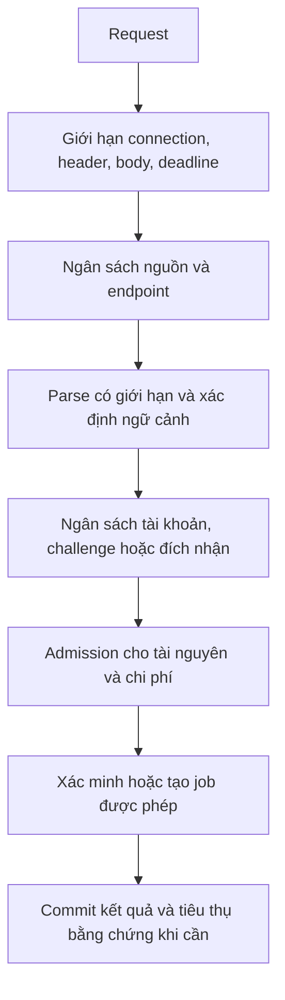

# Recovery API request limits: giới hạn yêu cầu cho API khôi phục tài khoản

## 1. Một request khôi phục có thể gây ra những chi phí nào?

API khôi phục tài khoản thường mở cho người chưa đăng nhập. Người dùng mất mật khẩu, MFA hoặc thiết bị xác thực cần truy cập được API, nhưng kẻ tấn công cũng có thể gọi cùng endpoint để đoán mã, gửi thư hàng loạt, làm cạn ngân sách SMS hoặc chiếm tài nguyên xử lý bằng chứng.

**Recovery API request limits** là tập giới hạn phía máy chủ đối với số yêu cầu, số lần xác minh, kích thước dữ liệu, mức đồng thời và chi phí phát sinh trong một quy trình khôi phục. Nó rộng hơn một cấu hình “100 request mỗi phút” ở gateway.

Một request có thể thực hiện nhiều việc:

- Phân tích JSON, giải nén hoặc đọc tệp đính kèm.
- Tra cứu tài khoản và trạng thái khôi phục.
- Sinh token, gọi dịch vụ khóa hoặc băm mật khẩu mới.
- Gửi email, SMS, cuộc gọi hoặc push notification.
- Chuyển tài liệu sang dịch vụ xác minh danh tính.
- Tạo công việc bất đồng bộ và các lần retry về sau.

OWASP API4:2023 mô tả rủi ro khi API không kiểm soát tài nguyên tiêu thụ, bao gồm chi phí từ các dịch vụ tích hợp. Vì vậy giới hạn cần được đặt theo công việc thực tế, không chỉ số request ở cửa vào. [Nguồn: OWASP API4:2023 Unrestricted Resource Consumption](https://api-security.owasp.org/editions/2023/en/0xa4-unrestricted-resource-consumption/).

Các endpoint, tên bộ đếm và con số trong bài là ví dụ thiết kế. Chúng cần được điều chỉnh theo mức đảm bảo, lưu lượng hợp lệ, chi phí nhà cung cấp và khả năng hỗ trợ người dùng của hệ thống.

## 2. Tách các loại giới hạn theo mục tiêu

| Loại giới hạn | Mục tiêu | Ví dụ trong luồng khôi phục |
| --- | --- | --- |
| Tần suất request | Giảm tốc tự động hóa và tải vào | Số lần gọi endpoint từ một nguồn trong một khoảng thời gian |
| Số lần thử bằng chứng | Giới hạn xác suất đoán đúng | Số lần kiểm tra OTP của một challenge và các challenge liên quan |
| Phát hành và gửi lại | Giảm spam và vòng lặp cấp mã | Khoảng cách tối thiểu giữa hai lần gửi |
| Chi phí giao nhận | Bảo vệ ngân sách và người nhận | Tổng SMS theo đích nhận, tenant và hệ thống |
| Kích thước và độ phức tạp | Giới hạn công việc trong một request | Body, số trường, độ sâu JSON, số tệp và kích thước tệp |
| Đồng thời | Bảo vệ worker, CPU và phụ thuộc | Số tác vụ băm mật khẩu hoặc xác minh hồ sơ đang chạy |
| Hàng đợi và retry | Tránh chuyển quá tải sang tầng nền | Số job chờ, tuổi job, số lần retry gửi thông báo |
| Thời gian thực hiện | Ngăn giữ tài nguyên quá lâu | Deadline toàn request và timeout của dịch vụ xác minh |

Các giới hạn này bổ sung cho nhau. Giới hạn 10 request mỗi phút không ngăn một request chứa hàng nghìn mã cần xác minh. Giới hạn body 8 KiB không ngăn hàng triệu request nhỏ. Giới hạn SMS mỗi tài khoản không bảo vệ ngân sách toàn hệ thống nếu kẻ tấn công nhắm vào nhiều tài khoản.

Cũng cần phân biệt **quota lưu lượng** với **số lần thử bằng chứng**. Một lần gọi endpoint có thể bị từ chối trước khi kiểm tra OTP vì vượt quota nguồn; điều đó không có nghĩa OTP đã được kiểm tra. Ngược lại, nếu một request được phép chứa nhiều lần kiểm tra, phải tính theo từng phép kiểm tra thực sự hoặc từ chối dạng batch đó.

## 3. Giới hạn theo nhiều chiều, không chỉ theo IP

Một mô hình tham khảo cho quyết định tiếp nhận:

```text
allow = source_budget
    AND endpoint_budget
    AND recovery_context_budget
    AND proof_attempt_budget_when_required
    AND delivery_budget_when_required
    AND service_capacity_budget
```

Không phải endpoint nào cũng có đầy đủ danh tính để áp dụng mọi chiều. Gateway biết nguồn mạng và route; ứng dụng biết quy trình, tài khoản đã được ánh xạ và mục đích; worker gửi thông báo biết đích giao nhận cùng chi phí.

### 3.1. Theo nguồn mạng

Giới hạn theo IP hữu ích để chặn một nguồn gửi quá nhanh, nhưng có hai giới hạn quan trọng:

- Botnet hoặc proxy phân tán có thể thay nguồn liên tục.
- Nhiều người hợp lệ có thể dùng chung IP sau NAT, mạng doanh nghiệp hoặc mạng di động.

Địa chỉ IPv6 và prefix có thể cung cấp thêm tín hiệu, nhưng không có một độ dài prefix phù hợp cho mọi nhà mạng hoặc môi trường. Không biến giả định mạng thành một định danh người dùng tuyệt đối.

Khi nằm sau proxy, chỉ tin thông tin địa chỉ được các proxy tin cậy cung cấp theo cấu hình. Một client tự đặt `X-Forwarded-For` không được quyền tự chọn khóa rate limit. Cần xác định chuỗi proxy nào được tin và tránh để client truy cập trực tiếp backend để bỏ qua gateway.

### 3.2. Theo định danh yêu cầu và tài khoản đích

Nếu chỉ giới hạn IP, kẻ tấn công có thể dùng nhiều IP để gửi hàng nghìn yêu cầu vào cùng một người nhận. Vì vậy cần giới hạn gắn với định danh được yêu cầu, rồi bổ sung giới hạn tài khoản chuẩn khi hệ thống đã ánh xạ được tài khoản.

Việc chuẩn hóa phải dùng cùng quy tắc định danh của ứng dụng. Không tự bỏ dấu chấm hoặc phần sau dấu cộng của mọi địa chỉ email; các quy tắc đó không áp dụng đồng nhất cho mọi nhà cung cấp. Nếu một tài khoản có nhiều alias hợp lệ, quota tài khoản cần tránh bị nhân lên chỉ vì dùng các alias khác nhau.

Một khóa có thể được tạo như sau:

```text
candidateKey = HMAC(
    limiterSecret,
    encode(namespace, trustedTenant, operationFamily, canonicalIdentifier)
)
```

`encode` phải tạo biểu diễn không nhập nhằng, thay vì nối chuỗi có thể va chạm do dấu phân cách. `trustedTenant` phải lấy từ ngữ cảnh đã xác minh, không lấy tùy ý từ một header của client.

HMAC giúp tránh đưa email rõ vào tên khóa và giảm khả năng dò từ một danh sách hash email đơn thuần. Nó không làm dữ liệu trở thành vô danh tuyệt đối: ai có quyền truy cập phù hợp và khóa liên quan vẫn có thể liên kết hoặc kiểm tra định danh.

### 3.3. Theo phiên khôi phục, challenge và mục đích

Một challenge nhập OTP cần ngân sách thử riêng. Tuy nhiên, nếu cứ tạo challenge mới là có thêm toàn bộ lượt thử, giới hạn có thể bị vô hiệu hóa bằng vòng lặp tạo lại challenge.

Thiết kế cần kết hợp ít nhất:

- Giới hạn lần thử trên challenge hiện tại.
- Giới hạn tổng trên tài khoản hoặc ngữ cảnh khôi phục trong cửa sổ phù hợp.
- Giới hạn tạo mới và gửi lại challenge.
- Ràng buộc mục đích, chẳng hạn đặt mật khẩu khác với thay MFA.

Không dựa vào một `challengeId` công khai để cho bất kỳ ai tiêu hết ngân sách của nạn nhân. Endpoint xác minh phải yêu cầu ngữ cảnh khôi phục hoặc quyền tiếp tục phù hợp trước khi xử lý challenge. Ngay cả như vậy, vẫn cần cân bằng giữa chống đoán mã và khả năng kẻ đã có quyền hạn chế gây cản trở.

### 3.4. Theo đích nhận, tenant và nhà cung cấp

Giới hạn giao nhận không chỉ là số lần gọi API gửi. Một yêu cầu có thể tạo nhiều tin nhắn hoặc bị retry nhiều lần.

Cần xem các ngân sách riêng cho đích nhận đã được phép sử dụng, kênh gửi, tenant và toàn dịch vụ. Đặc biệt, API công khai không được trở thành bộ chuyển tiếp tới một số điện thoại tùy ý do client cung cấp. Đích giao nhận phải thuộc chính sách khôi phục đã được thiết lập hoặc một quy trình xác minh thích hợp.

Thiết bị và fingerprint có thể bổ sung tín hiệu rủi ro, nhưng có thể bị thay đổi hoặc không sẵn sàng. Không dùng chúng làm chiều bảo vệ duy nhất và không thu thập thêm dữ liệu thiết bị không cần thiết chỉ để đặt quota.

## 4. Giới hạn theo từng endpoint

Một tập endpoint minh họa:

| Endpoint | Công việc cần bảo vệ | Chiều giới hạn chính |
| --- | --- | --- |
| `POST /recovery/requests` | Tiếp nhận định danh và bắt đầu quy trình | Nguồn, định danh yêu cầu, tenant, công suất tiếp nhận |
| `POST /recovery/challenges/{id}/resend` | Gửi lại bằng chứng qua kênh đã cho phép | Ngữ cảnh khôi phục, đích nhận, cooldown, tổng gửi |
| `POST /recovery/challenges/{id}/verify` | Kiểm tra OTP hoặc mã dự phòng | Quyền tiếp tục, challenge, tài khoản, nguồn, chi phí xác minh |
| `POST /recovery/evidence` | Tiếp nhận hồ sơ xác minh danh tính | Kích thước, số tệp, mức đồng thời, ngân sách dịch vụ ngoài |
| `GET /recovery/operations/{id}` | Tra cứu kết quả xử lý | Quyền đọc kết quả, tần suất polling, công suất đọc |
| `POST /recovery/complete` | Thay credential và kết thúc quy trình | Phiên hạn chế, bằng chứng, tính dùng một lần, CPU và đồng thời |

Một endpoint nội bộ, API phiên bản cũ, ứng dụng di động hoặc endpoint GraphQL không được tạo đường vòng với ngân sách riêng ngoài dự kiến. Giới hạn nên theo **họ thao tác nghiệp vụ** khi các route thực hiện cùng một công việc.

CORS, nút bấm bị vô hiệu hóa trên frontend và thời gian đếm ngược ở client không ngăn request được gửi trực tiếp. Quota bắt buộc phải được thực thi ở các tầng máy chủ liên quan.

## 5. Chọn thuật toán theo ý nghĩa của giới hạn

### 5.1. Cửa sổ cố định

Một bộ đếm cho mỗi phút dễ triển khai nhưng có thể cho burst ở ranh giới. Nếu cho 10 request trong mỗi phút, nguồn có thể gửi gần 10 request cuối phút trước và 10 request đầu phút sau trong một khoảng rất ngắn.

Cơ chế này có thể phù hợp với một số ngân sách thô, nhưng không nên được hiểu là “không bao giờ vượt 10 request trong bất kỳ 60 giây nào”.

### 5.2. Cửa sổ trượt

Cửa sổ trượt theo dõi hoạt động trong khoảng thời gian tính từ hiện tại. Nó phù hợp khi chính sách cần diễn đạt số lần tối đa trong một khoảng gần nhất, chẳng hạn tổng gửi tới một đích nhận.

Độ chính xác và chi phí phụ thuộc cách triển khai: lưu từng sự kiện khác với dùng các bucket tổng hợp. Một giải pháp gần đúng cần ghi rõ mức sai lệch có thể chấp nhận.

### 5.3. Token bucket

Token bucket phù hợp khi cho phép một burst nhỏ nhưng giới hạn tốc độ dài hạn. Với sức chứa `B`, tốc độ nạp `r` và khoảng thời gian `Δt`:

```text
available = min(B, previous + r × Δt)
allow nếu available >= cost
sau khi tiếp nhận: available = available - cost
```

“Token” trong công thức là đơn vị ngân sách lưu lượng, không phải token khôi phục tài khoản. Có thể dùng `cost` khác nhau cho công việc nhẹ và nặng, nhưng đó là quyết định vận hành cần được áp dụng nhất quán.

Token bucket không tự tạo hard cap chính xác cho mọi cửa sổ trượt. Nếu chính sách yêu cầu số lần thử OTP tuyệt đối không vượt một mức trong vòng đời challenge, cần một bộ đếm trạng thái riêng.

### 5.4. Cooldown và giới hạn đồng thời

Cooldown giới hạn khoảng cách giữa các lần phát hành hoặc gửi lại. Nó không thay thế tổng quota trong giờ hoặc ngày.

Giới hạn đồng thời bảo vệ số công việc đang chạy. Ví dụ, một pool băm mật khẩu có thể đã đầy dù tốc độ request chưa cao vì mỗi công việc tốn nhiều thời gian. Semaphore hoặc cơ chế admission control cần có deadline và cách thu hồi tài nguyên khi worker lỗi.

Không dùng sleep kéo dài trong request handler như cơ chế chống lạm dụng chính: hàng nghìn request đang ngủ vẫn có thể giữ connection, bộ nhớ hoặc thread. Nên từ chối sớm hoặc chuyển công việc được phép sang hàng đợi có giới hạn.

## 6. Ngân sách thử OTP và vòng đời challenge

Giả sử một mã được chọn đều trong không gian có `N` giá trị và kẻ tấn công được thực hiện `q` phép đoán khác nhau khi mã còn hiệu lực. Với một mã hợp lệ cố định, xác suất thành công xấp xỉ `q/N` khi `q` nhỏ so với `N`; trong mô hình đoán không lặp và phân bố đều, xác suất là `q/N` cho `q ≤ N`.

Ví dụ minh họa: OTP sáu chữ số có một triệu khả năng; năm phép thử cho xác suất `5 / 1.000.000` trong mô hình trên. Đây không phải đánh giá tổng rủi ro của một hệ thống. Nhiều mã đồng thời hợp lệ, nhiều challenge mới hoặc quota bị reset có thể làm tăng số cơ hội thực tế.

Để giới hạn có ý nghĩa:

1. Giữ thời hạn challenge ở máy chủ; client không được kéo dài bằng tham số.
2. Chặn số phép xác minh theo ngữ cảnh đã được cấp quyền.
3. Không reset ngân sách tài khoản chỉ vì gửi lại hoặc thay IP.
4. Kiểm soát số bằng chứng đồng thời còn hiệu lực và chính sách thay thế chúng.
5. Tiêu thụ bằng chứng thành công một cách nguyên tử với hành động cần bảo vệ.

Cần thận trọng khi vô hiệu hóa mã cũ mỗi lần có yêu cầu công khai mới. Nếu bất kỳ ai biết email cũng có thể liên tục làm mã của nạn nhân hết hiệu lực, cơ chế chống brute force lại tạo thành tấn công từ chối khôi phục. Quyền gửi lại, phạm vi challenge và chính sách thay mã phải được thiết kế cùng nhau.

Rate limit cũng không thay thế entropy. Một token ngẫu nhiên dài vẫn cần đủ khó đoán; một OTP ngắn vẫn cần giới hạn thử dù được truyền qua HTTPS.

## 7. Thực thi nhất quán khi có nhiều instance

### 7.1. Bộ đếm cục bộ không phải giới hạn toàn hệ thống

Nếu mỗi instance cho năm lần thử và có sáu instance độc lập, kẻ tấn công có thể nhận nhiều lượt hơn chính sách dự kiến. Sticky session không giải quyết đầy đủ vì có thể thay nguồn, connection hoặc vùng triển khai.

Các giới hạn có ý nghĩa bảo mật cần nguồn trạng thái dùng chung hoặc cơ chế phân bổ ngân sách được chứng minh tương đương. Phải xác định phạm vi thực sự là một tiến trình, một vùng, một tenant hay toàn hệ thống.

Nếu mỗi vùng được cấp một phần ngân sách, tổng phần cấp và khoảng trễ đồng bộ phải nằm trong mức sai lệch được chấp nhận. Không dùng bộ đếm eventually consistent cho một hard cap số lần thử mà lại mô tả nó là chính xác tuyệt đối.

### 7.2. Kiểm tra rồi tăng riêng lẻ có race condition

Mẫu sau không bảo đảm giới hạn:

```text
đọc attempts
nếu attempts < limit:
    kiểm tra mã
    ghi attempts + 1
```

Hai request đồng thời có thể cùng thấy còn một lượt. Cần thao tác nguyên tử để nhận quyền thực hiện một phép xác minh trước khi tiến hành công việc cần giới hạn.

Một trình tự khái niệm:

```text
verifyChallenge(request):
    enforceTransportAndShapeLimits(request)
    enforceSourceAndEndpointBudget(request)

    context = requireAuthorizedRecoveryContext(request)
    challenge = findBoundChallenge(context, request.challengeId)

    reservation = reserveProofAttemptAtomically(
        context,
        challenge,
        request.operationId
    )
    if reservation denied:
        return policySafeRejection()

    result = verifyOneSubmittedProof(challenge, request.proof)

    if result is valid:
        return commitProofSuccessConditionally(context, challenge)
    if result is invalid:
        recordInvalidProofForReservedAttempt(reservation)
        return genericProofRejected()
    if result is unavailable:
        recordInfrastructureOutcome(reservation)
        return temporarilyUnavailable()
```

Các hàm là thành phần trừu tượng, không phải API có sẵn. Việc đặt chỗ phải gắn với một thao tác đã xác định để retry không vô tình tạo hoặc hoàn trả lượt thử nhiều lần.

Cần quy định rõ một “lượt thử” nghĩa là gì. Có thể giới hạn tổng số phép xác minh được tiếp nhận, đồng thời ghi riêng số bằng chứng thực sự sai. Lỗi KMS không nên bị diễn giải thành người dùng nhập mã sai, dù request vẫn có thể tiêu ngân sách tải hoặc chi phí. Không tự động hoàn trả ngân sách sau mọi timeout vì kẻ tấn công có thể lợi dụng các kết quả chưa rõ.

Trong Redis, một script nguyên tử có thể cập nhật các khóa phù hợp cùng miền thực thi. Nhưng trên Redis Cluster, các khóa ở hash slot khác nhau không tự nhiên trở thành một giao dịch nguyên tử. Một chiều giới hạn toàn dịch vụ và một chiều theo tài khoản có thể cần admission control theo tầng, cơ chế đặt chỗ hoặc một thiết kế đồng bộ khác.

### 7.3. Đặt giới hạn trước chi phí cần bảo vệ

Một pipeline tham khảo:



Không có một thứ tự cứng cho mọi endpoint. Điểm bắt buộc là mỗi tài nguyên đắt phải có giới hạn trước khi được sử dụng. Chẳng hạn, không thể bảo vệ dịch vụ xác minh hồ sơ bằng quota được kiểm tra sau khi dịch vụ đó đã tính phí.

Hệ thống limiter cũng cần được bảo vệ: đầu vào định danh tùy ý có thể tạo hàng triệu khóa khác nhau. Dùng TTL, giới hạn kích thước khóa, admission ở tầng nguồn và ngân sách cardinality; không tạo trạng thái không thời hạn cho mọi email giả.

## 8. Giới hạn request size, độ phức tạp và thời gian

OWASP REST Security khuyến nghị giới hạn kích thước request, kiểm tra kiểu nội dung và sử dụng parser an toàn. Với luồng khôi phục, nên chọn giới hạn theo hợp đồng của từng endpoint thay vì dùng một body limit rất lớn cho mọi route. [Nguồn: OWASP REST Security Cheat Sheet](https://cheatsheetseries.owasp.org/cheatsheets/REST_Security_Cheat_Sheet.html).

### 8.1. Endpoint JSON nhỏ

Các trường email, token và mã không cần một JSON document tùy ý. Có thể giới hạn:

- Tổng số byte body được nhận và, nếu hỗ trợ nén, tổng kích thước sau giải nén.
- Độ dài từng chuỗi và số lượng trường.
- Độ sâu cấu trúc, số phần tử mảng và số thao tác trong một request.
- Media type được hỗ trợ, chẳng hạn `application/json` đúng theo hợp đồng.
- Kích thước URL và header, bao gồm cookie hoặc authorization token.

Không chỉ tin `Content-Length`: cơ chế đọc body cần thực thi giới hạn khi dữ liệu thực sự đi vào. Nếu không có nhu cầu nhận request nén hoặc batch, có thể không hỗ trợ chúng thay vì cố xử lý một bề mặt phức tạp không cần thiết.

Body nhỏ hơn giới hạn không có nghĩa giá trị hợp lệ. Mật khẩu, token và mã vẫn cần kiểm tra theo hợp đồng; đặc biệt không cắt chuỗi mật khẩu quá dài rồi tiếp tục xử lý như thể đó là toàn bộ mật khẩu người dùng gửi.

### 8.2. Endpoint hồ sơ định danh

Tệp tải lên cần giới hạn tổng dung lượng, số tệp, số phần và tài nguyên giải mã/xử lý. Một tệp nén hoặc ảnh có thể nhỏ khi truyền nhưng tiêu tốn nhiều bộ nhớ sau xử lý.

Nếu dùng URL upload được cấp quyền, giới hạn phải tiếp tục tồn tại ở kho nhận và pipeline xử lý, không chỉ endpoint cấp URL. Việc tải lên trực tiếp không được biến thành cách bỏ qua tổng quota hồ sơ hoặc ngân sách xác minh.

### 8.3. Deadline và mức đồng thời

Mỗi request cần deadline toàn trình và timeout phù hợp cho từng phụ thuộc. Request đến muộn không được chờ vô hạn trong hàng đợi để rồi thực hiện thay credential khi người dùng đã chuyển quy trình.

Deadline HTTP hết không chứng minh công việc nền chưa xảy ra. Cần biết worker còn chạy không, có thể hủy an toàn không và kết quả đã commit ở đâu. Với thao tác thay credential, tra cứu kết quả và idempotency giúp xử lý tình trạng này; không tự gửi lại toàn bộ công việc vì nhận timeout.

## 9. Phản hồi giới hạn mà không làm lộ tài khoản

### 9.1. Dùng HTTP status theo điều thực sự xảy ra

RFC 6585 định nghĩa `429 Too Many Requests` cho trường hợp gửi quá nhiều yêu cầu trong một khoảng thời gian và cho phép trả `Retry-After`. RFC không quy định bắt buộc giới hạn phải theo IP hay tài khoản. Phản hồi 429 không được lưu bởi cache. [Nguồn: RFC 6585, mục 4](https://httpwg.org/specs/rfc6585.html#status.429).

Ví dụ cho một giới hạn công khai theo nguồn hoặc endpoint:

```http
HTTP/1.1 429 Too Many Requests
Content-Type: application/json
Cache-Control: no-store
Retry-After: 60

{
  "code": "RECOVERY_REQUEST_LIMITED",
  "message": "Bạn đang gửi yêu cầu quá nhanh. Vui lòng thử lại sau."
}
```

Giá trị 60 là ví dụ thời gian chờ tính bằng giây. Không hứa thời điểm chính xác dựa trên một bộ đếm tài khoản bí mật nếu điều đó làm lộ tài khoản có tồn tại hoặc đã có người sử dụng quy trình.

Các tình huống khác cần phân biệt:

| Tình huống | Hướng phản hồi tham khảo |
| --- | --- |
| Request vượt kích thước cho phép | `413 Content Too Large`, không cố đọc và xử lý đầy đủ |
| Media type không hỗ trợ | `415 Unsupported Media Type` |
| Nguồn vượt tần suất đã công bố | `429`, có hướng dẫn thử lại phù hợp |
| Phụ thuộc bắt buộc không sẵn sàng | `503` hoặc lỗi dịch vụ tương ứng; không giả là OTP sai |
| Bằng chứng không hợp lệ hoặc không còn dùng được | Phản hồi chung theo hợp đồng xác minh |
| Đã tiếp nhận yêu cầu bất đồng bộ hợp lệ về hình thức | Có thể `202`, không đồng nghĩa đã gửi thông báo |

### 9.2. Quota tài khoản có thể tạo kênh enumeration

Nếu tài khoản tồn tại nhận `429` khi đủ số lần gửi, còn email không tồn tại luôn nhận `202`, attacker có thể suy ra sự tồn tại từ chính bộ giới hạn. Header còn bao nhiêu lượt hoặc countdown chính xác cũng có thể gây rò rỉ.

Một thiết kế có thể áp dụng quota ứng viên trước lookup cho mọi định danh theo cùng quy tắc, rồi xử lý giới hạn gửi thật phía sau một phản hồi tiếp nhận chung. Nội dung bên ngoài phải diễn đạt đúng: “Nếu thông tin phù hợp và yêu cầu được xử lý, bạn sẽ nhận được hướng dẫn”, thay vì khẳng định đã gửi email.

Đây không phải giấy phép để tiếp nhận vô hạn công việc. Tầng nguồn, endpoint và hàng đợi vẫn phải chặn tải rõ ràng; tầng gửi có thể từ chối hoặc gộp công việc nội bộ mà không tiết lộ lý do tài khoản.

OWASP yêu cầu phản hồi nhất quán đối với tài khoản tồn tại và không tồn tại, đồng thời khuyến nghị chống gửi tự động quá mức và không khóa tài khoản chỉ vì yêu cầu quên mật khẩu. Chính sách quota cần được xây trên các ràng buộc đó. [Nguồn: OWASP Forgot Password Cheat Sheet](https://cheatsheetseries.owasp.org/cheatsheets/Forgot_Password_Cheat_Sheet.html).

Không chỉ so nội dung JSON: thời gian, status, header, hành vi polling và thông báo phụ đều có thể tạo khác biệt. Thêm một khoảng sleep ngẫu nhiên không tự chứng minh đã loại bỏ kênh thời gian.

## 10. Resend, idempotency và giới hạn chi phí nền

### 10.1. Một request không nhất thiết tương ứng một tin nhắn

Cần xác định đơn vị đếm rõ ràng:

- Số request API được tiếp nhận.
- Số lần phát hành bằng chứng mới.
- Số job được ghi vào outbox.
- Số lần gọi nhà cung cấp gửi.
- Số tin đã được nhà cung cấp chấp nhận hoặc tính phí.

Những số này có thể khác nhau do gộp request, retry hoặc kết quả giao nhận chưa rõ. Dùng một bộ đếm “reset requests” cho tất cả sẽ khiến việc kiểm soát ngân sách và điều tra khó chính xác.

Worker gửi thông báo cần kiểm tra lại tuổi công việc và ngân sách được đặt chỗ trước khi gửi. Không xử lý một đợt email đã chờ quá lâu bằng cách gửi mã hết hạn hoặc tự kéo dài TTL để hợp thức hóa hàng đợi.

### 10.2. Retry không được tạo thêm quyền gửi

Với request có idempotency key, cùng một thao tác phải đọc lại kết quả đã ghi hoặc tiếp tục công việc đó, thay vì tạo token và tin nhắn mới mỗi lần. Key cần được ràng buộc với ngữ cảnh và ý nghĩa request, có giới hạn độ dài, TTL và tổng số key để không trở thành bề mặt làm đầy bộ nhớ.

Không cho một key được tái sử dụng với tài khoản đích, số điện thoại hoặc thao tác khác. Không lưu mật khẩu mới hoặc mã dự phòng rõ trong bản ghi idempotency chỉ để so sánh payload.

Retry idempotent vẫn tiêu tài nguyên endpoint. Có thể tránh tính thêm một lần gửi cho cùng công việc đã được ghi, nhưng vẫn giới hạn số request đọc lại kết quả.

Nếu nhà cung cấp timeout, chưa chắc tin chưa được gửi. Dùng khả năng dedupe hoặc tra cứu kết quả của nhà cung cấp khi có; giới hạn tổng lần thử và tuổi retry. Không hoàn trả mọi ngân sách rồi gửi lại vô hạn khi kết quả còn chưa rõ.

### 10.3. CAPTCHA và tín hiệu rủi ro là lớp bổ sung

CAPTCHA hoặc step-up có thể giảm một số hoạt động tự động, nhưng không thay thế quota tài khoản, đích nhận và tổng ngân sách. CAPTCHA cũng có thể được giải hộ và tạo thêm chi phí, độ trễ hoặc rào cản tiếp cận.

Khi dùng thử thách bổ sung, cần giới hạn cả API xác minh thử thách và tránh một cơ chế fallback tự bỏ kiểm soát khi nhà cung cấp CAPTCHA lỗi. Đường thay thế cho người dùng hợp lệ phải là một quy trình có mức đảm bảo rõ ràng.

## 11. Khi bộ giới hạn hoặc một vùng triển khai gặp lỗi

Quyết định fallback cần được ghi theo loại thao tác:

| Thành phần lỗi | Chính sách tham khảo |
| --- | --- |
| Bộ đếm thử OTP dùng chung không đọc được | Chặn xác minh cần hard cap hoặc dùng cơ chế dự phòng tương đương đã thiết kế |
| Ngân sách SMS toàn dịch vụ không xác nhận được | Tạm dừng hoặc dùng phần ngân sách dự phòng có giới hạn rõ ràng |
| Bộ giới hạn nguồn ở edge không sẵn sàng | Tầng ứng dụng vẫn có giới hạn; không mặc nhiên nhận mọi request |
| Dịch vụ quan sát số liệu lỗi | Không đưa bí mật vào log tạm; xem tiếp các ràng buộc audit bắt buộc |
| Một vùng mất kết nối | Không tự tạo lại toàn bộ quota tại vùng khác |

Một ngân sách fallback cục bộ có thể phục vụ khả dụng nếu tổng số instance, thời gian tồn tại và mức vượt tối đa đã được kiểm soát. Nó không tương đương một giới hạn toàn cục chỉ vì tên cấu hình giống nhau.

Không biến lỗi limiter thành khóa vĩnh viễn tài khoản hay thu hồi mọi session. Hạn chế ở đây nhắm vào hành động khôi phục đang không thể kiểm soát an toàn; đăng nhập bình thường hoặc một yếu tố độc lập đã được thiết lập có thể có chính sách khác.

Khởi động lại, eviction bộ nhớ hoặc đổi phiên bản khóa HMAC có thể làm mất bộ đếm. Cần xem đó là một phần của tính đúng đắn: trạng thái còn hạn phải được bảo toàn hoặc có phương án chuyển tiếp, thay vì vô tình cấp lại toàn bộ lượt thử cho mọi người.

## 12. Một chính sách minh họa và cách đọc đúng

Bảng dưới chỉ để thể hiện cách mô tả chính sách; các số không phải khuyến nghị mặc định:

| Phạm vi | Chính sách giả định | Ý nghĩa |
| --- | --- | --- |
| Nguồn mạng, họ endpoint khởi tạo | Tối đa 30 request trong cửa sổ trượt 60 giây | Giảm burst từ một nguồn, cần cân nhắc NAT |
| Định danh yêu cầu | Tối đa 5 lần khởi tạo trong 15 phút | Không bị reset bằng đổi IP |
| Gửi lại trong phiên hợp lệ | Cooldown 60 giây | Không đồng nghĩa chỉ có một tin trong toàn phiên |
| Đích email | Tối đa 3 lần gửi trong 30 phút | Đếm công việc gửi thực tế và xử lý retry đúng |
| Một challenge OTP | Tối đa 5 phép xác minh được tiếp nhận | Bộ đếm nguyên tử trong vòng đời challenge |
| Tài khoản, họ thao tác OTP | Tối đa 12 phép xác minh trong 30 phút | Ngăn nhân ngân sách bằng tạo challenge mới |
| Tác vụ băm mật khẩu | Số tác vụ đồng thời hữu hạn theo công suất | Bảo vệ CPU và bộ nhớ, không chỉ tốc độ request |

Giới hạn tài khoản và đích nhận có thể bị attacker cố tình tiêu hết để làm người dùng chậm khôi phục. Cần xem xét mức ảnh hưởng, thời gian hồi phục, tín hiệu rủi ro và đường khôi phục độc lập đã được thiết lập. Không giải quyết bằng cách bỏ quota khi người dùng khai “tôi là chủ tài khoản”.

Các ngưỡng cần có chủ sở hữu, đơn vị đếm, thuật toán, phạm vi, TTL và hành vi khi lỗi. Một giá trị `limit=5` không đủ diễn đạt chính sách nếu chưa biết nó đếm gì và có bị nhân lên theo vùng, alias hay phiên mới hay không.

## 13. Quan sát và tình huống vận hành

Theo dõi số request được tiếp nhận, bị giới hạn, số phép xác minh, số lần gửi, chi phí, độ dài hàng đợi và độ trễ phụ thuộc. Có thể phân nhóm theo route family, loại giới hạn, kênh gửi và tenant trong phạm vi kiểm soát phù hợp.

Không đưa token, OTP, mật khẩu, số điện thoại hoặc email rõ vào metric label. Dù dùng HMAC, một label cho từng định danh vẫn tạo cardinality lớn và cần quản lý quyền, thời hạn giữ. Số liệu tổng hợp cho vận hành và bản ghi sự kiện để điều tra có thể có nhu cầu lưu giữ khác nhau.

Ví dụ xuyên suốt: một botnet dùng nhiều IP để nhắm vào cùng tài khoản đang mất MFA.

1. Giới hạn IP làm chậm một số nguồn nhưng không đủ chặn chiến dịch phân tán.
2. Quota định danh và tài khoản giữ số lần khởi tạo trong phạm vi cho phép.
3. Ngân sách đích nhận ngăn email hoặc SMS bị gửi không giới hạn.
4. Ngữ cảnh khôi phục được ràng buộc trước khi cho thử OTP; hard cap không bị reset bởi mỗi request gửi lại.
5. Nếu người dùng đã hoàn tất quy trình, request cũ không thể dùng lại bằng chứng hoặc tạo thêm thay đổi.
6. Nếu kho limiter lỗi, hệ thống dừng nhánh nhạy cảm theo chính sách đã thiết kế thay vì biến sự cố thành quyền thử vô hạn.

Thiết kế giới hạn request tốt bảo vệ cả bằng chứng, người nhận và tài nguyên. Các giới hạn phải cùng bao phủ một hành động nghiệp vụ qua gateway, API, hàng đợi và nhà cung cấp; đồng thời giữ cho phản hồi khôi phục không trở thành công cụ dò tài khoản hoặc khóa người dùng từ xa.

