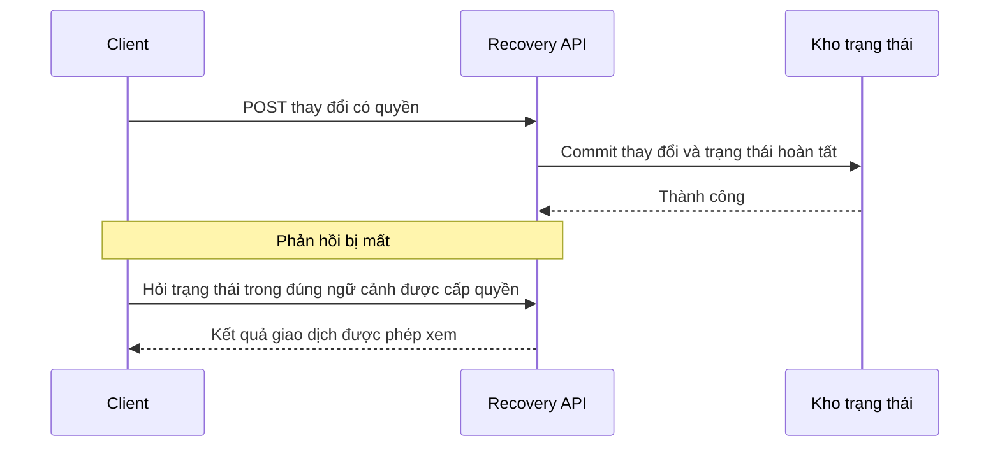

# Hợp đồng lỗi cho API khôi phục tài khoản (Recovery API error contract)

## 1. Phản hồi lỗi cũng là một phần của ranh giới bảo mật

API khôi phục phải giúp client biết nên làm gì tiếp theo: sửa dữ liệu, chờ, bắt đầu lại hay hỏi trạng thái giao dịch. Đồng thời, nó không được trở thành công cụ dò tài khoản, kiểm tra token hoặc khám phá các yếu tố xác thực của người khác.

Xét hai phản hồi từ endpoint yêu cầu khôi phục:

```json
{
  "code": "USER_NOT_FOUND",
  "message": "Không tìm thấy tài khoản với email này."
}
```

```json
{
  "code": "EMAIL_SENT",
  "message": "Đã gửi liên kết khôi phục."
}
```

Dù không trả mật khẩu, hai phản hồi đã cho người gọi phân biệt email có tài khoản hay không. Đổi riêng thông điệp trên giao diện không giải quyết được nếu HTTP status, mã lỗi hoặc header vẫn khác nhau.

Một **error contract** cần xác định đồng thời:

- Ý nghĩa của HTTP status và cấu trúc body.
- Định danh lỗi ổn định để client xử lý bằng máy.
- Thông tin được phép tiết lộ ở từng mức quyền.
- Hành vi retry, trạng thái giao dịch và tác động đã có.
- Cách liên hệ với log nội bộ mà không trả bí mật ra ngoài.

Hợp đồng này áp dụng cho reset mật khẩu, khôi phục MFA, đăng ký lại passkey và các bước xác minh danh tính liên quan. Tên lỗi cụ thể có thể khác nhau, nhưng không được tự mở rộng quyền chỉ để trả một thông báo hữu ích hơn.

## 2. Tách nguyên nhân nội bộ khỏi lỗi công khai

Nhiều nguyên nhân kỹ thuật có thể cần cùng một phản hồi ở phía ngoài:

| Nguyên nhân nội bộ | Phản hồi công khai có thể dùng | Điều cần giữ kín |
| --- | --- | --- |
| Email không có tài khoản | Yêu cầu đã được tiếp nhận theo chính sách chung | Tài khoản có tồn tại hay không |
| Tài khoản không đủ điều kiện nhận email recovery | Cùng phản hồi tiếp nhận chung | Trạng thái khóa, phương thức đăng nhập |
| Token không tồn tại, hết hạn, đã dùng hoặc bị thu hồi | Không thể tiếp tục bằng liên kết hoặc phiên hiện tại | Chi tiết vòng đời token trước khi có quyền biết |
| Mã xác minh sai | Bằng chứng không được chấp nhận | Mã đúng, giá trị mong đợi, bằng chứng nào gần đúng |
| Lỗi cơ sở dữ liệu không dự kiến | Lỗi dịch vụ chung | SQL, tên bảng, stack trace, thông tin hạ tầng |
| Không có quyền với giao dịch được chỉ định | Phản hồi không tiết lộ sự tồn tại của giao dịch | Chủ sở hữu, tiến độ, tài khoản liên quan |

Nhật ký nội bộ có thể cần phân biệt TOKEN_EXPIRED, TOKEN_REVOKED hoặc TOKEN_ALREADY_USED để điều tra. Không cần đưa các lý do ấy vào body công khai chỉ để phục vụ người vận hành.

Mức chi tiết được phép phụ thuộc **quyền đã được xác minh**, không phụ thuộc việc client có cookie hoặc biết một ID. Sau khi xác minh một recovery session giới hạn, có thể trả hướng xử lý cụ thể hơn cho đúng giao dịch, nhưng vẫn không tiết lộ yếu tố khác ngoài phạm vi quyền đó.

## 3. Chọn một định dạng lỗi có cấu trúc

RFC 9457 định nghĩa Problem Details cho HTTP API, với media type JSON tương ứng là `application/problem+json`. Nó thay thế RFC 7807. Định danh `type` nhận diện loại vấn đề; `status`, khi có, phải khớp HTTP status mà server phát sinh; `title` và `detail` phục vụ con người. Client không nên phân tích câu chữ trong `detail` để quyết định nghiệp vụ. [Nguồn: RFC 9457, mục 3.1](https://www.rfc-editor.org/rfc/rfc9457.html#section-3.1).

Ví dụ sau dùng tên miền và mã định danh minh họa:

```http
HTTP/1.1 400 Bad Request
Content-Type: application/problem+json
Cache-Control: no-store
Content-Language: vi
```

```json
{
  "type": "https://accounts.example.test/problems/recovery-cannot-continue",
  "title": "Không thể tiếp tục khôi phục",
  "status": 400,
  "detail": "Liên kết hoặc phiên khôi phục không còn dùng được. Hãy yêu cầu liên kết mới.",
  "instance": "urn:uuid:6e11a925-4a34-42ae-918f-96057f8d220d",
  "code": "RECOVERY_CANNOT_CONTINUE",
  "nextAction": "RESTART_FLOW"
}
```

Trong hợp đồng minh họa này, `code` và `nextAction` là extension do ứng dụng định nghĩa. `code` là bí danh ổn định của `type`, không được có ý nghĩa mâu thuẫn với `type`. Một thư viện Problem Details dùng `type` làm định danh chính; ứng dụng có thể ánh xạ sang enum nội bộ.

Địa chỉ `type` có thể trỏ tới tài liệu công khai về loại lỗi. Không tạo một type URI mới cho mỗi người dùng hoặc mỗi nguyên nhân nhạy cảm. `instance` nhận diện lần xuất hiện lỗi, không chứa email, token, URL gốc hoặc recovery session.

## 4. Hợp đồng trường dữ liệu

| Trường | Vai trò | Quy tắc đề xuất |
| --- | --- | --- |
| `type` | Định danh loại lỗi | URI ổn định, không chứa thông tin giao dịch |
| `title` | Tóm tắt cho con người | Có thể bản địa hóa; không dùng làm khóa xử lý |
| `status` | Bản sao HTTP status | Số nguyên, khớp phản hồi phát ra |
| `detail` | Hướng dẫn an toàn cho lần lỗi | Không chứa exception hoặc đầu vào bí mật |
| `instance` | Đối chiếu lần lỗi | ID ngẫu nhiên hoặc URI tham chiếu an toàn |
| `code` | Bí danh loại lỗi cho ứng dụng | Tập giá trị ổn định, ánh xạ rõ tới type |
| `nextAction` | Hướng xử lý có giới hạn | Enum được công bố; không phải lệnh thực thi tùy ý |
| `violations` | Lỗi từng trường khi được phép | Chỉ tên trường và mã vi phạm, không lặp lại giá trị |

Một tập `nextAction` nhỏ có thể gồm:

```text
FIX_INPUT
WAIT
REFRESH_STATE
RESTART_FLOW
CONTACT_SUPPORT
```

Các giá trị này hướng dẫn trải nghiệm. Chúng không cấp quyền bỏ qua một bước, tự mở khóa tài khoản hoặc tự gửi lại một thao tác thay đổi thông tin xác thực.

Không nên dùng một cờ `retryable: true` nếu chưa định nghĩa rõ retry thao tác nào, khi nào và có cần khóa chống thực hiện trùng hay không. “Có thể thử lại sau” không đồng nghĩa “an toàn để tự gửi lại POST vừa rồi”.

## 5. Ánh xạ HTTP status theo endpoint và mức tiết lộ

Bảng sau là một thiết kế minh họa, không phải yêu cầu dùng cùng một mã cho mọi hệ thống:

| Tình huống | HTTP status | Code công khai minh họa | Hướng xử lý |
| --- | --- | --- | --- |
| JSON hỏng hoặc thiếu trường bắt buộc | 400 | INVALID_REQUEST | Sửa cấu trúc request |
| Liên kết hoặc phiên recovery không thể tiếp tục | 400 | RECOVERY_CANNOT_CONTINUE | Bắt đầu lại |
| Bằng chứng không được chấp nhận | 400 | PROOF_NOT_ACCEPTED | Làm theo chính sách bước hiện tại |
| Phiên có quyền nhưng hành động không được phép | 403 | RECOVERY_ACTION_NOT_ALLOWED | Dừng hoặc đồng bộ trạng thái |
| Trạng thái đã đổi trong một giao dịch mà caller được phép biết | 409 | RECOVERY_STATE_CHANGED | Hỏi lại trạng thái |
| Dữ liệu hợp lệ về cấu trúc nhưng vi phạm chính sách đã công khai | 422 | INPUT_NOT_ACCEPTED | Sửa trường được chỉ rõ |
| Vượt giới hạn request được công khai | 429 | RECOVERY_RATE_LIMITED | Chờ theo hướng dẫn |
| Lỗi không dự kiến | 500 | INTERNAL_ERROR | Giữ kết quả là chưa rõ nếu đã gửi hành động |
| Dịch vụ tạm không tiếp nhận được | 503 | RECOVERY_TEMPORARILY_UNAVAILABLE | Thử lại có kiểm soát |

Không dùng 404 cho email không có tài khoản nhưng 202 cho email có tài khoản. Tương tự, nếu chủ ý gộp các token không thể dùng, không phân biệt chúng qua 400, 409 và 410 ở endpoint công khai.

401 chỉ phù hợp khi endpoint yêu cầu cơ chế HTTP authentication tương ứng. Server phát 401 phải có `WWW-Authenticate` chứa challenge thích hợp; không chọn 401 cho mọi token recovery sai rồi để client tự đăng xuất phiên chính. [Nguồn: RFC 9110, mục 11.6.1](https://www.rfc-editor.org/rfc/rfc9110.html#section-11.6.1).

Có thể dùng 404 để che sự tồn tại của một tài nguyên giao dịch đối với caller không có quyền, nhưng cách áp dụng phải nhất quán. Một ID hợp lệ của người khác không được tạo body hoặc thời gian phản hồi dễ phân biệt với ID không tồn tại.

## 6. Endpoint yêu cầu recovery: tiếp nhận không có nghĩa đã gửi thư

Với endpoint khởi tạo, một lựa chọn là phản hồi đồng nhất cho các định danh có cú pháp hợp lệ:

```http
HTTP/1.1 202 Accepted
Content-Type: application/json
Cache-Control: no-store
```

```json
{
  "code": "RECOVERY_REQUEST_ACCEPTED",
  "message": "Nếu thông tin phù hợp với tài khoản có thể khôi phục, hướng dẫn sẽ được gửi qua kênh đã đăng ký."
}
```

Đây là phản hồi tiếp nhận, không phải Problem Details và không khẳng định email tồn tại hoặc thư đã được giao. RFC 9110 mô tả 202 là đã chấp nhận xử lý nhưng chưa hoàn tất; yêu cầu có thể không được thực hiện ở giai đoạn xử lý sau. [Nguồn: RFC 9110, mục 15.3.3](https://www.rfc-editor.org/rfc/rfc9110.html#section-15.3.3).

Cần giữ nhất quán cả status, schema, header và đường xử lý. Một `operationId`, trạng thái “delivered” hoặc URL theo dõi chỉ xuất hiện cho tài khoản có thật cũng có thể phá vỡ lớp che thông tin này.

OWASP khuyến nghị thông điệp và thời gian phản hồi nhất quán giữa tài khoản tồn tại và không tồn tại. Xử lý bất đồng bộ giúp tránh chờ gửi thư theo nhánh tài khoản, nhưng bản thân việc dùng queue không bảo đảm hết khác biệt thời gian. Không thay thiết kế bằng một khoảng sleep cố định làm cạn tài nguyên. [Nguồn: OWASP Forgot Password — Forgot Password Request](https://cheatsheetseries.owasp.org/cheatsheets/Forgot_Password_Cheat_Sheet.html#forgot-password-request).

Nếu hệ thống biết toàn bộ dịch vụ đang không thể tiếp nhận yêu cầu, có thể trả 503 theo một điều kiện chung không phụ thuộc định danh. Ngược lại, trả “mail provider failed” chỉ cho email tồn tại sẽ làm lộ thông tin. Lỗi xử lý phía sau cần được theo dõi nội bộ, không biến endpoint công khai thành API dò khả năng gửi thư của từng tài khoản.

## 7. Lỗi xác minh và lỗi dữ liệu cần có thứ tự xử lý rõ

Sau khi một phiên đã được cấp quyền đặt mật khẩu mới, phản hồi về chính sách mật khẩu có thể hữu ích:

```json
{
  "type": "https://accounts.example.test/problems/recovery-input-not-accepted",
  "title": "Dữ liệu chưa đáp ứng yêu cầu",
  "status": 422,
  "detail": "Hãy điều chỉnh trường được chỉ rõ.",
  "instance": "urn:uuid:084d7b85-08d6-42dc-8e6a-19a73df22fd4",
  "code": "INPUT_NOT_ACCEPTED",
  "nextAction": "FIX_INPUT",
  "violations": [
    {
      "field": "newPassword",
      "code": "PASSWORD_POLICY_NOT_MET"
    }
  ]
}
```

Không trả lại mật khẩu bị từ chối, hash của nó hoặc chi tiết kiểm tra có khả năng nhận diện dữ liệu người dùng. Các trường trong `violations` lấy từ tập tên đã định nghĩa, không sao chép tùy ý tên thuộc tính độc hại trong request.

Endpoint cần kiểm tra quyền trước khi tiết lộ dữ liệu riêng của tài khoản. Có thể từ chối JSON hỏng trước khi tra session, nhưng thông tin như lịch sử mật khẩu, yếu tố MFA đã đăng ký hoặc credential ID thuộc tài khoản nào chỉ được xử lý và tiết lộ trong phạm vi thích hợp.

Lỗi nhập liệu có thể sửa không nên tự tiêu thụ token thành công. Ngược lại, một lần nhập recovery code sai có thể phải tăng bộ đếm thất bại theo chính sách chống đoán. Hợp đồng cần phân biệt các tác động đó; “request lỗi” không đồng nghĩa “máy chủ không thay đổi bất kỳ trạng thái nào”.

Với MFA hoặc passkey, tránh lỗi công khai như “credential này thuộc tài khoản khác” khi caller chưa có quyền biết. Lỗi challenge không hợp lệ cũng không được tự hạ xuống một phương thức xác minh yếu hơn.

## 8. Giới hạn request và Retry-After

429 biểu diễn tình huống gửi quá nhiều request; phản hồi có thể kèm `Retry-After`. RFC 6585 không buộc một thuật toán hoặc một cách nhận diện caller cụ thể. [Nguồn: RFC 6585, mục 4](https://www.rfc-editor.org/rfc/rfc6585.html#section-4).

Ví dụ, giá trị 60 dưới đây chỉ minh họa số giây cần chờ:

```http
HTTP/1.1 429 Too Many Requests
Content-Type: application/problem+json
Cache-Control: no-store
Retry-After: 60
```

```json
{
  "type": "https://accounts.example.test/problems/recovery-rate-limited",
  "title": "Cần chờ trước khi tiếp tục",
  "status": 429,
  "detail": "Hãy chờ rồi thực hiện lại thao tác được hướng dẫn.",
  "instance": "urn:uuid:0f1281cf-b7a7-4d30-86d6-e627b5dd0f31",
  "code": "RECOVERY_RATE_LIMITED",
  "nextAction": "WAIT"
}
```

Ở endpoint yêu cầu recovery công khai, giới hạn có thể áp dụng theo caller, mạng hoặc định danh đầu vào đã chuẩn hóa, với cùng chính sách cho định danh có thật và không có thật. Không chỉ tạo bộ đếm hoặc header giới hạn khi tìm được tài khoản.

Một biện pháp chặn gửi thư theo tài khoản có thể được giữ ở xử lý nội bộ trong khi phản hồi công khai vẫn đồng nhất. Thiết kế không nên biến việc người lạ gửi nhiều yêu cầu thành khóa đăng nhập của nạn nhân.

Client cần tuân thủ thời gian chờ, có ngân sách retry và tránh gửi dồn từ nhiều tab. `Retry-After` không cấp phép thử lại vô hạn và không xác nhận rằng POST trước đó chưa có tác động.

## 9. Timeout và 5xx: kết quả có thể chưa xác định

Giả sử server đã đổi mật khẩu và commit, nhưng kết nối đứt trước khi client nhận phản hồi. Client chỉ thấy lỗi mạng. Trường hợp này khác với một request bị từ chối trước khi xử lý.



Không diễn giải mọi timeout, 500 hoặc 503 thành “chắc chắn chưa thực hiện”. Hướng xử lý có thể là:

- Đọc trạng thái qua endpoint an toàn gắn với đúng giao dịch và quyền.
- Retry cùng thao tác qua cơ chế idempotency đã được thiết kế.
- Hướng dẫn người dùng kiểm tra hoặc bắt đầu lại theo kết quả được xác nhận.

Khóa idempotency cần gắn với đúng ngữ cảnh và nội dung hành động theo thiết kế, không được tạo từ raw token hoặc mật khẩu rồi đưa ra log hoặc URL. Khóa này không thay thế quyền truy cập.

Sau khi thay đổi thông tin xác thực đã commit, lỗi gửi email thông báo không nên bị trình bày như thể thay đổi chắc chắn chưa diễn ra. Tách trạng thái thay đổi chính khỏi công việc gửi thông báo phía sau, đồng thời duy trì các yêu cầu session và bảo mật của giao dịch.

## 10. Tập trung ánh xạ lỗi, không serialize exception

Một kiến trúc xử lý lỗi có thể tách thành ba lớp:

```text
Lỗi miền nội bộ
    -> chính sách tiết lộ theo endpoint và quyền
    -> danh mục lỗi công khai
    -> serializer Problem Details
```

Mã giả:

```text
handleFailure(internalFailure, requestContext):
    occurrenceId = tạo ID ngẫu nhiên phía server

    publicProblem = errorPolicy.map(
        failureClass = internalFailure.classification,
        disclosureScope = requestContext.verifiedScope,
        endpointKind = requestContext.endpointKind
    )

    ghi audit tối giản:
        occurrenceId
        endpointKind
        internalReason theo enum
        kết quả chuyển trạng thái nếu đã biết

    trả response:
        HTTP status từ publicProblem
        Content-Type: application/problem+json
        Cache-Control: no-store
        body chỉ gồm các trường được phép
```

Không dùng `exception.getMessage()`, raw request, DTO chứa token hoặc toàn bộ đối tượng session để tạo body. Một lỗi kiểm tra dữ liệu có thể giữ nguyên giá trị đầu vào trong exception; log exception không chọn lọc cũng có thể làm lộ bí mật.

OWASP khuyến nghị xử lý lỗi không dự kiến bằng phản hồi chung cho client, giữ thông tin phục vụ điều tra ở phía máy chủ thay vì phơi bày chi tiết triển khai. Phần log nội bộ vẫn cần được lọc dữ liệu nhạy cảm. [Nguồn: OWASP Error Handling Cheat Sheet](https://cheatsheetseries.owasp.org/cheatsheets/Error_Handling_Cheat_Sheet.html).

ID lần lỗi phải do server tạo hoặc được kiểm soát chặt. Biết ID không tự cho phép tải log; mọi giao diện hỗ trợ hoặc tra cứu vẫn cần xác thực, phân quyền và giới hạn dữ liệu.

## 11. Toàn bộ đường phản hồi phải tuân theo chính sách

Body của controller chưa phải toàn bộ hợp đồng. API gateway, WAF, authentication filter, bộ giải mã JSON và reverse proxy có thể tạo lỗi trước khi request tới controller.

Các lớp do dịch vụ kiểm soát cần thống nhất những điểm thiết yếu:

- Status có ý nghĩa và không phụ thuộc sự tồn tại của tài khoản ngoài chính sách.
- Không có raw token trong `Location`, URL lỗi hoặc header chẩn đoán.
- Không cache phản hồi recovery nhạy cảm.
- Không tự redirect API sang trang đăng nhập HTML rồi để client hiểu nhầm là JSON thành công.
- Chính sách CORS và credential được áp dụng nhất quán cho lỗi thuộc origin được phép, không mở wildcard để làm “lỗi dễ đọc”.
- Fallback cho lỗi không dự kiến không hiện stack trace hoặc trang debug.

Một client vẫn phải chịu được phản hồi rỗng, HTML từ tầng ngoài hoặc body không đúng schema khi hạ tầng gặp sự cố. Khi không phân tích được, client dùng thông báo chung và giữ kết quả hành động ở trạng thái chưa rõ; không tự dựng một code thành công.

## 12. Hành vi client và tính ổn định của contract

Client nên phân loại theo HTTP status và định danh lỗi đã công bố, với fallback an toàn khi gặp type hoặc code chưa biết. Không so sánh câu `detail`, không lấy thông báo từ server làm HTML và không tự thực thi URL hoặc hành động tùy ý trong response.

Ví dụ ánh xạ:

| Hướng xử lý đã công bố | Hành vi client |
| --- | --- |
| FIX_INPUT | Hiển thị lỗi của trường được phép, giữ dữ liệu không nhạy cảm cần thiết |
| WAIT | Hiển thị thời gian chờ phù hợp, tránh vòng lặp retry |
| REFRESH_STATE | Hỏi lại trạng thái trong phiên hợp lệ |
| RESTART_FLOW | Giải thích và đưa về bước bắt đầu được định nghĩa sẵn |
| CONTACT_SUPPORT | Hiển thị kênh hỗ trợ cố định và mã lần lỗi |

Không tự điền lại mật khẩu, mã khôi phục hoặc token vào URL điều hướng. Khi gửi thông tin cho hỗ trợ, mã lần lỗi thường đủ để đối chiếu; không yêu cầu người dùng chụp toàn bộ URL có token.

Bản địa hóa có thể thay `title` và `detail` theo ngôn ngữ, còn `type` và ý nghĩa `code` cần giữ ổn định. Thêm trường tùy chọn cần tương thích với client cũ; thay ý nghĩa một code hiện có có thể làm client retry hoặc bỏ bước sai.

Một hợp đồng lỗi hữu ích cho recovery vừa cho người dùng đường tiếp tục rõ ràng, vừa giới hạn thông tin mà người gọi chưa có quyền biết. Khả năng giải thích nguyên nhân kỹ thuật thuộc kênh vận hành có kiểm soát; quyền thay đổi tài khoản vẫn nằm ở chính sách và giao dịch phía máy chủ.
