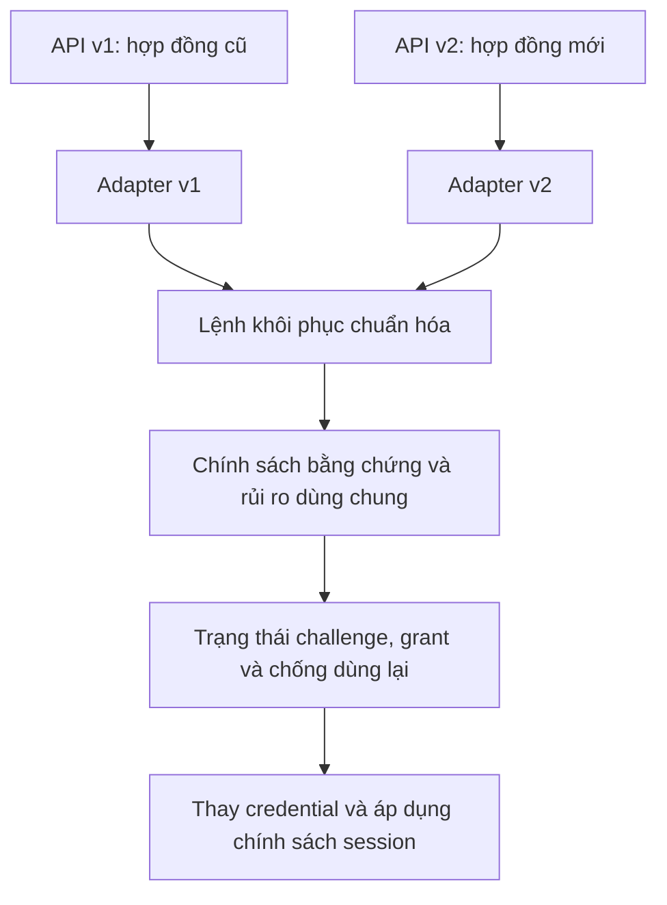

# Recovery API versioning — Quản lý phiên bản API khôi phục tài khoản

## 1. Phiên bản cũ có thể trở thành đường khôi phục yếu hơn

**Recovery API versioning** là cách duy trì và chuyển đổi hợp đồng API của luồng khôi phục khi cấu trúc dữ liệu, trạng thái hoặc trải nghiệm thay đổi. Với chức năng này, quản lý phiên bản còn liên quan trực tiếp đến nguy cơ chiếm đoạt tài khoản.

Giả sử sản phẩm có hai đường hoàn tất phục hồi:

```text
POST /api/v1/password-reset/complete
POST /api/v2/recovery/password
```

Phiên bản mới yêu cầu bằng chứng bổ sung khi phát hiện rủi ro. Phiên bản cũ vẫn chấp nhận cùng một loại token và chỉ kiểm tra token chưa hết hạn. Nếu cả hai tác động đến cùng tài khoản, kẻ tấn công có thể chọn đường cũ thay vì vượt qua điều kiện mới.

Đổi ứng dụng chính sang v2 không tự làm v1 biến mất. Client tùy biến vẫn có thể gọi endpoint còn hoạt động.

OWASP mô tả rủi ro từ phiên bản API cũ, host bị bỏ quên và kiểm soát bảo mật không đồng đều trong [API9:2023 Improper Inventory Management](https://api-security.owasp.org/editions/2023/en/0xa9-improper-inventory-management/). Từ rủi ro đó, bài học đề xuất một nguyên tắc thiết kế: **các phiên bản còn được phục vụ phải cùng tôn trọng mức bảo vệ tối thiểu của hành động khôi phục**.

API có thể khác cách biểu diễn dữ liệu. Quyền đặt lại mật khẩu, thay MFA, đăng ký passkey mới và quản lý session vẫn cần được quyết định bằng chính sách phía máy chủ.

## 2. Phân biệt các loại phiên bản

Không nên dùng một số phiên bản cho mọi lớp của hệ thống.

| Loại phiên bản | Ví dụ minh họa | Trách nhiệm |
| --- | --- | --- |
| Hợp đồng API công khai | `/api/v1`, `/api/v2` | Request, response và cách client tương tác |
| Định dạng grant hoặc token | `grant_format=2` | Cách máy chủ giải mã và xác minh bằng chứng |
| Chính sách khôi phục | `policy_revision=7` | Điều kiện cần để được thực hiện hành động |
| Schema dữ liệu lưu trữ | `record_schema=3` | Cách lưu hồ sơ và đọc dữ liệu qua các bản triển khai |
| Phiên bản ứng dụng client | Một bản phát hành mobile | Khả năng giao diện và tích hợp của client |

Các số trong bảng chỉ là ví dụ, không phải schema bắt buộc.

Một client dùng API v1 không được tự chọn chính sách yếu hơn bằng cách gửi `policy_revision=1`. Tương tự, phát hành API v2 không bắt buộc phải thay toàn bộ định dạng token nếu định dạng hiện tại vẫn đáp ứng yêu cầu.

Việc tách các khái niệm giúp trả lời đúng câu hỏi khi có sự cố. “Lỗi v2” có thể là lỗi mapping response, trong khi quyết định xác minh và trạng thái token dùng chung vẫn hoàn toàn hợp lệ. Rollback phần giao tiếp không được vô tình rollback trạng thái đã dùng của token.

## 3. Hợp đồng bao gồm cả ý nghĩa và trạng thái

Tương thích không chỉ là giữ nguyên tên URL hoặc JSON còn parse được. Client còn dựa vào ý nghĩa của phản hồi và cách điều khiển các bước tiếp theo.

[AIP-180 của Google](https://google.aip.dev/180) phân biệt tương thích mã nguồn, truyền dữ liệu và ngữ nghĩa. Đây là hướng dẫn thiết kế của Google; bài học dùng cách phân biệt này để phân tích API khôi phục, không coi nó là quy chuẩn bắt buộc cho mọi sản phẩm.

Ví dụ những thay đổi cần xem xét:

| Thay đổi | Tác động có thể xảy ra |
| --- | --- |
| Đổi `token` thành `recovery_grant` | Client cũ không còn gửi đúng field |
| Bổ sung một field bắt buộc | Request cũ không đáp ứng hợp đồng mới |
| Đổi `success=true` từ “đã hoàn tất” thành “đã tiếp nhận” | Client có thể báo thành công quá sớm |
| Thêm trạng thái yêu cầu xác minh độc lập | Client cũ có thể không biết hiển thị bước tiếp theo |
| Đổi phản hồi lỗi theo trạng thái tồn tại tài khoản | Có thể tạo thêm cách dò định danh |
| Thay đổi chính sách thu hồi session | Người dùng và client cần hiểu tác động sau phục hồi |

Bản vá bảo mật không nên bị trì hoãn chỉ để bảo tồn một hành vi thiếu an toàn. Nếu không thể giữ tương thích mà vẫn đạt mức bảo vệ cần thiết, sản phẩm cần một quyết định chuyển đổi hoặc ngừng hỗ trợ rõ ràng.

Đặc biệt, không giải quyết việc client cũ không hiểu bước xác minh mới bằng cách tự bỏ bước đó.

## 4. Nhiều adapter, một nơi quyết định quyền khôi phục

Thiết kế dưới đây là **kiến trúc tham khảo do bài học đề xuất**. Các phiên bản API có adapter riêng nhưng cùng gọi một lớp nghiệp vụ khôi phục.



Adapter chịu trách nhiệm đọc request theo hợp đồng đã công bố, kiểm tra cấu trúc và chuyển thành một lệnh nội bộ. Nó không được tự quyết định rằng v1 “được miễn MFA” hoặc v2 “được dùng token hai lần”.

Ví dụ hai request có cách đặt tên khác nhau:

```json
{
  "reset_token": "<opaque-secret>",
  "password": "<new-password>"
}
```

```json
{
  "recovery_grant": "<opaque-secret>",
  "new_password": "<new-password>"
}
```

Chúng có thể cùng được chuyển thành:

```text
CompletePasswordRecovery
  grant
  proposedPassword
  requestContext
```

Đây chỉ là minh họa việc mapping. Không có nghĩa mọi token ở v1 đều được chấp nhận tại v2 hoặc ngược lại. Tập định dạng và mục đích được chấp nhận phải được máy chủ quy định rõ.

Máy chủ lấy tài khoản đích từ hồ sơ hoặc grant đã xác minh. Không chọn lại tài khoản chỉ bằng một field email do client gửi kèm.

## 5. Các bất biến cần giữ giữa những phiên bản còn hoạt động

Trong kiến trúc tham khảo, các adapter phải tuân theo cùng một tập bất biến:

- Bằng chứng thuộc đúng tài khoản và đúng loại hành động.
- Challenge hoặc grant chưa hết hạn, chưa bị thu hồi và chưa được sử dụng theo quy tắc của nó.
- Hành động đáp ứng chính sách đang có hiệu lực cho hồ sơ đó.
- Các yêu cầu nhạy cảm giữ đúng phạm vi quyền của phiên khôi phục.
- Giới hạn thử mã và gửi thông báo không bị nhân lên bằng cách đổi phiên bản.
- Phản hồi công khai không tạo khác biệt không cần thiết để dò tài khoản.
- Khi thay credential thành công, cơ chế session và thông báo bảo mật được xử lý theo cùng chính sách.

Ví dụ, một grant `RESET_PASSWORD` không được dùng để gọi chức năng `REPLACE_AUTHENTICATOR`, kể cả khi adapter cũ chỉ có một endpoint mang tên chung là `complete`.

Việc cập nhật tên field ở v2 không làm thay đổi phạm vi của grant. Ngược lại, việc giữ nguyên tên field ở v1 cũng không bảo đảm rằng quyền bên trong vẫn phù hợp.

Một giới hạn thử mã gắn riêng với `/api/v1` và một giới hạn độc lập cho `/api/v2` có thể tạo thêm ngân sách thử cho cùng challenge. Thiết kế của bài học gắn giới hạn cốt lõi với hồ sơ và hành động; các giới hạn theo route chỉ là lớp bổ sung.

## 6. Token dùng một lần phải dùng một lần trên toàn bộ đường chấp nhận

Giả sử cùng một grant được hỗ trợ qua cả v1 và v2. Nếu hai phiên bản ghi nhận việc sử dụng ở hai kho độc lập, mỗi bên có thể nghĩ rằng grant vẫn chưa dùng.

Tình huống lỗi:

```text
v1: thấy grant chưa dùng trong kho của v1 → chấp nhận
v2: thấy grant chưa dùng trong kho của v2 → chấp nhận
```

Trong thiết kế tham khảo, mọi đường hoàn tất đều đi qua cùng một quyết định tiêu thụ grant. Mã giả:

```text
completeRecovery(normalizedCommand):
    grant = verifySupportedGrant(normalizedCommand.grant)
    require grant purpose is PASSWORD_RESET

    begin transaction
        recovery = loadRecoveryForUpdate(grant.recoveryId)
        require grant belongs to recovery
        require recovery is active and not expired
        require grant is not consumed or revoked
        require evidence meets effective policy
        require action is allowed for this recovery

        updatePassword(recovery.accountId, normalizedCommand.proposedPassword)
        consumeGrant(grant.id)
        applySessionPolicy(recovery.accountId)
        enqueueSecurityNotification(recovery.accountId)
    commit transaction
```

Ví dụ giả định các thay đổi cốt lõi có thể được phối hợp trong ranh giới giao dịch phù hợp. Nếu hệ thống tách thành nhiều dịch vụ, cần một cơ chế nhất quán tương đương; bộ nhớ đệm riêng của mỗi phiên bản không đủ thay cho quyết định dùng một lần.

Phiên bản cũ không được tiếp tục tin một token chỉ vì trước đó đã xác minh chữ ký và cache kết quả. Trạng thái đã tiêu thụ hoặc thu hồi vẫn cần được tôn trọng.

Nếu có hỗ trợ retry, cơ chế idempotency cần gắn với cùng hành động nghiệp vụ. Việc gửi lại phải trả về kết quả phù hợp, không thực hiện thêm lần đổi credential hay cấp thêm quyền. Chỉ trùng một idempotency key do client cung cấp chưa đủ nếu request thực tế khác nhau.

## 7. Không để client lựa chọn mức bảo đảm bằng phiên bản

Client có thể chọn một hợp đồng được hỗ trợ. Nó không được tự chọn bỏ bớt điều kiện bảo mật.

Các hành vi sau không phù hợp với thiết kế của bài học:

```text
v2 thất bại xác minh → tự chuyển sang v1 với ít điều kiện hơn
token không đọc được theo định dạng mới → thử mọi parser cũ
không biết policy_revision → mặc định về chính sách đầu tiên
client cũ thiếu bằng chứng → coi như đã có bằng chứng
```

Chính sách hiệu lực cần được máy chủ giải quyết từ hồ sơ, loại hành động và các yêu cầu bảo mật hiện tại. Không diễn giải số policy như một số nguyên để luôn chọn nhỏ nhất hoặc lớn nhất; các revision có thể mang ý nghĩa khác nhau.

Với hồ sơ được tạo trước một bản cập nhật bảo mật, sản phẩm có thể chọn:

1. Cho tiếp tục nếu bằng chứng hiện có vẫn đạt yêu cầu được chấp nhận.
2. Yêu cầu thêm bằng chứng rồi mới hoàn tất.
3. Thu hồi hồ sơ cũ và hướng dẫn bắt đầu lại.

Quyết định cần được quy định rõ. Không đóng băng một chính sách đã bị xác định là thiếu an toàn chỉ vì token được phát hành trước ngày cập nhật.

Nếu v1 không thể biểu diễn bước bổ sung, adapter không được trả thành công giả. Nó có thể trả kết quả yêu cầu dùng luồng được hỗ trợ, với nội dung công khai không tiết lộ chi tiết tài khoản hoặc quyết định rủi ro nội bộ.

## 8. Chọn phiên bản rõ ràng và không tự fallback

Một API có thể đặt phiên bản trong đường dẫn, header hoặc loại biểu diễn. Thiết kế tham khảo chọn đường dẫn để việc định tuyến dễ quan sát:

```text
/api/v1/...
/api/v2/...
```

Không cần kết hợp nhiều cách lựa chọn nếu không có nhu cầu rõ ràng. Nếu sản phẩm đồng thời hỗ trợ header, phải định nghĩa cách xử lý khi header và đường dẫn mâu thuẫn.

Trong ví dụ, yêu cầu mâu thuẫn bị từ chối trước khi phát sinh tác dụng nghiệp vụ. Không xử lý bằng v1 ở gateway nhưng lại dùng schema v2 tại ứng dụng.

Các quy tắc vận hành của ví dụ gồm:

- Phiên bản không hỗ trợ nhận phản hồi đã được tài liệu hóa.
- Tên phiên bản không phân biệt được không tự rơi về bản cũ.
- Không có route không ghi phiên bản vô tình trỏ đến một implementation lỗi thời.
- Client không tự lặp lại một POST nhạy cảm qua phiên bản khác sau mọi lỗi.
- Thay đổi response mapping không thay đổi việc quyền đã được tiêu thụ hay chưa.

Ví dụ, timeout sau bước hoàn tất không chứng minh máy chủ chưa cập nhật credential. Client cần một cách retry hoặc nhận biết trạng thái phù hợp với hợp đồng; gửi lại tùy ý sang v1 có thể tạo ra sự mơ hồ.

## 9. Xử lý hồ sơ đang dở và rollback

Khi v1 và v2 cùng hoạt động, có thể tồn tại link email cũ, phiên khôi phục chưa hoàn tất và client mobile chưa cập nhật.

Không nên suy rằng mọi hồ sơ cũ đều phải tiếp tục qua v1. Cũng không tự cấp lại toàn bộ token chỉ vì giao diện mới cần một tên field khác.

Một kế hoạch chuyển đổi cần trả lời:

| Dữ liệu đang tồn tại | Quyết định cần có |
| --- | --- |
| Link chưa hết hạn | Còn được tiếp nhận ở đâu và theo điều kiện nào? |
| Phiên khôi phục giới hạn | Có thể tiếp tục qua adapter nào? |
| Challenge đã dùng | Mọi phiên bản đều nhận biết trạng thái đã tiêu thụ không? |
| Hồ sơ cần thêm bằng chứng | Client cũ nhận hướng dẫn tiếp tục như thế nào? |
| Thay đổi schema | Bản ứng dụng còn có thể rollback có đọc được dữ liệu mới không? |

Trong kiến trúc tham khảo, thay đổi schema được tách khỏi quyết định quyền. Có thể bổ sung dữ liệu phục vụ v2 trước, chuyển dần nơi sử dụng, rồi loại bỏ thành phần cũ khi không còn phụ thuộc.

Rollback adapter không được khôi phục token đã dùng thành chưa dùng, bật lại grant bị thu hồi hoặc giảm mức bằng chứng vừa được yêu cầu. Nếu bản cũ không hiểu trạng thái bảo mật mới, việc quay về bản đó có thể không còn là phương án phục hồi an toàn.

Một hướng xử lý sự cố là tạm ngừng hành động nhạy cảm bị ảnh hưởng trong khi vẫn cung cấp hướng dẫn phù hợp. Không dùng tính sẵn sàng như lý do tự mở lại đường khôi phục đã biết yếu hơn.

## 10. Thông báo deprecation và sunset

Deprecation thông báo rằng một tài nguyên sẽ hoặc đã được đưa vào diện không khuyến khích tiếp tục phụ thuộc. Sunset thông báo mốc dự kiến tài nguyên ngừng phục vụ. Hai thông tin không đồng nghĩa.

Theo [RFC 9745](https://www.rfc-editor.org/rfc/rfc9745.html), `Deprecation` dùng giá trị ngày theo Structured Fields; quan hệ link `deprecation` có thể trỏ đến tài liệu chuyển đổi. Header không tự thay đổi chức năng của tài nguyên.

`Sunset` dùng định dạng HTTP-date và được mô tả trong [RFC 8594](https://www.rfc-editor.org/rfc/rfc8594.html). Đây là tín hiệu vòng đời, không phải cơ chế tự chặn request.

Ví dụ lịch giả định cho một tài nguyên v1:

```http
Deprecation: @1798761600
Sunset: Thu, 01 Apr 2027 00:00:00 GMT
Link: <https://accounts.example.com/docs/recovery-v1>; rel="deprecation"; type="text/html"
```

Trong ví dụ:

- Mốc deprecation là 00:00:00 UTC ngày 01/01/2027.
- Mốc sunset dự kiến là 00:00:00 UTC ngày 01/04/2027.
- Tài liệu giải thích endpoint thay thế và cách tiếp tục các hồ sơ đang dở.

Đây là lịch minh họa, không phải lịch triển khai của module. Khi cả hai header được sử dụng, mốc sunset không được sớm hơn mốc deprecation theo RFC 9745.

Việc thật sự ngừng v1 vẫn cần được thực hiện trong cấu hình định tuyến và ứng dụng. Không coi header hay việc xóa endpoint khỏi tài liệu là bằng chứng endpoint không còn gọi được.

## 11. Ngừng phiên bản cũ là công việc quản lý bề mặt truy cập

Để loại bỏ một phiên bản, cần biết nó đang được phục vụ qua những đường nào. Ngoài host chính có thể còn alias, đường dẫn cũ, host đối tác hoặc bản triển khai phục vụ một nhóm client riêng.

OWASP khuyến nghị kiểm kê host, môi trường, phiên bản và bảo vệ các phiên bản đang lộ ra bên ngoài; khi có cải tiến bảo mật ở bản mới, cần đánh giá cách xử lý bản cũ. Xem [API9:2023](https://api-security.owasp.org/editions/2023/en/0xa9-improper-inventory-management/#how-to-prevent).

Trong thiết kế tham khảo, quá trình ngừng v1 có thứ tự:

1. Xác định consumer còn phụ thuộc và người chịu trách nhiệm từng đường phục vụ.
2. Ngừng tạo phụ thuộc mới vào v1 theo kế hoạch đã công bố.
3. Chuyển các consumer phù hợp sang hợp đồng mới.
4. Xử lý hồ sơ đang dở theo chính sách đã chọn.
5. Chặn v1 ở những điểm phục vụ đã xác định, đồng thời giữ các lớp phòng thủ cần thiết ở backend.
6. Duy trì hướng dẫn chuyển đổi và dấu vết vận hành cần thiết.

Phản hồi sau khi ngừng cần nhất quán với hợp đồng vòng đời. Có thể chọn một phản hồi như `410 Gone` khi phù hợp, nhưng không trả kết quả khác nhau tùy tài khoản có tồn tại hay không.

Ngừng endpoint không tự có nghĩa được xóa mọi hồ sơ, log hoặc trạng thái thu hồi. Thời gian lưu bằng chứng vận hành và dữ liệu khôi phục cần theo chính sách riêng.

## 12. Quan sát chuyển đổi mà không ghi bí mật

Số request v1 giảm là tín hiệu hữu ích, nhưng chưa đủ để biết người dùng đã chuyển thành công. Một client cũ có thể ngừng gọi vì người dùng bị kẹt trước bước xác minh.

Các tín hiệu có thể theo dõi trong ví dụ:

- Lượt bắt đầu và hoàn tất theo phiên bản API.
- Lỗi hợp đồng hoặc phiên bản không hỗ trợ.
- Số hồ sơ cần dùng một luồng tiếp tục khác.
- Tỷ lệ gặp challenge đã hết hạn hoặc đã tiêu thụ.
- Hành vi lặp lại cùng một hành động qua nhiều phiên bản.
- Request còn đến những host hoặc route dự kiến đã ngừng.

Dữ liệu vận hành nên dùng định danh tương quan phù hợp và kết quả phân loại. Không ghi token, OTP, mật khẩu mới hoặc toàn bộ request body để giải thích lỗi chuyển phiên bản.

Việc nhận thấy nhiều request v1 không tự chứng minh có tấn công. Đó có thể là một bản mobile còn được dùng. Tuy nhiên, nhu cầu hỗ trợ client này cũng không tự cho phép bỏ điều kiện bảo mật.

## 13. Áp dụng vào ba tình huống

### V2 đã sửa lỗi nhưng v1 vẫn nối cùng dữ liệu thật

Nếu v1 còn quyền thay credential với điều kiện yếu hơn, lợi ích bảo mật của v2 không bao phủ toàn bộ tài khoản. Cần áp dụng bảo vệ tương ứng cho v1 hoặc quyết định ngừng đường đó theo mức rủi ro.

### Token bị dùng lại bằng cách đổi đường dẫn

Nếu grant đã được v2 tiêu thụ, request đến v1 phải thấy cùng trạng thái đã dùng. Tách adapter không được tách ý nghĩa “một lần” thành một lần cho mỗi phiên bản.

### Client cũ không hiểu bước phục hồi MFA mới

Máy chủ giữ yêu cầu xác minh. Adapter có thể hướng người dùng đến một luồng được hỗ trợ, nhưng không báo hoàn tất hoặc tự bỏ bước chỉ để giữ response cũ.

Quản lý phiên bản API khôi phục thành công là duy trì được đường chuyển đổi có thể sử dụng, trong khi mọi đường còn hoạt động vẫn tôn trọng quyền, bằng chứng, token và trạng thái session của cùng tài khoản.
