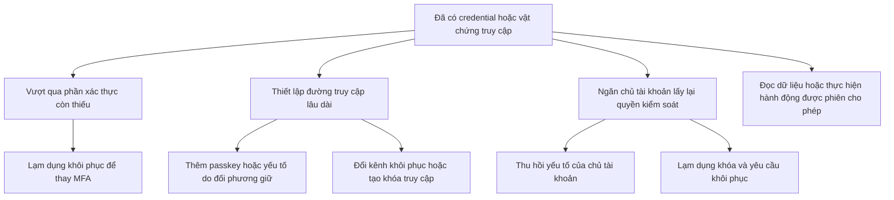

# Stolen credential attacker: Kẻ tấn công có thông tin xác thực bị đánh cắp

Trong chương **Recovery Threat Model**, một đối tượng cần mô hình hóa rõ là **stolen credential attacker**: kẻ tấn công đã có một thông tin xác thực hoặc vật chứng truy cập hợp lệ của nạn nhân, nhưng chưa chắc kiểm soát được toàn bộ tài khoản.

Đối tượng này khác với người chỉ đoán mật khẩu. Họ có thể đưa ra một mật khẩu đúng, dùng một recovery code thật hoặc sở hữu session còn hiệu lực. Nếu luồng khôi phục coi bất kỳ bằng chứng hợp lệ nào cũng đủ để thay mọi phương thức đăng nhập, kẻ tấn công có thể dùng phần quyền đã lấy được để giành quyền kiểm soát lâu dài.

Trong phạm vi `SECURITY_AUTHENTICATION_ACCOUNT_RECOVERY`, bài học tập trung vào rủi ro đó khi người dùng mất mật khẩu, MFA, passkey hoặc thiết bị xác thực. Mục tiêu là xác định đúng năng lực của đối phương, các ranh giới cần bảo vệ và biện pháp kiểm soát phù hợp với từng bằng chứng bị lộ.

Sau bài học, bạn có thể:

- Mô tả một kẻ tấn công theo đúng loại credential hoặc vật chứng truy cập mà họ đang giữ.
- Giải thích vì sao biết mật khẩu không tự đủ để thay MFA hoặc kênh khôi phục.
- Nhận diện cách luồng khôi phục bị dùng để biến truy cập tạm thời thành quyền kiểm soát bền vững.
- Thiết kế ràng buộc cho token, session và thao tác thay credential.
- Nêu rủi ro còn lại khi chính bằng chứng dự phòng hoặc nhiều kênh xác minh đã bị chiếm quyền.

## 1. Định nghĩa đối tượng tấn công bằng năng lực cụ thể

Trong ngữ cảnh xác thực, **credential** là thông tin hoặc cấu trúc được sử dụng để chứng minh quyền truy cập theo một cơ chế nhất định. Ví dụ quen thuộc là mật khẩu và thông tin liên quan tới một authenticator. Trong phân tích khôi phục, cũng cần xét recovery code, token khôi phục và vật chứng phiên vì chúng có thể trao quyền cho bên đang sở hữu.

Không nên gom mọi thứ vào một kết luận “attacker có credential nên đã có toàn quyền”. Cần viết chính xác họ giữ gì, dùng được ở đâu và còn thiếu điều gì.

| Thứ kẻ tấn công có | Năng lực có thể có | Không được mặc nhiên suy ra |
|---|---|---|
| Mật khẩu dạng rõ của tài khoản | Vượt qua bước kiểm tra mật khẩu nếu mật khẩu chưa bị đổi | Đã vượt MFA, kiểm soát email hay sở hữu recovery code |
| Bản băm mật khẩu bị lộ | Có thể thử khôi phục mật khẩu bằng đoán ngoại tuyến tùy cách bảo vệ | Bản băm luôn dùng trực tiếp được ở endpoint đăng nhập thông thường |
| Recovery code chưa dùng | Có thể thực hiện thao tác mà chính sách dành cho mã đó | Có quyền quản trị hoặc quyền khôi phục tài khoản khác |
| Token đặt lại mật khẩu | Có thể đổi mật khẩu trong phạm vi token nếu còn hiệu lực | Có quyền tắt MFA hoặc thêm passkey |
| Session cookie hoặc bearer token | Có thể dùng những quyền mà phiên hoặc token thực sự mang | Đã biết mật khẩu, có authenticator hoặc được phép sửa mọi thiết lập bảo mật |
| Quyền kiểm soát hộp thư khôi phục | Có thể nhận hướng dẫn, mã và thông báo gửi qua hộp thư đó | Kiểm soát một yếu tố độc lập nằm ngoài hộp thư |
| Thiết bị chứa passkey | Có thể có cơ hội dùng passkey tùy trạng thái khóa và cơ chế bảo vệ | Chỉ cầm thiết bị là chắc chắn dùng được khóa riêng |
| Khả năng sử dụng khóa riêng của một passkey hợp lệ | Có thể đáp ứng những lần xác thực mà authenticator đó được chấp nhận | Tự có quyền vượt qua mọi kiểm tra nghiệp vụ hoặc mọi yêu cầu bổ sung |

Session token và API key có thể thuộc các cơ chế truy cập khác với credential đăng nhập của người dùng. Dù tên gọi khác nhau, threat model vẫn phải xem xét chúng nếu chúng có thể gọi API bảo mật hoặc tạo đường truy cập mới.

Định danh công khai của credential hoặc khóa công khai được lưu ở máy chủ không tương đương với việc sở hữu khóa riêng. Tương tự, biết email của nạn nhân không đồng nghĩa kiểm soát hộp thư của họ.

## 2. Mô hình cơ sở: Có mật khẩu, chưa có MFA

Để phân tích nhất quán, trước hết chọn một mô hình giới hạn:

```text
Tài khoản đích:
  Có mật khẩu và MFA đã đăng ký.
  Có kênh khôi phục và chính sách dự phòng riêng.

Kẻ tấn công có:
  Email hoặc tên đăng nhập của nạn nhân.
  Mật khẩu hiện tại ở dạng có thể sử dụng.
  Khả năng gọi các endpoint công khai và bắt đầu yêu cầu khôi phục.

Kẻ tấn công chưa có:
  Authenticator MFA đang được chấp nhận.
  Recovery code hợp lệ.
  Quyền kiểm soát kênh khôi phục.
  Session đã hoàn tất toàn bộ yêu cầu đăng nhập.
  Quyền truy cập cơ sở dữ liệu hoặc khóa bí mật của máy chủ.

Mục tiêu của kẻ tấn công:
  Thay hoặc vô hiệu hóa MFA để đăng nhập.
  Đăng ký credential do mình kiểm soát.
  Thay kênh khôi phục để duy trì quyền kiểm soát.
```

Đây là giả định cho một nhánh phân tích, không phải mô tả mọi sự cố. Khi xuất hiện thêm session bị đánh cắp hoặc hộp thư bị chiếm quyền, phải mở rộng mô hình thay vì tiếp tục áp dụng kết luận của trường hợp chỉ lộ mật khẩu.

### Tài sản cần bảo vệ

Không chỉ dữ liệu nghiệp vụ mới là tài sản. Trong luồng khôi phục, các tài sản quan trọng gồm:

- Quyền quyết định authenticator nào được tài khoản chấp nhận.
- Kênh nhận quyền khôi phục trong tương lai.
- Recovery code và token có thể đổi phương thức đăng nhập.
- Session, refresh token, API key và dấu tin cậy thiết bị.
- Khả năng truy cập của chủ tài khoản hợp lệ.
- Tính toàn vẹn của bằng chứng, quyết định phê duyệt và audit.

Một kẻ tấn công chưa đọc được dữ liệu vẫn có thể gây thiệt hại nếu làm chủ tài khoản mất đường truy cập hoặc thay kênh khôi phục để chuẩn bị chiếm quyền sau đó.

## 3. Vì sao luồng khôi phục hấp dẫn với người đã biết mật khẩu?

MFA có thể đang chặn đăng nhập thông thường. Kẻ biết mật khẩu sẽ tìm một thao tác có yêu cầu thấp hơn nhưng cho phép loại bỏ chính lớp MFA đó.

Một chuỗi rủi ro thường có dạng:

```text
Có mật khẩu đúng
  -> Được tạo ngữ cảnh đăng nhập chưa hoàn tất MFA
  -> Endpoint khôi phục nhầm ngữ cảnh đó là đủ tin cậy
  -> Cho phép thay MFA hoặc thêm credential
  -> Đăng nhập bằng phương tiện do kẻ tấn công kiểm soát
```

Điểm thất bại là sự chuyển đổi từ **đã kiểm tra một yếu tố** sang **được sửa đường xác thực của tài khoản** mà không có đủ bằng chứng theo chính sách.

### Hỏi lại chính mật khẩu bị lộ không tạo ra bằng chứng độc lập

Giả sử luồng tắt MFA yêu cầu người dùng nhập lại mật khẩu. Bước nhập lại có thể hữu ích trong một số ngữ cảnh, chẳng hạn hạn chế thao tác từ session bỏ quên. Nhưng trong mô hình kẻ tấn công đã có mật khẩu, bước đó không ngăn được đối phương.

Một thao tác “reauthentication” cần được đánh giá theo yếu tố thực sự dùng để xác thực lại. Không thể chỉ nhìn tên bước hoặc việc nó vừa diễn ra gần đây.

### Mất yếu tố không được tự trở thành quyền bỏ yếu tố

Thông báo “Tôi mất điện thoại” mô tả một yêu cầu, không phải bằng chứng về danh tính. Nếu chỉ cần mật khẩu và lời khai mất điện thoại để xóa MFA, MFA không còn ngăn được kẻ biết mật khẩu trong tình huống đó.

Hệ thống cần một đường khôi phục khả thi cho người hợp lệ, nhưng đường đó phải có bằng chứng dự phòng hoặc quy trình xác minh phù hợp. Không thể giải quyết việc thiếu bằng chứng bằng cách coi lời khai khẩn cấp là bằng chứng thay thế.

## 4. Các mục tiêu tấn công cần đặt cạnh nhau

Kẻ tấn công có thể tìm nhiều kết quả khác nhau. Chỉ kiểm tra việc đăng nhập thành công sẽ bỏ sót các mục tiêu còn lại.



Các nhánh là những mục tiêu có thể độc lập hoặc kết hợp, không phải khẳng định mọi nhánh đều thực hiện được. Với từng nhánh, cần xác định điều kiện tiên quyết và nơi kiểm soát ngăn chặn.

### Truy cập tạm thời và kiểm soát lâu dài

Một session bị đánh cắp có thể hết hạn. Nếu session đó được phép thêm passkey mới, kẻ tấn công có thể tạo đường đăng nhập còn tồn tại sau khi session cũ đã bị thu hồi.

Tương tự, đổi mật khẩu chưa chắc kết thúc sự cố nếu đối phương đã thêm authenticator, đổi email khôi phục hoặc tạo API key. Tác vụ xử lý cần xem xét toàn bộ những phương tiện truy cập có thể đã được tạo trong khoảng thời gian bị xâm phạm.

Đây là lý do các thao tác quản lý credential và kênh khôi phục cần được xem là hành động nhạy cảm, ngay cả khi không trực tiếp chuyển tiền hoặc xuất dữ liệu.

## 5. Những lỗi thiết kế tạo đường vượt qua MFA

### Chấp nhận phiên chưa hoàn tất đăng nhập như phiên đầy đủ

Một hệ thống có thể tạo ngữ cảnh tạm sau khi kiểm tra mật khẩu để tiếp tục MFA. Ngữ cảnh đó cần được phân biệt với phiên sử dụng bình thường.

Kiểm tra sau là không đủ nếu `current_context` có thể là ngữ cảnh chưa hoàn tất MFA:

```text
if current_context has subject_id:
    allow_replace_mfa()
```

Sự tồn tại của `subject_id` chỉ giúp hệ thống biết đang xử lý tài khoản nào. Nó không tự cho biết đã đạt yêu cầu nào hoặc được phép gọi thao tác gì.

### Cho đổi kênh trước rồi dùng kênh mới để tự xác minh

Một luồng có vấn đề cho phép bên biết mật khẩu nhập email mới, nhận mã tại email mới rồi coi mã đó là đủ để thay MFA. Kẻ tấn công đã tự chọn kênh bằng chứng của mình.

Kiểm tra quyền kiểm soát email mới có thể cần thiết khi đổi email, nhưng chỉ chứng minh bên thao tác kiểm soát địa chỉ mới. Nó không tự chứng minh họ có quyền thay kênh cũ hoặc khôi phục tài khoản đích.

### Cho tải recovery code chỉ từ mật khẩu bị lộ

Nếu màn hình chưa hoàn tất MFA cho phép xem hoặc tạo bộ recovery code có đủ quyền thay MFA, hệ thống đã trao chính bằng chứng mà đối phương còn thiếu.

Không nên hiển thị lại bí mật dự phòng nguyên văn qua một ngữ cảnh yếu hơn yêu cầu bảo vệ thao tác. Việc tạo bộ mã thay thế cũng phải được kiểm soát như thay đổi bảo mật và xử lý bộ mã cũ theo chính sách.

### Dùng token đúng nhưng sai mục đích

Token đặt lại mật khẩu có thể bị endpoint thay MFA chấp nhận do dùng chung hàm “validate token”. Token hợp lệ về chữ ký hoặc giá trị tra cứu chưa có nghĩa hợp lệ cho thao tác hiện tại.

Cần ràng buộc token với tài khoản, tenant nếu có, mục đích, nơi sử dụng, thời hạn và trạng thái dùng. Client không được tự đổi `subject_id`, `operation` hoặc loại quyền bằng dữ liệu gửi lên.

### Tự cấp phiên đầy đủ sau một bước khôi phục hẹp

Sau khi đặt mật khẩu mới, hệ thống tự trả phiên đã hoàn tất MFA dù không có bước xác minh tương ứng. Khi đó đường đặt lại mật khẩu vô tình trở thành cách bỏ qua MFA.

Nếu chỉ thay mật khẩu và MFA vẫn còn hiệu lực, đường đăng nhập tiếp theo phải xử lý MFA theo chính sách. Nếu luồng khôi phục được thiết kế để cấp phiên khác, mức tin cậy và các hạn chế của phiên cần được quyết định rõ ràng.

## 6. Thiết kế quyết định khôi phục theo bằng chứng và thao tác

Một chính sách tốt bắt đầu từ câu hỏi: **Bên đang có bằng chứng này được phép thay đổi điều gì, trong mô hình bị xâm phạm nào?**

Ví dụ với mô hình chỉ lộ mật khẩu:

| Yêu cầu | Điều mật khẩu đúng có thể hỗ trợ | Điều còn cần quyết định riêng |
|---|---|---|
| Tiếp tục đăng nhập có MFA | Hoàn tất bước mật khẩu | Yếu tố MFA hoặc đường khôi phục được chấp nhận |
| Đặt lại mật khẩu qua kênh dự phòng | Nhận diện thêm ngữ cảnh nếu chính sách dùng | Bằng chứng cho phép đặt lại và phạm vi quyền |
| Thay MFA bị mất | Không đủ để loại trừ kẻ đã biết mật khẩu | Bằng chứng dự phòng hoặc quy trình phê duyệt phù hợp |
| Đăng ký passkey thay thế | Không tự chứng minh quyền thêm phương tiện đăng nhập | Quyền đăng ký cho đúng tài khoản và ngữ cảnh |
| Đổi email khôi phục | Không chứng minh quyền kiểm soát kênh cũ | Chính sách thay kênh và xác minh kênh mới |

Không có một loại bằng chứng dự phòng luôn đủ cho mọi loại tài khoản. Cần xét tác động của việc chấp nhận nhầm, các yếu tố còn lại và mức độc lập giữa chúng. Một tài khoản quản trị có thể cần điều kiện khác với tài khoản cá nhân có tác động thấp hơn.

### Tách kết quả xác minh khỏi quyền được cấp

Máy chủ nên lưu rõ:

```text
Đã kiểm tra:
  Loại bằng chứng nào, vào thời điểm nào, theo chính sách nào.

Cho phép:
  Thao tác nào, trên tài khoản và tenant nào, trong hồ sơ nào.

Giới hạn:
  Thời hạn, số lần dùng, điều kiện thu hồi và hạn chế phiên.

Chưa chứng minh:
  Những yếu tố hoặc quyền nào vẫn chưa được đáp ứng.
```

Một cờ `verified = true` thường không đủ để chứa các thông tin đó.

Pseudocode khái niệm cho một quyết định thay MFA:

```text
authorize_mfa_replacement(case, evidence_summary, account):
    require case.operation == "mfa.replace"
    require case.subject_id == account.id
    require case.tenant_id == account.tenant_id
    require case is active and not expired
    require account state permits this recovery operation
    require evidence_summary was validated by trusted server logic
    require evidence_summary is bound to this case and purpose
    require current_security_context_matches(case, account)

    decision = recovery_policy.evaluate(
        operation = "mfa.replace",
        account_context = account,
        evidence = evidence_summary
    )

    if decision does not satisfy required conditions:
        return ADDITIONAL_EVIDENCE_OR_DENIAL

    return NARROW_ONE_TIME_RECOVERY_GRANT
```

`evidence_summary` không phải danh sách tự khai do client gửi lên. Nó phải phản ánh các kiểm tra đã thực sự diễn ra phía máy chủ. Policy cũng không được mặc định chấp nhận mật khẩu đơn lẻ cho thao tác thay MFA trong mô hình đang xét.

Bước cấp grant chưa phải bước thay yếu tố. Khi áp dụng, hệ thống vẫn phải kiểm tra lại grant, thời hạn, trạng thái bảo mật và tiêu thụ quyền nguyên tử cùng thay đổi tương ứng.

## 7. Kiểm soát theo từng giai đoạn của luồng khôi phục

| Giai đoạn | Rủi ro từ credential bị đánh cắp | Kiểm soát cần có |
|---|---|---|
| Khởi tạo | Dùng thông tin nạn nhân để dò tài khoản hoặc gây spam | Phản hồi hạn chế dò tìm, giới hạn tần suất và không tự khóa tài khoản từ yêu cầu chưa xác minh |
| Chọn bằng chứng | Dùng lại chính yếu tố đã bị lộ để bỏ lớp bảo vệ còn lại | Chính sách theo thao tác; không gọi cùng một bí mật hai lần là hai bằng chứng độc lập |
| Phát hành challenge | Gửi mã tới kênh do đối phương vừa chọn | Dùng kênh đã được chấp nhận và quản lý thay kênh bằng quy trình riêng |
| Kiểm tra bằng chứng | Dò mã, trộn hồ sơ hoặc phát lại | Giới hạn thử, kiểm tra ngữ cảnh, thời hạn và trạng thái dùng |
| Cấp quyền | Biến kết quả xác minh hẹp thành quyền toàn phần | Grant gắn với tài khoản, tenant, mục đích và giới hạn rõ ràng |
| Áp dụng thay đổi | Hai request cùng tiêu thụ token hoặc sửa thuộc tính ngoài phạm vi | Giao dịch hoặc cập nhật có điều kiện, kiểm tra payload và quyền phía máy chủ |
| Sau khôi phục | Giữ session của đối phương hoặc credential đã cài thêm | Thu hồi đúng phạm vi, kiểm tra danh mục phương tiện truy cập và thông báo bảo mật |

### Bảo vệ token và recovery code

Token cần được sinh bằng nguồn ngẫu nhiên mật mã, có entropy phù hợp, hết hạn và giới hạn sử dụng. Nếu lưu giá trị băm của token, điều đó giảm hậu quả của một số dạng lộ dữ liệu lưu trữ; nó không bảo vệ token đã bị lấy từ trình duyệt, email hoặc log.

Recovery code cũng là bí mật có giá trị. Mã ngắn cần kiểm soát bổ sung phù hợp với không gian đoán nhỏ. Không ghi token, mã hoặc mật khẩu vào log, telemetry hay hồ sơ hỗ trợ.

Với liên kết email, cần xét rò rỉ qua referrer, tài nguyên bên thứ ba và trình quét liên kết. Request `GET` mở trang không nên trực tiếp tắt MFA hoặc thay credential. Thao tác thay đổi trạng thái cần được bảo vệ phù hợp; nếu dựa vào cookie thì phải xét CSRF.

### Hỗ trợ thủ công cũng nằm trong ranh giới bảo vệ

Kẻ biết mật khẩu có thể dùng nó để làm lời khai với hỗ trợ có vẻ đáng tin hơn. Nhân viên không nên coi việc đọc được mật khẩu, biết ngày sinh hoặc kể đúng lịch sử công khai là đủ để bỏ qua quy trình.

Cần xác định quyền thu thập bằng chứng, quyền phê duyệt và quyền áp dụng thay đổi. Với thao tác có tác động lớn, có thể cần phê duyệt độc lập và audit. Quy trình hỗ trợ không nên yêu cầu người dùng giao recovery code nguyên văn cho nhân viên.

## 8. Session bị đánh cắp làm thay đổi mô hình như thế nào?

Nếu đối phương có session đầy đủ, họ có thể không cần đi qua đăng nhập hoặc khôi phục để đọc dữ liệu đã được phiên cho phép. Khi đó, chỉ tăng yêu cầu ở màn hình đăng nhập là chưa đủ.

Các thao tác như thay MFA, thêm passkey, đổi kênh khôi phục hoặc tạo khóa truy cập cần kiểm tra mức xác thực, độ mới và chính sách riêng. Nếu yêu cầu xác thực lại chỉ bằng mật khẩu mà đối phương cũng đã có, hiệu quả ngăn chặn sẽ bị giới hạn.

### Đổi mật khẩu không tự thu hồi mọi session

Một session phía máy chủ có thể được thu hồi bằng trạng thái được kiểm tra khi truy cập. Với access token tự chứa, việc đổi mật khẩu hoặc tăng phiên bản trong cơ sở dữ liệu không có tác dụng tức thời nếu dịch vụ tài nguyên chỉ kiểm tra chữ ký và thời hạn.

Threat model cần nêu rõ:

- Thành phần nào kiểm tra trạng thái hoặc phiên bản session.
- Refresh token được thu hồi ở đâu.
- Access token cũ có thể còn hiệu lực trong bao lâu theo kiến trúc thực tế.
- Các API key hoặc credential ngoài session có nằm trong phạm vi xử lý không.
- Lỗi hoặc độ trễ khi phát sự kiện thu hồi được xử lý thế nào.

Nếu hệ thống chưa bảo đảm vô hiệu hóa ngay ở mọi nơi, không nên hiển thị rằng mọi truy cập của đối phương đã chấm dứt tức thời.

### Credential do đối phương đăng ký cần được xử lý riêng

Thu hồi session cũ không tự xóa passkey mới mà đối phương đã thêm. Đổi mật khẩu cũng không tự thu hồi API key không phụ thuộc mật khẩu.

Sau sự cố, cần xác định các thay đổi nhạy cảm trong khoảng thời gian bị xâm phạm, áp dụng chính sách với phương tiện đáng ngờ và cho chủ tài khoản có đường xác minh, khôi phục phù hợp. Không nên buộc chủ tài khoản phụ thuộc vào kênh mới có khả năng do đối phương đã đặt.

## 9. Tình huống thực tế: Mật khẩu đúng nhưng chưa đủ quyền thay MFA

Linh có tài khoản quản trị cửa hàng, dùng mật khẩu và ứng dụng MFA. Mật khẩu bị lộ qua một nguồn bên ngoài. Kẻ tấn công biết tên đăng nhập và mật khẩu nhưng không có điện thoại, recovery code hoặc quyền kiểm soát email của Linh.

### Thiết kế có vấn đề

| Bước | Hành vi hệ thống | Vì sao nguy hiểm |
|---|---|---|
| Kiểm tra mật khẩu | Tạo ngữ cảnh có `userId` nhưng còn chờ MFA | Ngữ cảnh này chưa đạt yêu cầu đăng nhập đầy đủ |
| Chọn “Mất điện thoại” | Chỉ yêu cầu nhập lại mật khẩu | Dùng lại đúng bí mật đã bị lộ |
| Chọn MFA mới | Cho đăng ký thiết bị ngay | Kẻ tấn công thay được lớp bảo vệ đang chặn mình |
| Hoàn tất | Tạo session quản trị và bỏ MFA cũ | Đối phương có đường đăng nhập lâu dài, chủ tài khoản có thể bị loại khỏi tài khoản |

Rủi ro không nằm ở việc vai trò được tăng từ người dùng lên quản trị. Kẻ tấn công lấy được vai trò quản trị vốn có của Linh bằng đường xác minh không đáp ứng yêu cầu bảo vệ đã đặt ra.

### Thiết kế giữ ranh giới

1. Ngữ cảnh sau mật khẩu chỉ được tiếp tục MFA hoặc những bước khôi phục được phép; nó không được gọi API quản lý bảo mật thông thường.
2. Lời khai mất điện thoại mở hồ sơ `mfa.replace`, không tự phê duyệt thay MFA.
3. Chính sách yêu cầu bằng chứng dự phòng được chấp nhận, có thể gồm authenticator còn lại, recovery code hoặc quy trình hỗ trợ phù hợp với tài khoản quản trị.
4. Nếu đối phương chỉ biết mật khẩu, hồ sơ không đạt điều kiện thay MFA. Hệ thống không tự gửi quyền khôi phục tới email mới do họ nhập.
5. Khi Linh thực hiện khôi phục hợp lệ, quyền được cấp chỉ cho thao tác cần thiết, có thời hạn và dùng một lần.
6. Sau khi áp dụng thay đổi, hệ thống xử lý session, yếu tố cũ, các thay đổi đáng ngờ và thông báo theo chính sách.

Nếu không còn bằng chứng đủ mạnh, quy trình cần hướng tới đường hỗ trợ đã được thiết kế hoặc chưa cho phép thay đổi. Việc có một đường xử lý khó hơn cho trường hợp mất toàn bộ yếu tố là vấn đề phải chuẩn bị trước, không phải lý do để hạ yêu cầu ngay khi nhận lời khai khẩn cấp.

## 10. Phát hiện và ứng phó khi nghi ngờ credential bị lộ

Các tín hiệu đáng quan sát có thể gồm:

- Mật khẩu đúng nhưng nhiều lần không hoàn tất MFA, sau đó mở yêu cầu thay MFA.
- Nhiều lần gửi lại mã hoặc nộp bằng chứng không hợp lệ trong cùng hồ sơ.
- Đăng ký credential mới rồi ngay lập tức đổi kênh khôi phục hoặc tạo khóa truy cập.
- Thay đổi bảo mật từ ngữ cảnh khác thường so với session đang sử dụng.
- Nhiều tài khoản gặp mẫu yêu cầu giống nhau từ các nguồn có liên quan.

Các tín hiệu này không tự chứng minh tấn công. Người mất điện thoại thật cũng có thể đổi thiết bị và mạng, còn người đi công tác có thể đăng nhập từ vị trí mới. Cần kết hợp bằng chứng và chọn phản ứng phù hợp, tránh dùng một đặc điểm như IP lạ làm kết luận duy nhất.

### Dữ liệu audit cần phục vụ quyết định

Nên ghi nhận hồ sơ, loại bằng chứng đã kiểm tra, thao tác được phê duyệt, kết quả và trạng thái bảo mật liên quan mà không lưu bí mật. Dữ liệu cần đủ để trả lời ai hoặc ngữ cảnh nào đã yêu cầu thay đổi, máy chủ đã chấp nhận bằng chứng gì và thay đổi nào thực sự được áp dụng.

Thông báo bảo mật nên đi tới kênh phù hợp đã thiết lập, không chỉ kênh vừa bị thay. Tuy nhiên, nếu kênh cũ đã bị chiếm quyền thì thông báo tại đó có hiệu quả giới hạn. Gửi thông báo là biện pháp phát hiện, không thay thế xác minh và không chứng minh chủ tài khoản đã đọc.

### Không để phản ứng trở thành công cụ gây gián đoạn

Bất kỳ ai cũng có thể khởi tạo một số yêu cầu chưa xác minh. Nếu mỗi yêu cầu làm khóa vĩnh viễn tài khoản hoặc thu hồi mọi session, đối phương có thể tấn công khả dụng mà không cần credential.

Cần phân biệt giới hạn cho nguồn lạm dụng, kết thúc một hồ sơ và đình chỉ tài khoản. Các hành động mạnh hơn cần cơ sở phù hợp, đồng thời giữ đường xử lý cho người dùng hợp lệ.

## 11. Rủi ro còn lại phải được nói rõ

### Chính bằng chứng dự phòng có thể đã bị đánh cắp

Một recovery code hợp lệ là bằng chứng sở hữu bí mật dự phòng, không phải bảo đảm người đang nhập là chủ tài khoản ngoài đời thực. Nếu chính sách chấp nhận mã đó cho một thao tác, đối phương lấy được mã có thể đạt cùng điều kiện.

Mã dùng một lần và thời hạn của quyền tiếp tục giảm khả năng phát lại; chúng không ngăn người đánh cắp sử dụng mã trước chủ tài khoản. Cần bảo vệ nơi cấp, lưu, sử dụng mã và xem xét thêm điều kiện đối với tài khoản có tác động lớn.

### Nhiều kênh có thể cùng bị chiếm quyền

Mật khẩu dịch vụ, hộp thư và recovery code có thể cùng nằm trên một thiết bị. Hai bước trên hai màn hình chưa chắc là hai bằng chứng độc lập.

Nếu đối phương kiểm soát mọi bằng chứng mà chính sách dựa vào, hệ thống có thể không phân biệt được họ với chủ tài khoản chỉ bằng những bằng chứng đó. Khi đó cần cơ chế dự phòng khác, quy trình ứng phó và khả năng phát hiện, thay vì khẳng định thêm màn hình xác nhận là đủ.

### Khoảng chờ và thiết bị quen không tự chứng minh danh tính

Khoảng chờ có thể làm chậm việc chiếm quyền và tạo cơ hội phát hiện. Thiết bị quen có thể là tín hiệu hỗ trợ. Cả hai không tự thay thế bằng chứng còn thiếu, đặc biệt khi thiết bị hoặc session đó cũng đã bị đánh cắp.

### Khôi phục an toàn vẫn cần khả năng sử dụng thực tế

Chính sách chỉ chấp nhận authenticator đã mất sẽ khiến người dùng hợp lệ không có đường về. Cần chuẩn bị authenticator dự phòng, recovery code, thông báo và quy trình hỗ trợ trước sự cố, với bằng chứng tương xứng rủi ro.

Mục tiêu là một đường khôi phục có thể sử dụng và được bảo vệ rõ ràng, không phải giảm mọi trường hợp về một kênh yếu hoặc từ chối mọi người mất thiết bị.

## 12. Câu hỏi kiểm tra threat model

1. Đối phương có mật khẩu dạng rõ, bản băm, token, session hay khả năng dùng authenticator?
2. Những thứ nào chắc chắn chưa bị đối phương kiểm soát trong mô hình đang xét?
3. Phiên chưa hoàn tất MFA gọi được những API nào?
4. Thao tác thay MFA có chỉ yêu cầu lại chính mật khẩu đã bị lộ không?
5. Đối phương có thể chọn kênh nhận mã mới rồi tự xác minh quyền thay kênh cũ không?
6. Bằng chứng dự phòng có thể bị xem hoặc tạo từ ngữ cảnh yếu hơn không?
7. Token và grant có ràng buộc đúng tài khoản, tenant, mục đích, thời hạn và lần dùng không?
8. Hai request đồng thời có tạo được hai quyền từ một bằng chứng không?
9. Sau khi đổi mật khẩu, những session, passkey và API key nào vẫn còn sử dụng được?
10. Nếu hộp thư hoặc thiết bị cũng đã bị chiếm quyền, kết luận nào của mô hình cơ sở không còn đúng?

### Bài tập áp dụng

**Đề bài:** Dịch vụ yêu cầu mật khẩu và MFA khi đăng nhập. Tuy nhiên, endpoint “không còn điện thoại” cho phép người biết mật khẩu nhập một email mới, nhận mã tại đó và đăng ký passkey thay thế. Sau đó hệ thống thu hồi MFA cũ và cấp session đầy đủ.

**Phân tích gợi ý:**

- Mô hình kẻ tấn công chỉ có mật khẩu đã đủ để khai thác sai sót thiết kế này.
- Email mới là kênh do người yêu cầu lựa chọn, không phải bằng chứng độc lập về quyền khôi phục tài khoản đích.
- Đăng ký passkey đã biến một mật khẩu bị lộ thành đường truy cập bền vững.
- Thu hồi MFA cũ có thể đồng thời làm chủ tài khoản mất yếu tố đang kiểm soát.
- Session đầy đủ được cấp từ một chuỗi xác minh không đáp ứng mục tiêu bảo vệ của MFA.

**Hướng sửa:** Tách xác minh email mới khỏi quyền thay kênh và thay authenticator. Quyền khôi phục cần dựa trên bằng chứng đã được chính sách chấp nhận cho tài khoản đích, có giới hạn và được áp dụng nguyên tử. Session sau đó phải phản ánh đúng điều kiện đã đạt; các phương tiện truy cập cũ và mới được xử lý theo chính sách sự cố.

## 13. Điều cần ghi nhớ

Stolen credential attacker là đối tượng đã có một phần bằng chứng hợp lệ. Thiết kế khôi phục phải chỉ rõ **phần đó cho phép làm gì và phần nào vẫn cần chứng minh**, thay vì suy ra toàn quyền từ một lần kiểm tra thành công.

Khi mật khẩu đã bị lộ, hỏi lại mật khẩu không bảo vệ được bước thay MFA trước chính đối phương đó. Khi session đã bị lấy, đổi mật khẩu không tự xóa mọi đường truy cập. Khi bằng chứng dự phòng đã bị chiếm, giới hạn dùng một lần không chứng minh người dùng mã là chủ tài khoản. Những ranh giới này là cơ sở để chọn chính sách khôi phục, thu hồi và phát hiện phù hợp.
