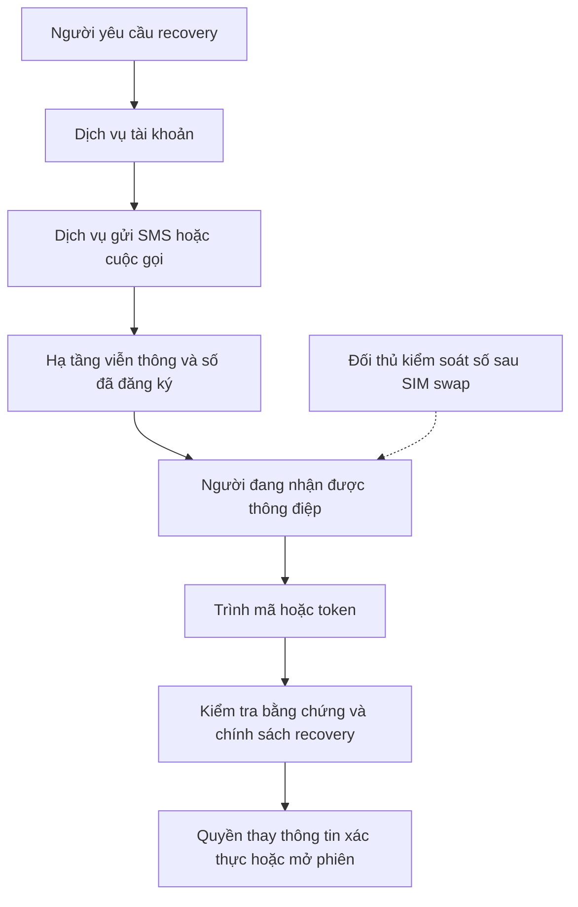

# SIM swap attacker: đối thủ chiếm quyền số điện thoại trong luồng khôi phục

Một tài khoản có mật khẩu mạnh và passkey vẫn có thể bị chiếm đoạt nếu đường khôi phục cho phép người nhận SMS thay thế mọi phương tiện xác thực. Trong tình huống đó, đối thủ không cần lấy khóa passkey; họ nhắm vào quan hệ tin cậy giữa tài khoản, số điện thoại và quy trình recovery.

Bài học này xây dựng mô hình đe dọa cho **SIM swap attacker**: đối thủ chiếm quyền nhận liên lạc qua số điện thoại của nạn nhân rồi khai thác quyền đó để lấy lại tài khoản dưới danh nghĩa người dùng hợp pháp. Trọng tâm là nhận diện khả năng của đối thủ, đường chuyển từ SMS sang quyền tài khoản và các kiểm soát cần thiết khi khôi phục mật khẩu, MFA, passkey hoặc thiết bị xác thực.

## 1. SIM swap là gì trong mô hình đe dọa?

Trong phạm vi bài này, **SIM swap trái phép** là tình huống quyền phục vụ số điện thoại bị chuyển sang SIM hoặc eSIM do đối thủ kiểm soát thông qua một quy trình cấp lại hoặc thay đổi ở phía nhà cung cấp dịch vụ viễn thông.

Một tình huống gần với nó là **chuyển số trái phép sang nhà cung cấp khác**. Cơ chế vận hành có thể khác, nhưng đối với dịch vụ tài khoản, mối đe dọa chung là: thông điệp gửi đến số đã đăng ký có thể đến người không phải chủ tài khoản hợp pháp.

Không cần giả định đối thủ cầm điện thoại cũ. Trong khoảng thời gian kiểm soát việc nhận liên lạc, họ có thể nhận các SMS hoặc cuộc gọi được định tuyến đến số đó, tùy trạng thái dịch vụ. Hệ thống recovery có thể không trực tiếp quan sát được sự thay đổi này.

| Tình huống | Quan hệ với SIM swap | Ý nghĩa đối với recovery |
| --- | --- | --- |
| Cấp lại SIM trái phép cho cùng số | Trường hợp chính của bài | Đối thủ có thể nhận mã gửi về số đã đăng ký |
| Chuyển số trái phép sang nhà cung cấp khác | Cơ chế liên quan, không hoàn toàn đồng nhất | Cũng có thể làm đổi người nhận thông điệp đến số |
| Người dùng tự thay SIM hoặc chuyển eSIM hợp lệ | Thay đổi hợp pháp | Có thể tạo tín hiệu tương tự; không được mặc định là gian lận |
| Điện thoại bị đánh cắp | Một mối đe dọa khác, có thể cùng xảy ra | Có thể lộ thêm phiên, ứng dụng hoặc dữ liệu trên thiết bị |
| Số cũ được cấp cho người mới | Không nhất thiết có hành vi SIM swap | Số còn lưu trong tài khoản có thể không còn thuộc người dùng |
| Kẻ tấn công biết số điện thoại | Chưa có quyền nhận SMS | Biết định danh không đồng nghĩa kiểm soát kênh |

eSIM không tự loại bỏ mối đe dọa này. Điểm đang xét là quyết định chuyển quyền phục vụ số và việc hệ thống tài khoản tin vào số đó, chứ không chỉ hình dạng của thẻ SIM.

### 1.1. Các biện pháp có tên gần nhau không bảo vệ cùng một thứ

Mã PIN bảo vệ việc sử dụng một SIM vật lý trên thiết bị và kiểm soát chống cấp lại hoặc chuyển số ở nhà cung cấp là những lớp khác nhau. Không nên kết luận “đã bật SIM PIN nên không thể bị SIM swap”.

Các kiểm soát tài khoản viễn thông có thể giảm khả năng bị chuyển quyền trái phép, nhưng dịch vụ tài khoản vẫn cần tự bảo vệ đường recovery. Nó không nên phụ thuộc hoàn toàn vào giả định rằng nhà cung cấp viễn thông luôn nhận diện đúng chủ số.

## 2. Đối thủ thực sự có và chưa có những gì?

Một mô hình hữu ích phải nêu rõ năng lực thay vì dùng nhãn “đã chiếm điện thoại” cho mọi tình huống.

### 2.1. Năng lực được giả định

Trong kịch bản chính, đối thủ:

- Biết hoặc tìm được định danh của tài khoản đích và số điện thoại liên quan.
- Kiểm soát việc nhận liên lạc đến số đó trong một khoảng thời gian.
- Có thể gửi yêu cầu recovery như một người dùng ngoài hệ thống.
- Có thể đọc mã hoặc mở liên kết được gửi đến số qua kênh họ kiểm soát.
- Có thể phối hợp với dữ liệu đã lộ trước đó, chẳng hạn mật khẩu bị đánh cắp hoặc thông tin cá nhân dễ biết.

Quyền kiểm soát số có thể đến từ việc một quy trình tại nhà cung cấp chấp nhận sai yêu cầu thay đổi. Bài học không cần giả định đối thủ đã xâm nhập máy chủ của dịch vụ tài khoản.

### 2.2. Những khả năng không tự phát sinh

| Tài sản hoặc khả năng | Có tự có được chỉ từ SIM swap không? |
| --- | --- |
| Mật khẩu tài khoản ứng dụng | Không; có thể bị lấy qua một đường khác hoặc được đặt lại nếu recovery cho phép |
| Khóa riêng của passkey | Không; quyền nhận SMS không tự xuất được khóa |
| Bí mật của ứng dụng TOTP | Không; TOTP không được tạo từ quyền sở hữu số điện thoại |
| Lịch sử SMS trên điện thoại cũ | Không tự được sao chép sang SIM mới |
| Cookie phiên trên máy tính của nạn nhân | Không tự có; có thể xuất hiện trong một sự cố kết hợp |
| Mã khôi phục lưu ở nơi độc lập | Không tự có |
| Quyền đọc email | Không tự có; có thể giành được nếu chính email được khôi phục bằng số điện thoại |
| Quyền mở khóa mọi dữ liệu trên thiết bị cũ | Không tự có |

Phân biệt này giúp chọn đúng biện pháp. Nếu đối thủ lấy được tài khoản email vì email có fallback SMS, rồi dùng email để khôi phục ứng dụng, đó là **chuỗi phụ thuộc giữa nhiều hệ thống**, không phải SIM mới trực tiếp chứa mọi dữ liệu của người dùng.

## 3. Tài sản và ranh giới tin cậy cần vẽ ra

Tài sản cần bảo vệ không chỉ là mã OTP. Đích cuối của đối thủ thường là một hoặc nhiều quyền sau:

- Đặt mật khẩu do đối thủ chọn.
- Gỡ hoặc thay yếu tố MFA đang cản đăng nhập.
- Đăng ký passkey hoặc yếu tố mới do đối thủ kiểm soát.
- Đổi email, số điện thoại hoặc mã dự phòng để duy trì quyền truy cập.
- Nhận phiên đăng nhập và thực hiện các hành động nhạy cảm.
- Ngăn người dùng hợp pháp tiếp tục khôi phục tài khoản.

Một hệ thống cần tách các ranh giới sau:



Ranh giới nguy hiểm nằm ở bước từ “người này có mã đã gửi qua số điện thoại” sang “người này được thay thế toàn bộ căn cứ xác thực của tài khoản”. Đó là một quyết định của dịch vụ tài khoản, không phải kết luận tự động của mạng viễn thông.

### 3.1. Một số điện thoại có thể giữ nhiều vai trò

| Vai trò | Điều cần hiểu |
| --- | --- |
| Định danh đăng nhập | Nhập số giúp chọn tài khoản, chưa chứng minh quyền sở hữu |
| Yếu tố MFA qua SMS | Quyền nhận mã là một phần bằng chứng của đường đăng nhập đó |
| Kênh recovery | Quyền nhận mã có thể được dùng để cấp một quyền khôi phục theo chính sách |
| Kênh thông báo | Nhận cảnh báo không nhất thiết là một bước xác minh |
| Kênh hỗ trợ liên hệ | Gọi từ số đó không tự chứng minh đủ quyền đổi yếu tố |

Nếu một số giữ tất cả vai trò, cùng một sự cố có thể làm yếu nhiều lớp cùng lúc. Không nên đếm SMS xác minh và cuộc gọi đến cùng số là hai bằng chứng độc lập.

## 4. Đường tấn công điển hình qua recovery

Một chuỗi đe dọa ở mức khái niệm có thể diễn ra như sau:

1. Đối thủ đã kiểm soát quyền nhận liên lạc đến số điện thoại của nạn nhân.
2. Họ yêu cầu đặt lại mật khẩu hoặc báo mất MFA, passkey hay thiết bị.
3. Hệ thống gửi thử thách đến số đang lưu trên tài khoản.
4. Đối thủ cung cấp mã hợp lệ hoặc token hợp lệ nhận qua số đó.
5. Backend cấp quyền rộng hơn mức mà bằng chứng thực sự bảo đảm, chẳng hạn gỡ MFA rồi mở phiên đầy đủ.
6. Đối thủ thêm phương tiện của mình, đổi kênh recovery hoặc duy trì phiên để giữ quyền truy cập.

Điểm thất bại ở bước 5 là trọng tâm của mô hình: hệ thống chấp nhận quyền kiểm soát kênh viễn thông như căn cứ đủ để thay thế các yếu tố mà đối thủ chưa có.

### 4.1. Token đúng vẫn có thể dẫn đến chiếm đoạt

Giả sử token SMS được sinh ngẫu nhiên an toàn, có thời hạn ngắn, gắn đúng tài khoản và chỉ sử dụng một lần. Các thuộc tính này rất cần thiết, nhưng đối thủ trong mô hình đang nhận token qua đúng kênh mà hệ thống sử dụng.

Vì vậy:

- Tăng độ dài token giúp chống đoán, không phân biệt chủ tài khoản với người đã chiếm kênh nhận.
- Rút ngắn thời hạn giảm cửa sổ sử dụng, không loại bỏ người nhận trái phép đang hoạt động trong cửa sổ đó.
- Dùng một lần chống phát lại, không bảo đảm người dùng đầu tiên là chủ tài khoản hợp pháp.
- Mã hóa đường truyền giữa các thành phần không sửa được việc thông điệp được giao đến bên đang kiểm soát số.

Cần bảo vệ cả tính an toàn của token và tính phù hợp của kênh nhận. Hai bài toán không thay thế nhau.

### 4.2. Một mã SMS có thể không đủ để tấn công mọi tài khoản

Nếu sau đặt lại mật khẩu hệ thống vẫn yêu cầu một yếu tố độc lập mà đối thủ không có, chuỗi tấn công có thể bị chặn tại lần đăng nhập hoặc trước thao tác nhạy cảm.

Tuy nhiên, cần xét mọi đường truy cập. Giữ passkey trong cấu hình không giúp chặn đối thủ nếu cùng tài khoản vẫn có đường đăng nhập chỉ bằng mật khẩu vừa đặt lại, hoặc hỗ trợ cho phép gỡ passkey bằng chính SMS đó.

## 5. Phân tích từng cấu hình thay vì chỉ hỏi “có SMS không?”

| Cấu hình | Tác động của việc chiếm số | Câu hỏi cần trả lời |
| --- | --- | --- |
| Số chỉ dùng làm định danh, không nhận bí mật hay cấp quyền | Chưa trực tiếp mở ra đường recovery bằng SMS | Các luồng hỗ trợ có âm thầm dùng số làm bằng chứng không? |
| Đăng nhập chỉ bằng OTP SMS | Đối thủ có thể đáp ứng căn cứ đăng nhập đó | Có cần thay cơ chế xác thực cho mức rủi ro của tài khoản không? |
| Mật khẩu kết hợp SMS MFA | Chiếm số làm mất tính bảo vệ của thành phần SMS trong kịch bản này | Đối thủ có hoặc có thể đặt lại mật khẩu bằng đường nào? |
| Đặt lại mật khẩu bằng SMS, vẫn bắt buộc yếu tố độc lập | Đối thủ có thể đổi mật khẩu nhưng chưa chắc đăng nhập được | Có thể gây gián đoạn; yếu tố độc lập có bị gỡ qua fallback khác không? |
| Mất MFA được xử lý chỉ bằng SMS | Đối thủ có thể xin thay yếu tố chưa từng sở hữu | Bằng chứng nào khác hoặc quyền hạn nào ngăn việc thay trái phép? |
| Đăng nhập bằng passkey, recovery toàn bộ bằng SMS | Đối thủ nhắm vào fallback thay vì khóa riêng | SMS có thể cấp quyền thêm passkey hoặc mở phiên đầy đủ không? |
| SMS kết hợp cuộc gọi đến cùng số | Cả hai có thể cùng phụ thuộc số bị chiếm | Có đang nhầm nhiều bước với nhiều căn cứ độc lập không? |
| Email kết hợp SMS nhưng email cũng khôi phục được bằng số đó | Có thể hình thành chuỗi chiếm email rồi ứng dụng | Hai đường bằng chứng độc lập đến mức nào trước đối thủ này? |

Tác động phải bao gồm cả mất quyền truy cập. Ngay cả khi đối thủ chưa vượt được MFA, một lần đặt lại mật khẩu trái phép vẫn có thể làm gián đoạn người dùng hoặc trở thành bước chuẩn bị cho đợt tấn công tiếp theo.

## 6. Viết các phát biểu đe dọa có điều kiện rõ

Thay vì ghi “SMS không an toàn”, hãy ghi tiền đề, hành động được phép bởi thiết kế hiện tại và hậu quả.

| Phát biểu đe dọa | Tiền đề | Hậu quả nếu không có kiểm soát khác |
| --- | --- | --- |
| Chiếm số để đặt mật khẩu mới | SMS đủ quyền đặt lại mật khẩu | Đối thủ thay bí mật mà chủ tài khoản dùng để đăng nhập |
| Chiếm số để gỡ MFA | Luồng mất MFA chấp nhận SMS là căn cứ duy nhất | Yếu tố độc lập bị vô hiệu hóa qua fallback |
| Chiếm số để đăng ký passkey mới | Quyền recovery bằng SMS cho phép thêm phương tiện | Đối thủ có phương tiện đăng nhập bền vững của riêng mình |
| Chiếm số rồi chiếm hộp thư | Hộp thư có recovery dựa trên số đó | Đối thủ lấy thêm một kênh dùng để khôi phục ứng dụng khác |
| Chiếm số để thao túng hỗ trợ | Nhân viên coi mã SMS hoặc cuộc gọi là đủ quyền đổi yếu tố | Đường thủ công bỏ qua chính sách của luồng tự động |
| Giữ quyền sau khi chủ số lấy lại dịch vụ | Phiên, phương tiện và thay đổi trái phép chưa bị xử lý | Khôi phục quyền nhận SMS chưa chấm dứt việc chiếm tài khoản |

Có thể dùng mẫu mô tả sau trong tài liệu thiết kế:

```text
Đối thủ: người đang kiểm soát số điện thoại đã đăng ký
Tài sản: quyền thay yếu tố MFA của tài khoản
Tiền đề: SMS được dùng làm căn cứ duy nhất cho luồng mất MFA
Ranh giới bị vượt: quyền nhận mã -> quyền thay phương tiện xác thực
Tác động: đăng ký yếu tố mới do đối thủ kiểm soát
Kiểm soát cần đánh giá: căn cứ độc lập, phạm vi quyền và xử lý sau thay đổi
Rủi ro còn lại: không thể bảo đảm an toàn chỉ bằng cách làm token khó đoán hơn
```

Mẫu này buộc đội thiết kế nêu đúng điều kiện. Một tài khoản không dùng SMS để cấp bất kỳ quyền nào không có cùng đường đe dọa với tài khoản cho phép SMS thay toàn bộ yếu tố.

## 7. Kiểm soát ở trước và trong luồng khôi phục

### 7.1. Bảo vệ việc gắn hoặc đổi số điện thoại

Một số được xác minh là nhận được mã chưa chắc đã được phép trở thành kênh recovery của tài khoản.

Việc thêm, đổi hoặc xóa kênh cần được cấp quyền trong một ngữ cảnh phù hợp. Với thay đổi nhạy cảm, hệ thống có thể yêu cầu xác thực lại bằng phương tiện còn tin cậy, áp dụng kiểm soát theo rủi ro và thông báo qua kênh đã đăng ký trước.

Nếu một session yếu có thể đổi số rồi dùng số mới để đáp ứng recovery, hệ thống tạo ra một vòng bằng chứng: đối thủ tự gắn kênh của mình rồi dùng nó để chứng minh quyền sở hữu.

Cần xác định cả tác động tới giao dịch đang mở. Khi số hoặc trạng thái bảo mật thay đổi, những quyền recovery dựa trên cấu hình cũ phải được kiểm tra, thu hồi hoặc giữ lại theo một quyết định rõ ràng.

### 7.2. Chọn căn cứ phù hợp với đối thủ đang xét

Một phương tiện còn hợp lệ có khả năng chứng minh quyền sử dụng khóa đã đăng ký, hoặc một mã dự phòng được lưu ở nơi độc lập, có thể giúp chặn đối thủ chỉ kiểm soát số điện thoại.

Không nên gọi căn cứ là độc lập chỉ vì nó có tên khác:

- Mã dự phòng lưu trong hộp thư vừa bị chiếm qua số điện thoại có thể không còn độc lập.
- Passkey có thể không bị lộ chỉ từ SIM swap, nhưng đường khôi phục tài khoản đồng bộ cần được xét nếu hệ thống phụ thuộc vào nó.
- Câu hỏi dựa trên dữ liệu cá nhân dễ biết không tạo ra một bí mật mạnh chỉ vì được hỏi sau SMS.
- Một cuộc gọi đến cùng số bị chiếm không khôi phục lại tính độc lập đã mất.

Độ mạnh của recovery cần được đánh giá theo toàn bộ quan hệ phụ thuộc và quyền được cấp, không chỉ theo số bước giao diện.

### 7.3. Giới hạn quyền khi vẫn cần hỗ trợ SMS

Nếu sản phẩm chấp nhận SMS cho một phần recovery, cần mô tả phạm vi cụ thể. Chẳng hạn, bằng chứng có thể đủ để bắt đầu một giao dịch giới hạn, nhưng chưa đủ để gỡ MFA, đổi email hoặc mở quyền giao dịch nhạy cảm.

Ngữ cảnh recovery nên gắn với tài khoản, mục đích, thời hạn, bằng chứng đã kiểm tra và tập thao tác được phép. Không chuyển một lần nhập mã thành cờ `authenticated = true` mà mọi API đều chấp nhận.

Cũng không ghi nhận session là đã xác thực bằng passkey hoặc MFA độc lập nếu căn cứ thực tế chỉ là SMS. Mức bảo đảm và độ mới của xác thực phải phản ánh điều đã xảy ra.

Giới hạn một số thao tác sau recovery có thể giảm tác động, nhưng không bù được mọi thiệt hại. Nếu đối thủ đã đọc dữ liệu bí mật trong phiên đầy đủ, khóa chức năng chuyển tiền không thu hồi được dữ liệu đã lộ.

### 7.4. Trì hoãn và thông báo là biện pháp bổ trợ

Một khoảng chờ cho thay đổi nhạy cảm có thể tạo thời gian phát hiện hoặc phản ứng. Nhưng thời gian trôi qua không tự chứng minh chủ tài khoản đã đồng ý.

Thông báo nên được gửi qua các kênh phù hợp còn được tin cậy, thay vì chỉ gửi SMS đến chính số đang bị nghi ngờ. Một phiên ứng dụng còn hợp lệ hoặc email đã đăng ký có thể hỗ trợ phát hiện, nhưng phải xét cả khả năng chúng cũng bị xâm nhập.

Không nhận được phản đối không có nghĩa yêu cầu là hợp pháp. Người dùng có thể chưa có mạng, mất thiết bị hoặc chưa đọc thông báo.

### 7.5. Đường hỗ trợ phải giữ cùng ranh giới quyền

Nếu luồng tự động yêu cầu căn cứ độc lập nhưng nhân viên hỗ trợ được gỡ MFA chỉ vì người gọi nhận được SMS, đối thủ sẽ chọn đường hỗ trợ.

Quy trình thủ công cần xác định bằng chứng, thẩm quyền phê duyệt, phạm vi thao tác và dấu vết kiểm tra. Không để cảm giác khẩn cấp hoặc việc người gọi biết nhiều thông tin cá nhân thay thế chính sách.

## 8. Tín hiệu phát hiện và giới hạn của chúng

Một số hệ thống có thể có thông tin từ nhà cung cấp về thay đổi SIM, chuyển số hoặc đặc điểm liên quan. Khả năng truy cập, độ trễ, độ bao phủ và ý nghĩa của dữ liệu phụ thuộc tích hợp cụ thể; không nên thiết kế như thể tín hiệu luôn có và luôn chính xác.

| Tín hiệu | Giá trị có thể có | Giới hạn |
| --- | --- | --- |
| Thay đổi SIM hoặc chuyển số gần đây, nếu có dữ liệu đáng tin cậy | Gợi ý cần kiểm tra thêm trước recovery nhạy cảm | Có thay đổi hợp pháp; dữ liệu có thể thiếu hoặc đến muộn |
| Recovery ngay sau thay đổi số trong ứng dụng | Gợi ý chuỗi thay đổi đáng kiểm tra | Không tự chứng minh gian lận; phải xét ngữ cảnh cấp quyền đổi số |
| Thiết bị hoặc phiên mới | Cho biết yêu cầu khác lịch sử quan sát | Người dùng thật cũng có thể vừa mất thiết bị |
| Nhiều yêu cầu hoặc thử mã bất thường | Hỗ trợ phát hiện lạm dụng và tự động hóa | Đối thủ có thể thử ít, còn người dùng thật có thể retry |
| Mất dịch vụ di động được người dùng báo cáo | Có thể liên quan việc số bị chuyển quyền | Nhiều lỗi mạng hoặc thiết bị khác cũng gây triệu chứng tương tự |
| Đổi yếu tố rồi đổi kênh recovery liên tiếp | Gợi ý hành vi duy trì quyền kiểm soát | Cần đánh giá cả các thao tác hợp pháp sau mất thiết bị |

Không có tín hiệu SIM swap không đồng nghĩa không có SIM swap. Cũng không nên từ chối mọi người vừa thay SIM mà không có hướng xử lý phù hợp.

Tín hiệu rủi ro có thể dẫn đến xác minh bổ sung, giữ quyền ở phạm vi hẹp, trì hoãn thay đổi hoặc chuyển thẩm định theo chính sách. Nó không nên trở thành cách bỏ qua bằng chứng chỉ vì điểm rủi ro thấp.

Một IP quen thuộc hoặc vị trí gần lịch sử sử dụng không phục hồi độ tin cậy của SMS khi đối thủ đang kiểm soát số. Những dữ liệu đó chỉ bổ sung ngữ cảnh.

## 9. Nhật ký cần giúp tái dựng chuỗi thay đổi

Khi điều tra, câu hỏi không chỉ là “OTP có đúng không?” mà là “bằng chứng nào đã cấp quyền gì, và quyền đó đã làm thay đổi những gì?”.

Các loại sự kiện hữu ích gồm:

- Khởi tạo recovery, mục đích và định danh giao dịch.
- Loại kênh đã dùng, tham chiếu kênh và phiên bản cấu hình liên quan.
- Kết quả kiểm tra bằng chứng, điều kiện chính sách và lý do chuyển bước.
- Tín hiệu về thay đổi số hoặc SIM nếu có, kèm nguồn và thời điểm quan sát.
- Quyền recovery được cấp, phạm vi, thời hạn và việc kết thúc quyền.
- Phương tiện nào được thêm, thay thế hoặc thu hồi.
- Kênh recovery nào được đổi và session nào được xử lý.
- Thông báo đã được lập lịch, gửi hoặc thất bại ở mốc nào.

Không cần ghi OTP, token nguyên vẹn, mật khẩu hoặc bí mật của mã dự phòng để có dấu vết này. Số điện thoại và dữ liệu tương quan cũng cần quyền truy cập và thời hạn lưu phù hợp.

Phải phân biệt sự kiện do hệ thống trực tiếp kiểm tra với lời khai. Ví dụ, “người dùng báo mất SIM” không có cùng ý nghĩa với “nhà cung cấp trả về thông tin thay đổi SIM tại thời điểm X”, và thông tin nhà cung cấp cũng không tự chứng minh yêu cầu là gian lận.

## 10. Ví dụ: passkey mạnh bị vượt qua bằng fallback yếu

Giả sử tài khoản của Minh đăng nhập bằng passkey. Sản phẩm có một đường “Tôi mất mọi thiết bị”, trong đó SMS về số đã đăng ký đủ để thêm passkey mới và tạo phiên đầy đủ.

### 10.1. Diễn tiến của thiết kế có lỗ hổng

| Mốc | Điều xảy ra | Nhận định bảo mật |
| --- | --- | --- |
| T0 | Minh có passkey và số điện thoại đã đăng ký | Đây là cấu hình trước sự cố |
| T1 | Đối thủ nhận được liên lạc đến số sau một thay đổi trái phép | Chưa chứng minh đối thủ có khóa passkey |
| T2 | Đối thủ bắt đầu luồng mất thiết bị | Chỉ là một yêu cầu do người ngoài gửi |
| T3 | Đối thủ nhập đúng mã SMS | Hệ thống kiểm tra được bí mật gửi qua số, chưa xác lập mọi quyền khác |
| T4 | Backend cho thêm passkey và mở phiên đầy đủ | Fallback biến quyền kiểm soát số thành quyền kiểm soát tài khoản |
| T5 | Đối thủ đổi kênh recovery hoặc duy trì session | Việc chiếm tài khoản có thể tiếp tục sau khi Minh lấy lại số |

Đối thủ không phá cơ chế mật mã của passkey. Họ đi qua một đường được sản phẩm cho phép để thay thế phương tiện mà mình không có.

### 10.2. Một phương án chính sách chặn đối thủ này

Giả sử sản phẩm quy định rằng SMS chỉ là một phần đầu vào của luồng mất thiết bị. Để thêm passkey mới, người dùng cần một căn cứ còn được chấp nhận và độc lập với số trong kịch bản này, hoặc một quy trình thẩm định có bảo đảm được xác định trước.

Tại T3, đối thủ chỉ có mã SMS nên chưa được cấp quyền đăng ký passkey. Hệ thống có thể tiếp tục yêu cầu bước phù hợp hoặc từ chối nếu không đủ bằng chứng. Nó không tự chuyển sang xác minh yếu hơn để hoàn thành yêu cầu.

Nếu Minh thật sự mất mọi căn cứ, khả năng khôi phục có thể bị hạn chế. Đây là đánh đổi cần được sản phẩm giải thích từ lúc người dùng đăng ký phương án dự phòng, thay vì hứa mọi tài khoản đều lấy lại được chỉ bằng một số điện thoại.

### 10.3. Không biến phòng vệ thành cách khóa người dùng

Một yêu cầu SMS chưa được xác minh không nên tự xóa passkey hoặc khóa mọi session của Minh. Nếu làm như vậy, chỉ cần biết số điện thoại cũng có thể gây gián đoạn.

Phòng vệ cần chặn việc cấp quyền không đủ căn cứ, đồng thời tránh tạo ra tác động phá hoại từ một yêu cầu công khai chưa được tin cậy.

## 11. Khi người dùng báo đã bị chiếm số và tài khoản

Xử lý sự cố cần tách việc lấy lại dịch vụ viễn thông khỏi việc lấy lại quyền kiểm soát tài khoản ứng dụng.

### 11.1. Không tiếp tục tin duy nhất kênh bị nghi ngờ

Nếu số đang bị chiếm quyền, gửi thêm mã đến chính số đó có thể tiếp tục cấp lợi thế cho đối thủ. Cần chuyển sang một đường đã được chính sách cho phép và có căn cứ khác phù hợp, chẳng hạn phương tiện xác thực còn an toàn hoặc quy trình tổ chức đã được ủy quyền.

Người dùng có thể cần làm việc với nhà cung cấp để xử lý quyền phục vụ số. Nhưng việc một người lại nhận được SMS không tự chứng minh mọi thay đổi tài khoản trước đó là hợp pháp hoặc mọi session của đối thủ đã mất hiệu lực.

### 11.2. Rà soát những gì đối thủ đã thay đổi

Phạm vi xử lý có thể bao gồm:

- Mật khẩu bị đặt lại và yếu tố mới được thêm trái phép.
- Passkey, MFA hoặc kênh recovery đã bị sửa.
- Token recovery, mã dự phòng và quyền tạm thời còn có thể sử dụng.
- Session, refresh token và thiết bị được tin cậy mà đối thủ có thể giữ.
- Hành động nhạy cảm đã xảy ra trong thời gian bị chiếm quyền.

Chỉ đổi mật khẩu có thể chưa đủ. Một passkey do đối thủ thêm hoặc một session còn hợp lệ có thể tiếp tục cấp quyền theo cách không phụ thuộc mật khẩu mới.

Không nhất thiết xóa mọi phương tiện còn an toàn. Cần phân biệt phương tiện của người dùng với phương tiện bị lộ hoặc được thêm trái phép, rồi áp dụng chính sách xử lý sự cố tương ứng.

### 11.3. Thu hồi phải có tác dụng ở nơi thực thi truy cập

Một cờ “đã thu hồi” trong dịch vụ tài khoản chưa chắc làm mọi API ngừng chấp nhận token cũ. Cần kiểm tra cơ chế session, refresh token, access token và các lớp cache theo kiến trúc thực tế.

Nếu chỉ thu hồi refresh token, access token đã phát hành có thể còn được chấp nhận cho tới khi hết hạn hoặc bị chặn bằng cơ chế khác. Mốc hoàn tất xử lý phải phản ánh bảo đảm mà hệ thống thực sự thực thi.

Đồng thời, kết quả recovery cần cho biết phần nào đã hoàn tất, phần nào còn chờ. Không gọi sự cố đã được xử lý hoàn toàn chỉ vì người dùng vừa nhận lại một mã SMS.

## 12. Các tình huống cần đưa vào đặc tả bảo vệ

| Tình huống | Hành vi cần xác định |
| --- | --- |
| Đối thủ có số nhưng không có yếu tố độc lập | Không tự cấp quyền thay mọi yếu tố chỉ vì SMS đúng |
| Tài khoản còn một passkey hợp lệ | Cho phép đường sử dụng phương tiện còn an toàn theo chính sách, không ép sang fallback yếu hơn |
| SMS và cuộc gọi cùng về một số | Không coi là hai căn cứ độc lập trước đối thủ chiếm số |
| Email có thể được khôi phục bằng cùng số | Xét chuỗi phụ thuộc thay vì mặc định email là lớp tách biệt |
| Có tín hiệu thay SIM nhưng người dùng thay hợp pháp | Có hướng xác minh bổ sung hoặc xử lý phù hợp, tránh từ chối vô điều kiện |
| Không có dữ liệu thay SIM từ nhà cung cấp | Không xem việc thiếu tín hiệu là bằng chứng an toàn |
| Đối thủ gửi nhiều yêu cầu recovery | Giới hạn lạm dụng và thông báo, không tự hủy mọi đường truy cập hợp lệ |
| Số đã được lấy lại nhưng đối thủ còn session | Tiếp tục xử lý quyền và thay đổi trái phép trong ứng dụng |
| Nhân viên hỗ trợ nhận yêu cầu gỡ MFA bằng SMS | Giữ ranh giới bằng chứng, thẩm quyền và ghi nhận như đường tự động |
| Token SMS đủ mạnh nhưng giao cho đối thủ | Thừa nhận đây là lỗi căn cứ hoặc phạm vi quyền, không giải quyết chỉ bằng đổi định dạng token |

Một mô hình đe dọa tốt phải trả lời được: **nếu đối thủ nhận được mọi SMS và cuộc gọi đến số đã đăng ký trong một khoảng thời gian, họ có thể thay những yếu tố nào, mở những phiên nào và giữ lại quyền gì sau đó?**

Câu trả lời giúp tìm đúng điểm cần bảo vệ: quan hệ giữa số điện thoại và tài khoản, phạm vi quyền mà recovery cấp, sự độc lập của bằng chứng và việc chấm dứt quyền truy cập sau sự cố. SMS hợp lệ chỉ là một kết quả kiểm tra; quyền kiểm soát tài khoản phải được quyết định bằng toàn bộ chính sách tương ứng với mối đe dọa này.