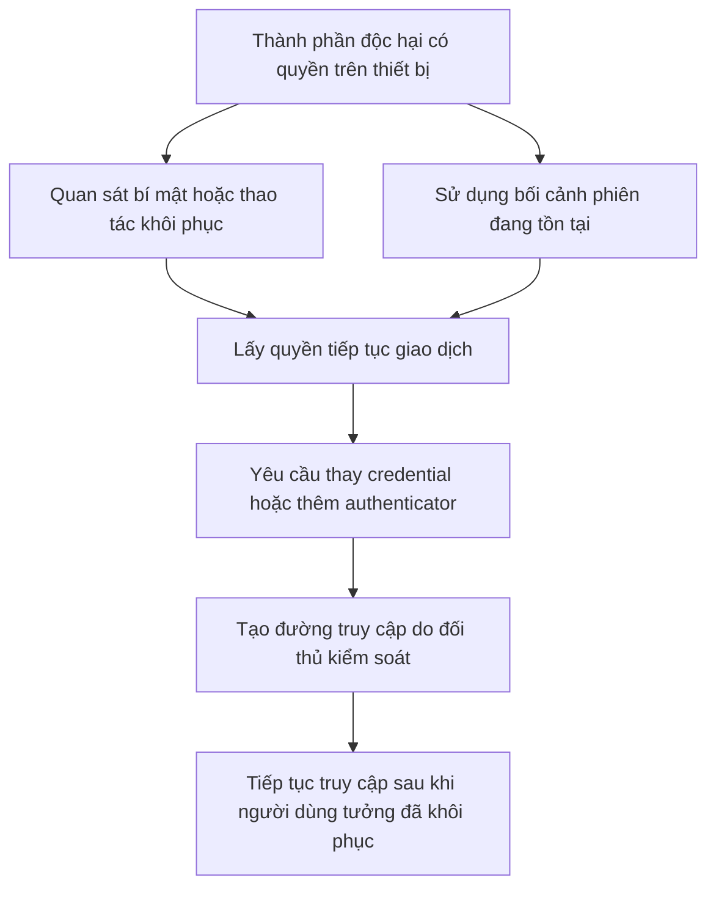

# Kẻ tấn công được hỗ trợ bởi phần mềm độc hại

Trong chương **Recovery Threat Model** của module **SECURITY_AUTHENTICATION_ACCOUNT_RECOVERY**, **malware assisted attacker** là đối thủ tận dụng phần mềm độc hại hoặc thành phần đã bị chiếm quyền trên thiết bị để hỗ trợ tấn công luồng khôi phục. Thay vì chỉ đoán mật khẩu từ bên ngoài, đối thủ có thể quan sát bí mật, sử dụng phiên đang tồn tại hoặc can thiệp một phần thao tác mà người dùng tưởng là an toàn.

Mô hình này đặc biệt quan trọng khi khôi phục sau mất mật khẩu, MFA, passkey hoặc thiết bị xác thực. Nếu người dùng thực hiện toàn bộ quy trình trên môi trường vẫn bị xâm nhập, mật khẩu mới và các bí mật khôi phục mới có thể tiếp tục rơi vào tay đối thủ. Luồng báo thành công nhưng quyền kiểm soát tài khoản chưa thực sự được lấy lại.

Bài học tập trung vào nhận diện năng lực đối thủ, ranh giới tin cậy và lựa chọn kiểm soát phòng vệ. Không cần biết cách xây dựng mã độc để phân tích được những điểm yếu này.

## 1. Mục tiêu học tập

Sau bài học, bạn có thể:

- Phân biệt tấn công từ xa thông thường với tấn công được hỗ trợ bởi thành phần độc hại trên thiết bị.
- Mô tả những tài sản trong luồng khôi phục có thể bị quan sát, sử dụng hoặc thay đổi.
- Giải thích vì sao MFA, token dùng một lần, HTTPS và thiết bị quen thuộc có giới hạn trước mô hình đe dọa này.
- Thiết kế đường khôi phục giảm phụ thuộc vào môi trường bị nghi xâm nhập.
- Kết hợp bằng chứng, phạm vi quyền, trạng thái giao dịch và thu hồi phiên để giảm khả năng đối thủ duy trì truy cập.
- Nêu rõ những điều dịch vụ có thể kiểm chứng và những điều không thể bảo đảm về độ sạch của thiết bị.

## 2. Năng lực của đối thủ phải được mô tả cụ thể

Không nên dùng một giả định duy nhất rằng “có malware thì đối thủ làm được mọi thứ”. Năng lực phụ thuộc vào thành phần bị chiếm, quyền của nó, nền tảng và cơ chế bảo vệ credential.

| Môi trường bị ảnh hưởng | Khả năng cần xét tùy quyền thực tế | Giới hạn cần giữ khi suy luận |
| --- | --- | --- |
| Tiện ích trình duyệt độc hại | Đọc hoặc sửa nội dung trang trong phạm vi được cấp quyền; quan sát thao tác trên trang | Không mặc định truy cập mọi origin, mọi cookie hoặc toàn bộ hệ điều hành |
| Tiến trình độc hại trong tài khoản hệ điều hành | Quan sát nhập liệu, đọc một số tệp hoặc dữ liệu ứng dụng nếu quyền cho phép | Có thể bị giới hạn bởi cơ chế cách ly, mã hóa và bảo vệ của nền tảng |
| Thiết bị bị chiếm ở mức đặc quyền cao | Can thiệp sâu hơn vào ứng dụng, giao diện và dữ liệu phiên | Không suy ra mọi khóa phần cứng đều có thể xuất ra dưới dạng bí mật |
| Ứng dụng độc hại có quyền nhạy cảm trên thiết bị di động | Quan sát thông báo, nội dung màn hình hoặc hỗ trợ thao tác nếu quyền và nền tảng cho phép | Không mặc định mọi ứng dụng đều đọc được OTP hoặc dữ liệu của ứng dụng khác |
| Trình duyệt hoặc hồ sơ trình duyệt bị chiếm | Sử dụng bối cảnh đăng nhập, quan sát bước khôi phục hoặc tác động yêu cầu | Năng lực đọc bí mật và năng lực thực hiện hành động cần được phân biệt |

Một đối thủ không xuất được khóa riêng vẫn có thể gây hại nếu họ điều khiển phiên đã xác thực hoặc làm người dùng thực hiện một thao tác ký không đúng ý định. Ngược lại, không nên tuyên bố mọi passkey đều bị lấy cắp chỉ vì trình duyệt xuất hiện thành phần độc hại.

### Ba kiểu năng lực cần phân biệt

- **Quan sát:** đọc dữ liệu hiển thị, nhập liệu hoặc bí mật trong phạm vi truy cập.
- **Hành động:** sử dụng phiên, gọi chức năng hoặc điều khiển thao tác trong bối cảnh đã có quyền.
- **Can thiệp:** thay đổi dữ liệu, đích nhận thông tin, nội dung giao diện hoặc ý định hành động mà máy chủ nhận được.

Đối thủ có thể chỉ có một phần trong ba nhóm. Mô hình đe dọa càng rõ, biện pháp kiểm soát càng có cơ sở và ít gây hạn chế không cần thiết cho người dùng.

## 3. Những tài sản đáng chú ý trong luồng khôi phục

| Tài sản | Vì sao có giá trị với đối thủ | Hậu quả cần xét |
| --- | --- | --- |
| Liên kết hoặc token khôi phục | Có thể mang quyền tiếp tục một giao dịch | Đối thủ đổi token lấy quyền trước người dùng hoặc tiếp quản bước tiếp theo |
| OTP và mã khôi phục dự phòng | Có thể là bằng chứng được chính sách chấp nhận | Mã bị dùng trái phép, kể cả khi có hạn dùng ngắn |
| Cookie phiên và refresh token | Cho phép truy cập mà không cần nhập lại mọi yếu tố | Tiếp tục truy cập sau khi người dùng đổi mật khẩu |
| Mật khẩu mới | Được tạo trong lúc người dùng muốn lấy lại quyền | Đối thủ biết ngay credential vừa thay |
| Bí mật thiết lập TOTP hoặc mã dự phòng mới | Tạo đường xác thực hoặc khôi phục lâu dài | Hai bên cùng giữ bí mật mà người dùng tưởng chỉ mình biết |
| Quyền đăng ký authenticator | Cho phép gắn một phương thức xác thực mới | Đối thủ thêm khóa của họ mà không cần lấy khóa hiện có |
| Quyết định khôi phục đã được duyệt | Có thể cấp quyền thực hiện thay đổi nhạy cảm | Một bước xác minh hợp lệ bị dùng cho hành động ngoài phạm vi |
| Thông tin hồ sơ và lịch sử giao dịch | Có thể được dùng để thuyết phục hỗ trợ | Đối thủ trả lời đúng câu hỏi nhờ dữ liệu đọc được trên thiết bị |

Tài sản không chỉ là chuỗi bí mật có thể sao chép. **Khả năng thực hiện hành động trong một phiên đang có quyền** cũng là tài sản. Đây là lý do một biện pháp chỉ ngăn đọc cookie chưa chắc ngăn được mọi hành vi trong trình duyệt đã bị kiểm soát.

## 4. Chuỗi tấn công điển hình

Một chuỗi khái quát có thể như sau:

Đây là mô hình phân tích, không khẳng định mọi bước đều làm được trên mọi nền tảng. Chẳng hạn, nếu API yêu cầu bằng chứng độc lập và không cho phiên hiện có tự đăng ký yếu tố mới, chuỗi có thể bị chặn ở bước thay credential.

### 4.1. Trước khi khôi phục

Đối thủ có thể đã giữ một phiên, biết mật khẩu hoặc đọc được dữ liệu dùng làm câu trả lời xác minh. Họ cũng có thể đã sửa kênh khôi phục trước khi người dùng nhận thấy sự cố.

Bởi vậy, kênh “đang được ghi trong hồ sơ” không luôn đồng nghĩa kênh đã được thiết lập hợp lệ trước khi tài khoản bị chiếm. Lịch sử thay đổi và bối cảnh sự cố có thể ảnh hưởng đến việc chọn căn cứ khôi phục.

### 4.2. Trong khi khôi phục

Người dùng mở liên kết, nhập mã, đặt mật khẩu và thiết lập yếu tố mới. Đây là khoảng thời gian nhiều bí mật hoặc quyền nhạy cảm cùng đi qua một môi trường. Malware có thể hỗ trợ đối thủ quan sát hoặc sử dụng những quyền đó theo năng lực thực tế.

Nếu chỉ có một token dùng một lần, đối thủ vẫn có thể là bên dùng thành công trước. Thuộc tính dùng một lần giới hạn số lần sử dụng; nó không tự phân biệt ai là người dùng hợp lệ.

### 4.3. Sau khi khôi phục

Đối thủ có thể tiếp tục giữ phiên cũ, refresh token, authenticator mới hoặc bí mật vừa được người dùng tạo trên thiết bị bị xâm nhập. Họ không nhất thiết phải lặp lại toàn bộ chuỗi khôi phục.

Mô hình cần xét cả khả năng duy trì quyền sau thay đổi, thay vì coi việc đổi mật khẩu là điểm kết thúc phân tích.

## 5. Các ranh giới tin cậy dễ bị hiểu sai

### 5.1. Trình duyệt hợp lệ không đồng nghĩa ý định hợp lệ

Máy chủ có thể nhận một yêu cầu từ đúng trình duyệt, kèm cookie và token chống CSRF hợp lệ. Điều này có ích cho các mô hình tấn công tương ứng, nhưng không chứng minh người dùng thực sự muốn nội dung hành động nếu môi trường thực hiện đã bị can thiệp.

Một thành phần có quyền trong bối cảnh ứng dụng có thể vượt ra ngoài giả định của biện pháp chống yêu cầu từ website khác. Do đó, kiểm tra CSRF không thay thế yêu cầu xác minh và ràng buộc hành động trong giao dịch khôi phục.

### 5.2. Hai kênh trên cùng môi trường có thể cùng thất thủ

Email và ứng dụng xác thực là hai kênh khác nhau về mặt chức năng. Nhưng nếu cả hai được dùng trên thiết bị mà đối thủ có khả năng quan sát tương ứng, chúng có thể không tạo được sự độc lập như thiết kế đang kỳ vọng.

Tương tự, gửi một mã thứ hai tới thông báo trên cùng thiết bị chưa chắc làm tăng đáng kể độ tin cậy trước giả định thiết bị bị xâm nhập. Cần mô tả mối phụ thuộc vào thiết bị, tài khoản đồng bộ và quyền truy cập thực tế.

### 5.3. Thiết bị quen thuộc có thể là thiết bị bị chiếm

IP, cookie nhận diện thiết bị hoặc lịch sử sử dụng trùng khớp có thể giảm nghi ngờ trong một số bối cảnh. Với malware trên thiết bị quen thuộc, chính những dấu hiệu đó lại có thể xuất hiện trong yêu cầu của đối thủ.

Không nên dùng điểm “thiết bị quen thuộc” để tự bỏ bằng chứng bắt buộc cho hành động như gỡ MFA hoặc thay kênh khôi phục. Đồng thời, một thiết bị mới cũng không tự chứng minh gian lận: chủ tài khoản hợp lệ có thể đang cố tránh thiết bị bị nghi xâm nhập.
