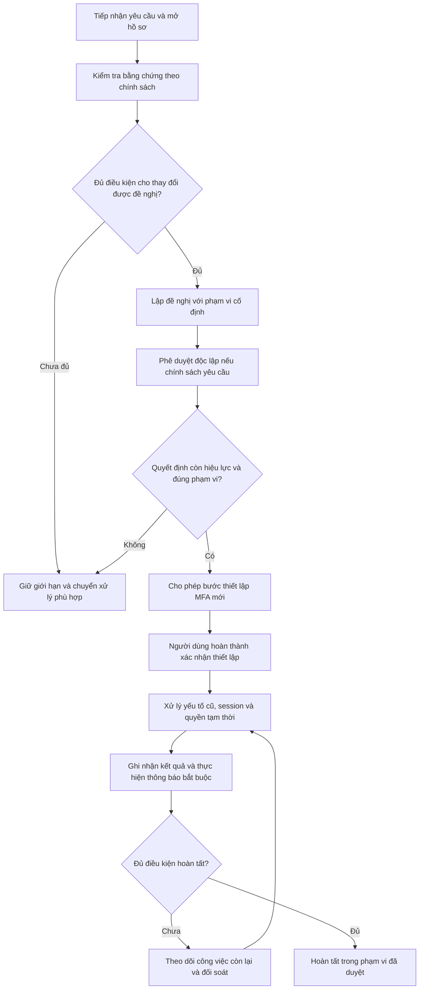

# Tác nhân nội bộ lạm dụng quyền trong khôi phục tài khoản

## 1. Insider abuse attacker là ai?

**Tác nhân nội bộ lạm dụng quyền — insider abuse attacker — là người có quyền truy cập hợp lệ vào một phần hệ thống hoặc quy trình, nhưng cố ý sử dụng quyền đó sai mục đích để tác động trái phép đến việc khôi phục tài khoản.** Người này có thể là nhân viên hỗ trợ, người vận hành, nhà thầu, quản trị viên của tổ chức khách hàng hoặc người có khả năng sửa cấu hình liên quan.

Trong chương Recovery Threat Model của module `SECURITY_AUTHENTICATION_ACCOUNT_RECOVERY`, đối tượng cần bảo vệ là quyền kiểm soát tài khoản khi người dùng mất mật khẩu, MFA, passkey hoặc thiết bị xác thực. Kẻ nội bộ không nhất thiết phải biết mật khẩu hiện tại. Họ có thể lợi dụng quyền xử lý khôi phục để thay đổi cách tài khoản sẽ xác thực trong tương lai.

Ví dụ, một nhân viên hỗ trợ được phép mở hồ sơ và ghi nhận bằng chứng. Nếu nhân viên đó có thể tự ghi “đã xác minh”, đổi địa chỉ nhận liên kết sang địa chỉ mình kiểm soát, rồi vô hiệu hóa MFA, quyền hỗ trợ đã trở thành đường chiếm đoạt tài khoản.

Điểm cốt lõi của mô hình đe dọa này là: **được phép tham gia quy trình không đồng nghĩa được phép quyết định mọi kết quả của quy trình**.

Cần phân biệt ba tình huống gần nhau:

| Tình huống | Bản chất | Ý nghĩa khi thiết kế |
| --- | --- | --- |
| Nhân viên cố ý lạm dụng quyền được cấp | Chủ thể nội bộ là người tấn công | Cần giới hạn quyền hợp lệ có thể bị dùng sai |
| Kẻ ngoài chiếm được tài khoản nhân viên | Chủ thể bên ngoài đang sử dụng vị trí tin cậy nội bộ | Nhiều ranh giới kiểm soát tương tự vẫn cần chặn tác động |
| Nhân viên làm sai do nhầm lẫn | Không có ý định tấn công | Xác nhận phạm vi, hạn chế quyền và nhật ký vẫn giúp giảm thiệt hại |

Không nên quy mọi sai sót thành hành vi ác ý. Tuy nhiên, hệ thống cũng không thể dựa hoàn toàn vào giả định rằng tài khoản nhân viên hợp lệ thì mọi yêu cầu từ tài khoản đó đều chính đáng.

## 2. Vì sao khôi phục tài khoản là mục tiêu hấp dẫn?

Luồng đăng nhập bình thường kiểm tra phương tiện xác thực mà người dùng đã đăng ký. Luồng khôi phục phải xử lý tình huống người dùng không còn sử dụng được một phần các phương tiện đó. Điều này tạo ra một đường thay thế để thiết lập lại quyền kiểm soát.

Nhân viên hỗ trợ thường có thêm ngữ cảnh mà người ngoài không có: tài khoản đang gặp khó khăn, thông tin liên hệ, lịch sử xử lý, loại phương tiện bị mất hoặc trạng thái xét duyệt. Nếu các thông tin và quyền này tập trung ở một vai trò, một người có thể vừa dựng câu chuyện khôi phục, vừa xác nhận câu chuyện đó, vừa thực hiện thay đổi.

Những đặc điểm làm tăng rủi ro gồm:

- Quy trình có nhiều ngoại lệ thủ công cho trường hợp mất cả mật khẩu và MFA.
- Một nút “reset MFA” thực hiện nhiều thay đổi hơn tên gọi của nó.
- Bằng chứng xác minh chỉ là một ghi chú do chính người xử lý nhập.
- Quyền sửa email khôi phục và quyền phát hành token khôi phục được cấp cùng lúc.
- Một công cụ nội bộ có thể tạo session đăng nhập thay cho người dùng.
- Nhân viên có thể tắt thông báo, sửa dấu vết hoặc đóng hồ sơ trước khi người dùng phát hiện.

Một giao diện nằm trong mạng nội bộ không tự tạo ra bảo đảm về thẩm quyền của từng thao tác. API đứng sau giao diện, công cụ dòng lệnh, tác vụ hàng đợi và thao tác vận hành đều cần được đưa vào mô hình.

## 3. Xác định tài sản, năng lực và ranh giới tin cậy

### 3.1. Tài sản cần bảo vệ

Trong khôi phục tài khoản, tài sản không chỉ là mật khẩu mới:

| Tài sản | Điều cần bảo vệ |
| --- | --- |
| Liên kết giữa tài khoản và người có quyền | Không chuyển quyền kiểm soát sang người không được phép |
| Mật khẩu, MFA và passkey | Chỉ thay đổi phương tiện trong phạm vi được chấp thuận |
| Kênh khôi phục | Không biến địa chỉ do người xử lý tự nhập thành kênh đã được tin cậy |
| Token, mã dự phòng và quyền khôi phục tạm thời | Không bị đọc, phát hành sai mục đích hoặc sử dụng lại |
| Session và token truy cập | Không để đối thủ duy trì truy cập sau khi khôi phục |
| Quyết định xác minh, phê duyệt | Không bị sửa phạm vi sau khi đã được duyệt |
| Nhật ký và thông báo | Có căn cứ phát hiện, truy vết và phản hồi khi có lạm dụng |
| Dữ liệu bằng chứng | Chỉ người có nhiệm vụ phù hợp được xem và sử dụng |

Nếu người hỗ trợ xem được mã khôi phục nguyên vẹn trong màn hình quản trị, bí mật đó đã đi qua một chủ thể không cần biết nó. Hạn chế hiển thị bí mật giúp giảm cả khả năng lạm dụng và nguy cơ rò rỉ ngoài ý muốn.

### 3.2. Mô tả năng lực cụ thể, không dùng nhãn “admin” chung chung

Một mô hình hữu ích phải ghi rõ đối thủ có thể làm gì ở thời điểm bắt đầu. Chẳng hạn:

```text
Vai trò giả định:
  Nhân viên hỗ trợ cấp một.

Có thể:
  Xem trạng thái hồ sơ được phân công.
  Tạo đề nghị khôi phục.
  Ghi nhận tham chiếu đến bằng chứng.
  Đề xuất loại thay đổi cần thực hiện.

Không được mặc định có thể:
  Sửa dữ liệu tài khoản trực tiếp.
  Tự phê duyệt đề nghị của mình.
  Đọc token hoặc mã dự phòng.
  Đăng ký passkey cho người dùng.
  Xóa nhật ký kiểm toán.
```

Sau đó có thể xét riêng trường hợp nhân viên hỗ trợ cấp cao, kỹ sư có quyền cơ sở dữ liệu hoặc hai người thông đồng. Không nên vừa giả định đối thủ chỉ có quyền đọc hồ sơ, vừa mô tả họ có thể sửa mọi bảng mà không giải thích đường leo thang.

Nếu đối thủ kiểm soát đồng thời dịch vụ xác thực, dữ liệu quyết định và nơi giữ nhật ký, các kiểm soát chỉ nằm trong chính các thành phần đó sẽ có giới hạn. Mô hình cần ghi nhận giới hạn này và xác định phần kiểm soát độc lập thực sự nằm ở đâu.

### 3.3. Những ranh giới quan trọng

Các điểm chuyển đổi sau không được xảy ra chỉ vì một nhân viên bấm nút:

1. Từ “nhân viên đã xem bằng chứng” sang “người yêu cầu có quyền với tài khoản”.
2. Từ “đề nghị đã được lập” sang “thay đổi đã được phê duyệt”.
3. Từ “được phép thay một yếu tố” sang “được phép thay toàn bộ cấu hình xác thực”.
4. Từ “phiên khôi phục giới hạn” sang “session sử dụng đầy đủ tài khoản”.
5. Từ “đã yêu cầu thu hồi” sang “quyền truy cập cũ đã bị chặn”.

Mỗi ranh giới cần có điều kiện do thành phần có thẩm quyền kiểm tra, thay vì dựa vào lời khẳng định từ màn hình hoặc vai trò đang gửi yêu cầu.

## 4. Các kịch bản lạm dụng điển hình

| Kịch bản | Cách quyền nội bộ bị dùng sai | Kiểm soát cần cân nhắc |
| --- | --- | --- |
| Dựng hồ sơ mất MFA | Nhân viên tạo yêu cầu giả rồi tự đánh dấu bằng chứng đạt | Quyết định dựa trên bằng chứng kiểm chứng được; tách người đề nghị và người duyệt khi chính sách yêu cầu |
| Đổi kênh nhận liên kết | Thay email khôi phục rồi phát hành liên kết đến email mới | Quy trình riêng cho thay kênh; không tự kế thừa độ tin cậy của kênh cũ |
| Hạ yêu cầu xác minh | Dùng lý do “khách hàng gấp” để bỏ bước bắt buộc | Ngoại lệ có phạm vi, thời hạn và thẩm quyền riêng; backend thực thi giới hạn |
| Mở rộng phạm vi đã duyệt | Hồ sơ được duyệt đặt lại mật khẩu nhưng API còn xóa MFA | Ràng buộc quyết định với tập thao tác cụ thể; từ chối trường ngoài phạm vi |
| Đăng ký phương tiện của đối thủ | Người xử lý dùng phiên hỗ trợ để thêm passkey do mình kiểm soát | Không cho quyền hỗ trợ trở thành quyền đăng ký; ràng buộc bước thiết lập với ngữ cảnh khôi phục được phép |
| Giữ đường truy cập cũ | Thay phương tiện cho chủ tài khoản nhưng để session của đối thủ tồn tại | Thu hồi theo kịch bản và xác nhận hiệu lực tại nơi kiểm tra truy cập |
| Che giấu thay đổi | Tắt thông báo hoặc sửa nhật ký sau khi hoàn tất | Tách quyền sửa cấu hình, gửi thông báo và quản lý nhật ký; giám sát độc lập |
| Lạm dụng tài khoản quản trị khách hàng | Quản trị viên một tổ chức can thiệp tài khoản ngoài phạm vi quản lý | Kiểm tra tổ chức, quan hệ quản lý, loại tài khoản và phạm vi được ủy quyền trên máy chủ |

Các kịch bản trên có thể nối tiếp nhau. Một chuỗi nguy hiểm thường là: sửa kênh liên hệ, phát hành token tới kênh mới, vô hiệu hóa MFA, rồi tạo session mới. Nếu chỉ kiểm tra từng API riêng lẻ, mỗi thao tác có thể trông hợp lệ trong khi tổng thể đã chuyển quyền kiểm soát tài khoản.

### 4.1. Thông tin mà nội bộ biết không tự trở thành bằng chứng danh tính

Một nhân viên có thể xem ngày tạo tài khoản, lịch sử thanh toán hoặc thông tin liên hệ. Nếu chính các dữ liệu đó lại được dùng làm câu hỏi xác minh, nhân viên đã biết sẵn câu trả lời.

Vì vậy, không nên coi “người gọi biết thông tin trong hồ sơ” là đủ để vượt qua một chính sách khôi phục vốn cần bằng chứng mạnh hơn. Dữ liệu tĩnh, dữ liệu dễ thu thập và thông tin mà nhân viên hỗ trợ có thể đọc không chứng minh quyền kiểm soát của người yêu cầu.

Cách xác minh cần phù hợp với loại tài khoản và mô hình danh tính của sản phẩm. Tài khoản chưa từng được gắn với danh tính pháp lý không thể đột nhiên được xác nhận chỉ bằng việc một người gửi giấy tờ có tên giống tên hiển thị. Việc thu thập thêm dữ liệu cá nhân cũng không tự làm quyết định đúng hơn.

### 4.2. Người có quyền hỗ trợ không được chọn bí mật thay người dùng

Nhân viên không nên yêu cầu người dùng gửi OTP, mã dự phòng, khóa riêng, mật khẩu mới hoặc bí mật thiết lập MFA qua cuộc gọi và ghi chú hỗ trợ. Nhân viên có thể hướng dẫn người dùng thực hiện bước trên giao diện tin cậy mà không cần nhìn thấy bí mật đó.

Với passkey, việc cho phép khôi phục phải dẫn tới một quy trình đăng ký được máy chủ kiểm tra đúng tài khoản và đúng ngữ cảnh. Một yêu cầu gửi từ công cụ hỗ trợ không đủ để kết luận khóa công khai mới thuộc về chủ tài khoản.

## 5. Thiết kế quyền để hạn chế tác động lạm dụng

### 5.1. Tách quyền theo hành động và phạm vi

“Quyền recovery” quá rộng để kiểm soát có ý nghĩa. Có thể tách thành các khả năng như:

- Xem hồ sơ được phân công.
- Tiếp nhận bằng chứng theo quy trình.
- Đề nghị đặt lại mật khẩu.
- Phê duyệt thay một yếu tố MFA cụ thể.
- Phê duyệt thay kênh liên hệ.
- Thực hiện thay đổi đã được duyệt.
- Xem nhật ký kiểm toán.
- Quản lý chính sách hoặc quyền của nhân viên.

Từng khả năng còn cần giới hạn theo tổ chức, nhóm tài khoản, mức nhạy cảm và thời gian. Nhân viên hỗ trợ của tổ chức A không được tác động lên tài khoản tổ chức B chỉ vì biết định danh tài khoản.

Hệ thống cần quyết định rõ ai có thể can thiệp tài khoản của nhân viên nội bộ, tài khoản quản trị hoặc chính tài khoản của người xử lý. Những mục tiêu này thường cần kiểm soát riêng vì tác động có thể vượt ra ngoài một tài khoản người dùng.

### 5.2. Ít quyền và quyền có thời hạn

Quyền đặc biệt có thể được cấp cho một nhiệm vụ cụ thể, trong khoảng thời gian cần thiết và gắn với hồ sơ. Khi nhiệm vụ kết thúc, quyền phải hết hiệu lực ở nơi thực thi, thay vì chỉ biến mất khỏi giao diện.

Cấp quyền tạm thời không giải quyết được lạm dụng nếu một người có thể tự cấp lại quyền bất cứ lúc nào. Cần xét cả ai được cấp, ai phê duyệt, ai có thể sửa chính sách và ai được sửa dấu vết của lần cấp quyền.

Xác thực mạnh cho nhân viên giúp giảm nguy cơ bị chiếm tài khoản nội bộ. Nó không chứng minh nhân viên đang hành động vì mục đích hợp lệ. Kiểm soát thẩm quyền của thao tác vẫn cần tồn tại sau khi nhân viên đăng nhập thành công.

### 5.3. Tách nhiệm vụ và phê duyệt độc lập

Với thao tác rủi ro cao, một chính sách có thể yêu cầu người đề nghị và người phê duyệt là hai chủ thể khác nhau. Máy chủ phải kiểm tra điều này bằng định danh thực của người thao tác, không chỉ bằng tên hiển thị hoặc hai tài khoản có thể cùng thuộc một người.

Người duyệt cần thấy được:

- Tài khoản đích và quan hệ quản lý liên quan.
- Lý do khôi phục và loại phương tiện bị mất.
- Bằng chứng, kết quả kiểm tra và nguồn của kết quả.
- Chính xác những thay đổi sẽ được áp dụng.
- Các hạn chế, ngoại lệ và tác động đến session hoặc kênh liên hệ.

Một màn hình chỉ hiện nút “Approve” và câu “đồng nghiệp đã kiểm tra” dễ biến phê duyệt thành thao tác hình thức.

Hai người cùng duyệt vẫn có thể thông đồng. Tách nhiệm vụ làm tăng số điều kiện cần để lạm dụng thành công, nhưng cần đi cùng giới hạn phạm vi, nhật ký độc lập và khả năng rà soát các cặp người xử lý có dấu hiệu bất thường.

## 6. Ràng buộc phê duyệt với thay đổi thực tế

### 6.1. Quyết định phải có đối tượng, mục đích và phiên bản

Một quyết định cho phép đặt lại mật khẩu không được dùng để xóa MFA hoặc thay email khôi phục. Phê duyệt nên gắn với một đề nghị không thể âm thầm thay nội dung sau khi duyệt.

Ví dụ khái niệm:

```text
proposal_id: recovery-proposal-42
case_id: recovery-case-18
target_account_id: account-73
target_organization_id: organization-9
proposal_version: 3
requested_action: REPLACE_SELECTED_MFA
affected_authenticator_id: authenticator-11
evidence_reference: evidence-result-26
policy_version: recovery-policy-5
requester_actor_id: staff-12
approver_actor_id: staff-31
approval_expires_at: thời điểm hết hiệu lực
```

Các tên trường chỉ minh họa ý nghĩa. Không đưa token hoặc dữ liệu bằng chứng nhạy cảm nguyên vẹn vào bản ghi dành cho mọi nhân viên xem.

Nếu đổi tài khoản đích, loại thao tác, phương tiện bị tác động, kênh nhận quyền hoặc nội dung quan trọng khác, quyết định cũ phải bị mất hiệu lực theo chính sách và được xét lại. Giữ nguyên nhãn “approved” sau khi sửa đề nghị là một cách vượt qua kiểm soát.

### 6.2. Kiểm tra tại máy chủ và tại thời điểm sử dụng

Ẩn nút “reset MFA” chỉ giúp giao diện phù hợp với vai trò; nó không chặn người có thể gửi yêu cầu trực tiếp đến API. Thành phần áp dụng thay đổi phải kiểm tra quyền hiện tại, hồ sơ, quyết định và phạm vi yêu cầu.

Mã giả sau chỉ mô tả ranh giới kiểm soát, không phải triển khai hoàn chỉnh:

```text
executeApprovedRecovery(command, staffContext):
    require authenticatedStaff(staffContext)

    begin consistent local transaction:
        proposal = loadProposalWithConcurrencyControl(command.proposalId)
        require currentPermissionForTarget(staffContext, proposal.target)
        decision = loadDecision(proposal.approvalId)

        require proposal.version == decision.approvedProposalVersion
        require proposal.target == decision.target
        require proposal.actions == decision.approvedActions
        require decision.isValidNow()
        require separationOfDutiesSatisfied(proposal, decision)
        require caseStillAllowsExecution(proposal.caseId)
        require noPriorConflictingExecution(proposal.id)

        reserveExecutionOnce(proposal.id)
        persistAuthorizedChangeAndRequiredPendingWork(proposal)
        recordDecisionReferencesWithoutSecrets(proposal, decision)
    commit

    processRequiredPendingWorkWithRetryAndReconciliation()
    markCompletedOnlyWhenRequiredConditionsAreMet()
```

Trong triển khai thực tế, phải có ràng buộc nhất quán để hai yêu cầu đồng thời không cùng vượt qua kiểm tra “chưa thực hiện”. Nếu nhiều dịch vụ tham gia, một giao dịch cơ sở dữ liệu cục bộ không làm toàn bộ thay đổi từ xa trở thành nguyên tử. Cần lưu bền vững công việc còn lại, xử lý lặp an toàn và đối soát kết quả không rõ.

Nhật ký nằm trong cùng cơ sở dữ liệu cũng chưa tự chống được người có quyền sửa cơ sở dữ liệu đó. Việc ghi nhận cục bộ có thể phục vụ nhất quán của nghiệp vụ, còn bảo vệ bằng chứng cần được xét riêng.

### 6.3. Quyền khôi phục tạm thời phải hẹp

Nếu quy trình phát hành token hoặc phiên khôi phục, quyền đó cần gắn với đúng tài khoản, mục đích, phạm vi và thời hạn. Một token dùng để thay MFA không nên cho phép thay cả email, đặt mật khẩu tùy ý và gọi mọi API như một session đầy đủ.

Việc tiêu thụ quyền một lần phải được bảo vệ khỏi phát lại và cạnh tranh đồng thời. Khi người dùng gửi lại cùng thao tác vì lỗi mạng, hệ thống có thể trả kết quả đã ghi nhận một cách có kiểm soát; điều đó không có nghĩa token được cấp thêm lần thay đổi.

Nhân viên không cần đọc token nguyên vẹn để hỗ trợ người dùng. Nếu người xử lý có thể chọn một kênh tùy ý rồi yêu cầu gửi token vào đó, tính ngẫu nhiên và thời hạn ngắn của token cũng không khắc phục được việc quyền đã được giao sai người.

## 7. Một luồng có kiểm soát cho trường hợp mất MFA

Giả sử An mất điện thoại dùng cho MFA. An vẫn có một phương án dự phòng được chính sách chấp nhận. Nhân viên hỗ trợ có quyền mở hồ sơ nhưng không có quyền tự xóa MFA hoặc tạo session cho An.



Trong luồng này:

1. Hồ sơ được mở không có nghĩa bằng chứng đã đạt.
2. Nhân viên ghi nhận bằng chứng không tự có quyền quyết định mọi ngoại lệ.
3. Quyết định thay MFA không cho phép sửa kênh khôi phục.
4. Bước thiết lập thuộc ngữ cảnh được cấp cho người dùng; nhân viên không chọn bí mật MFA thay An.
5. Hiển thị mã QR chưa chứng minh việc thiết lập MFA đã hoàn tất; cần bước xác nhận theo giao thức và chính sách.
6. Những phương tiện và session phải xử lý được xác định theo tình huống mất thiết bị hoặc nghi lộ, không xóa mọi phương án dự phòng một cách máy móc.
7. Hoàn tất hồ sơ không tự biến phiên khôi phục thành session có đầy đủ quyền sử dụng ứng dụng.

Nếu An cũng mất phương án dự phòng, yêu cầu cần đi qua một nhánh xác minh khác được chính sách cho phép. Áp lực hoàn thành hồ sơ nhanh không phải bằng chứng để bỏ qua yêu cầu xác minh.

Nếu chuyển ví dụ sang mất passkey, hệ thống cần kiểm tra kết quả đăng ký passkey mới đúng tài khoản và xử lý phương tiện bị mất theo đánh giá rủi ro. Không nên mặc định một khóa công khai do nhân viên tải lên là phương tiện của An.

## 8. Ngoại lệ khẩn cấp và nguy cơ biến ngoại lệ thành cửa sau

Một số sản phẩm cần quy trình khẩn cấp khi kênh thông thường không hoạt động. Có thể gọi đó là cơ chế truy cập hoặc xử lý khẩn cấp, thường được biết đến với tên break-glass.

Cơ chế này cần được thiết kế như một đường đặc biệt có kiểm soát, gồm:

| Thành phần | Câu hỏi cần trả lời |
| --- | --- |
| Điều kiện kích hoạt | Sự kiện nào đủ để dùng ngoại lệ, ai xác nhận sự kiện đó? |
| Thẩm quyền | Ai được đề nghị, ai được duyệt, có được tự duyệt không? |
| Phạm vi | Được làm gì với tài khoản nào, không được mở rộng sang thao tác nào? |
| Thời hạn | Quyền có hiệu lực đến khi nào và hết hiệu lực ở đâu? |
| Ghi nhận | Lý do, người tham gia, quyết định và kết quả được lưu thế nào? |
| Giám sát | Bộ phận hoặc hệ thống nào độc lập nhận biết việc sử dụng? |
| Rà soát | Ai kiểm tra lại tính hợp lệ và các tác động sau xử lý? |

Một trường “lý do” không rỗng không đủ chứng minh tính chính đáng của ngoại lệ. Tương tự, phê duyệt sau sự kiện giúp truy trách nhiệm nhưng không ngăn được việc chiếm đoạt ngay tại thời điểm thực hiện.

Nếu một người có thể tự sửa chính sách để bỏ yêu cầu phê duyệt rồi thực hiện recovery, việc tách người duyệt trong ứng dụng đã bị vòng qua. Quyền thay chính sách, quyền cấp vai trò và quyền triển khai thay đổi cũng nằm trong phạm vi cần đánh giá.

Không nên dùng tên khẩn cấp để che giấu một API bỏ toàn bộ xác minh. Những bảo đảm nào bị thay đổi, ai chấp nhận và những biện pháp nào bù đắp phải được mô tả rõ trong chính sách.

## 9. Ghi nhận và phát hiện lạm dụng

### 9.1. Ghi lại ai quyết định điều gì

Một bản ghi có ích cần giúp trả lời: ai tác động đến tài khoản nào, với phạm vi gì, dựa vào quyết định nào và kết quả thực tế ra sao.

Những trường tham khảo gồm:

```text
event_id
occurred_at
case_id
proposal_id_and_version
actor_id
effective_role_and_delegation
target_account_id
target_organization_id
requested_action
evidence_result_reference
approval_reference
policy_version
exception_reason_reference
execution_result
session_cleanup_result
notification_result
correlation_id
```

Không ghi mật khẩu, OTP, token đầy đủ, bí mật MFA hoặc toàn bộ giấy tờ vào nhật ký thông thường. Dùng tham chiếu có kiểm soát và tách quyền truy cập bằng chứng khỏi quyền xem số liệu vận hành.

Dấu vết cần bao gồm cả thao tác bị từ chối, thay đổi đề nghị, sử dụng ngoại lệ và thay đổi quyền của nhân viên. Chỉ ghi sự kiện “recovery thành công” có thể bỏ mất chuỗi thử vượt quyền trước đó.

Nơi lưu nhật ký cần có kiểm soát truy cập, phát hiện sửa đổi và phạm vi quản trị phù hợp. Nếu cùng một người có thể thực hiện recovery và xóa bằng chứng tương ứng mà không bị phát hiện ở nơi khác, khả năng truy vết còn yếu.

### 9.2. Tìm dấu hiệu theo ngữ cảnh

Một số tín hiệu đáng xem xét:

- Một nhân viên có số lần dùng ngoại lệ tăng bất thường so với công việc được phân công.
- Nhiều tài khoản được chuyển sang cùng một kênh liên hệ do nhân viên đề xuất.
- Các thao tác thay kênh liên hệ, thay MFA và tạo session xảy ra liên tiếp.
- Một cặp người đề nghị và phê duyệt xử lý chéo với tần suất bất thường.
- Nhân viên tác động lên tài khoản của mình, đồng nghiệp hoặc tài khoản đặc quyền.
- Thông báo khôi phục thường bị tắt, gửi lỗi hoặc đổi đích trong các hồ sơ của cùng một người.
- Quyền đặc biệt được cấp rồi dùng để khôi phục ngay trước khi hết hạn.

Một tín hiệu đơn lẻ chưa chứng minh người đó có ý đồ xấu. Ca trực, đợt sự cố diện rộng và nhóm chuyên xử lý ca khó có thể làm số liệu thay đổi. Cảnh báo cần giúp điều tra đúng ngữ cảnh, không tự thay thế kết luận về hành vi.

Các kiểm soát ngăn chặn tại thời điểm thao tác vẫn cần thiết. Phát hiện một vụ chiếm đoạt sau vài giờ không tương đương với ngăn việc cấp quyền sai ngay từ đầu.

### 9.3. Thông báo hỗ trợ phát hiện, không thay thế xác minh

Thông báo về thay đổi bảo mật nên đến những kênh phù hợp đã được tin cậy theo thiết kế. Nếu chỉ gửi tới địa chỉ vừa bị thay bởi chính nhân viên đang xử lý, chủ tài khoản có thể không biết chuyện gì xảy ra.

Cần phân biệt đã xếp hàng gửi, đã được dịch vụ gửi chấp nhận, đã giao và đã đọc nếu kênh cung cấp các trạng thái đó. Không có phản hồi phản đối không chứng minh yêu cầu hợp lệ.

Một nút báo “tôi không yêu cầu thay đổi này” có thể giúp mở xử lý sự cố. Nó không nên tự cho người giữ liên kết khả năng đặt mật khẩu mới hoặc chiếm lại tài khoản mà không có kiểm tra phù hợp.

## 10. Khi nghi ngờ có lạm dụng nội bộ

Mục tiêu xử lý là chặn tác động tiếp diễn, bảo toàn căn cứ và phục hồi quyền kiểm soát qua một quy trình đáng tin cậy.

Một trình tự tham khảo:

1. **Giới hạn quyền của chủ thể nghi vấn:** đình chỉ quyền đặc biệt hoặc phiên nhân viên liên quan theo thẩm quyền xử lý sự cố, không chỉ ẩn công cụ trên giao diện.
2. **Bảo toàn dấu vết:** giữ hồ sơ, quyết định, lịch sử cấp quyền, thay đổi cấu hình và tham chiếu sự kiện; hạn chế tiếp cận dữ liệu nhạy cảm.
3. **Xác định phạm vi ảnh hưởng:** tìm các tài khoản, token khôi phục, phương tiện và session đã được tạo hoặc thay đổi bởi chuỗi hành động liên quan.
4. **Chặn các đường truy cập trái phép:** thu hồi quyền khôi phục còn tồn tại và xử lý phương tiện, session hoặc token đã bị ảnh hưởng theo kết quả điều tra.
5. **Liên hệ chủ tài khoản qua kênh đáng tin cậy:** không dựa duy nhất vào thông tin liên hệ vừa bị thay trong sự kiện nghi vấn.
6. **Thực hiện lại phần khôi phục cần thiết:** dùng người xử lý và quyết định độc lập phù hợp; ghi rõ phần thay đổi nào đã có hiệu lực và phần nào còn chờ.
7. **Khắc phục đường lạm dụng:** sửa phân quyền, phạm vi phê duyệt hoặc cơ chế ngoại lệ đã bị khai thác, đồng thời rà soát các hồ sơ có đặc điểm tương tự.

Không nên tự động phục hồi bí mật cũ chỉ để “rollback”: mật khẩu, yếu tố hoặc kênh trước đó có thể đã bị lộ. Không được mở lại token đã dùng như một cách sửa nhanh hồ sơ.

Việc chặn token cũng cần xét nơi thực thi quyền. Thu hồi refresh token thường ngăn cấp access token mới, nhưng không tự chứng minh access token đã phát hành bị từ chối ngay tại mọi API. Nếu yêu cầu an toàn cần chặn ngay, cơ chế thực thi phải đáp ứng bảo đảm đó.

Ngược lại, một báo cáo chưa xác thực không nên đủ để khiến mọi phương tiện hợp lệ của chủ tài khoản bị vô hiệu hóa. Biện pháp ứng phó cần dựa trên bằng chứng và mức rủi ro để tránh biến chức năng báo cáo thành công cụ gây gián đoạn.

## 11. Đánh giá rủi ro còn lại và giới hạn của từng biện pháp

| Biện pháp | Giúp giảm điều gì? | Giới hạn cần nhớ |
| --- | --- | --- |
| Xác thực mạnh cho nhân viên | Nguy cơ kẻ ngoài dùng tài khoản nội bộ | Không ngăn nhân viên hợp lệ cố ý lạm dụng |
| Phân quyền theo vai trò | Giảm số hành động được phép | Vai trò quá rộng vẫn cho phép một người hoàn thành cả chuỗi |
| Tách người đề nghị và người duyệt | Giảm khả năng một người tự thực hiện toàn bộ | Không loại bỏ thông đồng hoặc phê duyệt hình thức |
| Quyền có thời hạn | Thu hẹp khoảng thời gian có thể lạm dụng | Vẫn nguy hiểm nếu người đó tự cấp lại hoặc dùng ngay trong thời hạn |
| Token ngẫu nhiên, dùng một lần | Giảm đoán token và phát lại | Không cứu được quyết định phát token sai người |
| Nhật ký được bảo vệ | Tăng khả năng phát hiện và truy vết | Không tự ngăn tác động nếu mọi kiểm soát trước đó đã bị vượt qua |
| Thông báo cho người dùng | Tăng khả năng phát hiện thay đổi trái phép | Người dùng có thể mất kênh liên hệ hoặc phản hồi chậm |
| Giới hạn tần suất thao tác | Hạn chế lạm dụng hàng loạt | Một tài khoản đặc quyền bị chiếm đoạt vẫn có thể gây thiệt hại lớn |

Đánh giá rủi ro nên xét năng lực đối thủ, điều kiện cần để vượt kiểm soát, tác động đến loại tài khoản và khả năng phát hiện. Không nên gán mức rủi ro thấp chỉ vì số lượng nhân viên có quyền ít, hoặc vì chưa từng ghi nhận sự cố.

Một thiết kế thực tế có thể không loại bỏ được mọi nguy cơ từ người nắm quyền hạ tầng cao nhất. Điều cần làm là nêu rõ giả định, thu hẹp quyền, tách những thành phần quan trọng khi có thể và tránh tuyên bố bảo đảm vượt quá khả năng kiểm soát thực tế.

## 12. Câu hỏi dùng khi đọc một thiết kế khôi phục

Các câu hỏi dưới đây giúp biến thuật ngữ “insider abuse attacker” thành một mô hình có thể thảo luận và kiểm tra:

1. Chủ thể nội bộ nào được giả định có ý đồ xấu và họ có quyền ban đầu gì?
2. Họ có thể tự tạo bằng chứng, tự duyệt hoặc tự mở rộng phạm vi thay đổi không?
3. Họ có thể thay kênh nhận token rồi dùng kênh đó làm bằng chứng tin cậy không?
4. Quyền của quản trị viên khách hàng có bị giới hạn đúng tổ chức và đúng loại tài khoản không?
5. Backend có từ chối thao tác ngoài phạm vi, kể cả khi gọi trực tiếp không?
6. Quyết định cũ có mất hiệu lực khi nội dung đề nghị thay đổi không?
7. Có thể dùng đồng thời hoặc phát lại quyền khôi phục để tạo nhiều thay đổi không?
8. Ai có thể tạo, sửa hoặc vô hiệu hóa phương tiện xác thực và session?
9. Ai biết về một lần sử dụng ngoại lệ, và người thực hiện có thể xóa dấu vết không?
10. Nếu hai người thông đồng hoặc tài khoản nhân viên bị chiếm, còn ranh giới nào giúp hạn chế tác động?
11. Khi phát hiện lạm dụng, có xác định và chặn được các quyền đã phát hành không?
12. Kết quả “hoàn tất” có phản ánh các điều kiện an toàn đã thực sự đạt hay chỉ là hồ sơ hỗ trợ đã đóng?

Một mô hình đe dọa tốt nối được bốn yếu tố: quyền ban đầu của tác nhân, đường lạm dụng, tác động lên quyền kiểm soát tài khoản và kiểm soát thực thi tại từng ranh giới. Nhờ đó, hỗ trợ khôi phục vẫn làm được nhiệm vụ của mình mà không trở thành một quyền chuyển giao tài khoản tùy ý.