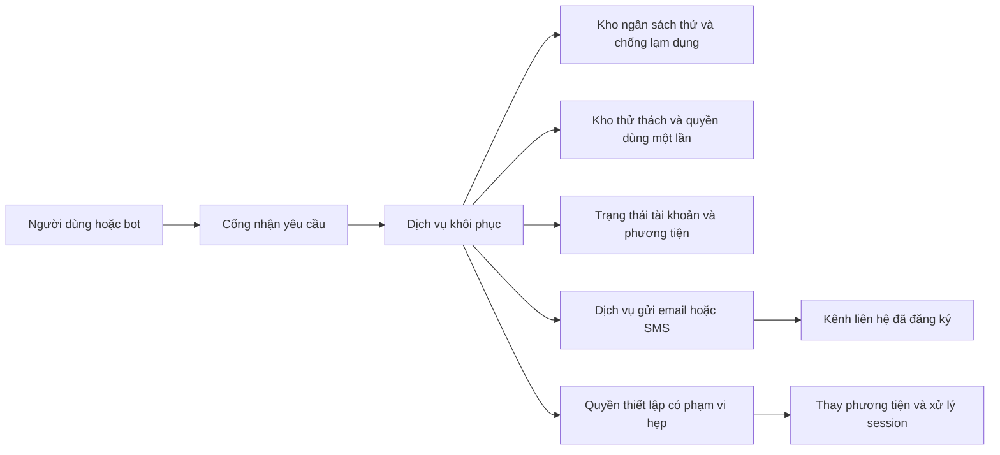

# Kẻ tấn công đoán tự động trong luồng khôi phục tài khoản

## 1. Mối đe dọa cần mô hình hóa

**Kẻ tấn công đoán tự động — automated guessing attacker — dùng phần mềm để thử hàng loạt giá trị nhằm vượt qua một bước xác minh của luồng khôi phục.** Giá trị bị thử có thể là OTP, mã dự phòng, token đặt lại mật khẩu, mã xác nhận hủy thay đổi hoặc câu trả lời cho một bước xác minh yếu.

Trong module `SECURITY_AUTHENTICATION_ACCOUNT_RECOVERY`, người dùng có thể mất mật khẩu, MFA, passkey hoặc thiết bị xác thực. Khi đó, hệ thống mở một đường thay thế để chứng minh quyền kiểm soát tài khoản. Đường thay thế này trở thành mục tiêu nếu kẻ tấn công có thể gửi đủ nhiều lần đoán, tạo lại thử thách hoặc chuyển sang một kênh có điều kiện dễ hơn.

Ví dụ: Lan mất điện thoại chứa ứng dụng xác thực. Dịch vụ cho phép khôi phục bằng OTP gửi đến email đã đăng ký, sau đó thiết lập MFA mới. Kẻ tấn công biết email của Lan nhưng không kiểm soát hộp thư. Hắn gửi các giá trị OTP bằng chương trình và tìm cách mở rộng số lần thử. Nếu đoán đúng OTP đã đủ để gắn MFA mới, một bước xác minh yếu có thể dẫn tới chiếm đoạt tài khoản.

Cần phân biệt ba kết quả:

| Kết quả | Ý nghĩa đối với mô hình đe dọa |
| --- | --- |
| Vượt qua bằng chứng khôi phục | Kẻ tấn công đoán đúng một giá trị được backend chấp nhận |
| Chiếm đoạt tài khoản | Kẻ tấn công hoàn tất những bước còn lại để thay phương tiện hoặc nhận quyền truy cập |
| Làm gián đoạn khôi phục | Kẻ tấn công tiêu hao lượt thử, gây gửi thư hoặc SMS hàng loạt, khiến chủ tài khoản khó hoàn tất quy trình |

Đoán đúng một bước chưa luôn đồng nghĩa chiếm đoạt thành công. Tuy nhiên, không được bỏ qua bước đó chỉ vì còn một màn hình xác nhận phía sau: phải xác định chính xác màn hình sau yêu cầu bằng chứng gì và có thực thi ở backend hay không.

## 2. Năng lực, mục tiêu và giới hạn của tác nhân

### 2.1. Những gì nên giả định kẻ tấn công làm được

Một mô hình thực tế có thể giả định tác nhân:

- Biết hoặc suy ra email, số điện thoại hay tên đăng nhập của nhiều mục tiêu.
- Gọi trực tiếp API thay vì dùng giao diện trình duyệt.
- Đổi địa chỉ IP, trình duyệt, cookie và dấu nhận diện thiết bị.
- Chạy nhiều yêu cầu đồng thời, phân phối qua nhiều máy và thay đổi tốc độ.
- Tạo lại phiên khôi phục, yêu cầu gửi lại mã và chuyển giữa các endpoint.
- Quan sát mã HTTP, nội dung trả về, thời gian phản hồi và thời điểm bị hạn chế.
- Thử chậm trong thời gian dài, hoặc dùng một số ít lần đoán trên rất nhiều tài khoản.

Các năng lực này không có nghĩa tác nhân luôn kiểm soát được hộp thư, SIM hay máy chủ. Với bài toán đoán thuần túy, cần nêu giả định rằng mã được sinh đúng và chưa bị lộ. Nếu mã đã xuất hiện trong log, bị đánh cắp qua phishing hoặc gửi tới địa chỉ do tác nhân kiểm soát, đó là con đường khác; tăng entropy sẽ không sửa được nguồn rò rỉ ấy.

### 2.2. Tài sản cần bảo vệ

Tài sản không chỉ là mật khẩu hiện tại. Cần bảo vệ:

- Quyền thay mật khẩu, MFA, passkey và thông tin liên hệ dùng để khôi phục.
- Quyền cấp session, refresh token hoặc quyền thiết lập phương tiện mới.
- Tính bí mật của mã và token khôi phục.
- Khả năng khôi phục của người dùng hợp lệ.
- Ngân sách gửi email, SMS, xử lý yêu cầu và hỗ trợ.
- Thông tin về việc một tài khoản tồn tại hoặc đang khôi phục.

Một luồng không cho phép chiếm đoạt nhưng để bot khóa đường khôi phục của bất kỳ người dùng nào vẫn có rủi ro đáng kể.

### 2.3. Các kiểu phân bổ lượt đoán

| Kiểu thử | Cách phân bổ | Điểm yếu thường bị khai thác |
| --- | --- | --- |
| Tập trung vào một mục tiêu | Rất nhiều lần thử cho một tài khoản | Thiếu giới hạn theo tài khoản hoặc mục đích |
| Rải trên nhiều mục tiêu | Vài lần thử cho mỗi tài khoản | Chỉ phát hiện khi một tài khoản có lưu lượng rất lớn |
| Phân tán nguồn gửi | Nhiều IP cùng thử một mục tiêu | Chỉ giới hạn theo IP |
| Tạo mới thử thách | Mỗi mã hoặc phiên mới lại có lượt thử mới | Ngân sách bị đặt lại khi gửi lại mã |
| Chuyển kênh hoặc endpoint | Thử luân phiên email, SMS, ứng dụng và API cũ | Các đường cùng cấp một quyền nhưng đếm riêng |
| Thử chậm và kéo dài | Mỗi khoảng thời gian chỉ gửi ít yêu cầu | Chỉ quan sát các đợt bùng phát ngắn |

Đếm lượt đoán theo cách tác nhân được lợi, không chỉ theo cách API được chia thành các dịch vụ.

## 3. Luồng dữ liệu và các ranh giới tin cậy

Một luồng khôi phục bằng mã có thể được mô tả như sau:



Những ranh giới cần chú ý:

1. **Từ client tới backend:** trường `attempt_count`, thời điểm hết hạn, trạng thái CAPTCHA hoặc kết quả xác minh do client gửi không phải nguồn có thẩm quyền.
2. **Từ cổng API tới dịch vụ khôi phục:** một giới hạn ở cổng có thể bị bỏ qua nếu còn API khác hoặc đường nội bộ có thể truy cập.
3. **Giữa các bản sao dịch vụ:** bộ đếm trong RAM của từng instance không tạo ra một ngân sách chung.
4. **Từ kết quả kiểm tra mã tới quyền thay phương tiện:** một mã hợp lệ phải tạo quyền đúng mục đích và phạm vi, không mặc nhiên mở mọi thao tác nhạy cảm.
5. **Từ tác vụ gửi mã tới kênh nhận:** việc yêu cầu gửi thành công không chứng minh người yêu cầu kiểm soát kênh.

Mã định danh thử thách khó đoán giúp hạn chế một số cách dò tìm, nhưng không thay thế việc giới hạn số lần thử mã. Nếu bất kỳ ai biết email cũng có thể tạo thử thách cho tài khoản đó, tác nhân vẫn có thể tự nhận một mã định danh thử thách rồi đoán OTP tương ứng.

## 4. Bề mặt đoán không chỉ nằm ở ô nhập OTP

| Bề mặt | Kịch bản đáng xét | Điều kiện cần bảo vệ |
| --- | --- | --- |
| Yêu cầu khôi phục | Bot phát động trên nhiều tài khoản để nhận trạng thái hoặc gây gửi mã | Hạn chế phát hành, phản hồi công khai phù hợp và kiểm soát chi phí |
| Kiểm tra OTP | Bot thử nhiều giá trị cho một mã đang sống | Ngân sách hữu hạn, hết hạn và kiểm tra nguyên tử |
| Gửi lại mã | Bot xin mã mới để có thêm lượt thử hoặc nhiều mã cùng hợp lệ | Quy tắc thay thế mã và ngân sách liên tục |
| Token trong liên kết | Token có ít khả năng hoặc được tạo từ thông tin dễ suy ra | Nguồn ngẫu nhiên mật mã và không gian đủ lớn |
| Mã dự phòng | Thử nhiều mã vào endpoint dành cho người mất MFA | Giới hạn theo tài khoản, loại bằng chứng và tính dùng một lần |
| Câu hỏi hoặc dữ liệu cá nhân | Bot thử dữ liệu phổ biến hay có sẵn từ nguồn khác | Đánh giá chất lượng bằng chứng; không coi dữ liệu công khai là bí mật mạnh |
| Bước thêm phương tiện mới | Bot gọi trực tiếp API thiết lập mà không có quyền khôi phục hợp lệ | Backend kiểm tra quyền hẹp, đúng tài khoản và đúng mục đích |
| Endpoint phụ hoặc phiên bản cũ | Bot chuyển sang đường ít kiểm soát hơn | Cùng tuân theo quyết định chống lạm dụng và điều kiện cấp quyền |

Không mặc định mọi phương tiện đều là một chuỗi bí mật có thể đoán bằng cách tương tự OTP. Chẳng hạn, challenge trong một giao thức passkey không phải mã mà người dùng giữ kín; biết challenge không đủ tạo chữ ký hợp lệ. Trong ngữ cảnh này, tác nhân thường nhắm vào bước thay thế để đăng ký passkey mới hoặc bỏ qua phương tiện cũ.

Nếu OTP dùng để xác minh email nhưng một endpoint khác chấp nhận nó làm bằng chứng tắt MFA, phạm vi quyền đã bị mở rộng. Đây là lỗi ràng buộc mục đích, dù mã được sinh ngẫu nhiên tốt.

## 5. Ước lượng khả năng đoán thành công

### 5.1. Không gian mã và số lần thử hiệu lực

Giả sử một mã gồm sáu chữ số, cho phép cả số 0 ở đầu, được sinh đều trên mọi giá trị:

```text
N = 10^6 = 1.000.000 giá trị
```

Nếu chỉ có một mã đúng cố định và tác nhân thử `q` giá trị khác nhau trước khi mã hết hiệu lực, xác suất thành công là `q / N`, với `q <= N`.

Nếu mỗi lần đoán độc lập, cho phép lặp lại giá trị, xác suất là:

```text
P = 1 - (1 - 1/N)^q
```

Khi `q` nhỏ so với `N`, hai mô hình cho kết quả gần nhau. Ví dụ, năm lần đoán khác nhau đối với một mã sáu chữ số cho:

```text
P = 5 / 1.000.000
  = 0,000005
  = 0,0005%
```

Con số này chỉ có nghĩa với các giả định đã nêu. Nếu mã sinh lệch, tác nhân biết một phần mã hoặc có thể thử thêm ở endpoint khác, không thể dùng nguyên kết quả trên.

### 5.2. Nhiều mục tiêu làm rủi ro tổng tăng

Giả sử có 100.000 tài khoản mục tiêu, mỗi tài khoản đều có một thử thách sáu chữ số đang hợp lệ mà tác nhân có thể gửi năm lần đoán khác nhau. Giả sử mã của các tài khoản độc lập:

```text
P có ít nhất một lần đoán đúng
    = 1 - (1 - 5/1.000.000)^100.000
    ≈ 39,3%
```

Ví dụ minh họa rủi ro cộng dồn; không phải khẳng định mọi hệ thống thực tế có sẵn số lượng thử thách đó. Khả năng tạo thử thách, hạn chế phát hành, thời hạn, số mục tiêu và các bằng chứng tiếp theo đều ảnh hưởng kết quả. Đoán đúng cũng chưa chứng minh đã hoàn tất chiếm đoạt tài khoản.

Tuy vậy, chỉ nhìn tỷ lệ rất nhỏ trên một tài khoản có thể khiến đội thiết kế đánh giá thiếu rủi ro ở quy mô dịch vụ.

### 5.3. Nhiều mã cùng sống mở rộng tập giá trị được chấp nhận

Nếu hệ thống đồng thời chấp nhận `c` mã khác nhau trong cùng không gian `N`, một lần đoán đều có xác suất `c/N` trúng một giá trị được chấp nhận. Với `q` lần thử, một cận trên đơn giản là:

```text
P <= min(1, q × c / N)
```

Cận này hữu ích để nhận ra tác động của việc giữ nhiều mã cũ, nhưng không thay thế mô hình cụ thể về cách sinh, thay thế và tiêu thụ mã. Nếu mã thay đổi theo thời gian, cần xét tập được chấp nhận tại từng thời điểm.

### 5.4. TTL không tự tạo ngân sách nhỏ

Thời hạn sống ngắn giảm khoảng thời gian mã có thể được sử dụng. Nó không ngăn bot gửi nhiều yêu cầu trong khoảng đó. Khi không có giới hạn hiệu lực, nhiều nguồn gửi và nhiều kết nối đồng thời có thể tạo số lượt thử lớn trước khi TTL kết thúc.

Đối với token trong liên kết mà người dùng không cần gõ, có thể dùng không gian ngẫu nhiên lớn hơn nhiều so với OTP nhập tay. Ví dụ minh họa: với token ngẫu nhiên đều 128 bit, một giá trị hợp lệ và một tỷ lần đoán khác nhau, xác suất đoán thuần túy xấp xỉ `10^9 / 2^128`, tức khoảng `2,94 × 10^-30`. Kết quả này không bao gồm rò rỉ token hay lỗi kiểm tra.

Entropy, thời hạn, ngân sách thử và ràng buộc quyền giải quyết những phần khác nhau của bài toán. Không dùng một con số TTL hoặc một độ dài token để thay cho toàn bộ mô hình đe dọa.

## 6. Thiết kế ngân sách thử theo quyền mà tác nhân muốn đạt

### 6.1. Kết hợp nhiều chiều giới hạn

Không có một khóa đếm duy nhất đáp ứng mọi mục tiêu:

| Chiều giới hạn | Mục đích chính | Giới hạn khi dùng riêng |
| --- | --- | --- |
| Theo thử thách | Chặn đoán nhiều vào một mã hoặc quyền cụ thể | Có thể bị tạo lại thử thách để đặt lại |
| Theo tài khoản và mục đích | Gom lượt thử nhằm đạt cùng một quyền khôi phục | Cần kiểm soát nguy cơ gây từ chối dịch vụ cho nạn nhân |
| Theo kênh nhận hoặc đích gửi | Hạn chế quấy rối và chi phí phát hành mã | Không chặn được mọi lượt xác minh từ nhiều đích |
| Theo IP hoặc dải mạng | Giảm lưu lượng từ một nguồn | Bot đổi nguồn; nhiều người hợp lệ có thể chung mạng |
| Theo thiết bị hoặc phiên có tín hiệu | Bổ sung ngữ cảnh hành vi | Cookie và dấu thiết bị có thể thay đổi hoặc giả mạo |
| Theo toàn dịch vụ hoặc nhóm rủi ro | Nhận biết tấn công rải trên nhiều tài khoản | Cần tránh để một đợt tấn công làm tắt mọi khôi phục |

Các bộ đếm có thể dùng cửa sổ thời gian, ngân sách theo đợt hoặc cơ chế khác phù hợp. Điều cần đặc tả là số yêu cầu nào được tính, khi nào ngân sách được bổ sung, độ trễ thực thi và mức vượt ngưỡng có thể xảy ra.

Nếu dùng cửa sổ cố định, cần xét đợt gửi ngay trước và ngay sau ranh giới cửa sổ. Không mô tả giới hạn như một mức đều tuyệt đối khi thuật toán thực tế cho phép các đợt bùng phát.

Thông số như “tối đa năm lần nhập” trong bài chỉ là ví dụ tính toán. Chính sách triển khai cần dựa vào không gian mã, kênh chứng minh, số lượng mục tiêu, giá trị quyền được cấp và khả năng gây gián đoạn; không sao chép con số đó như một mặc định an toàn cho mọi dịch vụ.

### 6.2. Gửi lại không được mở vô hạn lượt đoán

Một thiết kế dễ mắc lỗi:

```text
Mỗi challenge có 5 lượt thử.
Mỗi lần gửi lại tạo challenge mới với 5 lượt.
Không có ngân sách chung cho tài khoản và mục đích.
```

Tác nhân có thể biến “năm lượt” thành hàng trăm lượt bằng cách xin mã mới. Lỗi vẫn còn nếu endpoint gửi lại và endpoint tạo yêu cầu mới có các bộ đếm tách biệt.

Cần xác định quan hệ giữa:

- Ngân sách phát hành hoặc gửi lại mã.
- Ngân sách xác minh của từng thử thách.
- Ngân sách tích lũy theo tài khoản và quyền đang được yêu cầu.
- Khoảng thời gian áp dụng và điều kiện chuyển sang quy trình xác minh khác.

Nếu phát hành mã mới làm mất hiệu lực mã cũ, cần cân nhắc khả năng bot liên tục tạo mã để khiến mã người dùng vừa nhận luôn thất bại. Có thể hạn chế gửi lại, tái sử dụng một yêu cầu còn hiệu lực theo chính sách, hoặc yêu cầu thêm điều kiện trước khi thay thế. Lựa chọn nào cũng phải nêu rõ tập mã đang được chấp nhận và không đặt lại ngân sách tùy tiện.

### 6.3. Chuyển kênh không được xóa lịch sử liên quan

Email và SMS có thể có hạn chế riêng để bảo vệ đích nhận, nhưng nếu cả hai đều cho quyền thay MFA thì cần có một lớp đánh giá chung cho quyền đó. Tác nhân không nên được thử hết ngân sách ở từng kênh rồi tiếp tục qua ứng dụng di động hoặc API cũ như một người hoàn toàn mới.

Khi chưa biết tài khoản có tồn tại hay không, vẫn cần kiểm soát tài nguyên cho yêu cầu công khai. Không dùng việc bỏ qua bộ đếm cho tài khoản không tồn tại để tạo một khác biệt dễ dò với tài khoản thật.

## 7. Thực thi nguyên tử khi nhiều yêu cầu chạy đồng thời

### 7.1. Kiểm tra rồi tăng bộ đếm là chưa đủ

Giả sử chỉ còn một lượt thử. Hai mươi request đồng thời cùng đọc bộ đếm “còn một”, sau đó tất cả đều kiểm tra mã rồi mới tăng số lần thất bại. Hệ thống đã cho nhiều lượt đoán hơn chính sách dù từng request đều có câu lệnh kiểm tra giới hạn.

Bộ đếm đặt riêng trong từng instance còn làm tổng lượt được phép tăng theo số máy đang chạy. Cache trễ hoặc một endpoint bỏ qua kiểm tra cũng có thể phá vỡ ngân sách hiệu lực.

Cần bảo đảm việc dành lượt thử và quyết định chấp nhận có một thứ tự nhất quán. Có thể dùng cập nhật có điều kiện, khóa, giao dịch hoặc cơ chế tương đương. Chọn công nghệ nào cũng cần xác định tính nguyên tử thực tế; việc dùng một kho dùng chung chưa tự chứng minh mọi thao tác đã nguyên tử.

### 7.2. Đặc tả kiểm tra mã minh họa

Đoạn dưới là mã giả để diễn đạt những điều kiện cần phối hợp, không phải một triển khai có thể sao chép nguyên xi:

```text
verifyRecovery(challengeId, submittedCode, requestContext):
    kiểm soát lưu lượng và chi phí tại điểm vào

    trong phạm vi phối hợp cập nhật được thiết kế:
        đọc thử thách có thẩm quyền
        xác định accountId và purpose từ dữ liệu phía server
        kiểm tra thử thách còn hiệu lực, chưa dùng, chưa bị thu hồi
        kiểm tra vòng đời tài khoản còn cho phép thao tác này
        kiểm tra ràng buộc tài khoản, mục đích và ngữ cảnh cần thiết

        dành một lượt từ các ngân sách bắt buộc
        nếu không dành được lượt:
            không kiểm tra ứng viên như một lượt thử được phép

        so sánh mã ứng viên với bằng chứng đã lưu
        nếu không khớp:
            giữ lại lượt đã tiêu hao và ghi nhận kết quả
            không trả thông tin phân biệt có ích cho việc dò

        nếu khớp:
            tiêu thụ thử thách đúng một lần
            tạo quyền thiết lập có phạm vi hẹp
            commit các thay đổi liên quan một cách nhất quán

    trả kết quả phù hợp với quyền được biết của người gọi
```

Hai điểm dễ bị bỏ sót:

- **Lượt thất bại phải được lưu lại.** Nếu ném lỗi làm rollback giao dịch chứa bộ đếm, bot có thể thử sai mà không tiêu hao ngân sách.
- **Một mã đúng không được tạo nhiều quyền độc lập do chạy đua.** Nếu cần hỗ trợ retry sau lỗi mạng, retry phải trả lại cùng một kết quả được phép hoặc kết quả đã hoàn tất, thay vì tạo thêm quyền khôi phục mới.

Nếu ngân sách chung, thử thách và quyền thiết lập nằm ở các kho khác nhau, cần đặc tả cách phối hợp. Ví dụ, việc dành lượt trước có thể làm mất một lượt khi xử lý sau bị lỗi; điều này cần được cân nhắc về trải nghiệm và vận hành. Không được hoàn lại một lượt đã thực sự cho phép kiểm tra mã chỉ vì request kết thúc bằng timeout.

Không giữ giao dịch dữ liệu mở trong lúc chờ gửi SMS hay gọi dịch vụ bên ngoài. Phát hành thông báo và kiểm tra mã là các tác vụ cần phối hợp bằng thiết kế phù hợp, không phải kéo mọi hiệu ứng mạng vào một giao dịch dài.

### 7.3. Khi hạ tầng giới hạn bị lỗi

Nếu kho ngân sách không hoạt động, việc cho mọi yêu cầu đi qua mà không giới hạn biến một sự cố vận hành thành cửa sổ đoán không kiểm soát.

Cần có chính sách cho trạng thái suy giảm: từ chối bước nhạy cảm một cách kiểm soát, áp dụng một giới hạn thay thế đã được đánh giá hoặc chuyển sang đường có bằng chứng phù hợp. Nếu giới hạn thay thế đặt tại từng instance, phải tính tổng mức có thể vượt khi nhiều instance cùng phục vụ; không coi nó tương đương ngân sách chung.

Thông điệp cho người dùng nên nêu cách tiếp tục phù hợp. Không trả chi tiết giúp tác nhân xác định chính xác lúc lớp phòng vệ đang mất hiệu lực.

## 8. Sinh, lưu và ràng buộc bằng chứng

### 8.1. Giá trị khó đoán ngay từ lúc sinh

Mã hoặc token cần được sinh từ nguồn ngẫu nhiên mật mã và phân bố phù hợp với không gian đã tính. Mã sáu chữ số có độ dài đúng nhưng lấy từ thời gian, số thứ tự hay thông tin tài khoản có thể dễ đoán hơn nhiều so với mô hình một triệu khả năng.

Mã định danh thử thách, OTP và quyền thiết lập sau xác minh có vai trò khác nhau. Không dùng một mã ngắn nhập tay làm token truy cập dài hạn cho mọi bước còn lại.

### 8.2. Lưu mã không đồng nghĩa lưu bản rõ

Không ghi mã hoặc token vào log, URL phân tích, trace hay thông báo lỗi. Một token có độ ngẫu nhiên cao vẫn mất giá trị bảo vệ nếu bị lộ qua đường quan sát.

Với OTP có không gian nhỏ, lưu một giá trị băm không có khóa vẫn cho phép người đọc được cơ sở dữ liệu liệt kê toàn bộ không gian để tìm mã. Một lựa chọn thiết kế là dùng MAC có khóa phía server, ràng buộc với ngữ cảnh như mã thử thách và mục đích, đồng thời quản lý khóa riêng khỏi bản ghi thử thách. Điều này không thay thế kiểm soát truy cập dữ liệu hay giới hạn đoán trực tuyến.

Với token ngẫu nhiên có không gian rất lớn, lưu giá trị băm để tra cứu hoặc xác minh có đặc tính khác so với OTP ngắn. Cần đánh giá đúng loại bí mật thay vì áp dụng một cách lưu duy nhất cho mọi bằng chứng.

### 8.3. Ràng buộc đúng quyền và đúng thời điểm

Bản ghi phía server cần đủ thông tin để quyết định:

- Bằng chứng thuộc tài khoản nào và phục vụ thao tác gì.
- Được cấp khi nào, hết hiệu lực khi nào, đã dùng hoặc bị thu hồi chưa.
- Còn những lượt thử nào và có nằm trong ngân sách chung không.
- Có thay đổi bảo mật hoặc vòng đời nào làm bằng chứng cũ không còn được chấp nhận.
- Sau khi thành công, quyền nào được cấp, trong bao lâu và được dùng mấy lần.

Tài khoản đã bị xóa, bị vô hiệu hóa theo chính sách hoặc có quyết định ngăn khôi phục không được trở lại hoạt động chỉ vì một mã cũ còn khớp. Mã đúng là một phần của quyết định, không phải lệnh bỏ qua mọi điều kiện khác.

Khi hoàn tất khôi phục, cần xử lý các quyền khôi phục còn lại và session theo mức rủi ro, thông báo tới kênh đáng tin cậy theo chính sách. Không phục hồi session cũ hoặc tự bỏ yêu cầu MFA chỉ để rút ngắn luồng.

## 9. Chống bot mà vẫn giữ khả năng khôi phục hợp lệ

### 9.1. Đừng biến giới hạn thử thành công cụ khóa nạn nhân

Nếu chỉ cần biết email là có thể làm tài khoản bị khóa vĩnh viễn sau vài lần sai, tác nhân không cần đoán đúng nữa. Hắn dùng chính cơ chế phòng vệ để ngăn chủ tài khoản truy cập hoặc khôi phục.

Cần phân biệt:

- Từ chối thêm lượt đoán vào một thử thách.
- Tạm hạn chế việc cấp hoặc kiểm tra bằng chứng.
- Khóa đăng nhập thông thường.
- Kết thúc hay vô hiệu hóa tài khoản.

Một bộ đếm sai ở luồng công khai không nên mặc nhiên kích hoạt mọi hậu quả còn lại. Tùy rủi ro, có thể dùng trì hoãn tăng dần, hạn chế theo nhiều chiều, thêm bằng chứng hoặc chuyển sang xử lý có kiểm chứng. Điều kiện gỡ hạn chế phải do server kiểm soát và không tạo cách đặt lại ngân sách vô hạn.

### 9.2. CAPTCHA và tín hiệu thiết bị chỉ là lớp bổ sung

CAPTCHA có thể làm tăng chi phí tự động hóa, nhưng tác nhân có thể thuê giải, dùng dịch vụ trung gian hoặc vượt qua bằng cách khác. Vượt CAPTCHA không chứng minh quyền kiểm soát tài khoản.

Tương tự, một IP “sạch”, cookie quen thuộc hay thiết bị có điểm rủi ro thấp không nên biến một OTP sai thành hợp lệ. Các tín hiệu giúp điều chỉnh lưu lượng và mức xác minh, trong phạm vi chính sách đã xác định.

Trì hoãn phải được thực thi ở backend. Một đồng hồ đếm ngược bằng JavaScript không ngăn bot gọi thẳng API. Cũng không nên giữ quá nhiều kết nối chờ chỉ để trì hoãn, khiến tài nguyên dịch vụ cạn trước khi tác nhân bị hạn chế.

### 9.3. Phản hồi công khai không được trở thành công cụ dò tài khoản

Trước khi người gọi có quyền biết trạng thái tài khoản, tránh trả các thông điệp khác biệt như “email không tồn tại”, “tài khoản đang khôi phục” và “mã đúng nhưng thiếu MFA” theo cách cho phép dò hàng loạt.

Cần xét cả mã HTTP, cấu trúc phản hồi, thời gian xử lý, hành vi giới hạn và thông báo phát sinh. Không cần mọi request có thời gian giống hệt nhau, nhưng không nên để nhánh xử lý tạo tín hiệu phân biệt rõ ràng và ổn định.

Sau khi đã có ngữ cảnh được phép, người dùng cần hướng dẫn đủ rõ: mã đã hết hạn, yêu cầu gửi lại có bị hạn chế không và đường hỗ trợ nào có thể dùng. Sự rõ ràng đó phải đi kèm phạm vi thông tin được phép tiết lộ.

### 9.4. Đường dự phòng phải giữ mức bằng chứng phù hợp

Khi người dùng không còn điện thoại hoặc passkey, có thể cần kênh khác. Không để bot chỉ bấm “tôi không dùng được cách này” rồi chuyển sang câu hỏi dễ đoán hơn hoặc nhân viên hỗ trợ bỏ qua xác minh.

Hỗ trợ thủ công cần thẩm quyền, bằng chứng và kiểm soát riêng. Thất bại ở bộ đếm tự động không phải bằng chứng cho thấy người yêu cầu là chủ tài khoản.

## 10. Tình huống thiết kế: năm lượt thử nhưng thực tế không phải năm lượt

Một dịch vụ cho phép đặt lại MFA bằng OTP sáu chữ số gửi tới email đã đăng ký. Mỗi challenge có năm lượt sai. Mã mới có hiệu lực độc lập với mã cũ, giới hạn tạo mới chỉ theo IP và API di động có bộ đếm riêng.

Kẻ tấn công biết email nạn nhân, không đọc được hộp thư. Hắn đổi IP, tạo 20 challenge còn hiệu lực và gửi năm giá trị khác nhau vào từng challenge.

Nếu các mã độc lập và không có giới hạn chung, tổng cộng có 100 lượt so sánh được chấp nhận trên 20 thử thách. Xác suất có ít nhất một lần đúng xấp xỉ `100/1.000.000` khi xác suất còn nhỏ, theo các giả định trên. Đó chưa tính lượt thử thêm ở API di động.

Không được tính thành `100 × 20/1.000.000` cho chính tình huống này: mỗi request chỉ so với mã của một challenge. Hệ số 20 chỉ áp dụng nếu một endpoint thực sự chấp nhận bất kỳ mã nào trong tập 20 mã cho mỗi lần thử. Phân biệt hai hành vi giúp tránh vừa đánh giá thiếu vừa phóng đại rủi ro.

Một phương án sửa cần phối hợp nhiều quyết định:

1. Áp dụng ngân sách xác minh chung theo tài khoản và mục đích đặt lại MFA, dùng ở mọi API tương đương.
2. Giới hạn phát hành, gửi lại và số thử thách còn hiệu lực; định nghĩa rõ khi nào mã cũ mất hiệu lực.
3. Dành lượt và tiêu thụ mã nguyên tử, kể cả khi request tới nhiều instance.
4. Sau khi đủ bằng chứng, cấp quyền chỉ dùng để thiết lập phương tiện được cho phép, với thời hạn và tính dùng một lần.
5. Xử lý quyền khôi phục còn lại, session và thông báo khi hoàn tất.
6. Theo dõi tấn công rải nhiều mục tiêu, đồng thời cung cấp đường xử lý cho người dùng bị bot tiêu hao lượt.

Phương án này vẫn cần được đánh giá theo mức tin cậy của email và giá trị tài khoản. Kiểm soát tốt việc đoán không tự chứng minh một kênh email đơn lẻ luôn đủ cho mọi yêu cầu đặt lại MFA.

## 11. Quan sát và điều kiện cần đưa vào đặc tả

### 11.1. Những tín hiệu có ích

Theo dõi số lượt phát hành, gửi lại, xác minh sai, từ chối do ngân sách, thành công và hoàn tất thay phương tiện. Cần phân biệt số request với số lần so sánh mã thực sự được cho phép.

Các mẫu đáng chú ý gồm:

- Một tài khoản nhận thử nghiệm từ nhiều nguồn.
- Một nguồn hoặc cụm nguồn thử ít lần trên rất nhiều tài khoản.
- Nhiều thử thách mới xuất hiện ngay sau khi hết lượt ở thử thách cũ.
- Lưu lượng chuyển giữa kênh hoặc endpoint sau khi bị hạn chế.
- Đợt xác minh tăng nhanh nhưng số người dùng hoàn tất hợp lệ không tăng tương ứng.
- Tỷ lệ người dùng hợp lệ phải gửi lại, bị chặn hoặc chuyển hỗ trợ tăng bất thường.

Dùng định danh vận hành và mã lý do phù hợp, kiểm soát quyền truy cập và thời gian lưu. Không ghi ứng viên OTP, token, mật khẩu hay toàn bộ nội dung kênh liên hệ chỉ để phân tích tấn công.

Số request bị chặn cao không đủ để kết luận thiết kế hiệu quả. Cần quan sát những request vẫn đi qua, độ vượt ngân sách và khả năng người dùng hợp lệ hoàn tất. Tấn công chậm hoặc phân tán có thể không tạo một đỉnh lưu lượng dễ thấy.

### 11.2. Các thuộc tính hành vi cần xác minh ở giai đoạn kiểm tra

| Tình huống | Kết quả mong muốn |
| --- | --- |
| Gửi đồng thời nhiều request khi chỉ còn một lượt | Số lần kiểm tra được cho phép không vượt bảo đảm ngân sách đã công bố |
| Xin mã mới, gửi lại hoặc mở phiên khác | Không tự nhận lại toàn bộ ngân sách chung |
| Đổi IP, cookie hoặc chuyển sang API di động | Các giới hạn chung theo tài khoản và mục đích vẫn được thực thi |
| Dùng sai mã rồi giao dịch trả lỗi | Lượt đã cho phép kiểm tra vẫn được tính |
| Gửi đồng thời cùng một mã đúng | Không tạo nhiều quyền khôi phục độc lập |
| Retry sau timeout | Không mở thêm lượt đoán hay cấp lại quyền ngoài chính sách |
| Dùng mã cho tài khoản hoặc mục đích khác | Bị từ chối ở backend |
| Dùng mã cũ sau khi quyền đã thu hồi hoặc vòng đời thay đổi | Không thay phương tiện hay cấp session trái điều kiện hiện tại |
| Kho ngân sách mất kết nối | Không tự mở bước nhạy cảm cho lượt đoán không giới hạn |
| Bot tiêu hao ngân sách của nạn nhân | Không mặc nhiên khóa tài khoản vĩnh viễn; có đường xử lý phù hợp |
| Thử trên nhiều mục tiêu với lưu lượng thấp | Có khả năng quan sát rủi ro tổng và áp dụng kiểm soát thích hợp |
| Xem log và trace vận hành | Không thu được mã hoặc token có thể sử dụng |

Đặc tả hoàn chỉnh cần trả lời được ba câu hỏi: tác nhân có thể thực hiện bao nhiêu lần đoán có ích, các lần đoán ấy có thể đạt quyền gì, và chủ tài khoản hợp lệ tiếp tục ra sao khi bị lạm dụng. Câu trả lời phải nhất quán giữa giao diện, API, các instance và mọi đường dự phòng của luồng khôi phục.
