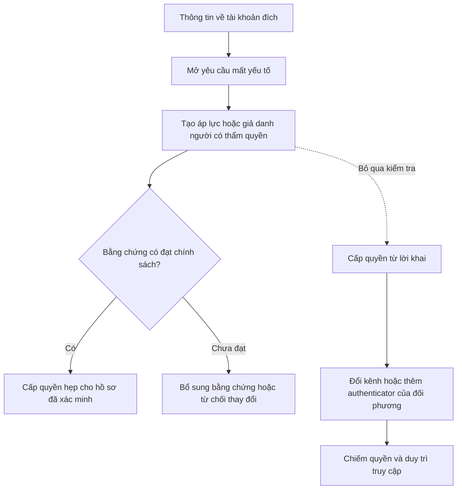

# Social engineering attacker: Kẻ tấn công thao túng con người trong khôi phục tài khoản

Trong chương **Recovery Threat Model** của `SECURITY_AUTHENTICATION_ACCOUNT_RECOVERY`, **social engineering attacker** là đối tượng tìm cách khiến người khác thực hiện hoặc phê duyệt hành động khôi phục trái với quyền thực sự của mình. Đối tượng bị tác động có thể là chủ tài khoản, nhân viên hỗ trợ, quản trị viên tổ chức hoặc người có quyền duyệt ngoại lệ.

Luồng khôi phục cần giúp người dùng trở lại tài khoản khi mất mật khẩu, MFA, passkey hoặc thiết bị xác thực. Chính tình huống thiếu phương tiện xác minh và cần được giúp đỡ tạo ra cơ hội để đối phương dựng câu chuyện hợp lý, thúc ép xử lý nhanh hoặc lợi dụng quyền can thiệp của con người. Một hệ thống dùng xác thực mạnh vẫn có thể bị chiếm quyền nếu nhân viên hỗ trợ có thể xóa yếu tố đó chỉ dựa trên lời khai.

Bài học này tập trung vào mô hình năng lực, các điểm chuyển giao niềm tin và cách thiết kế quy trình để sự thuyết phục không tự biến thành quyền khôi phục.

## 1. Mục tiêu học tập

Sau bài học, bạn có thể:

- Mô tả đối phương đang biết gì, kiểm soát ai hoặc kênh nào và muốn thay đổi thuộc tính bảo mật nào.
- Phân biệt thông tin giúp tìm tài khoản với bằng chứng cho phép khôi phục tài khoản.
- Nhận diện điểm mà lời khai, danh tính nhân viên hoặc áp lực nghiệp vụ bị đổi thành quyền kỹ thuật.
- Thiết kế vai trò hỗ trợ, bằng chứng dự phòng, quyền dùng một lần và kiểm soát session phù hợp.
- Nêu giới hạn của thông báo, khoảng chờ và phê duyệt nhiều người khi các kênh hoặc người duyệt cùng bị tác động.

## 2. Mô hình đối phương phải nêu rõ điều đã có và điều còn thiếu

Social engineering mô tả phương thức tác động vào quyết định của con người. Nó có thể kết hợp với mật khẩu bị lộ, hộp thư bị chiếm quyền hoặc session bị đánh cắp, nhưng không được mặc định rằng mọi đối phương đều có các năng lực đó.

Một mô hình cơ sở cho bài học:

```text
Tài khoản đích:
  Có MFA hoặc passkey đang bảo vệ quyền đăng nhập.
  Có quy trình khôi phục tự phục vụ và bộ phận hỗ trợ.

Đối phương có:
  Thông tin nhận diện hoặc thông tin công khai về nạn nhân.
  Khả năng mở yêu cầu hỗ trợ và liên hệ qua kênh công khai.
  Khả năng đưa ra lời khai về việc mất thiết bị hoặc mất yếu tố.

Đối phương chưa có:
  Authenticator hợp lệ hoặc recovery code của nạn nhân.
  Quyền kiểm soát kênh khôi phục đã đăng ký.
  Quyền quản trị hệ thống hoặc phê duyệt yêu cầu.

Mục tiêu:
  Khiến một người hoặc quy trình cấp quyền khôi phục còn thiếu.
  Thêm credential, thay kênh hoặc tạo session do đối phương kiểm soát.
```

Với mô hình này, một yêu cầu khẩn cấp và một hồ sơ cá nhân đúng vẫn chưa đủ để chứng minh quyền khôi phục. Nếu phát hiện đối phương có thêm mật khẩu hoặc email của nạn nhân, cần cập nhật giả định và đánh giá lại các biện pháp vốn dựa vào những bí mật hay kênh đó.

### Những tài sản và quyền cần bảo vệ

Tài sản không chỉ là dữ liệu trong tài khoản. Cần bảo vệ quyền đăng ký và xóa authenticator, quyền đổi email hoặc số điện thoại khôi phục, recovery code, token khôi phục, session và refresh token. Quyền của nhân viên hỗ trợ, lịch sử phê duyệt và khả năng tiếp tục truy cập của chủ tài khoản cũng nằm trong phạm vi.

Một đối phương chỉ đổi được email khôi phục hôm nay vẫn có thể tạo điều kiện chiếm quyền ngày mai. Một yêu cầu làm thu hồi mọi yếu tố của chủ tài khoản có thể gây thiệt hại ngay cả khi đối phương chưa nhận được session.

## 3. Ai có thể trở thành điểm bị thao túng?

| Người hoặc vai trò bị tác động | Hành động đối phương muốn họ thực hiện | Ranh giới cần giữ |
|---|---|---|
| Chủ tài khoản | Giao mã, mở liên kết giả, chấp thuận yêu cầu hoặc thêm phương tiện của người khác | Hiểu rõ mục đích và đích của thao tác; dùng kênh chính thức |
| Nhân viên hỗ trợ | Bỏ bước xác minh, đổi kênh hoặc xóa MFA | Thu thập thông tin không đồng nghĩa được tự cấp quyền khôi phục |
| Quản trị viên tổ chức | Reset yếu tố cho thành viên hoặc xác nhận danh tính | Kiểm tra quyền quản trị, tenant và quy trình nội bộ độc lập |
| Người duyệt ngoại lệ | Chấp nhận hồ sơ thiếu bằng chứng vì có áp lực | Ngoại lệ phải có tiêu chí và phạm vi quyền được ghi nhận |
| Người quản lý hoặc đồng nghiệp | Xác nhận một người là chủ tài khoản | Lời xác nhận phải có nguồn, thẩm quyền và giá trị theo chính sách |

Không nên coi con người chỉ là một lỗi bên ngoài hệ thống. Nếu bảng điều khiển cho phép nhân viên tắt MFA không cần bằng chứng, quyết định cá nhân đó chính là một đường cấp quyền được sản phẩm tạo ra. Threat model phải bao gồm cả giao diện hỗ trợ và API phía sau.

## 4. Phân biệt thông tin, tín hiệu và bằng chứng

### Thông tin giúp tìm tài khoản

Tên, email, chức danh, ngày sinh, mã khách hàng hoặc mô tả một giao dịch có thể giúp xác định hồ sơ cần xử lý. Giá trị xác minh của chúng phụ thuộc nguồn gốc và khả năng bị biết bởi người khác. Thông tin có trên mạng, trên hóa đơn được chia sẻ hoặc trong một vụ lộ dữ liệu không nên được coi là bí mật độc lập.

Biết nhiều dữ kiện đúng có thể làm một câu chuyện đáng tin hơn với người nghe. Điều đó không tự chứng minh người kể được phép thay yếu tố xác thực.

### Tín hiệu hỗ trợ đánh giá rủi ro

Thiết bị quen, địa chỉ mạng, lịch sử yêu cầu và cách liên hệ có thể hỗ trợ đánh giá. Chúng có thể sai lệch khi người dùng đổi máy, đi công tác hoặc khi đối phương đang dùng chính thiết bị bị đánh cắp.

Tín hiệu rủi ro giúp chọn bước xử lý; nó không tự thay thế bằng chứng còn thiếu. Một IP quen cũng không đủ để cho phép thêm passkey mới.

### Bằng chứng được chính sách chấp nhận

Authenticator dự phòng, recovery code còn hiệu lực hoặc kết quả của một quy trình xác minh được thiết kế cho loại tài khoản cụ thể có thể được chấp nhận trong phạm vi nhất định. Phải nêu rõ bằng chứng đó chứng minh điều gì và được dùng cho thao tác nào.

| Dữ liệu hoặc hành động quan sát được | Có thể hỗ trợ kết luận nào? | Không tự chứng minh điều gì? |
|---|---|---|
| Đọc đúng email và tên tài khoản | Đã xác định được hồ sơ đích | Có quyền khôi phục hồ sơ đó |
| Nhận mã tại email mới vừa cung cấp | Kiểm soát email mới tại thời điểm kiểm tra | Có quyền thay email cũ của tài khoản |
| Gọi từ số hiển thị quen thuộc | Có một cuộc gọi với thông tin hiển thị tương ứng | Người gọi chắc chắn là chủ tài khoản; caller ID có thể bị giả mạo |
| Gửi ảnh giấy tờ | Có một bản ảnh cần được đánh giá theo quy trình | Ảnh là thật, người gửi là người trong ảnh hoặc có quyền với tài khoản |
| Xuất hiện trong cuộc gọi video | Có người hoặc nội dung hình ảnh đang tương tác | Video không bị giả mạo hoặc việc xác minh đã đáp ứng chính sách |
| Dùng recovery code hợp lệ | Sở hữu bí mật dự phòng được chấp nhận | Người nhập chắc chắn là chủ tài khoản ngoài đời thực |
| Một nhân viên đã ghi “verified” | Có quyết định được ghi trong hệ thống | Quyết định có đủ căn cứ hoặc đúng thẩm quyền |

Ảnh giấy tờ, giọng nói và video có thể bị đánh cắp hoặc giả mạo; cũng có người hợp lệ không thể cung cấp chúng. Nếu dùng xác minh danh tính, cần một quy trình có tiêu chí chấp nhận, xử lý sai lệch, bảo vệ dữ liệu và đường khiếu nại. Không thể thay toàn bộ quy trình bằng yêu cầu “gửi một ảnh giấy tờ”.

## 5. Chuỗi chiếm quyền qua một quyết định hỗ trợ



Nhánh nguy hiểm xuất hiện khi nội dung giao tiếp được nâng thành quyền kỹ thuật mà không có bằng chứng tương ứng. Các biểu hiện thường gặp gồm:

- **Khẩn cấp:** viện lý do công việc bị đình trệ để yêu cầu xử lý trước, bổ sung xác minh sau.
- **Giả danh thẩm quyền:** tự xưng là lãnh đạo, quản trị viên hoặc đối tác để yêu cầu ngoại lệ.
- **Tạo cảm giác quen thuộc:** dùng dữ kiện nội bộ hoặc lịch sử trao đổi để làm người xử lý giảm cảnh giác.
- **Chuyển người xử lý:** mở nhiều yêu cầu để tìm người chấp nhận điều kiện thấp hơn, hoặc chia nhỏ câu chuyện giữa các kênh.
- **Lợi dụng lòng muốn giúp đỡ:** biến việc từ chối một thao tác chưa được phép thành cảm giác nhân viên đang gây khó cho khách hàng.

Những biểu hiện này là dấu hiệu cần xem xét, không phải bằng chứng kết tội. Người dùng thật cũng có thể hoảng loạn hoặc cần xử lý gấp. Cách phòng vệ bền vững là quy trình và quyền hạn rõ ràng, thay vì yêu cầu nhân viên đoán ai đang nói dối.

### Tấn công có thể diễn ra qua nhiều lần liên hệ

Một yêu cầu đầu chỉ đổi email, yêu cầu sau đặt lại mật khẩu, yêu cầu cuối thay MFA. Nếu mỗi nhân viên chỉ thấy bước hiện tại, họ có thể không nhận ra toàn bộ chuỗi đang chuyển quyền về cùng một phía.

Hệ thống cần liên kết các thay đổi bảo mật và hồ sơ liên quan theo tài khoản, tenant và thời gian. Việc liên kết phải có kiểm soát truy cập, tránh biến giao diện hỗ trợ thành nơi nhân viên tùy ý tra cứu dữ liệu cá nhân.

## 6. Những lỗi thiết kế khiến sự thuyết phục có hiệu lực

### 6.1. Nhầm tìm đúng hồ sơ với xác minh đúng người

Một kịch bản hỏi tên, email và ngày sinh có thể tìm đúng tài khoản nhưng không loại trừ đối phương đã thu thập các dữ kiện đó. Nếu kết thúc kịch bản bằng quyền xóa MFA, hệ thống đã gán giá trị quá lớn cho thông tin nhận diện.

### 6.2. Cho tự chọn kênh để xác minh quyền thay kênh

Người yêu cầu nói không còn email cũ, đưa email mới rồi nhận mã ở đó. Mã chứng minh họ kiểm soát địa chỉ mới. Nó không chứng minh quyền chuyển tài khoản sang địa chỉ đó. Quyền thay kênh phải được xác lập trước bằng bằng chứng phù hợp; xác minh kênh mới là một kiểm tra riêng.

### 6.3. Nhờ người dùng giao bí mật cho người hỗ trợ

Yêu cầu đọc mật khẩu, OTP, recovery code hoặc gửi liên kết khôi phục nguyên văn tạo ra thói quen có thể bị kẻ giả danh khai thác. Một thiết kế tốt cho phép người dùng nộp bằng chứng tại giao diện chính thức, gắn với hồ sơ và mục đích cụ thể; nhân viên chỉ thấy kết quả cần thiết.

Việc nhập mã vào giao diện thật vẫn có thể bị lợi dụng nếu giao diện không giải thích rõ mã sẽ cho phép thao tác gì. Cần hiển thị tài khoản, thay đổi dự kiến và ngữ cảnh khôi phục để người dùng nhận biết một yêu cầu không do mình khởi tạo.

### 6.4. Phê duyệt không gắn với nội dung thay đổi

Người duyệt xác nhận một hồ sơ thay MFA, nhưng sau đó người xử lý đổi email đích hoặc tài khoản đích mà quyết định vẫn còn hiệu lực. Khi đó quyền được cấp đã bị dùng cho một nội dung khác.

Phê duyệt cần gắn với phiên bản hồ sơ và phạm vi thay đổi đã xem xét. Sửa dữ liệu có ảnh hưởng đến quyết định phải làm mất hiệu lực phê duyệt tương ứng và yêu cầu đánh giá lại.

### 6.5. Nhân viên có quyền rộng hơn nhiệm vụ

Nếu mọi nhân viên đều có thể tự thu thập, tự phê duyệt và tự áp dụng thay đổi cho mọi tài khoản, một quyết định bị thao túng có thể dẫn thẳng tới chiếm quyền. Với tài khoản có tác động lớn, cần cân nhắc tách nhiệm vụ và phê duyệt độc lập. Các vai trò phải được API kiểm tra, không chỉ ẩn nút trên giao diện.

### 6.6. Dùng khoảng chờ như bằng chứng danh tính

Đợi một khoảng thời gian có thể tạo cơ hội phát hiện và phản đối thay đổi. Việc hết giờ không làm lời khai ban đầu trở thành đúng. Không nên tự phê duyệt một hồ sơ thiếu bằng chứng chỉ vì không ai phản hồi thông báo.

## 7. Thiết kế một quy trình hỗ trợ có ranh giới rõ ràng

### Bước 1: Tiếp nhận và phân loại yêu cầu

Xác định người dùng mất mật khẩu, một authenticator, toàn bộ thiết bị hay cả quyền truy cập kênh dự phòng. Tách việc tạo hồ sơ khỏi quyết định cho phép thay đổi. Một yêu cầu chưa xác minh không nên tự làm mất hiệu lực credential hoặc khóa tài khoản vô thời hạn.

Phản hồi cần hạn chế dò tìm tài khoản. Giới hạn tần suất phải xét nguồn, tài khoản và hành vi liên quan, đồng thời tránh cho đối phương dùng hàng loạt yêu cầu để chặn đường khôi phục của chủ tài khoản.

### Bước 2: Xác định chính sách theo thao tác và tài khoản

Đặt lại mật khẩu, thay MFA, thêm passkey và đổi email khôi phục có tác động khác nhau. Không nên gộp thành một quyền “reset account” không giới hạn. Tài khoản quản trị, tài khoản doanh nghiệp và tài khoản cá nhân có thể cần điều kiện khác nhau.

Nếu tài khoản thuộc tổ chức dùng nhà cung cấp danh tính tập trung, phải xác định thành phần nào có thẩm quyền khôi phục. Bộ phận hỗ trợ của một ứng dụng không được tự tạo đường vượt qua chính sách tổ chức chỉ vì họ có thể tìm thấy hồ sơ người dùng.

### Bước 3: Thu thập bằng chứng qua kênh được kiểm soát

Ưu tiên cơ chế dự phòng đã được đăng ký và bảo vệ phù hợp. Người dùng cần có cách kiểm tra họ đang tương tác với dịch vụ thật bằng cách tự mở ứng dụng hoặc địa chỉ chính thức đã biết. Một email, số gọi lại hoặc liên kết do chính người yêu cầu cung cấp không tự tạo ra nguồn xác minh độc lập.

Nếu cần quản trị viên tổ chức xác nhận, hệ thống phải xác định quản trị viên đó từ quyền đã được quản lý và xác thực trong tenant tương ứng. Không chỉ dựa vào tên hoặc địa chỉ mà người yêu cầu đưa ra.

### Bước 4: Đánh giá và phê duyệt có căn cứ

Máy chủ ghi nhận loại bằng chứng đã được kiểm tra, thời điểm, nguồn kiểm tra, phiên bản chính sách và kết quả. Nhân viên không được tự đánh dấu đã xác thực một yếu tố mà hệ thống chưa kiểm tra.

Đối với ngoại lệ có rủi ro cao, có thể cần người duyệt khác với người thu thập hồ sơ. Hai người duyệt cùng đọc lại một lời khai chưa được kiểm chứng không tạo ra hai bằng chứng độc lập. Việc phân tách chỉ có giá trị khi có thẩm quyền, tiêu chí và hoạt động kiểm tra thực sự.

### Bước 5: Cấp quyền hẹp và áp dụng có kiểm soát

Một quyết định hợp lệ nên tạo quyền cho đúng thao tác, tài khoản, tenant và hồ sơ. Quyền cần có thời hạn, giới hạn sử dụng và điều kiện thu hồi. Không phát hành một token có thể thay mọi thiết lập bảo mật khi chỉ phê duyệt thay một authenticator.

Token ngẫu nhiên cần được bảo vệ khỏi rò rỉ, kiểm tra thời hạn và dùng một lần theo chính sách. Kiểm tra quyền, tiêu thụ quyền và thay đổi dữ liệu phải được phối hợp nguyên tử hoặc bằng cơ chế có bảo đảm tương đương; hai yêu cầu đồng thời không được tạo hai kết quả từ một quyền dùng một lần.

### Bước 6: Kiểm soát truy cập sau thay đổi

Sau khôi phục, cần quyết định rõ phiên nào bị thu hồi, refresh token nào bị vô hiệu hóa và authenticator nào còn được chấp nhận. Nếu nghi có chiếm quyền, phải xem xét cả passkey, API key hoặc kênh khôi phục mới đã được thêm trong khoảng thời gian liên quan.

Đổi mật khẩu không tự bảo đảm mọi access token mất hiệu lực ngay. Dịch vụ tài nguyên phải thực sự thực thi cơ chế thu hồi hoặc giới hạn thời gian tồn tại theo kiến trúc đang dùng. Phiên được tạo sau khôi phục cũng phải phản ánh đúng các điều kiện đã đạt và các hạn chế còn áp dụng.

### Bước 7: Thông báo và xử lý phản đối

Gửi thông báo về thay đổi nhạy cảm tới các kênh phù hợp đã có trước đó, thay vì chỉ kênh vừa được thêm. Nội dung cần giúp chủ tài khoản biết thay đổi gì và tự vào kênh chính thức để phản hồi.

Một liên kết báo “không phải tôi” không nên trở thành công cụ để bất kỳ ai nắm liên kết cũng khóa vĩnh viễn tài khoản. Hành động phòng vệ và hủy khôi phục cần có phạm vi, xác minh và đường xử lý tương xứng. Thông báo có ích cho phát hiện nhưng không chứng minh người nhận đã đọc hoặc rằng kênh đó chưa bị chiếm.

## 8. Mô hình quyền cho hệ thống hỗ trợ

Thay vì một nút “bỏ MFA”, có thể mô hình hóa hồ sơ bằng các trạng thái có điều kiện chuyển rõ ràng:

```text
OPEN
  -> EVIDENCE_PENDING
  -> REVIEW_PENDING
  -> APPROVED_FOR_OPERATION
  -> APPLIED

Các kết thúc khác:
  DENIED, CANCELLED, EXPIRED

Yêu cầu:
  Tạo hồ sơ không cấp quyền thay credential.
  Thay bằng chứng hoặc đích có thể làm mất hiệu lực phê duyệt.
  APPROVED không bỏ qua kiểm tra khi áp dụng.
  APPLIED không được áp dụng lại bằng cùng quyền dùng một lần.
```

Pseudocode thể hiện các ranh giới chính:

```text
authorize_recovery_change(case, actor, requested_change):
    require actor is authenticated with required security level
    require actor may handle this operation in case.tenant
    require case is active and not expired
    require requested_change.subject == case.subject
    require requested_change.operation == case.approved_operation
    require requested_change matches case.approved_change_version
    require evidence was validated by trusted server logic
    require approval satisfies policy and separation rules
    require security state has not invalidated the approval

    return narrow_recovery_grant_bound_to_case()

apply_recovery_change(grant, requested_change):
    atomically:
        recheck grant validity, scope, expiry and unused state
        recheck relevant account state and approved change version
        apply only the authorized change
        consume grant and record the auditable result
```

Đây là mô hình khái niệm. Cờ `approved = true` do client gửi, nội dung ghi chú hỗ trợ hoặc một cuộc gọi đã kết thúc không được dùng thay các kiểm tra phía máy chủ. Các tác vụ ngoài giao dịch, như phát thông báo và lan truyền thu hồi, cần cơ chế xử lý lỗi và thử lại phù hợp.

Nhân viên hỗ trợ cũng có thể là nạn nhân hoặc có tài khoản bị chiếm. Bảng điều khiển hỗ trợ cần xác thực phù hợp, giới hạn quyền, ghi nhận hành động và kiểm tra lại với thao tác nhạy cảm. Xác thực được nhân viên chỉ chứng minh tác nhân vận hành đã đăng nhập; nó không tự chứng minh khách hàng đã vượt quy trình khôi phục.

## 9. Tình huống thực tế: Khôi phục cho quản trị viên cửa hàng

Mai quản lý một cửa hàng, dùng passkey trên điện thoại và một phương thức dự phòng. Người khác biết tên, email công việc và thông tin công khai của cửa hàng. Họ mở yêu cầu nói đã mất điện thoại, không còn email cũ và cần vào tài khoản để xử lý đơn hàng gấp.

### Quy trình dễ bị lợi dụng

| Bước | Cách xử lý | Hậu quả |
|---|---|---|
| Tìm tài khoản | Hỏi tên và thông tin cửa hàng | Chỉ xác định được hồ sơ |
| Đánh giá lời khai | Thấy thông tin đúng và tình huống khẩn cấp | Nhầm tính hợp lý với quyền sở hữu |
| Đổi kênh | Gửi mã tới email mới do người yêu cầu cung cấp | Xác minh kênh của đối phương |
| Khôi phục | Xóa passkey cũ, cho đăng ký passkey mới | Tạo đường đăng nhập do đối phương giữ |
| Kết thúc | Gửi thông báo duy nhất tới email mới | Chủ tài khoản không nhận được cảnh báo qua kênh cũ |

Việc passkey mới đáp ứng xác thực bằng mật mã không sửa được sai sót trước đó: hệ thống đã cho sai người quyền đăng ký nó. Cơ chế đăng nhập mạnh vẫn phụ thuộc vào chất lượng của bước đăng ký và khôi phục.

### Quy trình giữ được ranh giới

1. Nhân viên mở hồ sơ thay authenticator, giải thích các phương án dự phòng và chưa đổi bất kỳ kênh nào.
2. Người yêu cầu được hướng dẫn tự mở giao diện chính thức để nộp bằng chứng được chấp nhận; nhân viên không yêu cầu đọc mã bí mật trong cuộc gọi.
3. Nếu chỉ có thông tin công khai và một email mới, yêu cầu chưa đạt điều kiện. Áp lực xử lý đơn hàng không làm giảm yêu cầu xác minh.
4. Nếu Mai thật sự mất thiết bị, phương thức dự phòng hoặc quy trình đã quy định cho loại tài khoản đó được dùng. Không có phương thức phù hợp thì chuyển tới đường xử lý ngoại lệ có tiêu chí, thay vì tự tạo ngoại lệ tại chỗ.
5. Khi được duyệt, quyền chỉ cho phép thay authenticator theo hồ sơ. Việc đổi email cần thỏa chính sách riêng và không được thêm vào sau phê duyệt.
6. Hệ thống xử lý credential cũ, session, thông báo và khả năng phản đối theo chính sách, đồng thời ghi lại kết quả thực tế.

Cách xử lý này vẫn cung cấp hỗ trợ cho người gặp sự cố. Nó đặt quyết định vào bằng chứng và quyền được xác định trước, để nhân viên không phải tự giải quyết mâu thuẫn giữa đồng cảm và bảo vệ tài khoản.

## 10. Phát hiện lạm dụng và điều tra

Các tín hiệu có thể hữu ích gồm nhiều hồ sơ cùng tài khoản, liên tục xin bỏ bước xác minh, thay kênh ngay trước khi thay yếu tố, chuyển nhiều nhân viên hoặc một nhân viên có số ngoại lệ bất thường. Cần xét cả hành vi trên các tài khoản và thay đổi trong cùng một tài khoản.

Không dùng riêng giọng nói, thái độ, ngôn ngữ hoặc việc người dùng đang khẩn cấp làm cơ sở kết luận gian lận. Cần tính đến khả năng tiếp cận, người dùng khuyết tật và trường hợp mất đồng thời nhiều thiết bị.

### Audit cần trả lời được những câu hỏi nào?

- Ai hoặc ngữ cảnh nào đã khởi tạo yêu cầu, tiếp nhận và phê duyệt?
- Đang xử lý tài khoản, tenant và thao tác nào?
- Loại bằng chứng nào đã được kiểm tra, với kết quả và phiên bản chính sách nào?
- Nội dung được duyệt có khớp nội dung đã áp dụng không?
- Những credential, kênh và phiên nào đã thực sự bị thay đổi hoặc thu hồi?
- Ngoại lệ do ai quyết định và căn cứ nào đã được dùng?

Không ghi mật khẩu, token, OTP hoặc recovery code vào log và ghi chú hỗ trợ. Chỉ thu thập dữ liệu danh tính cần thiết; quy định quyền xem, thời hạn lưu và cách xử lý tài liệu nhạy cảm. Dữ liệu audit phải được bảo vệ khỏi sửa đổi trái phép và vẫn đủ để điều tra một quyết định sai.

### Khi phát hiện một lần khôi phục đáng ngờ

Ưu tiên đánh giá phạm vi ảnh hưởng, dừng các quyền khôi phục chưa dùng có liên quan và xử lý phương tiện truy cập đáng ngờ theo chính sách. Không mặc định rằng đổi lại mật khẩu đã loại bỏ passkey hoặc API key mà đối phương tạo thêm.

Xác minh lại chủ tài khoản qua đường phù hợp, tránh chỉ dựa vào kênh mới đang bị tranh chấp. Nếu nghi tài khoản hỗ trợ bị chiếm, cần xử lý cả quyền vận hành và các hồ sơ mà tài khoản đó đã tác động. Các bước hạn chế tài khoản phải cân nhắc ảnh hưởng tới chủ tài khoản và có đường phục hồi khả dụng.

## 11. Rủi ro còn lại và giới hạn của biện pháp

**Bằng chứng dự phòng bị chiếm:** Nếu đối phương có đúng recovery code mà chính sách chấp nhận, giới hạn dùng một lần không ngăn họ dùng trước chủ tài khoản. Cần bảo vệ vòng đời mã và đánh giá thêm điều kiện khi tác động cao.

**Kênh không thực sự độc lập:** Mật khẩu, email và mã dự phòng có thể cùng nằm trên một thiết bị. Hai lần hỏi trên hai màn hình không tạo ra hai nguồn tin độc lập. Gọi lại số điện thoại vừa được thay cũng không kiểm chứng được quyền thay đổi trước đó.

**Người dùng bị dụ thực hiện thao tác thật:** Giao diện chính thức và xác thực mạnh không ngăn mọi trường hợp người dùng bị lừa tự phê duyệt thay đổi. Cần diễn đạt rõ mục đích, phạm vi và hậu quả của thao tác, đồng thời hạn chế khả năng chuyển quyền sang người khác.

**Nhiều người duyệt cùng bị thuyết phục:** Tách nhiệm vụ giảm một số rủi ro nhưng không bảo đảm an toàn nếu mọi người chỉ tin cùng một lời khai, hoặc tài khoản của họ cùng bị chiếm.

**Khoảng chờ và cảnh báo bị bỏ lỡ:** Người mất thiết bị có thể không đọc được thông báo; hộp thư cũ có thể đã bị chiếm. Không phản hồi không phải là xác nhận đồng ý.

**Mất toàn bộ bằng chứng:** Có trường hợp hệ thống không còn đủ cơ sở phân biệt chủ tài khoản với đối phương. Cần chuẩn bị quy trình dự phòng và giải thích giới hạn cho người dùng. Cho phép ngoại lệ tùy ý chỉ chuyển rủi ro đó sang quyết định không có kiểm soát.

## 12. Các tình huống dùng để kiểm tra thiết kế

| Tình huống | Kết quả kỳ vọng |
|---|---|
| Người yêu cầu biết đầy đủ thông tin công khai nhưng không có bằng chứng được chấp nhận | Có thể tiếp nhận hồ sơ; không cấp quyền thay yếu tố chỉ từ các dữ kiện đó |
| Người yêu cầu nhận được mã tại email mới | Chỉ xác nhận quyền kiểm soát email mới; chưa đủ quyền chuyển tài khoản |
| Nhân viên đã đăng nhập nhưng không có quyền với tenant đích | API từ chối xử lý thao tác ngoài phạm vi |
| Đổi đích hoặc loại thao tác sau phê duyệt | Phê duyệt cũ không còn dùng được cho thay đổi mới |
| Gửi hai yêu cầu đồng thời với một grant dùng một lần | Chỉ có một lần áp dụng hợp lệ; không tạo hai đường truy cập |
| Hồ sơ bị hủy, hết hạn hoặc trạng thái bảo mật đã đổi | Quyền chưa dùng bị từ chối theo điều kiện tương ứng |
| Một yêu cầu chưa xác minh đòi thu hồi toàn bộ credential | Không tự gây khóa tài khoản từ lời khai đơn lẻ |
| Hệ thống đã thu hồi session nhưng có passkey mới đáng ngờ | Vẫn đánh giá và xử lý passkey; không coi thu hồi session là đủ |

Đây là các kết quả cần kiểm chứng khi thiết kế và triển khai, không phải tuyên bố rằng hệ thống đã đáp ứng chúng. Ngoài đường thành công, cần xét cả lỗi, tranh chấp và độ trễ của những thành phần thực thi thay đổi.

## 13. Bài tập áp dụng

**Đề bài:** Một dịch vụ dùng MFA. Nhân viên hỗ trợ được quyền tắt MFA nếu người yêu cầu trả lời đúng ba câu hỏi về hồ sơ và nhận mã ở email mới. Tài khoản doanh nghiệp có thể được xử lý ngay nếu người yêu cầu tự xưng là quản lý và viện lý do vận hành khẩn cấp. Hệ thống chỉ gửi thông báo tới email sau khi đổi.

**Yêu cầu phân tích:**

1. Nêu một mô hình đối phương chưa có mật khẩu, MFA hay quyền kiểm soát email cũ nhưng vẫn có thể lợi dụng quy trình này.
2. Xác định bước nào chỉ giúp nhận diện tài khoản và bước nào bị gán nhầm thành quyền khôi phục.
3. Thiết kế điều kiện cấp quyền thay MFA, quyền đổi email và giới hạn của nhân viên hỗ trợ.
4. Nêu cách xử lý nếu chính tài khoản hỗ trợ đã bị chiếm.
5. Giải thích vì sao thêm một người duyệt hoặc đợi thêm thời gian chưa tự giải quyết được nguồn bằng chứng yếu.

**Gợi ý:** Ba câu hỏi có thể dựa trên dữ kiện đã bị lộ; email mới là kênh do đối phương chọn; chức danh tự khai không tạo ra thẩm quyền. Cần tách các thao tác, xác minh qua quy trình phù hợp với tài khoản đích và ràng buộc phê duyệt vào thay đổi cụ thể. Sau thay đổi phải xét cả phương tiện đăng nhập, session, thông báo tới kênh phù hợp và khả năng chủ tài khoản phản đối.

## 14. Điều cần ghi nhớ

Social engineering attacker tìm đường biến sự tin tưởng hoặc áp lực trong giao tiếp thành quyền khôi phục. Một câu chuyện hợp lý, một người hỗ trợ đã đăng nhập hay một email mới nhận được mã đều có giá trị giới hạn; không điều nào tự cấp quyền thay toàn bộ cơ chế xác thực.

Thiết kế an toàn cần định nghĩa rõ bằng chứng nào được chấp nhận cho từng thao tác, ai có quyền đánh giá, nội dung nào được phê duyệt và hệ thống thực thi giới hạn đó ra sao. Khi quy trình hỗ trợ là một phần của ranh giới xác thực, người dùng thật có đường lấy lại quyền truy cập mà việc thuyết phục một cá nhân không tự trở thành đường chiếm tài khoản.