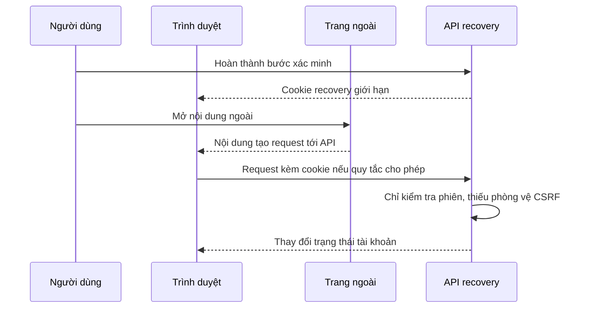

# Cross site request forgery risk

## 1. CSRF nguy hiểm thế nào đối với khôi phục tài khoản?

**Cross-Site Request Forgery, viết tắt CSRF**, xảy ra khi một nguồn không tin cậy khiến trình duyệt người dùng gửi request đến ứng dụng, còn ứng dụng chấp nhận request đó nhờ ngữ cảnh mà trình duyệt tự mang theo.

Điểm quan trọng là kẻ tấn công có thể không biết cookie và không cần đọc response. Nếu server đã thay đổi tài khoản trước khi response bị trình duyệt chặn đọc, hậu quả đã xảy ra.

[CWE-352](https://cwe.mitre.org/data/definitions/352.html) mô tả loại điểm yếu liên quan đến việc không xác minh đầy đủ request có được chủ thể hợp lệ chủ ý gửi hay không.

Trong recovery, người dùng có thể chưa đăng nhập đầy đủ nhưng vẫn có:

- Cookie của phiên đăng nhập trước đó.
- Phiên tạm để nộp bằng chứng.
- Cookie recovery sau khi xác minh một challenge.
- Quyền giới hạn cho đặt lại mật khẩu hoặc thay phương thức xác thực.

Vì vậy, “người dùng đang ở trang quên mật khẩu” không đủ để kết luận CSRF không áp dụng. Cần nhìn vào credential thực tế mà từng endpoint chấp nhận.

Các URL, token và dữ liệu trong bài là ví dụ giả định, không có giá trị sử dụng.

## 2. Những điều kiện làm xuất hiện rủi ro

Một tình huống CSRF dựa trên cookie thường cần các điều kiện kết hợp:

| Điều kiện | Ý nghĩa trong recovery |
| --- | --- |
| Có hành động đáng bảo vệ | Đổi mật khẩu, hoàn tất recovery, thay yếu tố hoặc hủy một luồng |
| Trình duyệt tự gắn ngữ cảnh quyền | Cookie đăng nhập hoặc cookie recovery được gửi kèm request |
| Nguồn ngoài tạo được request có tác dụng | Endpoint nhận form hoặc một kiểu request mà nguồn đó tạo được |
| Server thiếu bằng chứng chống giả mạo phù hợp | Chỉ dựa vào cookie, không kiểm tra token CSRF hoặc nguồn theo chính sách |
| Quyền phía server cho phép hành động | Phiên recovery còn hiệu lực và đang ở bước có thể thực hiện thay đổi |

Sự tồn tại của một cookie không tự chứng minh có lỗ hổng. Còn phải xét chính sách cookie, loại request, quyền hiện tại và các lớp bảo vệ khác.

Ngược lại, việc không đọc được cookie cũng không chứng minh request an toàn. Trình duyệt có thể tự gửi cookie đến đúng host ngay cả khi mã ở trang khác không được đọc giá trị đó.

Cần tách hai điều kiện: **request có credential hợp lệ** và **request được tạo qua luồng chống giả mạo phù hợp**. Server phải xử lý cả hai, bên cạnh authorization cho đúng tài khoản và hành động.

## 3. Ví dụ: POST đổi mật khẩu trong phiên recovery

Giả sử một ứng dụng có các đặc điểm sau:

1. Người dùng vừa xác minh một challenge và có cookie recovery.
2. Cookie được phép gửi trong ngữ cảnh request giả định.
3. Endpoint đổi mật khẩu nhận form URL-encoded.
4. Backend chỉ kiểm tra cookie recovery, không có phòng vệ CSRF phù hợp.

Một trang ngoài có thể khiến trình duyệt gửi request trông như:

```http
POST /api/recovery/password HTTP/1.1
Host: accounts.example.com
Origin: https://untrusted.example.net
Cookie: recovery_session=DEMO_NOT_VALID
Content-Type: application/x-www-form-urlencoded

newPassword=DEMO_PASSWORD_NOT_FOR_USE
```

Cookie trong request do trình duyệt chọn và gắn theo các quy tắc của nó. Trang ngoài không cần biết giá trị cookie.

Nếu server lấy tài khoản từ phiên recovery rồi chấp nhận mật khẩu trong body, thao tác có thể được thực hiện dù chủ tài khoản không chủ ý đặt mật khẩu đó. Việc grant chỉ dùng một lần còn có thể khiến request giả mạo là request tiêu thụ quyền trước.

Ví dụ này có điều kiện: cookie phải thực sự được gửi và request phải vượt các lớp kiểm tra còn lại. Với một cookie `SameSite=Lax` được đặt rõ, POST cross-site thông thường không được gửi kèm cookie đó. Chính sách chặn cookie của trình duyệt cũng có thể thay đổi kết quả. Không suy rộng ví dụ thành khẳng định mọi cookie đều được gửi trong mọi request.



Ranh giới bị nhầm là server coi “trình duyệt có cookie” như “chủ tài khoản đã gửi thao tác này qua luồng được bảo vệ”.

## 4. Recovery token và CSRF token có vai trò khác nhau

| Loại dữ liệu | Chứng minh hoặc tham chiếu điều gì? | Cách sử dụng |
| --- | --- | --- |
| Token khôi phục gửi qua email | Quyền recovery theo mục đích và tài khoản được cấp | Server xác minh trước khi cấp hoặc thực hiện quyền hẹp |
| Cookie recovery | Một phiên có trạng thái và quyền giới hạn | Trình duyệt có thể tự gửi đến endpoint phù hợp |
| Token CSRF | Giá trị chống giả mạo gắn với ngữ cảnh được bảo vệ | Client gửi qua trường form hoặc header mà server xác minh |
| Attempt ID | Định danh một lần recovery | Dùng tra cứu; không mặc nhiên là bằng chứng có quyền |

Không được coi cookie recovery là CSRF token chỉ vì cookie có giá trị ngẫu nhiên. Vấn đề là nguồn ngoài có thể lợi dụng việc trình duyệt tự gắn cookie đó.

Ngược lại, một CSRF token hợp lệ không chứng minh người gửi có quyền đổi mật khẩu. Server vẫn phải kiểm tra tài khoản, mục đích, trạng thái, thời hạn và quyền một lần.

Nếu endpoint yêu cầu một bearer token bí mật do client chủ động gắn, không có cơ chế cookie hay credential tự gửi thay thế, và nguồn ngoài không lấy được token, rủi ro CSRF truyền thống sẽ khác với endpoint chỉ dựa vào cookie. Tuy nhiên, đánh giá này phải dựa trên hành vi thật của endpoint. Không chỉ nhìn thấy tên `Authorization` hoặc định dạng JWT rồi kết luận toàn bộ ứng dụng không cần chống CSRF.

[Tài liệu Spring Security về CSRF](https://docs.spring.io/spring-security/reference/features/exploits/csrf.html) giải thích rằng ứng dụng được gọi là stateless vẫn có thể chịu rủi ro nếu trình duyệt tự gửi credential. Định dạng credential không quyết định vấn đề một mình.

Một recovery token bí mật, được ràng buộc đúng và bắt buộc trong request có thể đóng vai trò quan trọng trong thiết kế chống giả mạo. Khi token đó được đổi thành cookie rồi không còn bắt buộc ở các bước sau, phải đánh giá lại các bước sau theo cơ chế phiên mới.

## 5. SameSite giảm rủi ro nhưng cần hiểu đúng

Thuộc tính cookie ảnh hưởng đến việc trình duyệt có gửi cookie trong ngữ cảnh cross-site hay không:

| Thuộc tính | Hành vi khái quát |
| --- | --- |
| `SameSite=Strict` | Hạn chế cookie trong request cross-site |
| `SameSite=Lax` | Cho phép một số điều hướng cấp cao dùng phương thức an toàn |
| `SameSite=None; Secure` | Cho phép sử dụng cross-site, tùy các chính sách cookie khác của trình duyệt |
| `HttpOnly` | Hạn chế JavaScript đọc cookie; không tự ngăn trình duyệt gửi cookie |
| `Secure` | Giới hạn gửi cookie qua kết nối an toàn; không tự chứng minh nguồn request |

Xem [tài liệu Set-Cookie của MDN](https://developer.mozilla.org/en-US/docs/Web/HTTP/Reference/Headers/Set-Cookie#samesitesamesite-value) về các điều kiện cụ thể.

Không dựa vào giá trị mặc định của trình duyệt như một contract bảo mật cố định. Đặt cấu hình rõ và lựa chọn theo luồng ứng dụng.

Đặc biệt, Lax không cứu một thiết kế dùng GET để đổi mật khẩu, gỡ MFA hoặc hoàn tất thay đổi tài khoản. Một điều hướng cấp cao có thể đi kèm cookie; endpoint không được diễn giải việc mở URL như ý định thực hiện thay đổi nhạy cảm.

### Same-site không đồng nghĩa same-origin

Trong ví dụ:

```text
https://accounts.example.com
https://promo.example.com
```

Hai URL khác origin nhưng có thể cùng site. Origin xét scheme, host và port; site trong mô hình hiện đại xét scheme và miền có thể đăng ký theo quy tắc public suffix. Xem [giải thích same-site và same-origin của web.dev](https://web.dev/articles/same-site-same-origin).

Nếu một subdomain cùng site bị chiếm hoặc phục vụ nội dung không tin cậy, chỉ dựa vào SameSite có thể không chặn request từ nguồn đó. Ngay cả cookie chỉ thuộc host accounts vẫn có thể được trình duyệt gửi tới accounts khi có request phù hợp; cookie không cần bị chia sẻ cho subdomain ngoài để rủi ro này xuất hiện.

Do đó, phạm vi tin cậy của chính sách nguồn cần hẹp hơn câu “mọi subdomain của công ty đều an toàn”.

## 6. Vì sao CORS không thay thế toàn bộ phòng vệ CSRF?

Một form có thể tạo request cross-origin thuộc loại không cần preflight. CORS có thể ngăn script ở nguồn ngoài đọc response, nhưng request đã có thể đến server.

Theo [hướng dẫn CORS của MDN về simple requests](https://developer.mozilla.org/en-US/docs/Web/HTTP/Guides/CORS#simple_requests), server phải tự bảo vệ các request kiểu form thay vì trông chờ vào preflight.

Trong ví dụ đổi mật khẩu, kẻ tấn công có thể chỉ quan tâm thao tác đã xảy ra. Response có đọc được hay không không phải điều kiện bắt buộc.

Với API JSON, việc yêu cầu content type và custom header có thể là một phần của thiết kế chống request cross-origin, nếu contract được thực thi chặt và CORS chỉ cho phép các origin tin cậy. Rủi ro xuất hiện khi:

- API cũng nhận form hoặc `text/plain` rồi tự suy đoán JSON.
- Có endpoint cũ thực hiện cùng thao tác nhưng yêu cầu ít hơn.
- Server phản chiếu origin tùy ý trong cấu hình có credential.
- Một origin được cho phép thực tế chứa mã không tin cậy.
- Lớp bảo vệ kiểm tra header ở một route nhưng bỏ sót route khác.

Không nên diễn đạt rằng “bật CORS” hoặc “chỉ dùng POST” là đủ. Cần xác định loại request nào nguồn ngoài có thể tạo, credential nào được gửi và điều kiện nào được backend kiểm tra trước khi thay đổi.

## 7. Rủi ro ở bước trước đăng nhập và khi đổi ngữ cảnh

Recovery còn có rủi ro nhầm tài khoản nếu ứng dụng không bảo vệ việc thiết lập hoặc thay ngữ cảnh recovery.

Ví dụ giả định:

1. Kẻ tấn công có liên kết recovery cho chính tài khoản của họ.
2. Họ khiến người khác mở liên kết đó.
3. Ứng dụng âm thầm thay phiên tạm hiện có bằng ngữ cảnh tài khoản của kẻ tấn công.
4. Người dùng tưởng đang xử lý tài khoản của mình rồi tiếp tục nhập dữ liệu.
5. Nếu ứng dụng tự đăng nhập hoặc tiếp tục hoạt động dưới tài khoản sai, dữ liệu mới có thể đi vào tài khoản của kẻ tấn công.

Đây là rủi ro nhầm ngữ cảnh tương tự lớp vấn đề được bàn trong login CSRF; mức độ ảnh hưởng phụ thuộc thiết kế. Nó không tự chứng minh rằng kẻ tấn công đã chiếm tài khoản thật của nạn nhân.

Thiết kế cần làm rõ tài khoản và hành động đang được xử lý, kiểm soát việc đổi attempt, và không nâng ngữ cảnh recovery thành phiên đầy đủ một cách âm thầm. Với phiên tạm, phải có cơ chế ràng buộc và chống cố định phiên phù hợp khi chuyển sang ngữ cảnh có quyền cao hơn.

Một liên kết recovery được mở từ email thường là một điều hướng cross-site hợp lệ. Vì vậy, không áp dụng máy móc quy tắc “mọi điều hướng từ site ngoài đều là tấn công”. Có thể cho mở trang tiếp nhận, nhưng bước thực hiện thay đổi phải có contract riêng và bằng chứng phù hợp.

GET mở trang không được trực tiếp đổi credential hay tiêu thụ quyền cuối cùng. Ngoài CSRF, trình xem trước và trình quét liên kết cũng có thể tự mở URL.

## 8. Các lớp bảo vệ cần phối hợp

[OWASP CSRF Prevention Cheat Sheet](https://cheatsheetseries.owasp.org/cheatsheets/Cross-Site_Request_Forgery_Prevention_Cheat_Sheet.html) trình bày token, kiểm tra nguồn và các lớp hỗ trợ. Ưu tiên cơ chế được framework duy trì khi phù hợp với kiến trúc.

Với mô hình recovery dùng phiên phía server, một lựa chọn là token CSRF khó đoán gắn với phiên đó, được gửi lại qua form hoặc header và xác minh tại backend. Nếu dùng double-submit cookie, cần thiết kế có chữ ký và ràng buộc ngữ cảnh phù hợp; không chỉ so hai giá trị bất kỳ mà client có thể tác động.

Các lớp khác có vai trò riêng:

| Lớp | Điều kiện cần làm rõ |
| --- | --- |
| Token CSRF | Gắn với đúng ngữ cảnh, không lộ qua URL hoặc log |
| Kiểm tra `Origin` | So khớp origin đã chuẩn hóa với danh sách tin cậy |
| Kiểm tra `Referer` khi thích hợp | Có chính sách rõ khi thiếu; không tự cho phép vì header vắng |
| Fetch Metadata | Dùng các tín hiệu như `Sec-Fetch-Site` cùng chính sách fallback |
| SameSite và phạm vi cookie | Giảm nơi cookie được sử dụng, phù hợp luồng email |
| Authorization và chuyển trạng thái | Đúng account, purpose, quyền và thời hạn |
| Bảo vệ XSS | Hạn chế mã độc chạy ngay trong origin được tin cậy |

Khi so origin, cần phân tích URL và so scheme, host, port theo cấu hình. So chuỗi kiểu “có chứa example.com” có thể chấp nhận nhầm host khác. Nếu có proxy, origin đích bên ngoài phải được xác định từ cấu hình hoặc dữ liệu proxy được tin cậy, không từ header tùy ý của client.

Các tín hiệu nguồn không phải bằng chứng danh tính. Request từ client ngoài trình duyệt có thể tự đặt nhiều header; quyền recovery vẫn phải đến từ credential và trạng thái đã xác minh.

## 9. Một pipeline xử lý hợp lý

Pseudocode sau minh họa thứ tự trách nhiệm, không phải cấu hình dùng nguyên xi cho mọi framework:

```text
receive a state-changing recovery request

validate route, method and request format
apply the endpoint's source and CSRF policy
resolve the authenticated recovery context
authorize action against account, purpose and current state

atomically:
    recheck time-sensitive and one-use conditions
    perform the permitted change
    consume the relevant recovery permission

return a minimal response
```

Trong triển khai cụ thể, cơ chế CSRF có thể cần đọc phiên trước khi xác minh token. Yêu cầu quan trọng là không có thay đổi nghiệp vụ nhạy cảm xảy ra trước khi các điều kiện bảo vệ cần thiết đã đạt.

Nếu CSRF validation thất bại, từ chối request trước khi đổi mật khẩu, gỡ yếu tố hoặc tiêu thụ quyền cuối. Không “thử xử lý trước rồi báo lỗi sau”.

Khi chuyển từ phiên challenge sang phiên recovery đã xác minh, cần quản lý lại định danh phiên, token CSRF và quyền theo lifecycle đã thiết kế. Không để một token CSRF của phiên không liên quan được dùng như bằng chứng cho phiên mới.

Sau thành công, đóng quyền một lần và xử lý session theo policy. Cơ chế chống CSRF không thay thế việc chống hai request hợp lệ chạy đồng thời.

## 10. Phân biệt CSRF với các rủi ro gần giống

| Tình huống | Bản chất chính |
| --- | --- |
| Nguồn ngoài lợi dụng cookie để gửi thao tác ngoài ý định | CSRF dựa trên credential tự gửi |
| Kẻ tấn công đã có recovery token bị lộ | Lộ credential và sử dụng trái phép |
| Client sửa account ID để tác động tài khoản khác | Thiếu authorization trên đối tượng |
| Script độc chạy trong chính origin ứng dụng | XSS hoặc mã phía client không tin cậy |
| Người ngoài gửi hàng loạt yêu cầu email công khai, không dùng quyền của nạn nhân | Lạm dụng luồng công khai, không tự động là CSRF cổ điển |
| Trang recovery bị nhúng để lừa thao tác bằng giao diện | Clickjacking, có thể kết hợp rủi ro khác |

Phân biệt giúp chọn đúng cơ chế. Rate limit và CAPTCHA có thể giảm spam, nhưng không chứng minh một request dùng cookie được chủ tài khoản chủ ý gửi. Token CSRF không cứu một API cho đổi tài khoản đích tùy ý. Chống CSRF cũng không ngăn được script đã chạy trong origin tin cậy đọc dữ liệu trang và tạo request hợp lệ theo cách đó.

Đối với recovery, câu hỏi cốt lõi là: request này được gửi nhờ quyền nào, nguồn nào có thể tạo nó, và server có đủ điều kiện để thực hiện đúng thao tác mà người dùng đang chủ ý làm hay chưa?
