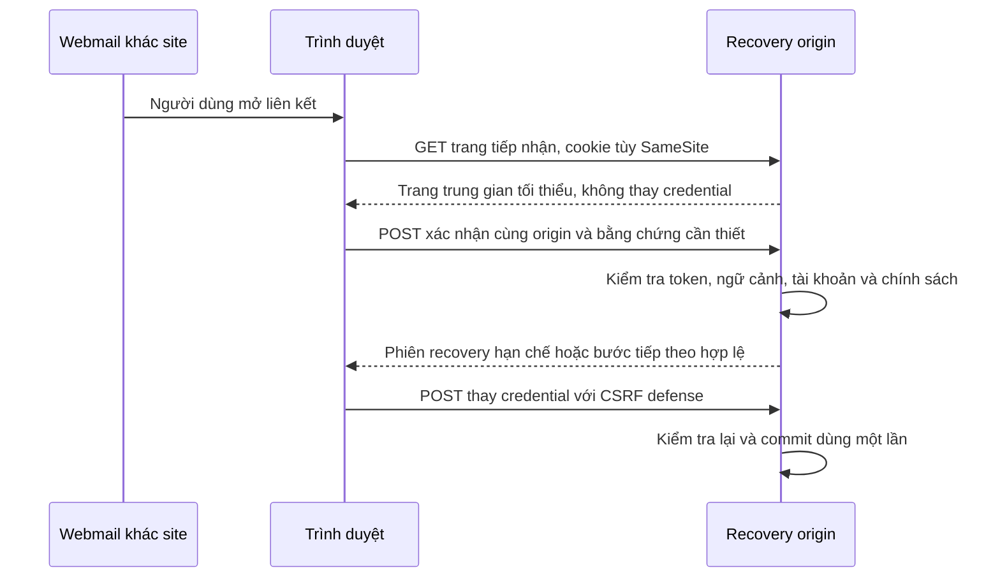

# Same site cookie policy: chính sách SameSite cho luồng khôi phục tài khoản

## 1. SameSite giải quyết phần nào của CSRF?

Trong luồng khôi phục tài khoản, trình duyệt có thể giữ một cookie đại diện cho phiên khôi phục hạn chế. Cookie này cho phép tiếp tục xác minh, đặt mật khẩu mới hoặc đăng ký yếu tố xác thực thay thế theo quyền máy chủ đã cấp.

Khi trình duyệt tự gửi cookie cùng request, máy chủ không thể chỉ dựa vào sự hiện diện của cookie để kết luận người dùng chủ động yêu cầu hành động. Kẻ tấn công có thể tìm cách khiến trình duyệt nạn nhân gửi request tới một endpoint nhạy cảm. Đó là bối cảnh của cross-site request forgery, viết tắt CSRF.

**SameSite** là thuộc tính cookie giúp trình duyệt quyết định có gửi cookie trong một ngữ cảnh yêu cầu giữa các site hay không. Nó giảm một số trường hợp cookie tự đi kèm request từ site khác, nhưng không kiểm tra danh tính người dùng, nội dung thao tác hoặc bằng chứng khôi phục.

Trong bài này, chính sách SameSite được thiết kế cho module khôi phục tài khoản khi người dùng mất mật khẩu, MFA, passkey hoặc thiết bị. Các tên cookie, endpoint và thời hạn là ví dụ kiến trúc; việc chọn chính sách cần dựa trên luồng điều hướng thực tế.

## 2. Phân biệt site, origin và phạm vi cookie

Ba khái niệm này liên quan nhưng không đồng nhất:

| Khái niệm | Thành phần chính | Câu hỏi nó trả lời |
| --- | --- | --- |
| Origin | Scheme, hostname, port | Hai tài nguyên có cùng origin để áp dụng chính sách origin không? |
| Site trong ngữ cảnh schemeful same-site | Scheme và registrable domain | Hai địa chỉ có thuộc cùng site không? |
| Phạm vi cookie | Host hoặc Domain, Path và các thuộc tính liên quan | Cookie có phù hợp với địa chỉ request và điều kiện gửi không? |

Registrable domain được xác định theo ranh giới public suffix, không phải luôn lấy hai nhãn cuối của hostname. Ví dụ các miền có public suffix nhiều nhãn hoặc các nền tảng cung cấp miền cho nhiều tenant cần được xử lý đúng.

Theo mô hình schemeful same-site, scheme tham gia vào việc xác định site, còn port phân biệt origin nhưng không phân biệt site. [Nguồn: web.dev, Same-site and same-origin](https://web.dev/articles/same-site-same-origin).

Giả sử trang khôi phục ở `https://accounts.example.com`:

| Địa chỉ còn lại | Quan hệ origin | Quan hệ site của cặp URL |
| --- | --- | --- |
| `https://accounts.example.com/recover` | Cùng origin | Cùng site |
| `https://app.example.com` | Khác origin | Cùng site |
| `https://untrusted.example.com` | Khác origin | Cùng site |
| `https://accounts.example.com:8443` | Khác origin | Cùng site |
| `http://accounts.example.com` | Khác origin | Khác site do scheme |
| `https://mail.example.net` | Khác origin | Khác site |

Bảng minh họa quan hệ URL; ngữ cảnh iframe, chuỗi ancestor và redirect còn có thể ảnh hưởng cách trình duyệt đánh giá một request. Không dự đoán mọi hành vi chỉ bằng cách so hostname của hai URL.

Hệ quả quan trọng: một subdomain bị chiếm quyền có thể vẫn thuộc cùng site với trang khôi phục. `SameSite=Strict` không có nghĩa “chỉ request từ đúng origin của trang khôi phục mới được gửi cookie”.

Cookie host-only cũng không thay đổi điều đó. Nó ngăn cookie được gửi tới host anh em, nhưng request do host anh em khởi tạo **tới host khôi phục** vẫn có thể thuộc ngữ cảnh same-site.

## 3. Hiểu đúng ba giá trị SameSite

### 3.1. `SameSite=Strict`

`Strict` hạn chế gửi cookie trong request cross-site, gồm điều hướng ban đầu từ một site bên ngoài. Nó phù hợp khi các bước cần cookie đều có thể diễn ra trong một ngữ cảnh same-site đã được thiết lập.

Đổi lại, người dùng bấm liên kết từ webmail sang trang khôi phục có thể không mang theo cookie Strict đang có trên request đầu tiên. Đây là hành vi cần được thiết kế trước, không phải lý do tự bỏ xác minh khi cookie vắng mặt.

### 3.2. `SameSite=Lax`

`Lax` cho phép cookie trong ngữ cảnh same-site và trong một số điều hướng cross-site ở top-level sử dụng phương thức HTTP safe, điển hình là nhấp liên kết GET.

Nó không cho phép cookie trong mọi request cross-site. Một cross-site fetch, ảnh nhúng, iframe hoặc form POST không được hưởng ngoại lệ điều hướng GET chỉ vì đích request là cùng URL.

Vì GET top-level có thể mang cookie Lax, GET không được thực hiện các thay đổi nhạy cảm như đặt mật khẩu, xóa MFA hoặc đăng ký passkey mới. Không thể sửa một endpoint GET thay đổi tài khoản chỉ bằng cách thêm `SameSite=Lax`.

### 3.3. `SameSite=None`

`None` cho phép cookie được xét gửi trong cả ngữ cảnh same-site và cross-site. Cookie dùng giá trị này phải có `Secure` trên các trình duyệt thực thi quy tắc tương ứng.

`None` không tắt kiểm soát truy cập và cũng không bảo đảm cookie sẽ luôn được gửi. Các chính sách chặn cookie bên thứ ba hoặc môi trường nhúng vẫn có thể ngăn nó hoạt động. Không chọn `None` cho toàn bộ cookie chỉ vì một callback đặc biệt cần cookie cross-site.

Các hành vi cơ bản của ba giá trị, cùng yêu cầu `Secure` với `None`, được mô tả trong tài liệu cookie của trình duyệt. [Nguồn: MDN Set-Cookie](https://developer.mozilla.org/en-US/docs/Web/HTTP/Reference/Headers/Set-Cookie).

### 3.4. Ma trận gửi cookie cơ bản

Bảng dưới giả định cookie còn hạn, khớp host/path, thỏa `Secure`, chế độ credentials cho phép và không bị chính sách riêng của trình duyệt chặn:

| Ngữ cảnh request | Strict | Lax tường minh | None |
| --- | --- | --- | --- |
| Request được phân loại same-site | Có thể gửi | Có thể gửi | Có thể gửi |
| Cross-site top-level GET navigation | Không gửi | Có thể gửi | Có thể gửi |
| Cross-site top-level POST | Không gửi | Không gửi | Có thể gửi |
| Cross-site fetch hoặc subresource | Không gửi | Không gửi | Có thể gửi |
| Cross-site điều hướng trong iframe | Không gửi | Không gửi | Có thể gửi |

“Có thể gửi” có nghĩa SameSite không chặn trong dòng đó, không phải cookie chắc chắn xuất hiện. Đặc biệt, mode của Fetch và chính sách cookie của trình duyệt vẫn áp dụng độc lập.

### 3.5. Không bỏ trống để dựa vào mặc định

Một số trình duyệt dùng mặc định gần với Lax khi không khai báo SameSite. Có môi trường áp dụng ngoại lệ nới lỏng cho cookie mới được đặt, cho phép một số top-level POST trong khoảng hai phút đầu. Ngoại lệ mặc định này không nên được đồng nhất với khai báo `SameSite=Lax` tường minh. [Nguồn: MDN Set-Cookie, phần Lax](https://developer.mozilla.org/en-US/docs/Web/HTTP/Reference/Headers/Set-Cookie#lax).

Vì vậy hãy ghi rõ giá trị của từng cookie. Không dùng việc “trên trình duyệt của tôi cookie không đi theo” để thay thế chính sách được xác định trên máy chủ và các môi trường được hỗ trợ.

## 4. Chọn chính sách theo vai trò cookie

Không nên đặt một lựa chọn SameSite duy nhất cho mọi cookie trong hệ thống. Cookie đăng nhập đầy đủ, cookie khôi phục hạn chế và cookie tương quan callback có thể có nhu cầu khác nhau.

| Cookie hoặc ngữ cảnh | Chính sách tham khảo | Điều kiện cần giữ |
| --- | --- | --- |
| Phiên khôi phục sau bước tiếp nhận | Strict nếu luồng cho phép | Các bước nhạy cảm được thực hiện từ trang tin cậy và có kiểm tra CSRF |
| Phiên khôi phục cần tiếp tục qua liên kết top-level từ email | Lax có chủ đích | GET không đổi credential; POST vẫn được bảo vệ |
| Cookie tương quan cho callback cross-site POST bắt buộc | None chỉ trong phạm vi cần thiết | Secure, thời hạn ngắn, ràng buộc transaction và chống replay |
| Cookie đăng nhập đầy đủ | Chính sách riêng theo ứng dụng | Không nới chỉ để chữa một lỗi của luồng recovery |
| Tùy chọn giao diện | Theo nhu cầu thực tế | Không chứa quyền khôi phục hoặc trạng thái xác minh đáng tin |

Strict là một lựa chọn mạnh hơn đối với nhiều request cross-site, nhưng không làm một thiết kế chưa ràng buộc tài khoản trở nên đúng. Lax có thể là lựa chọn hợp lý khi luồng yêu cầu, miễn là ngoại lệ top-level GET được hiểu và các hành động nhạy cảm vẫn có bảo vệ độc lập.

Cookie callback cần được tách mục đích khỏi cookie cấp quyền thay credential. “Đã nhận callback đúng giao thức” và “đã có quyền đặt lại MFA” là hai quyết định khác nhau.

## 5. Luồng mở liên kết khôi phục từ email

Giả sử người dùng đang có cookie `__Host-recovery` dạng Strict rồi bấm một liên kết từ webmail ở site khác. Request điều hướng đầu tiên có thể không mang cookie đó.

Ứng dụng không được xử lý tình huống này bằng cách:

- Tự coi người dùng là chủ tài khoản vì URL có một `accountId`.
- Lấy tài khoản từ session đăng nhập khác rồi gắn với token trong email mà không đối chiếu.
- Bỏ ràng buộc browser hoặc kiểm tra CSRF để tránh hiện thông báo lỗi.
- Chuyển cookie đăng nhập đầy đủ sang None trên toàn ứng dụng.

Một cách tổ chức tham khảo:



Trang trung gian có thể thiết lập ngữ cảnh tạm phục vụ chống request giả mạo, nhưng không được biến một lần tải trang thụ động thành việc thay đổi credential hay tiêu thụ không thể phục hồi bằng chứng duy nhất. Trình quét liên kết email có thể mở URL trước người dùng.

Token trong email cần được bảo vệ khỏi log và script không cần thiết; URL sạch ở các bước sau, `Referrer-Policy: no-referrer` và `Cache-Control: no-store` giúp giảm những đường rò rỉ liên quan. Chúng bổ sung cho SameSite, không thay đổi quy tắc gửi cookie của thuộc tính này.

Không có một chuỗi redirect thần kỳ luôn làm Strict hoạt động cho mọi luồng. Redirect có thể giữ hoặc thay phương thức, và trình duyệt còn xét ngữ cảnh điều hướng. Nếu một thiết kế cần một điểm tiếp nhận riêng, hãy mô tả quyền của điểm đó và kiểm tra lại ở POST nhạy cảm thay vì dựa vào giả định về chuỗi redirect.

## 6. Ví dụ cấu hình cookie và ý nghĩa từng thuộc tính

Phiên khôi phục hạn chế, chỉ dùng trong luồng same-site đã thiết lập:

```http
Set-Cookie: __Host-recovery=<opaque-random-id>; Path=/; Secure; HttpOnly; SameSite=Strict; Max-Age=600
Cache-Control: no-store
```

Biến thể khi luồng cần cookie trong điều hướng GET từ email:

```http
Set-Cookie: __Host-recovery=<opaque-random-id>; Path=/; Secure; HttpOnly; SameSite=Lax; Max-Age=600
```

Hai dòng trên là lựa chọn thay thế, không phải hai cookie cần được đặt đồng thời. Giá trị 600 giây chỉ là ví dụ. Máy chủ phải có thời hạn và trạng thái thu hồi riêng.

| Thuộc tính | Vai trò | Điều không được suy ra |
| --- | --- | --- |
| `Secure` | Hạn chế gửi qua kết nối HTTPS trong môi trường triển khai phù hợp | Không mã hóa mọi bản sao cookie trên thiết bị |
| `HttpOnly` | Ngăn JavaScript đọc cookie qua API thông thường | Không ngăn script độc hại dùng trình duyệt gửi request có cookie |
| `SameSite` | Hạn chế gửi theo ngữ cảnh site | Không phải kiểm tra tài khoản hoặc origin chính xác |
| `Path=/` | Xác định phạm vi đường dẫn gửi cookie | Không phải ranh giới phân quyền giữa ứng dụng cùng host |
| Không có `Domain` | Giữ cookie host-only | Không chặn mọi request same-site do host anh em khởi tạo |
| `Max-Age` | Giới hạn thời gian sống cookie trên client | Không thay thế thu hồi hoặc TTL ở máy chủ |

Tiền tố `__Host-` yêu cầu `Secure`, `Path=/` và không khai báo `Domain` trên trình duyệt hỗ trợ quy tắc này. Nó giúp chống việc subdomain đặt một cookie Domain cùng tên để tác động tới host đích. Máy chủ phải kiểm tra đúng tên cookie có tiền tố, không tự bỏ tiền tố khi xử lý. [Nguồn: MDN secure cookie configuration](https://developer.mozilla.org/en-US/docs/Web/Security/Practical_implementation_guides/Cookies).

Ví dụ không phù hợp với các điều kiện của tiền tố:

```http
Set-Cookie: __Host-recovery=<id>; Domain=example.com; Path=/; Secure; HttpOnly; SameSite=Strict
```

Khi đổi chính sách hoặc dọn cookie cũ, cần biết chính xác tên và phạm vi đã phát hành. Cookie host-only và cookie Domain có thể gây tình huống trùng tên trong request; không dùng quy tắc tùy tiện “lấy cái đầu tiên” để giải quyết một phiên khôi phục nhạy cảm.

## 7. SameSite cần kết hợp với kiểm tra nào ở máy chủ?

### 7.1. CSRF token gắn với phiên khôi phục

Với endpoint thay credential dựa vào cookie, có thể dùng CSRF token do máy chủ cấp và ràng buộc vào đúng phiên khôi phục. Frontend gửi token qua trường form hoặc header theo hợp đồng; máy chủ không chấp nhận việc “cookie CSRF cũng có mặt” như bằng chứng đầy đủ.

Nếu dùng double-submit, cần thiết kế chống cookie injection và ràng buộc phiên, chẳng hạn mẫu signed double-submit phù hợp. Không mặc nhiên coi một cookie ngẫu nhiên và một trường có cùng giá trị là an toàn trong môi trường có subdomain không đáng tin.

OWASP xem SameSite là một lớp phòng vệ bổ sung trong nhiều mô hình triển khai và nêu rõ rủi ro từ các host anh em cùng registrable domain. Những ràng buộc ứng dụng trong bài được xây trên giới hạn đó. [Nguồn: OWASP CSRF Prevention Cheat Sheet](https://cheatsheetseries.owasp.org/cheatsheets/Cross-Site_Request_Forgery_Prevention_Cheat_Sheet.html).

Ví dụ request cuối của một quy trình hạn chế:

```http
POST /recovery/complete HTTP/1.1
Host: accounts.example.com
Origin: https://accounts.example.com
Cookie: __Host-recovery=<opaque-random-id>
Content-Type: application/json
X-CSRF-Token: <session-bound-csrf-token>

{
  "newPassword": "<user-entered-secret>"
}
```

Đây là minh họa cấu trúc request, không phải dữ liệu để ghi log. CSRF token không thay thế token khôi phục, không chứng minh người dùng đã vượt MFA và không cho phép bỏ kiểm tra policy trước khi commit.

### 7.2. Kiểm tra Origin hoặc nguồn được cho phép

Nguồn cần được so sánh theo origin chính xác: scheme, hostname và port hiệu lực. Không dùng `contains("example.com")`, kiểm tra hậu tố thiếu ranh giới hoặc chấp nhận mọi subdomain chỉ vì SameSite cũng coi chúng cùng site.

Máy chủ cần biết origin đích chuẩn từ cấu hình đáng tin cậy. Nếu có reverse proxy, không lấy tùy ý một `Host` hoặc `X-Forwarded-Host` do client kiểm soát để biến kiểm tra nguồn thành vòng so sánh với chính dữ liệu attacker gửi.

Khi không có Origin, có thể dùng Referer theo chính sách được thiết kế và phân tích URL đúng cách. Header vắng mặt hoặc `Origin: null` không chứng minh request hợp lệ. Một phương án fallback phải dựa vào cơ chế CSRF được cấu hình rõ ràng; không đơn giản “thiếu header thì cho qua”.

Callback giao thức từ một nhà cung cấp ngoài là một trường hợp riêng. Nó có nguồn dự kiến và quy tắc xác minh riêng, không cần được thêm vào allowlist của mọi endpoint thay mật khẩu.

### 7.3. Fetch Metadata giúp phân loại nhưng không tạo quyền

`Sec-Fetch-Site` cho biết những ngữ cảnh như `same-origin`, `same-site`, `cross-site` hoặc `none`. Nó giúp máy chủ lọc request không phù hợp với chức năng endpoint. [Nguồn: MDN Sec-Fetch-Site](https://developer.mozilla.org/en-US/docs/Web/HTTP/Reference/Headers/Sec-Fetch-Site).

Không đồng nhất `same-site` với được tin cậy nếu có host anh em không kiểm soát hoàn toàn. Giá trị `none` cũng không phải bằng chứng người dùng đã đồng ý thay credential; nó có thể xuất hiện ở một số thao tác điều hướng trực tiếp.

Các header này không thay thế quyền truy cập. Client ngoài trình duyệt có thể tự tạo header, còn một số môi trường có thể không gửi chúng. API cần phương án xử lý thiếu metadata mà vẫn giữ ranh giới CSRF và xác thực đã chọn.

### 7.4. Luồng quyết định cho endpoint nhạy cảm

Một mô hình khái niệm:

```text
completeRecovery(request):
    requireAllowedMethodAndContentType(request)
    session = requireActiveLimitedRecoverySession(request.cookie)
    requireExpectedRecoveryFlow(session, request)
    enforceConfiguredSourcePolicy(request)
    requireValidCsrfDefense(request, session)
    requireCurrentRecoveryProofsAndRiskPolicy(session)

    transaction:
        requireFlowStillUsable(session)
        consumeAuthorizationOnce(session)
        changeOnlyAuthorizedCredential(session, request)
        persistRequiredSessionInvalidation(session.account)

    finishRecoverySessionAndReturnMinimalResult()
```

SameSite được trình duyệt áp dụng trước khi request tới đây; máy chủ vẫn phải kiểm tra tất cả điều kiện phù hợp. Khi cookie thiếu, endpoint không được tự dựng lại một phiên đã xác minh từ `accountId` trong body.

## 8. Same-site subdomain, CORS và XSS

### 8.1. Một host anh em vẫn có thể gửi request có cookie

Giả sử `untrusted.example.com` bị chiếm quyền, còn cookie recovery host-only thuộc `accounts.example.com`. Host bị chiếm không nhận trực tiếp cookie recovery khi người dùng truy cập nó.

Tuy nhiên, nó có thể tìm cách gửi form hoặc request tới `accounts.example.com`. Nếu trình duyệt phân loại request là same-site và các điều kiện khác đạt, Strict không loại cookie chỉ vì nguồn khác origin.

CSRF token gắn phiên, allowlist origin chính xác, kiểm soát host anh em và nội dung cùng origin vì thế vẫn quan trọng. `__Host-` giúp chống một số hành vi đặt đè cookie từ subdomain; nó không biến host anh em thành cross-site.

### 8.2. SameSite và Fetch credentials là hai bộ lọc khác nhau

Fetch mặc định dùng `credentials: "same-origin"`. Một request từ `app.example.com` tới `accounts.example.com` là cross-origin dù cùng site; muốn gửi credential theo thiết kế cross-origin, client phải chọn chế độ phù hợp. [Nguồn: MDN Request.credentials](https://developer.mozilla.org/en-US/docs/Web/API/Request/credentials).

Ngược lại, `credentials: "include"` không ép trình duyệt gửi cookie Strict hoặc Lax trong một ngữ cảnh cross-site vốn bị SameSite chặn. Nó cũng không vượt mọi chính sách cookie bên thứ ba.

Vì vậy khi cookie không xuất hiện, cần phân biệt chế độ Fetch, phạm vi cookie, SameSite và chính sách trình duyệt. Không chữa tất cả trường hợp bằng cách đổi sang None hoặc mở CORS cho mọi origin.

### 8.3. CORS không phải hàng rào chung chống gửi request

CORS kiểm soát một số tương tác cross-origin của script, trong đó có quyền đọc phản hồi. Một form HTML có thể tạo request mà không cần script đọc được kết quả; một số request đơn giản cũng có thể tới máy chủ mà không có preflight.

Khi thiết kế API chỉ nhận JSON và yêu cầu header CSRF riêng, có thể tận dụng đặc tính preflight như một phần chính sách, nhưng phải thực thi đúng ở máy chủ và không mở CORS rộng. Không để endpoint đồng thời chấp nhận body form thiếu bảo vệ rồi dựa vào việc frontend chính dùng JSON.

Origin được cấp CORS có credential cần được chọn cụ thể. Không phản chiếu Origin tùy ý vào response chỉ để làm request hết báo lỗi trên console.

### 8.4. SameSite không giải quyết XSS hoặc client-side CSRF

Script độc hại chạy trong origin khôi phục có thể gửi request trong ngữ cảnh được coi là tin cậy. Cookie HttpOnly có thể không đọc được, nhưng trình duyệt vẫn có thể đính kèm cookie vào request script phát ra.

Ngay cả khi không có script do attacker chèn trực tiếp, frontend có thể đọc URL hoặc message không tin cậy rồi tự gọi một endpoint nhạy cảm. Nếu dữ liệu attacker điều khiển được biến thành URL, method hoặc body của request, SameSite không xác minh ý định thay cho ứng dụng.

Cần kiểm soát script, dữ liệu đầu vào frontend và việc xây request, đồng thời giữ ràng buộc thao tác ở máy chủ. Nút xác nhận hoặc CAPTCHA riêng lẻ cũng không thay thế việc xác minh request và quyền.

## 9. Callback xác minh danh tính từ site ngoài

Một quy trình khôi phục MFA có thể chuyển người dùng sang nhà cung cấp xác minh danh tính rồi nhận callback. Nếu callback dùng top-level POST, cookie Strict và Lax có thể không được gửi vì đây là ngữ cảnh cross-site.

Không giải quyết bằng cách bỏ kiểm tra tương quan transaction khi cookie thiếu. Một giá trị `state` có chữ ký chỉ chứng minh dữ liệu được ký theo thiết kế; nếu không ràng buộc đúng giao dịch và browser hoặc kênh tiếp tục được phép, nó chưa đủ chống tráo luồng giữa người dùng.

Một thiết kế cần xác định rõ:

1. Transaction được tạo bởi ai và gắn với tài khoản nào.
2. Browser hoặc kênh nào có quyền tiếp tục transaction đó.
3. Cách kiểm tra phản hồi nhà cung cấp theo giao thức đang dùng.
4. Cách chặn replay, hết hạn và dùng lại transaction.
5. Quyền hạn chế nào được cấp sau callback và bằng chứng nào còn thiếu.

Nếu cần cookie cross-site cho tương quan, có thể dùng một cookie riêng, thời hạn ngắn, giá trị khó đoán và quyền chỉ phục vụ transaction đó:

```http
Set-Cookie: __Host-recovery-correlation=<transaction-binding>; Path=/; Secure; HttpOnly; SameSite=None; Max-Age=180
```

Ví dụ này không cấp quyền truy cập tài khoản và không thay cookie đăng nhập đầy đủ. Máy chủ phải ràng buộc cookie với transaction được lưu, xử lý phản hồi đúng giao thức và chỉ cấp bước tiếp theo sau khi tất cả điều kiện đạt.

Một số trình duyệt hoặc môi trường nhúng vẫn có thể chặn cookie cần thiết. Khi đó nên cung cấp đường tiếp tục được thiết kế ở top-level origin hoặc bắt đầu lại transaction an toàn; không tắt browser binding, chuyển quyền vào localStorage hoặc tin callback chỉ vì nó trả về qua HTTPS.

Khả năng `SameSite=None` hoạt động còn chịu chính sách cookie bên thứ ba của môi trường. Không thiết kế luồng khôi phục duy nhất dựa trên giả định mọi iframe hoặc webview đều giữ cookie này. [Nguồn: MDN Third-party cookies](https://developer.mozilla.org/en-US/docs/Web/Privacy/Guides/Third-party_cookies).

## 10. Vòng đời cookie và hành vi khi thiếu cookie

### 10.1. Chuyển bước không làm tăng quyền ngoài dự kiến

Phiên trước khi xác minh, phiên đã xác minh hạn chế và session đăng nhập đầy đủ cần có ranh giới rõ ràng. Khi mức quyền thay đổi, có thể cần tạo định danh phiên mới hoặc xoay trạng thái liên quan theo thiết kế, thay vì giữ một định danh attacker đã biết từ giai đoạn đầu.

CSRF token cũng phải được ràng buộc với phiên hiện tại. Không vì xoay phiên mà chấp nhận token cũ vô thời hạn hoặc bỏ kiểm tra cho lần POST đầu tiên sau khi quay lại từ email.

### 10.2. Cookie vắng mặt không đồng nghĩa đã đăng xuất hay token sai

Một request có thể thiếu cookie vì SameSite, hết hạn, bị người dùng xóa, bị chặn, sai Path hoặc khác host. Endpoint cần phản hồi theo trạng thái thực sự có thể xác định, không đoán rằng cookie thiếu nghĩa là người dùng đã vượt xác minh theo một cách khác.

Một trang tiếp nhận công khai có thể hiển thị hướng dẫn bắt đầu hoặc tiếp tục. Một endpoint hoàn tất nhạy cảm phải yêu cầu quyền thích hợp và từ chối khi không có. Hai loại endpoint không nên chia sẻ một fallback tự động cấp quyền.

Thông báo không cần lộ tên tài khoản, chi tiết bằng chứng hay cookie nào đang bảo vệ tầng nào. Có thể hướng dẫn mở trang khôi phục chính thức hoặc bắt đầu lại quy trình theo chính sách.

### 10.3. Kết thúc quyền ở máy chủ và xóa cookie đúng phạm vi

Sau khi hoàn tất hoặc hủy, máy chủ kết thúc quyền khôi phục đã dùng và gửi chỉ thị xóa cookie:

```http
Set-Cookie: __Host-recovery=; Path=/; Secure; HttpOnly; SameSite=Strict; Max-Age=0
Cache-Control: no-store
```

Tên, host/Domain và Path phải xác định đúng cookie cần xóa. SameSite không phải một thành phần tạo định danh cookie riêng, nhưng giữ cấu hình nhất quán giúp tránh nhầm giữa các phiên bản triển khai.

Xóa cookie trên browser không đủ thu hồi một bản sao định danh đã bị lộ. Trạng thái phiên phía máy chủ, thời hạn, tính dùng một lần và việc vô hiệu hóa session cũ theo chính sách vẫn cần hoạt động độc lập.

### 10.4. Máy chủ không đọc được thuộc tính SameSite từ Cookie header

Request thông thường chỉ gửi các cặp tên và giá trị cookie, không gửi lại nguyên `SameSite`, `Secure` hay `HttpOnly`. Máy chủ phải biết chính sách từ cấu hình phát hành của mình, không trông chờ đọc một trường metadata SameSite trong request để quyết định cho phép.

Cần quản lý cả tầng ứng dụng và reverse proxy có thể sửa `Set-Cookie`. Một quy tắc proxy thêm `SameSite=None` cho mọi cookie có thể vô tình nới phiên khôi phục vốn được thiết kế Strict. Khi thay chính sách, cookie đang lưu trên client cần được cập nhật theo vòng đời triển khai, không tự biến đổi chỉ vì đổi một biến cấu hình trên server.

## 11. Hai tình huống áp dụng

### Tình huống A: khôi phục mật khẩu bắt đầu từ email

Sản phẩm cần người dùng mở liên kết top-level từ email rồi tiếp tục tại recovery origin. Nhóm chọn một cookie hạn chế Lax vì có yêu cầu tiếp tục luồng điều hướng này.

GET chỉ hiển thị trang tiếp nhận hoặc trạng thái phù hợp. POST đặt mật khẩu yêu cầu phiên hợp lệ, CSRF token, nguồn được cho phép và bằng chứng còn hiệu lực. Token dùng một lần được tiêu thụ cùng thay đổi cần bảo vệ; cookie recovery kết thúc sau khi hoàn tất.

Nếu attacker điều hướng nạn nhân tới một URL GET, Lax có thể gửi cookie nhưng GET không được phép đổi mật khẩu. Nếu attacker gửi form POST cross-site, lớp SameSite giúp chặn cookie trong ngữ cảnh đó; kiểm tra CSRF và quyền tại API vẫn tồn tại cho các đường còn lại.

### Tình huống B: subdomain bị chiếm quyền trong cùng site

Ứng dụng dùng Strict nhưng một host anh em cùng site bị chiếm. Attacker tìm cách gửi request tới recovery origin.

Strict không loại request chỉ vì khác subdomain. Host-only và tiền tố `__Host-` bảo vệ một số khía cạnh phạm vi, cookie injection, nhưng không phải bộ lọc nguồn chính xác cho mọi request.

Endpoint vẫn yêu cầu CSRF token ràng buộc phiên, áp dụng source policy theo origin và kiểm tra bước khôi phục được phép. Một request thiếu điều kiện không được làm thay MFA hoặc thêm passkey. Ví dụ này cho thấy giá trị của Strict phải được đánh giá cùng mô hình tin cậy giữa các host.

## 12. Những quyết định cần được ghi rõ

| Câu hỏi | Nội dung chính sách cần có |
| --- | --- |
| Cookie nào cấp quyền gì? | Phân biệt session đầy đủ, recovery hạn chế và tương quan callback |
| Luồng có bắt đầu từ email ngoài site không? | Hành vi request đầu tiên với Strict/Lax và điểm tiếp nhận |
| Có cross-site POST callback không? | Giao thức, cookie tương quan riêng và cách ràng buộc transaction |
| Có subdomain hoặc tenant không đáng tin không? | Ranh giới origin, host-only và biện pháp chống CSRF độc lập |
| Endpoint GET làm gì? | Không thay credential, không tự cấp quyền vượt bằng chứng |
| Cookie thiếu thì sao? | Hướng dẫn hoặc từ chối theo vai trò endpoint; không tự bỏ xác minh |
| CORS và Fetch credentials được cấu hình thế nào? | Origin cụ thể, chế độ credentials và loại request thực sự hỗ trợ |
| Khi hoàn tất hoặc thu hồi thì sao? | Kết thúc phiên máy chủ, xóa cookie đúng phạm vi và kiểm soát session |

SameSite là cơ chế trình duyệt về việc gửi cookie, không phải toàn bộ chính sách khôi phục. Một thiết kế tốt chọn giá trị theo luồng thực tế và giữ nguyên ranh giới cấp quyền ngay cả khi cookie được gửi từ một ngữ cảnh ngoài dự kiến hoặc không được gửi trong một thao tác hợp lệ.

Các định nghĩa và thuật toán cookie chi tiết có thể được đối chiếu trong tài liệu làm việc RFC6265bis; đây là Internet-Draft và cần đọc cùng hành vi của các môi trường trình duyệt mà sản phẩm hỗ trợ. [Nguồn: HTTP Working Group, Cookies: HTTP State Management Mechanism](https://httpwg.org/http-extensions/draft-ietf-httpbis-rfc6265bis.html).

