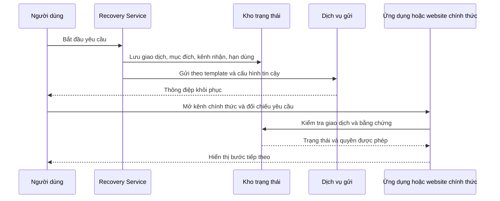

# Recovery message authenticity — Tính xác thực của thông điệp khôi phục

Một thông điệp khôi phục tài khoản thường xuất hiện đúng lúc người dùng lo lắng vì mất mật khẩu, điện thoại, MFA hoặc passkey. Người dùng có thể chấp nhận một hướng dẫn bất thường chỉ vì nó hứa giúp lấy lại quyền truy cập. Vì vậy, thông điệp này vừa là phương tiện hỗ trợ vừa là bề mặt tấn công.

**Recovery message authenticity** là khả năng xác minh nguồn phát hành và tính toàn vẹn phù hợp của thông điệp, đồng thời đối chiếu nó với một yêu cầu khôi phục cụ thể. Mục tiêu thiết kế là giúp người nhận hiểu ai đang liên hệ, việc gì được đề nghị và nơi nào được phép tiếp nhận bí mật khôi phục.

Bài học tập trung vào email, SMS và thông báo ứng dụng trong luồng khôi phục. Các mẫu nội dung, thời hạn và kiến trúc dưới đây là thiết kế minh họa; chúng cần được điều chỉnh theo rủi ro của dịch vụ.

## 1. Ba câu hỏi phải được tách biệt

| Câu hỏi | Bằng chứng liên quan | Điều chưa thể kết luận |
| --- | --- | --- |
| Thông điệp có được phát hành qua hạ tầng được tổ chức cho phép không? | Xác thực miền gửi, quyền của dịch vụ gửi, dữ liệu sự kiện nội bộ | Chính chủ đã yêu cầu khôi phục |
| Thông điệp có thuộc giao dịch đang xử lý không? | Loại thao tác, mã yêu cầu, thời điểm, trạng thái phía máy chủ | Người đang đọc là chủ tài khoản |
| Người yêu cầu có đủ điều kiện thực hiện thay đổi không? | Bằng chứng khôi phục và chính sách xác minh tương ứng | Mọi session hoặc phương thức xác thực cũ đều an toàn |

Một email hoàn toàn thật vẫn có thể được gửi vì kẻ tấn công nhập địa chỉ của nạn nhân vào chức năng quên mật khẩu. Ngược lại, một email giả có thể chứa đúng tên, địa chỉ và thông tin thiết bị lấy từ nguồn khác.

Do đó, đừng suy luận:

```text
Thư trông đúng thương hiệu
    ⇒ thư thật
    ⇒ yêu cầu do chính chủ tạo
    ⇒ được phép xóa MFA
```

Mỗi mũi tên cần một cơ chế xác minh riêng. Logo, văn phong và chữ ký cuối thư chỉ hỗ trợ nhận diện, không phải bằng chứng cấp quyền.

## 2. Kịch bản tấn công: dùng thông điệp thật làm đạo cụ

Lan nhận email đặt lại mật khẩu từ đúng dịch vụ. Ngay sau đó, một người gọi điện tự xưng nhân viên hỗ trợ và nói: “Tôi vừa gửi thư xác minh, hãy đọc mã để hủy yêu cầu bất thường”.

Diễn biến thực tế có thể là:

1. Kẻ tấn công khởi tạo yêu cầu khôi phục cho tài khoản của Lan.
2. Hệ thống gửi thông điệp thật đến kênh đã đăng ký.
3. Kẻ tấn công dùng sự xuất hiện của thư để tăng độ tin cậy cho cuộc gọi.
4. Lan chuyển mã hoặc đường dẫn cho người gọi.
5. Người gọi dùng bí mật vừa nhận để tiếp tục luồng khôi phục.

Sự cố không đòi hỏi giả mạo miền gửi. Thiết kế cần ngăn việc chuyển từ “tôi nhận được một thông điệp thật” sang “người đang gọi cho tôi có quyền xử lý tài khoản”.

Một quy ước hữu ích cho dịch vụ là: nhân viên hỗ trợ không thu mật khẩu, OTP, recovery code hoặc đường dẫn khôi phục qua điện thoại, email trả lời hay chat. Nếu cần xác minh trong quy trình hỗ trợ, người dùng thao tác trong giao diện chính thức đã được mở độc lập.

## 3. Chuỗi tin cậy từ sự kiện đến thao tác

Một kiến trúc minh họa có thể tách các thành phần như sau:



Các ranh giới cần chú ý:

- Client có thể yêu cầu bắt đầu khôi phục, nhưng không được tự quyết định miền gửi, URL hành động hoặc địa chỉ nhận thay thế.
- Dịch vụ gửi chỉ chuyển thông điệp; webhook báo đã giao không có nghĩa người nhận đã chứng minh danh tính.
- Giao diện tiếp nhận mã phải kiểm tra trạng thái phía máy chủ; văn bản trong thư không phải nguồn chuẩn về quyền khôi phục.
- Một màn hình hiển thị lịch sử yêu cầu khi chưa đăng nhập cũng phải được bảo vệ để không tiết lộ thông tin tài khoản cho người ngoài.

Nếu người dùng mở website bằng bookmark hoặc tự nhập địa chỉ đã biết, dịch vụ vẫn cần một cách tiếp tục phù hợp: nhập mã tại luồng chính thức, sử dụng bằng chứng dự phòng hoặc làm quy trình hỗ trợ. Không nên thiết kế phương án xác minh độc lập chỉ tồn tại trên giấy.

## 4. Xác thực email: hiểu đúng SPF, DKIM và DMARC

Ba cơ chế có vai trò khác nhau:

| Cơ chế | Ý nghĩa chính | Giới hạn cần nhớ |
| --- | --- | --- |
| SPF | Kiểm tra máy gửi có được miền dùng trong SMTP cho phép không | Không tự xác thực tên hiển thị người gửi; không phải cơ chế ký nội dung |
| DKIM | Chữ ký của miền ký trên các phần thông điệp được bao phủ | Miền ký có thể khác miền người đọc thấy; không chứng minh yêu cầu là chính đáng |
| DMARC | Yêu cầu SPF hoặc DKIM hợp lệ và có alignment với miền trong From | Không đảm bảo nội dung an toàn hoặc chủ tài khoản đã yêu cầu khôi phục |

Các mô tả giao thức tương ứng nằm trong [RFC 7208 về SPF](https://www.rfc-editor.org/rfc/rfc7208.html), [RFC 6376 về DKIM](https://www.rfc-editor.org/rfc/rfc6376.html) và [RFC 9989 về DMARC](https://www.rfc-editor.org/rfc/rfc9989.html). RFC 9989 nêu rõ rằng DMARC pass không phải bảo đảm thông điệp an toàn.

Ví dụ, thư từ một miền gần giống thương hiệu do kẻ tấn công sở hữu có thể vượt qua xác thực cho chính miền đó. Ngoài ra, nếu tài khoản gửi thư hợp lệ bị chiếm đoạt, các kiểm tra miền gửi không tự phát hiện được ý đồ của từng thông điệp.

### Cách áp dụng trong hệ thống khôi phục

Trong thiết kế minh họa, tổ chức chọn một danh tính gửi ổn định, chẳng hạn `security@notify.example.com`, quản lý nhà cung cấp gửi thư và khóa ký như tài sản bảo mật. Mỗi nguồn gửi hợp lệ được kiểm kê trước khi tăng mức thực thi chính sách nhận thư.

Không nên chuyển chính sách một cách máy móc khiến thư khôi phục hợp lệ bị chặn hàng loạt. Cũng không nên hạ mức kiểm soát vô thời hạn chỉ để duy trì một tích hợp gửi thư chưa được quản lý.

Các kết quả xác thực phải được diễn giải từ hạ tầng nhận thư đáng tin cậy. Dòng chữ “đã xác minh” hoặc một khối header được chép vào thân thư không có giá trị tương đương.

## 5. URL hành động phải đến từ cấu hình tin cậy

Một thông điệp có nguồn gửi hợp lệ vẫn nguy hiểm nếu đường dẫn của nó được tạo từ dữ liệu client. Chẳng hạn, dịch vụ lấy `Host` của request để dựng link; kẻ tấn công có thể khiến hệ thống gửi thư thật nhưng chứa URL do họ lựa chọn nếu chuỗi proxy và ứng dụng không kiểm soát đúng header.

OWASP khuyến nghị tạo URL HTTPS từ giá trị cố định hoặc danh sách miền tin cậy, không dựa trực tiếp vào Host header; token cần sinh ngẫu nhiên an toàn, hết hạn và dùng một lần. Trang khôi phục nên dùng `Referrer-Policy: no-referrer` để hạn chế rò rỉ qua referrer. Xem [Forgot Password Cheat Sheet](https://cheatsheetseries.owasp.org/cheatsheets/Forgot_Password_Cheat_Sheet.html).

Với hệ thống minh họa, quyết định thiết kế là:

- Origin công khai được cấu hình là `https://accounts.example.com`.
- Route hành động nằm trong tập được dịch vụ sở hữu.
- Client không gửi `recoveryBaseUrl`, `sender`, `replyTo` hoặc `redirectUrl` tùy ý.
- Trang xử lý không chuyển tiếp token sang website ngoài.
- Tính năng rút gọn link và theo dõi click của nhà cung cấp gửi được tắt riêng cho thông điệp chứa bí mật khôi phục.

So sánh các URL:

| URL minh họa | Cách hiểu |
| --- | --- |
| `https://accounts.example.com/recovery/continue` | Host khớp cấu hình ví dụ; máy chủ vẫn phải kiểm tra giao dịch |
| `https://accounts.example.com.attacker.example/recovery` | Host thuộc `attacker.example`, không phải `example.com` |
| `https://accounts.example.com@attacker.example/recovery` | Host là `attacker.example`; phần trước dấu @ không phải host |
| `https://accounts.example.com/redirect?next=...` | Host ban đầu đúng nhưng đích chuyển hướng còn phải được kiểm soát |
| `https://short.example/abc` | Người đọc khó nhận biết đích thực từ thông điệp |

HTTPS bảo vệ kết nối tới host đang truy cập; nó không xác nhận host đó là thương hiệu mà người dùng định liên hệ.

### Ví dụ Java: cố định nơi tiếp nhận

Đoạn sau chỉ minh họa dựng URI từ origin và route cố định. Nó giả định token đã được dịch vụ sinh bằng CSPRNG và mã hóa Base64 URL không padding.

```java
import java.net.URI;
import java.util.Objects;
import java.util.regex.Pattern;

public final class RecoveryLinkFactory {
    private static final String PUBLIC_ORIGIN =
            "https://accounts.example.com";

    private static final Pattern TOKEN_FORMAT =
            Pattern.compile("[A-Za-z0-9_-]{43}");

    private RecoveryLinkFactory() {
    }

    public static URI passwordResetLink(String token) {
        Objects.requireNonNull(token, "token");

        if (!TOKEN_FORMAT.matcher(token).matches()) {
            throw new IllegalArgumentException("Invalid token format");
        }

        return URI.create(
                PUBLIC_ORIGIN + "/recovery/password?token=" + token
        );
    }
}
```

Độ dài 43 ký tự trong ví dụ tương ứng biểu diễn Base64 URL không padding của 32 byte. Kiểm tra định dạng không chứng minh token đã được phát hành, còn hạn hoặc thuộc đúng tài khoản; endpoint tiếp nhận phải làm những việc đó.

Không thêm tham số `host` từ request vào factory chỉ để hỗ trợ nhiều tenant. Với nhiều tenant, máy chủ nên chọn cấu hình đã phê duyệt từ định danh tenant được xác lập tin cậy.

## 6. Thiết kế nội dung giúp người dùng kiểm tra

Một thông điệp tốt trả lời được: thao tác gì, khi nào, cho tài khoản nào ở mức thông tin tối thiểu và người nhận nên làm gì nếu không chủ động yêu cầu.

Ví dụ nội dung cho dịch vụ giả định:

```text
Tiêu đề: Yêu cầu đặt lại mật khẩu

Chúng tôi nhận được yêu cầu đặt lại mật khẩu cho tài khoản p***@example.net
lúc 09:20 ngày 23/11/2026, giờ Việt Nam.

Mã tham chiếu yêu cầu: RQ-7K2M
Đường dẫn tiếp tục có hiệu lực đến 09:35 cùng ngày.
Nơi xử lý: accounts.example.com

Nếu bạn đã yêu cầu, hãy tiếp tục trong luồng khôi phục chính thức.
Không gửi mã hoặc đường dẫn này cho bất kỳ ai, kể cả người tự xưng hỗ trợ.

Nếu bạn không yêu cầu, không tiếp tục thao tác.
Hãy mở ứng dụng đã cài hoặc địa chỉ dịch vụ bạn đã lưu để kiểm tra bảo mật.
Việc nhận thư này không có nghĩa mật khẩu của bạn đã được thay đổi.
```

Trong bản gửi thực tế, link chứa token có thể được đặt trong nút hành động và bản plain text tương ứng. Phần nêu `accounts.example.com` chỉ là ví dụ; tổ chức phải dùng miền thật do mình quản lý.

Mã tham chiếu như `RQ-7K2M` phục vụ đối chiếu và hỗ trợ, **không phải bí mật chứng minh danh tính**. Nếu một mã được dùng để cấp quyền thì nó phải được quản lý như token, không được trình bày như mã công khai vô hại.

Thời hạn 15 phút ở đây chỉ là ví dụ. Máy chủ phải quyết định hiệu lực theo trạng thái thật; email đến trễ không được làm thời hạn kéo dài.

### Những chi tiết nên tránh

- Gộp “đặt lại mật khẩu”, “xóa MFA” và “thay địa chỉ nhận” trong một nút mơ hồ như “xác minh tài khoản”.
- Đe dọa khóa hoặc xóa tài khoản nếu người nhận không bấm ngay.
- Yêu cầu trả lời thư bằng OTP, recovery code hoặc ảnh giấy tờ.
- Chèn liên kết quảng cáo, tài liệu đính kèm hay mã QR không cần thiết vào thông điệp khôi phục.
- Đưa tên thiết bị hoặc vị trí suy đoán thành khẳng định chắc chắn về danh tính.

Thông tin do client cung cấp, như tên hiển thị và mô tả thiết bị, phải được xem là dữ liệu không tin cậy. Trong HTML, dùng template có escape phù hợp; trong header, không ghép trực tiếp chuỗi có thể chứa CR/LF. Tốt hơn là thông điệp khôi phục không cần chứa nội dung tự do do người khởi tạo nhập vào.

## 7. Ràng buộc thông điệp với giao dịch phía máy chủ

Một bản ghi giao dịch minh họa có các thuộc tính sau:

```text
RecoveryRequest
  requestId
  accountId
  purpose                  // RESET_PASSWORD, RECOVER_MFA...
  channelId
  channelVersionAtIssue
  tokenDigest
  createdAt
  expiresAt
  state                    // PENDING, CONSUMED, EXPIRED, CANCELLED
  templateVersion
```

`channelId` trỏ đến kênh đã được đăng ký và phù hợp chính sách khôi phục. Dịch vụ không chuyển sang địa chỉ do người đang yêu cầu vừa nhập chỉ vì địa chỉ cũ “không dùng được nữa”. Trường hợp mất kênh cần đi qua chính sách khôi phục riêng.

`channelVersionAtIssue` giúp phát hiện cấu hình kênh đã thay đổi trong lúc yêu cầu còn chờ. Với một thiết kế thận trọng, nếu phiên bản không còn phù hợp thì yêu cầu cũ bị dừng để đánh giá lại, thay vì gửi token tới một đích mới ngoài dự kiến.

Mục đích cũng phải được ràng buộc. Token đặt lại mật khẩu không mặc nhiên cho phép đăng ký passkey mới hoặc xóa MFA. Trang đích hiển thị thao tác dựa trên bản ghi phía máy chủ, thay vì tin tham số `action` trong URL.

### Quyền của từng thành phần

Một ranh giới quyền hợp lý là:

- Recovery Service tạo và kiểm soát giao dịch.
- Notification Service chỉ dựng nội dung từ template được duyệt và gửi tới đích đã được chọn hợp lệ.
- Support Console tra cứu trạng thái theo quyền được cấp, không cho nhân viên đọc token thô.
- Endpoint hoàn tất kiểm tra giao dịch và chuyển trạng thái nguyên tử để chống dùng lại.

Nếu token phải tồn tại tạm trong hàng đợi hoặc nhà cung cấp gửi thư, đường truyền và nơi lưu đó cần được bảo vệ, giới hạn quyền đọc và thời gian lưu. Việc cơ sở dữ liệu chính chỉ giữ digest không có nghĩa token không còn hiện diện ở nơi khác.

### Mở link không đồng nghĩa chấp thuận thay đổi

Bộ lọc thư hoặc công cụ xem trước có thể truy cập đường dẫn trước người dùng. Vì thế, thiết kế không nên đổi mật khẩu, xóa MFA hoặc gắn authenticator chỉ bởi một request GET.

GET có thể đưa người dùng tới trang giải thích và bước tiếp tục. Thao tác có tác động cần bước chủ động phù hợp, kiểm soát CSRF và kiểm tra trạng thái phía máy chủ. Nếu triển khai đổi token thành một session khôi phục giới hạn, phải thiết kế rõ cách tránh tiêu thụ token vô ích bởi trình quét và cách session đó chỉ có quyền cần thiết.

Các biện pháp này giúp luồng hoạt động đúng, nhưng không biến việc bấm một link thành bằng chứng chống phishing bằng mật mã.

## 8. Khác biệt giữa email, SMS và thông báo ứng dụng

| Kênh | Rủi ro khi đánh giá tính xác thực | Hướng thiết kế minh họa |
| --- | --- | --- |
| Email | Tên hiển thị giả, miền gần giống, link bị viết lại, hộp thư bị chiếm | Quản lý miền gửi, đích link ổn định, có cách mở dịch vụ độc lập |
| SMS | Tên người gửi hoặc số điện thoại dễ bị hiểu là bảo chứng; URL ngắn khó kiểm tra | Nội dung ngắn, nêu mục đích rõ, tránh yêu cầu chuyển mã cho người khác |
| Push | Người dùng chấp thuận vì bị làm phiền; nội dung trên màn hình khóa có thể lộ | Ẩn bí mật, mở app chính thức, tải lại chi tiết từ máy chủ |
| Hộp thư trong ứng dụng | Session có thể không còn đáng tin; thiết bị có thể đã mất | Kiểm tra quyền xem, thời điểm xác thực và chính sách cho hành động nhạy cảm |

Với push, không cấp quyền thay đổi chỉ vì hệ điều hành đã hiển thị thông báo. Ứng dụng cần đọc lại sự kiện từ API tin cậy, kiểm tra quyền truy cập và cho người dùng xem chính xác loại thay đổi.

Nếu người dùng mất toàn bộ thiết bị, push không thể là lối tiếp tục duy nhất. Cũng không nên coi email và push là hai bằng chứng độc lập nếu cả hai đều bị chi phối bởi cùng một thiết bị đang nghi bị chiếm.

## 9. Tính xác thực của thông điệp và phishing resistance

Một luồng email được vận hành tốt vẫn có thể bị lừa chuyển token sang người khác. DMARC, template rõ ràng và miền đích ổn định giảm nhiều rủi ro, nhưng không ràng buộc mật mã đầu ra xác thực với đúng phiên và đúng bên xác minh.

NIST SP 800-63B-4 phân biệt cơ chế chống phishing dựa trên channel binding hoặc verifier name binding. Mã OTP nhập thủ công không được coi là chống phishing; WebAuthn là ví dụ cho ràng buộc theo tên bên xác minh. Xem [NIST, mục Phishing Resistance](https://pages.nist.gov/800-63-4/sp800-63b.html#phish).

Hệ quả thiết kế cho khôi phục tài khoản có passkey là: không suy ra chất lượng của đường khôi phục từ chất lượng của đường đăng nhập thường ngày. Nếu chỉ cần một link email để xóa mọi phương thức mạnh và gắn phương thức mới, khả năng bảo vệ tài khoản còn phụ thuộc vào chính sách khôi phục đó.

Trong thiết kế minh họa cho tài khoản rủi ro cao, email có thể thông báo hoặc mở quy trình, còn quyền thay authenticator cần bằng chứng bổ sung, đánh giá rủi ro hoặc quy trình hỗ trợ đã định nghĩa. Thông điệp phải nói đúng vai trò này, tránh khiến người dùng nghĩ rằng “xác nhận email” luôn đồng nghĩa “đủ quyền lấy lại toàn bộ tài khoản”.

## 10. Khi nhận thông điệp ngoài dự kiến

Cần phân biệt hai tình huống.

**Chỉ có yêu cầu được tạo:** thông báo rằng một yêu cầu khôi phục đã phát sinh, nhưng không khẳng định tài khoản đã bị chiếm. Người nhận không cần hoàn tất yêu cầu đó. Đừng tự động khóa tài khoản chỉ vì ai đó biết địa chỉ và liên tục yêu cầu khôi phục.

**Có thay đổi đã hoàn tất:** thông báo phải nói rõ mật khẩu, MFA, passkey hoặc kênh khôi phục nào đã thay đổi ở mức tiết lộ phù hợp. Cách phản hồi sự cố cần dẫn người dùng về kênh hỗ trợ hoặc giao diện bảo mật chính thức.

Trong cả hai trường hợp, nên cho phép người nhận tự mở địa chỉ hoặc ứng dụng đã biết. FTC khuyến nghị liên hệ tổ chức bằng thông tin đã biết là thật khi nghi ngờ một thông điệp, thay vì dựa vào thông tin liên hệ nằm ngay trong thông điệp đó. Xem [Phishing scams can be hard to spot](https://consumer.ftc.gov/consumer-alerts/2024/12/phishing-scams-can-be-hard-spot).

Nút “không phải tôi” cũng là một thao tác cần thiết kế cẩn thận. Nếu bất kỳ người nào có link hoặc trình quét link đều có thể khóa tài khoản, tính năng chống lạm dụng lại trở thành công cụ từ chối dịch vụ. Có thể đưa người dùng tới trang đánh giá và hỗ trợ; quyền hủy yêu cầu, thu hồi session hoặc khóa tài khoản phải được xác định riêng.

## 11. Quan sát vận hành mà không phát tán bí mật

Tính xác thực còn phụ thuộc vào khả năng giải thích vì sao một thông điệp đã được gửi. Một mô hình sự kiện minh họa có thể ghi:

```json
{
  "event": "RECOVERY_MESSAGE_DISPATCHED",
  "requestId": "internal-request-id",
  "purpose": "RESET_PASSWORD",
  "channelId": "registered-channel-id",
  "templateVersion": "password-reset-v3",
  "providerMessageId": "provider-generated-id",
  "dispatchState": "ACCEPTED"
}
```

`ACCEPTED` chỉ mô tả nhà cung cấp đã nhận yêu cầu gửi. Các trạng thái giao thư, mở thư, bấm link và hoàn tất xác minh là những sự kiện khác nhau; không dùng một chỉ số thay cho tất cả.

Không ghi token, mã xác thực hoặc URL khôi phục đầy đủ vào log. OWASP cũng khuyến nghị giới hạn dữ liệu địa chỉ email trong log và kiểm soát quyền truy cập dữ liệu liên quan. Xem [Email Validation and Verification — Logging and Monitoring](https://cheatsheetseries.owasp.org/cheatsheets/Email_Validation_and_Verification_Cheat_Sheet.html#logging-and-monitoring).

Trong kiến trúc minh họa, các điểm có thể lưu request như reverse proxy, APM, analytics, trace và công cụ hỗ trợ đều cần được cấu hình theo nguyên tắc đó. Tắt click tracking trong email không giải quyết việc token vẫn bị ghi tại access log của trang đích.

Có thể quan sát tần suất gửi theo tài khoản và kênh để phát hiện chiến dịch tạo thư thật làm mồi. Khi hạn chế gửi, cần thông báo rõ trạng thái cho người đang dùng luồng hợp lệ, tránh khiến họ chuyển sang tìm “hỗ trợ” qua một kênh lạ.

## 12. Ví dụ áp dụng: khôi phục MFA sau khi mất điện thoại

Một dịch vụ giả định nhận yêu cầu khôi phục MFA từ thiết bị mới. Email được gửi tới kênh đã đăng ký, có mã tham chiếu và hướng dẫn mở trang chính thức. Tại đó, hệ thống cho biết đây là yêu cầu khôi phục MFA, không phải yêu cầu đặt lại mật khẩu.

Có ba cách diễn giải:

| Tình huống | Điều hệ thống nên suy ra | Bước tiếp theo phù hợp |
| --- | --- | --- |
| Chủ tài khoản đã tạo yêu cầu và còn bằng chứng dự phòng | Có cơ sở để tiếp tục xác minh | Kiểm tra bằng chứng theo chính sách trước khi thay MFA |
| Chủ tài khoản không tạo yêu cầu | Có yêu cầu ngoài dự kiến, chưa đủ kết luận bị chiếm | Không hoàn tất; mở luồng bảo mật hoặc hỗ trợ chính thức |
| Một người gọi điện đòi đọc mã trong email | Có dấu hiệu thu thập bí mật qua kênh khác | Không chuyển mã; kết thúc trao đổi và liên hệ lại độc lập |

Ngay cả khi email vượt qua kiểm tra miền gửi, hệ thống vẫn không bỏ qua kiểm tra bằng chứng. Ngay cả khi yêu cầu được hoàn tất hợp lệ, việc quản lý session cũ, phương thức bị mất và thông báo thay đổi vẫn phải theo chính sách hậu khôi phục.

Điều cần giữ xuyên suốt là sự nhất quán: **thông điệp cho biết việc gì đang xảy ra; máy chủ quyết định việc gì được phép; người dùng có đường quay về kênh chính thức để tự xác minh**.

## Tài liệu tham khảo

- [OWASP — Forgot Password Cheat Sheet](https://cheatsheetseries.owasp.org/cheatsheets/Forgot_Password_Cheat_Sheet.html): URL và token đặt lại mật khẩu.
- [OWASP — Email Validation and Verification Cheat Sheet](https://cheatsheetseries.owasp.org/cheatsheets/Email_Validation_and_Verification_Cheat_Sheet.html): dữ liệu nhạy cảm trong luồng email và log.
- [RFC 7208 — SPF](https://www.rfc-editor.org/rfc/rfc7208.html), [RFC 6376 — DKIM](https://www.rfc-editor.org/rfc/rfc6376.html), [RFC 9989 — DMARC](https://www.rfc-editor.org/rfc/rfc9989.html): ý nghĩa và giới hạn xác thực miền gửi.
- [NIST SP 800-63B-4](https://pages.nist.gov/800-63-4/sp800-63b.html): chống phishing trong giao thức xác thực.
- [FTC — Phishing scams can be hard to spot](https://consumer.ftc.gov/consumer-alerts/2024/12/phishing-scams-can-be-hard-spot): xác minh qua thông tin liên hệ đã biết.
