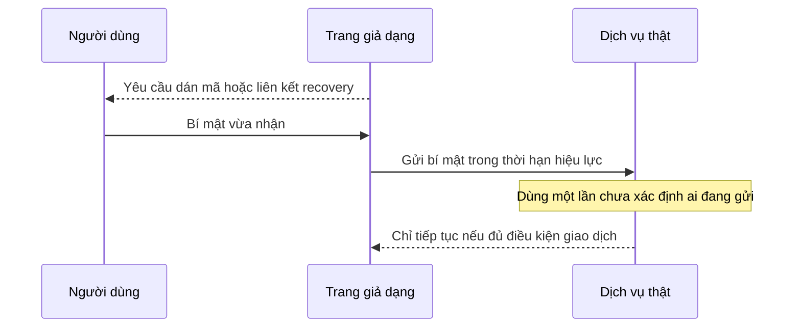

# Phòng vệ trước tên miền giả dạng trong khôi phục tài khoản (Lookalike domain defense)

## 1. Tên miền giống thật có thể đưa người dùng ra khỏi ranh giới tin cậy

Khi quên mật khẩu hoặc mất thiết bị MFA, người dùng thường đang cần lấy lại quyền truy cập nhanh. Một email mang thông điệp “Hoàn tất khôi phục ngay” có thể khiến họ chú ý đến logo, màu sắc và nút bấm hơn là địa chỉ trang.

Kẻ tấn công không nhất thiết chiếm được tên miền thật. Họ có thể dùng một tên miền khác trông gần giống, dựng giao diện tương tự và yêu cầu người dùng cung cấp:

- Mật khẩu mới hoặc mật khẩu đang sử dụng.
- Mã OTP hoặc recovery code.
- Toàn bộ liên kết khôi phục vừa nhận.
- Xác nhận trên thiết bị còn tin cậy.
- Một thao tác thay đổi yếu tố xác thực mà người dùng chưa hiểu rõ.

Trong bài này, `accounts.example.test` là tên miền chính thức **minh họa**, không phải tên miền triển khai của một dịch vụ thật. Mọi URL, token và mã giao dịch bên dưới đều là dữ liệu giả.

Phòng vệ cần thực hiện ở nhiều nơi: cách dịch vụ tạo liên kết, cách giao diện trình bày đích đến, giao thức xác thực, quy trình hỗ trợ và khả năng phát hiện tên miền lạm dụng. Không thể giao toàn bộ trách nhiệm cho người dùng phải nhận ra từng ký tự lạ.

## 2. Các dạng tên miền dễ gây nhầm lẫn

Giả sử địa chỉ recovery minh họa là:

```text
https://accounts.example.test/recovery
```

| Dạng gây nhầm lẫn | Ví dụ minh họa | Điểm cần nhận ra |
| --- | --- | --- |
| Thay ký tự gần giống | `accounts.examp1e.test` | Chữ l trong example bị thay bằng số 1 |
| Thêm hoặc đổi dấu phân cách | `accounts-example.test` | Đây không phải subdomain accounts của example.test |
| Đưa tên tin cậy vào phần đầu | `accounts.example.test.signin.test` | Host nằm dưới signin.test |
| Đưa tên tin cậy vào path | `untrusted.test/accounts.example.test/recovery` | Host vẫn là untrusted.test |
| Đưa tên tin cậy vào userinfo | `https://accounts.example.test@untrusted.test/recovery` | Host sau dấu @ là untrusted.test |
| Dùng ký tự Unicode nhìn giống | `accounts.exаmple.test` | Chữ а trong nhãn exаmple ở ví dụ là Cyrillic |
| Đổi phần đuôi tên miền | `accounts.example.support` | Không phải host accounts.example.test |

Không nên dạy quy tắc “hai nhãn cuối luôn là miền đăng ký” cho mọi tên miền. Public suffix có cấu trúc khác nhau; việc phân tích ở backend cần thư viện và dữ liệu thích hợp. Với các ví dụ dưới `.test`, mục đích là chỉ rõ host và ranh giới nhãn.

Một subdomain khác dưới chính miền tổ chức quản lý cũng chưa tự động là đích recovery được phép. Dịch vụ cộng đồng, nội dung người dùng hoặc subdomain bị bỏ quên có thể có mức tin cậy khác với dịch vụ tài khoản.

## 3. Unicode, IDN và Punycode: giống hình không có nghĩa cùng danh tính

Tên miền quốc tế hóa là nhu cầu hợp lệ. Không phải mọi tên miền có ký tự ngoài ASCII hoặc biểu diễn Punycode đều là lừa đảo.

Rủi ro xuất hiện khi hai chuỗi khác nhau trông giống nhau trong một phông chữ hoặc cách hiển thị nhất định. Unicode UTS #39 mô tả cơ chế phát hiện confusable và các dạng nhầm lẫn giữa ký tự hoặc hệ chữ. Những cơ chế đó giúp tìm ứng viên cần xem xét, không chứng minh hai tên miền có cùng chủ sở hữu. [Nguồn: Unicode UTS #39 — Confusable Detection](https://www.unicode.org/reports/tr39/#Confusable_Detection).

Trong triển khai:

- Dùng một cách xử lý IDNA và chuẩn hóa host nhất quán giữa cấu hình, parser và chính sách.
- Chỉ cấp quyền cho các host hoặc origin thực sự đã được phê duyệt.
- Có thể dùng confusable skeleton hoặc khoảng cách chỉnh sửa để phát hiện nghi vấn.
- Không dùng “trông giống tên miền chính thức” làm điều kiện cho phép redirect, gửi token hoặc xác thực.

Hai tên miền có cùng skeleton vẫn phải được xem là các danh tính mạng khác nhau. Không bỏ dấu, thay ký tự nhìn giống hoặc xóa dấu gạch nối rồi so sánh để quyết định đích có đáng tin hay không.

Trình duyệt có thể hiển thị Unicode hoặc dạng ASCII tùy ngữ cảnh và chính sách. Giao diện sản phẩm không nên dựa vào giả định rằng trình duyệt luôn phơi bày mọi sự khác biệt cho người dùng.

## 4. HTTPS và logo không xác nhận đúng dịch vụ

Một website giả dạng có thể có HTTPS hoạt động bình thường. Kết nối được mã hóa tới host đang mở không làm host đó trở thành tên miền của dịch vụ mà người dùng định truy cập.

Tương tự, những dấu hiệu sau không đủ để cấp niềm tin:

- Logo, favicon và màu sắc giống trang thật.
- Tiêu đề “Trung tâm khôi phục tài khoản”.
- Chứng nhận hoặc biểu tượng bảo mật do trang tự vẽ.
- Tên hiển thị của người gửi email.
- Một mã tham chiếu hỗ trợ hoặc thông tin cá nhân mà kẻ tấn công đã biết.

Một tên miền đúng cũng chưa bảo đảm toàn bộ nội dung an toàn nếu ứng dụng bị XSS hoặc endpoint redirect bị lạm dụng. Phòng vệ tên miền cần đi cùng bảo vệ ứng dụng và vòng đời token.

Có thể giải thích cho người dùng bằng câu ngắn: “Chỉ tiếp tục trên tên miền tài khoản đã được dịch vụ công bố; biểu tượng kết nối an toàn không thay thế việc xác định đúng trang.”

## 5. Sinh recovery URL từ cấu hình đáng tin cậy

Một lỗi nguy hiểm là dùng host trong request làm nguồn tạo liên kết:

```text
baseUrl = "https://" + request.headers["Host"]
recoveryUrl = baseUrl + "/recovery?token=" + token
```

Nếu host hoặc forwarded header bị người gọi chi phối, dịch vụ thật có thể gửi một email chứa token thật nhưng trỏ tới host của kẻ tấn công. Khi đó, email không cần bị giả mạo để dẫn nạn nhân ra ngoài.

OWASP khuyến nghị không dựa vào Host tùy ý khi tạo reset URL; cần dùng địa chỉ được cấu hình hoặc kiểm tra theo tập tên miền đáng tin cậy. [Nguồn: OWASP Forgot Password — URL Tokens](https://cheatsheetseries.owasp.org/cheatsheets/Forgot_Password_Cheat_Sheet.html#url-tokens).

Mã giả minh họa:

```text
createRecoveryLink(account, purpose):
    tenant = lấy tenant từ dữ liệu tài khoản đã xác định
    origin = trustedConfiguration.recoveryOriginFor(tenant)

    yêu cầu origin dùng HTTPS
    yêu cầu origin thuộc tập origin đã được phê duyệt cho tenant

    token = cấp token ngẫu nhiên đúng mục đích và giao dịch
    url = tạo URL bằng bộ dựng URL chuẩn
    đặt origin từ cấu hình
    đặt path cố định "/recovery/entry"
    thêm token bằng cơ chế mã hóa query phù hợp

    trả url
```

Không lấy `recoveryOrigin`, `callbackDomain` hoặc `returnTo` từ body rồi coi là cấu hình. Nếu hỗ trợ custom domain, phải có quy trình xác minh quyền kiểm soát, mapping tenant rõ ràng và vòng đời thu hồi khi domain không còn thuộc tenant.

TLS termination hoặc reverse proxy có thể làm backend nhìn thấy host nội bộ. Cần xử lý bằng cấu hình proxy và public origin đáng tin, không sửa bằng cách tin mọi `X-Forwarded-Host` có mặt.

## 6. Giữ một đích recovery nhất quán trong thông điệp

Một dịch vụ càng sử dụng nhiều miền không liên quan cho email, trợ giúp, theo dõi click và đăng nhập, người dùng càng khó hình thành thói quen nhận diện đúng đích.

Thiết kế thông điệp nên ưu tiên:

- Một địa chỉ recovery hoặc lối vào tài khoản được công bố rõ.
- Nhãn liên kết phản ánh thao tác, không che giấu đích bằng lời thúc ép.
- Một dòng văn bản chỉ rõ host cần mở.
- Cách đi từ ứng dụng hoặc bookmark đã biết tới mục khôi phục.
- Thông báo không yêu cầu gửi mã hay liên kết bí mật cho nhân viên hỗ trợ.

Ví dụ nội dung:

```text
Bạn đã yêu cầu khôi phục tài khoản.

Tiếp tục trên tên miền tài khoản:
accounts.example.test

Nếu không chắc về email này, hãy mở ứng dụng hoặc trang tài khoản
bằng cách bạn thường dùng và chọn mục Khôi phục tài khoản.

Không gửi mã hoặc toàn bộ liên kết khôi phục cho người khác.
```

Đây là mẫu thông điệp, không phải bằng chứng mật mã về nguồn email. Trang giả có thể sao chép nguyên mẫu. Giá trị của nó là làm nhất quán kỳ vọng và cung cấp đường đi độc lập với liên kết đáng ngờ.

Không khuyên người dùng tìm tên thương hiệu rồi nhấp kết quả đầu tiên. Kết quả tìm kiếm hoặc quảng cáo cũng có thể dẫn tới bên giả mạo. Lối vào đã biết như bookmark, ứng dụng chính thức hoặc địa chỉ đã được xác lập trước đó có ranh giới tin cậy rõ hơn.

### Tránh che đích bằng trung gian không cần thiết

URL rút gọn và miền click-tracking có thể làm đích khó nhận ra. Với liên kết mang recovery token, trung gian còn có thể nhận toàn bộ URL bí mật.

Nếu nền tảng gửi thư có khả năng theo dõi liên kết, cần cấu hình rõ cho thư recovery và tránh bọc token qua dịch vụ không cần thiết. Không đưa token vào URL hỗ trợ, tham số attribution hoặc mã QR gửi cho bên thứ ba.

Hệ thống quét an toàn của bên nhận có thể vẫn viết lại hoặc kiểm tra liên kết. Không yêu cầu người dùng tắt bảo vệ email; dịch vụ cần bảo đảm các lượt mở tự động không thực hiện thay đổi tài khoản.

## 7. Xác thực email giảm giả mạo bên gửi nhưng không loại bỏ miền giống thật

SPF, DKIM và DMARC hỗ trợ xác thực email, trong đó DMARC có kiểm tra sự phù hợp của domain trong From với domain được xác thực theo cơ chế tương ứng. Google mô tả các phương thức này trong hướng dẫn dành cho bên gửi email. [Nguồn: Google — Email sender guidelines](https://support.google.com/mail/answer/81126?hl=en).

Từ việc một email vượt qua xác thực của **một domain**, không thể suy ra domain ấy thuộc thương hiệu mà người nhận đang nghĩ tới. Kẻ kiểm soát một domain giống thật có thể cấu hình xác thực cho chính domain đó.

Do đó:

- Cấu hình xác thực cho các miền gửi thư hợp lệ của dịch vụ.
- Giữ tên bên gửi và quan hệ giữa miền gửi thư với miền recovery dễ hiểu.
- Không coi tên hiển thị hoặc một biểu tượng email là cơ chế duy nhất.
- Không coi DMARC pass là xác nhận rằng mọi liên kết trong email đều thuộc dịch vụ.

Miền gửi thư và host trang recovery không bắt buộc giống hệt nhau. Ví dụ `security@example.test` có thể gửi liên kết tới `accounts.example.test` theo cấu hình hợp lệ. Điều cần có là quan hệ đã được dịch vụ kiểm soát và công bố, không phải một quy tắc so sánh chuỗi đơn giản trong giao diện người dùng.

## 8. Không để open redirect hợp thức hóa một miền giả

Một liên kết bắt đầu ở tên miền thật vẫn có thể kết thúc ở nơi khác:

```text
https://accounts.example.test/continue?next=https://untrusted.test/recovery
```

Người dùng nhìn phần đầu hợp lệ trong email nhưng sau khi mở bị đưa tới trang giả. Nếu token được nối thêm vào `next`, chính ứng dụng còn có thể chuyển quyền recovery cho đích đó.

Với luồng recovery:

- Chọn đích chuyển bước từ tập route hoặc origin đã được phê duyệt.
- Không nối token hoặc session vào return URL.
- Không cho đích cùng origin được phép tiếp tục redirect tùy ý ra ngoài.
- Không dùng kiểm tra chứa thương hiệu, gần giống tên miền hoặc cùng skeleton để cấp phép.
- Giữ trang hỗ trợ bên ngoài tách khỏi điểm nhận bí mật.

Một ánh xạ nhỏ như `SIGN_IN -> /sign-in` dễ kiểm soát hơn một URL tùy ý do request gửi lên. Backend vẫn phải kiểm tra người dùng có đủ quyền đối với bước tiếp theo.

Đối với việc đổi tên miền chính thức, cần một kế hoạch riêng về thông báo, cấu hình, quyền sở hữu miền cũ và chuyển giao giao dịch. Không áp dụng một redirect tùy ý mang token sang miền mới chỉ để “giữ mọi link cũ hoạt động”.

## 9. Passkey tạo ràng buộc mà việc quan sát bằng mắt không có

Một cơ chế chống phishing mạnh cần giảm phụ thuộc vào việc người dùng nhận ra tên miền giả. NIST mô tả phishing resistance là khả năng giao thức ngăn bí mật hoặc đầu ra xác thực hợp lệ được tiết lộ cho verifier giả mà không dựa vào sự cảnh giác của người dùng. Mã OTP nhập thủ công không được xem là phishing-resistant vì có thể bị chuyển tiếp. [Nguồn: NIST SP 800-63B — Phishing Resistance](https://pages.nist.gov/800-63-4/sp800-63b.html#phishing).

WebAuthn ràng buộc credential với RP ID và dữ liệu về origin. Khi xác minh, relying party phải kiểm tra challenge, origin dự kiến, rpIdHash và các điều kiện xác thực khác. Một domain nhìn giống nhưng không thuộc phạm vi được phép không thể chỉ nhờ giao diện giống thật mà dùng credential của dịch vụ chính thức. [Nguồn: W3C WebAuthn, Verifying an Authentication Assertion](https://www.w3.org/TR/webauthn-3/#sctn-verifying-assertion).

Tuy nhiên, phải bảo vệ cả đường recovery:

- Nếu còn một passkey hoặc thiết bị tin cậy phù hợp, có thể dùng nó làm bằng chứng theo chính sách.
- Nếu tất cả yếu tố đã mất, cần một quy trình recovery riêng phù hợp với rủi ro.
- Không tự đổi sang OTP hoặc bỏ yêu cầu xác minh chỉ vì một trang báo “passkey không hoạt động”.
- Không thêm domain gần giống vào danh sách origin WebAuthn chỉ để làm đăng nhập thành công.
- Không chọn phạm vi RP ID rộng hơn nhu cầu rồi mặc nhiên tin mọi ứng dụng ở các subdomain liên quan.

Nếu email token vẫn đủ để xóa toàn bộ yếu tố và tạo credential mới, kẻ tấn công có thể nhắm tới đường đó dù đăng nhập thông thường dùng passkey. Bảo vệ giao thức đăng nhập không tự làm đường khôi phục có cùng mức chống phishing.

## 10. Token một lần vẫn có thể bị chuyển tiếp theo thời gian thực

Một trang giả có thể yêu cầu người dùng dán recovery code hoặc toàn bộ liên kết vừa nhận. Kẻ tấn công chuyển dữ liệu ấy sang dịch vụ thật trước khi hết hạn.



Token một lần ngăn việc dùng lại sau khi đã tiêu thụ đúng cách. Nó không bảo đảm người dùng hợp lệ sẽ là bên sử dụng đầu tiên. Thời hạn ngắn cũng không chặn được một lần chuyển tiếp rất nhanh.

Thiết kế có thể giảm tác động bằng:

- Giới hạn token theo mục đích và giao dịch.
- Dùng phiên recovery giới hạn thay cho đăng nhập đầy đủ ngay.
- Yêu cầu thêm bằng chứng thích hợp trước hành động rủi ro cao.
- Thông báo thay đổi qua kênh đã đăng ký và giữ cơ chế phát hiện/ứng phó.
- Kiểm soát session và credential sau khi khôi phục theo trạng thái sự cố.

Cần phân biệt ràng buộc giao dịch thực sự với tín hiệu yếu như IP hoặc User-Agent. Không coi hai request cùng IP là cùng người, hoặc trình duyệt mở link đầu tiên là thiết bị tin cậy. Những ràng buộc gây nhầm lẫn còn có thể làm người mất thiết bị không thể recovery hợp lệ.

## 11. Phát hiện miền đáng ngờ và giữ bằng chứng an toàn

Một hoạt động phòng vệ có thể tìm các tên miền mới hoặc trang công khai có dấu hiệu giống thương hiệu. Các tiêu chí như khoảng cách chỉnh sửa, ký tự confusable, từ khóa recovery, chứng thư và nội dung sao chép giúp ưu tiên xem xét.

Nhưng “gần giống tên thương hiệu” chưa đủ để khẳng định có hành vi phishing. Cần kết hợp bằng chứng về cách miền được sử dụng và ngữ cảnh thực tế.

Một luồng xử lý minh họa:

```text
Ứng viên tên miền
    -> phân tích cấu trúc và mức giống
    -> xem xét bằng chứng công khai an toàn
    -> xác định mức độ liên quan tới chiến dịch giả mạo
    -> cảnh báo, báo cáo hoặc xử lý theo quy trình tổ chức
```

Không dán liên kết recovery đang còn hiệu lực vào dịch vụ quét URL công khai để “kiểm tra hộ”. Làm vậy có thể chuyển token cho một bên mới. Dùng URL đã loại bí mật, ảnh chụp đã che dữ liệu và mã sự cố phù hợp.

Nếu người dùng báo đã cung cấp mã cho trang giả, ưu tiên đánh giá quyền đã lộ và thu hồi token hoặc giao dịch còn hiệu lực trong phạm vi ảnh hưởng. Nếu có dấu hiệu thay đổi trái phép, xử lý credential, session và thông báo theo quy trình sự cố. Không chờ miền giả bị gỡ rồi mới thu hồi quyền có thể đang bị lạm dụng.

## 12. Quy trình hỗ trợ không được trở thành đường vòng

Nhân viên hỗ trợ cần có lời hướng dẫn thống nhất:

```text
Không gửi cho chúng tôi mật khẩu, OTP, recovery code hoặc toàn bộ link.
Hãy mở ứng dụng/trang tài khoản theo lối vào bạn đã biết.
Bạn có thể cung cấp mã yêu cầu hỗ trợ để đối chiếu.
```

Một người gọi tự xưng là hỗ trợ không được yêu cầu “chuyển sang miền khôi phục mới” hoặc tắt MFA để xác minh danh tính. Khi thật sự có thay đổi tên miền, người dùng cần xác nhận được qua một kênh đã có niềm tin, thay vì chỉ qua chính thông điệp yêu cầu thay đổi.

Nếu người dùng mất mọi yếu tố xác thực, hướng dẫn về miền đúng vẫn cần đi cùng quy trình chứng minh quyền sở hữu tài khoản. Logo đúng, domain đúng và một cuộc trò chuyện với hỗ trợ chưa đủ thay cho bằng chứng mà chính sách yêu cầu.

Phòng vệ trước miền giả dạng có hiệu quả khi dịch vụ chỉ tạo liên kết tới đích đã kiểm soát, giữ hành vi email và điều hướng nhất quán, dùng ràng buộc giao thức khi có thể và không để recovery trở thành đường hạ cấp của các biện pháp xác thực mạnh.
