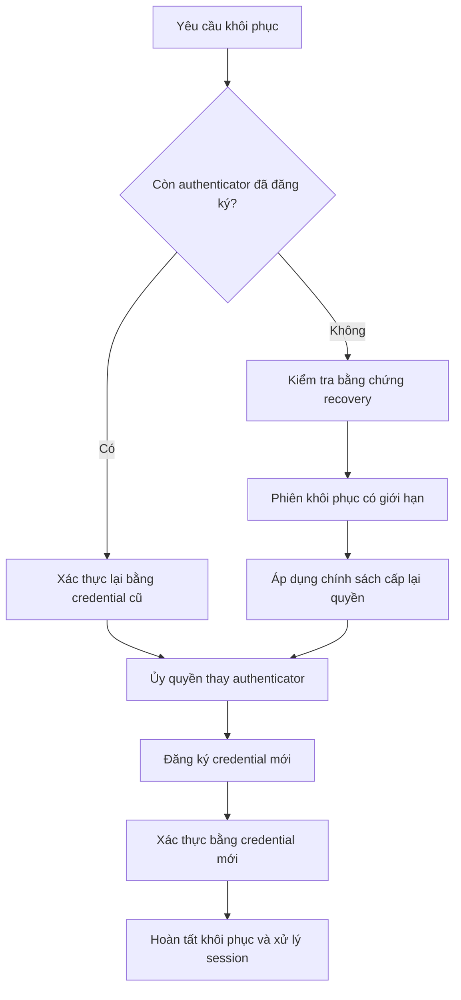

# Phishing resistant factors — Yếu tố xác thực chống phishing

## 1. Vì sao khôi phục tài khoản cần quan tâm đến yếu tố chống phishing?

Một hệ thống có thể đăng nhập bằng passkey nhưng vẫn bị chiếm đoạt qua chức năng “Tôi mất thiết bị”. Nếu chức năng này chỉ yêu cầu một mã email rồi cho phép thay mọi phương thức xác thực, kẻ tấn công sẽ chọn đường khôi phục thay vì đối đầu với passkey.

Trong bài này, **yếu tố xác thực chống phishing** là authenticator được sử dụng qua giao thức giúp bên xác minh phân biệt đúng dịch vụ, thay vì trông chờ người dùng luôn nhận ra trang giả. Cần đánh giá cả authenticator, giao thức sử dụng và cách máy chủ xác minh.

Bài học tập trung vào ba quyết định trong khôi phục tài khoản:

- Khi người dùng còn một authenticator hợp lệ, sử dụng nó để cho phép thay thiết bị như thế nào?
- Khi họ mất tất cả authenticator, bằng chứng khôi phục cho phép những hành động nào?
- Sau khi gắn một passkey mới, khi nào có thể cấp lại quyền truy cập đầy đủ?

Ví dụ xuyên suốt là dịch vụ quản lý tài khoản có tên miền hợp lệ `https://accounts.example.com`. Các trạng thái và chính sách minh họa dưới đây là một thiết kế đề xuất cho dịch vụ này, không phải tên trạng thái bắt buộc của một tiêu chuẩn.

## 2. Chống phishing khác với có thêm một bước xác thực

### 2.1. Mã dùng một lần vẫn có thể bị chuyển tiếp

Giả sử người dùng nhập mật khẩu và TOTP vào một trang giả. Kẻ tấn công có thể chuyển tiếp chúng ngay đến dịch vụ thật trước khi mã hết hạn. Việc mã chỉ dùng một lần không ngăn được lần sử dụng đầu tiên của kẻ tấn công.

NIST phân biệt khả năng chống phát lại và khả năng chống phishing: đầu ra OTP nhập thủ công không được ràng buộc vào đúng phiên xác thực nên không được xem là chống phishing. Một cơ chế có thể chống phát lại nhưng vẫn bị chuyển tiếp trực tiếp. [NIST SP 800-63B-4, Phishing Resistance và Replay Resistance](https://pages.nist.gov/800-63-4/sp800-63b.html#phishing-resistance)

### 2.2. So sánh theo vai trò trong recovery

| Phương thức | Điểm cần hiểu | Vai trò có thể có khi khôi phục |
| --- | --- | --- |
| Mật khẩu | Bí mật người dùng có thể nhập vào trang giả | Một phần bằng chứng theo chính sách; không tự chứng minh chống phishing |
| SMS OTP hoặc TOTP | Mã còn hạn có thể bị chuyển tiếp | Kênh dự phòng cần kiểm soát rủi ro riêng |
| Recovery code nhập thủ công | Là bí mật có thể bị đánh cắp hoặc bị lừa cung cấp | Bằng chứng khôi phục có phạm vi sử dụng cụ thể |
| Push chỉ yêu cầu bấm chấp thuận | Người dùng có thể chấp thuận yêu cầu do kẻ tấn công tạo | Không suy ra chống phishing chỉ từ thao tác bấm |
| Passkey hoặc khóa bảo mật dùng WebAuthn đúng cách | Bằng chứng mật mã được gắn với bên xác minh | Lựa chọn để xác thực lại bằng credential đã đăng ký |
| Chứng thư máy khách dùng trong giao thức phù hợp | Cần xem xét cách chứng minh khóa và ràng buộc kênh | Phù hợp với một số môi trường được quản lý |

Bảng này phân loại mục đích sử dụng, không xếp mọi triển khai của cùng một sản phẩm vào một mức bảo đảm cố định. Chẳng hạn, thiết bị phần cứng hiển thị OTP và khóa phần cứng dùng FIDO2 là hai cơ chế khác nhau.

Tương tự, “passwordless” chỉ mô tả trải nghiệm không nhập mật khẩu. Một liên kết đăng nhập qua email cũng có thể passwordless nhưng không vì thế mà có các thuộc tính chống phishing của WebAuthn.

## 3. Passkey và WebAuthn tạo ra sự khác biệt ở đâu?

Passkey sử dụng cặp khóa: dịch vụ giữ khóa công khai, còn authenticator thực hiện thao tác với khóa riêng. Người dùng có thể mở khóa cục bộ bằng PIN hoặc sinh trắc học; dữ liệu sinh trắc học không được gửi đến dịch vụ để thay cho chữ ký. [FIDO Alliance, Passkeys](https://fidoalliance.org/passkeys/)

Trong WebAuthn, credential có phạm vi RP ID. Dữ liệu phục vụ xác minh chứa challenge, origin và authenticator data; máy chủ phải kiểm tra đúng các giá trị dự kiến cùng chữ ký. Yêu cầu user verification còn cần được đối chiếu với cờ UV. Đây là những phần của quy trình xác minh được W3C quy định, không phải các trường chỉ để ghi log. [W3C WebAuthn Level 2, Verifying an Authentication Assertion](https://www.w3.org/TR/webauthn-2/#sctn-verifying-assertion)

Với ví dụ của bài học:

```text
Origin được dịch vụ chấp nhận:
    https://accounts.example.com

RP ID được dịch vụ cấu hình:
    accounts.example.com

Trang giả:
    https://accounts-example.net
```

Trong mô hình trình duyệt và authenticator tuân thủ WebAuthn, trang giả trên không thể yêu cầu sử dụng credential thuộc RP ID `accounts.example.com` như thể nó là dịch vụ thật. Việc sao chép giao diện và có chứng thư HTTPS cho tên miền giả không làm hai tên miền trở thành cùng một RP.

### User presence và user verification

Hai khái niệm cần được phân biệt:

- **User presence (UP):** có tương tác của người dùng, chẳng hạn chạm khóa bảo mật.
- **User verification (UV):** authenticator đã thực hiện xác minh người dùng theo cơ chế của nó, chẳng hạn PIN hoặc sinh trắc học.

Một lần chạm không mặc nhiên tương đương xác minh bằng PIN. Với tác vụ thay phương thức xác thực, thiết kế minh họa yêu cầu UV và để máy chủ thực thi yêu cầu đó. Giao diện hiển thị “Đã xác minh” không phải bằng chứng thay thế cho kết quả giao thức.

Việc xác minh WebAuthn nên được giao cho thư viện hoặc dịch vụ triển khai giao thức đầy đủ. Đoạn chính sách trong bài không thay thế việc xác minh chữ ký, origin, challenge hoặc dữ liệu authenticator.

## 4. Chống phishing và khả năng khôi phục là hai trục khác nhau

### 4.1. Passkey đồng bộ

Một passkey được đồng bộ có thể xuất hiện trên thiết bị khác trong hệ sinh thái được người dùng cho phép. Khả năng đồng bộ giúp giảm tình huống mất toàn bộ phương tiện đăng nhập.

Tuy nhiên, thiết kế phải tính đến cách bảo vệ tài khoản và hạ tầng đồng bộ. NIST đưa ra yêu cầu riêng về bảo vệ khóa trong sync fabric và kiểm soát truy cập vào đó. Việc đồng bộ cũng có nghĩa khóa có thể xuất ra khỏi thiết bị, khác với yêu cầu khóa không thể xuất của AAL3. [NIST SP 800-63B-4, Syncable Authenticators](https://pages.nist.gov/800-63-4/sp800-63b/syncable/)

Do đó, không nên suy luận:

```text
Chống phishing
    => khóa chắc chắn chỉ tồn tại trên một thiết bị
    => mọi quy trình khôi phục của nhà cung cấp đều tương đương
```

Trong một dịch vụ dành cho người dùng phổ thông, passkey đồng bộ có thể là lựa chọn thực tế. Với tài khoản đặc quyền, tổ chức có thể đề xuất authenticator gắn thiết bị và phương tiện dự phòng độc lập, sau khi xem xét yêu cầu bảo đảm và khả năng vận hành.

### 4.2. Khóa hoặc thiết bị dự phòng

Ví dụ, người dùng có:

- Một authenticator sử dụng hằng ngày.
- Một khóa bảo mật dự phòng được đăng ký trước và cất ở nơi khác.

Nếu mất thiết bị chính nhưng vẫn dùng được khóa dự phòng, dịch vụ có thể xác thực người dùng bằng credential đã gắn với tài khoản trước sự cố. Đây là tình huống khác với việc một người hoàn toàn chưa xác thực xin gắn khóa mới.

Hai bản sao phụ thuộc cùng một tài khoản đồng bộ không nhất thiết cung cấp mức độc lập giống hai phương tiện được quản lý riêng. Khi lập phương án dự phòng, cần xét nguyên nhân mất quyền truy cập chung, không chỉ đếm số thiết bị hiển thị trong giao diện.

## 5. Phân nhánh theo authenticator còn sử dụng được

### 5.1. Còn authenticator đã đăng ký

Người dùng báo mất điện thoại nhưng vẫn có khóa dự phòng. Luồng minh họa:

1. Tạo yêu cầu thay authenticator trên miền chính thức.
2. Yêu cầu xác thực mới bằng khóa dự phòng đã đăng ký.
3. Xác minh bằng chứng và gắn kết quả với yêu cầu thay authenticator cụ thể.
4. Cho phép đăng ký credential mới theo chính sách.
5. Xác thực thử bằng credential mới trước khi hoàn tất việc chuyển đổi.
6. Thu hồi credential bị mất nếu được xác định là không còn an toàn.
7. Thông báo thay đổi và xử lý các session liên quan theo tình trạng sự cố.

NIST khuyến khích có nhiều phương tiện xác thực để giảm nhu cầu account recovery, đồng thời yêu cầu kiểm soát khi gắn authenticator mới. NIST cũng phân biệt việc thay mật khẩu trong khi vẫn xác thực được bằng authenticator khác với account recovery khi mất khả năng xác thực cần thiết. [NIST SP 800-63B-4, Authenticator Event Management](https://pages.nist.gov/800-63-4/sp800-63b/events/)

### 5.2. Mất tất cả authenticator

Nếu người dùng không còn credential khả dụng, yêu cầu “hãy dùng passkey cũ” sẽ không giải quyết được vấn đề. Dịch vụ cần một chính sách recovery riêng, phù hợp với loại tài khoản và bằng chứng đã thiết lập từ trước.

Ví dụ, dịch vụ có thể chấp nhận recovery code để mở hồ sơ khôi phục có giới hạn, rồi áp dụng bước xác minh bổ sung trước khi cho phép gắn authenticator mới. Các tài khoản có hậu quả chiếm đoạt lớn có thể cần quy trình xét duyệt khác tài khoản thông thường.

Điểm mấu chốt là ghi nhận đúng nguồn bằng chứng. Việc một recovery code hợp lệ được trình bày không tự trở thành một lần xác thực chống phishing.

## 6. Credential mới không chứng minh ai đã yêu cầu khôi phục

Xét tình huống:

```text
Kẻ tấn công chiếm hộp thư của nạn nhân
    -> mở liên kết recovery
    -> đăng ký passkey trên thiết bị của mình
    -> xác thực thành công bằng passkey vừa tạo
```

Chữ ký cuối cùng có thể hoàn toàn hợp lệ. Nó chứng minh quyền kiểm soát khóa mới, nhưng không trả lời được việc khóa đó có được gắn vào đúng tài khoản với sự cho phép của chủ tài khoản hay không.

Đây là suy luận thiết kế quan trọng từ việc tách **xác thực bằng credential** và **ủy quyền gắn credential**. Nếu gộp hai bước, hệ thống có thể biến một phiên recovery yếu thành quyền truy cập mạnh chỉ bằng cách cho người đang giữ phiên tự tạo một passkey.

Một mô hình trạng thái minh họa:



Nếu chính sách ở bước G chưa đạt, dịch vụ giữ yêu cầu ở trạng thái giới hạn hoặc chuyển sang xét duyệt. Thành công ở bước I không được dùng để bỏ qua một điều kiện chưa đạt ở bước G.

## 7. Ví dụ chính sách ở tầng ứng dụng

Đoạn giả mã sau mô tả việc cấp quyền cho một thao tác cụ thể. Nó sử dụng kết quả xác minh do máy chủ tạo ra và không tự triển khai WebAuthn.

```text
authorizeAuthenticatorReplacement(requestId, authenticatedSession):
    request = recoveryRequests.load(requestId)
    require request.isActive()
    require request.accountId == authenticatedSession.accountId

    evidence = serverEvidence.findFor(request.id)
    require evidence.accountId == request.accountId
    require evidence.requestId == request.id
    require evidence.purpose == REPLACE_AUTHENTICATOR
    require evidence.isFreshByPolicy()
    require evidence.isUnused()

    if evidence.kind == EXISTING_WEBAUTHN_CREDENTIAL:
        credential = enrolledCredentials.load(evidence.credentialId)
        require credential.accountId == request.accountId
        require credential.isActive()
        require credential.enrolledBefore(request.startedAt)
        require evidence.signatureAndProtocolChecksPassed
        require evidence.userVerified

    else if evidence.kind == RECOVERY_DECISION:
        require evidence.recoveryPolicySatisfied
        require evidence.authorizedActions contains REPLACE_AUTHENTICATOR

    else:
        deny()

    transaction:
        require evidence.consumeOnceIfStillValid()
        return grants.create(
            accountId = request.accountId,
            requestId = request.id,
            action = REGISTER_REPLACEMENT_CREDENTIAL,
            expiresAt = policy.expiryForReplacementGrant()
        )
```

Các tên như `serverEvidence` và `recoveryPolicySatisfied` biểu diễn dữ liệu tin cậy do backend tạo. Client không được gửi một cờ `true` để tự xác nhận rằng chính sách đã đạt.

Thiết kế minh họa sử dụng ba ràng buộc:

1. **Đúng tài khoản và yêu cầu:** bằng chứng của tài khoản A không thể dùng cho yêu cầu của tài khoản B.
2. **Đúng mục đích:** bằng chứng cho thao tác đăng nhập không mặc nhiên cấp quyền thay authenticator.
3. **Đúng thời điểm và số lần:** quyền ngắn hạn được tiêu thụ nguyên tử, tránh hai yêu cầu đồng thời cùng sử dụng một bằng chứng.

Quyền trả về chỉ cho phép đăng ký credential thay thế. Nó chưa phải session đăng nhập đầy đủ và chưa cấp quyền đổi địa chỉ recovery, xuất dữ liệu hoặc thực hiện giao dịch.

Sau khi đăng ký, ứng dụng phải hoàn tất bước xác thực bằng credential mới, ghi nhận kết quả recovery và quyết định quyền của session theo chính sách. Đây là bước độc lập với quyền đăng ký vừa được cấp.

## 8. Recovery token, recovery code và session cần được kiểm soát riêng

### 8.1. Token có hạn dùng không trở thành yếu tố chống phishing

Đối với đặt lại mật khẩu, OWASP khuyến nghị token ngẫu nhiên an toàn, đủ dài, lưu an toàn, dùng một lần và hết hạn; đồng thời kiểm soát lạm dụng và tránh tiết lộ sự tồn tại của tài khoản qua phản hồi. [OWASP, Forgot Password Cheat Sheet](https://cheatsheetseries.owasp.org/cheatsheets/Forgot_Password_Cheat_Sheet.html)

Các thuộc tính này giúp bảo vệ token. Chúng không tạo ra ràng buộc mật mã với đúng bên xác minh tương đương WebAuthn. Trong thiết kế minh họa, token recovery chỉ mở một phạm vi thao tác đã định nghĩa.

Ví dụ:

```text
RECOVERY_LIMITED:
    được xem tiến độ hồ sơ khôi phục của chính tài khoản
    được gửi bằng chứng bổ sung qua luồng được cho phép
    không được thay email recovery
    không được tắt toàn bộ MFA
    không được truy cập dữ liệu nhạy cảm
```

Quyền cụ thể cần được kiểm tra tại backend cho từng endpoint. Ẩn nút trên giao diện không tạo ra giới hạn quyền.

### 8.2. Session đang tồn tại cũng cần được xem xét

OWASP khuyến nghị xác thực lại khi thay yếu tố MFA, không chỉ dựa vào session đang hoạt động, và cân nhắc kiểm soát rủi ro cùng thông báo độc lập. Một cookie phiên bị chiếm có thể cho phép kẻ tấn công yêu cầu thay authenticator. [OWASP, Multifactor Authentication Cheat Sheet](https://cheatsheetseries.owasp.org/cheatsheets/Multifactor_Authentication_Cheat_Sheet.html#changing-mfa-factors)

Áp dụng vào ví dụ của bài:

- Yêu cầu một bằng chứng mới cho thao tác thay credential nhạy cảm.
- Gắn thời điểm và mục đích xác thực lại với yêu cầu đang xử lý.
- Khi hoàn tất recovery, thay định danh session và vô hiệu hóa quyền recovery tạm.
- Nếu có dấu hiệu chiếm đoạt, thu hồi session và refresh token liên quan theo chính sách sự cố.
- Gửi thông báo tới kênh đã thiết lập, tránh chỉ thông báo qua địa chỉ vừa được thay trong cùng yêu cầu.

Chống phishing tại bước đăng nhập không thay thế bảo vệ session sau đăng nhập.

## 9. Ba tình huống để vận dụng

### Tình huống A — Mất điện thoại, còn khóa dự phòng

An có một khóa dự phòng được đăng ký từ trước. An dùng khóa đó xác thực lại tại miền chính thức rồi đăng ký thiết bị mới.

**Quyết định thiết kế:** ưu tiên credential còn sử dụng được. Không buộc An đi qua một kênh recovery yếu hơn chỉ vì đã chọn nút “Mất điện thoại”. Vẫn cần xử lý credential và session của thiết bị bị mất theo mức rủi ro thực tế.

### Tình huống B — Chỉ còn recovery code

Bình có recovery code nhưng không còn authenticator dùng hằng ngày.

**Quyết định thiết kế:** chấp nhận code trong phạm vi chính sách recovery đã công bố. Không ghi sự kiện này thành `phishing_resistant_authentication`. Với tài khoản đặc quyền của Bình, ví dụ yêu cầu xét duyệt bổ sung phải hoàn tất trước khi cấp quyền gắn khóa mới.

Nếu người giữ code thực ra là kẻ tấn công, việc họ tạo được một passkey không làm điều kiện xét duyệt biến mất.

### Tình huống C — Hỗ trợ viên nhận yêu cầu tắt MFA

Một người cung cấp đúng tên, ngày sinh và ảnh giấy tờ qua kênh hỗ trợ, rồi yêu cầu hỗ trợ viên tắt MFA ngay.

**Quyết định thiết kế:** thông tin cá nhân có vẻ thuyết phục không tự tạo ra một authenticator chống phishing. Hỗ trợ viên cần đi qua quy trình recovery được ủy quyền, với bằng chứng và phạm vi thao tác rõ ràng; không được dùng quyền hỗ trợ để tự tạo đường bỏ qua kiểm soát.

Thời gian chờ hoặc thông báo có thể hỗ trợ phát hiện bất thường, nhưng không thay thế bằng chứng đủ để cấp lại quyền.

## 10. Giới hạn của yếu tố chống phishing

Phishing resistance xử lý một nhóm đe dọa cụ thể. Nó không tự giải quyết toàn bộ các trường hợp sau:

- Mã độc điều khiển thiết bị hoặc trình duyệt hợp lệ.
- Cookie bị đánh cắp sau một lần xác thực thành công.
- Lỗ hổng tại ứng dụng trên origin được tin cậy.
- Quyền hỗ trợ hoặc quản trị bị lạm dụng.
- Đăng ký credential mới được ủy quyền sai.
- Người dùng bị lừa thực hiện một hành động thật trên dịch vụ thật.

Vì vậy, khi thiết kế account recovery, cần mô tả rõ **bằng chứng nào đã được kiểm tra, credential nào đã có từ trước, hành động nào được cấp phép và session nào được cấp sau cùng**.

Một thiết kế có passkey ở đầu vào nhưng bỏ qua các câu hỏi này vẫn có thể tạo điều kiện chiếm đoạt tài khoản qua recovery.

## 11. Câu hỏi tự kiểm tra

1. Vì sao một TOTP chỉ dùng một lần vẫn có thể bị phishing theo thời gian thực?
2. Một khóa USB hiển thị OTP có tự động tương đương khóa bảo mật FIDO2 không?
3. UP khác UV như thế nào khi người dùng thay authenticator?
4. Vì sao chữ ký hợp lệ của passkey vừa tạo chưa chứng minh chủ tài khoản đã yêu cầu recovery?
5. Nếu còn khóa dự phòng đã đăng ký, dịch vụ nên phân nhánh yêu cầu mất điện thoại ra sao?
6. Một phiên recovery có giới hạn cần bị chặn những hành động nhạy cảm nào?
7. Khi sử dụng passkey đồng bộ, cần xem xét thêm sự phụ thuộc nào trong phương án dự phòng?

Điểm cần giải thích được sau bài học: yếu tố chống phishing hỗ trợ xác thực với đúng dịch vụ; còn việc cấp lại quyền kiểm soát tài khoản phải dựa trên một quy trình recovery được ủy quyền và kiểm soát riêng.
