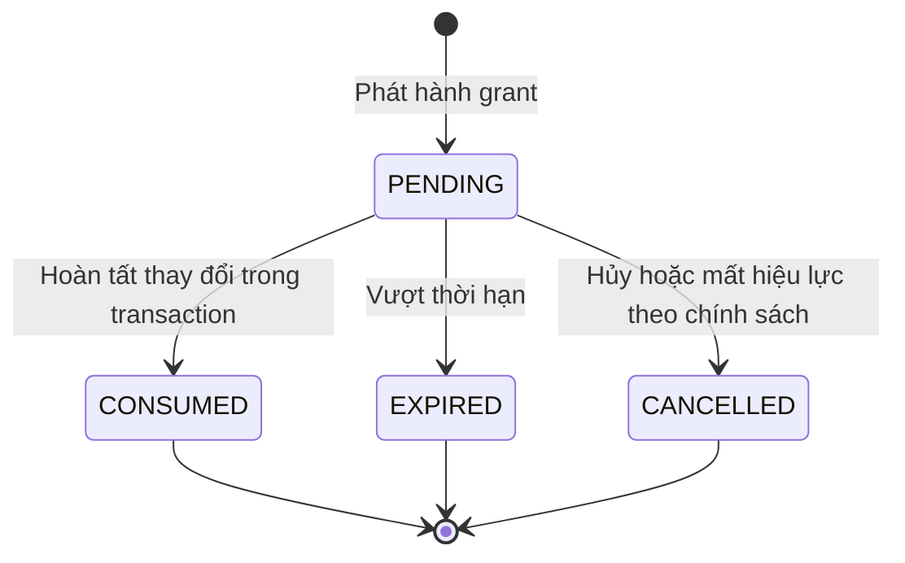

# Recovery request replay — Chống phát lại yêu cầu khôi phục tài khoản

Một yêu cầu đặt lại mật khẩu có thể được gửi lại vì người dùng bấm hai lần, trình duyệt retry sau khi mất kết nối hoặc kẻ tấn công lấy được bản sao token. Nếu máy chủ chỉ kiểm tra rằng token còn hạn rồi thực hiện thay đổi, cùng một bằng chứng có thể mở ra nhiều lần thay mật khẩu, xóa MFA hoặc đăng ký phương thức xác thực mới.

**Recovery request replay** là việc gửi lại một yêu cầu hoặc bằng chứng khôi phục đã được phát hành trước đó để hệ thống thực hiện thêm một tác động. Vấn đề không chỉ là nhận diện hai HTTP request giống nhau. Hệ thống phải bảo đảm rằng quyền khôi phục chỉ được dùng trong đúng phạm vi, đúng trạng thái và đúng số lần đã quy định.

Bài học sử dụng luồng đặt lại mật khẩu để minh họa. Các nguyên tắc về chuyển trạng thái, cạnh tranh và ràng buộc quyền cũng áp dụng khi khôi phục MFA, passkey hoặc thiết bị xác thực; bằng chứng cần thiết cho từng loại khôi phục vẫn phải được xác định riêng theo rủi ro.

## 1. Phân biệt replay với các vấn đề gần nhau

| Hiện tượng | Ví dụ | Cơ chế cần quan tâm |
| --- | --- | --- |
| Replay sau thành công | Gửi lại token đã dùng để đặt một mật khẩu khác | Trạng thái đã tiêu thụ và hiệu lực của bằng chứng |
| Replay đồng thời | Hai máy chủ cùng xử lý một token còn hợp lệ | Cập nhật có điều kiện, khóa và transaction |
| Retry hợp lệ | Máy chủ đã commit nhưng client chưa nhận phản hồi | Ngữ nghĩa idempotency và khả năng xác định kết quả |
| Gửi lại yêu cầu khởi tạo | Gọi liên tục chức năng quên mật khẩu | Chống lạm dụng, giới hạn gửi và chính sách cấp lại |
| Đoán token | Thử nhiều giá trị chưa từng được phát hành | Entropy, giới hạn thử và bảo vệ bí mật |
| CSRF | Buộc trình duyệt gửi một thao tác ngoài ý muốn | Ràng buộc phiên và kiểm soát nguồn yêu cầu |

Một biện pháp không thay thế tất cả các biện pháp khác. HTTPS không biến token thành dùng một lần. CSRF token không ngăn người đã có recovery token tự gửi request từ client khác. Giới hạn tốc độ không bảo đảm rằng hai request song song chỉ có một request thành công.

Đặc biệt, mã trạng thái HTTP hoặc phương thức POST không tự tạo ra thuộc tính chống phát lại. Thuộc tính đó phải được thực thi bằng trạng thái và quy tắc nghiệp vụ của máy chủ.

## 2. Lỗi điển hình: kiểm tra trước, ghi nhận sử dụng sau

Một cách xử lý dễ mắc lỗi là:

```text
1. Đọc token và thấy used = false.
2. Kiểm tra thời hạn.
3. Đổi mật khẩu.
4. Ghi used = true.
```

Nếu hai request A và B xen kẽ nhau:

| Thời điểm | Request A | Request B |
| --- | --- | --- |
| T1 | Đọc token chưa dùng | |
| T2 | | Đọc token chưa dùng |
| T3 | Ghi mật khẩu mới A | |
| T4 | | Ghi mật khẩu mới B |
| T5 | Đánh dấu token đã dùng | |
| T6 | | Đánh dấu token đã dùng |

Cả hai lần kiểm tra đều đúng tại thời điểm đọc. Sai sót nằm ở chỗ kiểm tra điều kiện và thay đổi trạng thái không được phối hợp nguyên tử.

Nếu A là chủ tài khoản và B là kẻ tấn công, mật khẩu cuối cùng có thể do B chọn. Việc đánh dấu token đã dùng sau cùng không khắc phục được tác động đã xảy ra.

Khóa trong một đối tượng Java hoặc một biến `synchronized` chỉ phối hợp các luồng dùng chung đối tượng đó. Nó không bảo vệ một hệ thống có nhiều tiến trình, nhiều instance hoặc nhiều nơi tiếp nhận yêu cầu.

## 3. Xác định chính xác điều cần bảo đảm

Đối với ví dụ đặt lại mật khẩu, có thể đặt các bất biến sau:

1. Một recovery grant chỉ cho phép tối đa một lần thay đổi credential được commit thành công.
2. Grant phải thuộc đúng tài khoản và đúng mục đích.
3. Grant hết hạn, đã hủy hoặc thuộc phiên bản bảo mật cũ không được cấp quyền.
4. Tiêu thụ grant và thay đổi credential phải cùng thành công hoặc cùng rollback.
5. Khôi phục thành công không để lại một quyền trung gian có thể tiếp tục thay đổi credential.
6. Retry không tạo thêm tác động nghiệp vụ hoặc cấp lại quyền đã kết thúc.

“Dùng một lần” ở đây được định nghĩa theo **tác động đã commit**, không phải theo số lần máy chủ nhận gói tin. Nếu transaction thất bại trước commit và không có tác động bên ngoài không thể hoàn tác, một lần thử sau có thể vẫn hợp lệ theo chính sách.

Bất biến thứ nhất không bảo đảm chủ tài khoản sẽ thắng cuộc đua. Nếu kẻ tấn công dùng token bị đánh cắp trước, cơ chế chống replay có thể chỉ khiến chủ tài khoản bị từ chối ở lần sau. Bảo vệ kênh nhận, chống phishing và xác minh phù hợp vẫn cần thiết.

## 4. Mô hình hóa vòng đời của quyền khôi phục

Trong bài này, **recovery request** là hồ sơ của quy trình, còn **recovery grant** là quyền giới hạn được cấp sau một bước xác minh. Một request có thể có nhiều bước; token trong email không nhất thiết phải cấp ngay quyền hoàn tất mọi bước.

Với grant dùng trực tiếp cho việc đặt lại mật khẩu, mô hình đơn giản là:



Không có chuyển trạng thái từ `CONSUMED` trở lại `PENDING`. Gửi lại email cũng không làm grant đã tiêu thụ sống lại.

Một job dọn dữ liệu có thể cập nhật `EXPIRED` sau thời điểm thực tế hết hạn. Endpoint hoàn tất vẫn phải tự so sánh `expiresAt`; không được coi grant còn hiệu lực chỉ vì job chưa chạy.

Nếu luồng có bước “đổi email token thành session khôi phục”, việc đổi đó là một lần chuyển quyền riêng. Token nguồn không được liên tục sinh ra nhiều session, và session được tạo cũng phải có giới hạn để không trở thành cửa vào dùng lại.

## 5. Dữ liệu cần ràng buộc với grant

Một mô hình minh họa:

```text
RecoveryGrant
  id
  accountId
  purpose
  tokenDigest
  state
  issuedAt
  expiresAt
  consumedAt
  securityEpochAtIssue
  recoveryRequestId
```

Các trường có vai trò khác nhau:

| Trường | Vai trò |
| --- | --- |
| accountId | Giới hạn tài khoản được tác động |
| purpose | Phân biệt đặt lại mật khẩu, khôi phục MFA hoặc thao tác khác |
| tokenDigest | Tra cứu bằng chứng mà không lưu token thô trong bảng grant |
| state | Thể hiện grant còn có thể được tiêu thụ hay không |
| expiresAt | Giới hạn thời gian dùng |
| securityEpochAtIssue | Ràng buộc với phiên bản bảo mật của tài khoản |
| recoveryRequestId | Liên kết quy trình và dấu vết nội bộ |

OWASP khuyến nghị token khôi phục được sinh bằng bộ sinh ngẫu nhiên an toàn, đủ khó đoán, lưu an toàn, giới hạn thời gian và dùng một lần. Đây là các thuộc tính bổ sung cho nhau. Xem [Forgot Password Cheat Sheet](https://cheatsheetseries.owasp.org/cheatsheets/Forgot_Password_Cheat_Sheet.html).

Trong thiết kế minh họa, token ngẫu nhiên có entropy cao và `tokenDigest` có ràng buộc duy nhất. ID hồ sơ không được xem là bí mật cấp quyền. Với mã OTP ngắn, việc lưu một hash thông thường không tự chống được dò toàn bộ không gian mã khi dữ liệu bị lộ; cần cơ chế bảo vệ phù hợp như MAC có khóa máy chủ cùng kiểm soát thử mã.

Một token có chữ ký vẫn có thể bị gửi lại nguyên vẹn. Chữ ký chứng minh dữ liệu không bị sửa theo giả định về khóa; nó không ghi nhớ rằng quyền đó đã được sử dụng. Nếu dùng token tự chứa, vẫn phải có cơ chế thực thi việc tiêu thụ hoặc vô hiệu hóa quyền tương ứng.

Không lấy `accountId` hoặc `purpose` do client gửi rồi coi chúng là thông tin đáng tin. Máy chủ phải đối chiếu chúng với grant đã phát hành. Token đặt lại mật khẩu không được dùng ở endpoint xóa MFA chỉ vì cùng tài khoản.

## 6. Tiêu thụ nguyên tử: cập nhật có điều kiện

Phần SQL dưới đây minh họa một thao tác trong PostgreSQL 16. Nó là một phần của transaction nghiệp vụ, không phải toàn bộ endpoint:

```sql
UPDATE recovery_grant
SET state = 'CONSUMED',
    consumed_at = clock_timestamp()
WHERE token_digest = :token_digest
  AND account_id = :account_id
  AND purpose = 'RESET_PASSWORD'
  AND state = 'PENDING'
  AND expires_at > clock_timestamp()
  AND security_epoch_at_issue = :current_security_epoch
RETURNING id, recovery_request_id;
```

Các tham số được bind qua thư viện truy cập dữ liệu. `:account_id` phải được xác lập từ bản ghi grant phía máy chủ; `:current_security_epoch` được lấy từ bản ghi tài khoản đã khóa trong cùng transaction.

Nếu câu lệnh trả về **không có hàng**, dịch vụ không được tiếp tục đổi mật khẩu. Nếu có một hàng, transaction mới có quyền thực hiện bước thay đổi tương ứng. Ràng buộc duy nhất trên `token_digest` giúp bảo đảm không có nhiều grant được chọn bởi cùng một token.

Trong PostgreSQL ở mức Read Committed, một UPDATE cạnh tranh có thể chờ transaction đang sửa hàng; sau khi transaction kia commit, điều kiện WHERE được đánh giá lại trên phiên bản hàng mới. Vì thế, điều kiện `state = 'PENDING'` là một phần quan trọng của mẫu này. Xem [Transaction Isolation](https://www.postgresql.org/docs/16/transaction-iso.html).

Sau khi A commit trạng thái `CONSUMED`, B không còn khớp điều kiện. Nếu A rollback, trạng thái tiêu thụ của A cũng rollback. B chỉ có thể tiếp tục nếu các điều kiện còn lại vẫn hợp lệ.

Mẫu này không có nghĩa mọi hệ quản trị dữ liệu đều có hành vi giống PostgreSQL. Khi dùng loại kho dữ liệu khác, cần xác định rõ phép ghi có điều kiện và bảo đảm nhất quán mà kho đó cung cấp.

### Thời gian được kiểm tra ở đâu?

Ví dụ dùng thời gian tại cơ sở dữ liệu ở bước tiêu thụ. PostgreSQL phân biệt `CURRENT_TIMESTAMP`, vốn gắn với thời điểm bắt đầu transaction, và `clock_timestamp()`, vốn phản ánh thời gian thực khi được gọi. Xem [Date/Time Functions — Current Date/Time](https://www.postgresql.org/docs/16/functions-datetime.html#FUNCTIONS-DATETIME-CURRENT).

Chính sách minh họa là grant phải còn hạn lúc thực hiện cập nhật tiêu thụ sau khi đã lấy khóa tài khoản. Đây không phải lời bảo đảm rằng commit xảy ra trước đúng mili giây hết hạn. Transaction nên ngắn và không chứa thao tác gọi nhà cung cấp bên ngoài.

## 7. Transaction phải bao phủ tác động nghiệp vụ

Chỉ tiêu thụ token nguyên tử vẫn chưa đủ nếu việc đổi mật khẩu xảy ra ở transaction khác. Có thể xuất hiện hai trạng thái lỗi:

- Token đã bị tiêu thụ nhưng mật khẩu chưa đổi.
- Mật khẩu đã đổi nhưng token vẫn dùng được.

Một cách tổ chức minh họa là:

```text
Trước transaction:
    Kiểm tra cấu trúc input và chính sách mật khẩu.
    Chuẩn bị password hash bằng cơ chế lưu mật khẩu của dịch vụ.
    Không ghi token hoặc password vào log.

Trong một transaction:
    Tra cứu accountId từ tokenDigest.
    Khóa bản ghi tài khoản.
    Đọc securityEpoch hiện hành.
    Tiêu thụ grant bằng UPDATE có điều kiện.
    Nếu không có grant hợp lệ: rollback.
    Cập nhật password hash.
    Tăng securityEpoch.
    Hủy các recovery grant cũ theo phạm vi chính sách.
    Ghi sự kiện audit và outbox.
    Commit.

Sau commit:
    Trả kết quả phù hợp cho client.
    Worker outbox gửi thông báo thay đổi.
```

Kiểm tra policy phụ thuộc trạng thái tài khoản phải được đối chiếu lại trong transaction khi cần. Không giữ khóa tài khoản trong lúc chạy một phép hash chậm hoặc chờ API gửi email.

Khóa tài khoản bằng `SELECT ... FOR UPDATE` là một lựa chọn để phối hợp các thay đổi liên quan. Khóa hàng được giữ trong transaction; các transaction cần khóa xung đột phải chờ. Xem [PostgreSQL — Explicit Locking](https://www.postgresql.org/docs/16/explicit-locking.html#LOCKING-ROWS).

Tất cả đường xử lý cùng sửa trạng thái bảo mật phải tuân thủ cùng quy ước khóa, chẳng hạn **tài khoản trước, grant sau**. Nếu nơi khác lấy khóa theo thứ tự ngược lại, có thể phát sinh deadlock. Khi gặp lỗi concurrency hoặc deadlock, rollback và áp dụng chính sách retry có giới hạn; không bỏ điều kiện kiểm tra để “cho request đi tiếp”.

Không gửi email xác nhận trước commit rồi dựa vào email để quyết định giao dịch đã xong. Outbox được ghi cùng transaction giúp tách tác động bên ngoài khỏi quyết định thay đổi credential. Việc chuyển thư vẫn có thể bị lặp; consumer cần xử lý theo event ID nếu muốn hạn chế tác động trùng.

## 8. Hai token khác nhau vẫn có thể tạo ra replay nghiệp vụ

Giả sử người dùng có hai grant T1 và T2 cùng tài khoản:

```text
09:00  T1 được phát hành khi securityEpoch = 18.
09:02  T2 được phát hành khi securityEpoch = 18.
09:05  T1 đổi mật khẩu thành công; securityEpoch tăng lên 19.
09:06  T2 được gửi để đổi mật khẩu lần nữa.
```

T2 chưa từng được dùng. Nếu chỉ kiểm tra cờ `CONSUMED` riêng từng token, T2 có thể vẫn hợp lệ. Đây là quyền cũ còn sót lại sau một thay đổi bảo mật.

Trong chính sách minh họa, một lần khôi phục thành công kết thúc các quyền khôi phục thuộc epoch cũ. Vì vậy T2 bị từ chối do `securityEpochAtIssue = 18` không còn khớp tài khoản.

Hai request hoàn tất với T1 và T2 cũng phải phối hợp qua cùng khóa tài khoản. Request thắng tăng epoch; request chờ đọc epoch mới rồi không còn đủ điều kiện. Cập nhật riêng hai hàng token mà không phối hợp ở cấp tài khoản không bảo đảm được điều này.

Luồng phát hành grant cũng phải lấy epoch nhất quán với các thay đổi tài khoản. Một grant được phát hành sau khi khôi phục hoàn tất có thể thuộc epoch mới và là một yêu cầu mới hợp lệ theo chính sách; không thể chặn mọi yêu cầu tương lai chỉ bằng việc kết thúc các grant cũ.

Việc dùng một epoch chung hay nhiều phiên bản riêng cho password, MFA và recovery là lựa chọn thiết kế. Epoch chung dễ diễn giải nhưng có thể vô hiệu hóa nhiều quyền hơn cần thiết. Phiên bản riêng cần quy định rõ thay đổi nào làm mất hiệu lực quyền nào.

## 9. Retry an toàn và idempotency

Sau commit, kết nối có thể đứt trước khi phản hồi đến client:

```text
Client gửi yêu cầu hoàn tất.
Máy chủ thay mật khẩu và commit.
Phản hồi bị mất trên đường truyền.
Client không biết kết quả và gửi lại.
```

Từ góc nhìn chống replay, request thứ hai không được tạo một lần đổi mật khẩu mới. Từ góc nhìn trải nghiệm, người dùng cần cách biết việc trước đó đã hoàn tất.

RFC 9110 định nghĩa idempotency theo tác động mong muốn của các request lặp và lưu ý việc tự động retry phương thức không idempotent cần có cơ sở phù hợp. Một POST không tự có ngữ nghĩa đó. Xem [HTTP Semantics, mục 9.2.2](https://www.rfc-editor.org/rfc/rfc9110.html#section-9.2.2).

### Cách đơn giản: không thực hiện lại tác động

Endpoint có thể từ chối grant đã dùng bằng thông báo tổng quát, rồi hướng người dùng đăng nhập bình thường hoặc bắt đầu lại nếu cần. Cách này dễ giữ bất biến, dù client có thể không biết chắc vì sao lần thử sau bị từ chối.

Không nên trả riêng “token của tài khoản X đã dùng lúc Y” cho bất kỳ người nào có chuỗi token, vì có thể tiết lộ thông tin nội bộ.

### Cách có bản ghi idempotency

Một hệ thống cần xác nhận retry rõ hơn có thể dùng bản ghi:

```text
OperationRecord
  operationId
  scope
  idempotencyKeyDigest
  requestFingerprint
  recoveryRequestId
  state
  safeResult
  expiresAt
```

Các quy tắc minh họa:

- Khóa idempotency gắn với đúng operation và ngữ cảnh khôi phục, không có phạm vi toàn cục tùy tiện.
- Có ràng buộc duy nhất trên scope và khóa; hai request đồng thời không cùng tạo hai operation.
- Cùng khóa và cùng dữ liệu tương ứng có thể nhận lại kết quả an toàn đã commit.
- Cùng khóa nhưng dữ liệu khác bị từ chối, không chạy lại với mật khẩu hoặc credential mới.
- Operation và thay đổi credential được commit phối hợp trong cùng transaction hoặc giao thức nhất quán đã định nghĩa.
- Kết quả lưu lại không chứa token, password, session đăng nhập đầy đủ hoặc quyền khôi phục còn hoạt động.

Nếu fingerprint bao phủ dữ liệu nhạy cảm, không lưu hash đơn giản của mật khẩu như một dấu vân tay phục vụ retry. Có thể dùng MAC có khóa với biểu diễn được chuẩn hóa và giới hạn thời gian lưu, nhưng vẫn cần bảo vệ khóa và dữ liệu; không được dùng fingerprint như cơ chế xác minh danh tính.

Khóa idempotency chỉ là công cụ chống thực thi trùng. Người gọi không được nhận dữ liệu operation của người khác chỉ vì đoán được một khóa.

Quan trọng hơn, bản ghi idempotency hết hạn không làm grant đã tiêu thụ có hiệu lực trở lại. Thông tin về quyền và trạng thái bảo mật vẫn quyết định việc cấp quyền.

## 10. Phân biệt gửi lại thông điệp và cấp quyền mới

Endpoint khởi tạo khôi phục thường chỉ nhận định danh tài khoản. Không thể yêu cầu người dùng đã chứng minh danh tính đầy đủ trước khi họ xin khôi phục, nên endpoint này cần kiểm soát lạm dụng riêng.

Có hai hành vi khác nhau:

| Hành vi | Ý nghĩa |
| --- | --- |
| Gửi lại thông điệp của một yêu cầu đang chờ | Nhắc lại cùng quy trình theo chính sách gửi |
| Phát hành một grant mới | Tạo một quyền có vòng đời và bí mật mới |

Nếu mỗi retry của nút “gửi lại” tự tạo token và gia hạn thời hạn, kẻ tấn công có thể duy trì một luồng khôi phục không kết thúc hoặc làm người dùng nhận nhiều thư khó phân biệt.

Một thiết kế minh họa có thể:

- Dùng thời gian chờ giữa các lần gửi và ngân sách theo tài khoản, kênh và nguồn yêu cầu.
- Giữ thời hạn ban đầu của grant khi chỉ gửi lại cùng một thông điệp.
- Khi thật sự cấp grant mới, quy định rõ grant cũ còn hiệu lực hay bị hủy.
- Không khóa tài khoản chỉ vì có nhiều yêu cầu khởi tạo.
- Trả phản hồi phù hợp để hạn chế việc dò tài khoản tồn tại.
- Giới hạn số quy trình đang chờ và có cách tiếp tục khi email đến trễ.

Nếu chọn chính sách “chỉ token mới nhất hợp lệ”, người ngoài biết email có thể liên tục tạo token mới để làm token của chủ tài khoản mất hiệu lực. Vì vậy, chính sách thay thế grant phải được thiết kế cùng chống lạm dụng; không thể coi việc hủy token cũ sau mọi lần gọi công khai là giải pháp hoàn chỉnh.

Idempotency cho retry của client hợp lệ có thể giảm gửi trùng. Nó không ngăn kẻ tấn công tạo vô số khóa idempotency mới; giới hạn tài nguyên vẫn cần thiết.

## 11. Hệ thống nhiều instance và nhiều kho dữ liệu

Trạng thái tiêu thụ phải có hiệu lực với mọi instance tiếp nhận thao tác. Một cache cục bộ ghi “đã dùng” không bảo vệ instance khác.

Một số bẫy thường gặp:

| Thiết kế | Khoảng trống |
| --- | --- |
| Đọc grant từ replica chậm đồng bộ | Có thể đọc lại trạng thái PENDING đã lỗi thời |
| Khóa Redis rồi ghi credential ở database riêng | Lỗi giữa hai nơi có thể làm token và credential lệch trạng thái |
| Chỉ giữ danh sách token đã dùng trong RAM | Khởi động lại làm mất lịch sử |
| Nhiều region cùng chấp nhận ghi độc lập | Cùng token có thể được chấp nhận trước khi dữ liệu hội tụ |
| Mất kho trạng thái thì tạm cho qua | Sự cố trở thành đường bỏ qua chống replay |

Một lựa chọn đơn giản là đưa quyết định tiêu thụ và thay đổi credential về cùng một nơi có transaction nhất quán. Nếu dùng nhiều dịch vụ hoặc nhiều vùng, phải xác định nơi có quyền quyết định cho tài khoản và giao thức phối hợp trước khi cam kết thuộc tính “một lần”.

Không coi khóa phân tán có thời hạn là đủ. Tiến trình có thể bị treo, khóa hết hạn và tiến trình khác tiếp tục trong khi tiến trình cũ vẫn chạy. Nếu kiến trúc cần lease, phải xử lý quyền ghi của chủ lease cũ, chẳng hạn bằng cơ chế fencing được kho đích thực thi.

Khi không thể kiểm tra hoặc cập nhật trạng thái chuẩn, lựa chọn an toàn cho thao tác thay credential là không thực hiện thay đổi và báo lỗi có thể thử lại. Chế độ chỉ đọc hoặc trang hướng dẫn vẫn có thể hoạt động theo phạm vi không cấp thêm quyền.

### Khôi phục backup cũng có thể làm quyền cũ sống lại

Nếu bản backup có grant đang PENDING nhưng thực tế grant đã được dùng sau thời điểm backup, khôi phục backup có thể phục hồi cả grant lẫn epoch cũ.

Vì vậy, quy trình phục hồi sau sự cố phải xem xét hủy grant đang chờ, vô hiệu hóa session liên quan hoặc dùng một thế hệ phục hồi được quản lý ngoài phần trạng thái vừa rollback. Đây là vấn đề về sự tươi mới của dữ liệu, không được giải quyết chỉ bằng chữ ký trên token.

## 12. Session khôi phục cũng là một quyền có thể bị phát lại

Một token dùng một lần có thể được đổi thành cookie session khôi phục. Nếu cookie đó dùng lại được vô hạn để đăng ký passkey, cơ chế một lần ở token nguồn chỉ bảo vệ một phần luồng.

Session khôi phục cần có phạm vi rõ:

- Thuộc đúng tài khoản, request và purpose.
- Có hạn dùng và được kiểm tra tại máy chủ.
- Chỉ cho phép các bước khôi phục đã cấp quyền.
- Bị kết thúc hoặc mất hiệu lực khi hoàn tất quy trình.
- Không tự trở thành session đăng nhập đầy đủ chỉ vì đã nhận một email.

OWASP nhấn mạnh việc vô hiệu hóa session phải được thực thi phía máy chủ, và session ID cần được đổi khi mức quyền thay đổi. Xem [Session Management Cheat Sheet](https://cheatsheetseries.owasp.org/cheatsheets/Session_Management_Cheat_Sheet.html).

Với session hoặc access token có chứa epoch, nơi kiểm tra quyền phải thực sự so sánh với trạng thái hiện hành theo yêu cầu của dịch vụ. Nếu API chỉ kiểm tra chữ ký và hạn dùng của JWT, tăng một số trong database không tự khiến JWT cũ bị từ chối.

Khi khôi phục vì nghi bị chiếm tài khoản, chính sách cần xử lý cả session cũ và phương thức xác thực bị lộ. Đổi mật khẩu mà để session của kẻ tấn công tiếp tục đổi kênh khôi phục có thể khiến quyền kiểm soát bị mất lần nữa.

Việc thu hồi có độ trễ do cache cần được mô tả trung thực. Nếu hệ thống yêu cầu chặn ngay thao tác nhạy cảm, bước đó cần kiểm tra trạng thái đủ mới; không được tuyên bố thu hồi tức thời khi mọi API vẫn chấp nhận dữ liệu cũ.

## 13. Sự cố từng phần và kết quả mong muốn

| Điểm xảy ra sự cố | Trạng thái đúng trong thiết kế minh họa |
| --- | --- |
| Input không hợp lệ trước transaction | Không thay credential, không tiêu thụ grant thành công |
| Đã cập nhật grant nhưng transaction rollback | Credential và grant cùng quay về trạng thái trước transaction |
| Commit thành công nhưng phản hồi mất | Tác động giữ nguyên một lần; retry không đổi credential lần nữa |
| Gửi email sau commit thất bại | Không hoàn tác credential chỉ vì gửi thư thất bại; outbox xử lý tiếp |
| Hai request cùng token | Tối đa một transaction hoàn tất hợp lệ |
| Hai grant cùng epoch của một tài khoản | Quy ước khóa và tăng epoch ngăn quyền cũ tiếp tục sau lần thành công |
| Token nguồn đã đổi thành session giới hạn | Không đổi lại thành thêm quyền; session đích cũng chịu vòng đời riêng |

Các kết quả này là mục tiêu của kiến trúc minh họa, không phải thuộc tính tự có của mọi cơ sở dữ liệu hoặc framework.

Cần đặc biệt chú ý thao tác gọi hệ thống ngoài. Nếu dịch vụ đã thay authenticator ở nhà cung cấp khác rồi transaction local rollback, hệ thống không còn thuộc mô hình “mọi tác động nằm trong một transaction”. Khi đó phải có giao thức trạng thái trung gian, khóa nghiệp vụ hoặc phối hợp với API idempotent của nhà cung cấp; không được che giấu tác động ngoài bằng cách chỉ reset cờ local.

## 14. Dấu vết vận hành và cách phản hồi

Một sự kiện nội bộ có thể ghi:

```json
{
  "event": "RECOVERY_GRANT_REJECTED",
  "requestId": "internal-request-id",
  "accountRef": "pseudonymous-account-reference",
  "purpose": "RESET_PASSWORD",
  "internalReason": "ALREADY_CONSUMED",
  "operationRef": "internal-operation-id"
}
```

Không ghi token, recovery code, mật khẩu hoặc URL chứa bí mật vào log. ID đối chiếu cũng cần được kiểm soát quyền xem và thời gian lưu.

Có thể phân biệt lý do chi tiết ở nội bộ như `EXPIRED`, `ALREADY_CONSUMED`, `EPOCH_MISMATCH` hoặc `PURPOSE_MISMATCH`, trong khi phản hồi công khai sử dụng nội dung tổng quát phù hợp.

Nhiều lần bị từ chối ngay sau một lần thành công có thể do retry hợp lệ, nhiều tab trình duyệt hoặc replay có chủ ý. Không suy ra bị tấn công chỉ từ một tín hiệu. Ngược lại, một token chỉ được dùng thành công một lần cũng không chứng minh rằng người dùng thành công là chính chủ.

Thông điệp cho người dùng nên nêu cách tiếp tục: đăng nhập qua luồng bình thường, xin yêu cầu mới hoặc liên hệ hỗ trợ chính thức. Không yêu cầu người dùng gửi token cho nhân viên để “kiểm tra replay”.

Một thiết kế chống phát lại tốt giữ được cả hai thuộc tính: bằng chứng cũ không thể tạo thêm quyền, và người dùng hợp lệ vẫn có lối xác định kết quả hoặc tiếp tục sau một lỗi mạng.

## Tài liệu tham khảo

- [OWASP — Forgot Password Cheat Sheet](https://cheatsheetseries.owasp.org/cheatsheets/Forgot_Password_Cheat_Sheet.html): các thuộc tính của token khôi phục.
- [OWASP — Session Management Cheat Sheet](https://cheatsheetseries.owasp.org/cheatsheets/Session_Management_Cheat_Sheet.html): vòng đời và vô hiệu hóa session.
- [RFC 9110, mục 9.2.2 — Idempotent Methods](https://www.rfc-editor.org/rfc/rfc9110.html#section-9.2.2): ngữ nghĩa idempotency và retry HTTP.
- [PostgreSQL 16 — Transaction Isolation](https://www.postgresql.org/docs/16/transaction-iso.html): hành vi của cập nhật cạnh tranh.
- [PostgreSQL 16 — Explicit Locking](https://www.postgresql.org/docs/16/explicit-locking.html): khóa hàng và phối hợp transaction.
- [PostgreSQL 16 — Current Date/Time](https://www.postgresql.org/docs/16/functions-datetime.html#FUNCTIONS-DATETIME-CURRENT): ý nghĩa các hàm thời gian.
