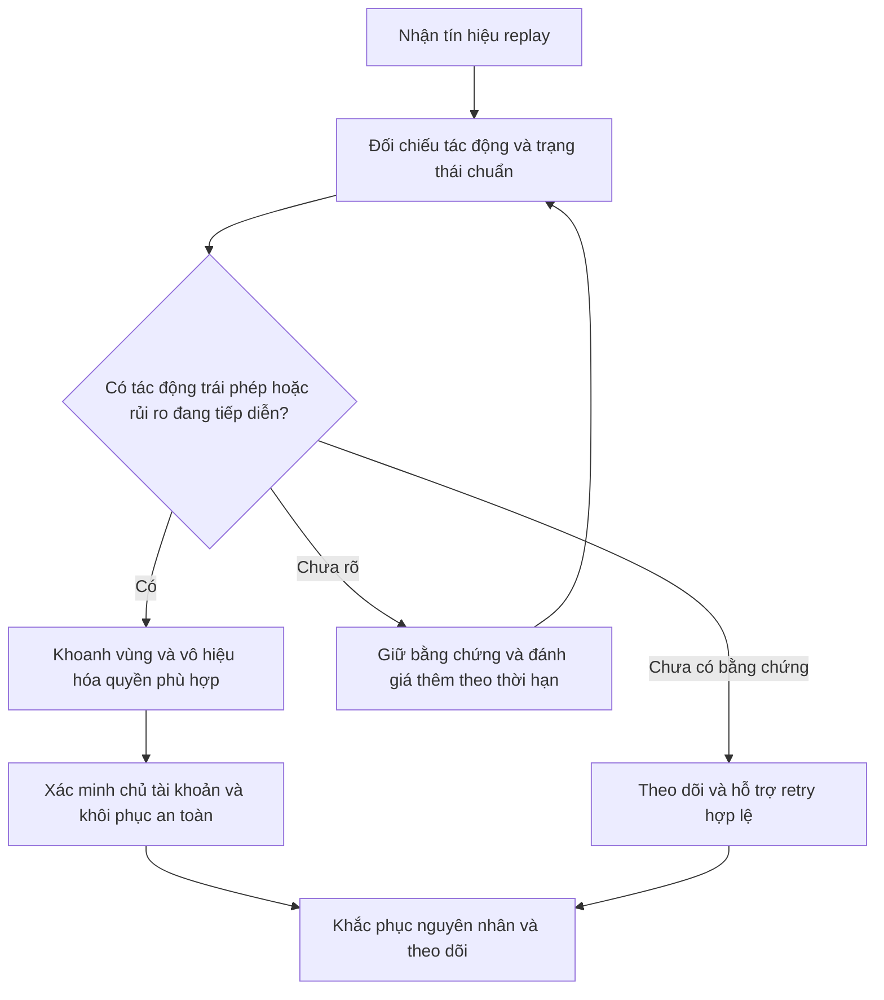

# Replay incident response — Ứng phó sự cố phát lại trong khôi phục tài khoản

Một cảnh báo “recovery token đã được dùng lại” có thể xuất hiện khi người dùng bấm hai lần, trình duyệt gửi lại request sau lỗi mạng hoặc kẻ tấn công cố tận dụng một token bị lộ. Ba tình huống này có thể tạo log gần giống nhau nhưng cần phản ứng khác nhau.

**Replay incident response** là quá trình xác định việc phát lại có tạo thêm quyền hoặc tác động trái phép hay không, ngăn tác động tiếp diễn, bảo toàn bằng chứng và đưa tài khoản về trạng thái được kiểm soát. Đếm số request bị từ chối chỉ là điểm bắt đầu; điều quan trọng là những thay đổi nào đã thực sự được commit và ai còn có thể sử dụng quyền sau đó.

Bài học đặt sự cố trong bối cảnh khôi phục mật khẩu, MFA, passkey hoặc thiết bị xác thực. Các mức ưu tiên, tên sự kiện và runbook dưới đây là thiết kế minh họa, cần được điều chỉnh theo hệ thống và rủi ro của tổ chức.

## 1. Một sự kiện replay chưa đồng nghĩa tài khoản bị chiếm

Cần tách ba câu hỏi:

1. Có request hoặc bằng chứng bị gửi lại không?
2. Hệ thống có thực hiện thêm một tác động ngoài quyền đã cấp không?
3. Một người không được phép có đang kiểm soát credential, session hoặc kênh khôi phục không?

Câu trả lời cho câu trước không tự quyết định câu sau.

| Quan sát | Điều có thể kết luận | Điều chưa thể kết luận |
| --- | --- | --- |
| Token đã dùng bị từ chối | Có lần thử với bằng chứng không còn hợp lệ | Có thêm lần đổi mật khẩu |
| Hai phản hồi HTTP 200 | Hai request nhận phản hồi thành công ở tầng HTTP | Có hai transaction đổi credential |
| Một grant gắn với hai thay đổi credential đã commit | Có dấu hiệu vi phạm thuộc tính dùng một lần | Người nào là chính chủ nếu chưa có bằng chứng khác |
| MFA mới được gắn sau một lần khôi phục mà chủ tài khoản phủ nhận | Có dấu hiệu chiếm quyền cần xử lý khẩn | Toàn bộ phạm vi tài khoản hoặc hệ thống đã bị ảnh hưởng |
| IP hoặc thiết bị khác nhau | Có khác biệt về nguồn truy cập quan sát được | Chắc chắn là hai người khác nhau |

Hai phản hồi 200 có thể là kết quả idempotent trả lại cùng một operation. Ngược lại, một phản hồi 500 có thể xảy ra sau khi thay đổi đã commit nhưng trước khi trả kết quả. Vì vậy, không dùng mã HTTP làm nguồn chuẩn duy nhất cho ảnh hưởng nghiệp vụ.

Một kẻ tấn công sử dụng token trước chính chủ có thể chỉ tạo đúng một lần khôi phục thành công. Nếu chính chủ thử sau và bị chặn replay, cơ chế một lần vẫn hoạt động nhưng tài khoản có thể đã bị chiếm. Người nhận được kết quả thành công không mặc nhiên là người có quyền.

## 2. Mục tiêu của phản ứng sự cố

Một runbook phù hợp cần đồng thời đạt các mục tiêu:

- Ngăn bằng chứng hoặc quyền khôi phục bị lạm dụng tiếp.
- Xác định các thay đổi đã xảy ra và quyền còn tồn tại.
- Giữ được dấu vết để phân tích nguyên nhân và phạm vi.
- Khôi phục quyền kiểm soát cho người được xác minh phù hợp.
- Giảm ảnh hưởng tới người dùng hợp lệ.
- Khắc phục nguyên nhân khiến replay có thể gây tác động.

NIST SP 800-61 Rev. 3 đặt ứng phó sự cố trong quản trị rủi ro an ninh mạng theo CSF 2.0, thay vì coi nó chỉ là công việc xử lý sau khi có cảnh báo. Xem [NIST SP 800-61 Rev. 3](https://csrc.nist.gov/pubs/sp/800/61/r3/final).

Trong phạm vi bài học, có thể hình dung quá trình xử lý như sau:



Bảo toàn bằng chứng và khoanh vùng có thể diễn ra song song. Không cần chờ phân tích hoàn hảo mới ngăn một hành vi chiếm tài khoản đang tiếp diễn, nhưng phải ghi rõ quyết định dựa trên dữ kiện nào và còn điều gì chưa biết.

## 3. Phân loại ban đầu theo tác động và độ tin cậy

Một cách phân loại minh họa:

| Mức xử lý | Dấu hiệu chính | Hướng xử lý |
| --- | --- | --- |
| Theo dõi | Request lặp cùng operation, không có tác động mới | Giữ dấu vết, hỗ trợ người dùng, điều chỉnh nhiễu cảnh báo nếu có cơ sở |
| Điều tra ưu tiên | Nhiều lần dùng lại từ nguồn khác hoặc có báo cáo token bị lộ | Xác định quyền còn hoạt động, xem xét thu hồi đúng phạm vi |
| Sự cố chiếm quyền nghi ngờ | Thay credential hoặc MFA bị chủ tài khoản phủ nhận | Hạn chế thay đổi nhạy cảm, xử lý session và xác minh độc lập |
| Sự cố kỹ thuật đã xác nhận | Một grant tạo nhiều thay đổi đã commit hoặc quyền đã hủy vẫn được chấp nhận | Ngăn đường xử lý dễ tổn thương, mở rộng phạm vi điều tra |
| Chưa xác định | Thiếu log hoặc trạng thái mâu thuẫn | Ghi nhận khoảng trống, đặt thời hạn đánh giá và chọn kiểm soát tạm thời tương xứng |

Các mức này không phải thang phân loại bắt buộc của một tiêu chuẩn. Tổ chức còn cần xét giá trị tài khoản, quyền quản trị, khả năng truy cập dữ liệu và mức độ lan rộng.

Không tự động khóa một tài khoản chỉ vì người ngoài liên tục gọi chức năng quên mật khẩu. Nếu tín hiệu công khai đủ để kích hoạt khóa, kẻ tấn công có thể dùng chính cơ chế phản ứng sự cố để từ chối dịch vụ cho nạn nhân.

Ngược lại, tài khoản quản trị có thay đổi MFA trái phép cần được ưu tiên ngay cả khi mới có một request đáng ngờ. Số lượng nhỏ không đồng nghĩa tác động nhỏ.

## 4. Bằng chứng cần thu thập

Nguồn chuẩn trước hết là trạng thái và lịch sử thay đổi mà hệ thống có thể tin cậy. Có thể đối chiếu:

| Nhóm dữ liệu | Câu hỏi cần trả lời |
| --- | --- |
| Hồ sơ recovery request và grant | Được phát hành cho ai, mục đích gì, khi nào, trạng thái hiện tại là gì? |
| Lịch sử credential | Có bao nhiêu lần thay đổi đã commit, liên quan operation nào? |
| Recovery session | Token nguồn có tạo quyền trung gian không, quyền đó còn hoạt động không? |
| Session và refresh token | Quyền nào được tạo hoặc sử dụng sau sự kiện khôi phục? |
| Kênh khôi phục và authenticator | Có thêm, xóa hoặc đổi email, số điện thoại, MFA, passkey không? |
| Cấu hình và bản triển khai | Instance nào xử lý, dùng phiên bản logic và chế độ vận hành nào? |
| Audit của công cụ hỗ trợ | Có nhân viên hoặc quy trình thủ công thay đổi tài khoản không? |

Một tập thuộc tính sự kiện minh họa:

```json
{
  "eventType": "RECOVERY_GRANT_REJECTED",
  "eventId": "internal-event-id",
  "occurredAt": "2026-11-23T03:10:04.000Z",
  "ingestedAt": "2026-11-23T03:10:04.250Z",
  "accountRef": "restricted-account-reference",
  "recoveryRequestId": "internal-request-id",
  "grantId": "internal-grant-id",
  "operationId": "internal-operation-id",
  "interactionId": "server-generated-interaction-id",
  "purpose": "RECOVER_MFA",
  "decision": "REJECTED",
  "reason": "ALREADY_CONSUMED",
  "instance": "recovery-instance-b",
  "policyVersion": "recovery-policy-v4"
}
```

Các ID trong ví dụ phục vụ đối chiếu nội bộ, không phải bearer credential. Nếu một ID thực tế cũng cấp quyền truy cập, nó phải được xem là bí mật và không được đưa vào log thông thường.

OWASP khuyến nghị log đủ ngữ cảnh về thời điểm, nơi phát sinh, chủ thể và hành động, đồng thời dùng interaction identifier để nối các sự kiện liên quan. Các bí mật như access token, mật khẩu và session ID thô cần được loại khỏi log. Xem [Logging Cheat Sheet](https://cheatsheetseries.owasp.org/cheatsheets/Logging_Cheat_Sheet.html).

Không yêu cầu người dùng gửi toàn bộ email chứa token hoặc cookie để “đối chiếu nhanh”. Có thể thu mã tham chiếu không cấp quyền và thời điểm tương đối qua kênh hỗ trợ phù hợp.

### Thời gian và nguồn dữ liệu cũng có thể gây nhầm lẫn

Thời điểm sự kiện phát sinh khác thời điểm log được thu nhận. Log tới muộn không chứng minh request xảy ra muộn. Hai đồng hồ lệch nhau không đủ để khẳng định thứ tự commit.

Khi thứ tự có ý nghĩa, ưu tiên liên kết operation, phiên bản credential, phiên bản bảo mật và dữ liệu transaction phù hợp. Không coi một ID tăng dần bất kỳ hoặc timestamp do client gửi là thứ tự commit chắc chắn.

Trace ID do client cung cấp có thể bị giả hoặc tái sử dụng. Hệ thống nên có định danh do máy chủ kiểm soát và xác định rõ độ tin cậy của từng trường.

## 5. Bảo toàn bằng chứng mà không giữ quyền nguy hiểm

Trong thiết kế minh họa, hồ sơ sự cố có thể lưu:

```text
IncidentRecord
  incidentId
  firstObservedAt
  affectedAccountRefs
  suspectedTimeWindow
  evidenceReferences
  confirmedEffects
  openQuestions
  containmentActions
  responsibleOwner
  nextReviewAt
```

Các bản trích xuất cần có phạm vi, thời điểm thu thập, nguồn và người thực hiện. Có thể ghi hash của tệp bằng chứng để kiểm tra tính toàn vẹn sau khi thu thập, nhưng hash không tự chứng minh nguồn dữ liệu ban đầu là đáng tin.

Giữ dữ liệu gốc trong nơi lưu hạn chế quyền sửa; bản phân tích hoặc bản đã che thông tin được quản lý riêng. Không xóa hàng grant hoặc ghi đè trạng thái lịch sử chỉ để bảng dữ liệu trông “sạch”.

Bảo toàn bằng chứng không có nghĩa tiếp tục cho token hoạt động. Có thể giữ thông tin grant, trạng thái thu hồi và liên kết audit trong khi vô hiệu hóa quyền của nó.

Nếu phát hiện token thô đã lọt vào log, đây còn là một nguồn lộ bí mật. Cần hạn chế truy cập, xem xét các quyền có thể bị lộ và xử lý bản sao theo quy trình lưu giữ bằng chứng của tổ chức. Không chuyển nguyên log đó sang chat, ticket hoặc báo cáo rộng rãi.

## 6. Dựng lại chuỗi sự kiện

Một chuỗi sự kiện hữu ích phải nối được việc cấp quyền với tác động:

```text
Phát hành grant
    → gửi thông điệp hoặc tiếp nhận bằng chứng
    → đổi grant thành quyền trung gian nếu có
    → tiêu thụ quyền để thay credential
    → commit operation
    → tạo hoặc sử dụng session
    → thay đổi tiếp theo trong tài khoản
```

Ví dụ hai nhánh có cùng cảnh báo replay:

### Nhánh A: retry bị chặn đúng

```text
10:00:00  Grant G được tiêu thụ trong operation O1.
10:00:01  Credential thay đổi một lần; O1 commit.
10:00:02  Client mất phản hồi và gửi lại.
10:00:03  Request sau bị từ chối vì G đã dùng.
```

Nếu không có dấu hiệu khác, đây có thể là lỗi trải nghiệm hoặc retry hợp lệ. Không cần suy ra rằng có hai lần đặt lại mật khẩu.

### Nhánh B: replay có tác động

```text
10:00:00  Instance A đọc G là PENDING.
10:00:00  Instance B cũng đọc G là PENDING.
10:00:01  O1 đổi credential và commit.
10:00:02  O2 lại đổi credential bằng cùng G và commit.
10:00:03  Bảng grant cuối cùng chỉ còn một trạng thái CONSUMED.
```

Trạng thái cuối cùng của grant không phản ánh đủ số lần tác động. Cần lịch sử credential và operation để xác nhận vi phạm.

Nếu chỉ có log “bắt đầu xử lý O2” mà không có bằng chứng commit hoặc tác động ngoài, chưa nên kết luận O2 đã thành công. Ngược lại, nếu có tác động ở hệ thống xác thực bên ngoài, rollback local không xóa được tác động đó; cần đối chiếu cả phía nhà cung cấp.

## 7. Khoanh vùng: vô hiệu hóa đúng quyền còn nguy hiểm

Phạm vi khoanh vùng phụ thuộc cơ chế bị ảnh hưởng:

| Tình huống | Phạm vi kiểm soát minh họa |
| --- | --- |
| Một grant bị lộ nhưng chưa có dấu hiệu lan rộng | Thu hồi grant và quyền trung gian được tạo từ grant đó |
| Một tài khoản có thay đổi trái phép | Xử lý recovery grant, recovery session và session liên quan theo chính sách |
| Lỗi dùng một lần ở một phiên bản dịch vụ | Hạn chế đường hoàn tất dễ tổn thương trên mọi instance liên quan |
| Kho trạng thái thu hồi mất tính nhất quán | Ngừng cấp quyền nhạy cảm khi chưa kiểm tra được trạng thái chuẩn |
| Khóa ký hoặc hạ tầng phát hành bị nghi lộ | Đánh giá các token và dịch vụ cùng miền tin cậy, phối hợp xử lý khóa |

Không thay khóa ký toàn hệ thống chỉ vì có một request retry. Nếu thực sự có dấu hiệu lộ khóa, thu hồi riêng một grant có thể lại quá hẹp.

Tương tự, chặn một IP không thu hồi token. Người giữ token có thể đổi mạng; IP chung cũng có thể đại diện nhiều người dùng hợp lệ.

### Thao tác khoanh vùng phải có tính nhất quán

Nếu dùng một `securityEpoch` để đánh dấu phiên bản bảo mật tài khoản, thao tác minh họa có thể là:

```text
Trong cơ chế ghi nhất quán của tài khoản:
    Nhận incidentId và mã hành động khoanh vùng.
    Nếu hành động đó đã hoàn tất: trả kết quả an toàn đã ghi.
    Khóa trạng thái bảo mật của tài khoản.
    Tăng phiên bản bảo mật theo chính sách.
    Thu hồi các recovery grant thuộc phạm vi.
    Kết thúc recovery session bị ảnh hưởng.
    Đánh dấu session hoặc refresh grant cần thu hồi.
    Ghi audit và sự kiện thông báo.
    Commit quyết định khoanh vùng.
```

Đây là mã giả cho một mô hình có thể phối hợp các trạng thái liên quan. Nếu credential, session và IdP nằm ở những hệ thống khác nhau, cần theo dõi từng hành động, xác nhận kết quả và xử lý trạng thái chưa đồng bộ; không tuyên bố tất cả đã thu hồi chỉ vì transaction local thành công.

Mã hành động giúp retry của nhân viên hoặc công cụ không liên tục tăng epoch và phát thông báo trùng. Một hành động mới sau khi có bằng chứng mới cần được định danh rõ, thay vì tái sử dụng mã cũ cho phạm vi khác.

Việc tăng epoch chỉ có tác dụng ở nơi thực sự đối chiếu epoch đó. API chỉ kiểm tra chữ ký JWT và hạn dùng có thể vẫn chấp nhận token cũ.

### Quyền phản ứng sự cố cũng cần được bảo vệ

Chức năng thu hồi hoặc khóa cần có xác thực và phân quyền vận hành phù hợp, ghi nhận ai làm, làm với tài khoản nào và vì sao. Không cho endpoint công khai nhận một `accountId` rồi tự kích hoạt toàn bộ hành động quản trị.

Cần phối hợp với request đang chạy. Nếu thao tác khoanh vùng hoàn tất nhưng một request cũ vẫn có thể commit thay đổi sau đó, quyền chưa thực sự được kiểm soát. Đường hoàn tất phải kiểm tra phiên bản hoặc trạng thái trong cùng cơ chế ghi đã được dùng để khoanh vùng.

## 8. Xác định phạm vi ảnh hưởng

Không dừng ở tài khoản đầu tiên phát cảnh báo. Cũng không suy rộng rằng mọi tài khoản đều bị chiếm chỉ vì dùng chung một dịch vụ.

Có thể mở rộng điều tra theo các trục:

- Phiên bản logic xử lý token và khoảng thời gian phiên bản đó hoạt động.
- Instance, region hoặc đường API bỏ qua kiểm tra trạng thái.
- Loại grant, purpose hoặc recovery session bị ảnh hưởng.
- Thời điểm cấu hình chuyển sang chế độ cho qua khi lỗi.
- Các tài khoản có tác động thực tế phù hợp với cùng cơ chế.
- Các log, hàng đợi hoặc công cụ hỗ trợ có thể làm lộ bí mật.

Báo cáo phạm vi nên phân biệt:

| Nhóm | Ý nghĩa |
| --- | --- |
| Đã xác nhận bị tác động | Có bằng chứng thay đổi hoặc quyền truy cập không được phép |
| Có thể bị tác động | Nằm trong điều kiện dễ tổn thương nhưng chưa đủ dữ kiện về khai thác |
| Đã kiểm tra trong phạm vi | Có bằng chứng hỗ trợ kết luận giới hạn cho phần đã xem xét |
| Chưa xác định | Thiếu nguồn dữ liệu hoặc chưa hoàn tất đối chiếu |

“Chưa thấy” không bằng “không có”. Nếu thời gian lưu audit ngắn hơn cửa sổ sự cố, phải ghi rõ phần không thể xác định.

Trong hệ thống nhiều tenant, việc điều tra cũng phải tuân thủ ranh giới truy cập. Công cụ hỗ trợ một tenant không được dùng việc tìm token replay làm lý do đọc dữ liệu của tenant khác.

## 9. Khôi phục quyền kiểm soát cho chính chủ

Sau khi ngăn tác động tiếp diễn, cần xác lập ai có quyền lấy lại tài khoản bằng bằng chứng phù hợp. Một session đang tồn tại hoặc một email vừa được thay trong thời gian sự cố không tự là bằng chứng đáng tin.

OWASP lưu ý rằng đặt lại mật khẩu đơn thuần có thể chưa đủ khi tài khoản bị xâm phạm: cần xét session, kênh khôi phục và authenticator bị thay đổi; không chỉ dựa vào thông tin khôi phục mới sửa và không tự động phục hồi địa chỉ cũ đã bị thay thế. Xem [Account Recovery After Suspected Compromise](https://cheatsheetseries.owasp.org/cheatsheets/Forgot_Password_Cheat_Sheet.html#account-recovery-after-suspected-compromise).

Một quy trình minh họa cho tài khoản bị chiếm có thể gồm:

1. Xác minh người yêu cầu qua bằng chứng độc lập, đã được thiết lập phù hợp và còn đáng tin.
2. Đối chiếu lịch sử thay đổi credential, MFA, passkey và kênh nhận.
3. Vô hiệu hóa phương thức xác thực được xác định là bị lộ hoặc được thêm trái phép.
4. Cho chính chủ thiết lập bằng chứng mới qua luồng đã kiểm soát.
5. Kết thúc các quyền khôi phục và session cũ theo phạm vi sự cố.
6. Thông báo bằng kênh đã được đánh giá an toàn và hướng dẫn đăng nhập lại.

Nếu người dùng mất toàn bộ thiết bị, không được giảm tiêu chuẩn chỉ vì quy trình khó. Hệ thống cần một lối hỗ trợ đã được thiết kế cho tình huống mất bằng chứng, với quyền hạn và bước xác minh tương ứng.

Không tự gắn lại một passkey cũ hoặc phục hồi số điện thoại lịch sử. Thiết bị hoặc số đó có thể đã mất, bị chuyển chủ hoặc chính là nguyên nhân sự cố.

### Thu hồi session phải có hiệu lực phía máy chủ

Xóa cookie trên một trình duyệt không thu hồi bản sao session mà người khác đang giữ. OWASP yêu cầu việc vô hiệu hóa session được thực thi ở phía máy chủ. Xem [Session Management Cheat Sheet](https://cheatsheetseries.owasp.org/cheatsheets/Session_Management_Cheat_Sheet.html).

Nếu kiến trúc có độ trễ do cache hoặc access token tự chứa, phải xác định thao tác nào còn được chấp nhận trong khoảng trễ. Các bước như thay kênh khôi phục hoặc thêm authenticator cần mức kiểm tra trạng thái tương ứng với rủi ro.

Việc chủ tài khoản đăng nhập lại thành công chỉ chứng minh một phần quá trình phục hồi. Cần biết các quyền bị lộ đã hết tác dụng và các thay đổi trái phép không còn tạo đường quay lại.

## 10. Thông báo cho người dùng và phối hợp nội bộ

Một thông báo nên nói đúng những gì đã biết, hành động bảo vệ đã thực hiện và người dùng cần làm gì tiếp theo. Tránh khẳng định “tài khoản đã an toàn tuyệt đối” khi vẫn còn hành động thu hồi đang chờ.

Ví dụ cho tình huống đã xác nhận một thay đổi đáng ngờ:

```text
Chúng tôi phát hiện một thay đổi phương thức xác thực cần được xác minh
trên tài khoản của bạn.

Các quyền khôi phục liên quan đã được hạn chế trong khi xử lý.
Hãy mở ứng dụng chính thức hoặc địa chỉ dịch vụ bạn đã lưu
để tiếp tục quy trình bảo mật.

Không gửi mật khẩu, OTP, recovery code hoặc đường dẫn khôi phục
qua email, điện thoại hay chat.

Mã tham chiếu hỗ trợ: IR-EXAMPLE-204
```

Mã tham chiếu chỉ dùng đối chiếu, không cấp quyền. Nội dung thực tế phải phù hợp với mức khoanh vùng đã có hiệu lực; nếu một phần vẫn đang xử lý, cần diễn đạt rõ.

Thông báo không nên chỉ gửi tới địa chỉ vừa được thêm trong cửa sổ nghi vấn. Việc chọn kênh cần dựa trên đánh giá tin cậy và chính sách thông báo của dịch vụ.

Nội bộ có thể phân vai:

| Vai trò | Trách nhiệm minh họa |
| --- | --- |
| Điều phối sự cố | Quyết định ưu tiên, ghi nhận phạm vi và điều chưa biết |
| Nhóm xác thực/khôi phục | Giải thích grant, epoch, session và đường thay đổi credential |
| Nhóm nền tảng | Kiểm tra tính nhất quán, lưu trữ, triển khai và sự cố hạ tầng |
| Hỗ trợ người dùng | Tiếp nhận báo cáo và hướng dẫn theo quy trình được phê duyệt |
| Người phụ trách bằng chứng | Quản lý nguồn dữ liệu, quyền truy cập và các bản trích xuất |

Không phát tán toàn bộ log hoặc thông tin xác minh danh tính tới mọi người tham gia. Mỗi vai trò chỉ cần dữ liệu phục vụ trách nhiệm của mình.

## 11. Khắc phục theo nguyên nhân thực tế

Phản ứng sự cố không kết thúc ở việc thu hồi token. Cần ngăn cơ chế gây sự cố tiếp tục tồn tại.

| Nguyên nhân được xác nhận | Hướng khắc phục phù hợp |
| --- | --- |
| Kiểm tra rồi ghi ở hai bước không nguyên tử | Phối hợp tiêu thụ quyền và thay đổi credential bằng transaction hoặc phép ghi có điều kiện phù hợp |
| Chỉ đánh dấu đã dùng trong RAM | Chuyển quyết định quyền về trạng thái được mọi instance thực thi |
| Instance cũ bỏ qua kiểm tra purpose hoặc epoch | Kiểm soát đường triển khai và loại bỏ đường xử lý không tuân thủ |
| Cache hoặc replica quyết định quyền từ dữ liệu cũ | Đưa quyết định nhạy cảm về nguồn có mức nhất quán cần thiết |
| Token nguồn sinh nhiều recovery session | Giới hạn cả việc chuyển quyền lẫn vòng đời quyền đích |
| Retry cùng operation bị thực thi lại | Bổ sung ngữ nghĩa idempotency và phối hợp bản ghi operation với tác động |
| Token bị lộ trong log hoặc công cụ hỗ trợ | Hạn chế nguồn lộ, xử lý các quyền bị lộ và thay đổi cách quan sát |
| Khôi phục backup làm grant cũ hoạt động lại | Xử lý hiệu lực grant và thế hệ bảo mật trong quy trình phục hồi dữ liệu |

Giảm TTL chỉ thu hẹp cửa sổ thời gian. Nó không sửa được hai request cùng tiêu thụ token trong một mili giây.

Đổi từ token ngẫu nhiên sang JWT có chữ ký cũng không tự giải quyết việc dùng lại. Thuộc tính “đã sử dụng” hoặc “không còn quyền” vẫn phải được thực thi bởi kiến trúc tương ứng.

Không chỉ đặt chặn ở giao diện. Một nút bị vô hiệu hóa sau lần bấm đầu không ngăn client khác gọi API.

## 12. Điều kiện đưa luồng khôi phục trở lại hoạt động

Một thiết kế minh họa có thể yêu cầu bằng chứng cho các điểm sau trước khi gỡ hạn chế:

- Đường tạo tác động không còn chấp nhận quyền đã tiêu thụ hoặc bị thu hồi.
- Quy tắc có hiệu lực trên các instance và đường API trong phạm vi.
- Quyền trung gian, session và refresh grant bị ảnh hưởng đã được xử lý hoặc ghi nhận giới hạn còn lại.
- Không còn cấu hình dự phòng cho phép bỏ qua trạng thái khi kho chuẩn lỗi.
- Các tài khoản đã xác nhận bị chiếm có lối khôi phục đáng tin.
- Nguồn lộ token được xử lý nếu sự cố có liên quan.
- Có người chịu trách nhiệm theo dõi giai đoạn mở lại và tiêu chí hạn chế lại khi cần.

Việc xác nhận hiệu quả của thay đổi phải diễn ra trong môi trường và quy trình được tổ chức cho phép. Không gửi lại token thật của người dùng trên production chỉ để chứng minh một bản sửa đã chặn replay.

Có thể mở lại theo phạm vi dịch vụ hoặc nhóm tài khoản nếu kiến trúc cho phép và nguy cơ còn lại được đánh giá. Không mở lại toàn bộ chỉ vì một instance đã được cập nhật.

Cũng không đóng sự cố chỉ vì cảnh báo đã im. Cảnh báo có thể im do pipeline log ngừng hoạt động, endpoint đang bị tắt hoặc người dùng không còn truy cập được.

## 13. Ví dụ xuyên suốt: replay trong khôi phục MFA

Một dịch vụ phát hiện hai sự kiện liên quan grant G trong vòng vài giây. Người dùng báo rằng họ vừa mất điện thoại và không nhận ra passkey mới xuất hiện.

### Dữ kiện ban đầu

```text
11:20:00  G được phát hành cho quy trình khôi phục MFA.
11:21:00  O1 tạo recovery session S1.
11:21:01  O2 cũng tạo recovery session S2 từ G.
11:22:00  S1 hoàn tất khôi phục.
11:22:10  S2 gắn thêm một phương thức xác thực.
```

Nếu những tác động này được xác nhận, lỗi không chỉ nằm ở bước gắn phương thức cuối cùng. Một token nguồn đã tạo nhiều quyền trung gian, và quyền S2 không bị kết thúc sau lần hoàn tất đầu.

### Quyết định xử lý minh họa

Nhóm ứng phó hạn chế các thao tác khôi phục liên quan tài khoản, thu hồi G cùng S1/S2 và xử lý các session phát sinh theo chính sách. Đồng thời, nhóm giữ lịch sử operation và thay đổi authenticator để không mất dấu vết.

Việc vô hiệu hóa phương thức bị nghi thêm trái phép dựa trên đánh giá và quy trình ứng phó được cấp quyền, không dựa đơn thuần vào tên thiết bị lạ. Người yêu cầu lấy lại tài khoản phải được xác minh độc lập với kênh vừa bị thay đổi.

Điều tra mở rộng tìm các trường hợp cùng phiên bản dịch vụ tạo hơn một recovery session cho một grant. Kết quả được chia thành tài khoản đã xác nhận tác động, có thể bị ảnh hưởng và chưa đủ dữ liệu; không gộp tất cả thành cùng một kết luận.

Khắc phục cần bao phủ cả bước đổi token thành session và bước kết thúc session sau khi hoàn tất. Chỉ thêm cờ “email token đã dùng” ở cuối quy trình vẫn có thể để nhiều session hoạt động trong khoảng trước đó.

## 14. Báo cáo kết thúc và bài học vận hành

Một báo cáo có ích phải phân biệt dữ kiện, suy luận và phần chưa biết. Mẫu nội dung:

```text
Sự cố:
    Loại quyền khôi phục bị ảnh hưởng và tác động đã xác nhận.

Phạm vi:
    Khoảng thời gian, thành phần và nhóm tài khoản liên quan.
    Phần đã xác nhận, có thể bị ảnh hưởng và chưa xác định.

Nguyên nhân:
    Cơ chế cho phép replay tạo thêm quyền hoặc tác động.
    Yếu tố phát hiện chậm hoặc khiến phạm vi khó xác định.

Xử lý:
    Hành động khoanh vùng, thời điểm có hiệu lực và người phụ trách.
    Cách khôi phục chính chủ và xử lý quyền còn tồn tại.

Trạng thái kết thúc:
    Căn cứ để mở lại dịch vụ.
    Giới hạn hoặc rủi ro còn lại và người tiếp nhận.

Cải tiến:
    Thay đổi kiến trúc, telemetry, công cụ hỗ trợ và quy trình.
    Thời hạn cùng người chịu trách nhiệm cho từng việc.
```

Một chỉ số như “thời gian phát hiện” cần có mốc rõ: từ tác động trái phép đầu tiên đã biết hay từ cảnh báo đầu tiên. “Thời gian khoanh vùng” nên phản ánh lúc kiểm soát có hiệu lực tại nơi cấp quyền, không chỉ lúc nhân viên bấm nút thu hồi.

Không coi số request bị chặn tăng là bằng chứng tự động rằng hệ thống an toàn hơn. Cũng không coi số request giảm là bằng chứng sự cố kết thúc. Các chỉ số phải được nối với hiệu lực cấp quyền và khả năng sử dụng hợp lệ.

Điểm cốt lõi của ứng phó replay là trả lời bằng bằng chứng: **quyền nào đã bị dùng, tác động nào đã xảy ra, quyền nào còn tồn tại và điều gì ngăn chúng bị lạm dụng tiếp**.

## Tài liệu tham khảo

- [NIST SP 800-61 Rev. 3 — Incident Response Recommendations and Considerations for Cybersecurity Risk Management](https://csrc.nist.gov/pubs/sp/800/61/r3/final): bối cảnh quản trị và phối hợp ứng phó sự cố.
- [OWASP — Logging Cheat Sheet](https://cheatsheetseries.owasp.org/cheatsheets/Logging_Cheat_Sheet.html): dữ liệu sự kiện, liên kết tương tác và loại trừ bí mật khỏi log.
- [OWASP — Forgot Password Cheat Sheet](https://cheatsheetseries.owasp.org/cheatsheets/Forgot_Password_Cheat_Sheet.html): khôi phục tài khoản khi nghi bị xâm phạm.
- [OWASP — Session Management Cheat Sheet](https://cheatsheetseries.owasp.org/cheatsheets/Session_Management_Cheat_Sheet.html): quản lý vòng đời và vô hiệu hóa session phía máy chủ.
