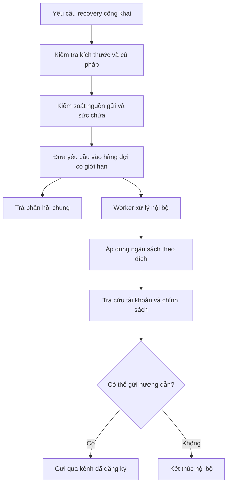

# Enumeration abuse — Lạm dụng dò tìm tài khoản qua luồng khôi phục

## 1. Enumeration abuse là gì?

**Account enumeration** là việc suy ra một định danh có thuộc về tài khoản trong hệ thống hay không. Trong luồng khôi phục, thông tin có thể bị lộ qua thông báo, mã HTTP, thời gian xử lý, phương thức xác thực được hiển thị hoặc hành vi của chức năng gửi lại mã.

**Enumeration abuse** xảy ra khi khả năng suy luận đó bị khai thác để dò nhiều định danh, xác nhận danh sách mục tiêu hoặc tìm hiểu trạng thái bảo mật của một người cụ thể.

Ví dụ, một endpoint nhận email và trả:

```text
Có tài khoản:
    "Đã gửi mã đến số điện thoại kết thúc bằng 1234."

Không có tài khoản:
    "Email này chưa đăng ký."
```

Người gọi chưa cần chứng minh quyền kiểm soát email nhưng đã biết email nào được đăng ký. Với tài khoản tồn tại, họ còn biết một phần số điện thoại và việc tài khoản có kênh recovery qua SMS.

Đối với dịch vụ khôi phục tài khoản khi mất mật khẩu, MFA, passkey hoặc thiết bị xác thực, cần bảo vệ ít nhất ba loại thông tin:

- Sự tồn tại của tài khoản.
- Trạng thái và khả năng khôi phục của tài khoản.
- Các phương thức, địa chỉ liên hệ hoặc thiết bị đã được gắn với tài khoản.

Không nên xem việc tài khoản có mật khẩu mạnh hoặc MFA là lý do để cho phép công khai các thông tin trên.

## 2. Vì sao dò tài khoản có thể dẫn đến chiếm đoạt?

Thông tin “có tài khoản” thường chưa đủ để đăng nhập, nhưng có thể làm bước chuẩn bị cho các hành vi khác:

1. Kẻ tấn công xác nhận định danh nào thực sự được sử dụng.
2. Chọn các tài khoản có phương thức recovery dễ bị lạm dụng hơn.
3. Cá nhân hóa nội dung giả mạo dựa trên kênh hoặc trạng thái bị lộ.
4. Gửi nhiều yêu cầu recovery để gây nhiễu hoặc làm người dùng mất cảnh giác.
5. Kết hợp với mật khẩu bị lộ, chiếm hộp thư hoặc thao túng hỗ trợ viên.

Đây là mô hình đe dọa minh họa, không có nghĩa mọi lần nhập nhầm email đều là một cuộc tấn công.

Ngoài nguy cơ chiếm đoạt, việc xác nhận một người có tài khoản tại một dịch vụ cũng có thể ảnh hưởng riêng tư. Vì vậy, mục tiêu bảo vệ không chỉ là ngăn đăng nhập trái phép mà còn là hạn chế thông tin được cung cấp trước khi có đủ quyền.

## 3. Phản hồi chung phải bao phủ toàn bộ giao diện quan sát được

OWASP khuyến nghị phản hồi xác thực theo cách chung, kể cả khi tài khoản không tồn tại, bị khóa hoặc vô hiệu hóa. Tài liệu cũng chỉ ra rằng mã HTTP khác nhau có thể tiết lộ trạng thái dù thông báo hiển thị giống nhau. [OWASP, Authentication Cheat Sheet](https://cheatsheetseries.owasp.org/cheatsheets/Authentication_Cheat_Sheet.html#authentication-and-error-messages)

### 3.1. Các kênh tiết lộ thường gặp

| Kênh quan sát | Ví dụ có thể làm lộ tài khoản |
| --- | --- |
| Nội dung thông báo | “Không tìm thấy người dùng” chỉ xuất hiện với định danh lạ |
| Mã HTTP | Tài khoản có thật trả 200, tài khoản không có trả 404 |
| Trường JSON | Chỉ tài khoản có thật có `accountId`, `methods` hoặc `locked` |
| Redirect hoặc URL | Chỉ tài khoản có thật được chuyển sang trang nhập OTP |
| Cookie và header | Chỉ nhánh có tài khoản cấp cookie recovery hoặc header đặc biệt |
| Thời gian xử lý | Nhánh không có tài khoản thoát sớm; nhánh có tài khoản chờ gửi email |
| CAPTCHA | Chỉ hiển thị khi định danh khớp một tài khoản |
| Giới hạn gửi lại | Chỉ tài khoản có thật nhận lỗi “đã gửi quá nhiều mã” |
| Tra cứu trạng thái | Mã yêu cầu cho biết “không có tài khoản” ở bước tiếp theo |

So sánh cần xét hình dạng và ý nghĩa của phản hồi. Không có yêu cầu mọi giá trị ngẫu nhiên như trace ID phải giống hệt nhau; vấn đề là chúng có mang thông tin phân biệt trạng thái tài khoản hay không.

### 3.2. Một phản hồi khởi tạo minh họa

Với định danh đúng cú pháp, dịch vụ có thể sử dụng:

```http
HTTP/1.1 202 Accepted
Content-Type: application/json
Cache-Control: no-store

{
  "message": "Nếu thông tin phù hợp với tài khoản có thể khôi phục, hướng dẫn sẽ được gửi qua kênh đã đăng ký."
}
```

Thông báo xác nhận việc nhận yêu cầu theo hợp đồng của endpoint. Nó không cam kết rằng tài khoản tồn tại, email đã được gửi hoặc người gọi đã được cấp một phiên recovery có quyền.

Ví dụ này không quy định mọi hệ thống phải dùng mã 202. Điều quan trọng là thiết kế phản hồi công khai nhất quán giữa các trạng thái tài khoản tương ứng.

### 3.3. Những lỗi vẫn có thể được trình bày riêng

Có thể báo định dạng đầu vào sai, thiếu trường bắt buộc hoặc body vượt kích thước cho phép nếu các kiểm tra này không phụ thuộc việc tài khoản tồn tại.

Ví dụ, phản hồi “Địa chỉ email không đúng định dạng” có thể dựa hoàn toàn trên chuỗi đầu vào. Ngược lại, “Tên miền email hợp lệ nhưng người dùng chưa đăng ký” đã tiết lộ dữ liệu tài khoản.

Không cần làm mọi yêu cầu trong hệ thống trả cùng một mã HTTP. Cần tránh dùng sự tồn tại hoặc trạng thái bí mật của tài khoản để tạo ra khác biệt mà người chưa được phép có thể quan sát.

## 4. Thời gian xử lý là một kênh tiết lộ riêng

### 4.1. Thoát sớm có thể làm lộ nhánh xử lý

Một thiết kế dễ gặp:

```text
account = findAccount(identifier)

if account == null:
    return genericResponse()

token = createRecoveryToken(account)
sendEmailSynchronously(account.recoveryAddress, token)

return genericResponse()
```

Hai nhánh có cùng body nhưng lượng công việc khác nhau. Người quan sát nhiều lần có thể suy luận từ đặc điểm độ trễ, dù mạng có nhiễu.

OWASP khuyến nghị thông báo nhất quán và thời gian phản hồi đồng đều cho yêu cầu quên mật khẩu; các lựa chọn được nêu gồm xử lý bất đồng bộ hoặc tránh nhánh thoát nhanh làm lộ thông tin. [OWASP, Forgot Password Cheat Sheet](https://cheatsheetseries.owasp.org/cheatsheets/Forgot_Password_Cheat_Sheet.html#forgot-password-request)

### 4.2. Thêm sleep không tự giải quyết được vấn đề

Chờ thêm một khoảng thời gian ngẫu nhiên có thể tăng nhiễu nhưng không chứng minh hai nhánh không còn phân biệt được. Nếu công việc phụ thuộc tài khoản vẫn diễn ra trước phản hồi, đặc điểm thời gian có thể tiếp tục tồn tại.

Chờ lâu trên mọi request còn có thể làm tăng số kết nối hoặc tác vụ đang giữ tài nguyên. Đối với endpoint công khai, đây là một chi phí cần được tính đến trong thiết kế.

Một hướng phù hợp với ví dụ của bài là đưa công việc tra cứu tài khoản và gửi thông báo ra khỏi đường phản hồi trực tiếp, đồng thời kiểm soát khả năng tiếp nhận của hàng đợi.

Thiết kế bất đồng bộ vẫn cần xem xét giới hạn tài nguyên, lỗi tiếp nhận và các endpoint tiếp theo. Nó không tự tạo ra một bảo đảm tuyệt đối rằng hệ thống không còn mọi side channel.

## 5. Luồng khởi tạo bất đồng bộ minh họa

Mô hình sau là đề xuất cho dịch vụ trong bài, không phải kiến trúc bắt buộc của một tiêu chuẩn:



Điểm thiết kế đáng chú ý:

- Cả định danh tồn tại và không tồn tại đều đi qua bước tiếp nhận công khai cùng loại.
- Không chờ nhà cung cấp email hoặc SMS rồi mới trả lời người gửi.
- Không tạo recovery token hoặc gửi thư cho một tài khoản không tồn tại.
- Việc không đủ điều kiện recovery được xử lý nội bộ, không biến thành trường JSON tiết lộ trạng thái.
- Dữ liệu trong hàng đợi cần được bảo vệ và có thời gian lưu phù hợp.

Nếu hàng đợi thực sự không tiếp nhận được, endpoint có thể báo lỗi phụ thuộc theo tình trạng hạ tầng chung. Không nên trả “đã tiếp nhận” khi hợp đồng yêu cầu đã nhận bền vững nhưng dữ liệu thực tế bị mất.

Cũng không nên chỉ tạo một tác vụ nặng cho mỗi chuỗi người dùng nhập mà không có giới hạn. Việc làm hai nhánh giống nhau không được trở thành lý do cho phép tạo tài nguyên không kiểm soát.

## 6. Rate limiting cần hạn chế lạm dụng mà không trở thành oracle

### 6.1. Giới hạn theo nhiều chiều

Chỉ giới hạn một IP có thể gây khó khăn cho người dùng dùng chung mạng, đồng thời không đủ cho nguồn gửi phân tán. Chỉ giới hạn một tài khoản lại không ngăn được việc dò rất nhiều định danh khác nhau.

Thiết kế minh họa sử dụng các lớp:

| Chiều kiểm soát | Mục đích |
| --- | --- |
| Nguồn gửi hoặc nhóm nguồn | Hạn chế một nguồn thử quá nhiều định danh |
| Định danh đích | Hạn chế gửi quá nhiều hướng dẫn tới một người |
| Nguồn gửi kết hợp đích | Kiểm soát hành vi tập trung vào một mục tiêu |
| Endpoint hoặc tenant | Bảo vệ năng lực xử lý của phạm vi dịch vụ |
| Ngân sách toàn hệ thống | Hạn chế cạn hàng đợi và chi phí gửi thông báo |

Ngưỡng cụ thể cần được chọn theo lưu lượng và tác động của dịch vụ. Không có một con số cố định phù hợp cho mọi hệ thống.

### 6.2. Không tạo bộ đếm chỉ khi đã tìm thấy tài khoản

Giả sử hệ thống chỉ tăng bộ đếm cho email tồn tại. Sau một số lần thử:

```text
Email tồn tại:
    "Bạn đã yêu cầu quá nhiều lần."

Email không tồn tại:
    "Nếu thông tin phù hợp, hướng dẫn sẽ được gửi."
```

Bộ giới hạn đã trở thành một phép kiểm tra sự tồn tại.

Một cách giảm rủi ro là tạo khóa ngân sách từ định danh đầu vào đã chuẩn hóa, không yêu cầu phải tìm được tài khoản trước. Cả định danh tồn tại và không tồn tại đều được tính theo cùng quy tắc.

Tuy vậy, trạng thái bộ đếm còn có thể phản ánh hoạt động trước đó. Vì thế, việc áp dụng cùng quy tắc chưa đủ để công khai số lượt còn lại hoặc thời điểm đặt lại của một đích cụ thể.

Trong mô hình của bài:

- Giới hạn nguồn gửi có thể tạo phản hồi công khai yêu cầu chờ hoặc hoàn thành thử thách.
- Giới hạn theo đích được thực thi nội bộ bằng cách trì hoãn, gộp hoặc không gửi thêm thông báo.
- Phản hồi recovery công khai không cho biết đích đã đạt ngưỡng gửi riêng hay chưa.

### 6.3. Sử dụng 429 theo đúng ý nghĩa

HTTP 429 mô tả việc gửi quá nhiều yêu cầu; phản hồi có thể kèm `Retry-After`. Chuẩn không quy định một cách duy nhất để xác định người gửi hoặc đếm yêu cầu. [RFC 6585, 429 Too Many Requests](https://www.rfc-editor.org/rfc/rfc6585.html#section-4)

Trong ví dụ này, phản hồi 429 dựa trên ngân sách nguồn gửi hoặc khả năng tiếp nhận công khai, thay vì chỉ xuất hiện khi định danh khớp tài khoản có thật.

Header như số lượt còn lại, thời điểm mở lại và nguyên nhân bị giới hạn cũng cần được xem là một phần của giao diện quan sát được. Không đưa trạng thái ngân sách của nạn nhân vào header công khai chỉ vì body đã chung.

## 7. Chuẩn hóa định danh và thiết kế khóa đếm

### 7.1. Dùng cùng quy tắc định danh với hệ thống tài khoản

Cần thống nhất cách xử lý khoảng trắng, chữ hoa/chữ thường, định danh theo tenant và các quy tắc được dịch vụ hỗ trợ.

Không tự động xóa dấu chấm hoặc phần sau dấu cộng của mọi địa chỉ email. Các quy tắc alias phụ thuộc hệ thống; suy diễn sai có thể gộp hai định danh khác nhau hoặc khiến người dùng bị tính nhầm ngân sách.

Việc chuẩn hóa phục vụ chống lạm dụng không được thay đổi ý nghĩa định danh đã được hệ thống đăng nhập quy định.

### 7.2. Tránh dùng trực tiếp định danh làm tên khóa log hoặc cache

Ví dụ khóa giả mã:

```text
canonicalTarget = normalizeUsingAccountIdentifierRules(input)

targetKey = HMAC(
    key = abuseLimiterSecret,
    message = encodeLengthPrefixed(
        "recovery-target-v1",
        trustedRealmId,
        canonicalTarget
    )
)
```

HMAC với khóa bí mật phía máy chủ giúp tránh đưa định danh thô vào tên khóa và giảm khả năng đối chiếu từ điển khi chỉ tên khóa bị lộ. Nó không phải mã hóa có thể giải mã, cũng không khiến dữ liệu tự động trở thành hoàn toàn vô danh.

Một hash không khóa của email có thể bị đối chiếu với danh sách email ứng viên. Không nên xem việc đổi email thành chuỗi hash là đã giải quyết xong việc bảo vệ dữ liệu.

Khóa đếm cần có TTL, giới hạn kích thước và cơ chế kiểm soát số lượng đích khác nhau. Nếu mỗi chuỗi đầu vào tạo một key tồn tại quá lâu, người gửi có thể làm tăng bộ nhớ dù không tìm được tài khoản nào.

Giới hạn nguồn và ngân sách chung nên được áp dụng đủ sớm để giảm khả năng tạo vô hạn khóa theo đích.

## 8. Giả mã phối hợp phản hồi và xử lý nội bộ

Đoạn sau mô tả chính sách ứng dụng, không phải mã hoàn chỉnh để triển khai:

```text
requestRecovery(httpRequest):
    input = parseWithBodyAndFieldLimits(httpRequest)

    if not hasValidIdentifierSyntax(input.identifier):
        return invalidFormatResponse()

    realm = resolveAllowedRealmWithoutAccountLookup(httpRequest)
    target = normalizeUsingAccountIdentifierRules(input.identifier)
    source = deriveSourceContextFromTrustedIngress(httpRequest)

    if not publicAdmission.tryConsume(source, realm):
        return genericRateLimitResponse()

    if sourceRiskPolicy.requiresChallenge(source):
        require validPublicChallenge(httpRequest, source)

    job = {
        realm: realm,
        protectedTarget: protectForQueue(target),
        operation: START_ACCOUNT_RECOVERY,
        acceptedAt: trustedServerTime()
    }

    if not boundedQueue.acceptDurably(job):
        return genericDependencyUnavailableResponse()

    return genericRecoveryAcceptedResponse()


processRecoveryJob(job):
    target = recoverQueueTargetForAuthorizedWorker(job)
    targetKey = derivePrivateLimiterKey(job.realm, target)

    if not targetDispatchBudget.tryConsume(targetKey):
        recordInternalOutcome(DISPATCH_SUPPRESSED)
        return

    account = directory.findByRealmAndIdentifier(job.realm, target)

    if account == null:
        recordInternalOutcome(NO_ELIGIBLE_DELIVERY)
        return

    if not recoveryPolicy.mayStartDelivery(account):
        recordInternalOutcome(NO_ELIGIBLE_DELIVERY)
        return

    delivery = recoveryRequests.createOrCoalesceAuthorizedDelivery(account)
    dispatchToPreviouslyRegisteredChannel(delivery)
```

Các điểm cần hiểu:

1. **Tiếp nhận công khai không phụ thuộc kết quả tìm tài khoản.** Việc tra cứu nằm ở nhánh xử lý nội bộ.
2. **Ngân sách gửi được áp dụng trước khi quyết định gửi.** Nó không tạo thông báo công khai riêng cho tài khoản có thật.
3. **Người gửi không tự chọn địa chỉ nhận thay thế.** Hướng dẫn đi tới kênh đã đăng ký theo chính sách.
4. **CAPTCHA hoặc thử thách công khai dựa vào nguồn và hành vi phù hợp.** Không dùng riêng việc tài khoản tồn tại để quyết định hiện CAPTCHA.
5. **Chấp nhận yêu cầu không cấp quyền recovery.** Quyền nhạy cảm vẫn cần bằng chứng và quy trình tiếp theo.

Trong triển khai thực tế, các thao tác ngân sách và gộp gửi cần chịu được request đồng thời. Hàm `tryConsume` không nên được hiểu thành thao tác đọc rồi ghi không có tính nguyên tử.

## 9. Đừng chuyển lỗ hổng sang bước tiếp theo

### 9.1. Gửi lại hướng dẫn

Nếu bước khởi tạo trả thông báo chung nhưng nút “Gửi lại” trả “Tài khoản không tồn tại”, khả năng dò vẫn còn.

Các giới hạn gửi lại, mẫu lỗi và redirect cần tuân theo cùng ranh giới thông tin trước khi người gọi có đủ bằng chứng.

Ngoài ra, mỗi yêu cầu công khai mới không nên tự động vô hiệu hóa toàn bộ hướng dẫn hợp lệ trước đó. Nếu không, người khác có thể liên tục gửi yêu cầu để làm gián đoạn quá trình recovery của nạn nhân.

Cách gộp yêu cầu, thời hạn token và số token đồng thời được phép cần được thiết kế cùng nhau.

### 9.2. Tra cứu bằng request ID

Một mã theo dõi ngẫu nhiên không tự động ngăn enumeration. Nếu endpoint trạng thái trả:

```text
request A -> EMAIL_SENT
request B -> ACCOUNT_NOT_FOUND
```

thì người đã khởi tạo hai yêu cầu vẫn nhận được thông tin bị che ở bước đầu.

Mô hình của bài không cung cấp trạng thái gửi theo tài khoản cho người chưa có quyền. Nếu cần một mã tham chiếu công khai, mã đó không được tự trở thành quyền đọc chi tiết hồ sơ recovery.

### 9.3. Hiển thị phương thức và liên hệ bị che một phần

Thông tin như “email bắt đầu bằng a”, “số điện thoại kết thúc bằng 1234”, “đã bật passkey” hoặc “tài khoản chỉ đăng nhập SSO” vẫn là thông tin tài khoản.

Không coi việc che một phần là đủ để công khai ngay sau khi nhập định danh. Dịch vụ cần xác định bằng chứng nào cho phép hiển thị dữ liệu đó và chỉ hiển thị phần cần thiết.

### 9.4. Các bề mặt khác của sản phẩm

Endpoint đăng nhập, đăng ký, kiểm tra username và hỗ trợ khách hàng có thể tiết lộ cùng thông tin qua đường khác. Bảo vệ một endpoint recovery không chứng minh toàn bộ sản phẩm đã ngăn enumeration.

Trong phạm vi thiết kế recovery, cần ghi nhận sự phụ thuộc này để phối hợp chính sách. Không nên tuyên bố bảo mật toàn hệ thống chỉ vì đã đổi một dòng thông báo.

## 10. Giới hạn gửi và khóa tài khoản là hai hành động khác nhau

Chặn thêm email trong một khoảng thời gian không đồng nghĩa khóa khả năng đăng nhập của tài khoản.

Nếu một người chưa xác thực có thể khiến nạn nhân bị khóa bằng cách gửi nhiều yêu cầu recovery, cơ chế chống enumeration đã tạo thêm khả năng gây từ chối dịch vụ.

Trong thiết kế minh họa:

- Giới hạn request công khai nhằm bảo vệ hạ tầng tiếp nhận.
- Giới hạn theo đích nhằm giảm làm phiền và chi phí thông báo.
- Yêu cầu recovery chưa được xác minh không tự đổi mật khẩu, tắt MFA hoặc thu hồi session của nạn nhân.
- Khi có dấu hiệu chiếm đoạt thực sự, quy trình xử lý sự cố sử dụng bằng chứng và chính sách riêng.

Người dùng cần được hướng dẫn kiểm tra địa chỉ nhập, chờ theo chính sách chung và sử dụng kênh hỗ trợ an toàn khi không nhận được hướng dẫn. Hỗ trợ viên cũng không nên xác nhận sự tồn tại của tài khoản chỉ dựa trên một câu hỏi chưa được xác minh.

## 11. Quan sát lạm dụng mà vẫn hạn chế dữ liệu

Các mẫu hoạt động có thể hữu ích:

| Mẫu hoạt động | Khả năng cần xem xét |
| --- | --- |
| Một nguồn thử rất nhiều đích khác nhau | Dò danh sách tài khoản |
| Nhiều nguồn cùng tập trung một đích | Gây nhiễu recovery hoặc làm phiền nạn nhân |
| Liên tục chuyển endpoint sau khi bị giới hạn | Tìm đường có kiểm soát yếu hơn |
| Lưu lượng tăng cùng chi phí gửi thông báo | Lạm dụng chức năng gửi |
| Nhiều request với định danh sai định dạng | Tự động hóa hoặc lỗi tích hợp |

Đây là tín hiệu, không phải kết luận chắc chắn về từng người gửi. Nhiều người có thể dùng chung mạng; một người hợp pháp cũng có thể đổi IP hoặc nhập sai nhiều lần.

Log nên ưu tiên loại sự kiện, phạm vi dịch vụ, quyết định kiểm soát và tham chiếu đã giảm thiểu dữ liệu. Hạn chế ghi định danh thô, token, nội dung email hoặc OTP.

Các chỉ số cần phân biệt số yêu cầu tiếp nhận, số thông báo bị gộp, số lượt gửi thực tế và lỗi phụ thuộc. Không suy ra số lượt chiếm đoạt chỉ từ số yêu cầu bị giới hạn.

Dữ liệu nội bộ cho biết tài khoản có thật hay không phải được giới hạn truy cập. Không để một trang dashboard, endpoint debug hoặc header trả về làm lộ lại kết quả phân loại.

## 12. Tình huống vận dụng

**Tình huống A — Body giống nhưng mã HTTP khác:** email có thật trả 202, email lạ trả 404. Cần loại bỏ khác biệt dựa trên sự tồn tại ở hợp đồng phản hồi công khai; đổi riêng nội dung thông báo chưa đủ.

**Tình huống B — Limiter chỉ đếm tài khoản thật:** sau nhiều lượt, chỉ tài khoản tồn tại nhận lỗi gửi quá nhiều mã. Cần thiết kế khóa đếm từ đầu vào và không công khai ngân sách theo đích như một phép tra cứu tài khoản.

**Tình huống C — Người dùng nhập nhầm email:** hệ thống trả hướng dẫn chung, cho phép sửa đầu vào và cung cấp hỗ trợ phù hợp. Không cần tiết lộ tài khoản có tồn tại để giúp người dùng sửa một lỗi cú pháp.

**Tình huống D — Hàng đợi đang đầy:** dịch vụ giới hạn tiếp nhận theo tình trạng hạ tầng chung. Không thực hiện tra cứu trước rồi chỉ trả lỗi quá tải cho tài khoản có thật.

**Tình huống E — Recovery bị gửi dồn dập:** dịch vụ gộp hoặc hạn chế thông báo theo đích nhưng giữ nguyên ranh giới quyền. Người gửi chưa xác thực không được dùng việc gửi dồn dập để khóa tài khoản hoặc hủy mọi phiên hợp lệ.

## 13. Câu hỏi tự kiểm tra

1. Vì sao thông báo giống nhau vẫn có thể để lộ tài khoản?
2. Khi nào một phản hồi sai định dạng không tạo account enumeration?
3. Vì sao chỉ thêm thời gian chờ ngẫu nhiên chưa đủ xử lý timing side channel?
4. Bộ giới hạn theo đích có thể biến thành oracle như thế nào?
5. Vì sao request ID và endpoint trạng thái cần cùng tuân theo ranh giới thông tin của bước khởi tạo?
6. Che một phần số điện thoại có làm thông tin đó tự động an toàn để công khai không?
7. Làm thế nào hạn chế gửi email recovery mà không cho người lạ khóa tài khoản của nạn nhân?

Điểm cốt lõi là kiểm soát thông tin trên toàn bộ luồng quan sát được. Phản hồi chung, đường xử lý phù hợp, ngân sách chống lạm dụng và ranh giới quyền ở các bước tiếp theo cần phối hợp để người chưa xác minh không thể dùng recovery làm công cụ tra cứu tài khoản.
