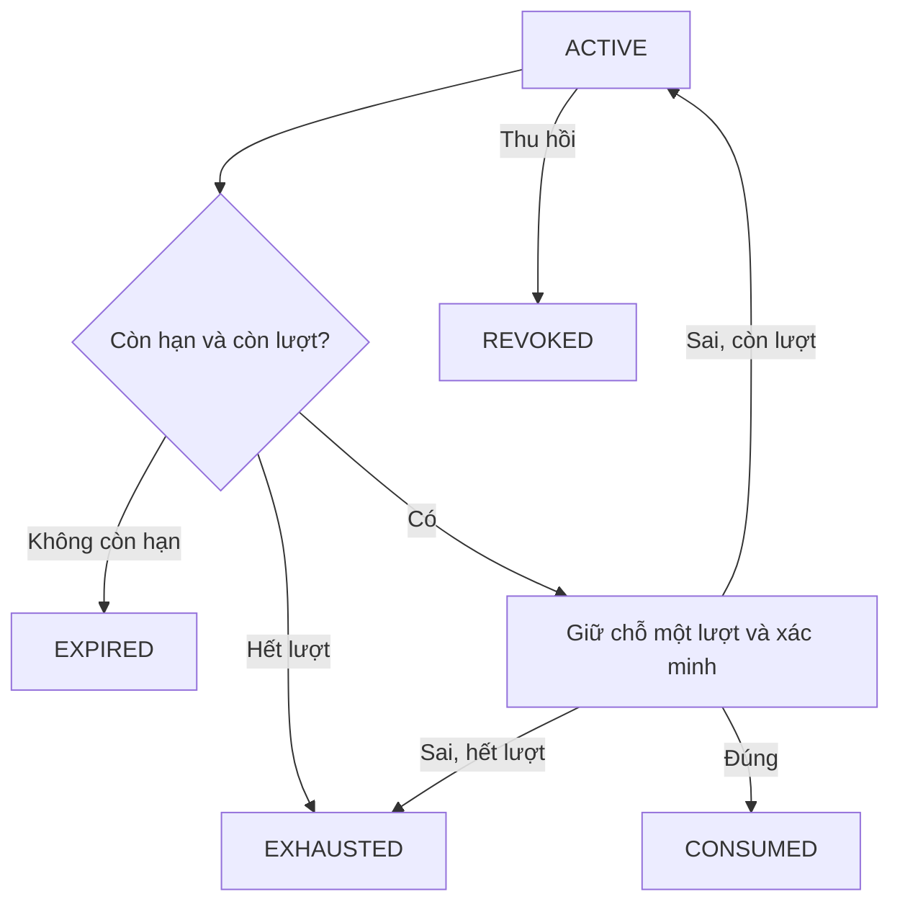

# Per recovery token limit — Giới hạn theo từng token khôi phục

## 1. Giới hạn theo token bảo vệ điều gì?

**Per recovery token limit** là chính sách giới hạn số lần hoặc tần suất xử lý đối với một token khôi phục cụ thể. Đơn vị được bảo vệ là token mà máy chủ đã phát hành, không phải IP, trình duyệt hay chuỗi định danh tài khoản do client tự khai.

Trong khôi phục tài khoản khi người dùng mất mật khẩu, MFA, passkey hoặc thiết bị xác thực, một token có thể được dùng để:

- Xác minh mã được gửi qua kênh recovery đã đăng ký.
- Đổi liên kết khôi phục thành quyền tiếp tục một quy trình có giới hạn.
- Cho phép thực hiện một thao tác cụ thể, như đặt lại mật khẩu.
- Tiếp tục một hồ sơ khôi phục đã được thiết lập theo chính sách.

Mỗi loại token phải có mục đích rõ ràng. Không nên cho một token gửi để đặt lại mật khẩu tự trở thành quyền tắt MFA, thay email recovery hoặc đăng nhập với mọi quyền.

OWASP khuyến nghị token khôi phục được sinh an toàn, đủ dài, lưu an toàn, có hạn dùng và chỉ sử dụng một lần. Rate limiting là một phần kiểm soát bổ sung cho việc xử lý token. [OWASP, Forgot Password Cheat Sheet](https://cheatsheetseries.owasp.org/cheatsheets/Forgot_Password_Cheat_Sheet.html)

Bài học sử dụng các tên trạng thái và giả mã do ứng dụng định nghĩa để giải thích thiết kế. Chúng không phải schema bắt buộc của một tiêu chuẩn.

## 2. Phân biệt bốn loại giới hạn

| Loại giới hạn | Câu hỏi được trả lời | Ví dụ minh họa |
| --- | --- | --- |
| Tần suất xử lý | Có đang nhận quá nhiều request cho token này không? | Giới hạn số lần gọi endpoint trong một khoảng thời gian |
| Ngân sách thử toàn vòng đời | Token này còn được phép so sánh bao nhiêu ứng viên? | Tối đa 5 lần so sánh mã trước khi token kết thúc |
| Số lần sử dụng thành công | Bằng chứng này được cấp quyền thành công mấy lần? | Chỉ một lần đổi token thành quyền recovery |
| Hạn sử dụng | Token còn hiệu lực về thời gian không? | Không chấp nhận sau thời điểm hết hạn |

Các con số trong bài chỉ là ví dụ để giải thích, không phải cấu hình mặc định cho mọi hệ thống.

Bốn điều kiện không thay thế nhau:

- Token chưa hết hạn vẫn có thể đã dùng.
- Token chưa dùng vẫn có thể đã hết lượt thử.
- Một token chỉ dùng thành công một lần vẫn có thể bị đoán nhiều lần trước đó.
- Giới hạn theo phút có thể bổ sung lượt về sau; ngân sách toàn vòng đời không được tự bổ sung theo cách đó.

Đặc biệt, cụm từ “single use” thường mô tả một lần sử dụng thành công, không mặc nhiên có nghĩa mọi request đầu tiên, kể cả request sai định dạng, đều phải làm token mất hiệu lực.

## 3. Dạng token quyết định cách áp dụng hạn mức

### 3.1. Token bí mật dài, không mang cấu trúc

Một liên kết có thể chứa một token ngẫu nhiên đủ mạnh. Máy chủ tra cứu bản ghi bằng digest của token, thay vì lưu token thô.

Nếu người gửi thay đổi một ký tự, digest thường không khớp bản ghi nào. Hệ thống không biết đó là “lần thử sai của token T” chỉ từ một chuỗi không khớp.

Với mô hình này:

- Request chứa token không khớp cần được kiểm soát bằng giới hạn nguồn và năng lực endpoint.
- Không tạo một bộ đếm bền vững mới cho mọi chuỗi rác.
- Khi xác định được token hợp lệ, áp dụng trạng thái và giới hạn của bản ghi đó.
- Nếu ai đó đã đánh cắp trọn token bearer, hạn mức không tự phân biệt họ với người nhận hợp pháp.

Độ ngẫu nhiên mạnh và bảo vệ token vẫn cần thiết. Không nên giảm độ mạnh của token chỉ vì đã có rate limiting.

### 3.2. Mã ngắn gắn với một tham chiếu recovery

Một thiết kế khác có:

```text
recovery_reference: tham chiếu tới ngữ cảnh đã được máy chủ tạo
candidate_code: mã người dùng nhập
```

Máy chủ có thể tìm token tương ứng từ tham chiếu rồi đếm mỗi ứng viên được phép so sánh. Vì vậy, ngay cả ứng viên sai cũng có thể được tính vào đúng ngân sách token.

Tham chiếu chỉ giúp xác định ngữ cảnh. Nó không tự chứng minh người gửi là chủ tài khoản.

Không đồng nhất mọi mã nhập tay: OTP cấp theo yêu cầu và recovery code lưu dự phòng có yêu cầu vòng đời khác nhau. NIST quy định saved recovery codes phải chịu kiểm soát throttling và bị vô hiệu hóa sau khi sử dụng. [NIST SP 800-63B-4, Authenticator Event Management](https://pages.nist.gov/800-63-4/sp800-63b/events/#saved-recovery-codes)

### 3.3. Token có chữ ký, chẳng hạn JWT

Chữ ký giúp kiểm tra nguồn phát hành và tính toàn vẹn của dữ liệu được ký. Nó không tự ghi nhận token đã được sử dụng hoặc đã hết lượt thử.

Nếu cần trạng thái dùng một lần, dịch vụ vẫn phải có cơ chế quản lý trạng thái tương ứng với token đã phát hành.

Không lấy một `jti` chưa được xác minh từ payload rồi tạo bộ đếm tùy ý. Client có thể thay đổi payload hoặc gửi vô số định danh khác nhau để làm tăng tài nguyên.

## 4. Ngân sách vòng đời phải gắn với bản ghi token ổn định

### 4.1. Mô hình trạng thái minh họa

```text
RecoveryToken:
    internal_token_id
    realm_id
    account_id
    recovery_request_id
    token_family_id
    purpose
    secret_verifier
    issued_at
    expires_at
    admitted_attempts
    attempt_limit
    state
    consumed_at
    policy_version
```

Các trường có vai trò khác nhau:

- `internal_token_id` định danh token do backend quản lý.
- `secret_verifier` dùng để xác minh bí mật theo cơ chế phù hợp.
- `admitted_attempts` đếm ứng viên đã được phép đưa vào kiểm tra.
- `state` ngăn dùng lại token đã kết thúc.
- `token_family_id` liên kết các token có quan hệ phát hành hoặc thay thế, nếu thiết kế sử dụng.
- `purpose` ràng buộc token với thao tác được cấp phép.

Không dùng token thô làm tên khóa cache hoặc đưa nó vào log để tiện tìm kiếm.

### 4.2. Không đặt khóa theo từng cách biểu diễn của client

Một token có thể đi qua URL encoding, parser hoặc các tầng giao thức khác nhau. Việc giải mã cần theo quy tắc định dạng đã chọn.

Sau khi xác định token, ngân sách nên gắn với ID nội bộ của bản ghi. Không để cùng một token nhận nhiều ngân sách chỉ vì người gửi thay đổi cách biểu diễn chuỗi, endpoint hoặc header.

Cũng không cho client tự chọn `attempt_limit`, mục đích token, tài khoản đích hoặc phiên bản chính sách.

### 4.3. Ngân sách toàn vòng đời không phải cửa sổ trượt

Ví dụ, token T có hạn dùng 10 phút và tối đa 5 lần so sánh:

```text
Đã so sánh 4 ứng viên
    -> còn 1 lượt trong vòng đời T

Chờ thêm 1 phút
    -> vẫn chỉ còn 1 lượt

Đổi IP
    -> vẫn chỉ còn 1 lượt

Gửi request tới node khác
    -> vẫn chỉ còn 1 lượt
```

Thời gian chờ có thể khôi phục khả năng tiếp nhận của một bộ giới hạn tần suất riêng. Nó không tự làm `admitted_attempts` của T quay về 0.

## 5. Trạng thái kết thúc không được tự sống lại

Một token trong thiết kế minh họa có thể kết thúc do:

- `CONSUMED`: đã sử dụng thành công.
- `EXHAUSTED`: hết ngân sách thử.
- `REVOKED`: bị thu hồi hoặc thay thế theo chính sách.
- `EXPIRED`: hết hạn.



Nếu giới hạn là 5 lần, ứng viên thứ năm vẫn được phép thành công khi token đang hợp lệ và chưa đủ 5 lượt trước lần kiểm tra đó. Chỉ kết thúc vì hết lượt sau kết quả sai cuối cùng hoặc khi đã không còn lượt để cấp.

Không xóa bản ghi hạn mức quá sớm rồi dựng lại trạng thái `ACTIVE` từ một token vẫn còn chữ ký hợp lệ.

Dữ liệu cần thiết để nhận biết đã dùng hoặc đã thu hồi phải tồn tại trong toàn bộ khoảng thời gian mà một cách biểu diễn của token còn có khả năng được chấp nhận. Dọn dữ liệu hết hạn phải phối hợp với quy tắc thời gian và độ lệch đồng hồ của hệ thống.

## 6. Đếm một lần thử ở đâu?

### 6.1. Loại bỏ request không đủ điều kiện trước bước so sánh

Có thể kiểm tra trước:

- Kích thước body và độ dài trường.
- Định dạng mã.
- Ngân sách nguồn gửi.
- Ngữ cảnh recovery mà máy chủ cho phép sử dụng.
- Mục đích token, liên kết tài khoản và trạng thái còn hiệu lực.

Request sai định dạng vẫn có thể được tính vào ngân sách nguồn hoặc endpoint. Nó không nhất thiết phải làm cạn token của nạn nhân.

Đối với mã ngắn gắn với tham chiếu hợp lệ, mỗi ứng viên đủ điều kiện và được đưa vào so sánh cần được giữ chỗ trong ngân sách token và ngân sách chung liên quan.

### 6.2. Không chờ tất cả request xác minh xong mới tăng bộ đếm

Nếu còn một lượt nhưng nhiều request song song cùng đọc được trạng thái đó, tất cả có thể được đem mã đi so sánh.

Cần gộp việc quyết định còn lượt và giữ chỗ lượt vào một thao tác nguyên tử. Sau khi giữ chỗ, mỗi ứng viên được so sánh đã tiêu thụ một phần ngân sách.

Phải phân biệt kết quả mã sai với lỗi hạ tầng. Nếu mỗi lần mã sai làm giao dịch rollback, bộ đếm có thể không bao giờ tăng.

## 7. Giả mã cho token mã ngắn có tham chiếu

Ví dụ dưới đây áp dụng cho một token được cấp để xác minh mã recovery. Nó không phải thuật toán chung bắt buộc cho mọi loại token.

```text
verifyIssuedRecoveryCode(recoveryRef, candidateCode, context):
    require boundedInputAndValidCodeFormat(candidateCode)
    require sourceAdmissionAllows(context)

    snapshot = resolveServerIssuedRecoveryContext(recoveryRef)

    result = transaction:
        account = lockAccount(snapshot.accountId)
        request = lockRecoveryRequest(snapshot.requestId)
        token = lockRecoveryToken(snapshot.tokenId)
        parentBudget = lockRecoveryVerificationBudget(account.id)

        require context.isAllowedFor(request)
        require token.accountId == account.id
        require token.recoveryRequestId == request.id
        require token.purpose == VERIFY_RECOVERY_CODE
        require request.isActive()
        require token.isCurrentUnderIssuancePolicy(request)

        now = trustedServerTime()

        if token.state != ACTIVE or token.expiresAt <= now:
            return INVALID_RECOVERY_EVIDENCE

        if token.admittedAttempts >= token.attemptLimit:
            token.state = EXHAUSTED
            return INVALID_RECOVERY_EVIDENCE

        if not parentBudget.canAdmit(now):
            return TEMPORARILY_UNAVAILABLE

        parentBudget.reserveAttempt(now)
        token.admittedAttempts += 1

        if not codeVerifier.matches(candidateCode, token.secretVerifier):
            recordFailureForApplicableRetryPolicy(account, token)

            if token.admittedAttempts >= token.attemptLimit:
                token.state = EXHAUSTED

            return INVALID_RECOVERY_EVIDENCE

        token.state = CONSUMED
        token.consumedAt = now

        evidence = createVerifiedEvidence(
            accountId = account.id,
            requestId = request.id,
            purpose = token.purpose,
            sourceTokenId = token.internalId
        )

        return VERIFIED_WITH_LIMITED_SCOPE(evidence.reference)

    return mapToResponseAllowedForContext(result, context)
```

### Những điều kiện quan trọng của ví dụ

**Lượt thử được giữ chỗ trước khi so sánh.** Hai request không thể cùng dùng lượt cuối nếu mọi luồng tuân thủ cùng cơ chế khóa.

**Mã sai vẫn là kết quả cần commit.** Bộ đếm của token, ngân sách chung và trạng thái hết lượt phải được lưu, thay vì hoàn tác như một exception hạ tầng.

**Thành công tiêu thụ token cùng lúc với ghi nhận bằng chứng.** Không để một node ghi nhận thành công trong khi node khác vẫn thấy token có thể sử dụng lại.

**Bằng chứng trả về có phạm vi giới hạn.** Nó ghi nhận một bước recovery, không mặc nhiên là session đăng nhập đầy đủ hoặc quyền thay mọi authenticator.

**Quy tắc retry bổ sung vẫn cần được thực thi.** Nếu loại bằng chứng hoặc chính sách yêu cầu đình chỉ sau số lần thất bại liên tiếp, việc kiểm tra ngân sách chung phải bao phủ điều kiện đó trước khi cấp thêm lượt.

**Tham chiếu phải được kiểm tra lại dưới khóa.** Snapshot chỉ hỗ trợ xác định trạng thái cần xử lý; nó không được dùng để bỏ qua các liên kết tài khoản, request và token hiện tại.

## 8. Tính nguyên tử của limiter khác với tính nguyên tử của recovery

Một Lua script có thể giúp quyết định và cập nhật ngân sách nguyên tử tại Redis. Redis cũng lưu ý script chạy theo cơ chế chặn trong thời gian thực thi, nên công việc trong script cần được giữ ngắn. [Redis, Scripting with Lua](https://redis.io/docs/latest/develop/programmability/eval-intro/)

Tuy nhiên:

```text
Trừ lượt trong Redis
    -> đổi mật khẩu trong database
```

không tự trở thành một giao dịch duy nhất.

Dịch vụ phải chọn cách phối hợp phù hợp. Một lựa chọn cho trạng thái token dùng một lần là giữ token, kết quả xác minh và thay đổi nghiệp vụ liên quan trong cùng cơ sở dữ liệu có giao dịch.

Nếu tác động tiếp theo nằm ở hệ thống khác, cần trạng thái tiến trình hoặc cơ chế chuyển giao có khả năng tránh lặp. Không chỉ dựa vào việc limiter đã trừ lượt để kết luận thao tác chỉ có thể diễn ra một lần.

Cũng cần phân biệt:

- Bộ giới hạn tần suất có thể chấp nhận một mức xấp xỉ đã định.
- Ngân sách đoán mã cần tuân theo mức bảo vệ đã chọn.
- Việc tiêu thụ quyền dùng một lần không được cấp trùng vì cache chậm đồng bộ.

## 9. Gửi lại và thay token không được tạo ngân sách vô hạn

Giả sử T1 được cấp 5 lượt. Người gửi dùng gần hết lượt rồi yêu cầu T2, tiếp tục T3 và T4.

Nếu không có ngân sách theo hồ sơ recovery hoặc tài khoản, tổng số lần so sánh sẽ tăng dù từng token đều tuân thủ giới hạn riêng.

Thiết kế cần phối hợp:

| Phạm vi | Điều được kiểm soát |
| --- | --- |
| Token | Lượt thử và trạng thái của một token cụ thể |
| Hồ sơ hoặc nhóm token | Quan hệ giữa các lần cấp lại trong cùng quy trình |
| Tài khoản | Tổng hoạt động liên quan trên cùng tài khoản |
| Nguồn gửi | Một nguồn yêu cầu hoặc thử quá nhiều lần |
| Dịch vụ | Tài nguyên, hàng đợi và chi phí |

Khi cấp lại, phải xác định rõ:

- Token cũ còn hiệu lực hay bị thu hồi.
- Có bao nhiêu token được phép hoạt động đồng thời.
- Ngân sách nào tiếp tục được giữ.
- Việc gửi lại có bị gộp hoặc trì hoãn hay không.
- Người chưa xác minh có thể làm gián đoạn token đang dùng của nạn nhân đến mức nào.

Không tự động cho một yêu cầu gửi lại công khai thu hồi mọi phương thức xác thực hoặc mọi phiên đăng nhập của tài khoản.

Việc phát hành token mới là một sự kiện vòng đời có chính sách, không phải cách xóa lịch sử thất bại theo yêu cầu của client.

## 10. Không để việc mở liên kết làm mất lượt hoặc tiêu thụ token

### 10.1. Trình quét liên kết và tải lại trang

Một dịch vụ email hoặc trình duyệt có thể tải URL trước khi người dùng bấm xác nhận. Nếu GET đầu tiên làm token mất hiệu lực, người nhận hợp pháp có thể thấy liên kết “đã dùng” ngay khi mở thư.

HTTP định nghĩa GET là phương thức có ngữ nghĩa an toàn: client không yêu cầu thay đổi trạng thái nghiệp vụ qua thao tác đọc. Điều này hỗ trợ việc tự động truy xuất mà không coi mọi lần tải trang là một hành động xác nhận. [RFC 9110, Safe Methods](https://www.rfc-editor.org/rfc/rfc9110.html#section-9.2.1)

Trong mô hình của bài:

- GET hiển thị trang chuẩn bị, không hoàn tất đặt lại mật khẩu.
- Việc tải trang không bị tính thành một ứng viên đoán mã.
- GET vẫn chịu giới hạn nguồn và tài nguyên endpoint.
- POST có kiểm soát thực hiện việc đổi token hoặc xác nhận thao tác theo thiết kế.

Chỉ dùng POST không tự chứng minh người gửi là chủ tài khoản. Token, ngữ cảnh và các kiểm soát xác thực vẫn phải hợp lệ.

### 10.2. Lỗi nhập mật khẩu mới không nhất thiết là lỗi token

Một người có thể nhập mật khẩu mới không đạt chính sách. Không nên tùy tiện coi đó là một lần đoán sai token nếu hai việc có mục đích khác nhau.

Một phương án là:

1. Xác minh token và tiêu thụ nó một lần.
2. Cấp một quyền recovery có giới hạn và thời hạn riêng.
3. Dùng quyền đó cho bước nhập mật khẩu mới.
4. Áp dụng giới hạn riêng cho bước này.
5. Tiêu thụ quyền khi thao tác được hoàn tất.

Quyền tiếp theo phải được bảo vệ, gắn đúng tài khoản và mục đích. Nếu không, việc chuyển token thành quyền trung gian có thể vô tình tạo một phiên không giới hạn.

## 11. Retry sau lỗi mạng phải giữ nguyên quy tắc dùng một lần

Máy chủ có thể đã commit thành công nhưng client chưa nhận được phản hồi. Gửi lại cùng token không được tạo thêm một quyền hoặc một session mới.

Có thể thiết kế thao tác có mã tham chiếu và trạng thái đã commit để client kiểm tra qua luồng có ủy quyền phù hợp. Mã tham chiếu không tự là quyền đọc thông tin recovery hoặc nhận lại token truy cập.

Idempotency cần ràng buộc với tài khoản, thao tác và nội dung cần thiết. Không dùng một idempotency key chưa được xác thực để bỏ qua việc kiểm tra token.

Nếu yêu cầu trước chưa được commit, việc có cho thử lại hay không phụ thuộc trạng thái bền vững còn lại. Không thể kết luận chỉ từ việc client nhận timeout.

Đối với lỗi hạ tầng không rõ kết quả, ưu tiên tra cứu trạng thái thao tác đã được ủy quyền thay vì giả định token vẫn chưa dùng.

## 12. Hết lượt, thu hồi và lỗi lưu trữ cần được xử lý khác nhau

### 12.1. Không làm lộ trạng thái cho người không có quyền

Phản hồi “token không tồn tại”, “token đúng nhưng hết lượt” và “token thuộc tài khoản đã bị khóa” có thể cung cấp các mức thông tin khác nhau.

Dịch vụ nên chọn thông báo công khai phù hợp, chẳng hạn không thể tiếp tục với bằng chứng này, cùng hướng dẫn an toàn để bắt đầu lại hoặc dùng kênh hỗ trợ được phép.

Chi tiết phân loại có thể được giữ nội bộ. Không công khai số lượt còn lại, token ID nội bộ hoặc trạng thái tài khoản chỉ vì request chứa một tham chiếu recovery.

### 12.2. Hết lượt một token không mặc nhiên khóa toàn bộ tài khoản

Người ngoài có thể cố làm cạn lượt của một mã ngắn nếu họ có đủ ngữ cảnh để gửi ứng viên. Cần hạn chế nguồn, quản lý phạm vi và giữ các nhánh xác thực mạnh còn hợp lệ theo chính sách.

Tuy nhiên, không thể vừa cho thử vô hạn cùng một token vừa tuyên bố có ngân sách đoán hữu hạn. Thiết kế cần thừa nhận giới hạn này và cung cấp lộ trình recovery có kiểm soát khi token kết thúc.

### 12.3. Mất cache không được khôi phục ngân sách

Nếu không đọc được trạng thái token, không mặc định `attempts = 0`.

Đặc biệt, không xử lý một cache miss bằng cách tạo lại token đang hoạt động mà không kiểm tra nguồn chuẩn. Cache bị đẩy dữ liệu, restart hoặc đổi node không phải sự kiện phát hành token mới.

Với bước nhạy cảm, lỗi kho trạng thái có thể yêu cầu tạm dừng xác minh. Hệ thống cần phân biệt điều này với token thực sự sai hoặc hết lượt để xử lý vận hành đúng.

## 13. Tình huống vận dụng

**Tình huống A — Lượt cuối đến đồng thời:** T còn một lượt nhưng hai request cùng gửi mã. Quyết định giữ chỗ phải nguyên tử; chỉ một ứng viên được phép so sánh.

**Tình huống B — Đổi token sau mỗi lần sai:** mỗi token có hạn mức riêng, nhưng ngân sách hồ sơ hoặc tài khoản tiếp tục được thực thi. Việc tạo token mới không mở vô hạn cơ hội đoán.

**Tình huống C — Token bearer bị lấy cắp:** người lấy được token nguyên vẹn có thể sử dụng trước người nhận. Per-token limit không thay thế bảo vệ kênh gửi, token và quyết định cấp quyền recovery.

**Tình huống D — Trình quét mở liên kết:** việc tải trang không tự tiêu thụ token hoặc hết lượt xác minh; bước thay đổi trạng thái yêu cầu thao tác phù hợp với thiết kế.

**Tình huống E — Mã sai làm rollback:** nếu bộ đếm không được commit sau lỗi nghiệp vụ, giới hạn không có hiệu lực. Cần lưu lượt đã cấp và trạng thái kết thúc.

**Tình huống F — Token đã dùng nhưng cache bị xóa:** nguồn chuẩn vẫn phải cho biết token không còn hoạt động. Không dựng lại quyền từ dữ liệu còn chữ ký hợp lệ.

## 14. Câu hỏi tự kiểm tra

1. Tần suất xử lý, số lần thử vòng đời và số lần sử dụng thành công khác nhau như thế nào?
2. Vì sao một chuỗi token opaque không khớp thường không thể được tính là lần thử sai của một token cụ thể?
3. Token có chữ ký hợp lệ có tự bảo đảm dùng một lần không?
4. Ứng viên đúng ở lượt cuối nên được xử lý ra sao?
5. Điều gì có thể xảy ra nếu request sai làm rollback bộ đếm?
6. Vì sao gửi lại token cần phối hợp với ngân sách theo hồ sơ và tài khoản?
7. Tại sao GET trang recovery không nên tự hoàn tất thao tác hoặc tiêu thụ quyền?
8. Khi cache không có dữ liệu token, vì sao không được mặc định cấp lại đầy đủ lượt?

Điểm cốt lõi là quản lý token như một quyền có mục đích, hạn dùng và trạng thái rõ ràng. Hạn mức riêng của token chỉ có hiệu lực khi lượt thử được cấp nhất quán, trạng thái kết thúc không sống lại và các lần phát hành mới vẫn chịu ngân sách chung của quy trình recovery.
