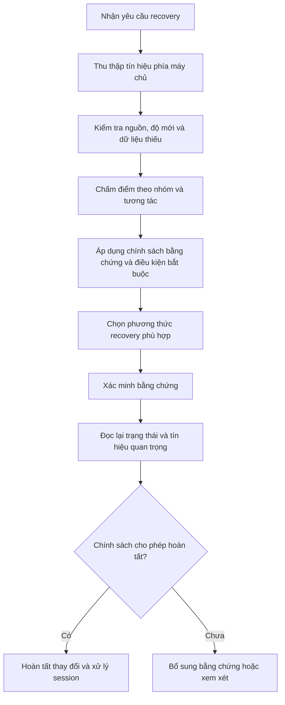

# Risk signal weighting

## 1. Vì sao cần gán trọng số cho tín hiệu rủi ro?

Trong khôi phục tài khoản, cùng một yêu cầu có thể chứa những dấu hiệu trái chiều: người dùng mở trang từ trình duyệt quen thuộc nhưng vừa thay số điện thoại; địa chỉ IP thay đổi nhưng họ đang đi du lịch; một mã khôi phục hợp lệ được gửi từ thiết bị chưa từng thấy. **Risk signal weighting** là cách xác định mỗi tín hiệu nên ảnh hưởng bao nhiêu đến đánh giá rủi ro của yêu cầu, trong đúng bối cảnh khôi phục.

Mục tiêu là lựa chọn mức kiểm tra và giới hạn phù hợp khi người dùng mất mật khẩu, MFA, passkey hoặc thiết bị xác thực. Điểm rủi ro thấp không tự chứng minh người yêu cầu là chủ tài khoản. Điểm cao cũng không tự chứng minh họ là kẻ tấn công.

OWASP mô tả xác thực thích ứng dựa trên các thuộc tính ngữ cảnh như vị trí, địa chỉ IP và dấu vết thiết bị. Áp dụng các thuộc tính đó cho recovery cần xét thêm lịch sử thay đổi kênh khôi phục và quyền mà luồng sắp cấp lại. [OWASP Authentication Cheat Sheet](https://cheatsheetseries.owasp.org/cheatsheets/Authentication_Cheat_Sheet.html#adaptive-or-risk-based-authentication)

Bài này xây dựng một mô hình thiết kế minh họa cho việc gán trọng số. **Mọi hệ số, điểm số, cửa sổ thời gian và ngưỡng bên dưới đều là ví dụ để giải thích cách làm; không phải giá trị tiêu chuẩn hoặc cấu hình dùng ngay cho môi trường thực tế.**

## 2. Tách ba câu hỏi trước khi tính điểm

Một quyết định recovery cần trả lời ba câu hỏi riêng biệt:

| Câu hỏi | Đại lượng cần xem | Ví dụ |
| --- | --- | --- |
| Yêu cầu có dấu hiệu bị lạm dụng đến đâu? | Rủi ro của yêu cầu | Có đợt thử recovery trên nhiều tài khoản |
| Người yêu cầu đã chứng minh điều gì? | Bằng chứng và mức bảo đảm | Đã xác minh recovery code được cấp từ trước |
| Nếu cấp lại quyền nhầm thì thiệt hại đến đâu? | Mức nhạy cảm của tài khoản và thao tác | Gỡ MFA của quản trị viên khác với đặt lại mật khẩu tài khoản thường |

Không nên ép cả ba câu trả lời vào một phép cộng duy nhất. Chẳng hạn, tài khoản quản trị không có nghĩa là yêu cầu chắc chắn gian lận; nó có nghĩa là chính sách phải thận trọng hơn với hậu quả của việc cấp nhầm quyền.

Có thể biểu diễn quyết định như sau:

```text
quyết định = policy(
    rủi_ro_yêu_cầu,
    bằng_chứng_đã_xác_minh,
    loại_thao_tác,
    mức_nhạy_cảm,
    độ_đầy_đủ_dữ_liệu,
    điều_kiện_bắt_buộc
)
```

Điều kiện bắt buộc có thể là token còn hiệu lực, chưa dùng, đúng tài khoản và đúng mục đích. Không cho phép điểm thuận lợi từ IP hoặc trình duyệt bù cho token đã hết hạn.

NIST SP 800-63B-4 quy định các phương thức recovery và yêu cầu theo mức bảo đảm của tài khoản. Vì vậy, nếu hệ thống áp dụng tiêu chuẩn này, bộ chấm điểm chỉ hỗ trợ chọn nhánh xử lý trong các phương thức được phép; nó không thay thế yêu cầu recovery tương ứng. [NIST SP 800-63B-4, mục 4.2](https://pages.nist.gov/800-63-4/sp800-63b.html#account-recovery)

## 3. Một tín hiệu cần có nội dung và nguồn gốc

Một giá trị như `deviceKnown=true` không đủ để đánh giá độ tin cậy. Cần biết thiết bị được nhận diện bằng cookie, fingerprint có thể thay đổi, hay bằng việc chứng minh quyền kiểm soát một khóa đã liên kết từ trước.

Một cấu trúc tín hiệu có thể gồm:

```text
Signal {
    name
    observedValue
    source
    observedAt
    collectedAt
    accountBinding
    integrityStatus
    confidence
    missingReason
    dependencyGroup
}
```

Trong đó:

- `source` cho biết dữ liệu do máy chủ ghi nhận, nhà cung cấp gửi hay client tự khai.
- `observedAt` là thời điểm sự kiện thật sự xảy ra; `collectedAt` là thời điểm hệ thống nhận được.
- `accountBinding` xác định tín hiệu có liên quan chắc chắn đến đúng tài khoản hay chỉ cùng một IP.
- `integrityStatus` phản ánh kết quả kiểm tra tính toàn vẹn hoặc xác thực nguồn.
- `confidence` phản ánh mức tin cậy của phép đo, không mặc nhiên là xác suất người dùng hợp pháp.
- `dependencyGroup` giúp tránh coi nhiều biểu hiện của cùng một hiện tượng là nhiều bằng chứng độc lập.

Không lấy IP do client gửi trong một header tùy ý làm IP nguồn đáng tin cậy. Với hệ thống có proxy, cần xác định chuỗi proxy được tin cậy và cách trích xuất địa chỉ nguồn ở biên hệ thống.

## 4. Chọn trọng số theo ý nghĩa bảo mật

Một tín hiệu đáng được tăng trọng số khi nó liên quan rõ đến một đường chiếm đoạt tài khoản, có nguồn đáng tin cậy và khó bị người yêu cầu tự tạo ra.

| Nhóm tín hiệu | Ví dụ | Cách diễn giải khi đặt trọng số |
| --- | --- | --- |
| Thiết bị và môi trường | Trình duyệt mới, mất cookie quen thuộc | Cho thấy thay đổi môi trường; thường gặp ở người thật vừa mất thiết bị |
| Mạng và vị trí | IP mới, mạng trung tâm dữ liệu, thay đổi quốc gia | Có ích về ngữ cảnh; cần xét VPN, mạng di động, sai số định vị |
| Hành vi yêu cầu | Thử mã liên tục, chuyển nhiều phương thức, nhiều tài khoản cùng nguồn | Có thể phản ánh tự động hóa hoặc hành vi dò tìm |
| Lịch sử bảo mật | Vừa đổi email recovery, vừa gỡ một phương thức xác thực | Liên quan trực tiếp đến chuỗi chiếm quyền nếu được ghi nhận đáng tin cậy |
| Tình trạng kênh | Có thông tin đáng tin cậy về sự cố của kênh đang dùng | Có thể khiến kênh đó không đủ điều kiện cho thao tác |
| Bằng chứng đã xác minh | Recovery code hợp lệ, authenticator còn giữ | Đưa vào bước kiểm tra bằng chứng; tránh quy đổi thành điểm âm tùy tiện |

Cần phân biệt **dấu hiệu yếu nhưng phổ biến** với **dấu hiệu mạnh nhưng hiếm**. Việc thiếu cookie thường xảy ra khi đổi điện thoại. Một thay đổi email recovery ngay trước yêu cầu gỡ MFA có thể gần với đường tấn công hơn, nhưng vẫn phải xét ai đã xác thực thay đổi đó và hệ thống có bằng chứng gì.

“Khó giả mạo” cũng không đồng nghĩa “độc lập”. Hai dữ liệu do cùng một thiết bị bị chiếm quyền cung cấp có thể cùng bị ảnh hưởng.

## 5. Chuẩn hóa, chất lượng và thời gian

Các tín hiệu có đơn vị khác nhau: số lần thử, tuổi của một thay đổi, khoảng cách địa lý hoặc nhãn phân loại thiết bị. Trước khi kết hợp, cần biến đổi chúng về thang có ý nghĩa rõ ràng.

Một mô hình minh họa cho đóng góp của tín hiệu:

```text
c_i = w_i × x_i × q_i × f_i

w_i : trọng số cơ sở của tín hiệu i
x_i : mức bất thường đã chuẩn hóa, từ 0 đến 1
q_i : hệ số chất lượng phép đo, từ 0 đến 1
f_i : hệ số phù hợp theo thời gian, từ 0 đến 1
```

Ví dụ:

```text
Một thay đổi kênh recovery:
w = 30, x = 1, q = 0,9, f = 1
đóng góp minh họa = 27
```

Các hệ số này giúp giải thích phép tính, nhưng không biến mô hình thành một phép ước lượng xác suất đã được kiểm chứng.

### 5.1. Chuẩn hóa theo bản chất dữ liệu

Với số lần thất bại, có thể dùng các mức tăng dần và giới hạn điểm tối đa. Không cần để một triệu yêu cầu làm điểm tăng vô hạn.

Với tuổi của thay đổi bảo mật, có thể dùng các khoảng thời gian có ý nghĩa nghiệp vụ. Chẳng hạn “mới thay đổi”, “đã qua thời gian ổn định” và “không có thay đổi liên quan” dễ giải thích hơn một công thức suy giảm áp dụng tùy tiện.

Với vị trí, cần tính cả độ chính xác và ngữ cảnh mạng. Một thành phố được suy ra từ IP không phải tọa độ GPS của người dùng.

### 5.2. Đừng để chất lượng thấp tạo ra sự an toàn giả

Nếu nguồn dữ liệu báo `unknown`, không nên ép nó thành `x=0` rồi coi là không có rủi ro. Tương tự, hạ `q` xuống 0 chỉ làm mất đóng góp số học; chính sách vẫn cần biết mình đang thiếu một phép đo quan trọng.

Nên trả thêm trạng thái:

```text
riskScore = 18
coverage = INCOMPLETE
missingCriticalSignals = [RECOVERY_CHANNEL_HISTORY]
```

Khi đó, chính sách có thể yêu cầu bổ sung dữ liệu hoặc chuyển sang phương thức khác. Không tự cho phép thao tác chỉ vì điểm số còn thấp.

### 5.3. Không dùng cùng một suy giảm cho mọi sự kiện

Một đợt thử mã từ nhiều ngày trước có thể giảm giá trị dự báo. Một authenticator đã xác nhận bị lộ vẫn cần xử lý cho đến khi có sự kiện khắc phục rõ ràng. Việc hết một khoảng thời gian không tự khôi phục độ tin cậy của khóa bị lộ.

## 6. Tránh cộng trùng các tín hiệu tương quan

Giả sử một yêu cầu xuất hiện từ IP mới, ASN mới và quốc gia mới. Nếu cả ba đều bắt nguồn từ cùng một lần đổi mạng, cộng đủ ba trọng số lớn có thể phóng đại cùng một sự kiện.

Một cách đơn giản là gom nhóm và giới hạn đóng góp:

```text
networkRisk = min(networkCap, ipRisk + asnRisk + geoRisk)
deviceRisk  = min(deviceCap, browserRisk + cookieRisk)
historyRisk = min(historyCap, emailChangeRisk + factorChangeRisk)

R = min(100, networkRisk + deviceRisk + historyRisk + abuseRisk)
```

Giới hạn nhóm làm mô hình dễ kiểm soát hơn, nhưng không bảo đảm đã loại hết tương quan. Lịch sử thiết bị và lịch sử mạng vẫn có thể phụ thuộc nhau; cần xem lại cách các tín hiệu được sinh ra.

Có thể bổ sung tương tác cho một chuỗi có ý nghĩa:

```text
Nếu vừa đổi kênh recovery
và ngay sau đó yêu cầu gỡ MFA:
    thêm đóng góp của chuỗi sự kiện
```

Chỉ thêm tương tác khi nó cung cấp thông tin mới so với các tín hiệu thành phần. Nếu một khoản cộng thêm chỉ lặp lại cùng kết luận, mô hình lại bị cộng trùng dưới tên khác.

## 7. Ví dụ tính điểm và chọn nhánh xử lý

Xét một yêu cầu đặt lại mật khẩu trong mô hình minh họa. Các đóng góp đã qua chuẩn hóa chất lượng và thời gian:

| Tín hiệu | Nhóm | Đóng góp |
| --- | --- | ---: |
| IP mới | Mạng | 10 |
| ASN mới | Mạng | 8 |
| Quốc gia khác lịch sử | Mạng | 12 |
| Không còn dấu hiệu trình duyệt quen thuộc | Thiết bị | 12 |
| Email recovery vừa thay đổi | Lịch sử bảo mật | 30 |
| Nhiều lần thử trong khoảng quan sát | Lạm dụng | 15 |

Nếu cộng thẳng, kết quả là 87. Giả sử giới hạn nhóm mạng là 20:

```text
networkRisk = min(20, 10 + 8 + 12) = 20
deviceRisk  = 12
historyRisk = 30
abuseRisk   = 15

R = 20 + 12 + 30 + 15 = 77
```

Một bảng định tuyến minh họa:

| Điểm R | Cách xử lý khi dữ liệu đủ và không vướng điều kiện bắt buộc |
| --- | --- |
| 0 đến dưới 25 | Tiếp tục phương thức recovery cơ sở đã được chính sách cho phép |
| 25 đến dưới 55 | Yêu cầu bằng chứng bổ sung phù hợp hoặc chuyển sang phương thức khác |
| 55 đến 100 | Tạm giữ thao tác nhạy cảm, xem xét thủ công hoặc dùng phương thức mạnh hơn theo chính sách |

Với R = 77, yêu cầu không đi thẳng đến bước đổi mật khẩu chỉ bằng email vừa được thêm. Tuy nhiên, cách xử lý cụ thể còn phụ thuộc bằng chứng người dùng thật sự giữ và yêu cầu của tài khoản.

Nếu người dùng cung cấp một recovery code hợp lệ, không nên tự trừ 50 điểm để đưa yêu cầu về nhóm trung bình. Hệ thống cần ghi nhận code là bằng chứng đã xác minh rồi đánh giá tổ hợp bằng chứng có đủ cho nhánh recovery được phép hay chưa.

OWASP lưu ý rằng khi nghi ngờ tài khoản bị chiếm quyền, không nên chỉ dựa vào thông tin recovery vừa được thêm hoặc thay đổi; cần xem xét bằng chứng đã thiết lập từ trước và xử lý các phương thức bị xâm phạm. [OWASP Forgot Password Cheat Sheet](https://cheatsheetseries.owasp.org/cheatsheets/Forgot_Password_Cheat_Sheet.html#account-recovery-after-suspected-compromise)

## 8. Tín hiệu thuận lợi không phải phiếu miễn kiểm tra

Thiết bị quen thuộc, địa chỉ IP thường dùng và lịch sử ít thất bại có thể giúp chọn mức kiểm tra hợp lý. Nhưng các dấu hiệu này có giới hạn:

- Cookie hoặc phiên trình duyệt có thể bị đánh cắp.
- Một IP có thể được nhiều người dùng chung.
- Máy tính quen thuộc có thể bị điều khiển từ xa.
- Tài khoản bị nhắm lần đầu có thể chưa có lịch sử thất bại.

Nếu dùng điểm giảm rủi ro cho các dấu hiệu thuận lợi, nên giới hạn tổng mức giảm và quy định rõ tín hiệu nào được phép giảm. Các điều kiện bắt buộc vẫn phải kiểm tra riêng.

Một thiết kế dễ hiểu hơn là dùng dấu hiệu thuận lợi để chọn giữa hai nhánh có cùng yêu cầu bằng chứng tối thiểu. Ví dụ, nó có thể ảnh hưởng đến việc cần xem xét thêm hay thời gian xử lý; nó không tự cho phép bỏ bước xác minh code.

## 9. Thiếu dữ liệu và mất phương thức xác thực là tình huống bình thường

Recovery thường diễn ra đúng lúc người dùng không còn môi trường quen thuộc. Vì thế, “không có thiết bị cũ” không được diễn giải giống “có bằng chứng thiết bị mới thuộc kẻ tấn công”.

Cần phân biệt ít nhất các trạng thái:

| Trạng thái | Ví dụ | Hướng xử lý |
| --- | --- | --- |
| Không áp dụng | Tài khoản chưa đăng ký số điện thoại | Không đòi dữ liệu SIM của tài khoản đó |
| Người dùng không còn phương tiện | Mất điện thoại có cookie và authenticator | Dùng nhánh recovery đã thiết kế cho mất thiết bị |
| Nhà cung cấp không trả dữ liệu | Dịch vụ tín hiệu mạng bị lỗi | Đánh dấu suy giảm khả năng quan sát |
| Dữ liệu đến muộn hoặc cũ | Sự kiện thay đổi email chưa đồng bộ | Kiểm tra nguồn chuẩn hoặc chuyển nhánh thận trọng hơn |
| Dữ liệu bị thiếu bất thường | Thông tin bắt buộc của yêu cầu bị xóa | Xử lý theo kiểm tra tính hợp lệ hoặc dấu hiệu can thiệp |

Một phương thức dự phòng tốt giữ được yêu cầu bảo đảm mà người dùng vẫn có khả năng hoàn tất. Nếu người dùng đã mất MFA, nhánh recovery không thể chỉ lặp lại yêu cầu “hãy dùng MFA đã mất”.

## 10. Đặt điểm số trong luồng recovery

Một luồng thiết kế có thể đi qua các bước sau:



Đánh giá khi bắt đầu là chưa đủ. Trong thời gian người dùng nhập code, tài khoản có thể bị đổi email, phương thức recovery có thể bị thu hồi hoặc một sự kiện lạm dụng mới xuất hiện.

Trước khi hoàn tất, nên kiểm tra lại phiên bản trạng thái tài khoản, hiệu lực của bằng chứng và những sự kiện quan trọng kể từ lần đánh giá trước. Nếu có thay đổi, chấm lại hoặc dừng giao dịch để giải quyết.

Việc tiêu thụ token một lần và cập nhật trạng thái cần được phối hợp để hai yêu cầu song song không dùng cùng một bằng chứng thành công. Điểm rủi ro không giải quyết được lỗi tranh chấp dữ liệu.

## 11. Mã giả tách chấm điểm khỏi cấp lại quyền

Đoạn dưới diễn tả ranh giới trách nhiệm, không phải mã triển khai hoàn chỉnh:

```text
function planRecovery(request, account, policy):
    context = collectServerSideSignals(request, account)
    validated = validateSignalSourcesAndFreshness(context)

    if requestIsInvalid(request):
        return genericInvalidRequestResponse()

    score = scoreGroupedSignals(validated, policy.weights)
    evidencePlan = policy.allowedRecoveryMethods(
        account.assuranceRequirements,
        request.operation
    )

    return policy.chooseRecoveryRoute(
        score,
        validated.coverage,
        account.sensitivity,
        evidencePlan,
        validated.mandatoryRestrictions
    )

function completeRecovery(transaction, presentedEvidence):
    verified = verifyEvidenceForTransaction(
        transaction,
        presentedEvidence
    )

    if not verified.valid:
        return genericFailureWithoutAccountDetails()

    latest = loadCurrentAccountAndCriticalSignals(transaction)
    decision = reevaluatePolicy(transaction, verified, latest)

    if not decision.permitsCompletion:
        return decision.safeNextStep

    return commitWithConcurrencyProtection(
        transaction,
        verified,
        expectedAccountVersion = latest.accountVersion
    )
```

`verifyEvidenceForTransaction` phải kiểm tra bằng chứng gắn với đúng tài khoản, giao dịch và mục đích. `commitWithConcurrencyProtection` phải bảo vệ việc tiêu thụ bằng chứng và thay đổi trạng thái; không chỉ kiểm tra một biến `used=false` rồi cập nhật ở thao tác riêng không có bảo vệ.

Phản hồi công khai cần tránh tiết lộ tài khoản có tồn tại, đã bật phương thức nào hoặc vì sao một tín hiệu được đánh giá cao. Chi tiết quyết định dành cho hệ thống nội bộ có kiểm soát truy cập.

## 12. Chọn và điều chỉnh trọng số bằng dữ liệu

Điểm số giải thích được vẫn có thể đưa ra quyết định kém nếu trọng số không phù hợp với người dùng thực tế.

Một quy trình điều chỉnh có thể gồm:

1. Mô tả các đường chiếm đoạt mà mô hình cần phát hiện.
2. Chọn tín hiệu có liên quan và ghi rõ nguồn dữ liệu.
3. Khởi tạo trọng số bảo thủ, giữ riêng điều kiện bắt buộc.
4. Quan sát kết quả của mô hình mà chưa tự động thay đổi quyết định ở giai đoạn đầu.
5. Đối chiếu với sự cố đã xác nhận, kết quả xem xét và phản ánh của người dùng.
6. Điều chỉnh trọng số, ngưỡng và chính sách theo chi phí sai sót.
7. Ghi phiên bản và theo dõi sau mỗi lần thay đổi.

Cần theo dõi cả hai phía:

- Yêu cầu gian lận được recovery thành công.
- Người dùng hợp pháp bị từ chối, phải chờ lâu hoặc không có phương thức phù hợp.

Không mặc nhiên xem mọi recovery hoàn tất là hợp pháp. Sự cố chiếm đoạt có thể chỉ được phát hiện sau đó. Cũng không mặc nhiên xem mọi người bỏ cuộc là kẻ tấn công.

Theo dõi riêng các tình huống như đổi thiết bị, đi du lịch, dùng VPN hoặc mạng di động. Mục đích là phát hiện hệ số đang phạt quá mức một hoàn cảnh sử dụng bình thường. Chỉ thu thập dữ liệu cần thiết và giới hạn quyền truy cập cùng thời gian lưu.

Nếu hiển thị “điểm 77”, hãy gọi đó là điểm chính sách. Chỉ diễn giải thành “xác suất gian lận 77%” khi có mô hình xác suất và bằng chứng hiệu chỉnh phù hợp cho đúng quần thể, khoảng thời gian và loại thao tác.

## 13. Ghi lại lý do mà không lộ bí mật recovery

Một bản ghi quyết định nội bộ có thể gồm:

```json
{
  "policyVersion": "recovery-risk-example-v1",
  "operation": "RESET_PASSWORD",
  "riskScore": 77,
  "coverage": "COMPLETE",
  "reasonCodes": [
    "NETWORK_CONTEXT_CHANGED",
    "RECOVERY_ADDRESS_RECENTLY_CHANGED",
    "RECOVERY_ATTEMPTS_ELEVATED"
  ],
  "route": "REQUIRE_ADDITIONAL_EVIDENCE",
  "evaluatedAt": "2026-11-23T14:00:00Z"
}
```

Ví dụ trên không phải thông tin trả cho người đang yêu cầu recovery. Nhật ký thực tế còn cần định danh giao dịch phù hợp để điều tra, nhưng không ghi token thô, recovery code, mật khẩu hoặc bí mật authenticator.

Nên lưu phiên bản trọng số, phiên bản chính sách và các đóng góp cần thiết để giải thích quyết định. Giữ quyền ghi nhật ký ở phía máy chủ; không tin `riskScore` hoặc `reasonCodes` do client tự gửi.

Một lần cho phép tiếp tục phương thức recovery cũng chưa phải cho phép mọi thao tác tiếp theo. Việc gỡ MFA, đổi địa chỉ recovery hoặc cấp session mới cần tuân theo quyền hạn của trạng thái hiện tại và được đánh giá ở ranh giới tương ứng.

## 14. Những lỗi thiết kế cần nhận ra

| Lỗi | Hệ quả | Cách thiết kế phù hợp hơn |
| --- | --- | --- |
| Gán trọng số cao cho mọi thay đổi môi trường | Người vừa mất thiết bị khó recovery | Xét bối cảnh và cung cấp nhánh mất thiết bị |
| Cộng đầy đủ IP, ASN và quốc gia | Phóng đại cùng một lần đổi mạng | Gom nhóm, giới hạn đóng góp, xét tương quan |
| Biến recovery code hợp lệ thành điểm âm lớn | Tín hiệu có thể bù điều kiện không được phép bù | Tách xác minh bằng chứng khỏi điểm rủi ro |
| Điểm thấp tự động gỡ MFA | Cấp quyền vượt mức đã chứng minh | Kiểm tra yêu cầu riêng của thao tác |
| Nguồn dữ liệu lỗi được coi là bình thường | Mất quan sát lại dẫn tới dễ được chấp nhận | Theo dõi coverage và chính sách suy giảm |
| Dùng cùng ngưỡng cho mọi thao tác | Bỏ qua khác biệt hậu quả | Tách ngưỡng và yêu cầu bằng chứng theo thao tác |
| Khóa toàn bộ tài khoản vì yêu cầu ẩn danh có điểm cao | Kẻ ngoài có thể gây từ chối dịch vụ | Ưu tiên hạn chế giao dịch và nguồn lạm dụng phù hợp |
| Chỉ đánh giá đầu luồng | Quyết định dựa trên trạng thái đã cũ | Đánh giá lại trước khi hoàn tất |
| Công khai lý do và trọng số chi tiết | Giúp người tấn công điều chỉnh yêu cầu | Dùng phản hồi chung và reason code nội bộ |

## 15. Nguyên tắc áp dụng

Gán trọng số hữu ích khi mỗi điểm cộng có một ý nghĩa bảo mật rõ ràng: tín hiệu đến từ đâu, đáng tin đến mức nào, còn phù hợp theo thời gian hay không, và có lặp lại thông tin từ tín hiệu khác không.

Một thiết kế recovery có thể giải thích được cần giữ riêng điểm rủi ro, bằng chứng đã xác minh, hậu quả của thao tác và điều kiện bắt buộc. Nhờ đó, hệ thống có thể điều chỉnh mức kiểm tra mà vẫn giữ được ranh giới cấp lại quyền cho người đã chứng minh đủ điều kiện.
