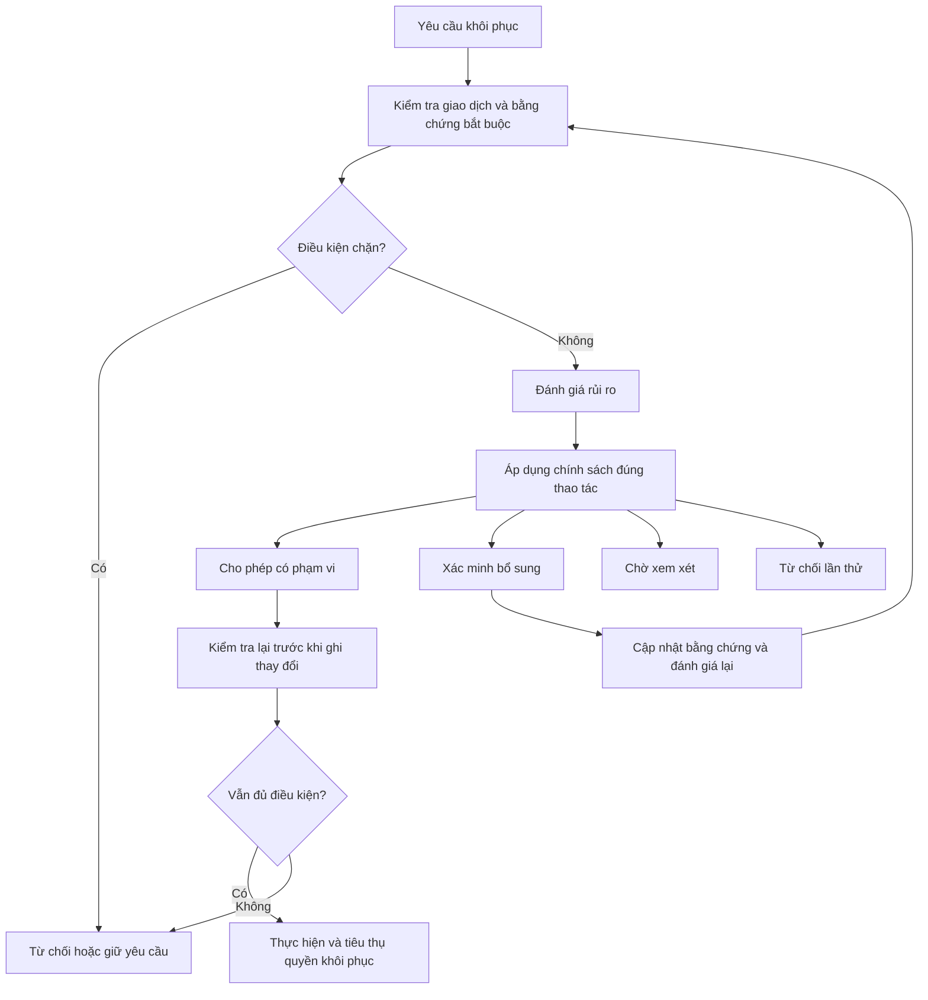

# Risk threshold policy — Chính sách ngưỡng rủi ro trong khôi phục tài khoản

## 1. Chính sách ngưỡng giải quyết vấn đề gì?

Trong luồng khôi phục tài khoản, hệ thống phải quyết định có cho phép người yêu cầu đặt lại mật khẩu, thay MFA, đăng ký passkey mới hoặc lấy lại quyền truy cập hay không. Những quyết định này có thể trao quyền kiểm soát tài khoản cho một người chưa đăng nhập bằng phương thức thông thường.

Một điểm rủi ro chỉ mô tả kết quả đánh giá. **Risk threshold policy** là chính sách biến kết quả đó thành hành động được phép thực hiện, kèm điều kiện xác minh, phạm vi quyền và cách xử lý khi thông tin không đủ.

Ví dụ, hai yêu cầu cùng có điểm rủi ro 25 có thể nhận quyết định khác nhau:

- Người dùng còn một passkey đã đăng ký và chỉ cần đặt lại mật khẩu.
- Người dùng đã mất mọi phương thức xác thực, yêu cầu thay số điện thoại nhận mã và xóa MFA.

Yêu cầu thứ hai thay đổi nhiều điểm kiểm soát hơn. Một ngưỡng dùng chung cho mọi thao tác có thể khiến luồng khôi phục trở thành đường vòng để chiếm tài khoản.

Mục tiêu của bài học là thiết kế một chính sách trả lời rõ bốn câu hỏi:

1. Những điều kiện nào bắt buộc phải đúng trước khi xét điểm?
2. Với mức rủi ro hiện tại, hệ thống cho phép, yêu cầu xác minh thêm, giữ yêu cầu hay từ chối?
3. Quyết định có hiệu lực cho thao tác nào và trong bao lâu?
4. Điều gì khiến hệ thống phải đánh giá lại trước khi hoàn tất?

## 2. Phân biệt điểm, ngưỡng và bằng chứng xác minh

### 2.1. Điểm rủi ro

Giả sử một bộ đánh giá trả điểm trong khoảng 0–100, điểm lớn hơn biểu thị rủi ro cao hơn. Đây là quy ước của ví dụ; hệ thống khác có thể dùng thang hoặc chiều điểm khác.

Đặc tả đầu ra cần nêu rõ:

| Thuộc tính | Ý nghĩa |
| --- | --- |
| Thang điểm và chiều điểm | Điểm nào biểu thị rủi ro cao hơn? |
| Phiên bản bộ đánh giá | Điểm được tạo bởi mô hình hoặc tập luật nào? |
| Thời điểm đánh giá | Kết quả còn đủ mới để quyết định không? |
| Tín hiệu thiếu | Những dữ liệu nào không thu thập được? |
| Phạm vi đánh giá | Đang đánh giá yêu cầu, tài khoản hay một thao tác cụ thể? |

Điểm 80 không tự động có nghĩa là xác suất bị tấn công bằng 80%. Chỉ diễn giải điểm thành xác suất khi đầu ra được thiết kế, hiệu chuẩn và đánh giá cho mục đích đó. Ngưỡng của phiên bản cũ cũng không tự động phù hợp với phiên bản mới.

### 2.2. Ngưỡng rủi ro

Ngưỡng là ranh giới làm thay đổi quyết định. Nếu chính sách dùng ngưỡng 30, phải mô tả chính xác điểm 30 thuộc nhánh nào.

Một quy ước không chồng lấn là:

- `0 ≤ score < 30`.
- `30 ≤ score < 60`.
- `60 ≤ score < 80`.
- `80 ≤ score ≤ 100`.

Ngoài ranh giới số học, chính sách còn cần nhánh riêng cho điểm không hợp lệ, quá hạn hoặc không tính được. Không ép các trường hợp này vào một khoảng điểm hợp lệ.

### 2.3. Bằng chứng xác minh

Tín hiệu rủi ro và bằng chứng xác minh phục vụ hai vai trò khác nhau:

- IP quen thuộc hoặc thiết bị thường dùng có thể làm giảm nghi ngờ.
- Hoàn thành một thử thách bằng phương thức đã đăng ký có thể cung cấp bằng chứng kiểm soát phương thức đó.
- Một token khôi phục hợp lệ có thể chứng minh quyền thực hiện đúng thao tác mà token được cấp.

**Điểm thấp không thay thế bằng chứng bắt buộc.** Người yêu cầu chưa chứng minh điều kiện tối thiểu vẫn chưa được đặt lại mật khẩu dù điểm rủi ro bằng 0.

Ngược lại, token hợp lệ cũng không buộc hệ thống phải chấp nhận một yêu cầu đã xuất hiện dấu hiệu chiếm đoạt tài khoản. Token chứng minh một điều kiện trong luồng; quyết định cuối cùng còn phụ thuộc vào trạng thái tài khoản, chính sách và thao tác được yêu cầu.

## 3. Đặc tả chính sách bằng điều kiện và hành động

Một quyết định nên là một đối tượng có cấu trúc, thay vì chỉ là `allowed = true`.

Ví dụ:

```text
decision: STEP_UP
allowedAction: NONE
requiredEvidence: APPROVED_PREEXISTING_AUTHENTICATOR
reasonCodes:
  - NEW_DEVICE
  - RECENT_RECOVERY_CONTACT_CHANGE
policyVersion: recovery-policy-v7
assessmentId: assessment-123
evaluatedAt: thời điểm máy chủ
validUntil: thời điểm hết hiệu lực của quyết định
```

Đây là ví dụ mô tả nội bộ. Không trả toàn bộ điểm, reason code hoặc chi tiết ngưỡng cho trình duyệt của người chưa được xác minh.

### 3.1. Xử lý điều kiện chặn trước khi áp dụng bảng ngưỡng

Một số điều kiện không nên bị “bù điểm” bởi các tín hiệu thuận lợi:

- Bằng chứng hoặc token bắt buộc bị thiếu, sai, hết hạn, đã dùng hoặc không khớp mục đích.
- Yêu cầu đã bị hủy hoặc giao dịch khôi phục đã kết thúc.
- Tài khoản đang có lệnh giữ khôi phục do quy trình xử lý sự cố.
- Thao tác được yêu cầu nằm ngoài phạm vi được phép của giao dịch.
- Có bằng chứng trực tiếp làm vô hiệu phương thức đang được dùng để xác minh.

Ví dụ, một thiết bị quen thuộc không làm token đã dùng trở lại hợp lệ. Chính sách phải kiểm tra tính hợp lệ của token độc lập với việc chấm điểm.

Điều kiện chặn cũng cần xác định hậu quả cụ thể: từ chối lần thử hiện tại, giữ giao dịch để xem xét hay chuyển sang một quy trình xác minh khác. Không mặc định khóa vĩnh viễn cả tài khoản chỉ vì có một yêu cầu đáng ngờ; kẻ tấn công có thể lợi dụng hành vi đó để gây từ chối dịch vụ.

### 3.2. Bảng quyết định minh họa

Bảng dưới áp dụng cho **một loại thao tác đã xác định**, sau khi các điều kiện bắt buộc ban đầu đã đạt. Các số chỉ minh họa cách đặc tả, không phải cấu hình khuyến nghị để đưa vào vận hành.

| Điều kiện | Quyết định | Hệ quả |
| --- | --- | --- |
| Có điều kiện chặn | `REJECT_ATTEMPT` hoặc `HOLD_FOR_REVIEW` | Không thực hiện thay đổi thông tin xác thực |
| Thiếu tín hiệu trọng yếu, kết quả quá hạn hoặc bộ đánh giá không khả dụng | Nhánh `UNKNOWN` | Dùng phương án dự phòng đã phê duyệt; không tự coi là rủi ro thấp |
| `0 ≤ score < 30` | `ALLOW_SCOPED_RECOVERY` | Chỉ cho phép thao tác đã được xác minh trong phạm vi giao dịch |
| `30 ≤ score < 60` | `STEP_UP` | Yêu cầu bằng chứng bổ sung phù hợp trước khi quyết định tiếp |
| `60 ≤ score < 80` | `HOLD_FOR_REVIEW` | Chưa thay đổi tài khoản; cần xử lý theo quy trình có điều kiện rõ ràng |
| `80 ≤ score ≤ 100` | `REJECT_ATTEMPT` | Kết thúc hoặc từ chối lần thử theo chính sách chống lạm dụng |

`STEP_UP` là yêu cầu xác minh bổ sung, không phải một quyền khôi phục đã được cấp. Nếu người dùng không còn phương thức đủ điều kiện, hệ thống phải chuyển sang nhánh xử lý được phép hoặc từ chối; không âm thầm hạ xuống một phương thức yếu hơn để luồng luôn kết thúc thành công.

Tương tự, `HOLD_FOR_REVIEW` không có nghĩa là “đợi đủ lâu rồi tự chấp nhận”. Thời gian chờ không tự tạo ra bằng chứng danh tính.

## 4. Ngưỡng phải gắn với thao tác và mức thiệt hại

### 4.1. Phạm vi khôi phục khác nhau cần chính sách khác nhau

Những thao tác sau không nên mặc định dùng cùng một ngưỡng:

| Thao tác | Câu hỏi chính sách cần trả lời |
| --- | --- |
| Đặt lại mật khẩu khi còn một phương thức xác thực mạnh đã đăng ký | Bằng chứng hiện tại đủ cho việc đổi mật khẩu chưa? |
| Thay MFA đã mất | Ai được phép vô hiệu MFA cũ, và dựa vào bằng chứng nào? |
| Đăng ký passkey thay thế khi mất toàn bộ thiết bị | Làm sao thiết lập lại quyền kiểm soát mà không bỏ qua yêu cầu xác minh? |
| Đổi địa chỉ email hoặc số điện thoại khôi phục | Kênh mới có được dùng ngay để xác minh chính thay đổi đó không? |
| Khôi phục tài khoản có quyền quản trị hoặc dữ liệu nhạy cảm | Hậu quả của việc chấp nhận sai có đòi hỏi thêm lớp kiểm soát không? |

Có thể dùng chung bộ đánh giá rủi ro nhưng ánh xạ sang các bảng quyết định khác nhau. Điều quan trọng là phạm vi hành động và bằng chứng bắt buộc được khai báo rõ.

Một phiên chỉ được cấp quyền đặt lại mật khẩu không tự có quyền tắt MFA, đổi email hoặc tạo passkey mới. Nếu cần mở rộng phạm vi, phải có quyết định riêng cho thao tác mới.

### 4.2. Đừng để dữ liệu người yêu cầu tự khai quyết định ngưỡng

Máy chủ phải lấy loại tài khoản, quyền quản trị, lịch sử phương thức xác thực và mức nhạy cảm từ nguồn đáng tin cậy. Không nhận trực tiếp `accountType = normal` hoặc `risk = low` từ request để chọn chính sách dễ hơn.

Các ngoại lệ cho từng nhóm tài khoản cần có cơ sở nghiệp vụ, người chịu trách nhiệm và khả năng giải thích. Phân nhóm tùy tiện có thể tạo ra đường khôi phục yếu mà kẻ tấn công chủ động lựa chọn.

## 5. Ví dụ xuyên suốt: khôi phục khi mất điện thoại MFA

Giả sử Lan mất điện thoại chứa ứng dụng MFA nhưng vẫn kiểm soát email khôi phục đã đăng ký từ trước. Lan gửi yêu cầu từ một máy tính mới.

### Bước 1: Xác định đúng mục đích

Mục đích của giao dịch là khôi phục khả năng sử dụng MFA, không phải xóa toàn bộ phương thức xác thực. Máy chủ tạo một giao dịch riêng, gắn với tài khoản, mục đích, thời hạn và ngân sách thử.

### Bước 2: Xác minh điều kiện ban đầu

Lan mở đường dẫn gửi đến email đã đăng ký. Nếu token hợp lệ và còn dùng được, hệ thống ghi nhận bằng chứng kiểm soát kênh email tại thời điểm đó.

Bằng chứng này chưa mặc nhiên đủ để thay MFA. Email có thể là phương thức khởi động quy trình trong khi chính sách thay MFA yêu cầu thêm một phương thức đã đăng ký hoặc quy trình xác minh khác.

### Bước 3: Áp dụng bảng quyết định đúng thao tác

Bộ đánh giá cho điểm 47 theo thang minh họa. Chính sách chọn `STEP_UP`.

Nếu Lan còn recovery code hợp lệ và chính sách cho phép dùng loại bằng chứng này cho thao tác đang yêu cầu, hệ thống xác minh và tiêu thụ code theo quy tắc dùng một lần. Nếu Lan không còn bằng chứng phù hợp, giao dịch chuyển sang quy trình xem xét đã được thiết kế.

Hệ thống không gửi thêm nhiều mã đến cùng email rồi coi số lượng mã thành công là nhiều yếu tố độc lập.

### Bước 4: Đánh giá lại trước khi thay MFA

Trong lúc giao dịch đang chờ, hệ thống phát hiện email khôi phục vừa được thay đổi từ một phiên đáng ngờ. Tín hiệu mới có thể làm phương thức xác minh không còn đủ điều kiện hoặc khiến giao dịch phải bị giữ lại.

Quyết định cho phép trước đó không phải một giấy phép vĩnh viễn. Trước khi ghi thay đổi MFA, máy chủ cần đối chiếu lại trạng thái, hiệu lực bằng chứng và chính sách áp dụng.

### Bước 5: Hoàn tất trong phạm vi đã cho phép

Chỉ sau khi có quyết định cuối cùng hợp lệ, hệ thống mới thực hiện đúng thay đổi đã được phê duyệt, tiêu thụ quyền khôi phục và áp dụng quy tắc session tương ứng. Những quyền như đổi email hoặc đăng ký thêm thông tin xác thực không nằm trong phạm vi này cần luồng riêng.

## 6. Tín hiệu thiếu, mâu thuẫn và có tương quan

### 6.1. Không biến “không biết” thành “an toàn”

Nếu dịch vụ đánh giá thiết bị không phản hồi, giá trị đó là `UNKNOWN`, không phải “thiết bị đáng tin”.

Nên phân biệt:

- Tín hiệu có giá trị bình thường.
- Tín hiệu có giá trị bất thường.
- Tín hiệu không thu thập được.
- Tín hiệu quá cũ để dùng.
- Tín hiệu có nguồn không đáng tin.

Thiếu một tín hiệu phụ có thể cho phép tiếp tục bằng một chính sách dự phòng bảo thủ. Thiếu một điều kiện xác minh cốt lõi có thể buộc giao dịch dừng. Hai trường hợp này cần được đặc tả riêng.

Khi hệ thống rủi ro gặp sự cố, phương án dự phòng nên giữ được đường xử lý hợp lệ cho người dùng mà vẫn bảo vệ thao tác nhạy cảm. Tự động chấp nhận mọi yêu cầu để tránh gián đoạn là một thay đổi chính sách bảo mật, không phải lựa chọn kỹ thuật vô hại.

### 6.2. Tín hiệu mâu thuẫn cần có thứ tự ưu tiên

Ví dụ:

- Thiết bị quen thuộc nhưng token đã bị thu hồi.
- IP thường dùng nhưng có cảnh báo kênh khôi phục bị chiếm quyền.
- Giao dịch có điểm thấp nhưng tài khoản đang bị giữ theo quy trình sự cố.

Trong các trường hợp này, chính sách cần quy định điều kiện nào chặn, điều kiện nào chỉ góp điểm. Một phép cộng tổng không nên vô tình làm mất tác dụng của lệnh thu hồi hoặc cảnh báo có tính quyết định.

### 6.3. Không cộng lặp bằng chứng cùng nguồn

“IP quen thuộc”, “vị trí quen thuộc” và “mạng thường dùng” có thể cùng bắt nguồn từ một dấu hiệu mạng. Xem chúng như ba bằng chứng độc lập có thể khiến rủi ro bị đánh giá thấp.

Tương tự, email OTP và đường dẫn khôi phục gửi đến cùng hộp thư không tự trở thành hai yếu tố xác minh độc lập. Chính sách nên ghi nhận nguồn gốc bằng chứng và phụ thuộc giữa các tín hiệu.

## 7. Chọn ngưỡng dựa trên chi phí sai lầm

### 7.1. Hai nhóm sai lầm

- **Chấp nhận sai:** người không có quyền hoàn tất khôi phục và chiếm tài khoản.
- **Gây trở ngại hoặc từ chối sai:** chủ tài khoản hợp lệ bị yêu cầu thêm bước, phải chờ hoặc không thể khôi phục.

Hai nhóm này có chi phí khác nhau theo thao tác, tài khoản và bối cảnh. Chính sách chỉ tối ưu tỷ lệ hoàn thành có thể hạ ngưỡng quá thấp. Chính sách chỉ tối ưu tỷ lệ chặn có thể khiến chủ tài khoản thật mất quyền truy cập lâu dài.

### 7.2. Diễn giải bằng tổn thất kỳ vọng

Nếu có ước lượng xác suất tấn công `p` đã được hiệu chuẩn, có thể dùng mô hình đơn giản để hỗ trợ thiết kế:

```text
expectedLoss(allow) = p × lossIfTakeover

expectedLoss(stepUp) =
    p × residualLossAfterStepUp
    + (1 - p) × legitimateUserFrictionCost
    + operatingCost
```

Mô hình này chỉ giúp so sánh chi phí; nó không thay thế các điều kiện xác minh bắt buộc. Một hành động chỉ được đưa vào so sánh khi hành động đó đã đủ điều kiện theo chính sách.

Ví dụ giả định: xác suất tấn công 1% và tổn thất khi chiếm tài khoản là 20.000 đơn vị chi phí tạo ra tổn thất kỳ vọng 200 đơn vị nếu cho phép ngay. Cùng xác suất đó nhưng tổn thất là 200 đơn vị chỉ tạo ra 2 đơn vị kỳ vọng.

Vì vậy, một xác suất giống nhau không buộc mọi thao tác phải có cùng quyết định. Những con số thực tế phải dựa trên dữ liệu phù hợp, mức bất định và giới hạn chấp nhận rủi ro của hệ thống.

### 7.3. Chất lượng dữ liệu ảnh hưởng trực tiếp đến ngưỡng

Nhãn “không có khiếu nại” không bảo đảm yêu cầu là hợp lệ. Nạn nhân có thể báo cáo muộn hoặc chưa phát hiện tài khoản bị chiếm.

Ngoài ra:

- Các yêu cầu đã bị chặn thường không cho biết chắc điều gì sẽ xảy ra nếu được chấp nhận.
- Dữ liệu quá khứ có thể phản ánh chính sách cũ, không đại diện cho lưu lượng sau khi đổi ngưỡng.
- Các tài khoản có quyền cao có thể ít mẫu nhưng gây thiệt hại lớn.
- Thiết bị mới có thể phổ biến ở người dùng vừa mất thiết bị; bất thường không đồng nghĩa với tấn công.

Khi mô tả một tỷ lệ, phải ghi rõ tử số, mẫu số, khoảng thời gian và cách xác định kết quả. “Tỷ lệ gian lận 0,1%” thiếu định nghĩa chưa đủ để chọn ngưỡng.

## 8. Cấu trúc bộ quyết định trên máy chủ

Ví dụ dưới là mã giả để diễn đạt thứ tự quyết định, không phải triển khai hoàn chỉnh:

```text
decideRecovery(transaction, requestedAction, evidence, assessment, policy):
    require transaction is active
    require requestedAction belongs to transaction.allowedPurpose

    if mandatoryEvidenceIsInvalidOrMissing(evidence, requestedAction, policy):
        return REJECT_ATTEMPT

    if hasBlockingCondition(transaction, evidence, policy):
        return policy.decisionForBlockingCondition

    if assessment is missing, stale, invalid, or for another transaction:
        return policy.unknownRiskDecision

    if assessment.version is not supported by policy:
        return policy.unknownRiskDecision

    score = assessment.score

    if score < 30:
        return ALLOW_SCOPED_RECOVERY(requestedAction)

    if score < 60:
        return STEP_UP(policy.requiredAdditionalEvidence)

    if score < 80:
        return HOLD_FOR_REVIEW

    return REJECT_ATTEMPT
```

Hàm kiểm tra tính hợp lệ phải loại bỏ điểm ngoài thang đo và các giá trị không phải số hữu hạn trước khi đi qua chuỗi so sánh. Nếu một điểm lỗi rơi xuống nhánh cho phép do cơ chế mặc định, bảng ngưỡng trên giấy sẽ không còn ý nghĩa.

Một số ràng buộc khác cần nằm trong thiết kế:

- Máy chủ chọn chính sách và phiên bản, không tin phiên bản do client yêu cầu.
- Bằng chứng gắn với đúng tài khoản, giao dịch, mục đích và thời hạn.
- Số lần thử và tốc độ yêu cầu được kiểm soát riêng, không chỉ góp một ít vào tổng điểm.
- Kết quả step-up được ghi nhận vào giao dịch; hệ thống đánh giá lại bằng chứng và rủi ro thay vì tự trừ một số điểm cố định.
- Một điều kiện chặn chưa được gỡ hợp lệ vẫn có hiệu lực sau khi người dùng hoàn thành bước bổ sung.

Nếu bổ sung xác minh không thể giải quyết nguyên nhân rủi ro, lặp lại cùng thử thách không giúp giao dịch trở nên an toàn hơn.

## 9. Quyết định phải được ràng buộc với vòng đời giao dịch



Giữa lúc đánh giá và lúc thay đổi thông tin xác thực có thể phát sinh nhiều sự kiện: token bị dùng ở yêu cầu khác, người dùng hủy khôi phục, tài khoản bị giữ hoặc phương thức xác minh bị thu hồi.

Để tránh sử dụng quyết định cũ cho trạng thái mới:

1. Lưu định danh đánh giá, phiên bản chính sách, phạm vi hành động và hạn hiệu lực ở phía máy chủ.
2. Trước khi hoàn tất, đối chiếu trạng thái hiện tại và các sự kiện làm mất hiệu lực quyết định.
3. Thực hiện kiểm tra, thay đổi thông tin xác thực và tiêu thụ quyền dùng một lần bằng cơ chế giao dịch hoặc cơ chế nhất quán tương đương.
4. Với lần gửi lặp, trả trạng thái hoàn tất phù hợp; không thực hiện lại thay đổi nhạy cảm.

Khi chính sách đổi giữa giao dịch, cần quy định trước một trong các cách xử lý: tiếp tục theo phiên bản còn được cho phép, đánh giá lại theo phiên bản mới hoặc kết thúc giao dịch cũ. Một thay đổi khẩn cấp nhằm xử lý lỗ hổng không nên bị vô hiệu chỉ vì một quyết định cũ chưa hết hạn.

Sau khôi phục, chính sách session cần tương ứng với loại sự cố: thu hồi các session hoặc token liên quan khi cần, tránh tạo ngay một phiên toàn quyền ngoài phạm vi đã xác minh, và yêu cầu đăng nhập hoặc xác thực lại theo thiết kế của luồng.

## 10. Vận hành chính sách và giải thích quyết định

Mỗi phiên bản chính sách nên mô tả tối thiểu:

| Thành phần | Nội dung cần xác định |
| --- | --- |
| Phạm vi | Loại thao tác và nhóm tài khoản áp dụng |
| Điều kiện bắt buộc | Bằng chứng tối thiểu và điều kiện chặn |
| Ngưỡng | Ranh giới, nhánh tại điểm bằng ngưỡng, thang điểm |
| Trạng thái chưa biết | Thiếu dữ liệu, quá hạn, lỗi bộ đánh giá |
| Vòng đời | Hiệu lực quyết định và sự kiện buộc đánh giá lại |
| Sau khôi phục | Phạm vi session, thông báo và thay đổi quyền truy cập |
| Trách nhiệm | Người quản lý chính sách và quy trình ngoại lệ |

Khi triển khai một ngưỡng mới, có thể quan sát quyết định đề xuất song song với quyết định đang có hiệu lực để ước lượng tác động. Chế độ quan sát không được tự cấp quyền, gửi thêm thử thách hoặc thay đổi tài khoản.

Các chỉ số hữu ích gồm tỷ lệ hoàn tất của người dùng hợp lệ theo nhánh, tỷ lệ phải step-up, thời gian chờ, số yêu cầu ở trạng thái chưa biết, khiếu nại sau khôi phục và sự cố chiếm tài khoản đã xác nhận. Cần nhìn cả thiệt hại lẫn mức cản trở, có xét độ trễ của nhãn kết quả.

Nhật ký quyết định nên ghi mã giao dịch, hành động, quyết định, reason code nội bộ và phiên bản chính sách. Hạn chế dữ liệu nhạy cảm, đặt thời hạn lưu và phân quyền truy cập. Không ghi token khôi phục nguyên văn, recovery code hoặc bí mật xác thực vào log.

Đối với người yêu cầu, thông báo cần hướng dẫn được bước tiếp theo nhưng không làm lộ tài khoản có tồn tại hay không, chi tiết bộ chấm điểm hoặc cách vượt ngưỡng. Thông báo an ninh sau thay đổi nên gửi qua kênh đủ tin cậy theo chính sách, tránh phụ thuộc hoàn toàn vào thông tin liên hệ vừa được thay trong cùng giao dịch.

Ngoại lệ do nhân viên hỗ trợ xử lý phải có quy trình riêng: căn cứ xác minh, phạm vi thao tác, thời hạn, thẩm quyền và dấu vết quyết định. Việc một người có quyền bấm nút hỗ trợ không tự tạo ra bằng chứng rằng người yêu cầu là chủ tài khoản.

## 11. Những lỗi thiết kế thường gặp

| Lỗi | Hậu quả | Hướng thiết kế phù hợp |
| --- | --- | --- |
| Cho điểm thấp đi thẳng đến thay thông tin xác thực | Bỏ qua bằng chứng sở hữu bắt buộc | Kiểm tra bằng chứng trước bảng ngưỡng |
| Dùng một ngưỡng cho đổi mật khẩu và xóa MFA | Không phản ánh quyền được trao và mức thiệt hại | Gắn chính sách với thao tác |
| Mặc định điểm 0 khi dịch vụ rủi ro lỗi | Biến mất dữ liệu thành dấu hiệu an toàn | Có nhánh chưa biết rõ ràng |
| Cộng nhiều tín hiệu cùng nguồn như bằng chứng độc lập | Tạo cảm giác tin cậy quá mức | Theo dõi nguồn gốc và tương quan |
| Tự cho phép khi hết thời gian chờ | Nhầm độ trễ với xác minh danh tính | Chỉ tiếp tục khi đạt điều kiện được quy định |
| Dùng lại quyết định cũ sau khi mở rộng thao tác | Quyền đặt lại mật khẩu bị dùng để thay MFA | Ràng buộc quyết định với mục đích và phạm vi |
| Tính lại ngưỡng nhưng không kiểm tra trước khi ghi | Chấp nhận bằng chứng đã hết hiệu lực | Kiểm tra trạng thái và tiêu thụ quyền nhất quán |
| Từ chối lần thử bằng cách khóa cả tài khoản vô thời hạn | Tạo cơ hội gây mất quyền truy cập | Phân biệt lần thử, giao dịch và trạng thái tài khoản |

## 12. Điểm cần ghi nhớ

Một chính sách ngưỡng tốt không chỉ trả lời “điểm bao nhiêu thì chặn”. Nó kết nối bằng chứng xác minh, mức rủi ro, mức nhạy cảm của thao tác và vòng đời giao dịch thành một quyết định có phạm vi rõ ràng.

Các nguyên tắc cốt lõi là: điểm thấp không thay thế xác minh; điều kiện chặn không bị bù bằng điểm thuận lợi; dữ liệu thiếu cần nhánh riêng; và quyền khôi phục phải được kiểm tra lại trước khi thay đổi tài khoản. Ngưỡng số học chỉ có ý nghĩa khi những điều kiện này được bảo toàn.
