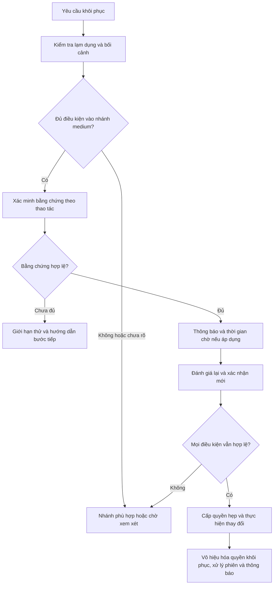

# Medium risk recovery

## 1. Khôi phục tài khoản ở mức rủi ro trung bình là gì?

**Medium risk recovery** là nhánh khôi phục dành cho yêu cầu có dấu hiệu bất thường cần xác minh thêm, nhưng chưa có đủ căn cứ để xử lý như một vụ chiếm đoạt tài khoản. Hệ thống chỉ tiếp tục khi người yêu cầu cung cấp được bằng chứng phù hợp với thao tác cần thực hiện.

Ví dụ, Linh mất điện thoại có ứng dụng TOTP, còn nhớ mật khẩu và giữ mã khôi phục đã cấp từ trước ở một nơi riêng. Linh bắt đầu khôi phục trên máy tính mới, từ mạng khách sạn. Thiết bị và mạng mới làm tăng sự không chắc chắn; mật khẩu cùng mã khôi phục hợp lệ có thể tạo một đường xác minh được chính sách cho phép.

Nếu Linh chỉ có địa chỉ email công khai và nói rằng mình bị mất điện thoại, hệ thống chưa có cơ sở để cho phép xóa MFA. Mức rủi ro phải được xem cùng **chất lượng bằng chứng**, **tác động của thay đổi** và **mức bảo đảm mà tài khoản cần duy trì**.

Các nhãn low, medium, high trong bài là cách phân loại nội bộ của một sản phẩm giả định. Chúng không ánh xạ trực tiếp sang AAL1, AAL2, AAL3. NIST mô tả yêu cầu khôi phục theo mức bảo đảm và phương thức xác minh cụ thể; triển khai có yêu cầu tuân thủ phải đối chiếu những yêu cầu đó riêng. [NIST SP 800-63B-4, mục Account Recovery](https://pages.nist.gov/800-63-4/sp800-63b.html#sec4-2).

Mục tiêu của nhánh medium là cung cấp một đường đi có kiểm soát: thu thập đủ bằng chứng, giới hạn quyền khôi phục, quan sát thay đổi rủi ro và chỉ hoàn tất đúng thao tác đã được duyệt.

## 2. Khi nào một yêu cầu có thể đi vào nhánh medium?

Việc phân loại diễn ra trên máy chủ. Giá trị do trình duyệt gửi như `risk=medium`, `trustedDevice=true` hoặc `mfaLost=false` chỉ là dữ liệu đầu vào chưa đáng tin.

| Tình huống | Điều cần làm rõ | Hướng xử lý có thể phù hợp |
| --- | --- | --- |
| Quên mật khẩu, dùng trình duyệt mới, còn phương thức xác minh đã đăng ký | Người yêu cầu còn kiểm soát phương thức nào và phương thức đó đủ cho thao tác nào? | Xác minh theo chính sách rồi chỉ cấp quyền đặt mật khẩu |
| Mất TOTP, còn mật khẩu và mã khôi phục đã cấp | Mã còn hiệu lực, chưa dùng và không phụ thuộc thiết bị bị mất? | Xem xét nhánh medium có xác minh bổ sung |
| Mất một thiết bị chứa passkey, còn passkey hoạt động trên thiết bị khác | Có thể xác thực bình thường bằng passkey còn lại không? | Ưu tiên đường quản lý authenticator sau xác thực nếu đủ điều kiện |
| Mạng thay đổi, thiết bị mới, nhiều lần nhập sai nhưng còn bằng chứng hợp lệ | Đây là khó khăn sử dụng hay chuỗi thử tự động? | Giới hạn thử, đánh giá lại trước khi tiếp tục |
| Email khôi phục vừa thay đổi, đồng thời có cảnh báo phiên bị đánh cắp | Kênh xác minh và phiên hiện tại có bị kiểm soát không? | Chuyển quy trình điều tra hoặc rủi ro cao |
| Không còn phương thức xác minh hay đường khôi phục đã thiết lập | Có cách xác minh danh tính phù hợp đã được sản phẩm hỗ trợ không? | Chuyển hỗ trợ có kiểm soát; không tự cấp quyền từ điểm medium |

Một địa chỉ IP mới có thể xuất hiện khi người dùng đi du lịch. Một địa chỉ IP quen cũng có thể xuất hiện khi kẻ tấn công dùng cùng mạng hoặc chiếm thiết bị. Vì vậy, không dùng một tín hiệu mạng để kết luận quyền sở hữu tài khoản.

Trong mô hình ở bài này, tài khoản quản trị hoặc tài khoản có quyền truy cập đặc biệt đi qua chính sách riêng. Một điểm số medium không tự mở đường khôi phục phổ thông cho mọi loại tài khoản.

## 3. Tách bằng chứng xác minh khỏi tín hiệu bối cảnh

Thiết kế nên giữ hai tập dữ liệu riêng:

- **Bằng chứng xác minh:** kết quả xác minh một authenticator đã liên kết, mã khôi phục hợp lệ hoặc kết quả xác minh danh tính được quy trình cho phép.
- **Tín hiệu bối cảnh:** tuổi của kênh liên hệ, thiết bị, mạng, lịch sử yêu cầu, thay đổi bảo mật gần đây, dấu hiệu tự động hóa và độ mới của dữ liệu đánh giá.

Địa lý và tín hiệu rủi ro có thể hỗ trợ quyết định xác thực nhưng không thay thế một yếu tố xác thực. OWASP cũng nhấn mạnh rằng cơ chế đặt lại MFA phải tránh tạo đường vượt qua MFA. [OWASP Multifactor Authentication Cheat Sheet](https://cheatsheetseries.owasp.org/cheatsheets/Multifactor_Authentication_Cheat_Sheet.html).

Mỗi bằng chứng cần gắn với tài khoản, yêu cầu khôi phục, loại bằng chứng, thời điểm xác minh và phiên bản cấu hình bảo mật. Dòng dữ liệu `emailVerified=true` không đủ để biết email nào đã được kiểm tra, kiểm tra lúc nào và có thay đổi sau đó hay chưa.

### 3.1. Kiểm tra sự phụ thuộc giữa các kênh

Hai bằng chứng có thể cùng bị phá vỡ bởi một sự cố:

- Email và SMS đều được truy cập từ điện thoại bị mất.
- Mã khôi phục lưu trong cùng tài khoản đám mây đang bị chiếm.
- Một phiên trình duyệt cũ có thể đã bị sao chép cookie.
- Email mới được thêm bằng phiên đang bị nghi ngờ.

Trong những trường hợp này, việc đếm số bước hoàn thành có thể tạo cảm giác chắc chắn sai. Chính sách cần xem nguồn gốc và khả năng bị kiểm soát chung của bằng chứng.

Một token gửi đến hộp thư chứng minh khả năng nhận thư tại thời điểm kiểm tra. Phạm vi quyền được cấp sau đó vẫn phụ thuộc vào chính sách của thao tác. Token đặt lại mật khẩu không tự có quyền gỡ MFA hoặc thay địa chỉ khôi phục.

### 3.2. Dữ liệu thiếu phải được biểu diễn rõ

Nếu dịch vụ rủi ro không phản hồi, hãy giữ trạng thái như `UNKNOWN` hoặc `UNAVAILABLE`. Không chuyển lỗi timeout thành `riskScore=0`.

Trong thiết kế minh họa, dữ liệu rủi ro không đủ mới sẽ đưa yêu cầu về trạng thái chờ hoặc nhánh xem xét. Người dùng vẫn nhận được hướng dẫn về bước tiếp theo; hệ thống không cấp quyền thay đổi authenticator chỉ để bỏ qua sự cố hạ tầng.

## 4. Xây chính sách theo thao tác cụ thể

Một yêu cầu khôi phục nên có một mục đích rõ ràng:

| Mục đích | Quyền hẹp có thể cấp sau xác minh | Những thay đổi cần quyết định riêng |
| --- | --- | --- |
| `RESET_PASSWORD` | Đặt mật khẩu mới cho đúng tài khoản | Gỡ MFA, đổi email, cấp API key |
| `REPLACE_LOST_TOTP` | Đăng ký và xác nhận TOTP thay thế | Đổi số điện thoại hoặc thêm quyền |
| `REPLACE_LOST_PASSKEY` | Đăng ký passkey mới và xử lý credential bị mất | Khôi phục khóa riêng của passkey cũ |
| `RESTORE_ACCOUNT_ACCESS` | Thực hiện kế hoạch khôi phục đã được quy trình duyệt | Tự động mở toàn bộ thao tác nhạy cảm |

Với passkey, quá trình đăng ký mới tạo một credential mới. Dịch vụ không tái tạo khóa riêng bị mất từ một email khôi phục. Nếu người dùng còn authenticator đủ mạnh để xác thực và quản lý thiết bị, nên dùng khả năng đó theo chính sách trước khi chọn đường khôi phục mất quyền truy cập.

Một chính sách medium minh họa có thể gồm các điều kiện đồng thời:

1. Loại thao tác thuộc tập được hỗ trợ cho nhánh medium.
2. Tài khoản không thuộc nhóm phải xem xét đặc biệt.
3. Không có tín hiệu buộc chuyển sang quy trình xử lý chiếm đoạt.
4. Bằng chứng đáp ứng đúng tổ hợp mà chính sách thao tác yêu cầu.
5. Cấu hình bảo mật và kênh khôi phục vẫn khớp phiên bản đã xác minh.
6. Dữ liệu rủi ro còn đủ mới ở bước hoàn tất.
7. Các yêu cầu trì hoãn, thông báo và xác nhận lại đã hoàn thành.

Ví dụ, sản phẩm giả định có thể yêu cầu mật khẩu được xác minh mới cùng mã khôi phục đã cấp cho nhánh thay TOTP bị mất. Đây là một lựa chọn thiết kế của ví dụ; việc chấp nhận tổ hợp nào phải theo mô hình đe dọa và mức bảo đảm của hệ thống.

Điểm rủi ro có thể chọn nhánh xử lý, nhưng không được thay các điều kiện bắt buộc bằng phép cộng trừ. Một cảnh báo kênh bị chiếm không biến mất chỉ vì người dùng có lịch sử sử dụng lâu năm.

## 5. Luồng xử lý một yêu cầu medium



### Bước 1: Tiếp nhận yêu cầu

Máy chủ tạo `recoveryCaseId` khó đoán, lưu mục đích và đánh giá ban đầu. Phản hồi công khai không tiết lộ tài khoản có tồn tại hay không. OWASP khuyến nghị phản hồi nhất quán và kiểm soát việc gửi yêu cầu tự động để giảm dò tài khoản cùng làm phiền qua email hoặc SMS. [OWASP Forgot Password Cheat Sheet](https://cheatsheetseries.owasp.org/cheatsheets/Forgot_Password_Cheat_Sheet.html).

Việc nhận một yêu cầu chưa xác minh không làm thay đổi mật khẩu, gỡ MFA hoặc thu hồi toàn bộ phiên. Nếu chỉ cần biết email là có thể khóa tài khoản, kẻ tấn công có thể biến tính năng khôi phục thành công cụ gây gián đoạn.

### Bước 2: Xác minh bằng chứng

Máy chủ kiểm tra bằng chứng theo mục đích đã lưu. Kết quả từ một yêu cầu khác không tự được tái sử dụng.

Nếu người yêu cầu đổi từ đặt mật khẩu sang thay MFA, máy chủ phải tính lại điều kiện. Không giữ kết quả duyệt của thao tác cũ rồi mở thêm quyền bằng cách sửa tham số.

### Bước 3: Áp dụng thời gian chờ và thông báo nếu cần

Sản phẩm giả định có thể quy định thời gian chờ 6 giờ trước khi thay MFA trong một nhóm yêu cầu medium. Con số này chỉ minh họa cấu hình; nó không phải thời gian chờ tiêu chuẩn cho mọi hệ thống.

Thời gian chờ tạo cơ hội phát hiện và phản đối yêu cầu. Nó không bổ sung bằng chứng danh tính chỉ vì đã trôi qua đủ lâu.

Token thử thách ngắn hạn và thời gian chờ có vòng đời riêng. Token có thể hết hạn sau 15 phút trong ví dụ này, trong khi hồ sơ vẫn đang chờ. Khi đến bước cuối, hệ thống cấp thử thách mới theo chính sách; không kéo dài hiệu lực token ban đầu đến hết 6 giờ.

Thông báo gửi tới các điểm liên hệ đã xác minh theo chính sách thông báo của tài khoản, đặc biệt những điểm có trước yêu cầu thay đổi. NIST coi thông báo là một phần của quy trình khôi phục để hỗ trợ phát hiện gian lận. [NIST SP 800-63B-4, Account Recovery Notification](https://pages.nist.gov/800-63-4/sp800-63b.html#sec4-2).

### Bước 4: Đánh giá lại trước thay đổi

Trước khi hoàn tất, kiểm tra ít nhất các thay đổi liên quan:

- Người dùng đã báo không nhận ra yêu cầu.
- Kênh liên hệ hoặc danh sách authenticator đã đổi.
- Một yêu cầu khác đã khôi phục tài khoản thành công.
- Xuất hiện cảnh báo chiếm đoạt hoặc dữ liệu rủi ro không còn đủ mới.
- Bằng chứng đã hết hạn hoặc không còn phù hợp với phiên bản chính sách.

Hết thời gian chờ chỉ khiến hồ sơ đủ điều kiện được xét tiếp. Nó không tự tạo một phiên đăng nhập đầy đủ.

### Bước 5: Hoàn tất đúng thay đổi đã được duyệt

Máy chủ cấp quyền khôi phục hẹp, thực hiện thay đổi và vô hiệu hóa quyền đó. Sau đặt lại mật khẩu, người dùng đi qua đăng nhập bình thường theo chính sách hiện hành. Sau thay authenticator, hệ thống yêu cầu xác nhận authenticator mới trước khi coi quá trình đăng ký đã hoàn tất.

## 6. Quản lý trạng thái và bằng chứng trong hồ sơ

Một hồ sơ có thể lưu những trường sau trong cơ sở dữ liệu:

```text
RecoveryCase
  id
  accountId
  purpose
  state
  createdAt
  expiresAt
  evidenceVerifiedAt
  evidenceExpiresAt
  eligibleAfter
  policyVersion
  authenticatorVersion
  recoveryChannelVersion
  riskAssessmentId
  riskAssessedAt
  revision
```

Không lưu token thô, mật khẩu, TOTP seed hoặc mã khôi phục vào hồ sơ theo dõi thông thường. Bằng chứng chi tiết được bảo vệ theo loại dữ liệu và thời hạn lưu giữ thích hợp.

| Trạng thái | Ý nghĩa | Điều kiện chuyển tiếp |
| --- | --- | --- |
| `CHALLENGE_REQUIRED` | Chưa đủ bằng chứng | Hoàn thành tổ hợp thử thách được chính sách chấp nhận |
| `EVIDENCE_VERIFIED` | Bằng chứng đã được chấp nhận cho một mục đích | Áp dụng thông báo và quyết định chờ |
| `WAITING` | Đang trong thời gian chờ | Đến thời điểm xét tiếp và không có sự kiện chặn |
| `READY_FOR_FINAL_CHECK` | Có thể thực hiện kiểm tra cuối | Đánh giá lại, xác nhận mới khi cần, kiểm phiên bản |
| `COMPLETED` | Thay đổi được commit thành công | Trạng thái kết thúc |
| `CANCELLED` / `EXPIRED` | Đã hủy hoặc hết hạn | Không tiếp tục hồ sơ này |
| `REVIEW_REQUIRED` | Cần quy trình xem xét khác | Chỉ tiếp tục theo quyết định có thẩm quyền |

Nếu không cần chờ, hồ sơ có thể đi từ `EVIDENCE_VERIFIED` tới `READY_FOR_FINAL_CHECK`. Mọi đường vào `COMPLETED` vẫn phải đi qua kiểm tra cuối ở máy chủ.

Không dựa vào thứ tự trang giao diện để bảo vệ trạng thái. Một người có thể gọi thẳng API hoàn tất, gửi lại request cũ hoặc mở nhiều tab. API phải kiểm trạng thái và quyền trên mỗi thao tác.

## 7. Token một lần và quyền khôi phục hẹp

Token khôi phục cần có mục đích, thời hạn và trạng thái sử dụng rõ ràng. Các nguyên tắc về token ngẫu nhiên, lưu trữ an toàn, dùng một lần và hết hạn được OWASP trình bày trong hướng dẫn đặt lại mật khẩu. [OWASP Forgot Password Cheat Sheet](https://cheatsheetseries.owasp.org/cheatsheets/Forgot_Password_Cheat_Sheet.html).

Trong thiết kế minh họa:

- Token gắn với `accountId`, `recoveryCaseId`, `purpose` và phiên bản cấu hình đã được duyệt.
- Cơ sở dữ liệu lưu giá trị kiểm tra phù hợp thay cho token thô.
- Quyền đặt mật khẩu không được API quản lý MFA chấp nhận.
- Thử thách và quyền thực hiện thay đổi là hai đối tượng có thể có thời hạn khác nhau.
- Mọi quyền được kiểm lại khi hồ sơ bị hủy, hết hạn hoặc cấu hình tài khoản thay đổi.

Với token có entropy cao, có thể lưu giá trị băm để đối chiếu. Với OTP ngắn, chỉ băm không làm tăng không gian tìm kiếm; cần giới hạn thử trực tuyến và phương án bảo vệ dữ liệu xác minh phù hợp. Không coi một trường `hash` là giải pháp đầy đủ cho mọi loại mã.

Liên kết trong email có thể bị trình quét an toàn mở trước. Vì vậy, GET hiển thị trang không nên tự tiêu thụ token và thay đổi thông tin bảo mật. Bước xác nhận có tác dụng thay đổi dùng phương thức phù hợp như POST, kiểm tra ngữ cảnh và chống CSRF khi dựa trên cookie.

Trang xử lý token cần tránh đưa bí mật vào analytics, referrer hoặc log. Nếu trao token URL đổi lấy ngữ cảnh khôi phục phía máy chủ, việc đổi phải được kiểm soát và trang sau đó dùng URL đã loại bí mật.

## 8. Ngăn hoàn tất hai lần và thay đổi dữ liệu giữa các bước

Hai request đồng thời có thể cùng nhìn thấy token chưa dùng. Cách xử lý đọc `used=false`, cập nhật tài khoản rồi mới ghi `used=true` tạo ra một cửa sổ tranh chấp.

Một quy trình giao dịch minh họa:

```text
BEGIN TRANSACTION

1. Khóa tài khoản, hồ sơ và quyền khôi phục theo thứ tự thống nhất.
2. Kiểm tra token, thời hạn, mục đích, trạng thái và revision.
3. Đối chiếu kết quả đánh giá cuối cùng:
   account, purpose, policyVersion, authenticatorVersion,
   recoveryChannelVersion và thời hạn quyết định.
4. Nếu không khớp hoặc có sự kiện chặn: từ chối và không đổi credential.
5. Đánh dấu quyền khôi phục đã dùng bằng cập nhật có điều kiện.
6. Áp dụng đúng thay đổi credential đã được duyệt.
7. Tăng phiên bản bảo mật liên quan; vô hiệu hóa quyền khôi phục xung đột.
8. Áp dụng kế hoạch xử lý phiên và ghi sự kiện thông báo vào outbox.
9. Đánh dấu hồ sơ COMPLETED.

COMMIT
```

Nếu bước thay đổi credential thất bại, giao dịch rollback cả việc tiêu thụ quyền. Nếu thông báo được gửi qua hệ thống ngoài, outbox giúp tách việc commit dữ liệu khỏi việc gửi mà vẫn có thể thử lại.

Không giữ khóa cơ sở dữ liệu trong lúc chờ một dịch vụ đánh giá từ xa lâu. Có thể lấy quyết định trước, ràng buộc quyết định vào phiên bản dữ liệu rồi kiểm lại các phiên bản bên trong giao dịch ngắn. Nếu dữ liệu đã đổi, phải đánh giá lại.

Yêu cầu hủy và yêu cầu hoàn tất phải tranh chấp trên cùng trạng thái hoặc revision. Nếu hủy đã commit, hoàn tất không được tiếp tục từ dữ liệu cache cũ.

Khi hỗ trợ idempotency, khóa idempotency phải gắn với đúng hồ sơ, chủ thể và nội dung thao tác. Request lặp có thể nhận lại kết quả cũ phù hợp với quyền của nó; không được phát sinh thêm credential hoặc cấp lại phiên chỉ vì client gửi lại.

## 9. Kiểm soát session sau khôi phục

Một ngữ cảnh khôi phục nên chỉ truy cập các chức năng phục vụ hồ sơ, chẳng hạn xem tiến độ, nộp bằng chứng và thực hiện thao tác đã được duyệt.

| Ngữ cảnh | Quyền có thể được cấp trong ví dụ | Quyền cần xác thực hoặc quyết định riêng |
| --- | --- | --- |
| Chưa có bằng chứng | Bắt đầu yêu cầu, nhận phản hồi chung | Đọc dữ liệu tài khoản |
| Hồ sơ đang chờ | Xem tiến độ của hồ sơ khi đã được phép | Xuất dữ liệu, chuyển tiền, đổi email |
| Quyền khôi phục hẹp | Hoàn thành đúng thay đổi credential | Tạo API key, cấp quyền quản trị |
| Đăng nhập sau khôi phục | Quyền theo mức xác thực và chính sách hiện tại | Thao tác nhạy cảm cần xác nhận bổ sung |

Kế hoạch xử lý phiên phải xác định rõ:

- Phiên hoặc thiết bị bị mất có bị thu hồi không.
- Refresh token nào bị vô hiệu hóa.
- Các phiên còn lại cần xác thực lại ở thời điểm nào.
- Các quyền khôi phục khác có bị hủy sau thay đổi này không.
- Hạn chế sau khôi phục kết thúc khi nào và bằng điều kiện nào.

Nếu dùng `securityVersion` hoặc `sessionEpoch`, các điểm xác minh cần thực sự kiểm phiên bản. Chỉ tăng một trường trong cơ sở dữ liệu sẽ không thu hồi ngay access token tự chứa nếu API vẫn chấp nhận token đó mà không đối chiếu trạng thái. Thiết kế phải tính đến cơ chế thu hồi, cache và thời gian hiệu lực của token.

Việc xử lý phiên bắt đầu sau các mốc xác minh mà chính sách quy định. Một yêu cầu khôi phục vô danh không có quyền tự thu hồi mọi phiên của nạn nhân.

## 10. Chống lạm dụng và thiết kế hỗ trợ

Giới hạn thử cần bao phủ nhiều chiều: tài khoản, hồ sơ khôi phục, nguồn truy cập và hoạt động gửi thông báo. Giới hạn chỉ theo IP có thể bỏ sót tấn công phân tán; giới hạn chỉ theo tài khoản dễ bị dùng để cản trở người thật.

Thiết kế ví dụ sử dụng các biện pháp sau:

- Backoff cho việc thử mã và giới hạn số lần gửi lại.
- Gộp thông báo trùng để giảm làm phiền.
- Giới hạn số hồ sơ đang mở theo chính sách, đồng thời tránh để yêu cầu vô danh liên tục hủy hồ sơ hợp lệ.
- Gắn CAPTCHA hoặc thử thách chống tự động hóa vào tình huống phù hợp; kết quả này không được tính là bằng chứng danh tính.
- Ghi nhận chuỗi yêu cầu bất thường mà không tiết lộ chi tiết luật phát hiện cho người yêu cầu.

Một nút “Tôi không yêu cầu khôi phục” trong email có thể tạo tín hiệu phản đối và dừng hồ sơ theo chính sách. Quyền của liên kết này cần bị giới hạn. Nó không nên tự cho người bấm quyền thay mật khẩu hoặc tùy ý khóa mọi tài khoản.

Đường hỗ trợ phải có tiêu chí tiếp nhận bằng chứng, quyền của nhân viên và dấu vết quyết định. Việc khách hàng mô tả đúng tên, ngày sinh, giao dịch công khai hoặc tạo áp lực khẩn cấp không tự đủ để bỏ qua xác minh. Nếu không có đường xác minh được chấp nhận, nhân viên giải thích trạng thái và chuyển đúng quy trình thay vì tự mở thêm quyền.

## 11. Ví dụ: Linh mất điện thoại chứa TOTP

Giả sử chính sách của sản phẩm cho phép thay TOTP bằng mật khẩu mới được xác minh cùng mã khôi phục đã cấp, có thời gian chờ cho một số bối cảnh medium.

1. Linh mở yêu cầu `REPLACE_LOST_TOTP` từ máy mới. Hệ thống nhận diện bối cảnh lạ và tạo hồ sơ medium.
2. Linh xác minh mật khẩu và mã khôi phục còn hiệu lực. Máy chủ tiêu thụ mã theo quy trình một lần và ghi kết quả bằng chứng vào đúng hồ sơ.
3. Hệ thống thông báo tới các kênh đã thiết lập, ghi `eligibleAfter` và hiển thị bước tiếp theo. Hồ sơ không có quyền truy cập dữ liệu tài khoản thông thường.
4. Sau thời gian chờ, Linh thực hiện xác nhận cuối mà chính sách yêu cầu. Hệ thống kiểm lại phiên bản kênh, authenticator và đánh giá rủi ro.
5. Linh đăng ký TOTP mới trong ngữ cảnh đã được duyệt và chứng minh khả năng sử dụng TOTP đó. Việc thay authenticator được commit theo kế hoạch đã định.
6. Hệ thống xử lý authenticator bị mất, phiên liên quan và bộ mã khôi phục theo chính sách, rồi gửi thông báo hoàn tất.
7. Linh đăng nhập theo luồng bình thường với cấu hình mới. Ngữ cảnh khôi phục hết quyền.

Cần phân biệt mã khôi phục được tiêu thụ ở bước 2 với quyền thực hiện thay đổi ở bước 5. Việc hoàn tất một bằng chứng không nhất thiết hoàn tất hồ sơ. Nếu hồ sơ bị hủy sau khi dùng mã, giao diện cần hướng dẫn đường tiếp theo; hệ thống không tự làm mã đã dùng có hiệu lực trở lại.

Ba diễn biến làm luồng thay đổi:

| Diễn biến | Quyết định trong ví dụ | Lý do |
| --- | --- | --- |
| Linh chỉ nhận được email, thiếu tổ hợp bằng chứng bắt buộc | Chưa cho thay TOTP; hướng dẫn phương thức còn lại hoặc hỗ trợ | Quyền nhận email không đáp ứng chính sách thay MFA |
| Xuất hiện báo cáo chiếm đoạt trong lúc chờ | Dừng đường tự phục vụ và chuyển quy trình xử lý | Bối cảnh của quyết định trước đã thay đổi |
| Hai tab gửi hoàn tất cùng lúc | Chỉ một giao dịch được thay đổi credential | Quyền thực hiện thay đổi chỉ dùng một lần |

## 12. Quan sát để điều chỉnh chính sách

Hệ thống có thể ghi các sự kiện như `RECOVERY_REQUESTED`, `EVIDENCE_ACCEPTED`, `WAITING_STARTED`, `FINAL_CHECK_REJECTED`, `RECOVERY_COMPLETED` và `RECOVERY_CANCELLED`.

Một sự kiện phục vụ điều tra nên có mã hồ sơ, định danh tài khoản nội bộ, mục đích, trạng thái, mã lý do, phiên bản chính sách, thời gian và correlation ID. Giới hạn người được xem dữ liệu này; không ghi token, OTP, mã khôi phục, mật khẩu hoặc nội dung giấy tờ vào log thông thường.

Các chỉ số hữu ích gồm:

- Tỷ lệ hoàn tất và thời gian hoàn tất theo loại bằng chứng.
- Tỷ lệ chuyển từ medium sang xem xét hoặc rủi ro cao.
- Số báo cáo khôi phục trái phép sau khi đã hoàn tất.
- Tỷ lệ bỏ cuộc tại thời gian chờ và thử thách cuối.
- Tần suất dịch vụ rủi ro thiếu dữ liệu.
- Mức tăng thông báo và số lượt hỗ trợ do giới hạn thử.

Đánh giá đồng thời khả năng người thật lấy lại quyền truy cập và khả năng ngăn khôi phục trái phép. Tỷ lệ hoàn tất cao một mình không chứng minh chính sách an toàn; tỷ lệ từ chối cao một mình cũng không chứng minh hệ thống phân biệt tốt.

Một nhánh medium được thiết kế rõ sẽ trả lời được bốn câu hỏi tại bước thay đổi credential: người yêu cầu đã đưa ra bằng chứng gì, bằng chứng đó cho phép thao tác nào, bối cảnh có còn hợp lệ không và quyền đó đã bị tiêu thụ an toàn chưa.