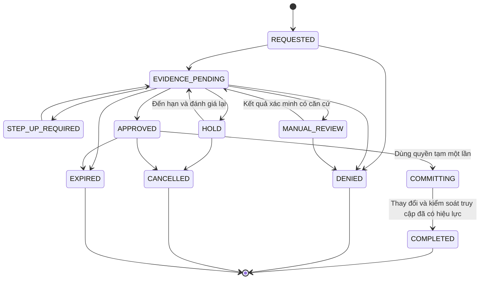

# High risk recovery: khôi phục tài khoản khi rủi ro cao

## 1. Mục tiêu và phạm vi

High risk recovery là quá trình khôi phục quyền kiểm soát tài khoản khi có dấu hiệu cho thấy một yêu cầu có thể đến từ kẻ tấn công, hoặc khi hậu quả của một quyết định sai đặc biệt lớn. Người dùng có thể mất mật khẩu, điện thoại chứa ứng dụng MFA, passkey hoặc toàn bộ thiết bị xác thực. Đồng thời, hệ thống có thể thấy email khôi phục vừa đổi, nhiều lần thử thất bại hoặc một phiên đăng nhập có dấu hiệu bị đánh cắp.

Trong chương Risk Based Recovery của module khôi phục tài khoản, mục tiêu của bài này là thiết kế một đường xử lý rõ ràng cho các tình huống đó: thu thập bằng chứng, quyết định quyền được khôi phục, giới hạn hành động và loại bỏ quyền truy cập còn sót lại của kẻ tấn công.

Ba câu hỏi phải được trả lời riêng:

1. Người yêu cầu đã chứng minh được mối liên hệ nào với tài khoản?
2. Bối cảnh hiện tại có cho thấy bằng chứng đó bị suy yếu hoặc đã bị xâm phạm không?
3. Với bằng chứng và bối cảnh ấy, hệ thống được phép cấp lại quyền gì?

Một IP quen thuộc có thể làm bối cảnh bớt bất thường, nhưng không chứng minh người yêu cầu là chủ tài khoản. Một mã được gửi thành công cũng chưa chứng minh người nhận mã được phép thay toàn bộ phương thức xác thực.

## 2. Nhận diện tình huống rủi ro cao

Rủi ro phụ thuộc cả khả năng yêu cầu là giả mạo lẫn thiệt hại nếu hệ thống chấp thuận sai. Cùng một bằng chứng có thể đủ cho một tài khoản diễn đàn thông thường nhưng chưa đủ để cấp lại quyền quản trị hệ thống.

| Nhóm tín hiệu | Ví dụ | Ý nghĩa đối với quyết định |
| --- | --- | --- |
| Thay đổi phương thức liên lạc | Email hoặc số điện thoại khôi phục vừa được thay | Cần xem nguồn gốc và thời điểm thay đổi trước khi dùng làm bằng chứng |
| Mất nhiều phương thức xác thực | Người dùng mất mật khẩu, MFA và thiết bị cùng lúc | Khả năng dùng đường xác thực thông thường giảm; cần lộ trình bằng chứng khác |
| Dấu hiệu chiếm đoạt | Người dùng báo không nhận ra một passkey mới | Phải xem xét cả tính hợp lệ của các thay đổi trước yêu cầu hiện tại |
| Hành vi lạm dụng | Nhiều tài khoản bị thử từ cùng hạ tầng, liên tục yêu cầu gửi mã | Cần hạn chế luồng yêu cầu và bảo vệ kênh liên lạc |
| Bối cảnh bất thường | Thiết bị mới, vị trí mạng mới, thời điểm khác thường | Là tín hiệu bổ trợ, có thể có giải thích hợp lệ |
| Tài khoản có tác động lớn | Quản trị viên, người duyệt thanh toán, tài khoản giữ khóa triển khai | Cần chính sách cấp lại quyền phù hợp với hậu quả |
| Dữ liệu đánh giá bị thiếu | Dịch vụ xác minh hoặc dữ liệu lịch sử không truy cập được | Quyết định nhạy cảm phải chờ hoặc chuyển sang phương án đã được phê duyệt |

Không nên quy mọi tín hiệu thành kết luận có tấn công. Người đi công tác có thể dùng mạng mới; người mất điện thoại thường phải dùng thiết bị mới. Hệ thống cần phân biệt sự bất thường có thể giải thích với bằng chứng thực sự về việc mất quyền kiểm soát.

Một vấn đề khác là dữ liệu không được tin cậy. Trường `deviceTrusted=true` do trình duyệt gửi lên không có giá trị ngang với bằng chứng sở hữu khóa thiết bị được máy chủ xác minh. Mỗi tín hiệu cần đi kèm nguồn, thời điểm và cách xác thực nguồn đó.

## 3. Bằng chứng danh tính và tín hiệu rủi ro

### 3.1. Hai loại dữ liệu có vai trò khác nhau

**Bằng chứng khôi phục** giúp chứng minh quyền khôi phục theo chính sách: mã dự phòng đã được cấp trước đó, một authenticator còn dùng được hoặc kết quả xác minh danh tính qua quy trình phù hợp.

**Tín hiệu rủi ro** giúp đánh giá độ an toàn của yêu cầu: lịch sử thay đổi email, dấu hiệu tự động hóa, mạng truy cập hoặc cảnh báo chiếm đoạt. Tín hiệu rủi ro không tự tạo ra quyền khôi phục.

Ví dụ:

- Biết tên, ngày sinh và số điện thoại của người dùng là thông tin về người dùng, chưa phải bằng chứng kiểm soát tài khoản.
- Một cookie cũ có thể hỗ trợ điều tra, nhưng cookie có thể bị đánh cắp.
- Xác nhận email mới chỉ chứng minh người yêu cầu nhận được thư ở email đó.
- Chữ ký từ một passkey đã đăng ký có thể là bằng chứng mạnh trong phạm vi máy chủ đã kiểm tra đúng challenge, tài khoản và ngữ cảnh.

NIST SP 800-63B-4 phân biệt khôi phục tài khoản với xác thực thông thường và mô tả các nhóm phương thức như mã khôi phục, người liên hệ được bố trí trước và xác minh danh tính lại. Việc chọn tổ hợp bằng chứng phải đáp ứng yêu cầu bảo đảm của tài khoản. Không thể suy ra một mức AAL chỉ từ nhãn “rủi ro cao” hay số bước trong giao diện. [Nguồn: NIST — Account Recovery](https://pages.nist.gov/800-63-4/sp800-63b/events/#account-recovery).

### 3.2. Kiểm tra tính độc lập của bằng chứng

Hai lần xác nhận chưa chắc là hai nguồn bằng chứng độc lập:

- Email và ứng dụng OTP cùng nằm trên chiếc điện thoại bị đánh cắp.
- Email mới và số điện thoại mới cùng do người yêu cầu thêm trong phiên đang bị nghi ngờ.
- Hai mã được gửi liên tiếp tới cùng một hộp thư chỉ kiểm tra lại quyền truy cập cùng kênh.
- Một nhân viên hỗ trợ đọc lại chính dữ liệu người yêu cầu đã nhập không tạo ra xác minh độc lập.

Có thể mô hình hóa mỗi bằng chứng bằng những thuộc tính sau:

| Thuộc tính | Câu hỏi cần trả lời |
| --- | --- |
| Nguồn gốc | Phương thức này được đăng ký khi nào, qua quy trình nào? |
| Phạm vi | Bằng chứng cho phép đặt lại mật khẩu hay thay cả MFA? |
| Độ mới | Việc xác minh có còn hiệu lực tại thời điểm hoàn tất không? |
| Miền bị xâm phạm | Bằng chứng có phụ thuộc vào thiết bị hoặc kênh đang bị nghi ngờ không? |
| Liên kết | Bằng chứng có gắn với đúng tài khoản, yêu cầu và hành động không? |
| Tính sử dụng một lần | Mã hoặc quyền tạm đã được dùng ở yêu cầu khác chưa? |

Thông tin này do máy chủ quản lý. Máy khách không được tự đánh dấu một phương thức là “đã đăng ký trước sự cố”.

## 4. Thiết kế quyết định theo chính sách

Một điểm số tổng hợp có thể hỗ trợ ưu tiên xử lý, nhưng không nên là điều kiện duy nhất để thay thông tin xác thực.

Giả sử hệ thống cộng điểm tốt cho IP quen thuộc, trình duyệt quen và giờ truy cập quen. Nếu kẻ tấn công đã điều khiển thiết bị của nạn nhân, cả ba tín hiệu đều có thể xuất hiện. Cộng thêm nhiều tín hiệu cùng nguồn sẽ làm hệ thống tự tin quá mức.

Một cách thiết kế là áp dụng các điều kiện bắt buộc trước, sau đó mới dùng đánh giá rủi ro để chọn đường xử lý:

1. Xác định hành động được yêu cầu và mức tác động.
2. Kiểm tra bằng chứng có được chính sách chấp nhận cho hành động đó không.
3. Loại bỏ bằng chứng bị thu hồi, hết hiệu lực hoặc phụ thuộc vào kênh bị xâm phạm.
4. Áp dụng các ràng buộc bảo vệ tài khoản và xử lý sự cố.
5. Chọn kết quả với phạm vi quyền cụ thể.

| Điều kiện | Kết quả có thể áp dụng | Quyền cấp ngay |
| --- | --- | --- |
| Còn phương thức mạnh hợp lệ, không có xung đột chưa giải quyết | Yêu cầu xác thực tăng cường bằng phương thức đó | Chỉ quyền thực hiện hành động đã được duyệt |
| Có bằng chứng hợp lệ nhưng cần chờ để phát hiện gian lận | Đưa vào thời gian chờ | Chưa được thay thông tin xác thực |
| Có cơ sở xác minh nhưng cần xử lý ngoại lệ | Chuyển hồ sơ xem xét thủ công | Chỉ quyền theo dõi hoặc bổ sung hồ sơ |
| Chưa có bằng chứng đủ mạnh | Yêu cầu phương án được chính sách hỗ trợ | Không cấp quyền khôi phục |
| Bằng chứng giả mạo hoặc yêu cầu vi phạm ràng buộc bảo vệ | Từ chối yêu cầu hiện tại | Không cấp quyền |
| Thiếu dữ liệu bắt buộc để quyết định | Tạm giữ hoặc chuyển đường dự phòng đã phê duyệt | Không tự hạ điều kiện bảo mật |

Đây là ví dụ chính sách để thiết kế hệ thống, không phải bộ ngưỡng tiêu chuẩn áp dụng cho mọi sản phẩm. Một quyết định cần lưu `policyVersion`, `reasonCodes`, loại bằng chứng đã chấp nhận và hành động được phép. Nhờ vậy, người vận hành có thể giải thích vì sao hai yêu cầu được xử lý khác nhau.

Thông báo công khai vẫn cần hạn chế lộ chi tiết. Người yêu cầu không cần được biết tín hiệu nội bộ nào vừa làm họ bị phân loại rủi ro cao.

## 5. Quản lý recovery bằng một máy trạng thái

Một yêu cầu cần có vòng đời riêng, thay vì dùng một cờ `recoveryPassed=true` tồn tại vô thời hạn.



Ý nghĩa của các trạng thái quan trọng:

- `HOLD`: chờ một điều kiện thời gian hoặc điều tra; chưa phê duyệt thay đổi.
- `MANUAL_REVIEW`: hồ sơ đang được xử lý theo một quy trình cụ thể.
- `APPROVED`: đã đủ điều kiện để cấp quyền tạm cho hành động được chỉ định.
- `COMMITTING`: đang áp dụng thay đổi và các biện pháp kiểm soát truy cập liên quan.
- `COMPLETED`: các điều kiện hoàn tất đã có hiệu lực.

Mỗi chuyển trạng thái phải được kiểm tra ở máy chủ. Một URL dẫn thẳng đến trang đặt mật khẩu mới không được phép bỏ qua trạng thái hiện tại.

Trong hệ thống thực tế, các trạng thái đang chờ còn cần đường hết hạn hoặc hủy phù hợp. Sơ đồ trên tập trung vào những nhánh chính; triển khai phải xác định đầy đủ chuyển trạng thái hợp lệ và cơ chế xử lý công việc bị gián đoạn.

## 6. Token và quyền tạm chỉ cho hành động khôi phục

OWASP khuyến nghị token đặt lại mật khẩu được sinh bằng bộ sinh ngẫu nhiên mật mã, đủ khó đoán, được lưu an toàn, có hạn dùng và chỉ sử dụng một lần. OWASP cũng khuyến nghị tránh tự động đăng nhập sau khi đặt lại mật khẩu. [Nguồn: OWASP — Forgot Password](https://cheatsheetseries.owasp.org/cheatsheets/Forgot_Password_Cheat_Sheet.html).

Với high risk recovery, có thể thiết kế một **recovery grant**: quyền tạm do máy chủ cấp sau khi hoàn tất các điều kiện phê duyệt. Grant này chỉ có quyền trên một yêu cầu và một tập hành động đã xác định.

Ví dụ bản ghi máy chủ:

```json
{
  "requestId": "rr_7a41",
  "accountId": "acct_204",
  "purpose": "REPLACE_LOST_AUTHENTICATOR",
  "state": "APPROVED",
  "allowedActions": [
    "ENROLL_REPLACEMENT_AUTHENTICATOR"
  ],
  "verifiedEvidenceRefs": [
    "ev_saved_code_18",
    "ev_review_92"
  ],
  "accountSecurityVersion": 27,
  "policyVersion": "recovery-policy-v3",
  "grantExpiresAt": "2026-11-23T09:10:00Z",
  "grantConsumedAt": null
}
```

Bản ghi này minh họa cấu trúc, không biểu thị rằng hai bằng chứng trong ví dụ luôn đủ cho mọi tài khoản. `verifiedEvidenceRefs` tham chiếu kết quả xác minh do hệ thống tạo; API không chấp nhận danh sách tự khai của người yêu cầu.

Các giới hạn quan trọng:

- `accountId`, `requestId` và `purpose` phải khớp ở mọi bước.
- Grant thay authenticator không tự cấp quyền thay email, đọc hồ sơ hoặc tạo API key.
- Phiên dành cho recovery không được được middleware thông thường coi là phiên đăng nhập đầy đủ.
- Nếu triển khai grant trong cookie, cần bảo vệ cookie và chống giả mạo yêu cầu theo mô hình ứng dụng.
- Bằng chứng hoặc trạng thái bảo mật thay đổi có thể làm grant mất hiệu lực trước thời hạn.
- Việc mở trang từ liên kết chỉ hiển thị giao diện; thay đổi nhạy cảm cần hành động xác nhận được máy chủ kiểm tra.

Grant tự chứa dưới dạng JWT cũng cần cơ chế kiểm soát việc sử dụng và thu hồi phù hợp. Chữ ký hợp lệ chỉ cho biết token chưa bị sửa; nó không chứng minh token chưa được dùng ở một yêu cầu đồng thời.

## 7. Hoàn tất an toàn khi có yêu cầu đồng thời

Một người dùng có thể mở hai tab; kẻ tấn công cũng có thể gửi hai yêu cầu gần như đồng thời. Do đó, kiểm tra `consumedAt == null` rồi cập nhật ở một thao tác khác là chưa đủ.

Pseudocode dưới đây minh họa điểm đặt các ràng buộc, không phải mã triển khai hoàn chỉnh:

```text
completeRecovery(requestId, opaqueGrant, proposedAuthenticator, idempotencyKey):
    locate server-side grant record from opaqueGrant

    begin transaction
        lock recovery request, grant record and affected account

        if this idempotencyKey already has a committed result:
            return that recorded result

        require request.state == APPROVED
        require grant.requestId == request.id
        require grant.accountId == account.id
        require grant is not expired and not consumed
        require grant.purpose permits the requested action
        require grant.accountSecurityVersion == account.securityVersion

        re-evaluate mandatory recovery conditions
        require accepted evidence is still valid for this action
        verify the proposed authenticator registration

        atomically consume the grant
        apply the approved credential changes
        increment account.securityVersion
        invalidate competing recovery authorizations
        record the idempotent result and required follow-up work
        set request.state = COMMITTING
    commit transaction

    ensure required access-control effects are effective
    durably schedule notifications
    mark COMPLETED only when completion conditions hold
```

Các thao tác cùng thuộc một cơ sở dữ liệu có thể được bảo vệ bằng transaction và khóa phù hợp. Khi có dịch vụ ngoài, transaction cơ sở dữ liệu không làm cho cuộc gọi mạng trở thành một phần nguyên tử của nó.

Ví dụ, nếu việc vô hiệu hóa refresh token nằm ở một dịch vụ khác, hệ thống cần một thiết kế có thể phục hồi sau lỗi. Có thể dùng hàng đợi bền vững hoặc outbox để xử lý lại công việc, kết hợp trạng thái `COMMITTING` và cơ chế chặn quyền còn hiệu lực. Không được báo hoàn tất chỉ vì đã gửi một thông điệp bất đồng bộ.

`idempotencyKey` giúp lần thử lại nhận cùng kết quả nghiệp vụ. Nó không thay thế kiểm tra token dùng một lần hoặc kiểm soát quyền.

## 8. Thời gian chờ và xử lý thủ công

### 8.1. Thời gian chờ phải có mục đích

Thời gian chờ có thể tạo cơ hội để chủ tài khoản nhận ra và phản hồi một hành động bất thường. Tuy nhiên, hết thời gian không tạo thêm bằng chứng danh tính.

Một chính sách chờ cần quy định:

- Thời điểm bắt đầu, thời điểm đủ điều kiện đánh giá lại và thời điểm hết hạn.
- Những thay đổi nào làm yêu cầu phải đánh giá lại từ đầu.
- Những hành động nào bị hạn chế trong thời gian chờ.
- Kênh nhận phản hồi khi chủ tài khoản báo gian lận.
- Cách xử lý nhiều yêu cầu cùng lúc.

Ví dụ một sản phẩm chọn chờ 24 giờ đối với yêu cầu thay toàn bộ phương thức xác thực. Con số này chỉ là giả định thiết kế. Khi đến hạn, hệ thống vẫn kiểm tra bằng chứng, cảnh báo mới và phiên bản bảo mật của tài khoản; nó không tự chuyển sang thành công theo đồng hồ.

Cũng không nên để một người chỉ biết email của nạn nhân liên tục tạo yêu cầu mới nhằm đẩy lùi thời điểm hoàn tất vô hạn. Cần phân biệt yêu cầu vô danh với yêu cầu đã có bằng chứng hợp lệ và quy định rõ quan hệ giữa các yêu cầu.

### 8.2. Nhân viên hỗ trợ xử lý bằng quy trình có căn cứ

Đường thủ công cần ghi rõ loại bằng chứng được chấp nhận, người có thẩm quyền quyết định và phạm vi quyết định. Với tài khoản có tác động lớn, tổ chức có thể yêu cầu người xác minh và người phê duyệt khác nhau.

Không nên dùng sự khẩn cấp, địa vị của người gọi hoặc kiến thức về thông tin cá nhân làm lý do bỏ qua điều kiện. Giấy tờ có ảnh cũng cần được kiểm tra theo quy trình phù hợp và liên kết với tài khoản; nhận một tệp ảnh không tự chứng minh người gửi là chủ tài khoản.

Nếu sản phẩm ban đầu không xác minh danh tính thật, một giấy tờ tùy thân có thể không tạo được liên kết đáng tin cậy với tài khoản dùng biệt danh. Khi không có phương thức được phê duyệt để chứng minh quyền sở hữu, kết quả có thể là chưa khôi phục được. Chính sách cần giải thích điều này rõ ràng và cung cấp phương án hỗ trợ hợp lệ nếu có.

Dữ liệu hồ sơ hỗ trợ cần được thu thập ở mức cần thiết, giới hạn người truy cập và có thời hạn lưu. Không đưa ảnh giấy tờ, mật khẩu, OTP hoặc mã dự phòng vào ghi chú hỗ trợ thông thường.

## 9. Giành lại quyền kiểm soát sau khôi phục

Thay mật khẩu có thể chưa loại bỏ hết quyền truy cập của kẻ tấn công. Với thiết kế high risk recovery, cần lập danh sách những loại quyền có thể còn tồn tại:

| Loại quyền hoặc cấu hình | Vấn đề cần giải quyết |
| --- | --- |
| Phiên web và thiết bị đã đăng nhập | Kẻ tấn công có thể vẫn đang có phiên hợp lệ |
| Refresh token | Có thể tiếp tục cấp access token mới |
| Access token tự chứa | Có thể còn được tài nguyên chấp nhận đến khi hết hạn |
| Authenticator và passkey đã đăng ký | Có thể đã có phương thức do kẻ tấn công thêm |
| Email, số điện thoại khôi phục | Có thể đã bị thay để phục vụ lần chiếm đoạt tiếp theo |
| API key, app password, quyền ủy quyền | Có vòng đời và cơ chế thu hồi riêng |
| Yêu cầu recovery đang chờ | Có thể tái cấp quyền sau khi người dùng vừa lấy lại tài khoản |

Trong một kiến trúc dùng `securityVersion`, token hoặc phiên mang phiên bản lúc được cấp. Sau recovery, máy chủ tăng phiên bản và các điểm kiểm soát truy cập từ chối phiên bản cũ. Thiết kế chỉ có tác dụng nếu các dịch vụ thực sự kiểm tra phiên bản với độ trễ đáp ứng chính sách.

Nếu tài nguyên chỉ kiểm tra chữ ký JWT mà không kiểm tra trạng thái thu hồi, một thay đổi trong cơ sở dữ liệu tài khoản chưa đủ khiến access token cũ bị từ chối ngay. Cần lựa chọn cơ chế thu hồi, kiểm tra trạng thái hoặc giới hạn quyền trong khoảng trễ và ghi rõ thời điểm hiệu lực.

Việc rà soát phương thức cũ cũng phải có phạm vi. Quên một mật khẩu trong khi MFA còn an toàn không tự tạo lý do vô hiệu hóa MFA. Ngược lại, phương thức được xác định đã bị chiếm quyền cần được xử lý theo luồng sự cố. Không tự khôi phục một địa chỉ liên lạc lịch sử chỉ vì nó cũ; địa chỉ ấy có thể đã bị bỏ do mất quyền kiểm soát.

Sau khi điều kiện hoàn tất đạt yêu cầu, người dùng thực hiện đăng nhập bằng đường thông thường với cấu hình xác thực đã được xác nhận. Quyền recovery không được tiếp tục tồn tại như một đường truy cập dự phòng không hết hạn.

## 10. Chống lạm dụng mà vẫn cho người dùng hợp lệ tiếp tục

Luồng recovery là bề mặt công khai, vì vậy phải xử lý cả lạm dụng và nguy cơ người dùng bị chặn oan.

Một thiết kế có thể kết hợp:

- Giới hạn theo nguồn truy cập, tài khoản đích, yêu cầu, kênh gửi và năng lực toàn hệ thống.
- Ngân sách gửi lại để giảm tình trạng dội email hoặc SMS.
- Giới hạn số lần nhập mã sai trên đối tượng phù hợp.
- Gộp các yêu cầu lặp mà không tạo thêm quyền mới.
- Phản hồi công khai nhất quán để giảm lộ sự tồn tại của tài khoản.
- Đường hỗ trợ có thể tiếp cận khi thiết bị hoặc mạng của người dùng thay đổi.

Giới hạn chỉ theo IP sẽ yếu trước nguồn tấn công phân tán và có thể gây khó khăn cho người dùng dùng chung mạng. Giới hạn chỉ theo tài khoản lại có thể bị lợi dụng để làm nạn nhân mất cơ hội thử. Chính sách cần kết hợp nhiều phạm vi và xác định cách phục hồi hạn mức an toàn.

Không khóa toàn bộ tài khoản chỉ vì có người gửi yêu cầu recovery. Nếu hệ thống cần hạn chế tài khoản do sự cố đã được xác minh, đó phải là quyết định bảo vệ có căn cứ, có phạm vi và có đường xử lý tiếp theo.

Thông báo cần hướng người dùng tới miền chính thức và cách báo hành động không được phép. Không đưa bí mật xác thực hoặc toàn bộ dữ liệu hồ sơ vào thông báo. Lỗi gửi thông báo phải được ghi nhận và xử lý lại bền vững; không âm thầm bỏ qua một điều kiện thông báo bắt buộc của chính sách.

## 11. Ví dụ xuyên suốt

Mai mất điện thoại có ứng dụng MFA và yêu cầu khôi phục trên máy tính mới. Hệ thống thấy email khôi phục vừa đổi hai giờ trước đó, đồng thời có nhiều lần đăng nhập thất bại.

### Bước 1: Phân loại hành động

Mai cần thay authenticator bị mất. Đây là thay đổi có thể ảnh hưởng đến toàn bộ khả năng kiểm soát tài khoản, khác với một yêu cầu chỉ đặt lại mật khẩu khi vẫn còn phương thức xác thực khác.

### Bước 2: Xác định bằng chứng còn dùng được

Email mới không tự được xem là nguồn tin cậy chỉ vì trạng thái của nó là “đã xác nhận”. Hệ thống kiểm tra nguồn gốc thay đổi và các phương thức được đăng ký trước sự cố.

Mai có một mã dự phòng được lưu riêng. Máy chủ kiểm tra mã theo cơ chế an toàn và ghi nhận kết quả cho đúng yêu cầu. Chính sách của sản phẩm còn yêu cầu một bước xác minh khác đối với tổ hợp dấu hiệu hiện tại; mã dự phòng không tự làm mất các điều kiện ấy.

### Bước 3: Chọn lộ trình

Yêu cầu được chuyển sang nhánh phù hợp với chính sách. Nếu có thời gian chờ, Mai chỉ được xem tiến độ và bổ sung bằng chứng theo quyền đã cấp. Cô chưa thể dùng hồ sơ recovery để đọc dữ liệu hoặc thay địa chỉ liên lạc.

Nếu không đủ bằng chứng để liên kết Mai với tài khoản, hệ thống chưa phê duyệt. Việc người yêu cầu mô tả chính xác sự cố vẫn cần được đối chiếu với bằng chứng được chấp nhận.

### Bước 4: Cấp và sử dụng quyền tạm

Sau khi các điều kiện đạt yêu cầu, máy chủ cấp grant chỉ để đăng ký authenticator thay thế. Nếu email hoặc cấu hình bảo mật tiếp tục thay đổi trước khi hoàn tất, phiên bản bảo mật không còn khớp và yêu cầu phải được đánh giá lại.

Grant được sử dụng một lần. Việc đăng ký mới, xử lý phương thức bị xâm phạm và kiểm soát quyền truy cập cũ tuân theo phạm vi đã phê duyệt.

### Bước 5: Xác nhận kết quả có hiệu lực

Hệ thống chỉ kết thúc recovery khi các điều kiện hoàn tất đã có hiệu lực. Mai đăng nhập qua luồng thông thường và được hướng dẫn thiết lập phương án dự phòng an toàn. Các yêu cầu recovery cạnh tranh không được tiếp tục cấp lại quyền trái với trạng thái mới.

Nếu Mai không thể cung cấp thêm bằng chứng nào được chính sách chấp nhận, hệ thống giữ kết quả chưa đủ điều kiện hoặc từ chối yêu cầu hiện tại, thay vì hạ điều kiện vì áp lực thời gian.

## 12. Các lỗi thiết kế cần nhận ra

| Lỗi | Hậu quả | Hướng thiết kế phù hợp |
| --- | --- | --- |
| Dùng điểm rủi ro thấp thay cho bằng chứng quyền sở hữu | Bối cảnh quen thuộc che lấp thiếu xác minh | Kiểm tra điều kiện bằng chứng trước khi chọn nhánh rủi ro |
| Tin ngay kênh liên lạc vừa thêm | Kẻ tấn công tự tạo nguồn “xác minh” | Đánh giá nguồn gốc, thời điểm và miền bị xâm phạm |
| Đếm mọi OTP thành các yếu tố độc lập | Nhiều bước vẫn phụ thuộc một kênh | Mô hình hóa quan hệ phụ thuộc của bằng chứng |
| Cho recovery session gọi API thông thường | Quyền tạm biến thành quyền tài khoản đầy đủ | Phân loại và kiểm tra phạm vi phiên ở mọi endpoint |
| Chỉ kiểm tra token ở đầu luồng | Trạng thái bảo mật có thể đổi trước khi hoàn tất | Đánh giá lại các điều kiện bắt buộc khi commit |
| Dùng token một lần bằng thao tác đọc rồi ghi tách rời | Hai yêu cầu đồng thời có thể cùng thành công | Tiêu thụ nguyên tử và kiểm soát cạnh tranh |
| Đánh dấu hoàn tất trước hiệu lực thu hồi | Kẻ tấn công tiếp tục dùng quyền cũ | Xác định completion gate cho các dịch vụ liên quan |
| Hết thời gian chờ là tự chấp thuận | Thời gian bị coi thành bằng chứng danh tính | Đánh giá lại sau thời gian chờ |
| Hỗ trợ thủ công không lưu căn cứ | Ngoại lệ khó kiểm soát và khó điều tra | Lưu chính sách, bằng chứng tham chiếu và quyết định |
| Yêu cầu vô danh làm khóa tài khoản | Recovery trở thành công cụ từ chối dịch vụ | Giới hạn yêu cầu theo rủi ro và tách khỏi quyết định bảo vệ tài khoản |

## 13. Câu hỏi tự suy luận

1. Một yêu cầu đến từ thiết bị quen thuộc nhưng chỉ cung cấp email vừa thêm. Điều gì đã được chứng minh, điều gì chưa?
2. Nếu email và ứng dụng MFA cùng nằm trên điện thoại bị đánh cắp, vì sao hai lần xác nhận vẫn có thể cùng thất bại về mặt bảo đảm?
3. Hệ thống sẽ xử lý thế nào khi grant được phê duyệt ở phiên bản bảo mật 27, nhưng tài khoản đã chuyển sang phiên bản 28?
4. Vì sao “đã gửi tác vụ thu hồi” và “quyền truy cập cũ đã bị chặn” là hai điều kiện khác nhau?
5. Nếu không có liên kết đáng tin cậy giữa giấy tờ và tài khoản dùng biệt danh, nhân viên hỗ trợ có cơ sở nào để cấp lại quyền?
6. Một đối tượng chỉ biết email của nạn nhân có thể lợi dụng thời gian chờ hoặc hạn mức gửi mã như thế nào?

Khi thiết kế một luồng high risk recovery, hãy mô tả được bằng chứng cần có, quyền được cấp ở từng trạng thái, điều kiện phải đánh giá lại và thời điểm quyền truy cập cũ thực sự mất hiệu lực. Đó là cơ sở để khôi phục tài khoản mà vẫn giữ được kiểm soát trước nguy cơ chiếm đoạt.