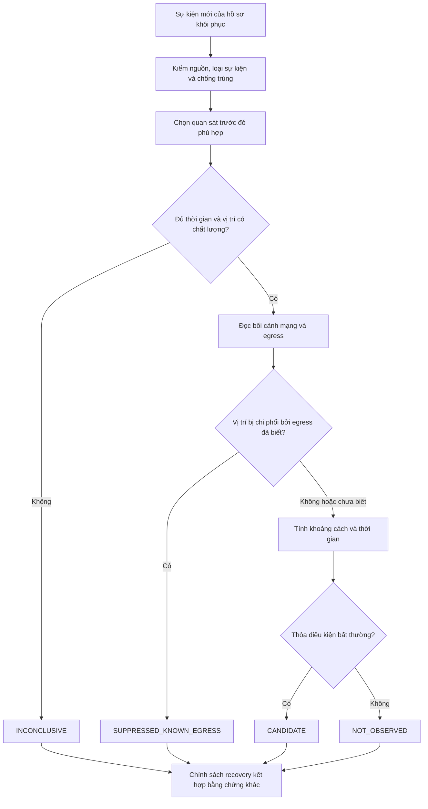

# Impossible travel signal

## 1. Impossible travel phát hiện điều gì?

**Impossible travel signal** là tín hiệu cho biết các hoạt động gắn với cùng một tài khoản xuất hiện ở những vị trí địa lý cách xa nhau trong khoảng thời gian quá ngắn để giải thích bằng việc di chuyển thông thường của một người.

Trong khôi phục tài khoản, tín hiệu này có thể xuất hiện khi một phiên đã xác thực vừa hoạt động tại Việt Nam, còn yêu cầu đặt lại mật khẩu hoặc thay MFA xuất hiện từ một điểm mạng được định vị ở châu Âu chỉ vài phút sau. Đây là một lý do để kiểm tra thêm về yêu cầu, nguồn mạng và bằng chứng xác minh.

Microsoft mô tả impossible travel thông qua hai hoạt động ở các vị trí cách xa nhau trong thời gian di chuyển không hợp lý, đồng thời nêu việc giảm cảnh báo sai từ VPN và vị trí mạng thường dùng. [Microsoft Learn: Anomaly detection policies](https://learn.microsoft.com/en-us/defender-cloud-apps/anomaly-detection-policy).

Tín hiệu phản ánh **sự bất thường của các quan sát**, chưa chứng minh một người thực sự xuất hiện ở hai nơi. Vị trí lấy từ IP thường là vị trí ước lượng của điểm mạng ra Internet. Vì vậy:

- Có tín hiệu không tự chứng minh tài khoản đã bị chiếm.
- Không có tín hiệu không chứng minh yêu cầu khôi phục là hợp lệ.
- Một vị trí quen thuộc không phải bằng chứng sở hữu tài khoản.
- Quyền đặt lại mật khẩu, MFA hoặc passkey vẫn phải dựa trên quy trình xác minh phù hợp.

Mục tiêu của bài là xây một tín hiệu có thể giải thích, biết biểu diễn dữ liệu thiếu và giúp chọn bước xử lý khôi phục hợp lý.

## 2. Dữ liệu đầu vào và ranh giới tin cậy

Một phép so sánh cần hai sự kiện có thể quy về cùng tài khoản nội bộ và có đủ thông tin về thời gian, nguồn mạng, chất lượng quan sát.

| Trường | Vai trò | Điều cần chú ý |
| --- | --- | --- |
| `eventId` | Nhận diện và loại sự kiện trùng | Không tạo thêm cảnh báo khi consumer xử lý lại |
| `tenantId`, `accountId` | Nhóm đúng chủ thể | Không nối tài khoản chỉ vì cùng chuỗi email |
| `eventType` | Phân biệt đăng nhập, dùng phiên, nộp bằng chứng và bắt đầu recovery | Các loại sự kiện có độ tin cậy khác nhau |
| `authenticationContext` | Cho biết đã xác minh gì tại sự kiện | Một request vô danh không ngang với xác thực thành công |
| `observedAt` | Thời gian quan sát từ nguồn máy chủ tin cậy | Không dùng đồng hồ do trình duyệt tự gửi làm nguồn chuẩn |
| `ingestedAt` | Thời gian pipeline nhận sự kiện | Dùng phát hiện trễ và vận hành pipeline |
| `sourceIp` | Địa chỉ mạng được trích xuất theo cấu hình biên | Không tin header IP do client tự khai |
| `networkContext` | ASN, mạng di động, VPN hoặc egress doanh nghiệp nếu biết | Chỉ là dữ liệu hỗ trợ, có thể thiếu hoặc lỗi thời |
| `geoEstimate` | Tọa độ, bán kính sai số, nguồn và phiên bản dữ liệu | Không mặc định tọa độ là vị trí chính xác |
| `sessionReference` | Liên hệ với phiên mà không lưu session token | Session còn tồn tại không bảo đảm chưa bị đánh cắp |

### 2.1. Lấy IP qua proxy đúng cách

Khi ứng dụng đứng sau load balancer, CDN hoặc reverse proxy, IP của kết nối trực tiếp có thể là IP proxy. Việc tìm địa chỉ nguồn cần theo cấu hình chuỗi proxy tin cậy.

Nếu client có thể tự đặt `X-Forwarded-For` và ứng dụng luôn lấy phần tử đầu tiên, kẻ tấn công có thể tự khai một IP ở vị trí mong muốn. Một thiết kế minh họa sẽ:

1. Chỉ nhận thông tin forwarding từ các proxy đã được cấu hình và xác minh.
2. Quy định rõ proxy nào xóa hoặc ghi lại header do client gửi.
3. Phân tích chuỗi địa chỉ theo đúng mô hình triển khai, thay vì chọn vị trí tùy ý.
4. Ghi nguồn và chất lượng của phép trích xuất IP.
5. Biểu diễn trạng thái chưa xác định khi không thể quy về nguồn đáng tin.

Địa chỉ tìm được vẫn có thể là egress của VPN hoặc mạng doanh nghiệp. Xử lý proxy đúng giúp xác định nguồn quan sát; nó không biến IP thành GPS của người dùng.

### 2.2. Dùng thời gian từ nguồn phù hợp

Chuẩn hóa thời gian thành instant UTC. Thời gian hiển thị tại Hà Nội hoặc Paris có thể khác múi giờ nhưng hai instant vẫn so sánh trực tiếp được.

Cần giữ riêng thời điểm sự kiện và thời điểm ingest. Một sự kiện xảy ra lúc 09:00 nhưng tới hệ thống lúc 09:20 không phải hoạt động mới tại 09:20. Nếu dùng thời điểm ingest cho phép tính di chuyển, việc chậm hàng đợi có thể tạo hoặc che giấu bất thường.

Đồng hồ máy chủ cũng có thể lệch. Nếu khoảng cách thời gian quá nhỏ so với sai số đồng hồ cho phép, kết quả nên là chưa đủ dữ liệu thay vì vận tốc vô hạn.

## 3. Chọn cặp sự kiện để tránh làm sai đường cơ sở

Trong hệ thống khôi phục, không nên coi mọi request nhập email là một sự kiện vị trí của chủ tài khoản.

Giả sử kẻ tấn công ở nước ngoài liên tục gọi “quên mật khẩu” cho tài khoản của An. Nếu những request này thay thế `lastKnownLocation`, đường cơ sở sẽ dần phản ánh vị trí kẻ tấn công. Khi An sử dụng tài khoản thật, hệ thống có thể gắn cờ chính An.

Một thiết kế phân tầng có thể dùng:

| Nhóm sự kiện | Cách sử dụng trong ví dụ |
| --- | --- |
| Xác thực thành công, ngữ cảnh xác minh rõ | Ứng viên đường cơ sở, có xem xét dấu hiệu phiên bị chiếm |
| Hoạt động trên phiên hiện có | Bối cảnh bổ sung; xét độ mới và chất lượng của phiên |
| Nộp thành công bằng chứng khôi phục | Quan sát trong hồ sơ, ghi rõ loại bằng chứng |
| Bắt đầu khôi phục chưa xác minh | Quan sát rủi ro của yêu cầu; không tự nâng thành vị trí tin cậy |
| Request do trình quét liên kết hoặc tác vụ máy chủ tạo | Phân loại riêng, không suy ra di chuyển của con người |
| Hoạt động tài khoản dịch vụ hoặc máy tự động | Xử lý theo mô hình riêng, không áp phép giả định một người di chuyển |

Một lần mở liên kết email có thể xuất phát từ dịch vụ quét an toàn. Nếu chưa có tương tác và xác minh phù hợp, vị trí của request này không nên trở thành bằng chứng rằng chủ tài khoản đang ở đó.

### 3.1. Không chỉ so với sự kiện vừa nhận gần nhất

Trong một khoảng thời gian, người dùng có thể có nhiều phiên. Ví dụ:

- 09:00: phiên đã xác thực ở điểm A.
- 09:01: request qua VPN ở điểm B.
- 09:02: một hoạt động khác ở điểm A.

So sánh máy móc từng cặp liên tiếp có thể phát ra nhiều cảnh báo cho một nguyên nhân mạng. Chỉ giữ một vị trí cuối cùng cũng có thể bỏ mất một phiên đồng thời bất thường.

Có thể duy trì cửa sổ sự kiện theo thời gian xảy ra, phân biệt nhóm nguồn và chọn các cặp theo chính sách. Cửa sổ phải có giới hạn kích thước, thời gian lưu và quy tắc loại trùng. Không cộng số cặp bị gắn cờ thành số bằng chứng gian lận độc lập.

## 4. Ước lượng khoảng cách và thời gian

Một cách minh họa là tính khoảng cách đường tròn lớn giữa hai tọa độ rồi chia cho khoảng thời gian.

### 4.1. Công thức Haversine

Với vĩ độ `φ1, φ2`, kinh độ `λ1, λ2` tính bằng radian:

```text
Δφ = φ2 − φ1
Δλ = λ2 − λ1

a = sin²(Δφ / 2) + cos(φ1) × cos(φ2) × sin²(Δλ / 2)
c = 2 × atan2(√a, √(1 − a))
d = R × c

R ≈ 6371 km
```

Khoảng cách này là xấp xỉ trên mặt cầu. Nó không bao gồm đường tới sân bay, thời gian chờ, tuyến đường thực tế hoặc thời gian nhập cảnh. Phép tính chỉ cung cấp một đặc trưng để hỗ trợ chính sách.

Nếu khoảng thời gian dương là `Δt` giờ:

```text
requiredSpeedKmH = distanceKm / elapsedHours
```

Không có một ngưỡng vận tốc duy nhất thích hợp cho mọi sản phẩm và mọi trường hợp. Ngưỡng phải được cấu hình, đánh giá theo dữ liệu vận hành và gắn với chất lượng nguồn.

### 4.2. Xem xét sai số vị trí

Giả sử hai ước lượng có bán kính sai số `r1`, `r2`. Có thể tạo một đặc trưng khoảng cách giảm theo sai số:

```text
adjustedDistanceKm = max(0, distanceKm − r1 − r2)
adjustedSpeedKmH = adjustedDistanceKm / elapsedHours
```

Nếu vị trí thực của cả hai quan sát nằm trong các vùng sai số tương ứng, phép trừ này cho một cận dưới khoảng cách giữa hai vùng trong mô hình. Tuy nhiên, bán kính do nhà cung cấp đưa ra thường biểu diễn mức độ ước lượng; nó không bảo đảm vị trí thật luôn nằm trong vòng tròn. Vì vậy, không gọi `adjustedDistanceKm` là khoảng cách tối thiểu chắc chắn của người dùng.

MaxMind giải thích IP geolocation có độ chính xác thay đổi theo mạng và khu vực, đồng thời cung cấp accuracy radius cho dữ liệu cấp thành phố. Nhà cung cấp cũng nêu rằng vị trí IP của VPN có thể là vị trí máy chủ VPN thay vì người dùng. [MaxMind: Geolocation accuracy](https://support.maxmind.com/knowledge-base/articles/maxmind-geolocation-accuracy).

Khi không có bán kính hoặc chỉ có vị trí trung tâm quốc gia, hãy ghi chất lượng tương ứng. Không thay giá trị thiếu bằng `0 km` vì điều đó tạo ra độ chính xác giả.

### 4.3. Ví dụ số học

Các con số dưới đây là dữ liệu giả định phục vụ phép tính:

```text
Khoảng cách giữa hai ước lượng: 1.200 km
Bán kính sai số thứ nhất:          100 km
Bán kính sai số thứ hai:           100 km
Khoảng thời gian:                  10 phút = 1/6 giờ

Khoảng cách giảm theo sai số = 1.200 − 100 − 100 = 1.000 km
Vận tốc tương ứng            = 1.000 / (1/6) = 6.000 km/h
```

Đây là một ứng viên bất thường rõ về mặt số học. Bước tiếp theo vẫn phải kiểm nguồn mạng, chất lượng thời gian và ý nghĩa của hai sự kiện.

Nếu hai quan sát cách nhau 24 giờ, cùng khoảng cách giảm theo sai số cho vận tốc khoảng 41,7 km/h. Phép tính không gắn cờ di chuyển bất khả thi, nhưng vẫn không cho biết người yêu cầu đã có quyền thay MFA hay chưa.

## 5. Các nguyên nhân cảnh báo sai và giới hạn phát hiện

| Nguyên nhân | Điều quan sát được | Cách xử lý trong mô hình minh họa |
| --- | --- | --- |
| VPN, proxy hoặc privacy relay | IP đổi vùng dù người dùng đứng yên | Gắn nhãn nguồn mạng, giảm khả năng diễn giải thành di chuyển vật lý |
| Egress doanh nghiệp | Nhân viên nhiều nơi đi qua cùng điểm ra | Quản lý danh sách egress có chủ sở hữu và ngày rà soát |
| Mạng di động | Địa chỉ IP được định vị ở vùng rộng hoặc điểm mạng xa | Xem bán kính sai số và loại mạng |
| Chuyển Wi-Fi sang mạng di động | Hai nguồn IP có vị trí khác nhau | Liên hệ ngữ cảnh phiên và authenticator; không kết luận từ IP đơn lẻ |
| Cơ sở dữ liệu geolocation thay đổi | Cùng IP được trả về vị trí mới | Lưu phiên bản dữ liệu và phát hiện thay đổi hàng loạt |
| Sự kiện trễ hoặc lệch đồng hồ | Thứ tự và khoảng thời gian bị hiểu sai | Dùng event time, kiểm độ lệch và cơ chế xử lý trễ |
| Trình quét liên kết | Request khôi phục xuất hiện từ hạ tầng quét | Phân loại hoạt động máy, không coi là hành vi đã xác minh của người |
| Hai người dùng chung tài khoản | Hoạt động xa nhau có thể là thật | Đánh giá vi phạm mô hình tài khoản; không coi chia sẻ là hợp lệ mặc định |

Khi đã nhận diện egress, việc giảm một cảnh báo di chuyển chỉ có nghĩa vị trí IP không phản ánh tốt sự di chuyển của người dùng. Nó không khiến nguồn mạng đó được phép bỏ qua xác minh.

Tín hiệu cũng có thể bỏ sót gian lận. Kẻ tấn công có thể hoạt động qua nguồn mạng gần nạn nhân, dùng phiên bị đánh cắp hoặc điều khiển chính thiết bị nạn nhân. Vì thế, impossible travel cần kết hợp với các tín hiệu và bằng chứng khác, không đóng vai trò cổng bảo vệ duy nhất.

## 6. Tạo một kết quả có trạng thái và lý do

Một detector nên trả về kết quả rõ hơn một cờ boolean:

| Kết quả | Ý nghĩa | Điều không được suy diễn |
| --- | --- | --- |
| `CANDIDATE` | Cặp quan sát thỏa điều kiện bất thường của mô hình | Đã chứng minh người yêu cầu là kẻ tấn công |
| `NOT_OBSERVED` | Cặp đủ dữ liệu nhưng không thỏa điều kiện | Tài khoản hoặc yêu cầu chắc chắn an toàn |
| `INCONCLUSIVE` | Thiếu dữ liệu, thời gian không dùng được hoặc nguồn không đủ chất lượng | Không có rủi ro |
| `SUPPRESSED_KNOWN_EGRESS` | Không dùng cặp này như bằng chứng di chuyển vì có bối cảnh egress phù hợp | Được miễn xác minh hoặc miễn các kiểm soát khác |

Trong ví dụ, một đánh giá có thể gồm:

```text
TravelAssessment
  assessmentId
  tenantId
  accountId
  recoveryCaseId
  eventAId
  eventBId
  status
  reasonCodes
  distanceKm
  adjustedDistanceKm
  elapsedSeconds
  requiredSpeedKmH
  eventQuality
  geoSourceVersion
  egressClassificationVersion
  detectorVersion
  evaluatedAt
  validUntil
```

Các giá trị số không tính được nên để vắng mặt hoặc biểu diễn bằng kiểu tùy chọn. Không dùng `speed=0` thay cho trường hợp không có tọa độ.

Mã lý do có thể là `INSUFFICIENT_EVENT_QUALITY`, `GEO_UNAVAILABLE`, `CLOCK_UNCERTAINTY`, `KNOWN_CORPORATE_EGRESS` hoặc `DISTANCE_TIME_MISMATCH`. Mã nội bộ giúp điều tra và hiệu chỉnh; giao diện công khai chỉ cần giải thích bước xác minh tiếp theo ở mức phù hợp.

### Luồng xử lý minh họa



Việc biết nguồn là VPN không bắt buộc mọi hệ thống phải bỏ phép tính. Có hệ thống giữ ứng viên với độ tin cậy thấp để điều tra. Điều cần giữ rõ là lý do, ảnh hưởng tới quyết định và giới hạn diễn giải.

## 7. Ví dụ Java tính khoảng cách

Đoạn Java sau chỉ minh họa phép tính khoảng cách trên mặt cầu. Nó không lấy IP, gọi dịch vụ geolocation hay đưa ra quyết định cho phép khôi phục.

```java
public final class TravelMath {
    private static final double EARTH_RADIUS_KM = 6371.0;

    private TravelMath() {
    }

    public static double greatCircleKm(
            double latitudeA,
            double longitudeA,
            double latitudeB,
            double longitudeB) {

        requireCoordinate(latitudeA, longitudeA);
        requireCoordinate(latitudeB, longitudeB);

        double phiA = Math.toRadians(latitudeA);
        double phiB = Math.toRadians(latitudeB);
        double deltaPhi = phiB - phiA;
        double deltaLambda = Math.toRadians(longitudeB - longitudeA);

        double sinHalfPhi = Math.sin(deltaPhi / 2.0);
        double sinHalfLambda = Math.sin(deltaLambda / 2.0);

        double a = sinHalfPhi * sinHalfPhi
                + Math.cos(phiA) * Math.cos(phiB)
                * sinHalfLambda * sinHalfLambda;

        // Sai số dấu phẩy động có thể làm a lệch nhẹ khỏi [0, 1].
        double boundedA = Math.max(0.0, Math.min(1.0, a));
        double angle = 2.0 * Math.atan2(
                Math.sqrt(boundedA),
                Math.sqrt(1.0 - boundedA));

        return EARTH_RADIUS_KM * angle;
    }

    private static void requireCoordinate(
            double latitude,
            double longitude) {

        if (!Double.isFinite(latitude)
                || !Double.isFinite(longitude)
                || latitude < -90.0
                || latitude > 90.0
                || longitude < -180.0
                || longitude > 180.0) {
            throw new IllegalArgumentException("Invalid coordinate");
        }
    }
}
```

Vĩ độ và kinh độ phải theo đúng thứ tự. Không thay tọa độ thiếu bằng `(0, 0)`: đó là một vị trí thật trên bản đồ, không phải ký hiệu “không biết”.

Phần điều phối có thể dùng quy tắc dạng giả mã:

```text
nếu không có cặp sự kiện đủ chất lượng:
    trả INCONCLUSIVE

nếu thời gian không đủ tin cậy hoặc quá gần mức sai số đồng hồ:
    trả INCONCLUSIVE

nếu dữ liệu vị trí thiếu, cũ hoặc không có độ phân giải phù hợp:
    trả INCONCLUSIVE

nếu bối cảnh egress khiến phép suy diễn di chuyển không phù hợp:
    trả trạng thái có mã lý do tương ứng

tính khoảng cách, thời gian và đặc trưng giảm theo sai số

nếu khoảng cách đủ lớn VÀ vận tốc vượt ngưỡng cấu hình:
    trả CANDIDATE
ngược lại:
    trả NOT_OBSERVED
```

Điều kiện khoảng cách đủ lớn giúp tránh việc một sai lệch vị trí nhỏ bị khuếch đại bởi khoảng thời gian rất ngắn. Nó vẫn cần đi cùng kiểm tra chất lượng thời gian, thay vì xử lý chia cho số gần bằng không bằng cách ép một khoảng thời gian tùy tiện.

Nếu sử dụng độ lệch đồng hồ trong mô hình, có thể xét khoảng thời gian lớn nhất còn hợp lý theo sai số để tránh phóng đại vận tốc. Phải ghi rõ giả định đó và nguồn cung cấp mức sai số.

## 8. Đưa tín hiệu vào quyết định khôi phục tài khoản

Impossible travel là đầu vào của chính sách. API thay đổi credential không nên tự quyết định từ một trường `impossibleTravel=true` do client hoặc một dịch vụ không được xác thực gửi lên.

| Tín hiệu và bằng chứng hiện có | Hành động minh họa của chính sách |
| --- | --- |
| Không phát hiện bất thường, bằng chứng khôi phục chưa đủ | Tiếp tục yêu cầu bằng chứng; chưa cho thay đổi |
| Có ứng viên bất thường, người dùng còn authenticator đã liên kết | Yêu cầu xác minh bổ sung phù hợp với thao tác |
| Có ứng viên bất thường và cảnh báo phiên bị đánh cắp | Chuyển quy trình xử lý chiếm đoạt, hạn chế thay đổi trong hồ sơ theo chính sách |
| Không thể đánh giá vì dịch vụ định vị lỗi | Giữ trạng thái không xác định; dùng đường xác minh thay thế hoặc chờ theo chính sách |
| Cặp bị giảm cảnh báo do egress doanh nghiệp | Tiếp tục các kiểm tra còn lại, không cấp thêm quyền |
| Nhiều request vô danh từ xa nhắm một tài khoản | Kiểm soát lạm dụng; không thu hồi phiên của nạn nhân chỉ từ các request này |

Các hành động cụ thể phụ thuộc tác động của thao tác:

- **Đặt lại mật khẩu:** yêu cầu thực hiện đúng đường xác minh đã được sản phẩm phê duyệt.
- **Thay hoặc gỡ MFA:** xem xét nguy cơ hạ thấp bảo vệ sau khôi phục; không cấp quyền chỉ vì nhận được một email.
- **Thay passkey bị mất:** xác minh theo quy trình rồi đăng ký credential mới; tín hiệu vị trí không khôi phục khóa riêng cũ.
- **Đổi kênh khôi phục:** kiểm nguồn gốc của kênh mới và các thay đổi gần đây; tránh vừa thêm kênh vừa dùng nó để tự xác nhận.
- **Cấp phiên sau khôi phục:** ràng buộc quyền vào mức xác minh thực tế, thay vì coi hồ sơ đã mở là đăng nhập thành công.

Nếu chính sách áp dụng thời gian chờ, việc thời gian trôi qua không làm tín hiệu biến mất hoặc tạo thêm bằng chứng danh tính. Hệ thống vẫn đánh giá lại trước thay đổi cuối cùng.

### 8.1. Kết hợp tín hiệu mà không đếm trùng

IP mới, quốc gia mới, ASN mới và impossible travel có thể cùng xuất phát từ một lần đổi VPN. Cộng bốn điểm rủi ro như bốn bằng chứng độc lập sẽ phóng đại kết luận.

Một mô hình có thể nhóm chúng vào bối cảnh mạng và lưu các lý do riêng. Bằng chứng xác minh authenticator, thông tin phiên bị thu hồi và thay đổi kênh gần đây được xét theo bản chất của chúng, không chỉ theo số lượng trường cảnh báo.

### 8.2. Đánh giá lại trước thao tác cuối

Khi người dùng hoàn tất khôi phục, kết quả đánh giá phải còn phù hợp với:

- Đúng tài khoản, tenant và hồ sơ.
- Đúng thao tác được yêu cầu.
- Các sự kiện đã dùng làm căn cứ.
- Phiên bản cấu hình bảo mật và chính sách liên quan.
- Thời hạn hiệu lực của quyết định.
- Những sự kiện mới phát sinh sau lần đánh giá trước.

Không tin trường `riskPassed=true` lưu trong trình duyệt hoặc kết quả đã quá hạn. Nếu đánh giá diễn ra trước giao dịch thay đổi credential, quyết định cần ràng buộc vào phiên bản dữ liệu và được kiểm lại trong giao dịch ngắn để phát hiện thay đổi giữa các bước.

## 9. Ba tình huống thực tế giả định

### 9.1. Đổi VPN trong lúc đặt lại mật khẩu

Lan sử dụng tài khoản từ mạng gia đình lúc 08:00. Đến 08:03, Lan bật VPN và tiếp tục hồ sơ khôi phục. Điểm ra VPN được định vị cách vị trí trước hàng nghìn kilômét.

Phép tính tạo ứng viên impossible travel. Hệ thống nhận diện bối cảnh mạng phù hợp với egress VPN, ghi lý do giảm độ tin cậy của phép suy diễn di chuyển và tiếp tục đường xác minh đã quy định.

Hệ thống không kết luận Lan đi ra nước ngoài trong ba phút. Nó cũng không cho bỏ qua xác minh chỉ vì có nhãn VPN.

### 9.2. Phiên đang hoạt động và yêu cầu thay MFA từ nguồn khác

Minh vừa xác thực trên một thiết bị ở điểm A. Vài phút sau, một hồ sơ thay MFA xuất hiện từ điểm B rất xa, trên thiết bị chưa biết. Hồ sơ đó thiếu phương thức xác minh còn lại và có nhiều lần nộp mã sai.

Impossible travel, nguồn thiết bị mới và hành vi nộp bằng chứng cùng làm tăng nhu cầu kiểm tra. Trong chính sách giả định, hệ thống dừng bước thay MFA của hồ sơ, giới hạn thử và chuyển quy trình xem xét phù hợp.

Thông báo về yêu cầu đáng ngờ có thể gửi tới kênh đã thiết lập. Việc thu hồi một phiên đang dùng cần có căn cứ và chính sách xử lý sự cố riêng; request vô danh ở điểm B không tự được quyền làm Minh mất mọi phiên.

### 9.3. Sự kiện tới trễ tạo thứ tự sai

Một sự kiện xảy ra tại A lúc 10:00 nhưng được ingest lúc 10:25. Sự kiện ở B xảy ra lúc 10:20 và được ingest lúc 10:21.

Nếu hệ thống sắp theo thời điểm ingest, nó có thể suy ra B rồi A trong bốn phút. Sắp theo event time cho biết A rồi B trong hai mươi phút. Hai phép tính đưa ra bối cảnh rất khác nhau.

Pipeline giữ cả hai loại thời gian, xử lý thứ tự và độ trễ theo chính sách. Nếu một đánh giá mới cần được tạo, nó được liên kết với các event ID và phiên bản detector. Quyết định lịch sử đã phát hành không bị sửa âm thầm chỉ vì dữ liệu tới muộn.

## 10. Bảo vệ detector khỏi việc bị dùng để gây gián đoạn

Một detector rủi ro cũng có thể trở thành mục tiêu lạm dụng.

### 10.1. Ngăn đầu độc đường cơ sở

Không cập nhật vị trí tin cậy từ request chưa xác minh. Khi một quan sát mới được đưa vào đường cơ sở, cần lưu lý do, ngữ cảnh xác minh và khả năng bị thu hồi độ tin cậy nếu có dấu hiệu phiên bị chiếm.

Lịch sử lặp lại không tự biến nguồn độc hại thành nguồn hợp lệ. Một kẻ tấn công hoạt động đủ lâu không nên mặc nhiên được coi là chủ tài khoản.

### 10.2. Không biến cảnh báo thành công cụ khóa tài khoản

Kẻ tấn công có thể gửi yêu cầu từ nhiều vùng để cố tạo chuỗi impossible travel. Nếu hệ thống tự khóa toàn tài khoản sau mỗi tín hiệu, người ngoài chỉ cần biết định danh là có thể gây gián đoạn.

Biện pháp có thể giới hạn vào hồ sơ hoặc nguồn gây rủi ro: giảm tốc độ yêu cầu, bổ sung xác minh hoặc chuyển xem xét. Hành động ảnh hưởng toàn tài khoản cần mức căn cứ phù hợp và đường phục hồi cho người thật.

### 10.3. Quản lý ngoại lệ egress có phạm vi

Danh sách egress nên có phạm vi tenant, người chịu trách nhiệm, lý do và thời hạn rà soát. Không cho tài khoản tự khai dải mạng của mình là đáng tin để tránh phát hiện.

Không bỏ qua mọi hoạt động từ một cloud provider hoặc mọi VPN. Hạ tầng dùng chung có thể chứa cả người hợp lệ lẫn kẻ tấn công. Ngoại lệ chỉ nên điều chỉnh tín hiệu mà bối cảnh đó giải thích được.

### 10.4. Xử lý tải và dữ liệu trễ

Giới hạn số cặp sự kiện được tính cho mỗi tài khoản trong một cửa sổ. Chống trùng trước khi tính và dùng khóa xử lý phù hợp để hai consumer không tạo hai đánh giá có tác dụng lặp.

Nếu enrichment bị lỗi hoặc hàng đợi quá trễ, ghi trạng thái suy giảm chất lượng. Không phát hàng loạt cảnh báo gian lận chỉ vì dịch vụ phụ trợ mất dữ liệu, cũng không âm thầm trả “an toàn”.

## 11. Giải thích, dữ liệu lưu giữ và chỉ số vận hành

Một bản ghi phục vụ điều tra có thể giữ mã đánh giá, hai event ID, thời gian, khoảng cách ước lượng, khoảng thời gian, chất lượng định vị, bối cảnh mạng và mã lý do.

Cần phân biệt thông tin cho ba nhóm:

| Nhóm sử dụng | Thông tin thích hợp trong ví dụ |
| --- | --- |
| Người đang khôi phục | Bước xác minh tiếp theo, trạng thái hồ sơ và hướng hỗ trợ |
| Nhân viên hỗ trợ được phân quyền | Diễn biến hồ sơ và lý do ở mức phục vụ xử lý |
| Bộ phận điều tra có thẩm quyền | Dữ liệu sự kiện, phiên bản nguồn và căn cứ đánh giá chi tiết |

Không đưa IP đầy đủ, session token, token khôi phục hoặc mã dùng một lần vào thông báo công khai. Trong log, dùng định danh tham chiếu thay cho bí mật. Dữ liệu mạng và vị trí cần có phạm vi truy cập cùng thời hạn lưu thích hợp với mục đích sử dụng.

Các chỉ số giúp đánh giá tính hữu ích của tín hiệu gồm:

- Tỷ lệ cảnh báo được xác nhận là hoạt động trái phép.
- Tỷ lệ người dùng hợp lệ phải xác minh thêm vì tín hiệu.
- Tỷ lệ `INCONCLUSIVE` theo nguồn geolocation và loại mạng.
- Tỷ lệ cảnh báo do egress, sự kiện trễ hoặc cập nhật dữ liệu.
- Mức tăng thời gian và tỷ lệ bỏ cuộc trong khôi phục.
- Độ trễ từ sự kiện tới quyết định.
- Số yêu cầu gây gián đoạn được chặn trước khi ảnh hưởng tài khoản.

Tỷ lệ cảnh báo được xác nhận cần dựa trên những trường hợp đã được phân loại và phải hiểu giới hạn chọn mẫu. Chỉ nhìn số cảnh báo giảm không cho biết khả năng phát hiện có được cải thiện hay không.

Trong một triển khai mới, có thể quan sát kết quả detector trước khi cho nó tác động mạnh tới quyền khôi phục. Khi thay ngưỡng hoặc nguồn định vị, giữ phiên bản cấu hình để có thể giải thích sự thay đổi hành vi.

## 12. Những nguyên tắc cần giữ

Impossible travel có giá trị khi giúp phát hiện mâu thuẫn trong các hoạt động của tài khoản. Để dùng đúng trong khôi phục mật khẩu, MFA, passkey hoặc thiết bị xác thực, thiết kế cần giữ các giới hạn sau:

1. Quan sát IP là ước lượng nguồn mạng, có sai số và bối cảnh egress.
2. Sự kiện chưa xác minh không tự trở thành vị trí tin cậy của chủ tài khoản.
3. Phép tính khoảng cách cần thời gian, tọa độ và chất lượng dữ liệu phù hợp.
4. Dữ liệu thiếu là chưa xác định; không đồng nghĩa không có rủi ro.
5. Kết quả bất thường cần kết hợp với bằng chứng xác minh và tác động thao tác.
6. Ngoại lệ mạng chỉ giải thích một tín hiệu; không cấp quyền thay credential.
7. Quyết định cuối phải còn hiệu lực và ràng buộc với đúng hồ sơ.
8. Hành động kiểm soát phải tránh cho người ngoài khả năng khóa tài khoản của nạn nhân.

Một tín hiệu tốt giúp hệ thống đặt đúng câu hỏi xác minh tiếp theo, đồng thời giữ được căn cứ để giải thích vì sao yêu cầu khôi phục được tiếp tục, tạm dừng hoặc chuyển xem xét.
