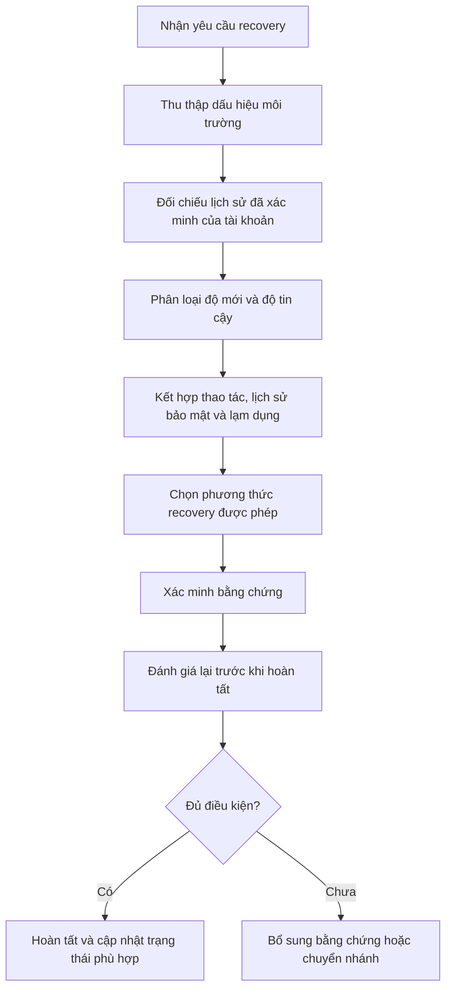

# New device signal

## 1. “Thiết bị mới” có nghĩa gì trong khôi phục tài khoản?

**New device signal** là tín hiệu cho biết môi trường gửi yêu cầu chưa được hệ thống nhận diện trong lịch sử đáng tin cậy của một tài khoản. Nó có thể phản ánh một điện thoại mới, nhưng cũng có thể chỉ là trình duyệt khác, hồ sơ trình duyệt mới hoặc dữ liệu nhận diện đã bị xóa trên chính thiết bị cũ.

Ví dụ, người dùng làm mất điện thoại chứa ứng dụng MFA và mở luồng recovery trên máy tính mượn. Hệ thống thấy môi trường mới, nhưng đây chính là hoàn cảnh mà recovery cần phục vụ. Một kẻ đã lấy được email của nạn nhân cũng có thể mở cùng luồng từ máy tính của họ. Chỉ riêng dấu hiệu “mới” chưa phân biệt được hai trường hợp.

Câu hỏi phù hợp là:

> Với mức tin cậy của dữ liệu hiện có, môi trường này khác lịch sử đã xác minh đến đâu, và thay đổi đó ảnh hưởng thế nào đến thao tác recovery đang được yêu cầu?

OWASP khuyến nghị sử dụng fingerprint, IP và cookie ghi nhớ thiết bị như tín hiệu rủi ro; chúng không thay thế việc xác thực. Đây là ranh giới quan trọng khi thiết kế recovery. [OWASP Authentication Cheat Sheet](https://cheatsheetseries.owasp.org/cheatsheets/Authentication_Cheat_Sheet.html#adaptive-or-risk-based-authentication)

## 2. Phân biệt thiết bị, trình duyệt, phiên và authenticator

Bốn khái niệm sau thường bị gom vào một biến như `trustedDevice`, khiến chính sách khó hiểu:

| Khái niệm | Ví dụ | Điều có thể kết luận |
| --- | --- | --- |
| Thiết bị vật lý | Điện thoại hoặc laptop | Là phương tiện người dùng đang sử dụng; web thường không nhận diện chắc chắn từng máy vật lý |
| Môi trường trình duyệt | Một hồ sơ Chrome trên laptop | Có thể giữ cookie, cấu hình và lịch sử tương tác riêng |
| Phiên đã xác thực | Session do máy chủ cấp sau đăng nhập | Có trạng thái, phạm vi và thời hạn xác thực cần kiểm tra |
| Authenticator | Passkey, khóa bảo mật, ứng dụng OTP | Có thể cung cấp bằng chứng xác thực khi được kiểm chứng đúng giao thức |

Một laptop có thể chứa nhiều hồ sơ trình duyệt. Một hồ sơ có thể mất cookie. Một phiên còn hiệu lực có thể tồn tại trên thiết bị bị đánh cắp.

Cũng không nên suy ra “đúng máy vật lý cũ” chỉ vì một passkey đã đăng ký xác thực thành công: cách lưu giữ và khả năng đồng bộ của credential còn tùy loại authenticator. Hãy ghi nhận chính xác bằng chứng đã được giao thức xác minh, thay vì suy diễn danh tính thiết bị từ tên gọi.

Trong mô hình dữ liệu, nên dùng các thuộc tính có nghĩa cụ thể:

```text
browserContinuity = UNKNOWN
sessionStatus = NO_AUTHENTICATED_SESSION
authenticatorEvidence = NOT_PRESENTED
deviceNovelty = FIRST_SEEN
```

Cấu trúc này dễ diễn giải hơn `trustedDevice=false`, vốn có thể che giấu nhiều nguyên nhân khác nhau.

## 3. Những nguồn dữ liệu thường được dùng

### 3.1. Cookie nhận diện do máy chủ phát hành

Máy chủ có thể cấp một giá trị ngẫu nhiên, không chứa thông tin tài khoản ở dạng đọc được, để nhận diện sự liên tục của một môi trường trình duyệt. Giá trị đó được đối chiếu với bản ghi phía máy chủ hoặc một cấu trúc có bảo vệ tính toàn vẹn thích hợp.

Các điểm thiết kế cần làm rõ:

- Cookie được cấp trong hoàn cảnh nào?
- Nó chỉ đánh dấu một môi trường đã quan sát, hay một môi trường đã trải qua xác thực?
- Bản ghi có liên hệ với đúng tài khoản đang recovery hay không?
- Nó đã hết hạn, bị thu hồi hoặc bị thay thế chưa?
- Nếu bị sao chép, kẻ khác có thể làm hệ thống tưởng môi trường là quen thuộc không?

Cookie nhận diện nên có cơ chế bảo vệ phù hợp với cách sử dụng, như `Secure`, `HttpOnly` khi không cần JavaScript truy cập và chính sách `SameSite` phù hợp với luồng. Các thuộc tính này giảm một số đường lộ hoặc sử dụng sai; chúng không biến cookie thành bằng chứng rằng người đang cầm thiết bị là chủ tài khoản.

Nếu cookie được định nghĩa chỉ để đánh giá rủi ro, không được dùng sự hiện diện của nó để cấp quyền xem dữ liệu riêng tư, đổi mật khẩu hoặc gỡ MFA.

### 3.2. Đặc điểm trình duyệt và hệ điều hành

Các đặc điểm như họ trình duyệt, hệ điều hành, ngôn ngữ hoặc loại thiết bị giúp mô tả môi trường. Tuy nhiên, chúng có thể thay đổi khi cập nhật phần mềm, chuyển cấu hình hoặc dùng tính năng bảo vệ quyền riêng tư. Một số giá trị do client gửi có thể bị giả lập.

Không nên coi việc User-Agent giống nhau là bằng chứng hai yêu cầu đến từ cùng một thiết bị. Cũng không nên coi việc User-Agent thay đổi là bằng chứng có một kẻ khác đang truy cập.

### 3.3. Fingerprint tổng hợp

Fingerprint kết hợp nhiều đặc điểm để ước lượng khả năng một môi trường trùng với lịch sử. Nó vẫn có thể:

- Tách cùng một môi trường thành nhiều định danh khi cấu hình thay đổi.
- Gộp các môi trường khác nhau khi đặc điểm giống nhau.
- Bị bắt chước hoặc bị giảm chất lượng bởi cơ chế chống theo dõi.
- Tạo rủi ro quyền riêng tư nếu thu thập quá nhiều thuộc tính.

Do đó, kết quả phù hợp thường là mức độ tương đồng và độ tin cậy, thay vì một lời khẳng định tuyệt đối về thiết bị vật lý.

### 3.4. Khóa được liên kết với môi trường hoặc ứng dụng

Nếu hệ thống có cơ chế đăng ký khóa và kiểm tra quyền kiểm soát khóa, nó có thể cung cấp thông tin mạnh hơn so với so khớp thuộc tính trình duyệt. Nhưng vẫn cần biết khóa được đăng ký sau loại xác minh nào, có thể bị sao chép hay đồng bộ không, và quyền mà bằng chứng đó được phép hỗ trợ.

Không tự coi mọi “device key” là một authenticator đủ điều kiện cho recovery. Điều đó phải được xác định bởi giao thức và chính sách đăng ký, sử dụng, thu hồi của chính hệ thống.

## 4. Dùng trạng thái có giải thích thay cho một cờ nhị phân

Một mô hình minh họa có thể phân loại sự quen thuộc của môi trường như sau:

| Trạng thái | Ý nghĩa | Giới hạn |
| --- | --- | --- |
| `KNOWN_RECENT` | Có dấu hiệu liên tục với môi trường đã được xác minh gần đây | Có thể bị lộ cookie hoặc bị chiếm thiết bị |
| `KNOWN_STALE` | Có bản ghi phù hợp nhưng lần xác minh đã cũ | Không nên hưởng cùng mức thuận lợi như bản ghi còn mới |
| `FIRST_SEEN` | Chưa có liên hệ đáng tin cậy với tài khoản này | Có thể là người dùng thật đổi thiết bị |
| `UNKNOWN` | Không đủ dữ liệu để so sánh | Không đồng nghĩa với đã xác nhận thiết bị mới |
| `CONFLICTING` | Các nguồn đưa ra dấu hiệu mâu thuẫn cần xử lý | Không tự đồng nghĩa có tấn công |
| `REVOKED` | Liên hệ hoặc khóa nhận diện đã bị thu hồi | Không dùng bản ghi đó để giảm yêu cầu kiểm tra |

Các tên trạng thái trên là đề xuất thiết kế trong bài, không phải một chuẩn giao thức.

Ví dụ, cookie không xuất hiện nhưng kho lịch sử cũng đang lỗi thì nên ghi `UNKNOWN`, với nguyên nhân thiếu dữ liệu. Ghi `FIRST_SEEN` trong trường hợp này khiến hệ thống biến lỗi quan sát thành kết luận về người dùng.

Tương tự, một bản ghi đã bị thu hồi không trở lại đáng tin chỉ vì cookie tương ứng vẫn được gửi lên.

## 5. Xây dựng lịch sử từ sự kiện đã xác minh

Một tín hiệu chỉ có ý nghĩa nếu lịch sử so sánh đáng tin cậy. Nếu mọi yêu cầu recovery đều tự thêm môi trường vào danh sách “đã biết”, người tấn công có thể gửi yêu cầu trước, chờ một thời gian rồi quay lại như thể đó là thiết bị quen thuộc.

Cần phân biệt:

```text
firstObservedAt       : lần đầu môi trường được quan sát
lastObservedAt        : lần gần nhất có tương tác
lastVerifiedAt        : lần gần nhất hoàn tất xác minh phù hợp
verificationMethod    : phương thức dùng trong lần xác minh
verificationContext   : đăng nhập, recovery hoặc đăng ký authenticator
revokedAt             : thời điểm thu hồi, nếu có
```

Một thời điểm quan sát cũ không tương đương với một lịch sử xác minh tốt. Nhiều lần thử thất bại cũng không làm môi trường trở nên đáng tin cậy.

Ví dụ quy tắc thiết kế:

1. Ghi nhận môi trường được quan sát để phát hiện lạm dụng.
2. Giữ trạng thái chưa xác minh khi người yêu cầu chỉ mở trang hoặc xin code.
3. Chỉ cập nhật lịch sử đã xác minh sau một sự kiện đáp ứng chính sách.
4. Ghi rõ nguồn của sự kiện, thời điểm và phạm vi sử dụng.
5. Giữ việc cấp thêm quyền cho thiết bị là một quyết định riêng khi cần.

Một recovery vừa hoàn tất có thể tạo bản ghi “đã xác minh qua recovery”. Không nên tự biến bản ghi đó thành “thiết bị đủ tin cậy để bỏ mọi kiểm tra”, đặc biệt khi thao tác tiếp theo là thay kênh recovery hoặc gỡ MFA.

## 6. Thiết bị mới phải được xét cùng bối cảnh recovery

Độ mới của môi trường cần được kết hợp với loại yêu cầu và bằng chứng người dùng còn giữ.

| Tình huống | Ý nghĩa của tín hiệu thiết bị mới | Hướng xử lý về chính sách |
| --- | --- | --- |
| Mất điện thoại, còn recovery code đã cấp từ trước | Là tình huống có thể dự kiến | Xác minh bằng chứng theo yêu cầu của tài khoản |
| Quên mật khẩu, còn authenticator đã đăng ký | Môi trường mới chưa phủ nhận bằng chứng có thể xác minh | Dùng quy trình phù hợp với authenticator còn giữ |
| Xin gỡ MFA ngay sau khi đổi email recovery | Là một phần của chuỗi cần xem kỹ hơn | Đánh giá lịch sử thay đổi và yêu cầu bằng chứng phù hợp |
| Có cookie quen thuộc nhưng không còn bằng chứng recovery hợp lệ | Cookie không tự giải quyết việc thiếu bằng chứng | Không bỏ yêu cầu recovery tối thiểu |
| Nhiều môi trường mới thử nhiều tài khoản | Có thể phản ánh tự động hóa | Kết hợp kiểm soát tốc độ và phân tích lạm dụng |
| Chỉ thiếu cookie sau khi xóa dữ liệu trình duyệt | Có thể là mất dấu nhận diện | Chuyển sang nhánh không phụ thuộc cookie cũ |

Không để nhiều dấu hiệu tương quan tạo ra cảm giác có nhiều bằng chứng độc lập. “Không có cookie”, “fingerprint lạ” và “trình duyệt mới” có thể cùng xuất phát từ một lần tạo hồ sơ trình duyệt.

Đối với thay MFA, OWASP khuyến nghị kiểm tra rủi ro như thiết bị hoặc vị trí mới, không chỉ dựa vào session đang hoạt động và thông báo khi phương thức bị thay đổi. Khi người dùng đã mất phương thức cũ, cần chuyển sang quy trình recovery thích hợp thay vì yêu cầu vô hạn yếu tố họ không còn giữ. [OWASP Multifactor Authentication Cheat Sheet](https://cheatsheetseries.owasp.org/cheatsheets/Multifactor_Authentication_Cheat_Sheet.html#changing-mfa-factors)

## 7. Từ tín hiệu đến hành động

Một chính sách có thể sử dụng tín hiệu thiết bị mới để:

- Yêu cầu thêm bằng chứng độc lập mà người dùng còn có khả năng cung cấp.
- Chuyển từ một phương thức có kênh nghi ngờ sang phương thức recovery khác được phép.
- Tạm giữ thao tác nhạy cảm trong khi hoàn tất xem xét.
- Giới hạn quyền của trạng thái recovery trước khi xác minh xong.
- Phát thông báo qua kênh đã thiết lập phù hợp với chính sách.
- Tăng mức quan sát lạm dụng cho giao dịch, nguồn yêu cầu hoặc cụm hành vi.

Các hành động này cần có lý do và phạm vi rõ ràng. Không khóa toàn bộ tài khoản chỉ vì một người ngoài gửi yêu cầu từ môi trường mới; điều đó có thể tạo đường gây từ chối dịch vụ.

Thời gian chờ cũng không phải bằng chứng danh tính. Chờ đủ lâu không làm một cookie không rõ nguồn trở thành bằng chứng hợp lệ. Nếu dùng thời gian chờ, hệ thống vẫn cần điều kiện xác minh và cách xử lý khi người dùng báo yêu cầu không phải của họ.

**Thiết bị mới là đầu vào để lựa chọn mức kiểm tra; bằng chứng recovery mới là thứ phải được xác minh trước khi cấp lại quyền.**

## 8. Một luồng đánh giá có thể triển khai



Luồng có hai thời điểm đánh giá quan trọng:

**Khi bắt đầu:** xác định phương thức và các giới hạn phù hợp với thông tin hiện có.

**Trước khi hoàn tất:** xác nhận bằng chứng còn hiệu lực, trạng thái tài khoản chưa thay đổi theo cách làm quyết định cũ mất hiệu lực và không có sự kiện quan trọng mới.

Việc gắn giao dịch recovery với môi trường khởi tạo có thể giúp phát hiện chuyển giao bất thường. Tuy nhiên, người dùng có thể hợp pháp mở email trên máy khác. Nếu hỗ trợ chuyển thiết bị, cần thiết kế bước chuyển giao rõ ràng và kiểm tra bằng chứng thích hợp; không dựa vào fingerprint khớp tuyệt đối, cũng không tự động bỏ mọi ràng buộc.

Token vẫn phải được kiểm tra đúng tài khoản, mục đích, thời hạn và trạng thái sử dụng. Việc hai yêu cầu đồng thời sử dụng token cần được bảo vệ ở bước cập nhật trạng thái; chấm tín hiệu thiết bị không thay thế được cơ chế đó.

## 9. Mã giả phân loại môi trường

Đoạn mã giả sau minh họa cách giữ riêng các loại kết luận. Đây không phải mã hoàn chỉnh để cấp quyền recovery:

```text
function assessEnvironment(request, accountReference):
    observation = collectBoundedEnvironmentData(request)

    if observation.collectionFailed:
        return Assessment(
            state = UNKNOWN,
            reason = OBSERVATION_UNAVAILABLE
        )

    marker = validateRecognitionMarker(observation.marker)

    if marker.present and not marker.valid:
        return Assessment(
            state = CONFLICTING,
            reason = INVALID_MARKER
        )

    history = loadVerifiedEnvironmentHistory(accountReference)

    if not history.available:
        return Assessment(
            state = UNKNOWN,
            reason = HISTORY_UNAVAILABLE
        )

    match = matchEnvironment(marker, observation, history)

    if match.revoked:
        return Assessment(
            state = REVOKED,
            reason = RECOGNITION_REVOKED
        )

    if not match.hasVerifiedAssociation:
        return Assessment(
            state = FIRST_SEEN,
            reason = NO_VERIFIED_ACCOUNT_ASSOCIATION
        )

    if match.verificationTooOld:
        return Assessment(
            state = KNOWN_STALE,
            reason = VERIFICATION_AGED
        )

    return Assessment(
        state = KNOWN_RECENT,
        reason = VERIFIED_ASSOCIATION_FOUND,
        assuranceContext = match.verificationContext
    )
```

Kết quả `KNOWN_RECENT` vẫn chỉ mô tả lịch sử nhận diện. Một bước khác phải xác minh session hoặc bằng chứng recovery và quyết định quyền được cấp.

`accountReference` cần do máy chủ phân giải và kiểm soát. Không cho client gửi một `deviceId` tùy ý rồi dùng nó tra ra dữ liệu bảo mật của tài khoản khác.

Nếu hệ thống chỉ có dữ liệu xác suất, hàm so khớp nên trả thêm độ tin cậy và nguồn; không nên đổi sự tương đồng yếu thành một liên hệ đã xác minh.

## 10. Ba ví dụ dễ nhầm lẫn

### 10.1. Người dùng thật vừa mất điện thoại

Lan mất điện thoại chứa MFA. Cô dùng laptop mới và cung cấp recovery code đã được cấp từ trước.

Hệ thống ghi nhận `FIRST_SEEN`, nhưng không từ chối chỉ dựa vào trạng thái này. Nó xác minh code, các yêu cầu bằng chứng tương ứng và lịch sử bảo mật liên quan. Nếu đủ điều kiện, luồng có thể tiếp tục theo chính sách recovery.

Điểm cần giữ là: laptop mới không làm code tự mất giá trị; code hợp lệ cũng không tự cho phép mọi thao tác ngoài phạm vi đã xác minh.

### 10.2. Kẻ tấn công có cookie quen thuộc

Kẻ tấn công sao chép được cookie nhận diện từ trình duyệt của nạn nhân rồi dùng nó khi xin gỡ MFA.

Nếu cookie đó chỉ dùng để đánh giá rủi ro, việc nó khớp không cho phép bỏ xác minh. Ngay cả khi có session, thao tác nhạy cảm vẫn phải đáp ứng yêu cầu riêng và xem xét khả năng session bị chiếm quyền.

Đây là lý do “không phải thiết bị mới” không tương đương với “không có gian lận”.

### 10.3. Kẻ tấn công làm bẩn lịch sử

Một môi trường lạ gửi yêu cầu recovery mỗi ngày nhưng không hoàn tất xác minh. Sau một tuần, hệ thống thấy `firstObservedAt` đã cũ.

Nếu chính sách dựa vào tuổi quan sát để cấp trạng thái quen thuộc, kẻ tấn công đã làm giảm cảnh giác mà chưa chứng minh quyền sở hữu tài khoản. Lịch sử phải giữ riêng lần quan sát và lần xác minh; các yêu cầu này vẫn thuộc môi trường chưa có liên hệ đã xác minh.

## 11. Nhật ký và quyền riêng tư

Một bản ghi đánh giá nội bộ có thể như sau:

```json
{
  "environmentState": "FIRST_SEEN",
  "reasonCodes": [
    "NO_VERIFIED_ACCOUNT_ASSOCIATION"
  ],
  "observationQuality": "LIMITED",
  "knownSessionPresent": false,
  "requestedOperation": "REPLACE_MFA",
  "policyVersion": "new-device-example-v1",
  "nextAction": "REQUIRE_RECOVERY_EVIDENCE"
}
```

Không cần ghi toàn bộ thuộc tính fingerprint để giải thích mọi quyết định. Có thể lưu nhóm đặc điểm cần thiết, reason code, chất lượng dữ liệu và phiên bản chính sách.

Không ghi token recovery, session secret hoặc cookie thô vào nhật ký. Nếu cần liên kết sự kiện bằng định danh dẫn xuất, chọn cơ chế phù hợp với loại dữ liệu và mô hình đe dọa; băm một giá trị ít khả năng không tự ngăn việc suy đoán hoặc theo dõi.

NIST xem đặc điểm thiết bị, trình duyệt và mạng là các dữ liệu có thể dùng trong giám sát session, đồng thời yêu cầu xét tác động quyền riêng tư của việc thu thập và lưu lịch sử. [NIST SP 800-63B-4, mục 5.3](https://pages.nist.gov/800-63-4/sp800-63b.html#session-monitoring)

Đối với thiết kế trong bài, nên giới hạn dữ liệu vào mục đích bảo vệ tài khoản, có thời gian lưu rõ ràng và kiểm soát truy cập. Không dùng khả năng nhận diện môi trường recovery làm lý do mở rộng theo dõi người dùng sang các ngữ cảnh không liên quan.

## 12. Giao diện cho người dùng và người hỗ trợ

Trước khi xác minh, thông báo công khai không nên tiết lộ:

- Tài khoản có bao nhiêu thiết bị đã biết.
- Thiết bị gần nhất là loại nào.
- Có session nào đang hoạt động.
- Phương thức recovery nào vừa được thay đổi.
- Tín hiệu cụ thể nào giúp yêu cầu vượt qua kiểm tra.

Một thông báo có thể nói: “Để tiếp tục, hãy hoàn tất phương thức khôi phục được cung cấp.” Hướng dẫn cụ thể chỉ xuất hiện ở giai đoạn phù hợp và tránh lộ thông tin tài khoản cho người chưa được xác minh.

Người hỗ trợ có thể cần reason code nội bộ, nhưng không được bỏ qua quy trình chỉ vì người gọi mô tả đúng tên máy, loại điện thoại hoặc trình duyệt. Đây là các thông tin có thể biết được mà không có quyền sở hữu tài khoản.

Sau xác minh, hệ thống có thể cho người dùng xem và thu hồi các môi trường hoặc session được ghi nhận theo phạm vi hỗ trợ. Giao diện cần phân biệt “trình duyệt đã nhận diện” với “phương thức xác thực đã đăng ký”, để người dùng hiểu hành động thu hồi sẽ ảnh hưởng điều gì.

## 13. Các lỗi thiết kế thường gặp

| Lỗi | Rủi ro phát sinh | Cách xử lý phù hợp hơn |
| --- | --- | --- |
| Không có cookie thì chặn recovery | Người mất thiết bị không thể trở lại | Có nhánh recovery không phụ thuộc thiết bị cũ |
| Cookie khớp thì tự gỡ MFA | Cookie bị lộ trở thành đường chiếm quyền | Giữ yêu cầu bằng chứng cho thao tác nhạy cảm |
| Nhận `isTrustedDevice=true` từ client | Client tự quyết định độ tin cậy | Phân loại phía máy chủ từ nguồn đã kiểm tra |
| Mọi yêu cầu đều thêm thiết bị vào danh sách tin cậy | Có thể làm bẩn lịch sử | Tách quan sát khỏi xác minh |
| Đòi fingerprint trùng tuyệt đối | Cập nhật phần mềm hoặc bảo vệ riêng tư gây lỗi | Cho phép trạng thái thiếu dữ liệu và nhánh thay thế |
| Coi cùng IP là cùng thiết bị | Nhầm người dùng trong mạng chung | Giữ IP là tín hiệu mạng riêng |
| Kho lịch sử lỗi thì mặc định thiết bị quen thuộc | Mất dữ liệu dẫn đến giảm kiểm tra | Dùng `UNKNOWN` và chính sách suy giảm rõ ràng |
| Thiết bị bị thu hồi vẫn giảm rủi ro | Trạng thái thu hồi không có hiệu lực thực tế | Kiểm tra thu hồi trước khi hưởng tín hiệu thuận lợi |
| Hoàn tất recovery là bỏ mọi hạn chế của thiết bị | Quyền mới vượt quá điều đã xác minh | Quyết định riêng việc cấp quyền và đăng ký authenticator |

## 14. Nguyên tắc thiết kế

Một tín hiệu thiết bị mới tốt phải diễn đạt được hệ thống biết gì và chưa biết gì về môi trường gửi yêu cầu. Độ mới luôn tương đối với một tài khoản, một lịch sử đã xác minh và một khoảng thời gian có ý nghĩa.

Trong recovery, hãy dự kiến người dùng hợp pháp có thể đang ở môi trường hoàn toàn mới. Dùng tín hiệu đó để lựa chọn mức kiểm tra phù hợp, bảo vệ lịch sử khỏi bị làm bẩn và giữ việc cấp lại quyền phụ thuộc vào bằng chứng đã được xác minh.
