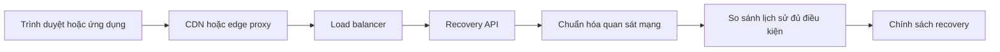

# New network signal: tín hiệu truy cập từ mạng mới trong khôi phục tài khoản

## 1. Tín hiệu mạng mới cho biết điều gì?

Trong luồng khôi phục tài khoản, **new network signal** cho biết bối cảnh mạng của một yêu cầu chưa từng xuất hiện, hoặc không còn được xem là quen thuộc, khi so với lịch sử hợp lệ mà hệ thống giữ cho tài khoản đó.

Ví dụ, người dùng thường truy cập qua mạng gia đình và mạng di động tại Việt Nam. Một yêu cầu đặt lại MFA xuất hiện từ một nhà cung cấp mạng chưa từng được ghi nhận. Đây là một thay đổi cần đánh giá, nhưng chưa chứng minh yêu cầu là gian lận: người dùng có thể vừa mất điện thoại, đi công tác hoặc đang dùng VPN.

Trong module khôi phục tài khoản, tín hiệu này có ba vai trò:

1. Bổ sung ngữ cảnh khi người dùng yêu cầu đặt lại mật khẩu, MFA hoặc passkey.
2. Giúp chọn mức xác minh và các biện pháp hạn chế lạm dụng phù hợp.
3. Hỗ trợ nhận ra thay đổi đáng chú ý giữa các bước của cùng một yêu cầu.

Tín hiệu mạng không chứng minh quyền sở hữu tài khoản. OWASP nêu rõ rằng IP hoặc vị trí có thể là tín hiệu rủi ro, nhưng không thay thế một yếu tố xác thực; kết hợp mật khẩu với IP quen thuộc không tạo thành MFA. [Nguồn: OWASP — Multifactor Authentication](https://cheatsheetseries.owasp.org/cheatsheets/Multifactor_Authentication_Cheat_Sheet.html#source-ip-address).

Vì vậy, hai kết luận sau đều không an toàn nếu chỉ dựa vào mạng:

- “Mạng mới nên đây chắc chắn là kẻ tấn công.”
- “Mạng quen nên người yêu cầu chắc chắn là chủ tài khoản.”

## 2. Phải định nghĩa rõ “mới” ở mức nào

Một địa chỉ IP, một dải địa chỉ định tuyến và một nhà mạng là những khái niệm khác nhau. Nếu gom tất cả thành một cờ boolean, hệ thống dễ vừa bỏ sót rủi ro vừa gây khó cho người dùng hợp lệ.

| Mức so sánh | Ví dụ về điều được quan sát | Hạn chế |
| --- | --- | --- |
| IP cụ thể | Địa chỉ hiện tại chưa có trong lịch sử đủ điều kiện | IP động có thể đổi thường xuyên |
| Nhóm địa chỉ hoặc prefix theo chính sách | Yêu cầu đến từ một nhóm địa chỉ khác | Kích thước nhóm không tương đương một người hay một hộ gia đình |
| ASN | Yêu cầu đi ra từ một hệ thống tự trị chưa từng thấy | Một ASN có thể phục vụ rất nhiều người, địa điểm và loại kết nối |
| Quốc gia ước lượng | Cơ sở dữ liệu gán IP hiện tại sang quốc gia khác | Là kết quả suy đoán từ mạng, không phải vị trí vật lý đã được chứng minh |
| Loại mạng ước lượng | Mạng dân dụng, di động, hosting hoặc dịch vụ trung gian | Phân loại có thể sai, thiếu hoặc đã cũ |

**ASN**, viết tắt của Autonomous System Number, định danh một hệ thống tự trị trong định tuyến Internet. Nó có thể hữu ích để nhóm quan sát theo nhà vận hành mạng, nhưng không phải định danh của người dùng.

Một thiết kế dễ giải thích sẽ giữ các đặc trưng riêng:

```text
ipNovelty
prefixNovelty
asnNovelty
countryNovelty
networkClassification
sourceReliability
baselineStatus
```

Ví dụ:

```text
ipNovelty      = NEW
asnNovelty     = SEEN
countryNovelty = SEEN
```

Kết quả này có nghĩa địa chỉ cụ thể chưa xuất hiện trong lịch sử đang xét, còn ASN và quốc gia ước lượng đã xuất hiện. Nó khác với việc cả ba cùng mới.

Các mức này có thể phụ thuộc nhau. Một thay đổi đường ra Internet có thể đồng thời làm IP, ASN và quốc gia ước lượng thay đổi. Không nên tự động xem đó là ba bằng chứng gian lận độc lập.

### 2.1. Các tình huống làm mạng thay đổi hợp lệ

Người dùng có thể:

- Chuyển từ Wi-Fi sang dữ liệu di động.
- Dùng máy tính ở nơi làm việc để khôi phục tài khoản sau khi mất điện thoại.
- Đi công tác, chuyển nhà hoặc đổi nhà cung cấp Internet.
- Bật VPN để truy cập qua mạng công cộng.
- Đi qua proxy doanh nghiệp hoặc thay đổi điểm thoát của nhà mạng.
- Sử dụng IPv6 với địa chỉ tạm thời thay đổi theo thời gian.

Ngược lại, nhiều người có thể chia sẻ cùng một IP công khai qua NAT hoặc CGNAT. Kẻ tấn công cũng có thể xuất hiện từ cùng mạng doanh nghiệp, cùng dịch vụ VPN hoặc thiết bị đã bị xâm phạm. “Đã từng thấy IP” chỉ mô tả lịch sử quan sát, không trao quyền khôi phục.

## 3. Thu thập địa chỉ nguồn từ đúng ranh giới tin cậy

### 3.1. Địa chỉ mà ứng dụng thấy có thể là địa chỉ proxy

Một đường đi phổ biến là:



Nếu API lấy địa chỉ peer của kết nối từ load balancer, mọi người dùng có thể bị xem là đến từ cùng một mạng nội bộ. Nếu API lấy tùy ý giá trị trong header do máy khách gửi, kẻ tấn công có thể giả một IP quen thuộc.

Do đó, hệ thống cần một hợp đồng rõ ràng giữa các hop:

- Proxy nào được phép cung cấp thông tin địa chỉ gốc?
- Proxy đó ghi đè hay nối thêm header?
- API có thể bị truy cập trực tiếp để bỏ qua proxy không?
- Thành phần nào chịu trách nhiệm xác định địa chỉ nguồn cuối cùng?
- Khi chuỗi chuyển tiếp không hợp lệ, kết quả được đánh dấu thế nào?

Ứng dụng chỉ nên nhận ngữ cảnh mạng đã được thành phần đáng tin cậy xác lập, qua đường truyền và danh tính dịch vụ được kiểm soát. Header có tên giống header nội bộ không tự trở thành dữ liệu đáng tin cậy.

### 3.2. Không chọn máy móc phần tử đầu hoặc cuối của header

Giả sử một chuỗi có dạng:

```text
X-Forwarded-For: client-claimed, observed-client, trusted-proxy
```

Ý nghĩa của từng phần phụ thuộc cách các proxy xử lý chuỗi. Phần tử bên trái có thể do máy khách tự cung cấp; phần tử bên phải có thể chỉ là một proxy trung gian.

Không có quy tắc “luôn lấy phần tử đầu” phù hợp với mọi kiến trúc. Cần kiểm tra peer trực tiếp và áp dụng thuật toán đúng với danh sách proxy tin cậy cùng hợp đồng ghi header của hạ tầng.

NGINX cung cấp các chỉ thị riêng để xác định nguồn tin cậy và cách diễn giải địa chỉ chuyển tiếp: `set_real_ip_from`, `real_ip_header` và `real_ip_recursive`. Khi xử lý đệ quy được bật, hành vi lựa chọn địa chỉ dựa trên các địa chỉ đã được cấu hình tin cậy. Cần đọc đúng ngữ nghĩa trước khi áp dụng cho topology cụ thể. [Nguồn: NGINX — ngx_http_realip_module](https://nginx.org/en/docs/http/ngx_http_realip_module.html).

Một cấu hình khai báo mọi nguồn Internet đều được phép cung cấp địa chỉ thay thế sẽ làm mất ranh giới tin cậy. Tương tự, chặn truy cập trực tiếp tới API là một phần của thiết kế, chứ không chỉ là xử lý chuỗi ký tự trong header.

### 3.3. Tách quan sát khỏi dữ liệu tự khai

Các trường như sau không được dùng trực tiếp làm kết quả đánh giá mạng:

```json
{
  "clientIp": "192.0.2.18",
  "knownNetwork": true,
  "networkRisk": "LOW"
}
```

Nếu chúng đến từ body do trình duyệt gửi, người yêu cầu có thể sửa chúng. Backend cần tự tạo quan sát mạng từ ngữ cảnh request đã được xác lập. Dữ liệu tự khai có thể được ghi nhận riêng nếu nghiệp vụ cần, nhưng không được nâng thành kết luận an toàn.

Các địa chỉ minh họa trong bài dùng cho tài liệu, không biểu thị nhà mạng hoặc hệ thống thật.

## 4. Chuẩn hóa trước khi so sánh

So sánh chuỗi IP một cách trực tiếp có thể tạo ra các kết quả “mới” giả. Đặc biệt, cùng một địa chỉ IPv6 có nhiều cách biểu diễn văn bản tương đương.

Bộ chuẩn hóa cần xử lý:

- Parse địa chỉ theo thư viện phù hợp, thay vì chỉ kiểm tra bằng biểu thức chính quy.
- Lưu hoặc so sánh biểu diễn nhị phân nhất quán.
- Tách cổng khỏi địa chỉ theo đúng định dạng đầu vào.
- Có chính sách rõ cho IPv4 được biểu diễn trong IPv6.
- Phân biệt địa chỉ nguồn thực với địa chỉ của hạ tầng trung gian.
- Từ chối hoặc đánh dấu dữ liệu không hợp lệ thay vì âm thầm thay bằng một địa chỉ mặc định.

Việc parse hợp lệ chỉ xác nhận cú pháp. Nó không chứng minh nguồn cung cấp địa chỉ là đáng tin cậy.

### 4.1. Prefix cần mang theo định nghĩa

Nếu hệ thống nhóm địa chỉ theo prefix, phải ghi rõ quy tắc nhóm và phiên bản quy tắc. Không nên mặc định rằng một IPv4 /24 hoặc một IPv6 /64 tương ứng với một người dùng, một thiết bị hay một địa điểm.

Một prefix rộng giúp giảm biến động nhưng làm nhiều nguồn bị gộp chung. Một prefix hẹp giữ chi tiết hơn nhưng dễ coi sự thay đổi bình thường là bất thường. Kích thước phù hợp còn phụ thuộc loại mạng và mục đích của đặc trưng.

Cũng cần phân biệt:

- **Prefix định tuyến**: lấy từ dữ liệu định tuyến hoặc nhà cung cấp metadata.
- **Prefix nhóm do sản phẩm chọn**: quy tắc kỹ thuật phục vụ so sánh.

Hai loại này không được dùng thay nhau mà vẫn giữ cùng tên đặc trưng.

### 4.2. Metadata mạng có thời điểm và phiên bản

Ánh xạ IP sang ASN, quốc gia hoặc loại mạng có thể đổi khi dữ liệu nguồn được cập nhật. Vì vậy, một quan sát nên có:

```text
observedAt
sourceResolutionVersion
enrichmentDatasetVersion
enrichmentStatus
normalizationVersion
```

Khi so sánh quan sát mới với lịch sử cũ, cần tránh nhầm việc đổi phiên bản dữ liệu thành việc người dùng thật sự đổi mạng. Có thể tái tính các quan sát được phép giữ lại bằng cùng phiên bản hoặc đánh dấu giới hạn so sánh khi không thể làm vậy.

## 5. Xây dựng lịch sử mà kẻ tấn công khó đầu độc

### 5.1. Lịch sử quan sát và lịch sử đủ điều kiện là hai tập khác nhau

Nếu cứ có request là hệ thống thêm mạng vào danh sách quen thuộc, kẻ tấn công chỉ cần gửi nhiều yêu cầu trước khi thực hiện recovery. Sau một thời gian, mạng của họ sẽ trở thành “đã thấy”.

Nên tách:

| Tập dữ liệu | Nội dung | Mục đích |
| --- | --- | --- |
| Quan sát thô | Các yêu cầu thành công, thất bại, đang chờ hoặc bị từ chối | Điều tra và nhận diện lạm dụng |
| Baseline đủ điều kiện | Các quan sát đáp ứng tiêu chí tin cậy đã định nghĩa | So sánh độ mới đối với tài khoản |
| Quan sát đang xem xét | Hoạt động chưa đủ căn cứ để đưa vào baseline | Chờ kết quả xác minh hoặc điều tra |

Tiêu chí đủ điều kiện cần gắn với bằng chứng độc lập về hoạt động hợp lệ, mức xác thực và bối cảnh sự cố. Một lần nhập đúng mật khẩu có thể chưa đủ trong hệ thống mà mật khẩu bị đánh cắp là mối đe dọa chính.

Không tự thêm mạng vào baseline chỉ vì:

- Đã gửi mã khôi phục thành công.
- Người yêu cầu đã mở liên kết trong email.
- Có một cookie cũ nhưng chưa kiểm tra độ tin cậy.
- Yêu cầu đã chờ đủ lâu.
- Một điểm số rủi ro khác đang thấp.

### 5.2. Baseline phải có thời hạn và nguồn gốc

Một quan sát hợp lệ từ nhiều năm trước không nhất thiết còn hữu ích. Baseline cần giới hạn thời gian và số phần tử, cùng các thuộc tính như:

```text
accountId
networkFeatureType
normalizedValueOrProtectedKey
firstQualifiedAt
lastQualifiedAt
qualifyingEventRef
assuranceContext
baselinePolicyVersion
revokedOrDisputed
```

Nếu một phiên về sau được xác định là do kẻ tấn công sử dụng, các quan sát phát sinh từ phiên đó cần có cách bị loại khỏi baseline. Việc cập nhật phải có nguồn gốc để không làm mất khả năng giải thích.

Không có một cửa sổ thời gian phù hợp cho mọi sản phẩm. Người truy cập hằng ngày khác người chỉ dùng dịch vụ vài lần một năm. Cần cân bằng giữa khả năng thích nghi với thói quen mới và nguy cơ giữ lại quan sát lỗi thời.

### 5.3. Chưa có baseline không có nghĩa là mạng xấu

Một tài khoản mới, tài khoản ít hoạt động hoặc tài khoản vừa hết thời gian lưu lịch sử có thể không còn baseline đủ điều kiện. Kết quả nên thể hiện điều đó thay vì gán “mạng mới đáng ngờ” một cách mặc định.

Tương tự, baseline của tài khoản A không được biến thành baseline của tài khoản B chỉ vì họ cùng email công ty, cùng IP hoặc cùng thiết bị dùng chung.

## 6. Biểu diễn kết quả có độ không chắc chắn

Mỗi phép so sánh nên hỗ trợ ít nhất ba kết quả:

| Giá trị | Ý nghĩa |
| --- | --- |
| `SEEN` | Giá trị đã xuất hiện trong baseline còn hiệu lực và phù hợp để so sánh |
| `NEW` | Có quan sát đáng tin cậy và có baseline phù hợp, nhưng giá trị chưa xuất hiện |
| `UNKNOWN` | Chưa đủ dữ liệu hoặc dữ liệu không đủ tin cậy để kết luận |

`UNKNOWN` cần đi kèm lý do, chẳng hạn:

- `NO_QUALIFIED_BASELINE`
- `UNTRUSTED_FORWARDING_CONTEXT`
- `ENRICHMENT_UNAVAILABLE`
- `BASELINE_EXPIRED`
- `INCOMPATIBLE_DATASET_VERSION`

Có thể tính được `ipNovelty=NEW` trong khi `asnNovelty=UNKNOWN` vì dịch vụ tra ASN không hoạt động. Không cần xóa toàn bộ kết quả hợp lệ chỉ vì một thành phần bị thiếu.

Ví dụ một bản ghi đặc trưng do máy chủ tạo:

```json
{
  "requestId": "rr_network_003",
  "observationId": "netobs_82",
  "observedAt": "2026-11-23T10:20:00Z",
  "sourceReliability": "TRUSTED_EDGE",
  "baselineStatus": "AVAILABLE",
  "baselineVersion": 18,
  "ipNovelty": "NEW",
  "asnNovelty": "SEEN",
  "countryNovelty": "UNKNOWN",
  "reasonCodes": [
    "COUNTRY_ENRICHMENT_UNAVAILABLE"
  ],
  "featurePolicyVersion": "network-novelty-v2"
}
```

Bản ghi này mô tả kết quả quan sát và so sánh. Nó chưa phải quyết định cho phép thay mật khẩu, bỏ MFA hoặc đăng ký passkey mới.

## 7. Từ đặc trưng mạng đến quyết định recovery

### 7.1. Đặt điều kiện bằng chứng trước tín hiệu ngữ cảnh

Một chính sách hợp lý có thể áp dụng thứ tự:

1. Xác định hành động: đặt lại mật khẩu, thay MFA, thay passkey hay đổi kênh khôi phục.
2. Kiểm tra bằng chứng người yêu cầu đã cung cấp có đáp ứng điều kiện cho hành động đó không.
3. Xem nguồn dữ liệu mạng và từng kết quả so sánh có đủ tin cậy không.
4. Kết hợp tín hiệu mạng với các dấu hiệu độc lập, như thay đổi bảo mật gần đây hoặc hành vi lạm dụng.
5. Chọn đường xử lý và phạm vi quyền.

Mạng quen không được bù cho bằng chứng thiếu. Mạng mới cũng không tự làm một bằng chứng mạnh trở thành vô giá trị.

Một số kết quả minh họa:

| Bối cảnh | Cách diễn giải | Đường xử lý có thể chọn |
| --- | --- | --- |
| IP mới, ASN quen, authenticator cũ vẫn được xác minh hợp lệ | Có thể chỉ là thay IP động | Tiếp tục theo điều kiện bằng chứng và chính sách hiện hành |
| ASN mới, thiết bị mới, email khôi phục vừa đổi | Có nhiều thay đổi cần xem xét cùng nhau | Yêu cầu bằng chứng bổ sung, tạm giữ hoặc chuyển xem xét theo chính sách |
| Mạng quen nhưng chỉ biết thông tin cá nhân công khai | Thiếu bằng chứng quyền sở hữu | Chưa phê duyệt recovery |
| Không tra được ASN nhưng có quan sát IP đáng tin cậy | Thiếu một phần metadata | Dùng phần dữ liệu còn hợp lệ và đường dự phòng đã quy định |
| Không xác định được nguồn IP do lỗi ranh giới proxy | Quan sát mạng không đáng tin cậy | Đánh dấu dữ liệu không đủ tin cậy; không suy ra rủi ro thấp |
| Cùng IP gửi nhiều yêu cầu đến nhiều tài khoản | Có dấu hiệu lạm dụng ở phạm vi nguồn | Giới hạn luồng gửi và đánh giá hành vi, đồng thời xử lý bằng chứng từng tài khoản |

Bảng này là ví dụ thiết kế, không phải ngưỡng áp dụng chung. Quyết định cuối cùng phải dựa trên chính sách và mức tác động của tài khoản.

### 7.2. Tránh cộng điểm lặp cho cùng một thay đổi

Giả sử một người bật VPN. IP mới, ASN mới và quốc gia ước lượng mới có thể cùng xuất hiện vì một nguyên nhân. Nếu mỗi cờ cộng một mức lớn độc lập, người hợp lệ sẽ bị đánh giá quá cao.

Có thể thiết kế chính sách theo nhóm:

- Nhóm thay đổi đường ra mạng.
- Nhóm bằng chứng xác thực.
- Nhóm thay đổi thông tin bảo mật.
- Nhóm hành vi tự động hóa hoặc lạm dụng.
- Nhóm chất lượng dữ liệu.

Việc nhóm không có nghĩa bỏ qua từng đặc trưng. Nó giúp giải thích mối quan hệ và hạn chế coi các tín hiệu tương quan là nhiều chứng cứ riêng.

Ngược lại, mạng quen không nên tạo một khoản “điểm an toàn” đủ lớn để xóa cảnh báo về mã recovery bị dùng lại hoặc việc thay toàn bộ MFA trái điều kiện.

### 7.3. Không dùng lỗi dịch vụ làm đường hạ bảo mật

Nếu dịch vụ metadata mạng bị lỗi, biến `UNKNOWN` thành `SEEN` sẽ tạo đường bỏ qua kiểm soát. Nhưng coi mọi lỗi dữ liệu là gian lận và khóa người dùng cũng gây sự cố diện rộng.

Cần định nghĩa đường suy giảm có kiểm soát:

- Giữ các kết quả vẫn tính được.
- Dùng snapshot được phép nếu còn trong giới hạn độ mới.
- Yêu cầu một phương thức xác minh khác đã được phê duyệt.
- Tạm giữ hành động nhạy cảm nếu thiếu điều kiện bắt buộc.
- Báo lỗi hạ tầng ở kênh vận hành, không gán lỗi đó thành kết luận người dùng gian lận.

Đường dự phòng không được tự xuất hiện vì nhà phát triển bắt một exception rồi trả về giá trị “an toàn”.

## 8. Pseudocode tách quan sát, so sánh và quyết định

Mô hình sau giúp tránh đưa quá nhiều trách nhiệm vào một hàm `isNewIp()`:

```text
evaluateNetworkContext(requestContext, accountId, action, now):
    source = resolveSourceAtTrustedBoundary(requestContext)

    if source is not reliable:
        features = unknownFeatures("UNTRUSTED_FORWARDING_CONTEXT")
        return features

    address = normalizeAddress(source.address)
    baseline = loadQualifiedBaseline(accountId, now)
    metadata = lookupNetworkMetadata(address, boundedDeadline)

    features = newFeatureRecord(
        observationId = source.observationId,
        observedAt = now,
        sourceResolutionVersion = source.version,
        baselineVersion = baseline.version
    )

    features.ipNovelty = compare(
        address,
        baseline.qualifiedIpValues,
        availability = baseline.ipAvailability
    )

    features.asnNovelty = compare(
        metadata.asn,
        baseline.qualifiedAsnValues,
        availability = combine(
            metadata.asnAvailability,
            baseline.asnAvailability
        )
    )

    features.countryNovelty = compare(
        metadata.country,
        baseline.qualifiedCountryValues,
        availability = combine(
            metadata.countryAvailability,
            baseline.countryAvailability
        )
    )

    recordObservationWithoutPromotingBaseline(features)
    return features


compare(value, qualifiedValues, availability):
    if availability is not usable:
        return UNKNOWN with reason

    if value is in qualifiedValues:
        return SEEN

    return NEW


decideRecovery(action, verifiedEvidence, networkFeatures, otherSignals):
    require mandatoryEvidenceFor(action, verifiedEvidence)

    return applyVersionedPolicy(
        action,
        verifiedEvidence,
        networkFeatures,
        otherSignals
    )
```

Đây là pseudocode mô tả trách nhiệm, không phải mã chạy hoàn chỉnh. Hàm `compare` chỉ trả `NEW` khi cả giá trị hiện tại và baseline tương ứng đều đủ điều kiện để so sánh.

Điểm cần giữ trong thiết kế:

- `accountId` được xác định và kiểm tra ở máy chủ.
- Thời hạn tra metadata phải có giới hạn để dịch vụ ngoài không giữ request vô hạn.
- Ghi nhận quan sát không đồng nghĩa nâng quan sát vào baseline.
- Quyết định recovery cần bằng chứng đã xác minh, không nhận cờ xác minh tự khai.
- Kết quả cần giữ phiên bản để có thể giải thích lại.

Việc đưa dữ liệu vào baseline nên là bước riêng, có điều kiện và gắn với kết quả hoạt động hợp lệ. Không để một truy vấn đọc baseline đồng thời làm thay đổi baseline bằng request chưa được xác minh.

## 9. Theo dõi mạng qua nhiều bước của cùng một yêu cầu

Luồng recovery có thể kéo dài qua các bước gửi mã, nhập mã, đăng ký authenticator thay thế và xác nhận hoàn tất. Mạng có thể thay đổi trong khoảng đó.

### 9.1. Đổi IP không tự làm token sai

Token recovery chứng minh quyền theo phạm vi mà hệ thống đã cấp. IP không phải bí mật và có thể thay đổi hợp lệ. Ràng buộc cứng mọi token vào IP ban đầu có thể làm người dùng thất bại khi chuyển Wi-Fi sang mạng di động.

Thay vì coi địa chỉ nguồn là yếu tố định danh duy nhất của token, có thể:

- Ràng buộc token với tài khoản, yêu cầu, mục đích, hạn dùng và trạng thái sử dụng.
- Ghi nhận quan sát mạng tại các bước nhạy cảm.
- Áp dụng chính sách khi ngữ cảnh thay đổi đáng kể.
- Yêu cầu đánh giá lại hoặc bằng chứng bổ sung nếu có căn cứ.

Nếu sản phẩm áp dụng ràng buộc mạng cho một tình huống đặc thù, cần có lý do, phạm vi và đường tiếp tục an toàn khi mạng thay đổi. Không được mặc định IP là định danh ổn định của người dùng.

### 9.2. Đánh giá lại trước hành động có tác động lớn

Một yêu cầu có thể được tạo ở mạng quen nhưng hoàn tất ở một hạ tầng khác sau khi token bị đánh cắp. Vì vậy, chỉ đánh giá mạng ở bước đầu sẽ bỏ sót thay đổi giữa luồng.

Ở thời điểm đăng ký authenticator thay thế, hệ thống có thể đọc:

```text
initialObservationRef
latestObservationRef
approvedEvidenceRefs
accountSecurityVersion
policyVersion
requestState
```

Sau đó kiểm tra các điều kiện còn hiệu lực. Nếu một thay đổi ngữ cảnh làm phê duyệt cũ không còn phù hợp, hệ thống cần cơ chế thu hồi quyền tạm hoặc đưa yêu cầu về bước đánh giá lại. Quyết định phải được kiểm tra phía máy chủ trước khi áp dụng thay đổi.

Việc đánh giá lại cần kết hợp với xử lý đồng thời: không để một tiến trình dùng phê duyệt cũ trong lúc tiến trình khác đã hủy hoặc thay đổi trạng thái yêu cầu.

### 9.3. Không tạo vòng xác minh vô hạn

Người dùng mạng di động có thể đổi IP nhiều lần. Nếu mỗi IP mới đều buộc khởi động lại toàn bộ recovery, hệ thống tạo vòng lặp khó hoàn tất.

Có thể giảm vấn đề bằng cách:

- Phân biệt thay đổi IP cụ thể với thay đổi ASN hoặc loại mạng.
- Xét bằng chứng đã được xác minh và còn hiệu lực.
- Dùng phạm vi đánh giá lại phù hợp với hành động đang thực hiện.
- Không xóa kết quả xác minh hợp lệ chỉ vì một thay đổi mạng không đáng kể.
- Cung cấp lộ trình khác nếu người dùng không còn phương thức xác thực đang được yêu cầu.

Hệ thống vẫn phải bảo vệ hành động nhạy cảm, nhưng cần nêu rõ điều kiện nào làm người dùng phải thực hiện lại bước nào.

## 10. Ví dụ xuyên suốt

### Tình huống A: Người dùng mất điện thoại và dùng mạng mới

Lan thường đăng nhập tại nhà. Sau khi mất điện thoại chứa MFA, cô dùng máy tính ở thư viện để khôi phục tài khoản.

Quan sát cho thấy:

```text
ipNovelty      = NEW
asnNovelty     = NEW
countryNovelty = SEEN
baselineStatus = AVAILABLE
```

Lan còn mã dự phòng được lưu riêng. Hệ thống kiểm tra mã theo cơ chế xác minh và chính sách recovery của tài khoản, rồi kết hợp các tín hiệu khác để quyết định.

Mạng thư viện là ngữ cảnh mới, không phải bằng chứng Lan nói dối. Nếu chính sách cần thêm xác minh, hệ thống chọn phương thức có thể thực hiện trong bối cảnh mất điện thoại. Chỉ yêu cầu Lan nhập lại mã từ ứng dụng MFA đã mất sẽ không giải quyết được tình huống.

Sau khi hoàn tất, mạng thư viện không tự trở thành “mạng an toàn” cho mọi lần truy cập. Việc có đưa quan sát nào vào baseline hay không vẫn tuân theo tiêu chí riêng.

### Tình huống B: Mạng quen nhưng bằng chứng không đủ

Một yêu cầu xuất hiện từ IP công khai của công ty, nơi tài khoản từng đăng nhập nhiều lần. Người yêu cầu biết tên và số điện thoại của chủ tài khoản nhưng không có bằng chứng recovery hợp lệ.

Kết quả có thể là `ipNovelty=SEEN`, song yêu cầu vẫn chưa đủ điều kiện. Cùng IP công khai không chứng minh cùng người dùng; dữ liệu cá nhân có thể bị lộ hoặc được biết bởi đồng nghiệp.

### Tình huống C: Lỗi proxy làm mọi yêu cầu trông giống nhau

Sau một thay đổi hạ tầng, Recovery API chỉ nhìn thấy địa chỉ load balancer. Nếu bộ đánh giá tiếp tục dùng địa chỉ này như IP người dùng, hàng loạt yêu cầu sẽ trở thành “mạng quen”.

Đây là lỗi chất lượng quan sát. Cần đánh dấu hoặc vô hiệu hóa phần đặc trưng không đáng tin cậy, dùng đường dự phòng đã quy định và xử lý lỗi hạ tầng. Không đưa địa chỉ load balancer vào baseline của mọi tài khoản.

### Tình huống D: Kẻ tấn công cố làm quen mạng trước

Một đối tượng gửi yêu cầu recovery tới cùng tài khoản từ một IP trong nhiều ngày. Không có yêu cầu nào chứng minh quyền sở hữu.

Các lần thử có thể hữu ích cho nhận diện lạm dụng, nhưng chúng không đủ điều kiện để trở thành baseline hợp lệ. Khi đối tượng tiếp tục gửi yêu cầu, việc IP đã xuất hiện trong log không làm nó trở thành nguồn được tin cậy.

## 11. Kết hợp chống lạm dụng và bảo vệ dữ liệu

### 11.1. Phân biệt tính mới với mức độ hoạt động

“Mạng mới đối với tài khoản” và “nguồn gửi quá nhiều yêu cầu” là hai đặc trưng khác nhau.

Một IP có thể mới với một tài khoản nhưng chỉ gửi một yêu cầu hợp lệ. Một IP quen có thể đột ngột gửi hàng nghìn yêu cầu tới nhiều tài khoản. Bộ giới hạn lạm dụng cần nhìn phạm vi tài khoản, nguồn truy cập, yêu cầu, kênh gửi và năng lực hệ thống.

Chỉ giới hạn theo IP có thể gây khó cho người dùng cùng NAT và bỏ sót nguồn tấn công phân tán. Chỉ giới hạn theo tài khoản có thể bị lợi dụng để làm nạn nhân mất cơ hội khôi phục. Cần kết hợp các phạm vi và có chính sách phục hồi hạn mức.

Một yêu cầu vô danh từ mạng mới không nên tự động vô hiệu hóa toàn bộ tài khoản. Quyết định bảo vệ tài khoản do sự cố cần căn cứ riêng, tránh biến endpoint recovery thành công cụ từ chối dịch vụ.

### 11.2. Không phát tán hồ sơ mạng không cần thiết

Dữ liệu mạng có thể làm lộ thói quen và quan hệ giữa các hoạt động. Thiết kế nên xác định:

- Mục đích của từng trường được lưu.
- Khoảng thời gian cần giữ dữ liệu.
- Người hoặc dịch vụ được phép truy cập.
- Mức chi tiết cần thiết cho quyết định và điều tra.
- Cách loại dữ liệu hết hạn và quản lý khóa bảo vệ.

Nếu chỉ cần so sánh bằng nhau, có thể cân nhắc khóa so sánh được tạo bằng HMAC với khóa bí mật do hệ thống quản lý. Hash thuần của IPv4 không tạo tính ẩn danh chắc chắn vì không gian địa chỉ có thể bị liệt kê. HMAC cũng không biến dữ liệu thành hoàn toàn vô danh; cách quản lý khóa, phạm vi sử dụng và metadata đi kèm vẫn quan trọng.

Không dùng một khóa so sánh toàn cục để vô tình tạo khả năng theo dõi giữa các tenant hoặc mục đích không liên quan. Việc cắt bớt địa chỉ, nhóm prefix hoặc mã hóa đều có đánh đổi và phải phù hợp với phép so sánh cần thực hiện.

Log phục vụ quyết định có thể ưu tiên:

```text
requestId
observationRef
featurePolicyVersion
baselineVersion
noveltyStates
dataQualityReasons
decisionReasonCodes
```

Nếu cần IP đầy đủ để điều tra, nên đặt nó trong nơi lưu có kiểm soát riêng. Không ghi kèm token recovery, OTP hoặc bí mật xác thực vào log quan sát mạng.

### 11.3. Quan sát hiệu quả theo từng nhóm người dùng

Một chính sách có thể gây nhiều trở ngại hơn cho người dùng mạng di động, VPN hoặc mạng dùng chung. Khi đánh giá hiệu quả vận hành, cần phân biệt các nhóm này và tách lỗi dữ liệu khỏi dấu hiệu gian lận.

Các chỉ số hữu ích gồm tỷ lệ `UNKNOWN`, số yêu cầu phải xác minh bổ sung do thay đổi mạng, tỷ lệ người dùng hợp lệ hoàn tất và số sự cố chiếm đoạt có kết quả điều tra đủ tin cậy.

Không được xem mọi yêu cầu bị chặn là một cuộc tấn công đã ngăn được, hoặc xem mọi yêu cầu hoàn tất là hợp lệ. Nhãn kết quả có thể thiếu và xuất hiện muộn; cần giữ giới hạn đó khi diễn giải số liệu.

## 12. Những lỗi thiết kế thường gặp

| Lỗi | Vấn đề gây ra | Cách thiết kế phù hợp hơn |
| --- | --- | --- |
| Tin IP trong body request | Người yêu cầu tự chọn mạng để được coi là quen | Tạo quan sát từ ranh giới hạ tầng đáng tin cậy |
| Lấy phần tử đầu của header trong mọi topology | Có thể chọn giá trị do máy khách chèn | Diễn giải theo peer, proxy tin cậy và hợp đồng chuyển tiếp |
| Dùng IP load balancer làm IP người dùng | Mọi tài khoản trông như cùng một mạng | Xác định rõ vai trò địa chỉ và theo dõi chất lượng nguồn |
| Chỉ so sánh chuỗi IPv6 | Một địa chỉ có thể bị nhận thành nhiều địa chỉ mới | Chuẩn hóa bằng thư viện và biểu diễn nhất quán |
| Coi ASN là định danh của người dùng | Gộp nhiều nguồn rất khác nhau | Giữ ASN như đặc trưng ngữ cảnh có giới hạn |
| Thêm mọi request vào baseline | Kẻ tấn công đầu độc lịch sử | Chỉ đưa quan sát đủ điều kiện vào baseline |
| Dùng baseline đã hết hạn như hiện tại | Kết luận dựa trên dữ liệu lỗi thời | Kiểm tra thời gian, nguồn gốc và phiên bản |
| Ép dữ liệu thiếu thành “đã thấy” | Lỗi hệ thống tạo đường hạ bảo mật | Dùng `UNKNOWN` với lý do và chính sách dự phòng |
| Cộng IP, ASN, quốc gia như chứng cứ độc lập | Khuếch đại một thay đổi đường ra mạng | Xét quan hệ phụ thuộc và nhóm tín hiệu |
| Mạng quen cho phép bỏ bằng chứng recovery | Kẻ tấn công cùng mạng được cấp quyền | Giữ điều kiện bằng chứng độc lập với bối cảnh |
| Đổi IP làm khởi động lại mọi bước | Người dùng di động khó hoàn tất | Đánh giá thay đổi theo mức tác động và bằng chứng còn hiệu lực |
| Chỉ đánh giá mạng ở đầu luồng | Bỏ sót thay đổi trước khi thay authenticator | Đánh giá lại ở điểm nhạy cảm theo chính sách |

## 13. Câu hỏi tự suy luận

1. Một người chuyển từ Wi-Fi sang mạng di động có thể làm những đặc trưng nào thay đổi? Vì sao không nên gộp tất cả thành “gian lận”?
2. Tại sao một header chứa IP hợp lệ về cú pháp vẫn có thể không đáng tin cậy?
3. Nếu tài khoản chưa có lịch sử đủ điều kiện, `NEW` và `UNKNOWN` khác nhau thế nào?
4. Kẻ tấn công có thể đầu độc baseline bằng các yêu cầu chưa xác minh ra sao?
5. Mạng quen có thể hỗ trợ quyết định gì, và không thể thay thế bằng chứng nào?
6. Nếu dịch vụ ASN bị lỗi nhưng địa chỉ nguồn vẫn đáng tin cậy, hệ thống nên giữ lại phần thông tin nào?
7. Làm thế nào để nhận ra token bị dùng từ bối cảnh mới mà không buộc mọi người dùng phải giữ nguyên IP?
8. Vì sao log ghi lại một IP nhiều lần không đủ để biến IP đó thành baseline hợp lệ?

Một new network signal hữu ích phải trả lời được “mới so với lịch sử nào, ở mức mạng nào, dựa trên nguồn nào và với độ chắc chắn nào”. Quyết định khôi phục tài khoản sau đó vẫn cần bằng chứng phù hợp, phạm vi quyền rõ ràng và chính sách có thể giải thích.